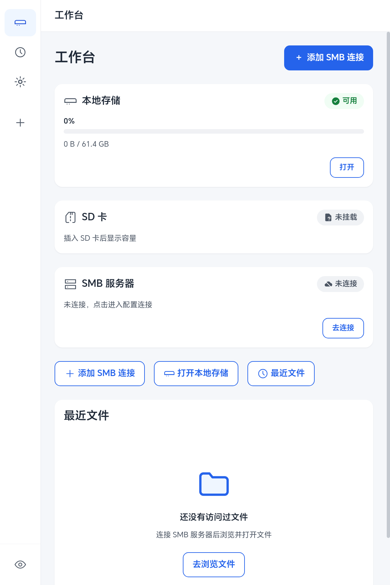
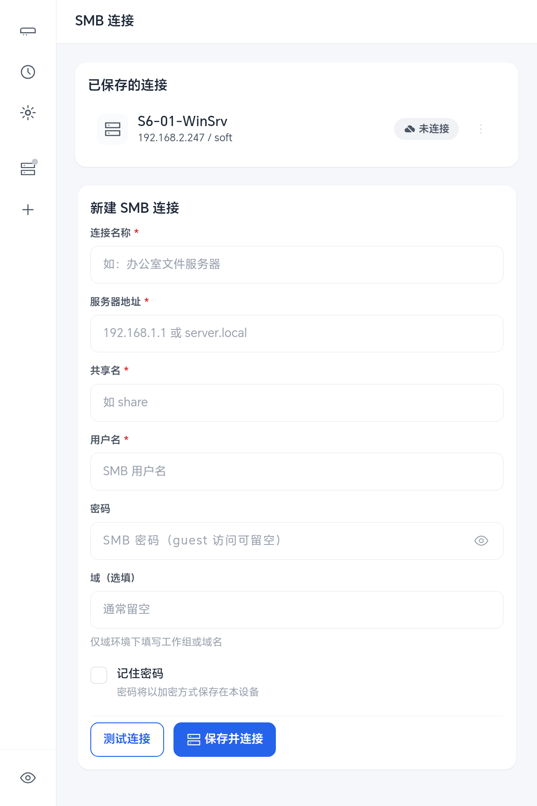
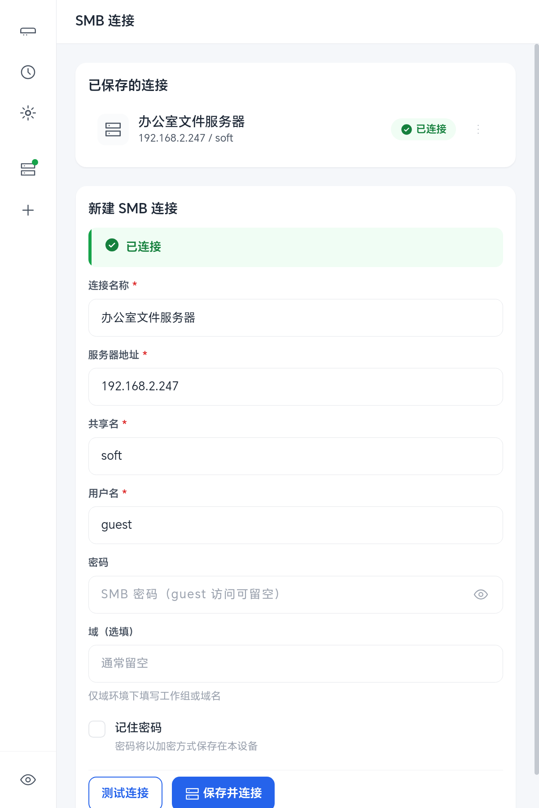
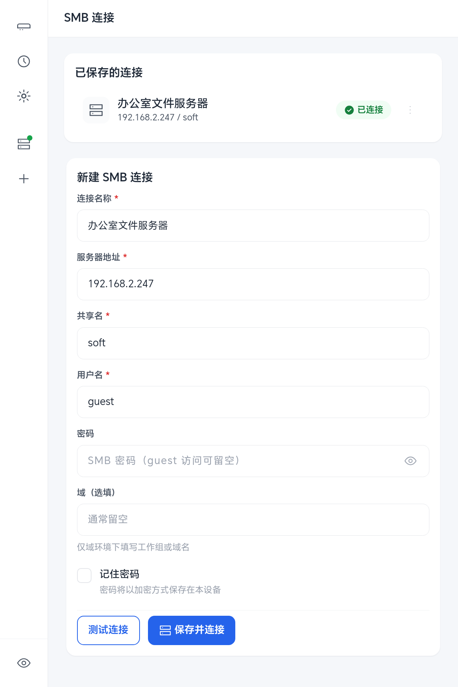
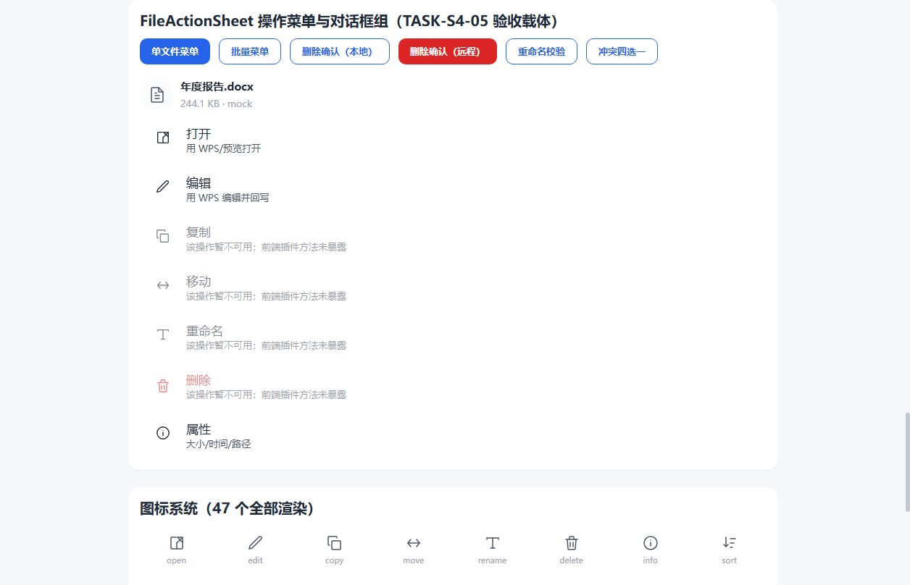
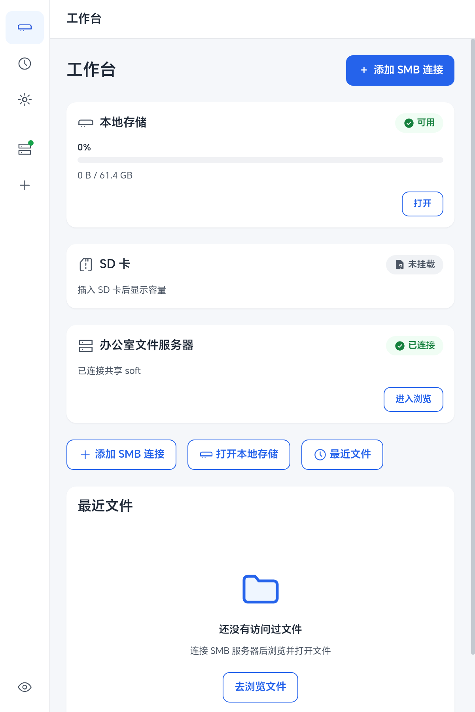
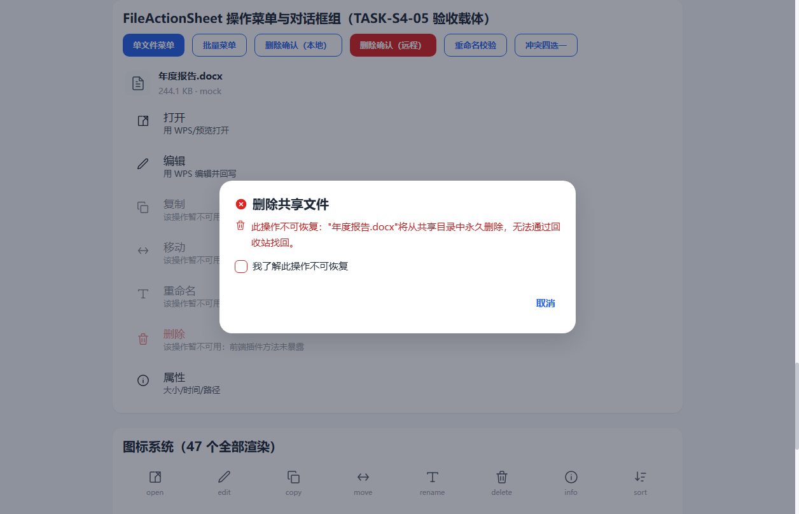
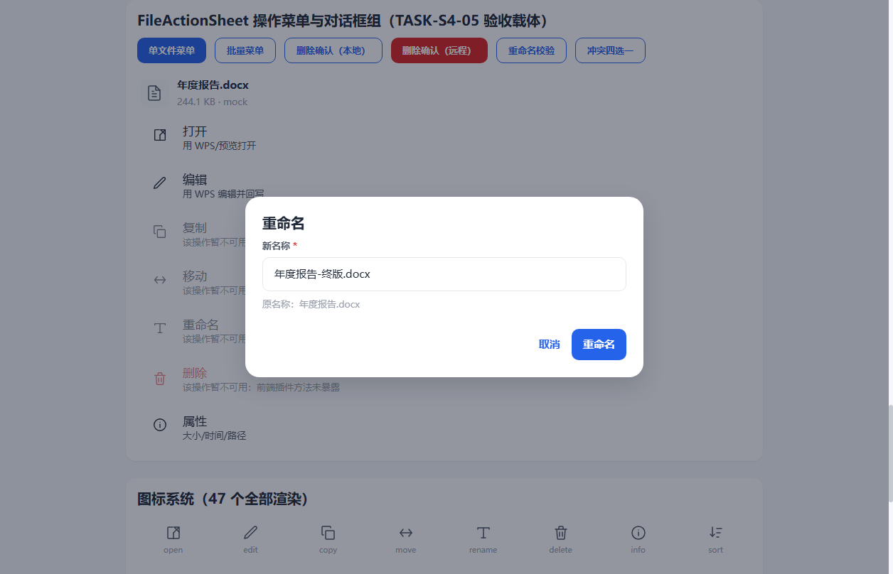
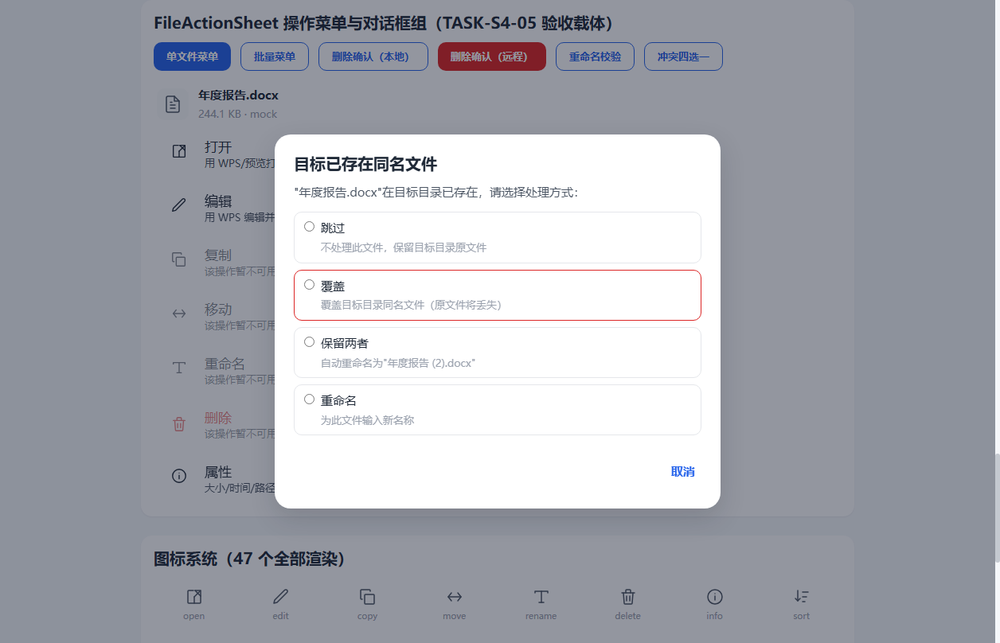

# PAD2 文件管理器

> 安卓平板 SMB 文件管理器——连接 Windows Server / Linux Samba 共享，浏览目录、管理文件、WPS 编辑写回。

## 截图

### 工作台与连接

| 工作台首页 | 连接表单 | 连接成功 |
|:---:|:---:|:---:|
|  |  |  |

### 文件浏览

| 目录列表 | 搜索高亮 | 已连接工作台 |
|:---:|:---:|:---:|
|  |  |  |

### 文件操作

| 操作菜单 | 删除确认 | 重命名 | 冲突处理 |
|:---:|:---:|:---:|:---:|
|  |  |  |  |

### 设置与验证

| 设置页 | M2 验证页 |
|:---:|:---:|
|  |  |

---

## 功能特性

### 连接管理
- **多服务器配置**：保存多个 SMB 连接配置（Windows Server / Linux Samba），冷启动后一键重连
- **guest/空密码支持**：支持 guest 匿名访问场景（如 Windows Server guest 共享）
- **记住密码加密存储**：勾选"记住密码"时经 AES-GCM 加密落盘，不可用时防御性降级
- **连接状态反馈**：连接中/成功/失败三态即时反馈（≤1s），失败持久呈现可重试
- **防重入**：连接在途时重复点击不会产生多次连接请求

### 文件浏览
- **目录浏览**：支持中文文件名/目录名正确显示
- **搜索**：实时搜索当前目录文件，匹配高亮
- **排序**：按名称/大小/修改时间/类型排序，目录置顶
- **虚拟列表**：5000+ 文件流畅滚动（虚拟化渲染）
- **长按多选**：长按文件进入多选模式，批量操作

### 文件操作
- **复制**：服务器端复制，SHA-256 校验目标完整性
- **移动**：先复制校验通过再删源（安全序，不确定状态不删源）
- **重命名**：服务端原子操作，目标冲突时拒绝覆盖（两文件内容不变）
- **删除**：远端删除二次确认（不可恢复 danger 警告）；本地删除（回收站可恢复）
- **冲突防覆盖**：复制/重命名目标已存在时服务端原子拒绝，无未授权覆盖

### WPS 编辑写回
- **.xlsx / .xls 双格式**：分别独立验证写回闭环
- **三方一致**：编辑源 == 本地缓存 == 服务器端 SHA-256
- **内容级核验**：服务器端 csv 内容标记确认
- **冲突检测**：服务器端文件被外部修改时识别冲突，不盲目覆盖
- **断网如实失败**：断网时写回如实失败不伪成功，源文件零污染

### 异常处理
- **错误凭据**：auth_failed 统一文案"用户名或密码不正确"（不区分具体哪项，避免探测）
- **网络不可达**：网络类文案+按钮恢复可重试
- **断网恢复**：wifi 恢复后重连+目录刷新含服务器最新文件
- **只读保护**：只读属性文件删除被服务端拒绝（smbclient 与 SMBJ 行为一致）

---

## 快速开始

### 环境要求
- Android 8.0+（API 26+）
- SMB 共享服务端（Windows Server / Linux Samba）
- WPS Office（用于编辑 .xlsx / .xls 文件）

### 安装
```bash
adb install -r pad2-p003-s6-05-fix.apk
```
> 荣耀设备安装时需在弹窗中勾选确认复选框→"继续安装"。

### 配置连接
1. 打开 App → 工作台 → "添加连接"
2. 填写连接名称 / 服务器地址 / 共享名 / 用户名
3. 密码留空（guest 访问）或填写 SMB 密码
4. 点击"保存并连接"→ 连接成功后自动进入文件浏览

### 编辑文件
1. 在文件列表中点击 .xlsx / .xls 文件
2. WPS 打开编辑 → 保存 → 返回 App
3. App 自动检测本地变更并写回服务器（三方 SHA-256 校验）

---

## 产品说明

### 适用场景
- **企业内网文件管理**：连接 Windows Server / Linux Samba 共享，在平板上浏览和管理办公文件
- **移动办公编辑**：在平板上用 WPS 编辑 Excel 文件，自动写回服务器
- **guest 共享访问**：支持 Windows Server guest 空密码场景（如自动备份目录）

### 已验证环境

| 维度 | 已验证范围 |
|---|---|
| SMB 服务端 | Windows Server（SMB 3.1.1，guest/空密码）+ Linux Samba（pad2gate3 账号） |
| 设备 | 荣耀 NDL2_W09 / Android 16 |
| WPS | 14.25.0（cn.wps.moffice_eng） |
| 文件格式 | .xlsx / .xls 编辑写回（三方 SHA-256 + 内容级核验） |

### 未验证环境（不在兼容性承诺内）
- NAS SMB 服务端
- Android Doze / 厂商省电策略深度场景
- 其他厂商设备 / Android 版本 / WPS 版本
- 混合分隔符路径输入（产品 UI 正常路径不触发）

### 已知限制
- **R-1 界面回显**：编辑已存密码的配置时"记住密码"复选框不回显（纯体验项，无凭据泄露）
- **R-2 路径分隔符**：API 层直接传入混合分隔符（`/` 与 `\` 混用）路径时写回必败（产品 UI 正常浏览路径纯反斜杠不触发）
- **R-3 DELETE_PENDING**：Windows Server 上失败的 rename 留 pending tombstone，连接断开后延迟生效（运维排障以当时核验为准）

### 安全特性
- **凭据保护**：密码经 AES-GCM 加密落盘（仅勾选"记住密码"时）；日志零凭据泄露（Capacitor 桥日志已关闭 loggingBehavior:'none'）
- **三态密码语义**：空密码（empty_credential）/ 未保存（unset）/ 已记住（remembered）三态可区分
- **fail-secure**：密文格式非法时静默清除并要求重新输入
- **release 构建**：非 DEBUGGABLE，v1+v2 签名

---

<details>
<summary><b>技术细节（开发者 / PM）</b></summary>

### 技术栈
- **前端**：React 18 + TypeScript + Vite + Zustand（状态管理）
- **移动框架**：Capacitor 8（Android 原生桥接）
- **SMB 协议**：SMBJ 0.12.1（Java SMB2/3 客户端）
- **Android 原生**：Java（SmbClient / SmbPlugin / WpsDeliveryHandler）
- **加密**：Web Crypto API（AES-GCM）+ Capacitor Preferences（持久化）

### 架构
```
UI 组件（React）
    ↓ 不直接 import SmbPlugin
Store 层（Zustand：smbConnectionStore / smbProfilesStore / browseStore / operationStore / editSessionStore）
    ↓ 唯一调用入口
Adapter 层（SmbPlugin.ts → registerPlugin proxy）
    ↓ Capacitor bridge
Android 原生（SmbPlugin.java → SmbClient.java → SMBJ）
```

### 状态机
- **连接六态**：disconnected → connecting → connected / connect_failed / session_invalid / network_interrupted
- **操作七态**：idle → pending → in_progress → success / failed / partial_failed / cancelled / conflict
- **编辑会话**：idle → session_active → save_detected → writeback_verified / writeback_failed / session_terminated

### 验证状态
- **S5 集成回归**：PASS（八条链路 I-01~I-08 全 PASS）
- **S6-01 Windows Server P0**：PASS（WS-01~20 全 PASS）
- **S6-01-FIX-01**：PASS（guest/空密码 UI 修复+S1~S10 全 PASS）
- **S6-04-RC-VERIFY**：PASS（发布候选验证六步全 PASS）
- **S6-05-FIX**：PASS（凭据泄露修复+release 构建链+T6 零泄露+T7 RC 全量 PASS）
- **S6-05-FINAL-APPROVAL**：PASS（生产发布门 OPEN）

### 当前 APK
- **文件**：`pad2-p003-s6-05-fix.apk`
- **SHA-256**：`d6d75d2028bae7600ecf388ea8602c0001d9d36108e93d14617a71d823f099e8`
- **构建**：release（非 DEBUGGABLE）
- **签名**：v1+v2（debug keystore 受控部署密钥——正式发布须换发布密钥）
- **版本**：1.0（versionCode=1，minSdk=26，targetSdk=36）

### 部署边界
- **受控部署范围**：Windows Server SMB + 荣耀 NDL2_W09 + Android 16 + WPS 14.25.0
- **生产发布门**：OPEN（PM 批准）
- **正式生产部署**：待 PM 单独授权（TASK-S6-06 受控部署执行方案已编制）

### 回滚基线
- **APK**：`pad2-p003-s5-06c-trial.apk`
- **SHA-256**：`e7a67ee5d5f537c59784cbf90453d5137d3c13b7cfe0c0d95cda0b20aaf1ee7b`
- **注意**：跨轨回滚（release→debug）签名不同须先卸载，卸载重置 All files access 须重新授予

### 项目文档
- 设计规格：`docs/p003-ui/spec.md` + `docs/p003-ui/design.md`
- 任务清单：`docs/p003-ui/tasks.md`
- 验证报告：`docs/p003-ui/s6-05-fix-verification.md` + `docs/p003-ui/s6-05-final-approval.md`
- 部署方案：`docs/p003-ui/s6-06-deployment-plan.md`

</details>

---

## 许可证

本项目为内部受控部署项目，未公开授权。