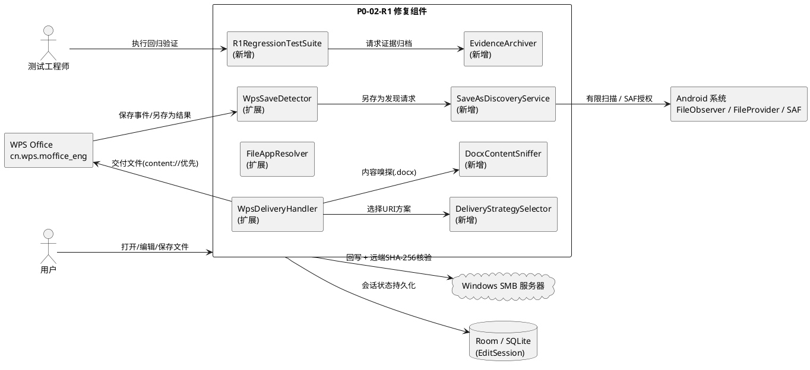
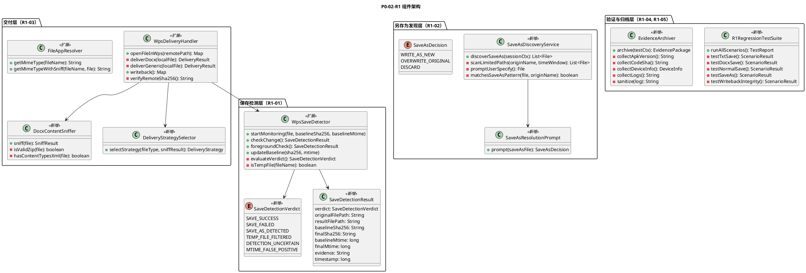
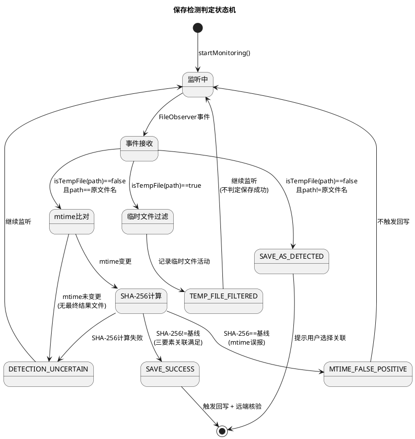
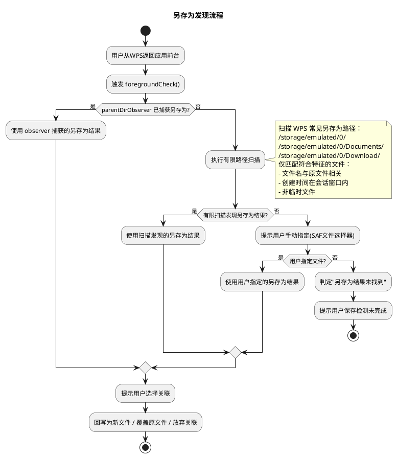
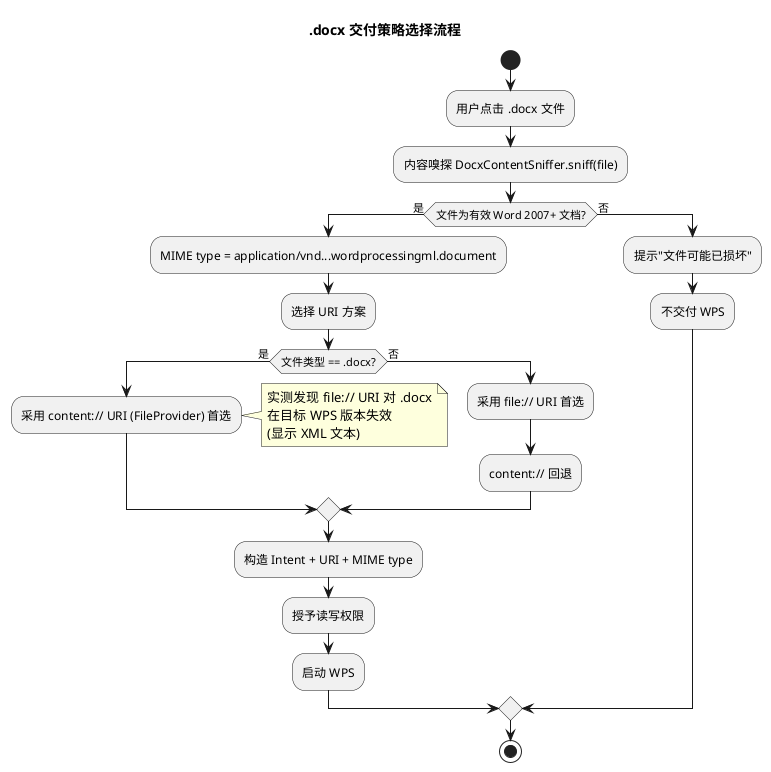
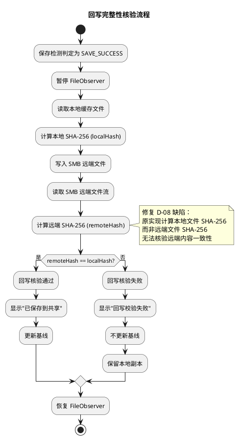
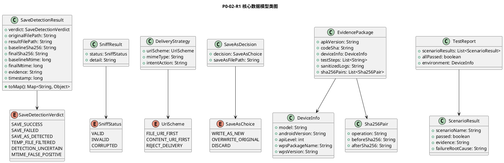
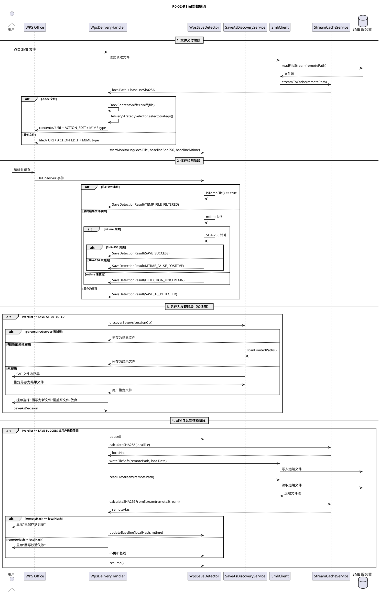
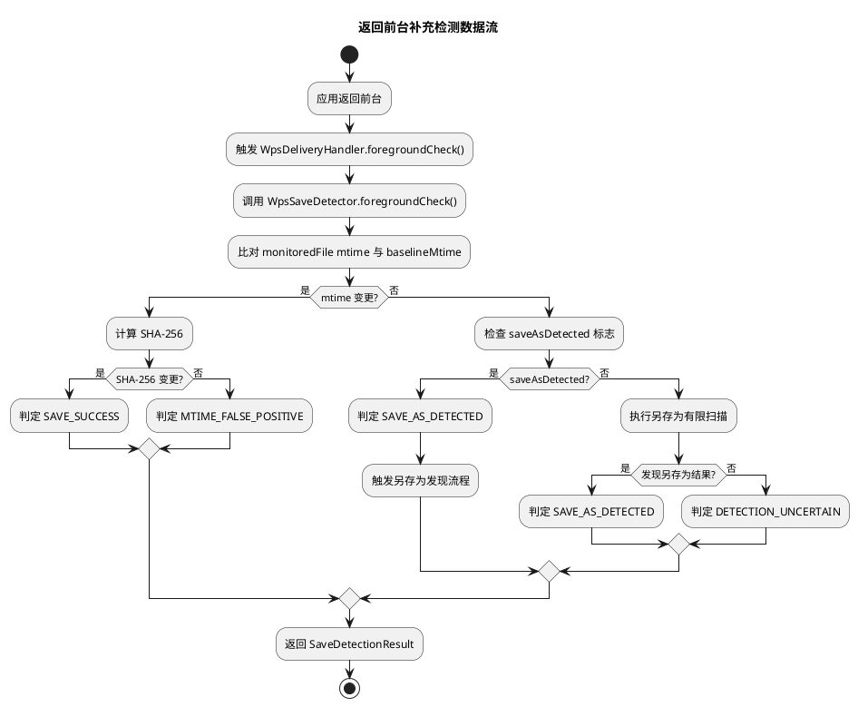

# P0-02-R1 技术设计文档：WPS Save Detection & MIME Compatibility

> 本文档为 P0-02-R1 修复任务的实现方案，基于 `docs/p0-02-r1/spec.md` 需求规格（R1-01 ~ R1-05 EARS 需求与验收标准）、PM Gate Review 裁定（P0-02 = HOLD / FIX REQUIRED）与 2026-10-16 Honor NDL2-W09 平板实测发现生成。文档将三类核心缺陷（保存检测误判、另存为漏检、.docx MIME 交付失效）的根因分析转化为可落地的增量架构设计，并明确 PM 三项关键技术约束的遵从方式。

---

# 一、需求与存量功能关系分析

## 1.1 需求功能与存量功能对比

本修复任务针对 P0-02（WPS 保存变更检测）在真实平板实测中暴露的三类缺陷，对存量代码进行定向修复。存量代码基线为 commit 792a9e0（诊断性改进），经 PM Gate Review 裁定为 HOLD / FIX REQUIRED。以下对 R1-01 ~ R1-05 五个子项与存量代码逐项匹配。

### 1.1.1 已实现功能

| 需求功能 | 存量功能 | 代码位置 | 匹配度 |
|---------|---------|---------|--------|
| FileObserver 三层监控 | fileObserver（文件本身）+ dirObserver（smb_cache 目录）+ parentDirObserver（PAD2 目录） | `WpsSaveDetector.java:62-134` | 75% |
| mtime + SHA-256 双重判定 | checkChange() 方法比对 mtime 后计算 SHA-256 | `WpsSaveDetector.java:168-210` | 75% |
| 临时文件过滤 | isTempFile() 过滤 `~$`/`.tmp`/`.temp`/`.moffice_wr_check`/`.~lock` | `WpsSaveDetector.java:235-243` | 50% |
| 另存为检测 | dirObserver/parentDirObserver 检测文件名不同的新文件 | `WpsSaveDetector.java:89-95, 124-128` | 25% |
| 暂停/恢复监控 | pause()/resume() 控制 paused 标志 | `WpsSaveDetector.java:158-166` | 100% |
| 前台补充检测 | foregroundCheck() 方法 | `WpsSaveDetector.java:212-215` | 75% |
| file:// URI 交付 | Uri.fromFile() + ACTION_EDIT | `WpsDeliveryHandler.java:75, 93-96` | 50% |
| FileProvider content:// 回退 | startActivity 异常时回退到 FileProvider | `WpsDeliveryHandler.java:137-174` | 75% |
| MIME type 映射 | getMimeType() 基于扩展名映射 | `FileAppResolver.java:120-156` | 50% |
| WPS 应用解析 | queryIntentActivities + WPS 包名回退 | `FileAppResolver.java:30-80, 95-106` | 100% |
| 流式缓存 + SHA-256 | streamToCache() + calculateSHA256() | `StreamCacheService.java:30-81, 111-126` | 100% |
| 回写 + 校验 | writeback() 方法含本地 SHA-256 校验 | `WpsDeliveryHandler.java:197-243` | 50% |
| FileProvider 路径配置 | external-path + cache-path + external-files-path | `file_paths.xml:2-4` | 100% |
| MANAGE_EXTERNAL_STORAGE 权限 | AndroidManifest 已声明 | `AndroidManifest.xml:62` | 100% |

**匹配度判定依据**：
- **100%**：存量实现完全满足 R1 需求验收条件，可直接复用。
- **75%**：核心机制存在但需补充判定逻辑或扩展覆盖范围。
- **50%**：基础能力存在但关键缺陷未修复，需较大改造。
- **25%**：仅有初步框架，核心逻辑缺失。

### 1.1.2 需要扩展的功能

| 需求功能 | 存量功能 | 差异说明 | 扩展方向 |
|---------|---------|---------|---------|
| R1-01 保存检测三要素关联判定 | checkChange() 仅比对原文件 mtime + SHA-256 | 存量缺少明确的判定结果枚举（保存成功/检测不确定/保存未完成/mtime 误报）；仅凭 contentChanged 布尔标志无法区分"检测不确定"与"保存未完成"；dirObserver 检测到新文件时未计算 SHA-256 | 引入 SaveDetectionVerdict 枚举；重构 checkChange() 返回结构化判定对象；对另存为结果文件计算 SHA-256 |
| R1-01 临时文件指纹扩展 | isTempFile() 覆盖 5 种模式 | 存量未覆盖数字命名临时文件（如 `-486781428.-1908999883225750862`），实测发现该类临时文件未被过滤 | 扩展 isTempFile() 正则匹配数字命名模式 |
| R1-02 另存为跨目录发现 | parentDirObserver 监控 PAD2 目录 | 存量 parentDirObserver 监控 `/storage/emulated/0/PAD2/`，实测发现 WPS 将 .txt 另存为 .doc 到 `/storage/emulated/0/` 根目录，超出监控范围 | 新增返回前台时有限扫描机制 + SAF 用户手动指定回退，不持续全盘监控 |
| R1-02 另存为用户选择 | checkLocalFileChanged() 仅返回 saveAsPrompt 字符串 | 存量未提供结构化的用户选择交互（回写为新文件/覆盖原文件/放弃关联） | 新增另存为关联决策接口与用户交互流程 |
| R1-03 .docx content:// 首选交付 | file:// 首选 + content:// 回退 | 存量以 file:// 为首选，实测发现 file:// 对 .docx 在目标 WPS 版本失效（显示 XML 文本）；回退仅在 startActivity 抛异常时触发，WPS 显示 XML 文本不抛异常 | 对 .docx 文件改为 content:// 首选；新增内容嗅探验证 |
| R1-03 内容嗅探验证 | 无 | 存量仅凭扩展名设置 MIME type，未验证文件实际内容为有效 Word 2007+ 文档 | 新增 DocxContentSniffer 内容嗅探组件 |
| R1-03 渲染异常检测 | 无 | 存量无法检测 WPS 渲染异常（显示 XML 文本而非 Word 文档） | 新增交付后用户反馈机制与渲染异常提示 |
| R1-04 回归测试套件 | 无 | 存量无结构化回归测试套件 | 新增 R1RegressionTestSuite 覆盖五类场景 |
| R1-05 证据归档器 | 无 | 存量仅有 eventLog 内存记录，无完整证据归档包 | 新增 EvidenceArchiver 组件收集六要素 |
| 回写远端 SHA-256 核验 | writeback() 中 verifyHash 计算本地文件而非远端文件 | 存量 `verifyHash = StreamCacheService.calculateSHA256(currentLocalFile)` 计算的是本地文件 SHA-256，与 localHash 必然相等，无法核验远端文件内容 | 修复为读取 SMB 远端文件计算 SHA-256 进行核验 |

### 1.1.3 需要新增的功能或接口

**模块 A：保存检测判定（R1-01）**
- **A1 SaveDetectionVerdict 枚举**：保存检测判定结果枚举（SAVE_SUCCESS / SAVE_FAILED / SAVE_AS_DETECTED / TEMP_FILE_FILTERED / DETECTION_UNCERTAIN / MTIME_FALSE_POSITIVE）。输入：检测信号集合；输出：判定结果 + 判定依据。核心逻辑：三要素关联评估。依赖：WpsSaveDetector。
- **A2 SaveDetectionResult 结构**：结构化判定结果对象，含判定枚举、关联原文件路径、最终结果文件路径、基线 SHA-256、最终 SHA-256、基线 mtime、最终 mtime、判定依据、判定时间戳。依赖：SaveDetectionVerdict。

**模块 B：另存为发现与关联（R1-02）**
- **B1 SaveAsDiscoveryService**：另存为结果发现服务，含返回前台时有限扫描 + SAF 用户手动指定回退。输入：编辑会话上下文（原文件名、会话时间窗口）；输出：另存为结果文件列表或用户指定文件。核心逻辑：有限路径扫描 + 文件特征匹配 + SAF 回退。依赖：EditSessionManager、StreamCacheService。
- **B2 SaveAsResolutionPrompt**：另存为关联决策交互，提示用户选择"回写为新文件/覆盖原文件/放弃关联"。输入：另存为结果文件；输出：用户决策。依赖：前端交互层。

**模块 C：.docx MIME 兼容交付（R1-03）**
- **C1 DocxContentSniffer**：.docx 内容嗅探组件，验证文件为有效 Word 2007+ 文档（ZIP 格式 + `[Content_Types].xml` 存在）。输入：本地文件；输出：嗅探结果（有效/无效/损坏）。依赖：java.util.zip。
- **C2 DeliveryStrategySelector**：交付策略选择器，根据文件类型与实测兼容性选择 URI 方案（file:// 或 content://）。输入：文件类型、内容嗅探结果；输出：交付策略。依赖：DocxContentSniffer、兼容性配置。

**模块 D：回归验证与证据归档（R1-04, R1-05）**
- **D1 R1RegressionTestSuite**：R1 回归测试套件，覆盖五类场景（.txt 保存、.docx 保存、普通保存、另存为、回写完整性）。输入：测试环境配置；输出：测试报告。依赖：WpsDeliveryHandler、WpsSaveDetector、SmbClient。
- **D2 EvidenceArchiver**：证据归档器，收集六要素（APK 版本、代码 SHA、设备信息、测试步骤、日志、前后 SHA-256）。输入：测试执行上下文；输出：证据归档包。依赖：BuildConfig、Git、DeviceInfo、LogCollector。

## 1.2 存量功能详细分析

### 1.2.1 WpsSaveDetector 保存检测逻辑

**接口契约**：
- `startMonitoring(File file, String baselineSha256, long baselineMtime)`：启动监控，入参为缓存文件、基线 SHA-256、基线 mtime，无返回值，副作用为启动三个 FileObserver。
- `checkChange()`：检测变更，无入参，返回 `Map<String, Object>`（含 changed/mtimeChanged/contentChanged/saveAsDetected 等字段），副作用为更新内部状态标志。
- `foregroundCheck()`：前台补充检测，无入参，返回 `Map<String, Object>`，当前实现仅委托 checkChange()。

**业务规则**：
- fileObserver 监控文件本身的 MODIFY/CLOSE_WRITE/MOVED_TO 事件，触发 checkChange()。
- dirObserver 监控 smb_cache 目录，对临时文件过滤（isTempFile），对文件名不同的非临时文件标记 saveAsDetected，对文件名相同的非临时文件触发 checkChange()。
- parentDirObserver 监控 PAD2 目录（grandparentDir），对文件名不同的非临时文件标记 saveAsDetected。
- checkChange() 比对 monitoredFile.lastModified() 与 baselineMtime，mtime 变更时计算 SHA-256 并比对 baselineSha256。

**约束**：
- paused 标志控制所有 observer 的 onEvent 是否处理事件。
- eventLog 上限 100 条，溢出时移除最早记录。

**缺陷与根因**：

| 缺陷编号 | 缺陷描述 | 根因分析 | 对应子项 |
|---------|---------|---------|---------|
| D-01 | 数字命名临时文件未过滤 | `isTempFile()` 仅覆盖 5 种模式（`~$`/`.tmp`/`.temp`/`.moffice_wr_check`/`.~lock`），未覆盖 WPS 生成的数字命名临时文件（如 `-486781428.-1908999883225750862`），该类文件被 dirObserver 误判为另存为结果 | R1-01 |
| D-02 | 保存检测缺少明确判定枚举 | checkChange() 返回 contentChanged/mtimeChanged 布尔标志，无法区分"检测不确定"（仅临时文件活动）、"保存未完成"（最终结果文件未出现）、"mtime 误报"（mtime 变更但 SHA-256 未变更）三种情况 | R1-01 |
| D-03 | dirObserver 另存为结果未计算 SHA-256 | dirObserver 检测到文件名不同的非临时文件时，仅设置 saveAsDetected/saveAsFileName，未对新文件计算 SHA-256，无法验证内容变更 | R1-01, R1-02 |
| D-04 | parentDirObserver 监控范围不足 | parentDirObserver 监控 `grandparentDir`（`/storage/emulated/0/PAD2/`），实测发现 WPS 将 .txt 另存为 .doc 到 `/storage/emulated/0/` 根目录，超出监控范围 | R1-02 |
| D-05 | 另存为缺少用户选择交互 | checkLocalFileChanged() 仅返回 saveAsPrompt 字符串提示，未提供结构化的用户决策流程（回写为新文件/覆盖原文件/放弃关联） | R1-02 |

### 1.2.2 WpsDeliveryHandler 交付与回写逻辑

**接口契约**：
- `openFileInWps(String remotePath)`：交付文件给 WPS，入参为 SMB 远端路径，返回 `Map<String, Object>`（含 intentLaunched/uri/mimeType 等），副作用为启动 WPS + 创建编辑会话 + 启动保存监控。
- `writeback()`：回写本地变更到 SMB，无入参，返回 `Map<String, Object>`（含 writebackSuccess/localHash/verifyHash），副作用为写入 SMB 远端文件。

**业务规则**：
- 首选 `Uri.fromFile(localFile)`（file:// URI）+ ACTION_EDIT 交付。
- startActivity 抛异常时回退到 FileProvider content:// URI。
- writeback() 暂停监控 → 读取本地文件 → 写入 SMB → 计算校验 SHA-256 → 更新基线 → 恢复监控。

**约束**：
- 交付前检查缓存空间（checkCacheSpace）。
- 回写期间暂停 FileObserver 避免回写事件触发误判。

**缺陷与根因**：

| 缺陷编号 | 缺陷描述 | 根因分析 | 对应子项 |
|---------|---------|---------|---------|
| D-06 | file:// URI 对 .docx 交付失效 | WPS 通过 file:// URI + ACTION_EDIT + 正确 MIME type 打开 .docx 时显示原始 XML/ZIP 文本而非 Word 文档渲染。根因为目标 WPS 版本（cn.wps.moffice_eng）对 file:// URI 的 .docx 处理存在兼容性问题，可能因 file:// URI 缺少 FileProvider 授权机制导致 WPS 无法正确解析文件类型 | R1-03 |
| D-07 | content:// 回退条件不足 | 回退仅在 startActivity 抛异常时触发，但 WPS 显示 XML 文本不抛异常，导致回退逻辑无法生效 | R1-03 |
| D-08 | 回写校验计算错误 | `writeback()` 中 `verifyHash = StreamCacheService.calculateSHA256(currentLocalFile)` 计算的是本地文件 SHA-256 而非 SMB 远端文件 SHA-256，与 localHash 必然相等，无法核验远端文件内容是否一致 | R1-01（PM 约束 3） |
| D-09 | MIME type 仅凭扩展名 | `FileAppResolver.getMimeType()` 基于扩展名映射，未做内容嗅探验证，无法检测文件扩展名与实际内容不匹配的情况 | R1-03 |

### 1.2.3 FileAppResolver 应用解析逻辑

**接口契约**：
- `resolveApp(String fileName, Uri uri)`：解析可处理文件的应用，入参为文件名与 URI，返回 `Map<String, Object>`（含 resolved/packageName/isWps 等）。
- `getMimeType(String fileName)`：静态方法，基于扩展名映射 MIME type。

**业务规则**：
- 构造 ACTION_EDIT Intent，queryIntentActivities 查询可处理应用。
- 查询结果为空时回退到 WPS 包名（遍历 WPS_PACKAGES 检查安装）。
- 查询结果非空时优先选择 WPS 应用。

**约束**：
- WPS_PACKAGES 含三个包名：`com.tencent.wps`、`cn.wps.moffice_eng`、`cn.wps.moffice`。
- AndroidManifest 已声明 `<queries>` 对 WPS 包名的可见性。

**缺陷与根因**：

| 缺陷编号 | 缺陷描述 | 根因分析 | 对应子项 |
|---------|---------|---------|---------|
| D-10 | MIME type 缺少内容嗅探 | getMimeType() 仅凭扩展名映射，未验证文件实际内容。对于 .docx 文件，未验证其为有效 Word 2007+ 文档（ZIP 格式 + OOXML 结构） | R1-03 |

### 1.2.4 StreamCacheService 缓存逻辑

**接口契约**：
- `streamToCache(String remotePath)`：流式缓存 SMB 文件到本地，入参为远端路径，返回 `Map<String, Object>`（含 localPath/sha256/size 等）。
- `calculateSHA256(File file)`：静态方法，计算文件 SHA-256。

**业务规则**：
- 缓存目录为 `/storage/emulated/0/PAD2/smb_cache/`。
- 流式读取 SMB 文件 + 分块写入本地 + 流式计算 SHA-256。
- 分块大小 8MB（CHUNK_SIZE）。

**约束**：
- 缓存空间不足时 checkCacheSpace 返回 false。
- clearCache 清理缓存时保留 `~$` 前缀和 `.tmp` 后缀文件。

**缺陷与根因**：

| 缺陷编号 | 缺陷描述 | 根因分析 | 对应子项 |
|---------|---------|---------|---------|
| D-11 | 缓存目录与 WPS 另存为路径不一致 | 缓存目录为 `/storage/emulated/0/PAD2/smb_cache/`，但实测发现 WPS 将 .txt 另存为 .doc 到 `/storage/emulated/0/` 根目录，两者不在同一目录树层级，导致 parentDirObserver 无法捕获 | R1-02 |

### 1.2.5 FileProvider 路径配置

**接口契约**：
- `file_paths.xml` 配置 FileProvider 可生成 content:// URI 的路径范围。

**业务规则**：
- `external-path name="my_images" path="."`：覆盖整个外部存储根目录（`/storage/emulated/0/`）。
- `cache-path name="my_cache_images" path="."`：覆盖应用缓存目录。
- `external-files-path name="my_external_files" path="."`：覆盖应用外部文件目录。

**约束**：
- FileProvider authority 为 `${applicationId}.fileprovider`。
- AndroidManifest 已配置 FileProvider + grantUriPermissions。

**分析**：FileProvider 路径配置已覆盖外部存储根目录，可为 smb_cache 中的文件生成 content:// URI，R1-03 的 content:// 交付方案无需修改 file_paths.xml。
---

# 二、增量设计方案

## 2.1 实现模型

### 2.1.1 上下文视图



### 2.1.2 服务/组件总体架构



### 2.1.3 实现设计文档

#### 保存检测状态机（R1-01）

保存检测判定引入六态枚举，替代现有的 contentChanged/mtimeChanged 布尔标志。状态迁移由 FileObserver 事件 + mtime 比对 + SHA-256 比对共同驱动。



#### 另存为发现流程（R1-02）

采用"返回前台时有限扫描 + SAF 用户手动指定回退"策略，不持续监控整个根目录。



#### .docx 交付策略选择（R1-03）



#### 回写完整性核验流程（PM 约束 3）



## 2.2 接口设计

### 2.2.1 总体设计

| 接口分类 | 接口名称 | 稳定性等级 | 变更类型 |
|---------|---------|---------|---------|
| 保存检测 | WpsSaveDetector.checkChange() | 稳定 | 扩展返回类型 |
| 保存检测 | WpsSaveDetector.foregroundCheck() | 稳定 | 扩展返回类型 |
| 保存检测 | WpsSaveDetector.isTempFile() | 稳定 | 扩展匹配模式 |
| 另存为发现 | SaveAsDiscoveryService.discoverSaveAs() | 实验（新增） | 新增接口 |
| 另存为决策 | SaveAsResolutionPrompt.prompt() | 实验（新增） | 新增接口 |
| 交付 | WpsDeliveryHandler.openFileInWps() | 稳定 | 扩展内部逻辑 |
| 交付 | WpsDeliveryHandler.writeback() | 稳定 | 修复核验逻辑 |
| 内容嗅探 | DocxContentSniffer.sniff() | 实验（新增） | 新增接口 |
| 交付策略 | DeliveryStrategySelector.selectStrategy() | 实验（新增） | 新增接口 |
| MIME type | FileAppResolver.getMimeTypeWithSniff() | 实验（新增） | 新增接口 |
| 回归测试 | R1RegressionTestSuite.runAllScenarios() | 实验（新增） | 新增接口 |
| 证据归档 | EvidenceArchiver.archive() | 实验（新增） | 新增接口 |

### 2.2.2 接口清单

#### WpsSaveDetector.checkChange()（扩展）

**接口签名**：
```java
public SaveDetectionResult checkChange()
```

**业务说明**：检测缓存文件变更，返回结构化判定结果（含六态枚举 + 三要素关联证据），替代原 `Map<String, Object>` 返回类型。

**前置条件**：startMonitoring() 已调用，monitoredFile 非空。

**后置条件**：返回 SaveDetectionResult，含判定枚举、关联原文件路径、最终结果文件路径、基线/最终 SHA-256 与 mtime、判定依据、判定时间戳。

**异常映射**：SHA-256 计算失败 → verdict = DETECTION_UNCERTAIN，evidence 含异常信息。

**判定逻辑**：
1. 比对 monitoredFile.lastModified() 与 baselineMtime。
2. mtime 未变更 → DETECTION_UNCERTAIN（无最终结果文件变更）。
3. mtime 变更 → 计算 SHA-256。
4. SHA-256 == baselineSha256 → MTIME_FALSE_POSITIVE（mtime 误报）。
5. SHA-256 != baselineSha256 → SAVE_SUCCESS（三要素关联满足）。
6. saveAsDetected == true → SAVE_AS_DETECTED（另存为已发现）。

#### WpsSaveDetector.isTempFile()（扩展）

**接口签名**：
```java
public static boolean isTempFile(String fileName)
```

**业务说明**：判断文件名是否为 WPS 临时文件，扩展匹配模式覆盖数字命名临时文件。

**扩展模式**：在现有 5 种模式基础上新增正则匹配 `^-?\d+\.-?\d+$`（数字命名临时文件，如 `-486781428.-1908999883225750862`）。

#### SaveAsDiscoveryService.discoverSaveAs()（新增）

**接口签名**：
```java
public List<File> discoverSaveAs(EditSessionContext sessionCtx)
```

**业务说明**：发现 WPS 另存为结果文件，采用"返回前台时有限扫描 + SAF 用户手动指定回退"策略。

**前置条件**：编辑会话已建立，原文件名与会话时间窗口已知。

**后置条件**：返回另存为结果文件列表（可能为空），或触发 SAF 文件选择器提示用户手动指定。

**核心逻辑**：
1. 检查 parentDirObserver 是否已捕获另存为结果（saveAsDetected）。
2. 若未捕获，执行有限路径扫描：扫描 WPS 常见另存为路径（`/storage/emulated/0/`、`/storage/emulated/0/Documents/`、`/storage/emulated/0/Download/`），匹配符合特征的文件（文件名与原文件相关、创建时间在会话窗口内、非临时文件）。
3. 若有限扫描未发现，触发 SAF 文件选择器提示用户手动指定。
4. 返回发现的另存为结果文件列表。

**约束**：不持续监控整个根目录（PM 约束 1），仅在返回前台时执行有限扫描。

#### DocxContentSniffer.sniff()（新增）

**接口签名**：
```java
public SniffResult sniff(File file)
```

**业务说明**：嗅探 .docx 文件实际内容，验证其为有效 Word 2007+ 文档。

**前置条件**：文件存在且可读。

**后置条件**：返回 SniffResult（VALID / INVALID / CORRUPTED），含嗅探依据。

**核心逻辑**：
1. 检查文件是否为有效 ZIP 格式（读取 ZIP magic number `PK\x03\x04`）。
2. 检查 ZIP 内是否含 `[Content_Types].xml`（OOXML 结构标志）。
3. 两项均满足 → VALID；ZIP 有效但缺 OOXML 结构 → INVALID；ZIP 无效 → CORRUPTED。

#### DeliveryStrategySelector.selectStrategy()（新增）

**接口签名**：
```java
public DeliveryStrategy selectStrategy(String fileType, SniffResult sniffResult)
```

**业务说明**：根据文件类型与内容嗅探结果选择 URI 交付方案。

**核心逻辑**：
1. fileType == "docx" 且 sniffResult == VALID → CONTENT_URI_FIRST（content:// 首选，file:// 回退）。
2. fileType == "docx" 且 sniffResult != VALID → REJECT_DELIVERY（拒绝交付，提示文件损坏）。
3. 其他文件类型 → FILE_URI_FIRST（file:// 首选，content:// 回退，保持现有行为）。

#### WpsDeliveryHandler.writeback()（修复）

**接口签名**：
```java
public Map<String, Object> writeback()
```

**业务说明**：回写本地变更到 SMB 远端，修复远端 SHA-256 核验逻辑。

**修复内容**：将 `verifyHash = StreamCacheService.calculateSHA256(currentLocalFile)` 修复为 `verifyHash = StreamCacheService.calculateSHA256FromStream(smbClient.readFileStream(currentRemotePath))`，即读取 SMB 远端文件流计算 SHA-256，与本地 SHA-256 比对，确认远端文件内容与预期一致。

**前置条件**：保存检测判定为 SAVE_SUCCESS，currentLocalFile 与 currentRemotePath 非空。

**后置条件**：回写成功且远端 SHA-256 核验通过 → writebackSuccess = true；核验失败 → writebackSuccess = false，保留本地副本。

#### FileAppResolver.getMimeTypeWithSniff()（新增）

**接口签名**：
```java
public static String getMimeTypeWithSniff(String fileName, File file)
```

**业务说明**：基于扩展名映射 MIME type 并通过内容嗅探验证一致性。

**核心逻辑**：
1. 调用 getMimeType(fileName) 获取扩展名映射的 MIME type。
2. 若 MIME type 为 .docx 类型，调用 DocxContentSniffer.sniff(file) 验证文件实际内容。
3. 嗅探结果为 VALID → 返回映射的 MIME type。
4. 嗅探结果为 INVALID/CORRUPTED → 返回 null 并记录警告日志。

#### EvidenceArchiver.archive()（新增）

**接口签名**：
```java
public EvidencePackage archive(TestExecutionContext testCtx)
```

**业务说明**：收集六要素生成证据归档包。

**前置条件**：测试已执行，测试上下文含日志与 SHA-256 记录。

**后置条件**：返回 EvidencePackage，含 APK 版本、代码 SHA、设备信息、测试步骤、脱敏日志、前后 SHA-256。

**核心逻辑**：
1. collectApkVersion()：从 BuildConfig 读取 versionName + versionCode。
2. collectCodeSha()：从 Git 读取当前提交 SHA。
3. collectDeviceInfo()：读取设备型号、Android 版本、API 级别、WPS 包名与版本。
4. collectLogs()：收集测试过程结构化日志。
5. sanitize(log)：脱敏处理（移除密码明文、文件内容明文）。
6. 汇总六要素生成 EvidencePackage。
## 2.3 数据模型

### 2.3.1 设计目标

数据模型须支持以下业务场景与目标：

1. **业务场景**：保存检测三要素关联判定、另存为结果发现与用户关联决策、.docx 内容嗅探与交付策略选择、回归测试与证据归档。
2. **性能目标**：保存检测判定响应时间 < 5 秒；另存为发现延迟 < 10 秒；有限路径扫描不持续运行，仅在返回前台时触发。
3. **容量目标**：eventLog 上限 100 条（保持现有）；证据归档包日志脱敏后大小可控。
4. **扩展性目标**：SaveDetectionVerdict 枚举可扩展新判定状态；DeliveryStrategy 可扩展新 URI 方案。
5. **兼容策略**：checkChange() 返回类型从 `Map<String, Object>` 扩展为 SaveDetectionResult，需适配调用方 WpsDeliveryHandler.checkLocalFileChanged()。

### 2.3.2 模型实现



**对象生命周期**：
- SaveDetectionResult：每次 checkChange() 调用时创建，判定完成后返回调用方，生命周期与单次检测一致。
- SniffResult：每次 .docx 交付时创建，交付完成后可丢弃。
- EvidencePackage：每次测试执行时创建，归档后持久化存储，生命周期与测试记录一致。

**持久化策略**：
- SaveDetectionResult：不持久化，仅用于实时判定与日志记录。
- EvidencePackage：持久化为 JSON 文件，存储于应用外部文件目录。
- EditSessionEntity（现有）：会话状态持久化于 Room/SQLite，本修复不修改其 schema。

## 2.4 数据流设计

### 2.4.1 完整数据流：保存检测 → 另存为发现 → 内容核验 → 回写确认



### 2.4.2 返回前台补充检测数据流



## 2.5 风险与缓解

### 2.5.1 R1-01 保存检测关联判定风险

| 风险编号 | 风险描述 | 概率 | 影响 | 缓解措施 |
|---------|---------|------|------|---------|
| R-R1-01-01 | SHA-256 计算耗时超过 5 秒（大文件） | 中 | 中 | 采用流式 SHA-256 计算（现有 calculateSHA256 已流式）；大文件场景在 DFX 约束中单独评估 |
| R-R1-01-02 | FileObserver 事件丢失（内核 inotify 上限） | 低 | 高 | foregroundCheck() 补充检测机制（现有）；返回前台时主动比对 mtime + SHA-256 |
| R-R1-01-03 | checkChange() 返回类型变更导致调用方不兼容 | 高 | 中 | SaveDetectionResult 提供 toMap() 方法保持与现有 Map 接口兼容；WpsDeliveryHandler.checkLocalFileChanged() 同步适配 |
| R-R1-01-04 | 数字命名临时文件正则匹配误过滤合法文件 | 低 | 中 | 正则 `^-?\d+\.-?\d+$` 严格匹配纯数字命名，合法文档文件名不会仅含数字与点 |

### 2.5.2 R1-02 另存为发现风险

| 风险编号 | 风险描述 | 概率 | 影响 | 缓解措施 |
|---------|---------|------|------|---------|
| R-R1-02-01 | 有限路径扫描未覆盖 WPS 实际另存为路径 | 中 | 高 | 提供 SAF 用户手动指定回退；扫描路径列表可配置扩展 |
| R-R1-02-02 | 有限扫描匹配条件过宽导致误识别 | 中 | 中 | 匹配条件组合：文件名与原文件相关 + 创建时间在会话窗口内 + 非临时文件，三重过滤 |
| R-R1-02-03 | SAF 文件选择器用户体验不佳 | 低 | 低 | 提供清晰的引导文案"检测到另存为操作，请选择另存为结果文件" |
| R-R1-02-04 | 另存为格式变更（.txt → .doc）导致 MIME type 不匹配 | 中 | 低 | 另存为结果按实际扩展名设置 MIME type；提示用户格式变更 |

### 2.5.3 R1-03 .docx MIME 兼容交付风险

| 风险编号 | 风险描述 | 概率 | 影响 | 缓解措施 |
|---------|---------|------|------|---------|
| R-R1-03-01 | content:// URI 在目标 WPS 版本仍无法正确渲染 .docx | 低 | 高 | 保留 file:// 回退方案；交付失败时如实报告并提示用户尝试其他应用 |
| R-R1-03-02 | 内容嗅探性能开销（ZIP 解析） | 低 | 低 | 仅对 .docx 文件嗅探；嗅探仅检查 ZIP magic number + `[Content_Types].xml` 存在性，不解压全部内容 |
| R-R1-03-03 | FileProvider content:// URI 权限不足导致 WPS 无法写入 | 低 | 中 | 授予 FLAG_GRANT_READ_URI_PERMISSION + FLAG_GRANT_WRITE_URI_PERMISSION + FLAG_GRANT_PERSISTABLE_URI_PERMISSION |
| R-R1-03-04 | 渲染异常无法自动检测（WPS 显示 XML 文本不抛异常） | 高 | 中 | 提供用户反馈入口"文件未正确渲染？"; 无法自动检测时依赖用户反馈触发替代方案 |

### 2.5.4 R1-04 回归验证风险

| 风险编号 | 风险描述 | 概率 | 影响 | 缓解措施 |
|---------|---------|------|------|---------|
| R-R1-04-01 | WPS UI 自动化保存操作不可靠 | 高 | 高 | spec 已指出 WpsSaveDetector 测试应直接修改缓存文件模拟保存；UI 自动化仅用于交付验证 |
| R-R1-04-02 | 测试环境不可用（设备/WPS 版本变更） | 低 | 高 | 测试前验证设备型号、Android 版本、WPS 包名与版本；环境不符时拒绝执行 |

### 2.5.5 R1-05 证据归档风险

| 风险编号 | 风险描述 | 概率 | 影响 | 缓解措施 |
|---------|---------|------|------|---------|
| R-R1-05-01 | 代码 SHA 与实际代码版本不一致 | 低 | 高 | 证据归档时自动从 Git 读取当前提交 SHA，不依赖手动填写 |
| R-R1-05-02 | 日志脱敏不充分导致敏感信息泄露 | 低 | 高 | 脱敏规则覆盖密码、凭据、文件内容明文；脱敏后日志审查验证 |

## 2.6 PM 约束遵从说明

### 2.6.1 约束 1 遵从：监控范围不得直接扩展到全盘

**约束要求**：不得直接把监控范围扩展到整个 `/storage/emulated/0/` 作为最终方案。

**设计遵从方式**：
1. **不新增持续全盘 FileObserver**：不对外部存储根目录 `/storage/emulated/0/` 新增持续 FileObserver 监控。
2. **保留现有三层监控**：fileObserver（文件本身）+ dirObserver（smb_cache 目录）+ parentDirObserver（PAD2 目录），监控范围不变。
3. **返回前台时有限扫描**：SaveAsDiscoveryService 仅在应用返回前台时（foregroundCheck 触发）执行一次性有限路径扫描，扫描范围为 WPS 常见另存为路径（`/storage/emulated/0/`、`/storage/emulated/0/Documents/`、`/storage/emulated/0/Download/`），扫描完成后即结束，不持续运行。
4. **扫描条件严格过滤**：有限扫描仅匹配符合三重条件的文件（文件名与原文件相关 + 创建时间在会话窗口内 + 非临时文件），避免误识别其他应用文件。
5. **SAF 用户手动指定回退**：有限扫描未发现时，通过 SAF 文件选择器提示用户手动指定另存为结果，不自动扩展监控。
6. **验证依据**：监控方式经 Android 版本（API 36）、存储权限（MANAGE_EXTERNAL_STORAGE）、WPS 实际保存路径（实测 `/storage/emulated/0/`）验证后确定。

**遵从结论**：本设计不持续监控整个根目录，仅在返回前台时执行一次性有限扫描 + SAF 回退，满足 PM 约束 1。

### 2.6.2 约束 2 遵从：.docx 问题不得仅凭扩展名解决

**约束要求**：不得只靠文件扩展名解决 .docx 问题，须核查 URI、MIME type、文件实际内容及访问授权的综合兼容性。

**设计遵从方式**：
1. **内容嗅探（DocxContentSniffer）**：交付 .docx 前验证文件实际内容为有效 Word 2007+ 文档（ZIP 格式 + `[Content_Types].xml` 存在），不仅凭扩展名。
2. **URI 方案评估（DeliveryStrategySelector）**：对 .docx 文件采用 content:// URI（FileProvider）首选方案，基于实测发现 file:// URI 在目标 WPS 版本失效。file:// 方案保留为其他文件类型的首选，经设备实测验证兼容性。
3. **MIME type 核查（getMimeTypeWithSniff）**：MIME type 设置后通过内容嗅探验证与文件实际内容一致。
4. **URI 授权最小化**：content:// URI 仅授予 FLAG_GRANT_READ_URI_PERMISSION + FLAG_GRANT_WRITE_URI_PERMISSION + FLAG_GRANT_PERSISTABLE_URI_PERMISSION，不授予超出编辑所需的权限。
5. **设备实测验证**：content:// 方案须在 Honor NDL2-W09 + Android 16 + WPS cn.wps.moffice_eng 上通过 R1-04 回归验证，证明 .docx 渲染为 Word 文档而非 XML 文本。

**遵从结论**：本设计综合核查 URI 方案、MIME type、文件实际内容与访问授权，不仅凭扩展名，满足 PM 约束 2。

### 2.6.3 约束 3 遵从：保存检测不等于回写成功

**约束要求**：保存检测仅确认本地副本已变更，不等于回写成功，最终须核验 SMB 远端文件内容与预期一致。

**设计遵从方式**：
1. **修复回写核验逻辑（D-08）**：将 writeback() 中 `verifyHash = StreamCacheService.calculateSHA256(currentLocalFile)` 修复为读取 SMB 远端文件流计算 SHA-256，与本地 SHA-256 比对，确认远端文件内容与预期一致。
2. **核验失败不伪报成功**：remoteHash != localHash 时，writebackSuccess = false，显示"回写校验失败"，不显示"已保存到共享"，不更新基线，保留本地副本。
3. **核验通过方更新基线**：仅当 remoteHash == localHash 时，更新基线 SHA-256 与 mtime，显示"已保存到共享"。
4. **保存检测与回写核验分离**：保存检测（SAVE_SUCCESS）仅触发回写流程，不直接标记回写成功；回写成功须远端 SHA-256 核验通过。

**遵从结论**：本设计将回写成功的判据从本地文件 SHA-256 修正为远端文件 SHA-256 核验，满足 PM 约束 3。

## 2.7 架构变更汇总

### 2.7.1 现有类修改清单

| 文件 | 修改类型 | 修改内容 | 对应子项 |
|------|---------|---------|---------|
| `WpsSaveDetector.java` | 扩展 | checkChange() 返回 SaveDetectionResult；isTempFile() 新增数字命名正则；foregroundCheck() 扩展另存为扫描触发 | R1-01, R1-02 |
| `WpsDeliveryHandler.java` | 扩展 + 修复 | openFileInWps() 对 .docx 采用 content:// 首选；writeback() 修复远端 SHA-256 核验；checkLocalFileChanged() 适配 SaveDetectionResult | R1-01, R1-03 |
| `FileAppResolver.java` | 扩展 | 新增 getMimeTypeWithSniff() 方法 | R1-03 |

### 2.7.2 新增类清单

| 类名 | 职责 | 对应子项 |
|------|------|---------|
| `SaveDetectionVerdict` | 保存检测判定结果枚举（六态） | R1-01 |
| `SaveDetectionResult` | 结构化判定结果对象 | R1-01 |
| `SaveAsDiscoveryService` | 另存为结果发现服务（有限扫描 + SAF 回退） | R1-02 |
| `SaveAsResolutionPrompt` | 另存为关联决策交互 | R1-02 |
| `DocxContentSniffer` | .docx 内容嗅探组件 | R1-03 |
| `DeliveryStrategySelector` | 交付策略选择器 | R1-03 |
| `R1RegressionTestSuite` | R1 回归测试套件 | R1-04 |
| `EvidenceArchiver` | 证据归档器 | R1-05 |

### 2.7.3 不修改的配置

| 配置文件 | 原因 |
|---------|------|
| `AndroidManifest.xml` | 已有 MANAGE_EXTERNAL_STORAGE 权限、`<queries>` 声明、FileProvider 配置，无需修改 |
| `file_paths.xml` | `external-path path="."` 已覆盖外部存储根目录，可为 smb_cache 文件生成 content:// URI，无需修改 |