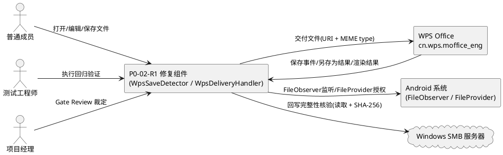
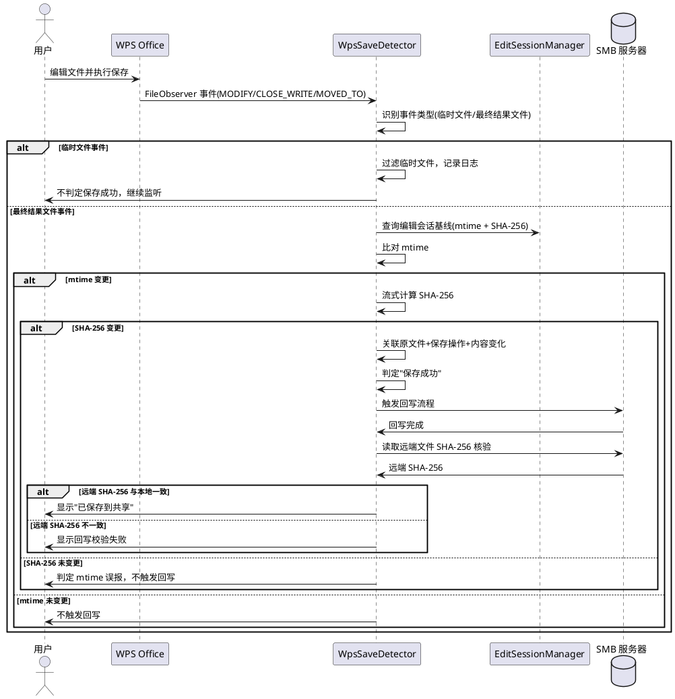
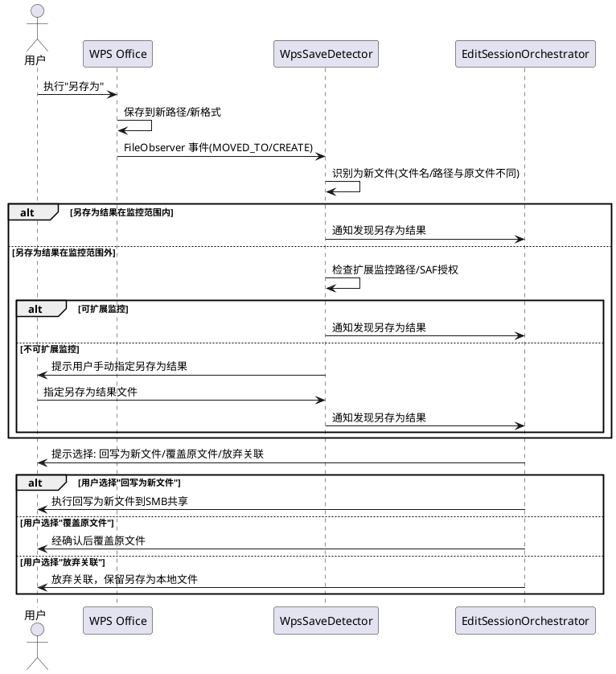
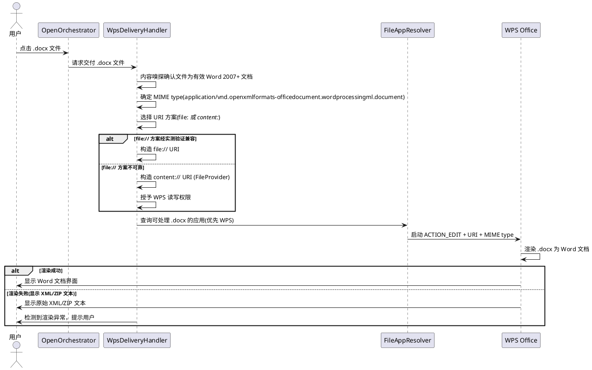
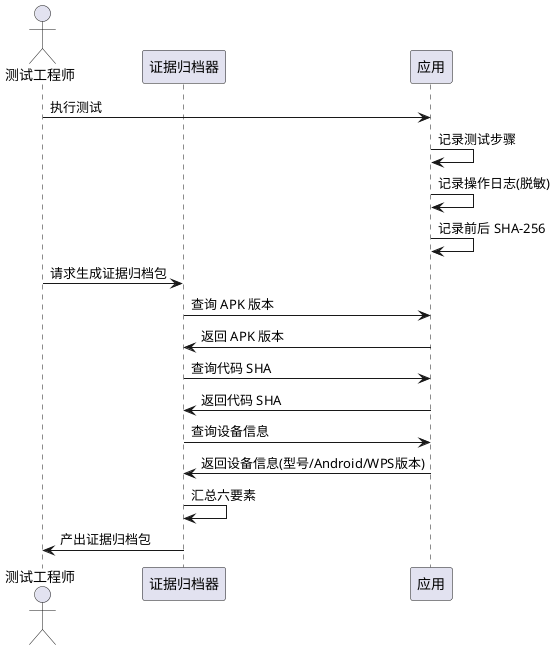

# P0-02-R1 需求规格：WPS Save Detection & MIME Compatibility

> 本文档为 P0-02-R1 修复任务的需求规格，基于 PM Gate Review 裁定（P0-02 = HOLD / FIX REQUIRED，P0-03 = NOT AUTHORIZED）与 2026-10-16 Honor NDL2-W09 平板实测发现生成。文档定义 R1-01 ~ R1-05 五个子项的 EARS 格式需求、验收标准、PM 三项关键技术约束与测试环境要求。所有业务规则采用可测试的验收条件（触发场景 → 预期行为）描述。

> **文档定位**：本规格为 P0-02（WPS 保存变更检测）的定向修复需求，不替代 `docs/specs/spec.md`（SMB 核心需求规格）与 `docs/p0/tasks.md`（P0 任务分解）中的原始定义，而是针对 P0-02 在真实设备实测中暴露的缺陷定义修复验收标准。P0-03（安全回写）在 P0-02-R1 通过前不被授权启动。

---

# 1. 组件定位

## 1.1 核心职责

本修复任务负责修正 P0-02（WPS 保存变更检测）在真实平板实测中暴露的三类缺陷：保存成功误判、另存为漏检、.docx MIME 交付失效，并补充回归验证与证据归档机制，使 WPS 保存检测与文件交付在目标设备上达到可验收的可靠程度。

## 1.2 核心输入

1. **WPS 保存过程事件**：FileObserver 在缓存目录及其父目录捕获的文件事件（MODIFY / CLOSE_WRITE / MOVED_TO / CREATE / MOVED_FROM），含目标文件路径、事件类型、时间戳。
2. **WPS 另存为结果文件**：WPS 将文件另存为新名称或新路径（如 `/storage/emulated/0/` 根目录）时产生的新文件，可能位于缓存目录之外。
3. **WPS .docx 打开请求**：用户点击 .docx 文件后，本组件构造的交付 Intent（URI + Action + MIME type）及其在 WPS 中的实际渲染结果。
4. **编辑会话上下文**：当前编辑会话的源文件路径、缓存副本路径、版本基线（SHA-256 + mtime）、会话状态。
5. **设备与环境信息**：APK 版本、代码 SHA、设备型号、Android 版本、WPS 包名与版本、测试步骤与日志。

## 1.3 核心输出

1. **保存检测判定结果**：对每次 WPS 保存过程产出"保存成功 / 保存失败 / 另存为已发现 / 临时文件已过滤 / 检测不确定"的明确判定，含判定依据（关联的原文件、保存操作与内容变化证据）。
2. **另存为处理结果**：发现另存为结果文件后，向用户呈现明确的关联选择或重新关联流程，不静默漏检。
3. **.docx 交付结果**：WPS 将 .docx 文件作为 Word 文档正确渲染打开，而非显示原始 XML/ZIP 文本。
4. **回归测试报告**：覆盖 .txt、.docx、普通保存、另存为和回写完整性的测试结果，含通过/失败判定与证据。
5. **证据归档包**：含 APK 版本、代码 SHA、设备信息、测试步骤、日志和前后 SHA-256 的完整证据记录。

## 1.4 职责边界

本修复任务**不负责**以下事项：

1. **不负责**将监控范围直接扩展到整个 `/storage/emulated/0/` 作为最终方案：这会带来权限、噪声、性能和其他应用文件误识别问题。应先验证 Android 版本、存储访问权限和 WPS 实际保存路径，再决定监控方式（PM 约束 1）。
2. **不负责**仅凭文件扩展名解决 .docx 问题：须核查发送给 WPS 的 URI、MIME type、文件实际内容及访问授权，综合判定交付方案（PM 约束 2）。
3. **不负责**将保存检测等同于回写成功：保存检测仅确认本地副本已变更，最终仍须核验 SMB 远端文件内容与预期一致，不能只看 mtime 或观察器事件（PM 约束 3）。
4. **不负责** P0-03（安全回写）的实现：P0-03 在 P0-02-R1 通过前不被授权启动，本规格仅定义保存检测与交付修复，不定义回写引擎。
5. **不负责**修改 WPS Office 的内部行为：本组件仅通过 Android 标准文件访问机制与 WPS 交互，不修改 WPS、不控制 WPS 的另存为目标路径选择。

---

# 2. 领域术语

**保存成功误判**
: 仅凭缓存目录中临时文件活动（如 `.moffice_wr_check-*`、数字命名临时文件）就认定用户保存成功的行为。临时文件活动是 WPS 保存过程的中间产物，不能证明最终保存成功。
: 备注：P0-02-R1 须修正的核心缺陷之一。

**另存为漏检**
: WPS 将文件另存为新名称或新路径（如从 `/storage/emulated/0/PAD2/smb_cache/` 另存到 `/storage/emulated/0/` 根目录，或从 .txt 另存为 .doc），而本组件未捕获该保存事件，导致静默丢失用户编辑结果的行为。
: 备注：P0-02-R1 须修正的核心缺陷之一。实测发现 WPS 将 .txt 另存为 .doc 并保存到外部存储根目录。

**.docx MIME 交付失效**
: WPS 通过 `file://` URI + `ACTION_EDIT` + MIME type `application/vnd.openxmlformats-officedocument.wordprocessingml.document` 打开 .docx 时，显示原始 XML/ZIP 文本而非渲染为 Word 文档的现象。
: 备注：P0-02-R1 须修正的核心缺陷之一。服务器端 `file` 命令确认该文件是有效的 Microsoft Word 2007+ 文档。

**保存操作关联**
: 将 FileObserver 捕获的文件事件与原文件（编辑会话源文件）、保存操作（用户在 WPS 中执行的保存动作）与内容变化（SHA-256 指纹变更）三者关联起来，共同判定保存成功的检测方法。
: 备注：R1-01 要求的检测方式，区别于仅凭临时文件活动判定。

**临时文件指纹**
: WPS 保存过程中生成的中间文件的特征，包括文件名模式（`-<数字>.-<数字>`、`.moffice_wr_check<数字>`、`~$` 前缀、`.tmp` 后缀）与生命周期特征（创建后短时间内被删除或重命名）。
: 备注：用于过滤临时文件，避免误判为最终结果文件。

**受控 content:// 交付**
: 通过 FileProvider 生成 `content://` URI 并授予 WPS 读写权限的文件交付方式，作为 `file://` URI 的替代或回退方案，须配合正确的 MIME type 与访问授权。
: 备注：PM 约束 2 要求评估的 .docx 交付方案之一。

**回写完整性核验**
: 保存检测触发回写后，通过读取 SMB 远端文件并计算 SHA-256，与本地缓存副本 SHA-256 比对，确认远端文件内容与预期一致的过程。
: 备注：PM 约束 3 要求的最终判据，不能只看 mtime 或观察器事件。

**证据归档包**
: 一次完整测试的证据集合，含 APK 版本、代码 SHA、设备信息（型号/Android 版本/WPS 包名与版本）、测试步骤、日志和前后 SHA-256 指纹。
: 备注：R1-05 要求的归档产物。

---

# 3. 角色与边界

## 3.1 核心角色

- **普通成员**：在平板上使用本组件打开 SMB 共享文件、在 WPS 中编辑并保存的主要用户，是保存检测与另存为处理的直接体验者。
- **测试工程师**：在真实平板上执行 R1-04 回归验证（覆盖 .txt、.docx、普通保存、另存为和回写完整性）并产出证据归档包的人员。
- **项目经理（PM）**：对 P0-02-R1 执行 Gate Review，裁定修复是否通过、P0-03 是否授权启动的评审者。

## 3.2 外部系统

- **WPS Office（cn.wps.moffice_eng）**：下游文件编辑应用，其保存行为（普通保存、另存为、临时文件生成、.docx 渲染）是本修复任务的核心适配对象。
- **Android 系统（FileObserver / FileProvider / ContentProvider）**：提供文件变更监听、URI 授权与文件访问机制，是保存检测与 .docx 交付的系统能力依赖。
- **Windows SMB 服务器**：回写完整性核验的远端目标，须支持文件读取与 SHA-256 校验所需的流式读取能力。

## 3.3 交互上下文



---

# 4. DFX约束

## 4.1 性能

1. **保存检测响应时间**：从 WPS 保存完成到本组件作出保存成功/失败判定，响应时间须在 5 秒以内（含 FileObserver 事件接收、mtime 比对、SHA-256 计算）。
   - 验收条件：[WPS 保存完成] → [5 秒内产出保存检测判定结果]
2. **另存为发现延迟**：从 WPS 另存为操作完成到本组件发现并提示用户，延迟须在 10 秒以内。
   - 验收条件：[WPS 另存为完成] → [10 秒内发现另存为结果并提示用户]
3. **监控开销**：FileObserver 监控不导致明显 CPU 或电量消耗，不影响平板正常使用。
   - 验收条件：[FileObserver 持续运行] → [设备无异常发热或明显电量消耗]

## 4.2 可靠性

1. **禁止保存成功误判**：不得仅凭缓存目录临时文件活动就认定用户保存成功。
   - 验收条件：[缓存目录仅有临时文件活动而无最终结果文件变更] → [判定为"检测不确定"或"保存未完成"，不判定为"保存成功"]
2. **禁止另存为静默漏检**：另存为结果文件须被发现或提供明确的用户选择/重新关联流程。
   - 验收条件：[WPS 执行另存为] → [本组件发现另存为结果或提示用户选择，不静默漏检]
3. **回写完整性最终核验**：保存检测触发回写后，须通过 SMB 远端文件 SHA-256 核验确认内容一致。
   - 验收条件：[保存检测判定为成功并触发回写] → [回写后读取 SMB 远端文件 SHA-256 与本地副本一致方可标记成功]
4. **禁止伪报成功**：检测不确定、另存为未关联、回写未核验通过时，禁止显示"已保存到共享"。
   - 验收条件：[检测/关联/核验未完成或失败] → [显示对应状态，不显示"已保存到共享"]

## 4.3 安全性

1. **监控范围最小化**：不将监控范围直接扩展到整个 `/storage/emulated/0/` 作为最终方案，避免权限、噪声、性能和其他应用文件误识别问题。
   - 验收条件：[审查监控范围配置] → [监控范围经 Android 版本、存储访问权限和 WPS 实际保存路径验证后确定，非全盘监控]
2. **URI 授权最小化**：交付 WPS 的 URI 仅授予读写权限，不授予超出编辑所需的权限。
   - 验收条件：[审查 URI 授权] → [仅含 FLAG_GRANT_READ_URI_PERMISSION 与 FLAG_GRANT_WRITE_URI_PERMISSION]

## 4.4 可维护性

1. **证据可追溯**：每次测试须产出完整证据归档包，含 APK 版本、代码 SHA、设备信息、测试步骤、日志和前后 SHA-256。
   - 验收条件：[执行任意测试] → [产出完整证据归档包，可追溯至具体代码版本与设备环境]
2. **诊断日志完备**：保存检测、另存为发现、.docx 交付过程须记录结构化诊断日志，含事件类型、文件路径、判定依据、时间戳。
   - 验收条件：[发生保存检测/另存为/交付事件] → [日志含完整事件链与判定依据，可定位根因]

## 4.5 兼容性

1. **目标设备兼容**：修复方案须在 Honor NDL2-W09（Android 16, API 36）+ WPS cn.wps.moffice_eng 上通过实测验证。
   - 验收条件：[在 Honor NDL2-W09 + Android 16 + WPS cn.wps.moffice_eng 上测试] → [R1-01 ~ R1-05 全部通过]
2. **不绑定单一设备**：修复方案基于 Android 标准 API（FileObserver、FileProvider、ContentProvider），不绑定厂商特定 API，按三层兼容性模型管理。
   - 验收条件：[审查修复实现] → [基于 Android 标准 API，未使用厂商特定 API]

---

# 5. 核心能力

## 5.1 R1-01 保存检测关联判定

### 5.1.1 业务规则

1. **保存成功须三要素关联**：判定用户保存成功须同时关联原文件（编辑会话源文件）、保存操作（WPS 中执行的保存动作产生的最终结果文件）与内容变化（最终结果文件 SHA-256 与基线不一致），三者缺一不可。
   - 验收条件：[WPS 保存完成] → [本组件关联原文件、最终结果文件与 SHA-256 变更，三者均满足方可判定为"保存成功"]
2. **临时文件不得作为保存成功依据**：缓存目录中的 WPS 临时文件（`-<数字>.-<数字>`、`.moffice_wr_check<数字>`、`~$` 前缀、`.tmp` 后缀）活动仅为保存过程中间产物，不得据此判定保存成功。
   - 验收条件：[缓存目录仅检测到临时文件活动而无最终结果文件变更] → [判定为"检测不确定"或"保存未完成"，不触发回写，不显示"已保存到共享"]
3. **mtime 变更须配合 SHA-256 变更**：mtime 变更但 SHA-256 未变更（如 touch 操作）时，判定为 mtime 误报，不触发回写。
   - 验收条件：[最终结果文件 mtime 变更但 SHA-256 与基线一致] → [判定为 mtime 误报，不触发回写]
4. **FileObserver 事件丢失补充检测**：FileObserver 因内核级限制丢失事件时，应用返回前台时主动检查缓存副本 mtime 与基线 mtime，发现变更则触发 SHA-256 比对作为补充检测。
   - 验收条件：[FileObserver 丢失事件且应用返回前台] → [主动检查 mtime + SHA-256，发现变更则触发检测流程]
5. **禁止项**：禁止仅凭以下任一信号单独判定保存成功：仅凭缓存目录临时文件活动；仅凭 mtime 变更；仅凭 FileObserver 事件而无内容校验。
   - 验收条件：[仅凭单一信号] → [不得判定为"保存成功"，须补充其他要素关联]

### 5.1.2 交互流程



### 5.1.3 异常场景

1. **仅检测到临时文件活动而无最终结果文件**
   - 触发条件：WPS 保存过程中生成临时文件（`.moffice_wr_check-*`、`-<数字>.-<数字>`），但最终结果文件未出现在监控范围内或保存被用户取消。
   - 系统行为：判定为"检测不确定"或"保存未完成"，记录临时文件活动日志，不触发回写，继续监听等待最终结果文件。
   - 用户感知：不显示"已保存到共享"，可显示"保存检测中"或无提示（继续监听）。
2. **FileObserver 事件丢失**
   - 触发条件：FileObserver 因内核级限制（如 inotify watch 数量上限）丢失文件变更事件。
   - 系统行为：应用返回前台时主动检查缓存副本 mtime 与基线 mtime，发现变更则触发 SHA-256 比对作为补充检测。
   - 用户感知：返回应用后稍延迟（≤5 秒）显示保存检测结果。
3. **SHA-256 计算失败**
   - 触发条件：缓存文件损坏或被其他进程锁定，导致流式 SHA-256 计算失败。
   - 系统行为：显示检测失败，提示用户重新打开文件，不触发回写。
   - 用户感知：显示"保存检测失败，请重新打开文件"。

## 5.2 R1-02 另存为发现与关联

### 5.2.1 业务规则

1. **另存为结果须被发现**：WPS 将文件另存为新名称或新路径（包括跨目录另存为，如从 `smb_cache/` 另存到 `/storage/emulated/0/` 根目录；跨格式另存为，如从 .txt 另存为 .doc）时，本组件须发现该另存为结果文件。
   - 验收条件：[WPS 执行另存为到任意可达路径] → [本组件发现另存为结果文件或提示用户手动指定]
2. **另存为须提供用户选择**：发现另存为结果后，须向用户呈现明确的关联选择：将另存为结果回写为新文件到 SMB 共享、覆盖原文件、或放弃关联。
   - 验收条件：[发现另存为结果文件] → [提示用户选择"回写为新文件/覆盖原文件/放弃关联"，不自动假设为覆盖原文件]
3. **另存为监控路径须经验证确定**：不直接将监控范围扩展到整个 `/storage/emulated/0/` 作为最终方案。须先验证 Android 版本、存储访问权限和 WPS 实际保存路径，再决定监控方式（如扩展 FileObserver 监控路径、使用 SAF 获取用户授权目录、或提示用户手动指定另存为结果）。
   - 验收条件：[确定另存为监控方式] → [经 Android 版本、存储权限、WPS 保存路径验证后确定，非全盘监控]
4. **禁止项**：禁止静默漏检另存为结果；禁止自动将另存为结果覆盖原文件而不提示用户。
   - 验收条件：[WPS 另存为] → [不静默漏检，不自动覆盖原文件]

### 5.2.2 交互流程



### 5.2.3 异常场景

1. **另存为结果在监控范围外（如 `/storage/emulated/0/` 根目录）**
   - 触发条件：WPS 将文件另存到 parentDirObserver 监控范围之外的路径（实测发现 WPS 将 .txt 另存为 .doc 到 `/storage/emulated/0/` 根目录）。
   - 系统行为：根据已验证的 WPS 保存路径与 Android 存储权限，扩展监控路径或提示用户手动指定另存为结果文件。
   - 用户感知：提示"检测到另存为操作，但结果文件不在自动监控范围内，请选择另存为结果文件"或自动发现后提示关联选择。
2. **另存为格式变更（如 .txt → .doc）**
   - 触发条件：WPS 将 .txt 文件另存为 .doc 格式，文件扩展名与原文件不同。
   - 系统行为：识别格式变更，提示用户另存为结果格式与原文件不同，由用户决定回写为新文件或覆盖原文件。
   - 用户感知：提示"另存为结果格式为 .doc，与原文件 .txt 不同，请选择处理方式"。
3. **另存为结果识别失败**
   - 触发条件：无法通过 FileObserver 或用户指定发现另存为结果文件。
   - 系统行为：提示用户保存检测未完成，提供手动指定结果文件的入口，不伪报成功。
   - 用户感知：显示"另存为结果未找到，请手动指定结果文件"。

## 5.3 R1-03 .docx MIME 兼容交付

### 5.3.1 业务规则

1. **.docx 须作为 Word 文档渲染打开**：交付 .docx 文件给 WPS 时，须使用适当的 MIME 类型和 URI 授权机制，确保 WPS 将文件作为 Word 文档渲染打开，而非显示原始 XML/ZIP 文本。
   - 验收条件：[用户点击 .docx 文件] → [WPS 将文件渲染为 Word 文档界面，不显示原始 XML/ZIP 文本]
2. **MIME type 须与文件实际内容一致**：交付的 MIME type 须与文件实际内容（通过内容嗅探或扩展名判定）一致，不仅凭扩展名设置 MIME type。
   - 验收条件：[交付 .docx 文件] → [MIME type 与文件实际内容一致，经内容嗅探验证]
3. **URI 方案须经验证**：若采用 `file://` URI，须通过设备实测证明目标 WPS 版本对 .docx 的兼容性；若 `file://` 不可靠，须评估受控的 `content://` 交付方案（通过 FileProvider 生成 URI 并授权）。
   - 验收条件：[交付 .docx 文件] → [URI 方案经设备实测验证，或采用经验证的 content:// 方案]
4. **交付失败须如实报告**：WPS 无法正确渲染 .docx 时，须如实显示失败原因，不伪报打开成功。
   - 验收条件：[WPS 显示 XML/ZIP 文本而非 Word 文档] → [本组件检测到渲染异常并提示用户，不显示打开成功]
5. **禁止项**：禁止仅凭文件扩展名设置 MIME type 而不核查 URI、MIME type、文件实际内容及访问授权的综合兼容性。
   - 验收条件：[仅凭扩展名设置 MIME type] → [须补充核查 URI 方案、文件内容、访问授权的兼容性]

### 5.3.2 交互流程



### 5.3.3 异常场景

1. **WPS 显示 XML/ZIP 文本而非 Word 文档**
   - 触发条件：WPS 通过 `file://` URI + `ACTION_EDIT` + 正确 MIME type 打开 .docx 时，仍显示原始 XML/ZIP 文本（实测发现的问题）。
   - 系统行为：评估并切换到受控 `content://` 交付方案（FileProvider + URI 授权），或调整 MIME type / Intent 参数，重新交付；仍失败时如实显示失败原因。
   - 用户感知：提示".docx 文件无法正确渲染，正在尝试替代方案"或"打开失败，请尝试其他应用"。
2. **file:// URI 被目标 WPS 版本拒绝**
   - 触发条件：目标 WPS 版本对 `file://` URI 的 .docx 处理存在兼容性问题。
   - 系统行为：自动回退到 FileProvider `content://` URI 方案，重新交付。
   - 用户感知：用户无感（自动回退）或提示"正在使用替代方式打开"。
3. **MIME type 与文件实际内容不匹配**
   - 触发条件：文件扩展名为 .docx 但实际内容不是有效的 Word 2007+ 文档（如文件损坏或被篡改）。
   - 系统行为：通过内容嗅探检测到不匹配，提示用户文件可能损坏，不交付 WPS 或交付时标注异常。
   - 用户感知：提示"文件可能已损坏，无法作为 Word 文档打开"。

## 5.4 R1-04 回归验证

### 5.4.1 业务规则

1. **回归验证须覆盖五类场景**：在真实平板上覆盖以下五类场景的完整测试：.txt 文件打开编辑保存、.docx 文件打开编辑保存、普通保存（保存到原文件）、另存为（保存为新文件/新路径/新格式）、回写完整性（SMB 远端文件内容与预期一致）。
   - 验收条件：[执行 R1-04 回归验证] → [五类场景全部测试完成，每类产出通过/失败判定与证据]
2. **回归验证须在真实平板上执行**：须在 Honor NDL2-W09（Android 16, API 36）+ WPS cn.wps.moffice_eng 上执行，不得仅用模拟器或单元测试替代。
   - 验收条件：[执行 R1-04 回归验证] → [测试环境为 Honor NDL2-W09 + Android 16 + WPS cn.wps.moffice_eng，有设备实测证据]
3. **每类场景须有明确通过/失败判定**：每类场景须定义明确的通过/失败判定条件，并记录判定结果。
   - 验收条件：[每类场景测试完成] → [产出明确的通过/失败判定，含判定依据]
4. **失败场景须记录根因**：测试失败时须记录失败根因分析，含失败现象、复现步骤、日志分析。
   - 验收条件：[某类场景测试失败] → [记录失败根因分析，含现象、复现步骤、日志]

### 5.4.2 交互流程

```plantuml
@startuml
actor "测试工程师" as Tester
participant "回归测试套件" as Suite
participant "WPS Office" as WPS
database "SMB 服务器" as SMB

Tester -> Suite : 启动 R1-04 回归验证
Suite -> Suite : 记录测试环境(设备/Android/WPS版本)

rect "场景1: .txt 打开编辑保存"
    Suite -> WPS : 打开 .txt 文件
    WPS -> Suite : 编辑并保存
    Suite -> Suite : 检测保存成功
    Suite -> SMB : 回写并核验 SHA-256
    Suite -> Suite : 记录通过/失败判定
end

rect "场景2: .docx 打开编辑保存"
    Suite -> WPS : 打开 .docx 文件
    WPS -> Suite : 验证渲染为 Word 文档(非 XML)
    WPS -> Suite : 编辑并保存
    Suite -> Suite : 检测保存成功
    Suite -> SMB : 回写并核验 SHA-256
    Suite -> Suite : 记录通过/失败判定
end

rect "场景3: 普通保存"
    Suite -> WPS : 打开文件，编辑，普通保存
    Suite -> Suite : 检测保存到原文件
    Suite -> SMB : 回写并核验 SHA-256
    Suite -> Suite : 记录通过/失败判定
end

rect "场景4: 另存为"
    Suite -> WPS : 打开文件，编辑，另存为
    Suite -> Suite : 发现另存为结果
    Suite -> Suite : 提示用户选择关联
    Suite -> SMB : 回写并核验 SHA-256
    Suite -> Suite : 记录通过/失败判定
end

rect "场景5: 回写完整性"
    Suite -> SMB : 执行回写
    Suite -> SMB : 读取远端文件 SHA-256
    Suite -> Suite : 比对本地与远端 SHA-256
    Suite -> Suite : 记录通过/失败判定
end

Suite -> Tester : 产出回归测试报告(五类场景判定 + 证据)
@enduml
```

### 5.4.3 异常场景

1. **某类场景测试失败**
   - 触发条件：五类场景中任一场景未通过测试。
   - 系统行为：记录失败场景、失败现象、复现步骤、日志分析，标记 R1-04 未通过，不授权 P0-03 启动。
   - 用户感知：PM 收到失败报告，决定是否要求进一步修复。
2. **测试环境不符合要求**
   - 触发条件：测试设备不是 Honor NDL2-W09 或 Android/WPS 版本不符合要求。
   - 系统行为：拒绝接受测试结果，要求在指定环境下重新测试。
   - 用户感知：提示"测试环境不符合要求，须在 Honor NDL2-W09 + Android 16 + WPS cn.wps.moffice_eng 上执行"。

## 5.5 R1-05 证据归档

### 5.5.1 业务规则

1. **证据归档包须含六要素**：每次测试须产出完整证据归档包，含：APK 版本、代码 SHA、设备信息（型号/Android 版本/WPS 包名与版本）、测试步骤、日志、前后 SHA-256 指纹。
   - 验收条件：[执行任意测试] → [产出证据归档包，含 APK 版本、代码 SHA、设备信息、测试步骤、日志、前后 SHA-256 六要素]
2. **证据须可追溯至代码版本**：证据归档包中的代码 SHA 须与测试时使用的代码版本一致，可追溯至具体提交。
   - 验收条件：[审查证据归档包] → [代码 SHA 与测试时代码版本一致，可 git log 追溯]
3. **证据须可追溯至设备环境**：证据归档包中的设备信息须与测试时实际使用的设备一致。
   - 验收条件：[审查证据归档包] → [设备信息与测试时实际设备一致]
4. **前后 SHA-256 须记录**：每次保存/回写操作须记录操作前后的 SHA-256 指纹，用于验证内容变更与完整性。
   - 验收条件：[执行保存/回写操作] → [证据含操作前 SHA-256 与操作后 SHA-256，可比对变更]
5. **日志须脱敏**：证据归档包中的日志不得包含密码、凭据、文件敏感内容。
   - 验收条件：[审查证据归档包日志] → [不含密码明文与文件内容明文]

### 5.5.2 交互流程



### 5.5.3 异常场景

1. **证据要素缺失**
   - 触发条件：证据归档包缺少六要素中的任一项。
   - 系统行为：标记证据不完整，要求补充缺失要素后重新归档。
   - 用户感知：提示"证据归档不完整，缺少 [缺失要素]，请补充"。
2. **代码 SHA 与实际代码不一致**
   - 触发条件：证据归档包中的代码 SHA 与测试时实际使用的代码版本不匹配。
   - 系统行为：标记证据无效，要求重新测试并记录正确的代码 SHA。
   - 用户感知：提示"证据代码版本与实际不一致，请重新测试归档"。

---

# 6. 数据约束

## 6.1 保存检测事件

1. **事件类型**：取值范围为 `MODIFY`、`CLOSE_WRITE`、`MOVED_TO`、`MOVED_FROM`、`CREATE`，须与 FileObserver 事件常量一致。
2. **文件路径**：事件目标文件的绝对路径，须为非空字符串。
3. **时间戳**：事件发生的时间戳，须为单调递增的毫秒级时间。
4. **事件来源**：标记事件来源 FileObserver 实例（fileObserver / dirObserver / parentDirObserver / 补充检测），用于诊断。

## 6.2 保存检测判定结果

1. **判定结果**：取值范围为 `保存成功`、`保存失败`、`另存为已发现`、`临时文件已过滤`、`检测不确定`、`mtime 误报`，须为枚举值。
2. **判定依据**：含关联的原文件路径、最终结果文件路径、基线 SHA-256、最终 SHA-256、基线 mtime、最终 mtime，须可追溯至具体事件。
3. **判定时间**：产出判定结果的时间戳，须晚于触发事件时间戳。

## 6.3 另存为结果

1. **原文件路径**：编辑会话源文件路径，须为非空字符串。
2. **另存为结果路径**：WPS 另存为的新文件路径，须与原文件路径不同。
3. **另存为结果格式**：另存为结果的文件格式（扩展名），可能与原文件格式不同（如 .txt → .doc）。
4. **用户关联决策**：取值范围为 `回写为新文件`、`覆盖原文件`、`放弃关联`，须为用户明确选择的结果。

## 6.4 .docx 交付参数

1. **URI 方案**：取值范围为 `file://`、`content://`，须经设备实测验证兼容性。
2. **MIME type**：.docx 文件的 MIME type，须为 `application/vnd.openxmlformats-officedocument.wordprocessingml.document`，且与文件实际内容一致。
3. **Intent Action**：交付 Intent 的 Action，须为 `ACTION_EDIT` 或 `ACTION_VIEW`。
4. **URI 授权标志**：须含 `FLAG_GRANT_READ_URI_PERMISSION` 与 `FLAG_GRANT_WRITE_URI_PERMISSION`。

## 6.5 证据归档包

1. **APK 版本**：测试时安装的 APK 版本号（versionName + versionCode），须为非空字符串。
2. **代码 SHA**：测试时使用的代码 Git 提交 SHA，须为 40 字符的十六进制字符串。
3. **设备信息**：含设备型号、Android 版本、API 级别、WPS 包名、WPS 版本，须为完整记录。
4. **测试步骤**：测试执行的步骤序列，须可复现。
5. **日志**：测试过程的结构化日志，须脱敏，不含密码明文与文件内容明文。
6. **前后 SHA-256**：每次保存/回写操作的前后 SHA-256 指纹对，须为 64 字符的十六进制字符串。

---

# 7. PM Gate Review 裁定摘要

## 7.1 裁定结果

| 任务 | 裁定 | 说明 |
|------|------|------|
| P0-02（WPS 保存变更检测） | **HOLD / FIX REQUIRED** | commit 792a9e0 仅有诊断性改进，不代表门禁通过；须启动 P0-02-R1 修复任务 |
| P0-03（安全回写） | **NOT AUTHORIZED** | 在 P0-02-R1 通过前不被授权启动 |

## 7.2 P0-02-R1 通过条件

P0-02-R1 须满足以下全部条件方可判定为通过：

1. R1-01 ~ R1-05 五个子项全部通过验收标准。
2. 在 Honor NDL2-W09（Android 16, API 36）+ WPS cn.wps.moffice_eng 上通过 R1-04 回归验证。
3. 产出完整 R1-05 证据归档包。
4. PM 三项关键技术约束全部遵守。

## 7.3 P0-02-R1 通过后的后续动作

- P0-02 状态更新为 PASS。
- P0-03（安全回写）授权启动。
- 更新已验证环境清单（Honor NDL2-W09 + Android 16 + WPS cn.wps.moffice_eng 组合）。

---

# 8. 实测发现与问题根因分析

## 8.1 实测环境

- **设备**：HONOR NDL2_W09
- **Android 版本**：Android 16，API Level 36
- **WPS 包名**：cn.wps.moffice_eng
- **测试日期**：2026-10-16

## 8.2 实测发现

### 8.2.1 发现一：WPS .txt 另存为行为异常

- **现象**：WPS 将 .txt 另存为 .doc 格式，保存到 `/storage/emulated/0/`（外部存储根目录），而非 `/storage/emulated/0/PAD2/` 子目录。
- **影响**：parentDirObserver（监控 PAD2 目录）未捕获到该保存事件，导致另存为漏检。
- **根因**：WPS 另存为的目标路径由 WPS 自身决定，可能选择外部存储根目录而非应用相关目录；监控范围未覆盖 WPS 实际保存路径。
- **对应子项**：R1-02 另存为发现与关联。

### 8.2.2 发现二：dirObserver 检测到临时文件活动

- **现象**：smb_cache 目录中检测到 WPS 临时文件（`-486781428.-1908999883225750862` 和 `.moffice_wr_check188758123`），但这只是保存过程的中间产物。
- **影响**：若仅凭临时文件活动判定保存成功，会导致保存成功误判。
- **根因**：WPS 保存过程会生成临时文件，这些临时文件不是最终结果文件；当前检测逻辑未充分区分临时文件活动与最终保存成功。
- **对应子项**：R1-01 保存检测关联判定。

### 8.2.3 发现三：.docx 打开显示 XML 文本

- **现象**：WPS 通过 `file://` URI + `ACTION_EDIT` + MIME type `application/vnd.openxmlformats-officedocument.wordprocessingml.document` 打开 .docx 时，显示原始 XML/ZIP 文本而非渲染为 Word 文档。
- **影响**：用户无法正常编辑 .docx 文件，核心功能不可用。
- **根因**：`file://` URI 交付方式在目标 WPS 版本上对 .docx 的处理存在兼容性问题；可能需要采用 `content://` URI + FileProvider 方案或调整交付参数。
- **对应子项**：R1-03 .docx MIME 兼容交付。

## 8.3 当前代码状态

| 文件 | 当前实现 | 待修复问题 |
|------|---------|-----------|
| `WpsSaveDetector.java` | FileObserver（fileObserver + dirObserver + parentDirObserver）、mtime + SHA-256、临时文件过滤、另存为检测、暂停/恢复、前台检测 | 临时文件活动可能被误判为保存成功；parentDirObserver 监控范围未覆盖 WPS 实际另存为路径 |
| `WpsDeliveryHandler.java` | `file://` URI + `ACTION_EDIT`，失败时回退到 FileProvider `content://` URI | `file://` 对 .docx 交付在目标 WPS 版本上失效，须评估 `content://` 方案 |
| `FileAppResolver.java` | queryIntentActivities 返回空时回退到 WPS 包名 | 须验证 .docx 交付时的应用选择与 MIME type 匹配 |
| `StreamCacheService.java` | 缓存目录为 `/storage/emulated/0/PAD2/smb_cache/` | 须验证 WPS 另存为是否保存到缓存目录之外 |

---

# 9. 约束条件（PM 三项关键技术判断）

## 9.1 约束 1：监控范围不得直接扩展到全盘

不得直接把监控范围扩展到整个 `/storage/emulated/0/` 作为最终方案。这会带来以下问题：

- **权限问题**：全盘监控可能需要 `MANAGE_EXTERNAL_STORAGE` 等高权限，须 Google Play 审查。
- **噪声问题**：全盘监控会捕获大量无关文件变更事件，增加误判风险。
- **性能问题**：全盘监控的 FileObserver 开销显著，影响设备性能与电量。
- **误识别问题**：其他应用的文件活动可能被误识别为 WPS 保存结果。

**正确做法**：先验证 Android 版本、存储访问权限和 WPS 实际保存路径，再决定监控方式。可选方案包括：

1. 扩展 FileObserver 监控路径至 WPS 实际保存目录（经验证后）。
2. 使用 SAF 获取用户授权目录的持久化访问权限。
3. 提示用户手动指定另存为结果文件。

## 9.2 约束 2：.docx 问题不得仅凭扩展名解决

不得只靠文件扩展名解决 .docx 问题。须核查以下要素的综合兼容性：

1. **发送给 WPS 的 URI**：`file://` 还是 `content://`，目标 WPS 版本对两种 URI 的 .docx 处理行为。
2. **MIME type**：`application/vnd.openxmlformats-officedocument.wordprocessingml.document` 是否被目标 WPS 版本正确识别。
3. **文件实际内容**：通过内容嗅探确认文件为有效的 Word 2007+ 文档（ZIP 格式，含 `[Content_Types].xml` 等 OOXML 结构）。
4. **访问授权**：URI 授权标志是否充分，WPS 是否有权限读取文件内容。

**若仍采用 `file://`**：必须通过设备实测证明目标 WPS 版本的兼容性。

**必要时评估 `content://` 方案**：通过 FileProvider 生成 `content://` URI 并授予 WPS 读写权限，作为受控的交付方案。

## 9.3 约束 3：保存检测不等于回写成功

保存检测仅确认本地副本已变更，不等于回写成功。最终仍须核验 SMB 远端文件内容与预期一致。

**正确做法**：

1. 保存检测判定为"保存成功"后，触发回写流程。
2. 回写完成后，读取 SMB 远端文件并计算 SHA-256。
3. 比对远端 SHA-256 与本地缓存副本 SHA-256，一致方可标记回写成功。
4. 不一致时标记回写失败，不显示"已保存到共享"。

**禁止**：仅凭 mtime 变更或 FileObserver 事件就标记回写成功。

---

# 10. 测试环境要求

## 10.1 目标设备

- **设备型号**：HONOR NDL2_W09
- **Android 版本**：Android 16
- **API 级别**：API Level 36
- **WPS 包名**：cn.wps.moffice_eng
- **WPS 版本**：测试时记录实际安装版本

## 10.2 技术栈

- **应用框架**：Capacitor 8 + React 18 + TypeScript 5.6 + Vite 5.4
- **原生层**：Android Java/Kotlin + SMBJ 0.12.1 + Room 2.6.1
- **最低支持版本**：minSdkVersion = 26（API 26 / Android 8.0）
- **目标版本**：targetSdkVersion = 36（API 36 / Android 16）

## 10.3 SMB 服务器要求

- 须提供 SMB2/3 协议支持。
- 须支持文件流式读取（用于 SHA-256 校验）。
- 须支持文件写入与重命名（用于回写完整性核验）。

## 10.4 测试文件要求

- **.txt 文件**：用于测试普通保存与另存为（.txt → .doc）。
- **.docx 文件**：用于测试 .docx MIME 兼容交付与渲染。
- **文件大小**：包含小文件（< 1MB）与大文件（≥ 100MB）以验证流式处理。

---

# 11. 验收标准汇总

## 11.1 R1-01 保存检测验收标准

| 编号 | 触发场景 | 预期行为 | 通过判定 |
|------|---------|---------|---------|
| R1-01-AC-01 | WPS 保存完成 | 关联原文件、最终结果文件与 SHA-256 变更，三者均满足方可判定"保存成功" | 判定结果为"保存成功"，含三要素关联证据 |
| R1-01-AC-02 | 缓存目录仅临时文件活动 | 判定"检测不确定"或"保存未完成"，不触发回写 | 不显示"已保存到共享"，不触发回写 |
| R1-01-AC-03 | mtime 变更但 SHA-256 未变更 | 判定 mtime 误报，不触发回写 | 不触发回写，记录误报日志 |
| R1-01-AC-04 | FileObserver 丢失事件，应用返回前台 | 主动检查 mtime + SHA-256 补充检测 | 返回前台后 ≤5 秒产出检测结果 |
| R1-01-AC-05 | 仅凭单一信号（临时文件/mtime/FileObserver 事件） | 不得判定"保存成功" | 须补充其他要素关联 |

## 11.2 R1-02 另存为验收标准

| 编号 | 触发场景 | 预期行为 | 通过判定 |
|------|---------|---------|---------|
| R1-02-AC-01 | WPS 另存为到任意可达路径 | 发现另存为结果文件或提示用户手动指定 | 另存为结果被发现或用户手动指定，不静默漏检 |
| R1-02-AC-02 | 发现另存为结果文件 | 提示用户选择"回写为新文件/覆盖原文件/放弃关联" | 用户选择提示出现，不自动覆盖原文件 |
| R1-02-AC-03 | 确定另存为监控方式 | 经 Android 版本、存储权限、WPS 保存路径验证后确定 | 监控方式有验证依据，非全盘监控 |
| R1-02-AC-04 | WPS 另存为 | 不静默漏检，不自动覆盖原文件 | 有用户提示或自动发现证据 |

## 11.3 R1-03 .docx 交付验收标准

| 编号 | 触发场景 | 预期行为 | 通过判定 |
|------|---------|---------|---------|
| R1-03-AC-01 | 用户点击 .docx 文件 | WPS 渲染为 Word 文档界面，不显示 XML/ZIP 文本 | WPS 界面为 Word 文档渲染 |
| R1-03-AC-02 | 交付 .docx 文件 | MIME type 与文件实际内容一致，经内容嗅探验证 | MIME type 经内容嗅探验证一致 |
| R1-03-AC-03 | 交付 .docx 文件 | URI 方案经设备实测验证，或采用经验证的 content:// 方案 | URI 方案有实测验证证据 |
| R1-03-AC-04 | WPS 显示 XML/ZIP 文本 | 检测到渲染异常并提示用户，不显示打开成功 | 有渲染异常检测与用户提示 |
| R1-03-AC-05 | 仅凭扩展名设置 MIME type | 须补充核查 URI 方案、文件内容、访问授权兼容性 | 有综合兼容性核查证据 |

## 11.4 R1-04 回归验证验收标准

| 编号 | 触发场景 | 预期行为 | 通过判定 |
|------|---------|---------|---------|
| R1-04-AC-01 | 执行 R1-04 回归验证 | 五类场景全部测试完成，每类产出通过/失败判定与证据 | 五类场景均有判定结果与证据 |
| R1-04-AC-02 | 执行 R1-04 回归验证 | 在 Honor NDL2-W09 + Android 16 + WPS cn.wps.moffice_eng 上执行 | 测试环境符合要求，有设备实测证据 |
| R1-04-AC-03 | 每类场景测试完成 | 产出明确通过/失败判定，含判定依据 | 每类场景有明确判定与依据 |
| R1-04-AC-04 | 某类场景测试失败 | 记录失败根因分析，含现象、复现步骤、日志 | 有失败根因分析记录 |

## 11.5 R1-05 证据归档验收标准

| 编号 | 触发场景 | 预期行为 | 通过判定 |
|------|---------|---------|---------|
| R1-05-AC-01 | 执行任意测试 | 产出证据归档包，含六要素 | 证据归档包含 APK 版本、代码 SHA、设备信息、测试步骤、日志、前后 SHA-256 |
| R1-05-AC-02 | 审查证据归档包 | 代码 SHA 与测试时代码版本一致，可 git log 追溯 | 代码 SHA 可追溯 |
| R1-05-AC-03 | 审查证据归档包 | 设备信息与测试时实际设备一致 | 设备信息可追溯 |
| R1-05-AC-04 | 执行保存/回写操作 | 证据含操作前后 SHA-256，可比对变更 | 前后 SHA-256 记录完整 |
| R1-05-AC-05 | 审查证据归档包日志 | 不含密码明文与文件内容明文 | 日志已脱敏 |

---

# 12. 子项与原始 P0-02 需求对照

| P0-02-R1 子项 | 对应 P0-02 原始验收标准 | 修复内容 |
|---------------|----------------------|---------|
| R1-01 保存检测 | P0-02 AC-1（FileObserver + mtime + SHA-256 判定保存成功） | 补充三要素关联要求，明确临时文件活动不得作为保存成功依据 |
| R1-02 另存为 | P0-02 AC-3（识别另存为操作，提示用户选择） | 补充跨目录另存为发现要求，明确不得静默漏检，监控方式须经验证确定 |
| R1-03 .docx 交付 | P0-01 AC-1（file:// URI 启动 WPS 成功打开） | 针对 .docx 渲染失效问题，要求综合核查 URI + MIME + 内容 + 授权，评估 content:// 方案 |
| R1-04 回归验证 | P0-06（异常与回归测试） | 聚焦五类场景的真实平板回归验证，作为 P0-02-R1 通过条件 |
| R1-05 证据归档 | P0-02 测试证据要求 | 系统化定义证据归档包六要素，确保可追溯 |

---

# 13. 依赖关系与前置条件

## 13.1 前置条件

- P0-01（SMB 文件交付与 WPS 打开）已完成：文件交付与编辑会话建立机制可用。
- M2-A WPS 技术验证门禁已通过（V1-V7 全部 PASS，2026-10-16）。
- 测试设备 Honor NDL2-W09 可用，WPS cn.wps.moffice_eng 已安装。

## 13.2 后续依赖

- **P0-02-R1 通过 → P0-02 状态更新为 PASS → P0-03 授权启动**。
- P0-03（安全回写）在 P0-02-R1 通过前不被授权启动。
- P0-04（冲突处理）依赖 P0-03 完成。
- P0-05（网络故障恢复）依赖 P0-03 完成。

## 13.3 不依赖

- 本修复任务不依赖 P0-03 ~ P0-05 的实现。
- 本修复任务不依赖 P1 及后续阶段的功能。