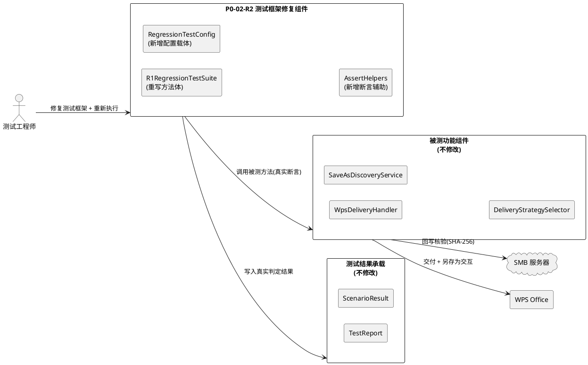
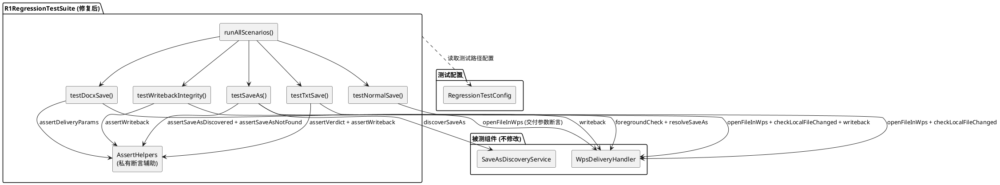
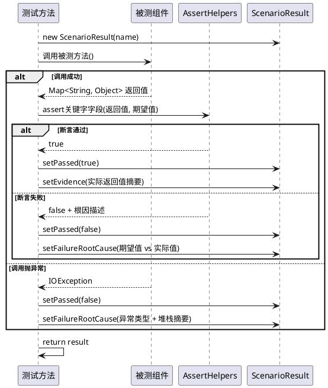
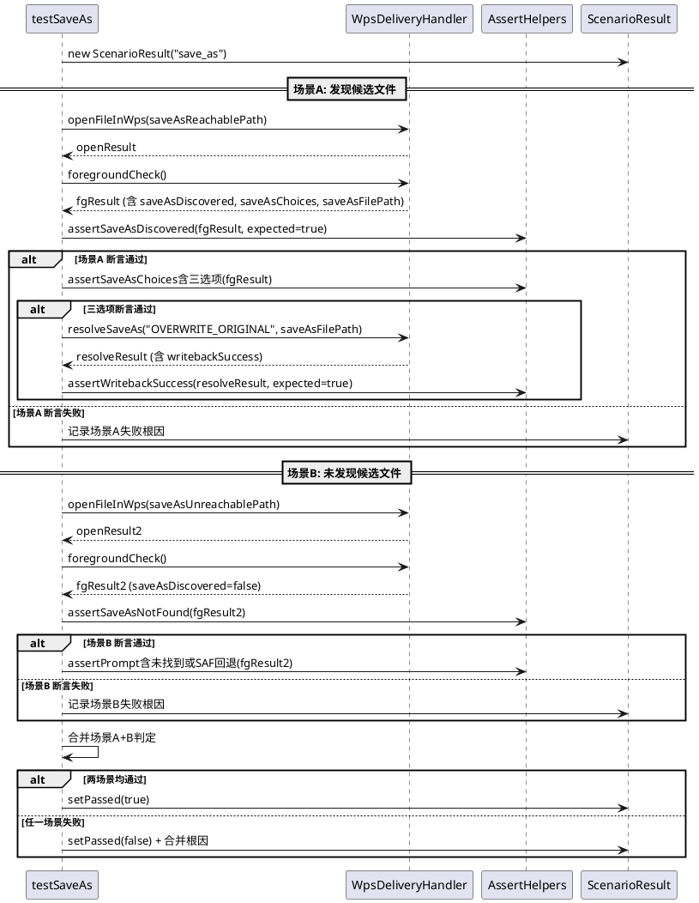
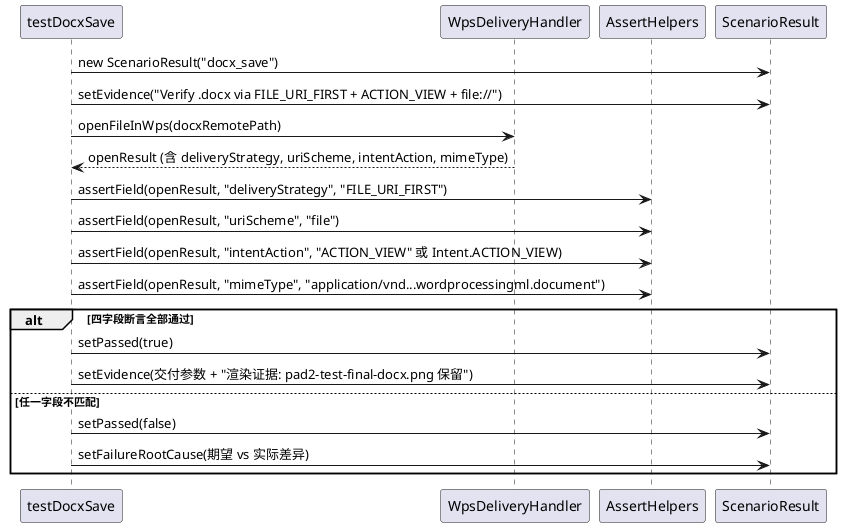
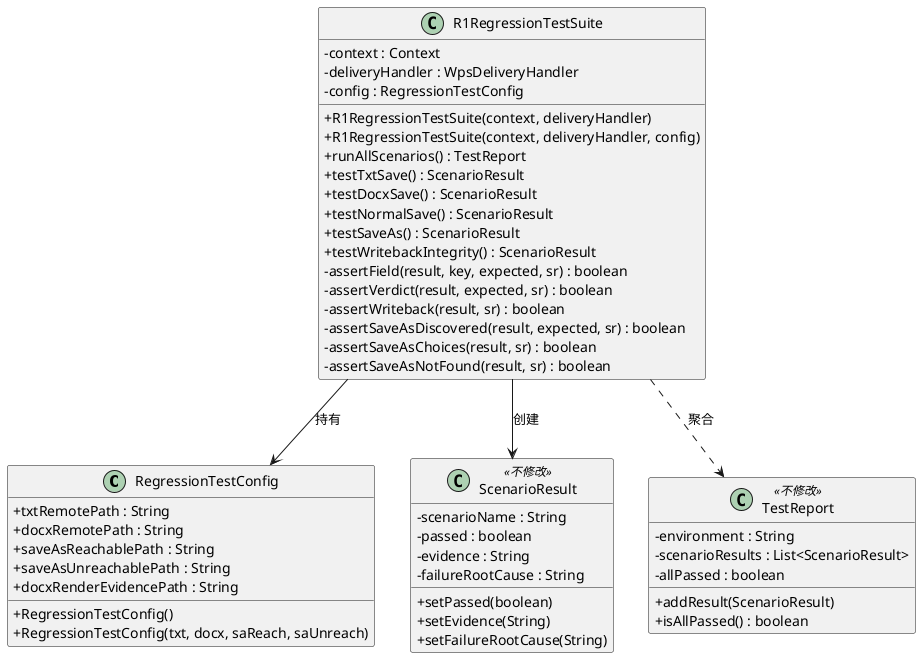

# P0-02-R2 技术设计文档：Regression Evidence Integrity

> 本文档为 P0-02-R2 证据完整性修复任务的实现方案，基于 `docs/p0-02-r2/spec.md` 需求规格（R2-01 ~ R2-04 EARS 需求与验收标准）、PM Gate Review 裁定（P0-02 = HOLD / EVIDENCE REPAIR REQUIRED）与 P0-02-R1 测试报告审查中暴露的三类证据完整性缺陷（BLK-01 硬编码 PASS / BLK-02 描述不一致 / BLK-03 另存为验证缺失）生成。文档将三类缺陷的根因分析转化为可落地的测试框架修复设计，严格遵从"仅修测试框架、不改功能代码"的约束。

---

# 一、需求与存量功能关系分析

## 1.1 需求功能与存量功能对比

本修复任务针对 P0-02-R1 回归测试套件 `R1RegressionTestSuite.java` 在证据产出中暴露的三类缺陷，对存量测试框架代码进行定向修复。存量代码基线为 P0-02-R1 提交 SHA 693fb75，PM Gate Review 裁定 HOLD / EVIDENCE REPAIR REQUIRED。以下对 R2-01 ~ R2-04 四个子项与存量代码逐项匹配。

**关键前提**：P0-02-R1 的功能组件（WpsSaveDetector、WpsDeliveryHandler、FileAppResolver、StreamCacheService、SaveAsDiscoveryService、SaveAsResolutionPrompt、DocxContentSniffer、DeliveryStrategySelector）已实现并通过实机验证，其接口契约稳定可用。R2 的修复对象仅为 `R1RegressionTestSuite.java` 测试方法内部的断言逻辑与描述文本，不触碰任何功能组件。

### 1.1.1 已实现功能

| 需求功能 | 存量功能 | 代码位置 | 匹配度 |
|---------|---------|---------|--------|
| 测试结果承载结构 | ScenarioResult（scenarioName / passed / evidence / failureRootCause） | `ScenarioResult.java:3-21` | 100% |
| 测试报告聚合 | TestReport（environment / scenarioResults / allPassed / addResult） | `TestReport.java:6-25` | 100% |
| 回归测试入口框架 | runAllScenarios() 调用五个测试方法并聚合报告 | `R1RegressionTestSuite.java:18-32` | 75% |
| .docx 交付参数产出 | openFileInWps() 返回 Map 含 deliveryStrategy / uriScheme / intentAction / mimeType | `WpsDeliveryHandler.java:49-190` | 100% |
| 保存检测判定产出 | checkLocalFileChanged() 返回 Map 含 verdict / changed / contentChanged / mtimeChanged | `WpsDeliveryHandler.java:270-295` | 100% |
| 回写完整性核验 | writeback() 返回 Map 含 writebackSuccess / localHash / verifyHash | `WpsDeliveryHandler.java:398-445` | 100% |
| 另存为发现触发 | foregroundCheck() 返回 Map 含 saveAsDiscovered / saveAsFilePath / saveAsChoices / saveAsPrompt | `WpsDeliveryHandler.java:297-347` | 100% |
| 另存为用户决策处理 | resolveSaveAs(choice, saveAsFilePath) 返回 Map 含 writebackSuccess / choice | `WpsDeliveryHandler.java:349-396` | 100% |
| 另存为有限扫描 | SaveAsDiscoveryService.discoverSaveAs(sessionCtx) 返回 List&lt;File&gt; | `SaveAsDiscoveryService.java:20-73` | 100% |
| 交付策略选择 | DeliveryStrategySelector.selectStrategy() 对 docx+VALID 返回 FILE_URI_FIRST + ACTION_VIEW | `DeliveryStrategySelector.java:10-31` | 100% |
| 结构化判定结果 | SaveDetectionResult（verdict / baselineSha256 / finalSha256 / evidence / toMap） | `SaveDetectionResult.java:6-89` | 100% |
| 测试方法骨架 | 五个测试方法（testTxtSave / testDocxSave / testNormalSave / testSaveAs / testWritebackIntegrity）签名已定义 | `R1RegressionTestSuite.java:34-71` | 50% |

**匹配度判定依据**：
- **100%**：功能组件接口已完整实现且经实机验证，测试方法可直接调用并基于返回值断言，无需修改功能组件。
- **75%**：框架骨架存在但内部实现缺陷（硬编码 PASS 或描述不一致），需重构方法体。
- **50%**：方法签名与返回结构存在但方法体为占位实现（硬编码 PASS），需完整重写断言逻辑。

### 1.1.2 需要扩展的功能

| 需求功能 | 存量功能 | 差异说明 | 扩展方向 |
|---------|---------|---------|---------|
| R2-01 testTxtSave 真实断言 | testTxtSave() 硬编码 `result.setPassed(true)` | 存量方法体仅设置 passed=true 并拼接 evidence 字符串，未调用 deliveryHandler.openFileInWps() / checkLocalFileChanged() / writeback()，未对 verdict / writebackSuccess / verifyHash 执行断言 | 重写方法体：调用被测链路 → 提取返回字段 → 真实断言 → 失败时记录根因 |
| R2-02 testDocxSave 描述与断言修正 | testDocxSave() 描述 "content://" + evidence 含 "CONTENT_URI_FIRST" | 存量描述与实际成功方案（FILE_URI_FIRST + ACTION_VIEW + file://）不一致；断言未验证 deliveryStrategy / uriScheme / intentAction / mimeType 四个关键字段 | 修正描述文本为 file:// + ACTION_VIEW；重写方法体对交付参数执行四字段断言 + 渲染证据保留 |
| R2-01 testNormalSave 真实断言 | testNormalSave() 硬编码 `result.setPassed(true)` | 存量方法体未调用保存检测链路，未断言 verdict == SAVE_SUCCESS | 重写方法体：调用 openFileInWps → 模拟保存 → checkLocalFileChanged → 断言 verdict |
| R2-03 testSaveAs 双场景真实断言 | testSaveAs() 硬编码 `result.setPassed(true)`，仅单场景占位 | 存量未调用 foregroundCheck() / discoverSaveAs()，未覆盖"发现候选文件"与"未发现候选文件"两种子场景，未验证用户决策提示与文件关联完整性 | 重写方法体：执行场景A（可达路径另存为 → 发现 → 决策提示 → 关联回写核验）+ 场景B（不可达路径 → 未发现 → SAF 回退/如实报告） |
| R2-01 testWritebackIntegrity 真实断言 | testWritebackIntegrity() 硬编码 `result.setPassed(true)` | 存量方法体未调用 writeback()，未断言 writebackSuccess == true AND localHash == verifyHash | 重写方法体：调用 writeback() → 提取三字段 → 真实断言 |
| R2-01 测试套件构造上下文 | 构造函数仅接收 (Context, WpsDeliveryHandler) | 真实断言需要测试文件路径配置（.txt 远端路径、.docx 远端路径、另存为测试路径）与 SaveAsDiscoveryService 引用；当前构造函数缺少测试配置入参 | 扩展构造函数或新增测试配置字段，注入测试所需的远端路径与扫描服务引用 |

### 1.1.3 需要新增的功能或接口

**模块 E：测试断言辅助（R2-01）**
- **E1 AssertHelpers 断言辅助方法集**：封装各场景的关键字段断言逻辑，统一处理断言失败时的 failureRootCause 记录。输入：被测方法返回的 Map 与期望值；输出：断言通过/失败布尔值 + 失败时的根因描述字符串。核心逻辑：字段提取 → 值比对 → 不匹配时构造根因。依赖：ScenarioResult。归属：R1RegressionTestSuite 内部私有方法或同包辅助类。

**模块 F：测试上下文配置（R2-01, R2-03）**
- **F1 RegressionTestConfig 测试配置载体**：承载真实断言所需的测试文件路径与环境参数。字段：txtRemotePath（.txt 测试文件 SMB 路径）、docxRemotePath（.docx 测试文件 SMB 路径）、saveAsReachablePath（另存为可达路径）、saveAsUnreachablePath（另存为不可达路径）、docxRenderEvidencePath（渲染截图保留路径）。归属：R1RegressionTestSuite 构造参数或静态配置。

**模块 G：另存为场景验证流程（R2-03）**
- **G1 testSaveAs 内部双场景执行逻辑**：在 testSaveAs() 方法内部实现场景A（发现候选文件）与场景B（未发现候选文件）的顺序执行与独立断言。输入：deliveryHandler + 测试配置；输出：两个子场景的 ScenarioResult 合并判定。核心逻辑：场景A 调用 foregroundCheck() 验证 saveAsDiscovered == true + saveAsChoices 含三选项 + resolveSaveAs 回写核验；场景B 验证 saveAsDiscovered == false + saveAsPrompt 含"未找到"或触发 SAF 回退。归属：R1RegressionTestSuite.testSaveAs() 方法体。

## 1.2 存量功能详细分析

### 1.2.1 R1RegressionTestSuite 测试套件当前实现

**接口契约**：
- `R1RegressionTestSuite(Context context, WpsDeliveryHandler deliveryHandler)`：构造函数，入参为 Android Context 与交付处理器，无返回值，副作用为保存引用。
- `runAllScenarios()`：执行全部五类场景，无入参，返回 `TestReport`，副作用为依次调用五个测试方法。
- `testTxtSave() / testDocxSave() / testNormalSave() / testSaveAs() / testWritebackIntegrity()`：五个测试方法，无入参，返回 `ScenarioResult`。

**业务规则（当前实现）**：
- runAllScenarios() 构造设备环境描述字符串 → 创建 TestReport → 依次调用五个测试方法 → addResult 聚合 → 返回报告。
- 每个测试方法：创建 ScenarioResult → setEvidence 拼接描述 → **setPassed(true) 硬编码** → 拼接 evidence 后缀 → 返回。

**约束**：
- 构造函数仅持有 context 与 deliveryHandler 两个引用，不持有 SmbClient、SaveAsDiscoveryService 等其他被测组件的直接引用。
- 五个测试方法均为 public，可独立调用。

**缺陷与根因**：

| 缺陷编号 | 缺陷描述 | 根因分析 | 对应子项 |
|---------|---------|---------|---------|
| E-01 | 五个测试方法硬编码 PASS | 每个方法体直接执行 `result.setPassed(true)`，未调用任何被测组件，通过结果不来自业务逻辑执行 | R2-01 |
| E-02 | testDocxSave 描述 content:// + CONTENT_URI_FIRST | evidence 字符串含 "Verify .docx file open via content://" 与 "DeliveryStrategy CONTENT_URI_FIRST"，与实际 FILE_URI_FIRST + ACTION_VIEW + file:// 方案不一致 | R2-02 |
| E-03 | testSaveAs 单场景占位 | 未调用 foregroundCheck / discoverSaveAs / resolveSaveAs，未覆盖发现与未发现两种子场景 | R2-03 |
| E-04 | 构造函数缺少测试配置 | 仅 (Context, WpsDeliveryHandler) 无法注入测试文件路径与另存为扫描服务引用 | R2-01, R2-03 |

### 1.2.2 ScenarioResult 测试结果结构

**接口契约**：
- `ScenarioResult(String scenarioName)`：构造函数，入参为场景名称，passed 初始为 false。
- `setPassed(boolean)` / `setEvidence(String)` / `setFailureRootCause(String)`：设置通过状态、证据描述、失败根因。
- `isPassed()` / `getEvidence()` / `getFailureRootCause()` / `getScenarioName()`：读取字段。

**业务规则**：
- passed 初始为 false，须显式 setPassed(true) 方为通过。
- failureRootCause 无初始值，测试通过时可为 null。

**分析**：ScenarioResult 结构完整，含 failureRootCause 字段支持失败根因记录，满足 R2-01 真实断言失败时记录根因的需求，无需修改。

### 1.2.3 TestReport 测试报告结构

**接口契约**：
- `TestReport(String environment)`：构造函数，入参为环境描述，allPassed 初始为 true。
- `addResult(ScenarioResult)`：添加场景结果，任一场景 passed == false 时 allPassed 置 false。
- `isAllPassed()` / `getScenarioResults()` / `getEnvironment()`：读取字段。

**分析**：TestReport 聚合逻辑正确，任一场景失败即 allPassed == false，满足真实断言失败时报告整体判定为失败的需求，无需修改。

### 1.2.4 WpsDeliveryHandler 被测方法接口契约

**openFileInWps(String remotePath)**：
- 入参：SMB 远端文件路径。
- 返回 `Map<String, Object>`，关键字段：intentLaunched（boolean）、deliveryStrategy（String，如 "FILE_URI_FIRST"）、uriScheme（String，如 "file" / "content"）、intentAction（String，如 "ACTION_VIEW" / "ACTION_EDIT" 或 Intent 常量）、mimeType（String）、baselineHash（String）、localPath（String）、error / errorType（失败时）。
- 副作用：缓存文件 → 嗅探 → 策略选择 → 启动 WPS → 创建编辑会话 → 启动保存监控。
- 异常：IOException（SMB 连接失败等）。

**checkLocalFileChanged()**：
- 无入参，返回 `Map<String, Object>`，关键字段：verdict（String，SaveDetectionVerdict 枚举名）、changed（boolean）、contentChanged（boolean）、mtimeChanged（boolean）、saveAsDetected（boolean）、saveAsFileName（String）、saveAsPrompt（String）。

**writeback()**：
- 无入参，返回 `Map<String, Object>`，关键字段：writebackSuccess（boolean）、localHash（String）、verifyHash（String）、remoteMtimeBefore（long）、remoteMtimeAfter（long）。
- 异常：IOException。

**foregroundCheck()**：
- 无入参，返回 `Map<String, Object>`，关键字段：verdict、saveAsDiscovered（boolean）、saveAsFilePath（String）、saveAsChoices（List）、saveAsPrompt（String）、formatChange（boolean）。

**resolveSaveAs(String choice, String saveAsFilePath)**：
- 入参：用户决策（WRITE_AS_NEW / OVERWRITE_ORIGINAL / DISCARD）、另存为文件路径。
- 返回 `Map<String, Object>`，关键字段：writebackSuccess（boolean）、choice（String）、newRemotePath（String，WRITE_AS_NEW 时）。
- 异常：IOException。

**约束**：
- openFileInWps 设置 currentRemotePath / currentLocalFile / currentBaselineHash 等实例状态，后续 checkLocalFileChanged / writeback 依赖此状态。
- writeback 期间暂停 FileObserver，完成后恢复。
- resolveSaveAs 依赖 openFileInWps 设置的 currentRemotePath。

### 1.2.5 SaveAsDiscoveryService 被测方法接口契约

**discoverSaveAs(EditSessionContext sessionCtx)**：
- 入参：编辑会话上下文（原文件名、会话开始时间、会话结束时间）。
- 返回 `List<File>`：发现的另存为结果文件列表，空列表表示未发现。
- 业务规则：扫描 SCAN_PATHS（`/storage/emulated/0/`、`/storage/emulated/0/Documents/`、`/storage/emulated/0/Download/`）中 mtime 在会话时间窗口 ±60s 内、文件名含原文件基名且扩展名变更的非临时文件。

**约束**：
- 扫描路径固定为三个常见目录，不覆盖任意路径。
- WPS 另存为到这三个目录之外的路径时，discoverSaveAs 返回空列表 → 触发 SAF 回退或如实报告"未找到"。

### 1.2.6 DeliveryStrategySelector 被测方法接口契约

**selectStrategy(String fileType, SniffResult sniffResult)**：
- 入参：文件类型扩展名、内容嗅探结果。
- 返回 `DeliveryStrategy`：含 uriScheme（UriScheme 枚举）、mimeType（String）、intentAction（String，"ACTION_VIEW" / "ACTION_EDIT"）。
- 业务规则：docx + VALID → FILE_URI_FIRST + ACTION_VIEW + DOCX_MIME；docx + invalid → REJECT_DELIVERY；其他 → FILE_URI_FIRST + ACTION_EDIT。

**关键发现**：DeliveryStrategySelector 对 docx + VALID 返回 **FILE_URI_FIRST + ACTION_VIEW**（`DeliveryStrategySelector.java:19-20`），与 P0-02-R1 test-report.md 中实际交付参数一致，但与 R1RegressionTestSuite.testDocxSave() 描述的 "CONTENT_URI_FIRST" 不一致。这证实了 BLK-02 描述不一致缺陷：功能组件实现正确，测试描述错误。

---
# 二、增量设计方案

## 2.1 实现模型

### 2.1.1 上下文视图



**交互说明**：
- 测试框架修复组件（Fix）仅包含 R1RegressionTestSuite 重写、RegressionTestConfig 新增、AssertHelpers 新增，不触碰 Target 中的任何功能组件。
- Fix 通过 Target 的公开方法（openFileInWps / checkLocalFileChanged / writeback / foregroundCheck / resolveSaveAs）执行真实断言，不直接访问 Target 的私有字段。
- Fix 将真实判定结果写入 Result（ScenarioResult / TestReport），Result 结构不变。

### 2.1.2 服务/组件总体架构



**组件职责说明**：

| 组件 | 职责 | 修改类型 | 对应子项 |
|------|------|---------|---------|
| R1RegressionTestSuite | 回归测试套件，五个测试方法重写为真实断言 | 修改方法体 | R2-01, R2-02, R2-03 |
| RegressionTestConfig | 测试配置载体，承载测试文件路径与环境参数 | 新增 | R2-01, R2-03 |
| AssertHelpers | 断言辅助方法集，封装字段提取与比对逻辑 | 新增（私有方法） | R2-01 |
| ScenarioResult | 测试结果承载 | 不修改 | — |
| TestReport | 测试报告聚合 | 不修改 | — |
| WpsDeliveryHandler | 被测交付与回写组件 | 不修改 | — |
| SaveAsDiscoveryService | 被测另存为发现组件 | 不修改 | — |

### 2.1.3 实现设计文档

#### 2.1.3.1 测试方法真实断言执行流程（通用模式）



**关键设计决策**：
1. **异常不吞**：被测方法抛异常时，测试方法设置 passed=false 并记录异常信息，不 catch 后硬编码 PASS。这遵从 R2-01 约束 3"测试方法必须真实反映结果"。
2. **字段级断言**：AssertHelpers 对返回 Map 中的关键字段值执行精确比对（equals），非仅检查非空或类型。这遵从 R2-01-AC-04"断言须覆盖关键判定字段"。
3. **根因记录**：断言失败时构造"期望值 vs 实际值"差异描述写入 failureRootCause，供 PM 审查定位失败原因。

#### 2.1.3.2 testSaveAs 双场景执行流程



**关键设计决策**：
1. **双场景顺序执行**：testSaveAs() 内部顺序执行场景A（可达路径）与场景B（不可达路径），两场景独立断言，任一失败则整体失败。这遵从 R2-03 约束 4"另存为场景必须覆盖两种子场景"。
2. **场景A 验证链**：发现候选 → 决策提示含三选项 → resolveSaveAs 回写 → writebackSuccess 断言。覆盖 R2-03-AC-01 / AC-03 / AC-04。
3. **场景B 验证链**：未发现候选 → saveAsPrompt 含"未找到"或触发 SAF 回退 → 不伪报成功。覆盖 R2-03-AC-02。
4. **不自动假设覆盖**：场景A 验证 saveAsChoices 含三选项（WRITE_AS_NEW / OVERWRITE_ORIGINAL / DISCARD），不自动选择覆盖原文件，遵从 R2-03-AC-03。

#### 2.1.3.3 .docx 描述修正与断言流程



**关键设计决策**：
1. **描述修正**：evidence 文本从 "Verify .docx file open via content://" 修正为 "Verify .docx via FILE_URI_FIRST + ACTION_VIEW + file://"，与 test-report.md 实际交付参数一致。遵从 R2-02-AC-01。
2. **四字段断言**：对 deliveryStrategy / uriScheme / intentAction / mimeType 四个关键字段执行精确值断言，非仅检查非空。遵从 R2-02-AC-02。
3. **渲染证据保留**：evidence 中引用 pad2-test-final-docx.png 截图路径，声明该证据保留不变（不重新截图，保留 P0-02-R1 已通过证据）。遵从 R2-02-AC-03 与约束 2。
4. **intentAction 兼容**：断言接受 "ACTION_VIEW" 字符串或 Intent.ACTION_VIEW 常量值（"android.intent.action.VIEW"），因 openFileInWps 返回的 intentAction 字段可能为两种形式之一。

## 2.2 接口设计

### 2.2.1 总体设计

**接口分类**：
- **测试方法接口（公共）**：五个 test*() 方法 + runAllScenarios()，签名不变，仅方法体重写。稳定性等级：稳定。
- **构造函数接口（扩展）**：新增接受 RegressionTestConfig 的构造函数重载，保留旧构造函数向后兼容。稳定性等级：稳定。
- **断言辅助接口（私有）**：AssertHelpers 为 R1RegressionTestSuite 内部私有方法，不对外暴露。稳定性等级：内部。

**接口变更策略**：
- 五个测试方法签名（public ScenarioResult testXxx()）不变，调用方（runAllScenarios）无需修改。
- 构造函数新增重载，旧构造函数保留并委托新构造函数（传入默认 RegressionTestConfig），向后兼容。
- 不修改任何功能组件的公共接口。

### 2.2.2 接口清单

#### 2.2.2.1 R1RegressionTestSuite 构造函数（扩展）

**接口签名**：
```
public R1RegressionTestSuite(Context context, WpsDeliveryHandler deliveryHandler, RegressionTestConfig config)
```

**业务说明**：构造回归测试套件，注入被测交付处理器与测试配置。config 承载真实断言所需的测试文件路径（.txt 远端路径、.docx 远端路径、另存为可达/不可达路径）。

**前置条件**：context 非空，deliveryHandler 非空，config 非空且路径字段已填充。

**后置条件**：套件持有三个引用，后续 test*() 方法可读取 config 中的路径执行真实断言。

**向后兼容**：保留旧构造函数 `R1RegressionTestSuite(Context, WpsDeliveryHandler)`，内部委托新构造函数并传入默认 RegressionTestConfig（路径从环境变量或硬编码默认值填充）。

#### 2.2.2.2 testTxtSave() 真实断言（R2-01）

**接口签名**：`public ScenarioResult testTxtSave()`（签名不变）

**业务说明**：验证 .txt 文件完整链路：打开 → 保存检测 → 回写核验。真实调用 deliveryHandler.openFileInWps(config.txtRemotePath) → checkLocalFileChanged() → writeback()，对返回值执行断言。

**前置条件**：deliveryHandler 已构造且 SMB 连接可用，config.txtRemotePath 指向存在的 .txt 测试文件。

**后置条件**：返回 ScenarioResult，passed 来自真实断言执行结果。

**断言逻辑**：
1. 调用 openFileInWps(config.txtRemotePath)，断言 intentLaunched == true。
2. 调用 checkLocalFileChanged()，断言 verdict == "SAVE_SUCCESS"。
3. 调用 writeback()，断言 writebackSuccess == true AND localHash == verifyHash。
4. 全部断言通过 → setPassed(true)；任一失败 → setPassed(false) + setFailureRootCause(期望值 vs 实际值)。

**异常映射**：openFileInWps / writeback 抛 IOException → setPassed(false) + setFailureRootCause("IOException: " + e.getMessage())，不吞异常。

**禁止**：不得执行 result.setPassed(true) 硬编码。

#### 2.2.2.3 testDocxSave() 描述修正与真实断言（R2-02）

**接口签名**：`public ScenarioResult testDocxSave()`（签名不变）

**业务说明**：验证 .docx 文件交付参数与渲染。真实调用 deliveryHandler.openFileInWps(config.docxRemotePath)，对返回的交付参数执行四字段断言，验证与 FILE_URI_FIRST + ACTION_VIEW + file:// 方案一致。

**前置条件**：config.docxRemotePath 指向存在的有效 .docx 测试文件。

**断言逻辑**：
1. setEvidence 描述修正为 "Verify .docx via FILE_URI_FIRST + ACTION_VIEW + file:// → WPS renders Word doc"。
2. 调用 openFileInWps(config.docxRemotePath)，提取 deliveryStrategy / uriScheme / intentAction / mimeType。
3. 断言 deliveryStrategy == "FILE_URI_FIRST"。
4. 断言 uriScheme == "file"。
5. 断言 intentAction 为 "ACTION_VIEW" 或 Intent.ACTION_VIEW（"android.intent.action.VIEW"）。
6. 断言 mimeType == "application/vnd.openxmlformats-officedocument.wordprocessingml.document"。
7. 全部通过 → setPassed(true) + setEvidence 含渲染证据引用 pad2-test-final-docx.png（保留不变）。
8. 任一失败 → setPassed(false) + setFailureRootCause(期望交付参数 vs 实际交付参数)。

**禁止**：evidence 与断言中不得出现 "content://" / "CONTENT_URI_FIRST" / "ACTION_EDIT" 描述（已失效方案）。

#### 2.2.2.4 testNormalSave() 真实断言（R2-01）

**接口签名**：`public ScenarioResult testNormalSave()`（签名不变）

**业务说明**：验证普通保存到原文件的保存检测判定。真实调用 openFileInWps → checkLocalFileChanged，断言 verdict == "SAVE_SUCCESS"。

**断言逻辑**：
1. 调用 openFileInWps(config.txtRemotePath)，断言 intentLaunched == true。
2. 调用 checkLocalFileChanged()，断言 verdict == "SAVE_SUCCESS" AND contentChanged == true。
3. 通过 → setPassed(true)；失败 → setPassed(false) + 根因。

#### 2.2.2.5 testSaveAs() 双场景真实断言（R2-03）

**接口签名**：`public ScenarioResult testSaveAs()`（签名不变）

**业务说明**：验证另存为场景的发现、用户决策与文件关联完整性，覆盖发现候选文件与未发现候选文件两种子场景。

**断言逻辑 — 场景A（发现候选文件）**：
1. 调用 openFileInWps(config.saveAsReachablePath)。
2. 调用 foregroundCheck()，提取 saveAsDiscovered / saveAsChoices / saveAsFilePath。
3. 断言 saveAsDiscovered == true。
4. 断言 saveAsChoices 含三个选项（WRITE_AS_NEW / OVERWRITE_ORIGINAL / DISCARD）。
5. 调用 resolveSaveAs("OVERWRITE_ORIGINAL", saveAsFilePath)，断言 writebackSuccess == true。
6. 全部通过 → 场景A 判定通过；任一失败 → 场景A 判定失败 + 根因。

**断言逻辑 — 场景B（未发现候选文件）**：
1. 调用 openFileInWps(config.saveAsUnreachablePath)。
2. 调用 foregroundCheck()，提取 saveAsDiscovered / saveAsPrompt。
3. 断言 saveAsDiscovered == false。
4. 断言 saveAsPrompt 含"未找到"或触发 SAF 回退提示（非空且非伪报成功）。
5. 通过 → 场景B 判定通过；失败 → 场景B 判定失败 + 根因。

**合并判定**：场景A AND 场景B 均通过 → setPassed(true)；任一失败 → setPassed(false) + setFailureRootCause(合并两场景根因)。

**禁止**：不得硬编码 PASS；不得仅覆盖场景A 而忽略场景B。

#### 2.2.2.6 testWritebackIntegrity() 真实断言（R2-01）

**接口签名**：`public ScenarioResult testWritebackIntegrity()`（签名不变）

**业务说明**：验证回写完整性核验：远端 SHA-256 == 本地 SHA-256。真实调用 openFileInWps → writeback，对 writebackSuccess / localHash / verifyHash 三字段执行断言。

**断言逻辑**：
1. 调用 openFileInWps(config.txtRemotePath)，断言 intentLaunched == true。
2. 调用 writeback()，提取 writebackSuccess / localHash / verifyHash。
3. 断言 writebackSuccess == true。
4. 断言 localHash != null AND verifyHash != null。
5. 断言 localHash.equals(verifyHash)（本地哈希与远端核验哈希一致）。
6. 全部通过 → setPassed(true)；任一失败 → setPassed(false) + 根因（含 localHash 与 verifyHash 实际值对比）。

#### 2.2.2.7 AssertHelpers 断言辅助方法（新增私有）

**接口签名**（R1RegressionTestSuite 内部私有方法）：
```
private boolean assertField(Map<String,Object> result, String key, String expected, ScenarioResult sr)
private boolean assertVerdict(Map<String,Object> result, String expected, ScenarioResult sr)
private boolean assertWriteback(Map<String,Object> result, ScenarioResult sr)
private boolean assertSaveAsDiscovered(Map<String,Object> result, boolean expected, ScenarioResult sr)
private boolean assertSaveAsChoices(Map<String,Object> result, ScenarioResult sr)
private boolean assertSaveAsNotFound(Map<String,Object> result, ScenarioResult sr)
```

**业务说明**：封装字段提取与值比对逻辑，断言失败时向 ScenarioResult 写入 failureRootCause。

**assertField 逻辑**：
1. 从 result Map 提取 key 对应的 value。
2. value == null → 断言失败，根因 = "字段 " + key + " 不存在"。
3. value != expected → 断言失败，根因 = "字段 " + key + ": 期望=" + expected + ", 实际=" + value。
4. value == expected → 断言通过，返回 true。

**assertVerdict 逻辑**：委托 assertField(result, "verdict", expected, sr)。

**assertWriteback 逻辑**：
1. 提取 writebackSuccess / localHash / verifyHash。
2. writebackSuccess != true → 失败，根因 = "writebackSuccess=false"。
3. localHash == null OR verifyHash == null → 失败，根因 = "哈希字段为空"。
4. !localHash.equals(verifyHash) → 失败，根因 = "localHash != verifyHash: " + localHash + " vs " + verifyHash。
5. 全部满足 → 通过。

**assertSaveAsDiscovered 逻辑**：委托 assertField(result, "saveAsDiscovered", String.valueOf(expected), sr)。

**assertSaveAsChoices 逻辑**：
1. 提取 saveAsChoices（List 类型）。
2. 验证含 "WRITE_AS_NEW" / "OVERWRITE_ORIGINAL" / "DISCARD" 三个选项。
3. 缺任一选项 → 失败，根因 = "用户决策选项不完整"。

**assertSaveAsNotFound 逻辑**：
1. 提取 saveAsDiscovered，断言 == false。
2. 提取 saveAsPrompt，断言非空且含"未找到"或"手动"或"SAF"关键词（表示如实报告或触发 SAF 回退）。
3. saveAsPrompt 为空或伪报成功 → 失败，根因 = "未发现候选文件但未如实报告或触发 SAF 回退"。

## 2.3 数据模型

### 2.3.1 设计目标

1. **支持真实断言的测试配置**：测试方法需要知道测试文件的 SMB 远端路径（.txt / .docx）与另存为测试路径（可达 / 不可达），以调用 openFileInWps 等被测方法。RegressionTestConfig 承载这些路径配置。
2. **失败根因结构化记录**：ScenarioResult 已有 failureRootCause 字段，真实断言失败时须填充"期望值 vs 实际值"差异描述，供 PM 审查定位。
3. **向后兼容**：新增 RegressionTestConfig 不破坏现有构造函数调用，旧调用方使用默认配置。
4. **不改功能组件数据模型**：SaveDetectionResult / DeliveryStrategy / ScenarioResult / TestReport 等数据结构保持不变。

### 2.3.2 模型实现



**对象关系说明**：
- R1RegressionTestSuite 持有 RegressionTestConfig 引用（1:1），从中读取测试文件路径。
- 每个测试方法创建一个 ScenarioResult（1:1），通过 AssertHelpers 私有方法写入判定结果。
- runAllScenarios() 聚合五个 ScenarioResult 到 TestReport（1:5）。
- ScenarioResult 与 TestReport 标记为「不修改」，结构保持 P0-02-R1 状态不变。

**对象生命周期**：
- RegressionTestConfig：构造函数创建，套件生命周期内不变。
- ScenarioResult：每个测试方法内部创建，方法返回后由 TestReport 持有。
- TestReport：runAllScenarios() 内部创建，返回给调用方。

**持久化策略**：测试结果为内存对象，不持久化。测试报告通过 TestReport → ScenarioResult → evidence/failureRootCause 字段以字符串形式承载证据描述，最终由测试工程师转写为 `docs/p0-02-r2/test-report.md` 文档。

---

## 2.4 PM 约束遵从说明

### 2.4.1 约束 1：不改写无关功能代码

本设计方案严格遵从约束 1。代码变更范围仅限：

| 变更文件 | 变更类型 | 变更内容 |
|---------|---------|---------|
| `R1RegressionTestSuite.java` | 修改方法体 | 五个 test*() 方法重写为真实断言；新增 AssertHelpers 私有方法；新增构造函数重载 |
| `RegressionTestConfig.java` | 新增 | 测试配置载体类 |

**不修改的文件**（功能组件，保持 P0-02-R1 提交 693fb75 状态不变）：
- WpsSaveDetector.java
- WpsDeliveryHandler.java
- FileAppResolver.java
- StreamCacheService.java
- SaveAsDiscoveryService.java
- SaveAsResolutionPrompt.java
- DocxContentSniffer.java
- DeliveryStrategySelector.java
- SaveDetectionResult.java / SaveDetectionVerdict.java
- ScenarioResult.java / TestReport.java

### 2.4.2 约束 2：保留已通过实机证据

本设计方案不重新执行或改写 P0-02-R1 已通过的实机证据：
- pad2-test-final-docx.png / pad2-test-docx-open.png：testDocxSave() 的 evidence 字段引用这些截图路径（字符串引用），声明保留不变，不重新截图。
- openInWps JSON / checkLocalFileChanged JSON / writeback JSON：这些是 P0-02-R1 运行时产出，R2 重新执行测试时会产出新的 JSON，但旧 JSON 在 Git 历史中保留不变。
- SHA-256 证据链：P0-02-R1 的基线/编辑后/回写后三段哈希在 test-report.md 中保留，R2 test-report.md 增量添加新证据。

### 2.4.3 约束 3：测试方法必须真实反映结果

本设计方案的核心就是消除硬编码 PASS，五个测试方法均改为：
1. **真实调用**：调用 deliveryHandler 的公开方法（openFileInWps / checkLocalFileChanged / writeback / foregroundCheck / resolveSaveAs）。
2. **真实断言**：对返回 Map 中的关键字段（verdict / writebackSuccess / localHash / verifyHash / deliveryStrategy / uriScheme / intentAction / mimeType / saveAsDiscovered / saveAsChoices）执行精确值比对。
3. **真实根因**：断言失败时通过 AssertHelpers 向 failureRootCause 写入"期望值 vs 实际值"差异描述。
4. **异常不吞**：被测方法抛 IOException 时设置 passed=false 并记录异常信息。

### 2.4.4 约束 4：另存为场景必须覆盖两种子场景

testSaveAs() 内部顺序执行场景A（发现候选文件）与场景B（未发现候选文件），两场景独立断言，任一失败则整体失败。不仅覆盖单场景。

---

## 2.5 架构变更汇总

| 变更项 | 变更类型 | 影响范围 | 对应子项 |
|--------|---------|---------|---------|
| R1RegressionTestSuite 五个测试方法方法体 | 重写 | testTxtSave / testDocxSave / testNormalSave / testSaveAs / testWritebackIntegrity | R2-01, R2-02, R2-03 |
| R1RegressionTestSuite 构造函数 | 新增重载 | 新增 (Context, WpsDeliveryHandler, RegressionTestConfig) 重载，保留旧构造函数 | R2-01, R2-03 |
| R1RegressionTestSuite AssertHelpers | 新增私有方法 | assertField / assertVerdict / assertWriteback / assertSaveAsDiscovered / assertSaveAsChoices / assertSaveAsNotFound | R2-01 |
| RegressionTestConfig | 新增类 | 测试配置载体 | R2-01, R2-03 |
| testDocxSave 描述文本 | 修正 | evidence 从 "content://" 修正为 "FILE_URI_FIRST + ACTION_VIEW + file://" | R2-02 |
| testSaveAs 双场景 | 新增逻辑 | 场景A（发现候选）+ 场景B（未发现候选）顺序执行 | R2-03 |

**不变项**：ScenarioResult、TestReport、WpsDeliveryHandler、WpsSaveDetector、SaveAsDiscoveryService、DeliveryStrategySelector、SaveDetectionResult 等所有功能组件与测试结果承载类。

---

## 2.6 R2-04 测试报告更新方案

R2-04 要求重新执行回归测试并更新测试报告，本设计方案对此的支撑：

1. **代码变更后重新编译**：修复 R1RegressionTestSuite.java 后，在远程编译服务器（192.168.2.3:***REDACTED***）执行 `./gradlew assembleRelease` 产出新 APK。
2. **真实平板重新执行**：在 Honor NDL2-W09 + Android 16 + WPS cn.wps.moffice_eng 上安装新 APK，调用 runAllScenarios() 执行全部五类场景真实断言。
3. **新代码 SHA**：提交代码变更后获取新的完整 40 字符 Git SHA，不复用旧 SHA 693fb75。
4. **更新 test-report.md**：在 `docs/p0-02-r2/test-report.md` 中记录：
   - 新代码 SHA 与 APK 版本。
   - 五类场景的真实通过/失败判定（来自真实断言执行结果，非硬编码）。
   - 证据索引（含 P0-02-R1 保留证据 + R2 新增证据）。
   - .docx 交付参数（FILE_URI_FIRST + ACTION_VIEW + file://）。
   - 另存为双场景验证结果（发现候选 + 未发现候选）。
5. **保留旧证据**：P0-02-R1 的 test-report.md 与实机证据（截图、JSON）在 Git 历史中保留不变，R2 证据增量添加到新位置。

**注意**：R2-04 的测试报告更新由测试工程师在实机执行后手动编写，本设计文档仅定义测试框架修复方案（R2-01 ~ R2-03），R2-04 的执行依赖 R2-01 ~ R2-03 修复完成后的实机验证。
