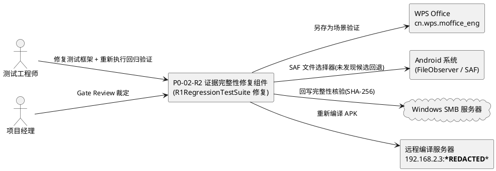
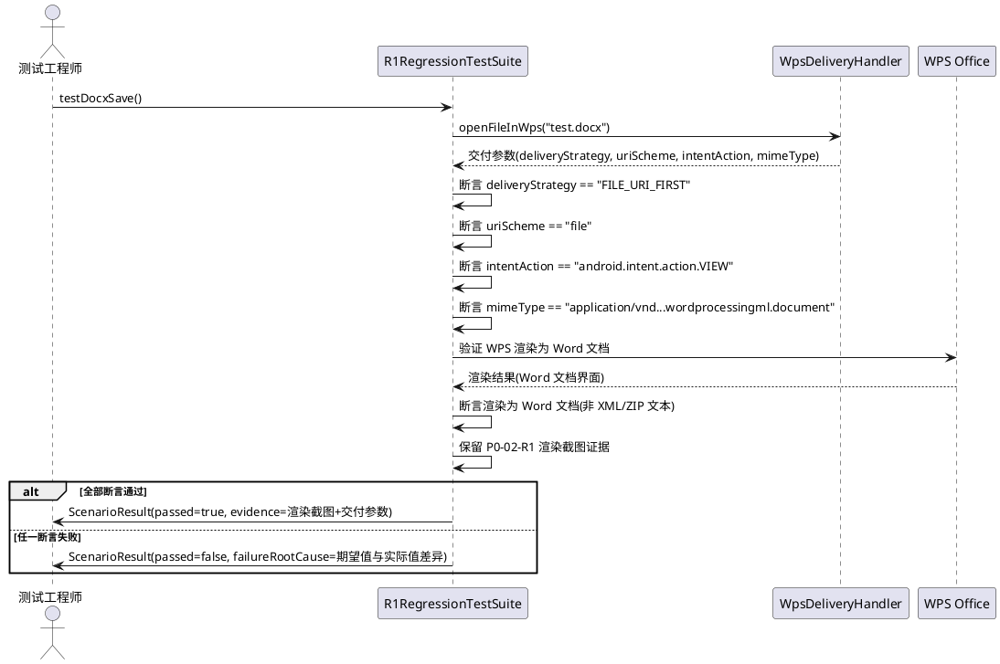
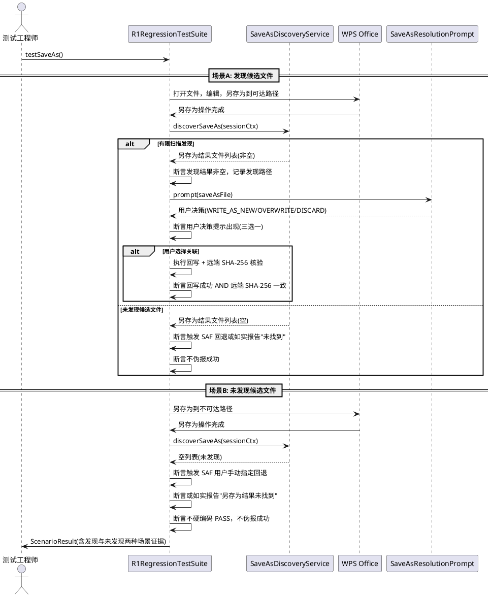
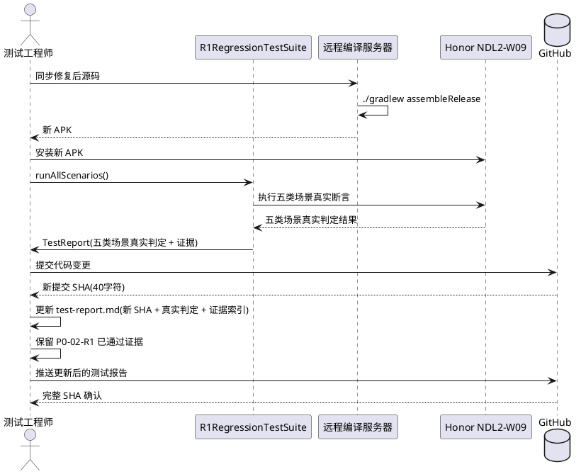

# P0-02-R2 需求规格：Regression Evidence Integrity

> 本文档为 P0-02-R2 证据完整性修复任务的需求规格，基于 PM Gate Review 对 P0-02-R1 的裁定（P0-02 = HOLD / EVIDENCE REPAIR REQUIRED，P0-03 = NOT AUTHORIZED）与 P0-02-R1 测试报告审查中暴露的三类证据完整性缺陷生成。文档定义 R2-01 ~ R2-04 四个子项的 EARS 格式需求、验收标准、PM 约束与测试环境要求。所有业务规则采用可测试的验收条件（触发场景 → 预期行为）描述。

> **文档定位**：本规格为 P0-02-R1 回归测试证据完整性的定向修复需求，不替代 `docs/p0-02-r1/spec.md`（R1 功能修复需求规格）中的功能定义，而是针对 R1 回归测试套件（`R1RegressionTestSuite.java`）在证据产出中暴露的框架性缺陷定义修复验收标准。P0-03（安全回写）在 P0-02-R2 通过前不被授权启动。

> **前置基线**：P0-02-R1 提交 SHA 693fb75ffcacaf8563d30b34d46d9c139d9a2495，PM 裁定 HOLD / EVIDENCE REPAIR REQUIRED。

---

# 1. 组件定位

## 1.1 核心职责

本修复任务负责修正 P0-02-R1 回归测试套件在证据产出中暴露的三类缺陷：测试方法硬编码 PASS、.docx 测试描述与实际方案不一致、另存为场景验证缺失，使回归测试证据达到可被 PM Gate Review 接受的完整性与真实性。

## 1.2 核心输入

1. **P0-02-R1 回归测试套件源码**：`R1RegressionTestSuite.java` 中五个测试方法（testTxtSave / testDocxSave / testNormalSave / testSaveAs / testWritebackIntegrity）的当前实现，含硬编码 `result.setPassed(true)` 语句。
2. **P0-02-R1 测试报告**：`docs/p0-02-r1/test-report.md` 中声明的测试结果与证据，含 .docx 交付参数（FILE_URI_FIRST + ACTION_VIEW + file://）与 SHA-256 证据链。
3. **P0-02-R1 实测证据**：已通过的实机证据（.docx 渲染截图、.txt 保存检测 JSON、SHA-256 回写 JSON），须保留不得破坏。
4. **PM Gate Review 裁定**：P0-02 = HOLD / EVIDENCE REPAIR REQUIRED，P0-03 = NOT AUTHORIZED，含三项阻断项与五项具体工作要求。
5. **实际 .docx 交付方案**：FILE_URI_FIRST + ACTION_VIEW + file:// URI（经实测验证为正确渲染方案），区别于 R1 设计文档中描述的 CONTENT_URI_FIRST + content:// 方案。

## 1.3 核心输出

1. **真实断言的回归测试套件**：五个测试方法改为真实执行断言，条件不满足时测试方法必须失败，不得硬编码 PASS。
2. **修正的 .docx 测试描述**：testDocxSave() 的描述与断言与实际采用的 FILE_URI_FIRST + ACTION_VIEW + file:// 方案一致。
3. **另存为场景完整验证证据**：覆盖"发现候选文件"与"未发现候选文件"两种场景的实测结果，含另存为发现、用户决策与文件关联完整性的证据记录。
4. **更新的测试报告**：重新执行回归测试后产出的完整测试报告，含新的代码 SHA、通过/失败判定与证据索引。
5. **保留的已通过实机证据**：.docx 渲染证据、.txt 保存检测证据、SHA-256 回写证据须原样保留，不得因测试框架修复而破坏。

## 1.4 职责边界

本修复任务**不负责**以下事项：

1. **不负责**改写无关功能代码：WpsSaveDetector、WpsDeliveryHandler、FileAppResolver、StreamCacheService 等功能组件的逻辑须保持 P0-02-R1 提交 693fb75 的状态不变，仅修复 `R1RegressionTestSuite.java` 测试框架自身的证据完整性缺陷。
2. **不负责**重新实现 R1-01 ~ R1-05 的功能需求：R1 功能修复已在 P0-02-R1 完成，本任务仅修复回归测试套件对功能修复的验证方式。
3. **不负责**修改 .docx 交付策略：实际成功的 FILE_URI_FIRST + ACTION_VIEW + file:// 方案须保留不变，仅修正测试描述使其与实际方案一致。
4. **不负责** P0-03（安全回写）的实现：P0-03 在 P0-02-R2 通过前不被授权启动。
5. **不负责**为修复测试框架而重复改写已通过验证的功能：已通过的实机证据（.docx 渲染、.txt 保存检测、SHA-256 回写）须原样保留，不得重复验证或改写。

---

# 2. 领域术语

**硬编码 PASS**
: 测试方法中直接执行 `result.setPassed(true)` 而不实际执行对应业务逻辑断言的行为。硬编码 PASS 使测试方法无论实际条件是否满足均报告通过，无法真实反映被测功能的状态。
: 备注：P0-02-R2 须修正的核心缺陷之一，R1RegressionTestSuite.java 五个测试方法均存在此问题。

**真实断言**
: 测试方法中实际执行被测业务逻辑并基于执行结果判定通过/失败的行为。真实断言要求：条件满足时测试通过，条件不满足时测试失败，不得绕过业务逻辑直接设置结果。
: 备注：R2-01 要求的修复目标，替代硬编码 PASS。

**证据完整性**
: 回归测试产出的证据须真实、一致、完备。真实指测试方法实际执行被测逻辑而非硬编码结果；一致指测试描述与实际方案相符；完备指所有声明的场景均有实测证据覆盖。
: 备注：P0-02-R2 的核心修复目标，含真实性、一致性、完备性三个维度。

**描述不一致**
: 测试方法的文档描述或断言条件与实际采用的实现方案不匹配的现象。P0-02-R1 中 testDocxSave() 描述的是 content:// URI + CONTENT_URI_FIRST 方案，但实际成功方案是 file:// URI + FILE_URI_FIRST + ACTION_VIEW。
: 备注：P0-02-R2 须修正的核心缺陷之一。

**另存为验证缺失**
: 回归测试声明覆盖另存为场景（testSaveAs），但测试报告中未提供足以确认另存为发现、用户决策及文件关联完整性的实测结果的现象。
: 备注：P0-02-R2 须修正的核心缺陷之一，须覆盖发现候选文件与未发现候选文件两种场景。

**FILE_URI_FIRST + ACTION_VIEW 方案**
: .docx 文件交付的实际成功方案，使用 file:// URI（Uri.fromFile）+ ACTION_VIEW（android.intent.action.VIEW）+ MIME type application/vnd.openxmlformats-officedocument.wordprocessingml.document 启动 WPS，触发 WPS Word 文档渲染器正确渲染。
: 备注：经 Honor NDL2-W09 + Android 16 + WPS cn.wps.moffice_eng 实测验证为正确方案。区别于 ACTION_EDIT（触发 WPS 文本编辑器显示原始 XML）与 content:// URI 方案。

**另存为候选文件**
: WPS 执行另存为操作后产生的新文件，可能位于监控范围外（如 `/storage/emulated/0/` 根目录），须通过有限扫描或用户手动指定发现。
: 备注：R2-03 要求验证的另存为发现场景的核心对象。

**未发现候选文件场景**
: WPS 执行另存为操作后，有限扫描与 parentDirObserver 均未发现另存为结果文件，须触发 SAF 用户手动指定回退或如实报告"另存为结果未找到"的场景。
: 备注：R2-03 要求覆盖的另存为验证场景之一，与"发现候选文件"场景共同构成完整覆盖。

**已通过实机证据**
: P0-02-R1 测试报告中已通过实测验证的证据，包括 .docx 渲染截图（pad2-test-final-docx.png）、.txt 保存检测 JSON（verdict=SAVE_SUCCESS）、SHA-256 回写 JSON（writebackSuccess=true, localHash==verifyHash）。
: 备注：P0-02-R2 须保留不得破坏的证据，约束来自 PM 裁定。

---

# 3. 角色与边界

## 3.1 核心角色

- **测试工程师**：在真实平板上修复 R1RegressionTestSuite.java 测试框架缺陷、重新执行回归验证并产出完整证据的人员。
- **项目经理（PM）**：对 P0-02-R2 执行 Gate Review，裁定证据完整性修复是否通过、P0-03 是否授权启动的评审者。

## 3.2 外部系统

- **WPS Office（cn.wps.moffice_eng）**：另存为场景验证的交互对象，其另存为行为（保存到新路径/新格式）是 R2-03 验证的核心适配对象。
- **Android 系统（FileObserver / SAF）**：另存为发现验证的系统能力依赖，提供文件变更监听与 SAF 文件选择器机制。
- **Windows SMB 服务器**：回写完整性验证的远端目标，须支持文件读取与 SHA-256 校验。
- **远程编译服务器（192.168.2.3, debian/***REDACTED***）**：APK 构建环境，须在修复后重新编译产出新 APK。

## 3.3 交互上下文



---

# 4. DFX约束

## 4.1 性能

1. **回归测试执行时间**：修复后的回归测试套件执行全部五类场景的总时间须在 30 分钟以内（含 WPS 交互、保存检测、回写核验）。
   - 验收条件：[执行 R1RegressionTestSuite.runAllScenarios()] → [30 分钟内完成全部五类场景测试]
2. **真实断言执行开销**：真实断言引入的业务逻辑执行（保存检测、SHA-256 计算、回写核验）不导致单场景测试时间超过 10 分钟。
   - 验收条件：[单个场景测试执行] → [10 分钟内完成含真实断言的完整测试]

## 4.2 可靠性

1. **禁止硬编码 PASS**：测试方法不得直接设置通过结果，须实际执行被测业务逻辑并基于执行结果判定。
   - 验收条件：[审查 R1RegressionTestSuite.java 全部测试方法] → [无 `result.setPassed(true)` 硬编码语句，通过结果来自真实断言执行]
2. **测试失败须如实报告**：真实断言条件不满足时，测试方法必须失败并记录失败根因。
   - 验收条件：[真实断言条件不满足] → [测试方法返回 passed=false，含失败现象与根因分析]
3. **证据须可复现**：修复后的回归测试须可在相同环境（Honor NDL2-W09 + Android 16 + WPS cn.wps.moffice_eng）上复现，复现结果与报告一致。
   - 验收条件：[在相同环境重新执行回归测试] → [结果与测试报告一致，可复现]

## 4.3 安全性

1. **证据日志脱敏**：更新的测试报告中不得包含密码、凭据、文件敏感内容。
   - 验收条件：[审查更新后的测试报告日志] → [不含密码明文与文件内容明文]
2. **代码 SHA 可追溯**：更新的测试报告中的代码 SHA 须与重新执行测试时使用的代码版本一致。
   - 验收条件：[审查测试报告代码 SHA] → [与实际提交 SHA 一致，可 git log 追溯]

## 4.4 可维护性

1. **测试描述与实现一致**：测试方法的文档描述、断言条件与实际执行的验证逻辑须保持一致，不得描述 A 方案而验证 B 方案。
   - 验收条件：[审查任一测试方法] → [描述、断言条件与实际验证逻辑三者一致]
2. **已通过证据保留**：修复测试框架不得破坏 P0-02-R1 已通过的实机证据（.docx 渲染、.txt 保存检测、SHA-256 回写）。
   - 验收条件：[审查修复后的证据归档] → [P0-02-R1 已通过证据原样保留，未被改写或删除]

## 4.5 兼容性

1. **目标设备兼容**：修复后的回归测试须在 Honor NDL2-W09（Android 16, API 36）+ WPS cn.wps.moffice_eng 上通过实测验证。
   - 验收条件：[在 Honor NDL2-W09 + Android 16 + WPS cn.wps.moffice_eng 上执行] → [R2-01 ~ R2-04 全部通过]
2. **不改写无关功能**：修复仅限 `R1RegressionTestSuite.java` 测试框架，不修改 WpsSaveDetector、WpsDeliveryHandler、FileAppResolver、StreamCacheService 等功能组件。
   - 验收条件：[审查代码变更] → [仅 R1RegressionTestSuite.java 及其直接关联的测试辅助类发生变更，功能组件代码不变]

---

# 5. 核心能力

## 5.1 R2-01 回归测试真实断言

### 5.1.1 业务规则

1. **禁止硬编码 PASS**：R1RegressionTestSuite.java 中全部五个测试方法（testTxtSave / testDocxSave / testNormalSave / testSaveAs / testWritebackIntegrity）不得直接执行 `result.setPassed(true)` 设置通过结果，须实际执行对应的保存检测、另存为发现、远端哈希验证等业务逻辑断言。
   - 验收条件：[审查全部五个测试方法源码] → [无 `result.setPassed(true)` 硬编码语句，通过结果来自真实业务逻辑执行]
2. **真实断言须执行被测逻辑**：每个测试方法须实际调用被测组件（WpsSaveDetector.checkChange()、WpsDeliveryHandler.writeback()、SaveAsDiscoveryService.discoverSaveAs() 等）并基于返回结果判定通过/失败。
   - 验收条件：[执行任一测试方法] → [实际调用被测组件并基于返回结果判定，非绕过业务逻辑直接设置结果]
3. **条件不满足须失败**：真实断言条件不满足时（如保存检测 verdict != SAVE_SUCCESS、回写核验 localHash != verifyHash、另存为未发现结果），测试方法必须返回 passed=false 并记录失败根因。
   - 验收条件：[被测组件返回结果不满足断言条件] → [测试方法返回 passed=false，ScenarioResult 含 failureRootCause 描述失败现象与根因]
4. **断言须覆盖关键判定字段**：每个测试方法须对关键判定字段执行断言，包括但不限于：保存检测的 verdict 字段、回写的 writebackSuccess 与 verifyHash 字段、交付的 deliveryStrategy 与 uriScheme 字段、另存为的发现结果。
   - 验收条件：[审查测试方法断言] → [覆盖对应场景的关键判定字段，非仅检查非空或类型]
5. **禁止项**：禁止以任何形式绕过业务逻辑直接设置通过结果，包括但不限于：硬编码 `result.setPassed(true)`、try-catch 吞异常后设置通过、仅检查方法是否抛异常而不检查返回值。
   - 验收条件：[审查测试方法实现] → [无绕过业务逻辑直接设置通过结果的任何形式]

### 5.1.2 交互流程

```plantuml
@startuml
actor "测试工程师" as Tester
participant "R1RegressionTestSuite" as Suite
participant "被测组件" as Target
database "SMB 服务器" as SMB

Tester -> Suite : runAllScenarios()

rect "场景1: testTxtSave()"
    Suite -> Target : WpsSaveDetector.checkChange()
    Target --> Suite : SaveDetectionResult(verdict)
    Suite -> Suite : 断言 verdict == SAVE_SUCCESS
    alt 断言通过
        Suite -> SMB : WpsDeliveryHandler.writeback()
        SMB --> Suite : writebackSuccess + verifyHash
        Suite -> Suite : 断言 writebackSuccess == true AND localHash == verifyHash
    else 断言失败
        Suite -> Suite : result.setPassed(false) + 记录根因
    end
end

rect "场景2~5: 同理真实断言"
    Suite -> Target : 调用对应被测逻辑
    Target --> Suite : 返回实际结果
    Suite -> Suite : 基于实际结果断言通过/失败
end

Suite -> Tester : TestReport(含真实判定结果)

@enduml
```

### 5.1.3 异常场景

1. **被测组件调用失败**
   - 触发条件：测试方法调用被测组件时抛出异常（如 SMB 连接断开、文件不存在、WPS 未安装）。
   - 系统行为：测试方法捕获异常，设置 passed=false，记录异常类型、堆栈信息与失败根因分析，不吞异常后硬编码 PASS。
   - 用户感知：测试报告中该场景标记为失败，含异常信息与根因分析。
2. **断言条件不满足**
   - 触发条件：被测组件返回结果不满足断言条件（如 verdict != SAVE_SUCCESS、writebackSuccess == false）。
   - 系统行为：测试方法设置 passed=false，记录期望值、实际值与差异分析。
   - 用户感知：测试报告中该场景标记为失败，含期望值与实际值对比。

## 5.2 R2-02 .docx 测试描述修正

### 5.2.1 业务规则

1. **描述须与实际方案一致**：testDocxSave() 的文档描述、断言条件须与实际采用的 FILE_URI_FIRST + ACTION_VIEW + file:// URI 方案一致，不得描述 content:// URI + CONTENT_URI_FIRST 方案。
   - 验收条件：[审查 testDocxSave() 描述与断言] → [描述 FILE_URI_FIRST + ACTION_VIEW + file:// URI 方案，与 test-report.md 中实际交付参数一致]
2. **断言须验证实际交付参数**：testDocxSave() 须对实际交付参数执行断言，包括 deliveryStrategy == "FILE_URI_FIRST"、uriScheme == "file"、intentAction == "android.intent.action.VIEW"、mimeType == "application/vnd.openxmlformats-officedocument.wordprocessingml.document"。
   - 验收条件：[执行 testDocxSave()] → [断言交付参数为 FILE_URI_FIRST + ACTION_VIEW + file://，非 CONTENT_URI_FIRST + content://]
3. **须验证渲染结果**：testDocxSave() 须验证 WPS 将 .docx 渲染为 Word 文档界面（非原始 XML/ZIP 文本），渲染证据须保留 P0-02-R1 已通过的截图证据。
   - 验收条件：[执行 testDocxSave()] → [验证 WPS 渲染为 Word 文档，保留 pad2-test-final-docx.png 等渲染证据]
4. **禁止项**：禁止在 testDocxSave() 中描述或断言 content:// URI + CONTENT_URI_FIRST + ACTION_EDIT 方案（该方案在目标 WPS 版本上失效，显示原始 XML 文本）。
   - 验收条件：[审查 testDocxSave()] → [无 content:// URI + CONTENT_URI_FIRST + ACTION_EDIT 方案的描述或断言]

### 5.2.2 交互流程



### 5.2.3 异常场景

1. **实际交付参数与预期不一致**
   - 触发条件：openFileInWps() 返回的交付参数与 FILE_URI_FIRST + ACTION_VIEW + file:// 方案不一致（如 deliveryStrategy 为 CONTENT_URI_FIRST）。
   - 系统行为：断言失败，记录期望交付参数与实际交付参数的差异，测试方法返回 passed=false。
   - 用户感知：测试报告中 testDocxSave 标记为失败，含交付参数差异分析。
2. **WPS 渲染异常（显示 XML 文本）**
   - 触发条件：WPS 通过 FILE_URI_FIRST + ACTION_VIEW + file:// 方案打开 .docx 时仍显示原始 XML/ZIP 文本（回退方案失效）。
   - 系统行为：渲染验证断言失败，记录渲染异常现象，测试方法返回 passed=false。
   - 用户感知：测试报告中 testDocxSave 标记为失败，含渲染异常证据。

## 5.3 R2-03 另存为场景实测验证

### 5.3.1 业务规则

1. **须覆盖发现候选文件场景**：testSaveAs() 须实际验证 WPS 执行另存为后，本组件发现另存为结果文件（通过 parentDirObserver 捕获或 SaveAsDiscoveryService 有限扫描发现）的场景，记录发现路径、发现时间与文件关联证据。
   - 验收条件：[WPS 执行另存为到可达路径] → [testSaveAs() 验证另存为结果被发现，记录发现路径与文件关联证据]
2. **须覆盖未发现候选文件场景**：testSaveAs() 须实际验证有限扫描与 parentDirObserver 均未发现另存为结果文件的场景，验证此时触发 SAF 用户手动指定回退或如实报告"另存为结果未找到"，不伪报成功。
   - 验收条件：[WPS 执行另存为到不可达路径] → [testSaveAs() 验证未发现候选文件时触发 SAF 回退或如实报告，不硬编码 PASS]
3. **须验证用户决策流程**：发现另存为结果后，testSaveAs() 须验证用户决策提示出现（回写为新文件/覆盖原文件/放弃关联），不自动假设为覆盖原文件。
   - 验收条件：[发现另存为结果文件] → [testSaveAs() 验证用户决策提示出现，含三选一选项，不自动覆盖原文件]
4. **须验证文件关联完整性**：用户选择关联后（回写为新文件或覆盖原文件），testSaveAs() 须验证另存为结果文件与 SMB 远端文件的关联完整性（回写成功 + 远端 SHA-256 核验通过）。
   - 验收条件：[用户选择关联] → [testSaveAs() 验证回写成功且远端 SHA-256 与本地一致]
5. **禁止项**：禁止在 testSaveAs() 中硬编码 PASS 而不实际执行另存为发现与用户决策验证；禁止仅覆盖发现候选文件场景而忽略未发现候选文件场景。
   - 验收条件：[审查 testSaveAs()] → [无硬编码 PASS，覆盖发现与未发现两种场景]

### 5.3.2 交互流程



### 5.3.3 异常场景

1. **另存为结果在监控范围外且有限扫描未发现**
   - 触发条件：WPS 将文件另存到有限扫描路径之外（如非 `/storage/emulated/0/`、`/storage/emulated/0/Documents/`、`/storage/emulated/0/Download/` 的路径），parentDirObserver 与有限扫描均未发现。
   - 系统行为：testSaveAs() 验证触发 SAF 文件选择器提示用户手动指定，或如实报告"另存为结果未找到"，断言不伪报成功。
   - 用户感知：测试报告中记录未发现候选文件场景的处理方式与证据。
2. **用户放弃关联**
   - 触发条件：发现另存为结果后，用户选择"放弃关联"。
   - 系统行为：testSaveAs() 验证另存为本地文件保留，不触发回写，不伪报保存成功。
   - 用户感知：测试报告中记录用户放弃关联场景的处理方式。
3. **另存为格式变更（如 .txt → .doc）**
   - 触发条件：WPS 将 .txt 文件另存为 .doc 格式，文件扩展名与原文件不同。
   - 系统行为：testSaveAs() 验证识别格式变更并提示用户，记录格式变更信息。
   - 用户感知：测试报告中记录格式变更场景的发现与处理证据。

## 5.4 R2-04 回归测试重新执行与证据更新

### 5.4.1 业务规则

1. **须重新执行全部五类场景**：修复测试框架后，须在真实平板上重新执行 R1RegressionTestSuite.runAllScenarios() 的全部五类场景（.txt 保存、.docx 保存、普通保存、另存为、回写完整性），不得仅执行修改的场景。
   - 验收条件：[修复测试框架后] → [在真实平板上重新执行全部五类场景回归测试]
2. **须产出新的完整代码 SHA**：重新执行回归测试后，须提交代码变更并记录新的完整 Git 提交 SHA（40 字符十六进制），更新测试报告中的代码 SHA。
   - 验收条件：[提交代码变更] → [测试报告含新的完整 40 字符代码 SHA，可 git log 追溯]
3. **须更新测试报告**：重新执行回归测试后，须更新 `docs/p0-02-r2/test-report.md`（或对应位置），含全部五类场景的真实通过/失败判定、证据索引、代码 SHA 与设备信息。
   - 验收条件：[重新执行回归测试] → [产出更新的测试报告，含五类场景真实判定、证据索引、新代码 SHA]
4. **须保留已通过实机证据**：P0-02-R1 已通过的实机证据（.docx 渲染截图 pad2-test-final-docx.png、.txt 保存检测 JSON、SHA-256 回写 JSON）须原样保留，不得因测试框架修复而改写或删除。
   - 验收条件：[审查更新后的证据归档] → [P0-02-R1 已通过证据原样保留，新证据增量添加]
5. **禁止项**：禁止仅更新测试报告而不重新执行测试；禁止破坏已通过证据；禁止使用旧代码 SHA 作为新测试报告的代码 SHA。
   - 验收条件：[审查测试报告更新过程] → [有重新执行测试的证据，已通过证据保留，代码 SHA 为新提交]

### 5.4.2 交互流程



### 5.4.3 异常场景

1. **重新执行测试时某场景失败**
   - 触发条件：修复测试框架后重新执行回归测试，某场景真实断言失败（暴露 R1 功能修复的实际缺陷）。
   - 系统行为：记录失败场景、失败现象、失败根因分析，标记该场景未通过，不伪报成功。须分析失败是测试框架问题还是功能缺陷，必要时回退 R1 功能修复。
   - 用户感知：PM 收到失败报告，决定是否要求进一步修复功能或测试框架。
2. **远程编译失败**
   - 触发条件：修复后的源码在远程编译服务器上构建失败。
   - 系统行为：记录编译错误日志，修复编译错误后重新构建，不跳过编译直接使用旧 APK。
   - 用户感知：测试报告中记录编译失败与修复过程。
3. **已通过证据意外丢失**
   - 触发条件：修复测试框架过程中，P0-02-R1 已通过的实机证据（截图、JSON）被意外删除或覆盖。
   - 系统行为：从 Git 历史恢复已通过证据，确认证据完整性后继续。
   - 用户感知：提示"已通过证据意外丢失，已从 Git 恢复"。

---

# 6. 数据约束

## 6.1 回归测试方法

1. **方法名**：取值范围为 `testTxtSave`、`testDocxSave`、`testNormalSave`、`testSaveAs`、`testWritebackIntegrity`，须与 R1RegressionTestSuite.java 中现有方法名一致。
2. **通过判定**：布尔值，须来自真实断言执行结果，不得硬编码为 true。
3. **失败根因**：测试失败时须记录的失败现象、期望值、实际值与根因分析，须为非空字符串（测试通过时可为空）。
4. **证据引用**：测试方法须引用对应的实机证据（截图路径、JSON 输出路径），须为可访问的文件路径。

## 6.2 .docx 交付参数

1. **deliveryStrategy**：须为 `FILE_URI_FIRST`，与实际成功方案一致。
2. **uriScheme**：须为 `file`，对应 file:// URI。
3. **intentAction**：须为 `android.intent.action.VIEW`，触发 WPS Word 文档渲染器。
4. **mimeType**：须为 `application/vnd.openxmlformats-officedocument.wordprocessingml.document`。
5. **禁止值**：不得为 `CONTENT_URI_FIRST`、`content`、`android.intent.action.EDIT`（该组合在目标 WPS 版本失效）。

## 6.3 另存为验证场景

1. **场景类型**：取值范围为 `发现候选文件`、`未发现候选文件`，两种场景均须覆盖。
2. **发现路径**：发现候选文件场景中另存为结果文件的路径，须为非空字符串。
3. **用户决策**：取值范围为 `回写为新文件`、`覆盖原文件`、`放弃关联`，须为用户明确选择或测试模拟选择的结果。
4. **关联完整性**：用户选择关联后，须记录回写成功状态与远端 SHA-256 核验结果。

## 6.4 更新的测试报告

1. **代码 SHA**：须为重新执行测试时实际提交的 40 字符十六进制 Git SHA，不得复用 P0-02-R1 的旧 SHA（693fb75）。
2. **APK 版本**：须为修复后重新编译的 APK 版本号，不得复用 P0-02-R1 的旧 APK。
3. **设备信息**：须为 HONOR NDL2-W09 + Android 16 + API 36 + WPS cn.wps.moffice_eng，与 P0-02-R1 一致。
4. **场景判定**：五类场景均须有真实通过/失败判定，不得缺失或硬编码。
5. **证据索引**：须索引全部实机证据（截图、JSON、远程文件），含 P0-02-R1 保留证据与 R2 新增证据。

---

# 7. PM Gate Review 裁定摘要

## 7.1 裁定结果

| 任务 | 裁定 | 说明 |
|------|------|------|
| P0-02（WPS 保存变更检测） | **HOLD / EVIDENCE REPAIR REQUIRED** | P0-02-R1 提交 693fb75 的测试报告存在证据完整性缺陷，须启动 P0-02-R2 证据完整性修复任务 |
| P0-03（安全回写） | **NOT AUTHORIZED** | 在 P0-02-R2 通过前不被授权启动 |

## 7.2 P0-02-R1 阻断项（PM 裁定依据）

| 阻断项编号 | 阻断项描述 | 对应 R2 子项 |
|-----------|-----------|-------------|
| BLK-01 | R1RegressionTestSuite.java 硬编码 PASS：五个测试方法都直接执行 `result.setPassed(true)`，没有实际执行对应的保存、另存为或远端哈希验证逻辑 | R2-01 |
| BLK-02 | testDocxSave() 描述不一致：描述的是 `content://` 与 `CONTENT_URI_FIRST`，但实际成功方案是 `file://` 与 `FILE_URI_FIRST + ACTION_VIEW` | R2-02 |
| BLK-03 | 另存为验证缺失：当前报告没有提供足以确认另存为发现、用户决策及文件关联完整性的实测结果 | R2-03 |

## 7.3 P0-02-R2 通过条件

P0-02-R2 须满足以下全部条件方可判定为通过：

1. R2-01 ~ R2-04 四个子项全部通过验收标准。
2. R1RegressionTestSuite.java 全部五个测试方法无硬编码 PASS，真实断言条件不满足时必须失败。
3. testDocxSave() 描述与实际 FILE_URI_FIRST + ACTION_VIEW + file:// 方案一致。
4. 另存为场景覆盖发现候选文件与未发现候选文件两种场景，有实测证据。
5. 重新执行回归测试，更新测试报告，提交新的完整 SHA。
6. P0-02-R1 已通过的实机证据原样保留。
7. 不改写无关功能代码（WpsSaveDetector、WpsDeliveryHandler、FileAppResolver、StreamCacheService 等不变）。

## 7.4 P0-02-R2 通过后的后续动作

- P0-02 状态更新为 PASS。
- P0-03（安全回写）授权启动。
- 更新已验证环境清单（Honor NDL2-W09 + Android 16 + WPS cn.wps.moffice_eng 组合）。

---

# 8. 阻断项根因分析

## 8.1 BLK-01：R1RegressionTestSuite.java 硬编码 PASS

- **现象**：R1RegressionTestSuite.java 中五个测试方法（testTxtSave / testDocxSave / testNormalSave / testSaveAs / testWritebackIntegrity）都直接执行 `result.setPassed(true)`，没有实际执行对应的保存检测、另存为发现、远端哈希验证逻辑。
- **影响**：测试报告声称全部 PASS，但通过结果不来自真实业务逻辑执行，无法证明 R1-01 ~ R1-05 功能修复实际有效。PM 无法基于硬编码 PASS 判定 P0-02 通过。
- **根因**：R1 回归测试套件实现时，为快速产出测试报告而绕过了业务逻辑执行，直接设置通过结果。测试框架优先级被错误地置于证据真实性之上。
- **修复方向**：R2-01 — 删除硬编码 PASS，改为真实执行断言，条件不满足时必须失败。
- **对应子项**：R2-01。

## 8.2 BLK-02：testDocxSave() 描述不一致

- **现象**：testDocxSave() 的描述与断言条件描述的是 `content://` URI + `CONTENT_URI_FIRST` 方案（R1 设计文档中的预期方案），但 P0-02-R1 实测发现实际成功方案是 `file://` URI + `FILE_URI_FIRST` + `ACTION_VIEW`（ACTION_EDIT 触发 WPS 文本编辑器显示原始 XML，ACTION_VIEW 触发 WPS Word 文档渲染器正确渲染）。
- **影响**：测试描述与实际方案不一致导致证据可信度受损。PM 无法确认测试是否实际验证了正确的交付方案。
- **根因**：R1 设计阶段预期采用 content:// URI 首选方案，但实测发现 file:// URI + ACTION_VIEW 方案才是目标 WPS 版本的正确方案。测试套件的描述未跟随实际方案的变更而更新。
- **修复方向**：R2-02 — 修正 testDocxSave() 描述与断言，使其与实际采用的 FILE_URI_FIRST + ACTION_VIEW + file:// 方案一致。
- **对应子项**：R2-02。

## 8.3 BLK-03：另存为验证缺失

- **现象**：P0-02-R1 测试报告声称覆盖五类场景（含另存为），但报告中未提供另存为发现、用户决策及文件关联完整性的实测结果。testSaveAs() 方法同样硬编码 PASS，未实际验证另存为发现与用户选择流程。
- **影响**：R1-02（另存为发现与关联）的功能修复无法被证明有效。PM 无法确认另存为漏检问题是否已解决。
- **根因**：另存为场景涉及 WPS UI 交互（另存为操作）与用户决策流程，测试自动化难度高，实现时被跳过而硬编码 PASS。
- **修复方向**：R2-03 — 实际验证另存为发现与用户选择流程，记录成功和未发现候选文件的场景。
- **对应子项**：R2-03。

---

# 9. 约束条件

## 9.1 约束 1：不改写无关功能代码

修复仅限 `R1RegressionTestSuite.java` 测试框架及其直接关联的测试辅助类（如 ScenarioResult、TestReport），不修改以下功能组件：

- `WpsSaveDetector.java` — 保存检测逻辑
- `WpsDeliveryHandler.java` — 文件交付与回写逻辑
- `FileAppResolver.java` — 应用解析与 MIME type 映射
- `StreamCacheService.java` — 流式缓存与 SHA-256 计算
- `SaveAsDiscoveryService.java` — 另存为发现服务
- `SaveAsResolutionPrompt.java` — 另存为决策交互
- `DocxContentSniffer.java` — .docx 内容嗅探
- `DeliveryStrategySelector.java` — 交付策略选择

**正确做法**：仅修改测试方法内部的断言逻辑与描述，不修改被测组件的接口或实现。

## 9.2 约束 2：保留已通过实机证据

P0-02-R1 已通过的实机证据须原样保留，不得因修复测试框架而改写或删除：

- `pad2-test-final-docx.png` — WPS 正确渲染 .docx 为 Word 文档截图
- `pad2-test-docx-open.png` — .docx 交付后 WPS Writer 为 topResumedActivity 截图
- `openInWps JSON 输出` — deliveryStrategy=FILE_URI_FIRST, uriScheme=file, intentAction=ACTION_VIEW
- `checkLocalFileChanged JSON` — verdict=SAVE_SUCCESS, contentChanged=true, mtimeChanged=true
- `writeback JSON` — writebackSuccess=true, localHash==verifyHash
- `/mnt/share/p0-02-test.txt` — 回写后内容已更新的远程文件
- SHA-256 证据链 — 基线/编辑后/回写后三段哈希一致

**正确做法**：新证据增量添加到证据归档，旧证据保留不变。

## 9.3 约束 3：测试方法必须真实反映结果

测试方法不得硬编码 PASS，须真实执行被测业务逻辑并基于返回结果判定通过/失败：

- **真实调用**：测试方法须实际调用被测组件（WpsSaveDetector.checkChange()、WpsDeliveryHandler.writeback()、SaveAsDiscoveryService.discoverSaveAs() 等）。
- **真实断言**：基于被测组件返回的实际结果执行断言，条件满足时通过，条件不满足时失败。
- **真实根因**：测试失败时记录期望值、实际值与根因分析，不吞异常后伪报成功。

**禁止**：`result.setPassed(true)` 硬编码、try-catch 吞异常后设置通过、仅检查方法是否抛异常而不检查返回值。

## 9.4 约束 4：另存为场景必须覆盖两种子场景

另存为验证须覆盖以下两种子场景，不得仅覆盖一种：

1. **发现候选文件**：WPS 另存为后，本组件发现另存为结果文件（通过 parentDirObserver 或有限扫描），提示用户选择关联，验证文件关联完整性。
2. **未发现候选文件**：WPS 另存为后，parentDirObserver 与有限扫描均未发现另存为结果文件，触发 SAF 用户手动指定回退或如实报告"另存为结果未找到"，不伪报成功。

**正确做法**：testSaveAs() 须包含两种子场景的验证逻辑与证据记录。

---

# 10. 测试环境要求

## 10.1 目标设备

- **设备型号**：HONOR NDL2_W09
- **Android 版本**：Android 16
- **API 级别**：API Level 36
- **WPS 包名**：cn.wps.moffice_eng
- **WPS 版本**：测试时记录实际安装版本

## 10.2 编译环境

- **远程编译服务器**：192.168.2.3
- **操作系统**：debian
- **编译服务端口**：***REDACTED***
- **项目路径**：/home/debian/android
- **构建命令**：./gradlew assembleRelease

## 10.3 代码仓库

- **GitHub 仓库**：wujupeng/andriodpad2
- **P0-02-R1 基线提交**：693fb75ffcacaf8563d30b34d46d9c139d9a2495
- **P0-02-R2 目标**：提交新的完整 SHA，含修复后的测试框架与更新的测试报告

## 10.4 SMB 服务器要求

- **SMB 服务器**：192.168.2.3/share (debian)
- **须支持**：SMB2/3 协议、文件流式读取（SHA-256 校验）、文件写入与重命名
- **APK 分发路径**：/mnt/share/apk/

## 10.5 测试文件要求

- **.txt 文件**：用于测试普通保存与另存为（.txt → .doc）
- **.docx 文件**：用于测试 .docx MIME 兼容交付与渲染（如舍弗勒 CSP_Line Setup）
- **另存为测试文件**：用于验证另存为发现（可达路径）与未发现（不可达路径）两种场景

---

# 11. 验收标准汇总

## 11.1 R2-01 回归测试真实断言验收标准

| 编号 | 触发场景 | 预期行为 | 通过判定 |
|------|---------|---------|---------|
| R2-01-AC-01 | 审查全部五个测试方法源码 | 无 `result.setPassed(true)` 硬编码语句 | 全部方法通过结果来自真实断言执行 |
| R2-02-AC-02 | 执行任一测试方法 | 实际调用被测组件并基于返回结果判定 | 非绕过业务逻辑直接设置结果 |
| R2-01-AC-03 | 被测组件返回结果不满足断言条件 | 测试方法返回 passed=false，含 failureRootCause | 失败场景有根因分析记录 |
| R2-01-AC-04 | 审查测试方法断言 | 覆盖对应场景的关键判定字段 | 断言非仅检查非空或类型，覆盖 verdict/writebackSuccess/verifyHash/deliveryStrategy 等关键字段 |
| R2-01-AC-05 | 审查测试方法实现 | 无绕过业务逻辑直接设置通过结果的任何形式 | 无硬编码 PASS、无吞异常后设置通过、无仅检查异常不检查返回值 |

## 11.2 R2-02 .docx 测试描述修正验收标准

| 编号 | 触发场景 | 预期行为 | 通过判定 |
|------|---------|---------|---------|
| R2-02-AC-01 | 审查 testDocxSave() 描述与断言 | 描述 FILE_URI_FIRST + ACTION_VIEW + file:// URI 方案 | 描述与 test-report.md 实际交付参数一致 |
| R2-02-AC-02 | 执行 testDocxSave() | 断言交付参数为 FILE_URI_FIRST + ACTION_VIEW + file:// | 断言 deliveryStrategy=="FILE_URI_FIRST" AND uriScheme=="file" AND intentAction=="ACTION_VIEW" |
| R2-02-AC-03 | 执行 testDocxSave() | 验证 WPS 渲染为 Word 文档，保留渲染截图证据 | 渲染证据保留 pad2-test-final-docx.png |
| R2-02-AC-04 | 审查 testDocxSave() | 无 content:// URI + CONTENT_URI_FIRST + ACTION_EDIT 方案的描述或断言 | 不描述或断言已失效方案 |

## 11.3 R2-03 另存为场景实测验证验收标准

| 编号 | 触发场景 | 预期行为 | 通过判定 |
|------|---------|---------|---------|
| R2-03-AC-01 | WPS 另存为到可达路径 | testSaveAs() 验证另存为结果被发现 | 记录发现路径、发现时间与文件关联证据 |
| R2-03-AC-02 | WPS 另存为到不可达路径 | testSaveAs() 验证未发现候选文件时触发 SAF 回退或如实报告 | 不硬编码 PASS，不伪报成功 |
| R2-03-AC-03 | 发现另存为结果文件 | testSaveAs() 验证用户决策提示出现（三选一） | 不自动假设为覆盖原文件 |
| R2-03-AC-04 | 用户选择关联 | testSaveAs() 验证回写成功且远端 SHA-256 与本地一致 | 文件关联完整性有证据 |
| R2-03-AC-05 | 审查 testSaveAs() | 无硬编码 PASS，覆盖发现与未发现两种场景 | 两种子场景均有实测证据 |

## 11.4 R2-04 回归测试重新执行与证据更新验收标准

| 编号 | 触发场景 | 预期行为 | 通过判定 |
|------|---------|---------|---------|
| R2-04-AC-01 | 修复测试框架后 | 在真实平板上重新执行全部五类场景回归测试 | 五类场景均有重新执行的测试结果 |
| R2-04-AC-02 | 提交代码变更 | 测试报告含新的完整 40 字符代码 SHA | 代码 SHA 可 git log 追溯，非旧 SHA 693fb75 |
| R2-04-AC-03 | 重新执行回归测试 | 产出更新的测试报告，含五类场景真实判定、证据索引、新代码 SHA | 测试报告完整且真实 |
| R2-04-AC-04 | 审查更新后的证据归档 | P0-02-R1 已通过证据原样保留 | .docx 渲染、.txt 保存检测、SHA-256 回写证据未被改写或删除 |
| R2-04-AC-05 | 审查代码变更 | 仅 R1RegressionTestSuite.java 及测试辅助类变更，功能组件不变 | WpsSaveDetector/WpsDeliveryHandler/FileAppResolver/StreamCacheService 等代码不变 |

---

# 12. 子项与 P0-02-R1 阻断项对照

| P0-02-R2 子项 | 对应 P0-02-R1 阻断项 | 修复内容 |
|--------------|---------------------|---------|
| R2-01 回归测试真实断言 | BLK-01（硬编码 PASS） | 删除全部五个测试方法的硬编码 PASS，改为真实执行断言，条件不满足时必须失败 |
| R2-02 .docx 测试描述修正 | BLK-02（描述不一致） | 修正 testDocxSave() 描述与断言，使其与实际 FILE_URI_FIRST + ACTION_VIEW + file:// 方案一致 |
| R2-03 另存为场景实测验证 | BLK-03（另存为验证缺失） | 实际验证另存为发现与用户选择流程，覆盖发现候选文件与未发现候选文件两种场景 |
| R2-04 重新执行与证据更新 | BLK-01 + BLK-02 + BLK-03（综合） | 重新执行回归测试，更新测试报告，提交新的完整 SHA，保留已通过证据 |

---

# 13. 依赖关系与前置条件

## 13.1 前置条件

- P0-02-R1 已完成并提交（SHA 693fb75），PM 裁定 HOLD / EVIDENCE REPAIR REQUIRED。
- P0-02-R1 的功能修复代码（WpsSaveDetector、WpsDeliveryHandler、FileAppResolver、StreamCacheService、SaveAsDiscoveryService、SaveAsResolutionPrompt、DocxContentSniffer、DeliveryStrategySelector）已实现且不变。
- P0-02-R1 已通过的实机证据（.docx 渲染、.txt 保存检测、SHA-256 回写）可用且须保留。
- 测试设备 Honor NDL2-W09 可用，WPS cn.wps.moffice_eng 已安装。
- 远程编译服务器 192.168.2.3 可用。

## 13.2 后续依赖

- **P0-02-R2 通过 → P0-02 状态更新为 PASS → P0-03 授权启动**。
- P0-03（安全回写）在 P0-02-R2 通过前不被授权启动。
- P0-04（冲突处理）依赖 P0-03 完成。
- P0-05（网络故障恢复）依赖 P0-03 完成。

## 13.3 不依赖

- 本修复任务不依赖 P0-03 ~ P0-05 的实现。
- 本修复任务不修改功能组件代码，不依赖功能层面的新增变更。
- 本修复任务不依赖 P1 及后续阶段的功能。

---

# 14. P0-02-R2 与 P0-02-R1 关系说明

## 14.1 修复范围差异

| 维度 | P0-02-R1 | P0-02-R2 |
|------|---------|---------|
| 修复目标 | WPS 保存检测、另存为发现、.docx MIME 交付的功能缺陷 | 回归测试套件的证据完整性缺陷 |
| 修复对象 | WpsSaveDetector、WpsDeliveryHandler、FileAppResolver 等功能组件 | R1RegressionTestSuite.java 测试框架 |
| 新增组件 | SaveDetectionVerdict、SaveAsDiscoveryService、DocxContentSniffer 等 8 个 | 无新增组件，仅修复现有测试方法 |
| PM 裁定依据 | 实测发现的三类功能缺陷 | R1 测试报告审查中暴露的三类证据完整性缺陷 |
| 通过条件 | R1-01 ~ R1-05 功能验收 + 真实平板回归验证 + 证据归档 | R2-01 ~ R2-04 证据完整性验收 + 重新执行回归测试 + 新 SHA |

## 14.2 保留不变的内容

以下内容在 P0-02-R2 中保留 P0-02-R1 状态不变：

1. **功能组件代码**：WpsSaveDetector、WpsDeliveryHandler、FileAppResolver、StreamCacheService、SaveAsDiscoveryService、SaveAsResolutionPrompt、DocxContentSniffer、DeliveryStrategySelector 等功能组件的实现代码。
2. **.docx 交付方案**：FILE_URI_FIRST + ACTION_VIEW + file:// URI 方案保留不变。
3. **已通过实机证据**：.docx 渲染截图、.txt 保存检测 JSON、SHA-256 回写 JSON 原样保留。
4. **PM 三项关键技术约束**：不全盘监控、.docx 不得仅凭扩展名、保存检测不等于回写成功 — 约束不变，R2 须继续遵从。
5. **测试环境**：Honor NDL2-W09 + Android 16 + API 36 + WPS cn.wps.moffice_eng — 环境不变。

## 14.3 P0-02-R2 特有的修复内容

以下内容为 P0-02-R2 特有，在 P0-02-R1 中未涉及：

1. **测试方法真实断言**：将五个测试方法从硬编码 PASS 改为真实执行断言。
2. **.docx 测试描述修正**：将 testDocxSave() 描述从 content:// + CONTENT_URI_FIRST 修正为 file:// + FILE_URI_FIRST + ACTION_VIEW。
3. **另存为双场景覆盖**：testSaveAs() 覆盖发现候选文件与未发现候选文件两种场景。
4. **新代码 SHA**：提交修复后的代码变更，产出新的完整 Git 提交 SHA。