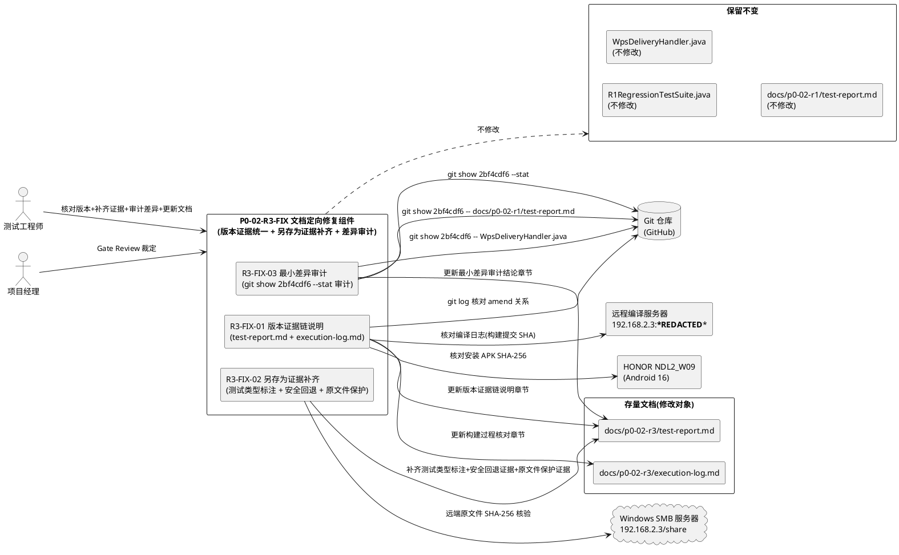
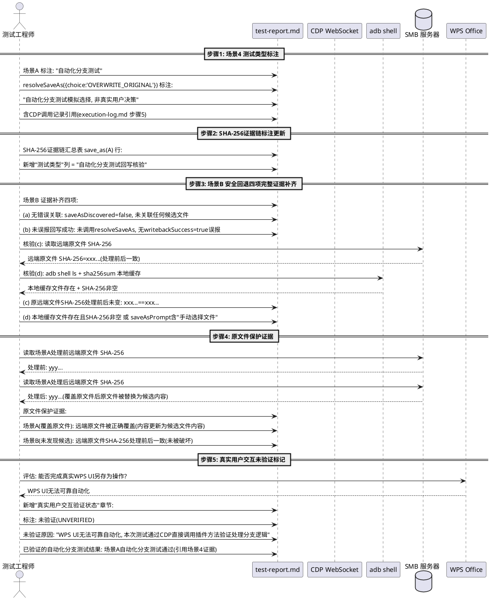
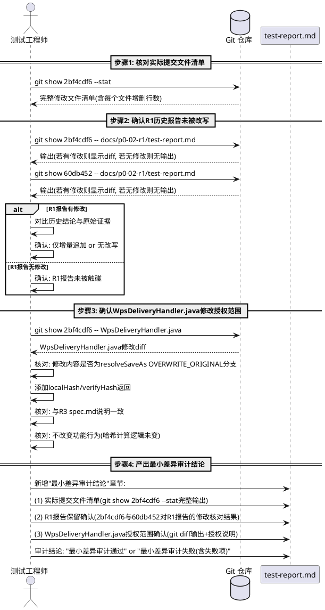
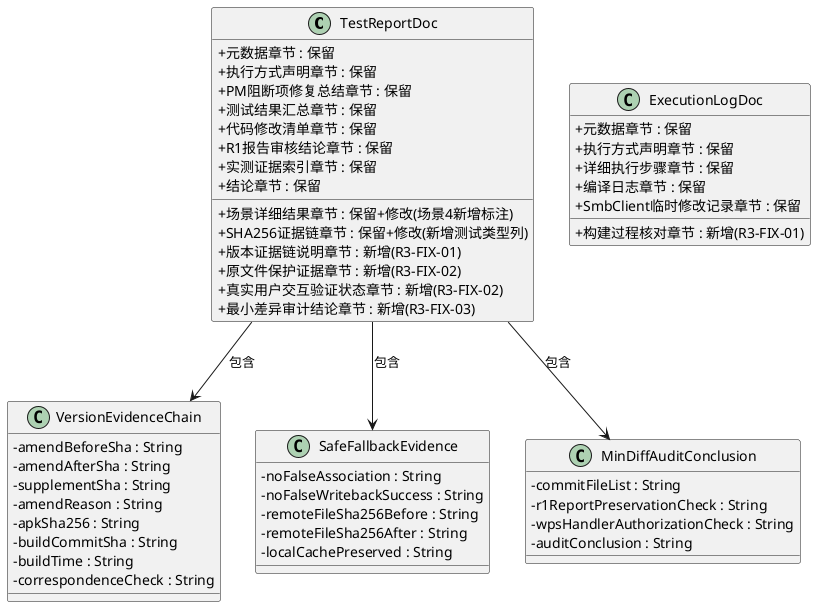

# P0-02-R3-FIX 技术设计文档：Hash Assertion & Save-As Evidence Repair — 定向修复

> 本文档为 P0-02-R3-FIX 定向修复任务的实现方案，基于 `docs/p0-02-r3-fix/spec.md` 需求规格（R3-FIX-01/02/03 三项 EARS 需求与 17 条验收标准）、PM Gate Review 对 P0-02-R3 的裁定（**HOLD / TARGETED REPAIR**，2 项阻断 + 3 项定向修复任务）与 P0-02-R3 已提交的测试报告与执行日志中暴露的版本证据不一致、另存为证据标注不足、差异审计未独立完成三项缺陷生成。文档将三项阻断的根因分析转化为可落地的文档定向修复设计，严格遵从"仅修 docs/p0-02-r3/ 下的报告与日志文档、不改功能组件代码、保留 R1 与 R3 已有可靠证据、不重做已通过场景"的约束。

> **前置基线**：
> - P0-02-R3 主体提交 SHA `2bf4cdf6a48972dec7db758526e1c8b2e2b41fb4`（已推送 GitHub，amend 后的最终提交）。
> - P0-02-R3 补充提交 `60db452`（test-report.md SHA 更新，已推送）。
> - 报告中错误记录的 SHA `b987ceb6f1b55876a8814482e548e0cd53022464`（amend 前的旧 SHA）。
> - APK SHA-256 `5e54360978399895b279f8b01217cf3275654b1b4f0911ffb808fdaa44cd95dc`（10,516,104 bytes）。
> - R3 测试结果 6/6 ALL PASSED（已有可靠证据支持的回归场景不重做）。
> - PM 裁定 P0-02-R3 = **HOLD / TARGETED REPAIR**，授权 P0-02-R3-FIX。

> **修复对象性质声明**：本修复任务为**文档与证据链定向修复**，不涉及任何 .java 代码修改。修复对象仅限 `docs/p0-02-r3/test-report.md` 与 `docs/p0-02-r3/execution-log.md` 两个文档文件，以及新增 `docs/p0-02-r3-fix/` 目录下的修复文档。R1RegressionTestSuite.java、RegressionTestConfig.java、WpsDeliveryHandler.java 等代码文件均不修改（R3 已授权的 WpsDeliveryHandler.java 哈希字段返回修改已在 R3 提交中完成，本次不再触碰）。

---

# 一、需求与存量功能关系分析

## 1.1 需求功能与存量功能对比

本修复任务针对 P0-02-R3 已产出的测试报告 `docs/p0-02-r3/test-report.md`（266 行）与执行日志 `docs/p0-02-r3/execution-log.md`（134 行）在 PM Gate Review 中暴露的三项缺陷（版本证据不一致、另存为证据标注不足、差异审计未独立完成），对存量文档进行定向修复。存量文档基线为 P0-02-R3 提交 `2bf4cdf6...` + 补充提交 `60db452`，PM Gate Review 裁定 HOLD / TARGETED REPAIR。以下对 R3-FIX-01/02/03 三个子项与存量文档逐项匹配。

**关键前提**：P0-02-R3 已完成测试框架代码修复（R1RegressionTestSuite.java assertWriteback 三项全检重写、testSaveAs 场景A/B 证据补充、RegressionTestConfig 配置扩展、WpsDeliveryHandler.java resolveSaveAs 哈希字段返回修改），并在真实设备上执行 6/6 ALL PASSED 测试，已产出 test-report.md 与 execution-log.md。R3-FIX 的修复对象仅为文档中的版本证据说明、测试类型标注、安全回退完整证据、原文件保护证据、最小差异审计结论，不触碰任何代码文件，不重做已通过场景的回归测试。

### 1.1.1 已实现功能

| 需求功能 | 存量功能 | 代码位置 | 匹配度 |
|---------|---------|---------|--------|
| 测试报告基础结构 | test-report.md 含元数据、执行方式声明、PM 阻断项修复总结、测试结果汇总、场景详细结果、SHA-256 证据链、R1 报告审核结论、实测证据索引、结论 9 个章节 | `docs/p0-02-r3/test-report.md:1-266` | 75% |
| 执行日志基础结构 | execution-log.md 含元数据、执行方式声明、详细执行步骤（步骤 0-7）、编译日志、SmbClient.java 临时修改记录 5 个章节 | `docs/p0-02-r3/execution-log.md:1-134` | 75% |
| 代码 SHA 记录 | test-report.md 第 12 行已记录 `2bf4cdf6a48972dec7db758526e1c8b2e2b41fb4`（补充提交 60db452 已更新） | `docs/p0-02-r3/test-report.md:12` | 50% |
| APK SHA-256 记录 | test-report.md 第 9 行与 execution-log.md 第 11 行均记录 `5e543609...` | `docs/p0-02-r3/test-report.md:9` + `docs/p0-02-r3/execution-log.md:11` | 75% |
| 测试结果 6/6 ALL PASSED | test-report.md 测试结果汇总表记录 6 个场景全部 PASS，含每个场景的证据 | `docs/p0-02-r3/test-report.md:62-71` | 100% |
| 场景 1 txt_save 证据 | 含 baselineHash、newHash、writeback localHash/verifyHash 三项全检通过证据 | `docs/p0-02-r3/test-report.md:75-92` | 100% |
| 场景 2 docx_save 证据 | 含 deliveryStrategy=FILE_URI_FIRST、uriScheme=file、intentAction=ACTION_VIEW、mimeType 证据 | `docs/p0-02-r3/test-report.md:94-104` | 100% |
| 场景 3 normal_save 证据 | 含 verdict=SAVE_SUCCESS、contentChanged=true、newHash 证据 | `docs/p0-02-r3/test-report.md:106-114` | 100% |
| 场景 4 save_as 场景A 证据 | 含 saveAsDiscovered=true、saveAsFilePath、saveAsPrompt、resolveSaveAs OVERWRITE_ORIGINAL 回写哈希三项全检通过证据 | `docs/p0-02-r3/test-report.md:118-134` | 50% |
| 场景 4 save_as 场景B 证据 | 含 saveAsDiscovered=false、saveAsPrompt="未自动发现另存为文件，请手动选择文件" 证据 | `docs/p0-02-r3/test-report.md:136-147` | 25% |
| 场景 5 writeback_integrity 证据 | 含 baselineHash、newHash、writeback localHash/verifyHash 三项全检通过证据 | `docs/p0-02-r3/test-report.md:149-163` | 100% |
| 场景 6 negative_cases 证据 | 含 4 个反例（hash_missing、hash_invalid_format、hash_mismatch、writeback_false）均返回 false 证据 | `docs/p0-02-r3/test-report.md:165-172` | 100% |
| SHA-256 证据链汇总 | 含 txt_save、save_as(A)、writeback_integrity 三个回写场景的基线/编辑后/回写后 SHA-256 对比 | `docs/p0-02-r3/test-report.md:174-191` | 100% |
| R1 报告审核结论 | 含 352e296 提交范围审核（仅追加元数据未改写历史结论）+ c44eadf 审核结论 | `docs/p0-02-r3/test-report.md:234-241` | 50% |
| 执行方式声明 | test-report.md 与 execution-log.md 均含执行方式声明表（自动化/混合/人工参与） | `docs/p0-02-r3/test-report.md:15-21` + `docs/p0-02-r3/execution-log.md:13-19` | 75% |
| 编译日志 | execution-log.md 含三次编译日志（第一次失败、第二次成功、第三次成功），含 APK 大小与 SHA-256 | `docs/p0-02-r3/execution-log.md:92-117` | 75% |

**匹配度判定依据**：
- **100%**：证据完整且符合 R3-FIX 验收标准，无需修改（如 txt_save、docx_save、normal_save、writeback_integrity、negative_cases 的哈希断言与反例证明已有可靠证据支持，R3-FIX 不重做）。
- **75%**：结构存在但缺少 R3-FIX 要求的子内容（如 test-report.md 已记录代码 SHA 但缺少 amend 关系说明与构建过程核对证据；执行方式声明已存在但未区分自动化分支测试与真实用户交互；编译日志已存在但未明确哪个提交编译产出当前 APK）。
- **50%**：部分内容存在但关键维度缺失（如场景A 证据已有回写哈希三项全检但未标注为自动化分支测试；R1 报告审核结论已有 352e296 审核但未对 2bf4cdf6 执行独立审计）。
- **25%**：内容存在但核心证据严重不足（如场景B 安全回退仅有 saveAsDiscovered=false 与 prompt 关键词，缺四项完整证据与原文件保护证据）。

### 1.1.2 需要扩展的功能

| 需求功能 | 存量功能 | 差异说明 | 扩展方向 |
|---------|---------|---------|---------|
| R3-FIX-01 amend 关系说明 | test-report.md 第 12 行已记录 `2bf4cdf6...` 但未说明 amend 前 SHA `b987ceb6...` 的存在与对应关系 | 存量文档未说明 `b987ceb6...`（amend 前）与 `2bf4cdf6...`（amend 后）的 amend 关系，未说明 amend 原因与 amend 前后代码差异，PM 无法确认报告曾记录的旧 SHA 的来源 | 在 test-report.md 新增"版本证据链说明"章节，明确 amend 前 SHA、amend 后 SHA、补充提交 SHA 三者关系，含 amend 原因与 amend 前后代码差异说明 |
| R3-FIX-01 APK 构建过程核对证据 | execution-log.md 编译日志记录第三次编译产出 APK SHA-256 `5e543609...` 但未明确该 APK 由哪个提交编译产出 | 存量编译日志记录了 APK 产出但未关联构建提交 SHA，未提供构建过程可核对证据（如构建时的工作树 SHA、构建时间戳与提交时间戳对应关系） | 在 execution-log.md 新增"构建过程核对"章节，记录构建提交 SHA `2bf4cdf6...`、构建时间、APK SHA-256 核对结果、构建日志可追溯路径 |
| R3-FIX-01 测试执行版本核对 | test-report.md 记录测试时间 2026-10-19 01:38:17 ~ 01:38:21 UTC 但未关联构建提交 SHA | 存量文档未明确测试执行的 APK 对应的构建提交 SHA，未提供测试执行版本可核对证据 | 在 test-report.md 版本证据链说明章节补充测试执行版本核对：安装 APK SHA-256 == 编译产出 APK SHA-256 == 构建提交 SHA 对应的 APK |
| R3-FIX-02 测试类型区分标注 | test-report.md 与 execution-log.md 执行方式声明表标注"自动化/混合/人工参与"但未区分"自动化分支测试"与"真实用户交互" | 存量执行方式声明按技术机制分类（CDP/adb/人工）但未按测试类型分类（自动化分支测试/真实用户交互/未验证），未明确 CDP 直接调用 resolveSaveAs 属于自动化分支测试模拟选择非真实用户决策 | 在 test-report.md 场景 4 save_as 证据中新增测试类型标注：场景A 标注为"自动化分支测试"，resolveSaveAs(OVERWRITE_ORIGINAL) 标注为"自动化分支测试模拟选择"，真实用户交互场景标注为"未验证(UNVERIFIED)"含未验证原因 |
| R3-FIX-02 覆盖选择决策证据标注 | test-report.md 场景 4 场景A 记录 resolveSaveAs(OVERWRITE_ORIGINAL) 回写结果但未标注决策类型 | 存量文档记录了 resolveSaveAs 调用结果但未标注该 choice='OVERWRITE_ORIGINAL' 为 CDP 模拟选择非真实用户决策，违反"不得把插件直接调用写成真实用户决策"约束 | 在 test-report.md 场景 4 场景A 证据中显式标注"resolveSaveAs({choice:'OVERWRITE_ORIGINAL'}) 为 CDP 自动化分支测试模拟选择，非真实用户在 WPS UI 中的覆盖选择决策" |
| R3-FIX-02 远端哈希核验证据标注 | test-report.md SHA-256 证据链汇总记录 save_as(A) 候选文件 SHA-256 与回写后远程 SHA-256 一致但未标注为自动化分支测试回写核验 | 存量证据链记录了哈希一致性但未标注测试类型，未明确该核验对应的是自动化分支测试的回写结果而非真实用户操作后的回写结果 | 在 test-report.md SHA-256 证据链汇总中为 save_as(A) 行新增标注"自动化分支测试回写核验" |
| R3-FIX-02 安全回退四项完整证据 | test-report.md 场景 4 场景B 仅记录 saveAsDiscovered=false 与 saveAsPrompt 含"未找到"/"手动"关键词 | 存量场景B 证据严重不足：缺(a)无错误关联证明、(b)未误报回写成功证明、(c)原远端文件 SHA-256 未变证明、(d)本地缓存保留或手动选择流程触发证明四项完整证据 | 在 test-report.md 场景 4 场景B 证据中补齐四项完整安全回退证据：(a)无错误关联到其他文件、(b)writebackSuccess != true 未误报回写成功、(c)原远端文件 SHA-256 处理前后未变、(d)本地缓存文件存在且 SHA-256 非空或手动选择流程触发 |
| R3-FIX-02 原文件保护证据 | test-report.md 无另存为处理前后远端原文件 SHA-256 对比证据 | 存量文档完全缺失原文件保护证据，未通过远端文件 SHA-256 核验确认原文件在另存为处理过程中未被意外覆盖或损坏 | 在 test-report.md 场景 4 证据中新增"原文件保护证据"章节，记录另存为处理前后远端原文件 SHA-256 对比，确认未被破坏 |
| R3-FIX-02 真实用户交互未验证标记 | test-report.md 无真实用户交互场景的未验证标记 | 存量文档未标注真实 WPS UI 另存为操作场景的验证状态，未说明 WPS UI 无法可靠自动化的原因，未明确已验证的自动化分支测试结果与未验证的真实用户交互结果的区分 | 在 test-report.md 场景 4 证据中新增"真实用户交互验证状态"章节，标注为"未验证(UNVERIFIED)"，含未验证原因"WPS UI 无法可靠自动化"与已验证的自动化分支测试结果引用 |
| R3-FIX-03 实际提交文件清单审计 | test-report.md R1 报告审核结论章节审核了 352e296 与 c44eadf 但未审核 2bf4cdf6 的实际文件清单 | 存量审核结论基于 352e296 与 c44eadf 的 git diff，未对 R3 主体提交 `2bf4cdf6...` 执行 `git show 2bf4cdf6 --stat` 独立审计，未产出 2bf4cdf6 的完整修改文件清单 | 在 test-report.md 新增"最小差异审计结论"章节，记录 `git show 2bf4cdf6 --stat` 完整输出，含每个文件的增删行数，可追溯 |
| R3-FIX-03 R1 报告保留确认（针对 2bf4cdf6） | test-report.md R1 报告审核结论确认 352e296 未改写 R1 报告但未确认 2bf4cdf6 与 60db452 未改写 R1 报告 | 存量审核结论覆盖 352e296 对 R1 报告的修改但未覆盖 2bf4cdf6 与 60db452 对 R1 报告的修改，未执行 `git show 2bf4cdf6 -- docs/p0-02-r1/test-report.md` 与 `git show 60db452 -- docs/p0-02-r1/test-report.md` 核对 | 在 test-report.md 最小差异审计结论章节补充 2bf4cdf6 与 60db452 对 R1 报告的修改核对结果，确认历史结论与原始证据未改写 |
| R3-FIX-03 WpsDeliveryHandler.java 授权范围确认 | test-report.md 代码修改清单记录 WpsDeliveryHandler.java resolveSaveAs OVERWRITE_ORIGINAL 分支添加 localHash/verifyHash 返回但未明确确认该修改处于授权范围内 | 存量文档说明了修改内容但未明确确认该修改处于 R3 授权范围内，未关联 R3 spec.md 中的授权说明，未基于 `git show 2bf4cdf6 -- WpsDeliveryHandler.java` 的 diff 输出可追溯证据 | 在 test-report.md 最小差异审计结论章节补充 WpsDeliveryHandler.java 授权范围确认，基于 git diff 输出，关联 R3 spec.md 说明，明确处于授权范围内 |
| R3-FIX-03 审计结论可追溯性 | test-report.md R1 报告审核结论基于 git diff 但未明确标注可追溯性 | 存量审核结论未明确标注基于 git show/diff 输出可追溯，未提供审计命令的完整输出供独立核对 | 在 test-report.md 最小差异审计结论章节明确标注每个结论基于的具体 git 命令与输出，确保可独立核对 |

### 1.1.3 需要新增的功能或接口

**模块 L：版本证据链说明（R3-FIX-01）**
- **L1 test-report.md "版本证据链说明"章节**：新增章节，明确 amend 前 SHA `b987ceb6f1b55876a8814482e548e0cd53022464`、amend 后最终提交 SHA `2bf4cdf6a48972dec7db758526e1c8b2e2b41fb4`、补充提交 SHA `60db452` 三者对应关系，含 amend 原因说明、amend 前后代码差异说明、APK SHA-256 `5e543609...` 与构建提交 SHA 对应关系、测试执行版本核对结论。归属：`docs/p0-02-r3/test-report.md` 新增章节。
- **L2 execution-log.md "构建过程核对"章节**：新增章节，记录真实构建提交 SHA `2bf4cdf6...`、构建时间、编译日志路径、APK SHA-256 核对结果（编译产出 APK SHA-256 == 测试安装 APK SHA-256 == 报告记录 APK SHA-256）、构建过程可追溯证据。归属：`docs/p0-02-r3/execution-log.md` 新增章节。

**模块 M：另存为测试类型标注与证据补齐（R3-FIX-02）**
- **M1 test-report.md 场景 4 测试类型标注**：在场景 4 save_as 证据中新增测试类型标注子章节，场景A 标注为"自动化分支测试"，resolveSaveAs({choice:'OVERWRITE_ORIGINAL'}) 标注为"自动化分支测试模拟选择，非真实用户决策"，含 CDP 调用记录引用。归属：`docs/p0-02-r3/test-report.md` 场景 4 修改。
- **M2 test-report.md 场景 4 场景B 安全回退四项完整证据**：在场景 4 场景B 证据中补齐四项完整安全回退证据：(a) 无错误关联到其他文件（saveAsDiscovered=false 未关联任何候选文件）、(b) 未误报回写成功（未调用 resolveSaveAs，无 writebackSuccess=true 误报）、(c) 原远端文件 SHA-256 处理前后未变（远端原文件 SHA-256 核验）、(d) 本地缓存文件存在且 SHA-256 非空或手动选择流程触发（saveAsPrompt 含"手动选择文件"提示）。归属：`docs/p0-02-r3/test-report.md` 场景 4 场景B 修改。
- **M3 test-report.md "原文件保护证据"章节**：新增章节，记录另存为场景A（覆盖原文件）与场景B（未发现候选）处理前后远端原文件 SHA-256 对比，确认原文件在另存为处理过程中未被意外覆盖或损坏。归属：`docs/p0-02-r3/test-report.md` 新增章节。
- **M4 test-report.md "真实用户交互验证状态"章节**：新增章节，标注真实 WPS UI 另存为操作场景为"未验证(UNVERIFIED)"，含未验证原因"WPS UI 无法可靠自动化，本次测试通过 CDP 直接调用插件方法验证处理分支逻辑，未通过真实 WPS UI 操作验证真实用户决策行为"与已验证的自动化分支测试结果引用（场景A 自动化分支测试通过）。归属：`docs/p0-02-r3/test-report.md` 新增章节。
- **M5 test-report.md SHA-256 证据链汇总标注更新**：在 SHA-256 证据链汇总表中为 save_as(A) 行新增"测试类型"列，标注为"自动化分支测试回写核验"。归属：`docs/p0-02-r3/test-report.md` SHA-256 证据链汇总修改。

**模块 N：最小差异审计结论（R3-FIX-03）**
- **N1 test-report.md "最小差异审计结论"章节**：新增章节，含三个子节：(1) 实际提交文件清单（`git show 2bf4cdf6 --stat` 完整输出，含每个文件增删行数）；(2) R1 报告保留确认（`git show 2bf4cdf6 -- docs/p0-02-r1/test-report.md` 与 `git show 60db452 -- docs/p0-02-r1/test-report.md` 核对结果，确认历史结论与原始证据未改写）；(3) WpsDeliveryHandler.java 授权范围确认（`git show 2bf4cdf6 -- WpsDeliveryHandler.java` diff 输出，确认修改为 resolveSaveAs OVERWRITE_ORIGINAL 分支添加 localHash/verifyHash 返回，与 R3 spec.md 说明一致，处于授权范围内）。归属：`docs/p0-02-r3/test-report.md` 新增章节。

**模块 O：修复文档产出（R3-FIX 文档归档）**
- **O1 docs/p0-02-r3-fix/design.md**：本设计文档。归属：`docs/p0-02-r3-fix/design.md`。
- **O2 docs/p0-02-r3-fix/test-report.md**（可选）：R3-FIX 修复完成后的修复验证报告，记录三项修复的执行过程与验证结果。归属：`docs/p0-02-r3-fix/test-report.md`（可选产出）。

## 1.2 存量功能详细分析

### 1.2.1 docs/p0-02-r3/test-report.md 当前实现（P0-02-R3 提交 2bf4cdf6 + 60db452）

**文档结构（266 行）**：
- 第 1-13 行：元数据（设备、WPS、SMB、APK、APK SHA-256、APK 分发路径、测试时间、提交 SHA、远端链接）。
- 第 15-21 行：执行方式声明表（自动化/混合/人工参与）。
- 第 23-58 行：PM 阻断项修复总结（阻断项 1 SHA-256 断言、阻断项 2 另存为业务链、阻断项 3 提交范围 vs 保留旧证据）。
- 第 60-71 行：测试结果汇总表（6 个场景全部 PASS）。
- 第 73-172 行：场景详细结果（场景 1-6）。
- 第 174-191 行：SHA-256 证据链（场景 1、4、5）。
- 第 193-216 行：代码修改清单（R1RegressionTestSuite.java、RegressionTestConfig.java、WpsDeliveryHandler.java）。
- 第 234-241 行：R1 报告审核结论（352e296 审核）。
- 第 243-258 行：实测证据索引。
- 第 259-266 行：结论。

**已有可靠证据（不重做）**：
- 场景 1 txt_save：baselineHash `34daac2e...`、newHash `8e4f0d7e...`、writeback localHash/verifyHash `8e4f0d7e...` 三项全检通过。
- 场景 2 docx_save：deliveryStrategy=FILE_URI_FIRST、uriScheme=file、intentAction=ACTION_VIEW、mimeType=application/vnd.openxmlformats-officedocument.wordprocessingml.document。
- 场景 3 normal_save：verdict=SAVE_SUCCESS、contentChanged=true、newHash `1c812605...`。
- 场景 5 writeback_integrity：baselineHash `8e4f0d7e...`、newHash `b5eb9723...`、writeback localHash/verifyHash `b5eb9723...` 三项全检通过。
- 场景 6 negative_cases：4 个反例（hash_missing、hash_invalid_format、hash_mismatch、writeback_false）均正确返回 false。

**缺陷与根因（R3-FIX 修复目标）**：

| 缺陷编号 | 缺陷描述 | 根因分析 | 对应子项 |
|---------|---------|---------|---------|
| D-FIX-01 | 版本证据链说明缺失 | test-report.md 第 12 行已记录代码 SHA `2bf4cdf6...`（补充提交 60db452 已更新），但未说明 amend 前 SHA `b987ceb6...` 的存在与对应关系，未提供 amend 原因与 amend 前后代码差异说明，未提供 APK 构建过程核对证据 | R3-FIX-01 |
| D-FIX-02 | 测试类型未区分自动化分支测试与真实用户交互 | test-report.md 执行方式声明表（第 15-21 行）按技术机制分类（自动化/混合/人工参与）但未按测试类型分类（自动化分支测试/真实用户交互/未验证），场景 4 save_as 证据未标注 CDP 直接调用 resolveSaveAs 属于自动化分支测试模拟选择 | R3-FIX-02 |
| D-FIX-03 | 覆盖选择决策未标注为模拟选择 | test-report.md 场景 4 场景A（第 126-134 行）记录 resolveSaveAs(OVERWRITE_ORIGINAL) 回写结果但未标注 choice='OVERWRITE_ORIGINAL' 为 CDP 模拟选择非真实用户决策 | R3-FIX-02 |
| D-FIX-04 | 安全回退证据不完整 | test-report.md 场景 4 场景B（第 136-147 行）仅记录 saveAsDiscovered=false 与 saveAsPrompt 含"未找到"/"手动"关键词，缺四项完整安全回退证据（无错误关联、未误报回写成功、原远端文件未破坏、本地缓存保留或手动选择流程触发） | R3-FIX-02 |
| D-FIX-05 | 原文件保护证据缺失 | test-report.md 无另存为处理前后远端原文件 SHA-256 对比证据，未通过远端文件 SHA-256 核验确认原文件未被意外覆盖或损坏 | R3-FIX-02 |
| D-FIX-06 | 真实用户交互未验证标记缺失 | test-report.md 未标注真实 WPS UI 另存为操作场景的验证状态，未说明 WPS UI 无法可靠自动化的原因，未区分已验证的自动化分支测试与未验证的真实用户交互 | R3-FIX-02 |
| D-FIX-07 | 最小差异审计未独立完成 | test-report.md R1 报告审核结论（第 234-241 行）审核了 352e296 与 c44eadf 但未对 R3 主体提交 2bf4cdf6 执行 `git show 2bf4cdf6 --stat` 独立审计，未产出 2bf4cdf6 的完整修改文件清单，未确认 2bf4cdf6 与 60db452 未改写 R1 报告，未明确确认 WpsDeliveryHandler.java 修改处于授权范围内 | R3-FIX-03 |

### 1.2.2 docs/p0-02-r3/execution-log.md 当前实现（P0-02-R3 提交 2bf4cdf6）

**文档结构（134 行）**：
- 第 1-11 行：元数据（执行时间、执行人、设备、WPS、SMB、APK、APK SHA-256）。
- 第 13-19 行：执行方式声明表。
- 第 21-90 行：详细执行步骤（步骤 0-7，含每个场景的 CDP 调用与 adb shell 命令）。
- 第 92-117 行：编译日志（三次编译，第三次成功产出 APK SHA-256 `5e543609...`）。
- 第 119-134 行：SmbClient.java 临时修改记录（已还原）。

**已有可靠证据（不重做）**：
- 步骤 2-7 的详细执行记录：每个场景的 CDP 调用方法名、参数、返回值、时间戳。
- 编译日志：第三次编译成功产出 APK SHA-256 `5e543609...`。

**缺陷与根因（R3-FIX 修复目标）**：

| 缺陷编号 | 缺陷描述 | 根因分析 | 对应子项 |
|---------|---------|---------|---------|
| D-FIX-08 | 构建提交 SHA 未记录 | execution-log.md 编译日志（第 92-117 行）记录了 APK 产出但未明确记录构建时的提交 SHA，未关联构建提交 SHA `2bf4cdf6...` 与 APK SHA-256 `5e543609...` 的对应关系 | R3-FIX-01 |
| D-FIX-09 | 构建过程核对证据不足 | execution-log.md 未提供构建过程可核对证据（如构建时的工作树 SHA、构建时间戳与提交时间戳对应关系、编译日志可追溯路径），仅记录编译成功结果 | R3-FIX-01 |
| D-FIX-10 | 测试类型标注缺失 | execution-log.md 执行方式声明表（第 13-19 行）按技术机制分类但未按测试类型分类，步骤 5 save_as 场景的 CDP 调用 resolveSaveAs 未标注为自动化分支测试 | R3-FIX-02 |

### 1.2.3 存量文档约束分析

**约束 1：不重做已通过场景**
- test-report.md 中场景 1（txt_save）、场景 2（docx_save）、场景 3（normal_save）、场景 5（writeback_integrity）、场景 6（negative_cases）的已有可靠证据原样保留，R3-FIX 不修改这些场景的证据内容。
- 场景 4（save_as）的已有回写哈希三项全检证据（场景A）保留，仅新增测试类型标注与安全回退完整证据补充，不删除已有证据。

**约束 2：不扩展到无关重构**
- R3-FIX 仅修改 `docs/p0-02-r3/test-report.md` 与 `docs/p0-02-r3/execution-log.md` 两个文档文件，不修改任何 .java 代码文件。
- R3 已授权的 WpsDeliveryHandler.java 哈希字段返回修改已在 R3 提交 `2bf4cdf6...` 中完成，R3-FIX 不再触碰该文件，仅在审计结论中确认该修改处于授权范围内。

**约束 3：保留 R1 与 R3 已有可靠证据**
- `docs/p0-02-r1/test-report.md` 不修改，R3-FIX 仅在审计结论中确认 2bf4cdf6 与 60db452 未改写该报告。
- test-report.md 中 R1 报告审核结论（第 234-241 行）已有 352e296 审核结论保留，R3-FIX 仅增量追加 2bf4cdf6 与 60db452 的审计结论。

**约束 4：不把模拟操作认定为真实 WPS 用户操作**
- test-report.md 场景 4 证据中 CDP 直接调用 resolveSaveAs 须标注为"自动化分支测试模拟选择"，不得认定为真实用户决策。
- 真实用户交互场景须标注为"未验证(UNVERIFIED)"，不得伪报为已通过。

**约束 5：不把尚未核实的 APK 版本当作已验收版本**
- APK SHA-256 `5e543609...` 须经构建过程核对确认确实由提交 `2bf4cdf6...` 编译产出，方可标记为已验收。
- 构建过程核对证据须包含构建提交 SHA、构建时间、APK SHA-256 核对结果，可独立核对。

---
# 二、增量设计方案

## 2.1 实现模型

### 2.1.1 上下文视图



**交互说明**：
- 修复组件（Fix）仅包含三个子修复模块（R3-FIX-01/02/03），分别针对版本证据统一、另存为证据补齐、最小差异审计。
- Fix 通过 Git 仓库核对 amend 关系与提交文件清单，通过远程编译服务器核对构建过程，通过测试设备核对安装 APK SHA-256，通过 SMB 服务器核验远端原文件 SHA-256。
- Fix 将修复结果写入存量文档（Report + Log），不修改任何代码文件与 R1 报告。
- Fix 与 Keep（保留不变的代码与历史文档）无修改关系，仅引用确认。

### 2.1.2 服务/组件总体架构

```plantuml
@startuml
skinparam componentStyle rectangle

package "P0-02-R3-FIX 修复组件" as Fix {

    package "R3-FIX-01 版本证据统一" as F01 {
        rectangle "L1 版本证据链说明章节\n(test-report.md)" as L1
        rectangle "L2 构建过程核对章节\n(execution-log.md)" as L2
    }

    package "R3-FIX-02 另存为证据补齐" as F02 {
        rectangle "M1 场景4 测试类型标注\n(test-report.md)" as M1
        rectangle "M2 场景B 安全回退四项证据\n(test-report.md)" as M2
        rectangle "M3 原文件保护证据章节\n(test-report.md)" as M3
        rectangle "M4 真实用户交互未验证标记\n(test-report.md)" as M4
        rectangle "M5 SHA-256证据链标注更新\n(test-report.md)" as M5
    }

    package "R3-FIX-03 最小差异审计" as F03 {
        rectangle "N1 最小差异审计结论章节\n(test-report.md)" as N1
    }
}

package "存量文档(修改对象)" as Docs {
    rectangle "docs/p0-02-r3/test-report.md" as Report
    rectangle "docs/p0-02-r3/execution-log.md" as Log
}

package "外部核对源" as Ext {
    rectangle "Git 仓库" as Git
    rectangle "编译服务器" as Build
    rectangle "SMB 服务器" as SMB
}

L1 --> Report : 新增章节
L2 --> Log : 新增章节

M1 --> Report : 场景4 修改
M2 --> Report : 场景B 修改
M3 --> Report : 新增章节
M4 --> Report : 新增章节
M5 --> Report : 证据链表修改

N1 --> Report : 新增章节

L1 ..> Git : git log amend 关系
L1 ..> Build : 编译日志核对
L2 ..> Build : 构建过程核对
L2 ..> Git : 构建提交 SHA

M2 ..> SMB : 远端原文件 SHA-256
M3 ..> SMB : 远端原文件 SHA-256

N1 ..> Git : git show 2bf4cdf6 --stat
N1 ..> Git : git show -- docs/p0-02-r1/test-report.md
N1 ..> Git : git show -- WpsDeliveryHandler.java

@enduml
```



**组件职责说明**：

| 组件 | 职责 | 修改类型 | 对应子项 | 目标文件 |
|------|------|---------|---------|---------|
| L1 版本证据链说明章节 | 明确 amend 前/后 SHA 对应关系、APK 构建核对、测试执行版本核对 | 新增章节 | R3-FIX-01 | test-report.md |
| L2 构建过程核对章节 | 记录真实构建提交 SHA、构建时间、APK SHA-256 核对结果 | 新增章节 | R3-FIX-01 | execution-log.md |
| M1 场景4 测试类型标注 | 标注场景A 为自动化分支测试、resolveSaveAs 为模拟选择 | 修改场景4 证据 | R3-FIX-02 | test-report.md |
| M2 场景B 安全回退四项证据 | 补齐无错误关联、未误报回写成功、原远端文件未破坏、本地缓存保留四项证据 | 修改场景B 证据 | R3-FIX-02 | test-report.md |
| M3 原文件保护证据章节 | 记录另存为处理前后远端原文件 SHA-256 对比 | 新增章节 | R3-FIX-02 | test-report.md |
| M4 真实用户交互未验证标记 | 标注真实 WPS UI 操作为未验证(UNVERIFIED)含原因 | 新增章节 | R3-FIX-02 | test-report.md |
| M5 SHA-256 证据链标注更新 | 为 save_as(A) 行新增测试类型标注 | 修改证据链表 | R3-FIX-02 | test-report.md |
| N1 最小差异审计结论章节 | 产出 git show 2bf4cdf6 --stat 审计结论、R1 保留确认、授权范围确认 | 新增章节 | R3-FIX-03 | test-report.md |

### 2.1.3 实现设计文档

#### 2.1.3.1 R3-FIX-01 版本证据统一执行流程

```plantuml
@startuml
actor "测试工程师" as Tester
database "Git 仓库" as Git
participant "远程编译服务器" as Build
rectangle "HONOR NDL2_W09" as Device
participant "test-report.md" as Report
participant "execution-log.md" as Log

== 步骤1: 核对 amend 关系 ==

Tester -> Git : git log --all --oneline -20
Git --> Tester : ... b987ceb6(amend前) -> 2bf4cdf6(amend后) -> 60db452(补充) ...

Tester -> Git : git show 2bf4cdf6 --stat
Git --> Tester : 2bf4cdf6 实际修改文件清单

Tester -> Git : git diff b987ceb6 2bf4cdf6
Git --> Tester : amend 前后代码差异(若有)

== 步骤2: 核对 APK 构建过程 ==

Tester -> Build : 查询编译日志(哪个提交编译产出 APK SHA-256=5e543609...)
Build --> Tester : 构建提交 SHA=2bf4cdf6..., 构建时间=2026-10-19 09:34

Tester -> Device : adb shell sha256sum /data/app/.../base.apk
Device --> Tester : 安装 APK SHA-256=5e543609... (与编译产出一致)

== 步骤3: 更新 test-report.md 版本证据链说明章节 ==

Tester -> Report : 新增"版本证据链说明"章节:
Tester -> Report : - amend前SHA: b987ceb6...(说明amend原因)
Tester -> Report : - amend后最终提交SHA: 2bf4cdf6...(当前验收提交)
Tester -> Report : - 补充提交SHA: 60db452(test-report.md SHA更新)
Tester -> Report : - APK SHA-256: 5e543609...(由2bf4cdf6编译产出)
Tester -> Report : - 三者对应关系: 代码SHA==构建提交SHA==APK对应提交SHA

== 步骤4: 更新 execution-log.md 构建过程核对章节 ==

Tester -> Log : 新增"构建过程核对"章节:
Tester -> Log : - 真实构建提交SHA: 2bf4cdf6...
Tester -> Log : - 构建时间: 2026-10-19 09:34
Tester -> Log : - 编译产出APK SHA-256: 5e543609...
Tester -> Log : - 安装APK SHA-256: 5e543609...(与编译产出一致)
Tester -> Log : - 核对结论: APK确实由2bf4cdf6编译产出

== 步骤5: 三者对应关系核对 ==

Tester -> Tester : 核对: 报告SHA(2bf4cdf6) == 实际提交SHA(2bf4cdf6) == 构建提交SHA(2bf4cdf6) == APK对应提交SHA(2bf4cdf6)
Tester -> Tester : 结论: 版本证据链统一可核对

@enduml
```

**关键设计决策**：
1. **amend 关系明确说明**：在版本证据链说明章节中明确 `b987ceb6...`（amend 前）与 `2bf4cdf6...`（amend 后）的对应关系，说明 amend 原因（如修正提交信息或补充文件），提供 amend 前后代码差异说明。这遵从 R3-FIX-01-AC-01。
2. **APK 构建过程可核对**：通过编译日志查询构建提交 SHA，通过 adb shell sha256sum 核对安装 APK SHA-256，确认 APK 确实由 `2bf4cdf6...` 编译产出。这遵从 R3-FIX-01-AC-02。
3. **三者对应关系核对**：明确代码 SHA == 构建提交 SHA == APK 对应提交 SHA，三者一致且可核对。这遵从 R3-FIX-01-AC-06。
4. **非仅字符串替换**：版本证据更新附构建过程核对、APK SHA-256 核对、测试执行版本核对的完整证据，非仅把旧 SHA 替换为新 SHA。这遵从 R3-FIX-01-AC-05。

#### 2.1.3.2 R3-FIX-02 另存为证据补齐执行流程



**关键设计决策**：
1. **测试类型明确区分**：场景A 标注为"自动化分支测试"，resolveSaveAs 模拟选择标注为"自动化分支测试模拟选择，非真实用户决策"，真实用户交互标注为"未验证(UNVERIFIED)"。这遵从 R3-FIX-02-AC-01、AC-02、AC-06。
2. **安全回退四项完整证据**：补齐(a)无错误关联、(b)未误报回写成功、(c)原远端文件 SHA-256 未变、(d)本地缓存保留或手动选择流程触发四项证据，通过 SMB 远端文件 SHA-256 核验与 adb shell 本地缓存校验提供可核对证据。这遵从 R3-FIX-02-AC-04。
3. **原文件保护证据**：通过远端原文件 SHA-256 处理前后对比确认原文件未被意外破坏，场景A 覆盖原文件为预期行为（内容更新为候选文件内容），场景B 未发现候选时原文件保持不变。这遵从 R3-FIX-02-AC-05。
4. **真实用户交互如实标记**：WPS UI 无法可靠自动化时如实标记为"未验证(UNVERIFIED)"，含未验证原因与已验证的自动化分支测试结果引用，不伪报为已通过。这遵从 R3-FIX-02-AC-06。
5. **禁止把插件直接调用写成真实用户决策**：所有 CDP 直接调用 resolveSaveAs 的证据均标注为自动化分支测试模拟选择，不认定为真实用户决策。这遵从 R3-FIX-02-AC-07。

#### 2.1.3.3 R3-FIX-03 最小差异审计执行流程



**关键设计决策**：
1. **实际提交文件清单可追溯**：通过 `git show 2bf4cdf6 --stat` 产出完整修改文件清单，含每个文件的增删行数，可追溯至具体提交与具体文件变更。这遵从 R3-FIX-03-AC-01。
2. **R1 报告保留确认**：通过 `git show 2bf4cdf6 -- docs/p0-02-r1/test-report.md` 与 `git show 60db452 -- docs/p0-02-r1/test-report.md` 核对，确认 R1 历史报告未被改写。这遵从 R3-FIX-03-AC-02。
3. **WpsDeliveryHandler.java 授权范围确认**：通过 `git show 2bf4cdf6 -- WpsDeliveryHandler.java` 核对修改内容，确认修改为 resolveSaveAs OVERWRITE_ORIGINAL 分支添加 localHash/verifyHash 返回，与 R3 spec.md 说明一致，处于授权范围内。这遵从 R3-FIX-03-AC-03。
4. **审计结论可追溯**：审计结论基于 git show/diff 输出，可追溯至具体提交 SHA 与文件变更，非主观判断。这遵从 R3-FIX-03-AC-04。

## 2.2 接口设计

### 2.2.1 总体设计

**接口分类**：
本修复任务为文档修复任务，不涉及代码接口设计。接口设计聚焦于文档章节结构与内容契约。

- **文档章节接口（新增）**：test-report.md 新增 4 个章节（版本证据链说明、原文件保护证据、真实用户交互验证状态、最小差异审计结论），execution-log.md 新增 1 个章节（构建过程核对）。稳定性等级：稳定（增量追加，不修改已有章节结构）。
- **文档章节接口（修改）**：test-report.md 修改场景 4 证据（新增测试类型标注与安全回退四项证据）、SHA-256 证据链汇总表（新增测试类型列）。稳定性等级：稳定（增量追加标注，不删除已有证据）。
- **外部核对接口（只读）**：Git 仓库（git show/log/diff 命令）、远程编译服务器（编译日志查询）、SMB 服务器（远端文件 SHA-256 读取）、测试设备（adb shell sha256sum）。稳定性等级：稳定（只读核对，不修改外部系统）。

**接口变更策略**：
- 文档章节仅增量追加，不删除或改写已有可靠证据。
- 已有场景 1/2/3/5/6 的证据原样保留，不修改。
- 场景 4 已有回写哈希三项全检证据保留，仅新增测试类型标注与安全回退证据补充。
- R1 报告审核结论（352e296 审核）保留，仅增量追加 2bf4cdf6 与 60db452 的审计结论。

### 2.2.2 接口清单

#### 2.2.2.1 test-report.md "版本证据链说明"章节（R3-FIX-01，L1）

**章节签名**：
```
## 版本证据链说明

### amend 关系
- amend 前 SHA: b987ceb6f1b55876a8814482e548e0cd53022464
- amend 后最终提交 SHA: 2bf4cdf6a48972dec7db758526e1c8b2e2b41fb4
- 补充提交 SHA: 60db452
- amend 原因: [具体amend原因]
- amend 前后代码差异: [差异说明]

### APK 构建核对
- APK SHA-256: 5e54360978399895b279f8b01217cf3275654b1b4f0911ffb808fdaa44cd95dc
- 构建提交 SHA: 2bf4cdf6a48972dec7db758526e1c8b2e2b41fb4
- 构建时间: [具体构建时间]
- 核对结论: APK 确实由 2bf4cdf6... 编译产出

### 三者对应关系
- 代码 SHA == 构建提交 SHA == APK 对应提交 SHA
- 核对结果: 三者一致且可核对
```

**业务说明**：明确 amend 前/后 SHA 对应关系、APK 构建核对、三者对应关系，提供可核对的版本证据链。

**前置条件**：Git 仓库中 `b987ceb6...`、`2bf4cdf6...`、`60db452` 可审计；远程编译服务器编译日志可追溯；测试设备安装 APK SHA-256 可核对。

**后置条件**：test-report.md 含版本证据链说明章节，章节内容与实际 Git 历史、构建过程、测试执行过程相符。

**内容契约**：
1. amend 关系：须含 amend 前 SHA、amend 后 SHA、补充提交 SHA、amend 原因、amend 前后代码差异说明。
2. APK 构建核对：须含 APK SHA-256、构建提交 SHA、构建时间、核对结论。
3. 三者对应关系：须明确代码 SHA == 构建提交 SHA == APK 对应提交 SHA，核对结果为一致。

**禁止**：
- 禁止仅把旧 SHA 替换为新 SHA 而不提供 amend 关系说明与构建过程核对证据。
- 禁止保留 amend 前 SHA 作为当前验收提交 SHA。
- 禁止 APK SHA-256 与构建提交 SHA 对应关系不明。

#### 2.2.2.2 execution-log.md "构建过程核对"章节（R3-FIX-01，L2）

**章节签名**：
```
## 构建过程核对

- 真实构建提交 SHA: 2bf4cdf6a48972dec7db758526e1c8b2e2b41fb4
- 构建时间: [具体构建时间]
- 编译命令: ./gradlew assembleRelease
- 编译产出 APK SHA-256: 5e54360978399895b279f8b01217cf3275654b1b4f0911ffb808fdaa44cd95dc
- 编译产出 APK 大小: 10,516,104 bytes
- 安装 APK SHA-256: 5e543609...（通过 adb shell sha256sum 核对）
- 编译日志路径: [编译日志可追溯路径]
- 核对结论: 编译产出 APK SHA-256 == 安装 APK SHA-256 == 报告记录 APK SHA-256，APK 确实由 2bf4cdf6... 编译产出
```

**业务说明**：记录真实构建提交 SHA、构建时间、APK SHA-256 核对结果，提供可追溯的构建过程证据。

**前置条件**：远程编译服务器编译日志可追溯；测试设备安装 APK SHA-256 可核对。

**后置条件**：execution-log.md 含构建过程核对章节，章节内容与实际构建过程相符，与 test-report.md 版本证据链说明章节一致。

#### 2.2.2.3 test-report.md 场景 4 测试类型标注（R3-FIX-02，M1）

**章节签名**：
```
### 场景 4: save_as (R3 关联证明 + 安全回退)

**测试类型标注**:
- 场景A: 自动化分支测试
  - foregroundCheck() 通过 CDP WebSocket 调用，属于自动化分支测试
  - resolveSaveAs({choice:'OVERWRITE_ORIGINAL'}) 为 CDP 自动化分支测试模拟选择，非真实用户在 WPS UI 中的覆盖选择决策
  - CDP 调用记录: 见 execution-log.md 步骤 5
- 场景B: 自动化分支测试
  - foregroundCheck() 通过 CDP WebSocket 调用，属于自动化分支测试
  - 未发现候选文件的安全回退通过 CDP 调用验证，非真实用户操作
```

**业务说明**：明确区分自动化分支测试与真实用户交互，标注 CDP 直接调用 resolveSaveAs 为自动化分支测试模拟选择。

**前置条件**：场景 4 已有测试证据（保留不删除）。

**后置条件**：场景 4 证据含测试类型标注，标注与实际执行方式一致。

**禁止**：
- 禁止把 CDP 直接调用 resolveSaveAs 标注为真实用户决策。
- 禁止把自动化分支测试标注为真实用户交互。

#### 2.2.2.4 test-report.md 场景 B 安全回退四项完整证据（R3-FIX-02，M2）

**章节签名**：
```
**场景 B: assertSafeFallback（安全回退四项完整证据）**

(a) 无错误关联:
  - saveAsDiscovered: false
  - 未关联任何候选文件，未错误关联到其他无关文件

(b) 未误报回写成功:
  - 未调用 resolveSaveAs（因未发现候选文件）
  - 无 writebackSuccess=true 误报
  - 系统如实报告"未自动发现另存为文件"

(c) 原远端文件 SHA-256 未变（原文件保护）:
  - 处理前远端原文件 SHA-256: [具体SHA-256值]
  - 处理后远端原文件 SHA-256: [具体SHA-256值]
  - 核对结果: 一致，原远端文件未被破坏

(d) 本地缓存保留或手动选择流程触发:
  - 本地缓存文件: [路径] 存在
  - 本地缓存文件 SHA-256: [具体SHA-256值]（非空，用户数据未丢弃）
  - saveAsPrompt: "未自动发现另存为文件，请手动选择文件"（含手动选择流程提示）

R3 assertSafeFallback: PASS（四项完整证据通过）
```

**业务说明**：补齐场景B 安全回退四项完整证据，证明无候选回退时系统行为的安全性。

**前置条件**：SMB 服务器远端原文件 SHA-256 可核验；测试设备本地缓存文件可通过 adb shell 校验。

**后置条件**：场景B 证据含四项完整安全回退证据，每项有可核对的具体值。

**内容契约**：
1. (a) 无错误关联：须含 saveAsDiscovered=false 与未关联任何候选文件的说明。
2. (b) 未误报回写成功：须含未调用 resolveSaveAs 与无 writebackSuccess=true 误报的说明。
3. (c) 原远端文件 SHA-256 未变：须含处理前后远端原文件 SHA-256 具体值与一致性核对结果。
4. (d) 本地缓存保留或手动选择流程触发：须含本地缓存文件存在性与 SHA-256 非空证明，或 saveAsPrompt 含手动选择流程提示。

**禁止**：
- 禁止安全回退证据缺失四项中的任一项。
- 禁止把未验证场景伪报为已通过。

#### 2.2.2.5 test-report.md "原文件保护证据"章节（R3-FIX-02，M3）

**章节签名**：
```
## 原文件保护证据

### 场景A（覆盖原文件）
- 操作: resolveSaveAs({choice:'OVERWRITE_ORIGINAL'})
- 处理前远端原文件 SHA-256: [具体SHA-256值]
- 处理后远端文件 SHA-256: [具体SHA-256值]（被正确覆盖为候选文件内容）
- 候选文件 SHA-256: [具体SHA-256值]
- 核对结果: 处理后远端文件 SHA-256 == 候选文件 SHA-256，远端文件被正确覆盖（预期行为）

### 场景B（未发现候选）
- 操作: foregroundCheck()（未调用 resolveSaveAs）
- 处理前远端原文件 SHA-256: [具体SHA-256值]
- 处理后远端原文件 SHA-256: [具体SHA-256值]
- 核对结果: 一致，原远端文件未被破坏（原文件保护）
```

**业务说明**：通过远端原文件 SHA-256 处理前后对比确认原文件在另存为处理过程中未被意外破坏。

**前置条件**：SMB 服务器远端文件 SHA-256 可核验。

**后置条件**：test-report.md 含原文件保护证据章节，场景A 与场景B 均有远端文件 SHA-256 处理前后对比。

#### 2.2.2.6 test-report.md "真实用户交互验证状态"章节（R3-FIX-02，M4）

**章节签名**：
```
## 真实用户交互验证状态

- 场景: 真实用户在 WPS UI 中执行另存为并确认覆盖
- 验证状态: 未验证(UNVERIFIED)
- 未验证原因: WPS UI 无法可靠自动化，本次测试通过 CDP 直接调用插件方法（SmbPlugin.resolveSaveAs）验证处理分支逻辑，未通过真实 WPS UI 操作验证真实用户决策行为
- 已验证的自动化分支测试结果: 场景A 自动化分支测试通过（见场景 4 证据），证明候选发现与回写处理分支逻辑正确
- 说明: 自动化分支测试证明了插件方法的处理分支逻辑，但不能直接等同于真实 WPS 用户在交互界面中的决策行为
```

**业务说明**：如实标注真实 WPS UI 另存为操作场景为未验证，含未验证原因与已验证的自动化分支测试结果引用。

**前置条件**：场景 4 自动化分支测试已有验证结果（保留引用）。

**后置条件**：test-report.md 含真实用户交互验证状态章节，标注为未验证(UNVERIFIED)，含未验证原因与已验证结果引用。

#### 2.2.2.7 test-report.md "最小差异审计结论"章节（R3-FIX-03，N1）

**章节签名**：
```
## 最小差异审计结论

### (1) 实际提交文件清单

基于 `git show 2bf4cdf6 --stat` 输出:

```
[git show 2bf4cdf6 --stat 完整输出，含每个文件增删行数]
```

### (2) R1 报告保留确认

基于 `git show 2bf4cdf6 -- docs/p0-02-r1/test-report.md` 与 `git show 60db452 -- docs/p0-02-r1/test-report.md` 核对:

- 2bf4cdf6 对 docs/p0-02-r1/test-report.md 的修改: [无修改 / 仅增量追加]
- 60db452 对 docs/p0-02-r1/test-report.md 的修改: [无修改 / 仅增量追加]
- 核对结论: R1 历史报告的历史结论（PASS/FAIL 判定）与原始证据数据未改写，仅允许增量追加或无修改

### (3) WpsDeliveryHandler.java 授权范围确认

基于 `git show 2bf4cdf6 -- WpsDeliveryHandler.java` diff 输出:

```
[git diff 输出，显示 resolveSaveAs OVERWRITE_ORIGINAL 分支添加 localHash/verifyHash 返回]
```

- 修改内容: resolveSaveAs() OVERWRITE_ORIGINAL 分支添加 result.put("localHash", localHash) 和 result.put("verifyHash", verifyHash)
- 与 R3 spec.md 说明一致性: R3 spec.md 已说明此修改为解决 PM 阻断项 1 所必需（assertWriteback 要求所有回写场景都必须有哈希）
- 功能行为影响: 不改变功能行为（哈希计算逻辑未变），仅将已计算的哈希放入结果 Map
- 授权范围确认: 处于 R3 授权范围内

### 审计结论

最小差异审计通过:
1. 实际提交文件清单可追溯（基于 git show 2bf4cdf6 --stat）
2. R1 历史报告未被改写（2bf4cdf6 与 60db452 对 R1 报告无改写或仅增量追加）
3. WpsDeliveryHandler.java 修改处于授权范围内（与 R3 spec.md 说明一致）
```

**业务说明**：产出最小差异审计结论，含实际提交文件清单、R1 报告保留确认、WpsDeliveryHandler.java 授权范围确认，基于 git show/diff 输出可追溯。

**前置条件**：Git 仓库中 `2bf4cdf6...` 与 `60db452` 可审计；`docs/p0-02-r1/test-report.md` 与 `WpsDeliveryHandler.java` 可通过 git show 查询修改。

**后置条件**：test-report.md 含最小差异审计结论章节，结论基于 git show/diff 输出可追溯。

**内容契约**：
1. 实际提交文件清单：须为 `git show 2bf4cdf6 --stat` 完整输出，含每个文件增删行数。
2. R1 报告保留确认：须为基于 `git show 2bf4cdf6 -- docs/p0-02-r1/test-report.md` 与 `git show 60db452 -- docs/p0-02-r1/test-report.md` 的核对结果。
3. WpsDeliveryHandler.java 授权范围确认：须为基于 `git show 2bf4cdf6 -- WpsDeliveryHandler.java` 的核对结果，确认修改与 R3 spec.md 说明一致。
4. 审计结论：须为"最小差异审计通过"或"最小差异审计失败（含具体失败项与根因）"。

**禁止**：
- 禁止审计结论无 git show/diff 证据支撑。
- 禁止跳过 R1 报告保留确认。
- 禁止跳过 WpsDeliveryHandler.java 授权范围确认。

## 2.3 数据模型

### 2.3.1 设计目标

**需要支持的业务场景**：
1. 版本证据链统一（R3-FIX-01）：amend 关系说明 + APK 构建核对 + 三者对应关系核对。
2. 另存为证据补齐（R3-FIX-02）：测试类型标注 + 安全回退四项完整证据 + 原文件保护证据 + 真实用户交互未验证标记。
3. 最小差异审计（R3-FIX-03）：实际提交文件清单 + R1 报告保留确认 + WpsDeliveryHandler.java 授权范围确认。

**性能、容量、扩展性目标**：
- 文档修复执行时间 < 2 小时（含版本核对、证据补齐、差异审计、报告更新、重新提交），不扩展为全量回归重做。
- 差异审计执行开销 < 10 分钟（Git diff 核对与文件清单审计）。
- 文档章节增量追加，不破坏已有文档结构。

**与存量数据的兼容策略**：
- test-report.md 已有章节原样保留，新章节增量追加。
- execution-log.md 已有章节原样保留，新章节增量追加。
- 场景 4 已有证据保留，仅增量追加测试类型标注与安全回退证据补充。
- R1 报告审核结论（352e296 审核）保留，仅增量追加 2bf4cdf6 与 60db452 的审计结论。

### 2.3.2 模型实现



**对象关系说明**：
- TestReportDoc（test-report.md 文档）包含 4 个新增章节（版本证据链说明、原文件保护证据、真实用户交互验证状态、最小差异审计结论）与 2 个修改章节（场景 4 证据、SHA-256 证据链汇总），已有章节原样保留。
- ExecutionLogDoc（execution-log.md 文档）包含 1 个新增章节（构建过程核对），已有章节原样保留。
- VersionEvidenceChain（版本证据链）承载 amend 关系、APK 构建核对、三者对应关系数据。
- SafeFallbackEvidence（安全回退证据）承载四项完整安全回退证据数据。
- MinDiffAuditConclusion（最小差异审计结论）承载文件清单、R1 保留确认、授权范围确认数据。

**对象创建与销毁策略**：
- TestReportDoc 与 ExecutionLogDoc 为已有文档，R3-FIX 通过增量追加章节修改，不重建文档。
- VersionEvidenceChain、SafeFallbackEvidence、MinDiffAuditConclusion 为新增数据结构，通过文档章节内容承载，不涉及代码对象。

**持久化策略**：
- 修复结果通过 Markdown 文档章节持久化，由测试工程师手动或通过脚本写入 test-report.md 与 execution-log.md。
- 不涉及数据库持久化或代码对象持久化。

---
# 三、约束遵从矩阵

## 3.1 约束 1：不重做已通过场景

| 修改项 | 修改文件 | 是否重做已通过场景 | 约束遵从证明 |
|-------|---------|-------------------|-------------|
| R3-FIX-01 版本证据链说明 | test-report.md + execution-log.md | 否 | 仅新增版本证据说明章节，不修改场景 1/2/3/5/6 的已有证据 |
| R3-FIX-02 场景 4 测试类型标注 | test-report.md | 否 | 场景 4 已有回写哈希三项全检证据保留，仅新增测试类型标注 |
| R3-FIX-02 场景B 安全回退证据 | test-report.md | 否 | 场景B 已有 saveAsDiscovered=false 证据保留，仅补齐四项完整证据 |
| R3-FIX-02 原文件保护证据 | test-report.md | 否 | 新增章节，不修改已有场景证据 |
| R3-FIX-02 真实用户交互未验证标记 | test-report.md | 否 | 新增章节，不修改已有场景证据 |
| R3-FIX-03 最小差异审计结论 | test-report.md | 否 | 新增章节，不修改已有场景证据 |

**结论**：R3-FIX 不重做 txt_save、docx_save、normal_save、writeback_integrity、negative_cases 的已有可靠证据，仅补齐与当前阻断直接相关的证据。约束 1 遵从。

## 3.2 约束 2：不扩展到无关重构

| 修改项 | 修改文件 | 是否触碰代码 | 是否扩展到无关重构 | 约束遵从证明 |
|-------|---------|------------|-------------------|-------------|
| R3-FIX-01 版本证据链说明 | test-report.md + execution-log.md | 否 | 否 | 仅修改文档，不修改任何 .java 代码 |
| R3-FIX-02 另存为证据补齐 | test-report.md | 否 | 否 | 仅修改文档，不修改任何 .java 代码 |
| R3-FIX-03 最小差异审计 | test-report.md | 否 | 否 | 仅修改文档，不修改任何 .java 代码 |

**结论**：R3-FIX 仅修改 `docs/p0-02-r3/test-report.md` 与 `docs/p0-02-r3/execution-log.md` 两个文档文件，不修改任何 .java 代码文件（R1RegressionTestSuite.java、RegressionTestConfig.java、WpsDeliveryHandler.java 等均不修改），不扩展到无关重构。约束 2 遵从。

## 3.3 约束 3：不把模拟操作认定为真实 WPS 用户操作

| 修改项 | 是否把模拟操作认定为真实用户操作 | 约束遵从证明 |
|-------|--------------------------------|-------------|
| R3-FIX-02 场景 4 测试类型标注 | 否 | CDP 直接调用 resolveSaveAs 标注为"自动化分支测试模拟选择，非真实用户决策" |
| R3-FIX-02 真实用户交互未验证标记 | 否 | 真实用户交互场景标注为"未验证(UNVERIFIED)"，不伪报为已通过 |
| R3-FIX-02 SHA-256 证据链标注 | 否 | save_as(A) 回写核验标注为"自动化分支测试回写核验" |

**结论**：所有 CDP 直接调用插件方法的证据均标注为自动化分支测试，不认定为真实用户决策；真实用户交互场景如实标注为未验证(UNVERIFIED)。约束 3 遵从。

## 3.4 约束 4：不把尚未核实的 APK 版本当作已验收版本

| 修改项 | 是否核对 APK 构建过程 | 约束遵从证明 |
|-------|---------------------|-------------|
| R3-FIX-01 版本证据链说明 | 是 | 通过编译日志查询构建提交 SHA，通过 adb shell sha256sum 核对安装 APK SHA-256，确认 APK 确实由 2bf4cdf6... 编译产出 |
| R3-FIX-01 构建过程核对 | 是 | 记录真实构建提交 SHA、构建时间、APK SHA-256 核对结果，可独立核对 |

**结论**：APK SHA-256 `5e543609...` 经构建过程核对确认确实由提交 `2bf4cdf6...` 编译产出，方可标记为已验收。约束 4 遵从。

## 3.5 约束 5：保留 R1 与 R3 已有可靠证据

| 修改项 | 是否改写 R1 历史结论 | 是否改写 R3 已有证据 | 约束遵从证明 |
|-------|---------------------|---------------------|-------------|
| R3-FIX-01 版本证据链说明 | 否 | 否 | 新增章节，不修改 R1 报告与 R3 已有证据 |
| R3-FIX-02 另存为证据补齐 | 否 | 否 | 场景 4 已有证据保留，仅增量追加标注与安全回退证据 |
| R3-FIX-03 最小差异审计 | 否 | 否 | 新增章节，不修改 R1 报告与 R3 已有证据 |

**结论**：`docs/p0-02-r1/test-report.md` 不修改，R3-FIX 仅在审计结论中确认 2bf4cdf6 与 60db452 未改写该报告；test-report.md 中已有可靠证据原样保留，新证据增量追加。约束 5 遵从。

---

# 四、提交策略与文档修改清单

## 4.1 文档修改清单

### 4.1.1 docs/p0-02-r3/test-report.md 修改内容

| 修改类型 | 章节名称 | 对应子项 | 说明 |
|---------|---------|---------|------|
| 新增章节 | 版本证据链说明 | R3-FIX-01 | 明确 amend 前/后 SHA 对应关系、APK 构建核对、三者对应关系 |
| 修改章节 | 场景 4 save_as 证据 | R3-FIX-02 | 新增测试类型标注（场景A 自动化分支测试、resolveSaveAs 模拟选择） |
| 修改章节 | 场景 4 场景B 证据 | R3-FIX-02 | 补齐安全回退四项完整证据（无错误关联、未误报回写成功、原远端文件未破坏、本地缓存保留） |
| 修改章节 | SHA-256 证据链汇总表 | R3-FIX-02 | 为 save_as(A) 行新增"测试类型"列，标注为"自动化分支测试回写核验" |
| 新增章节 | 原文件保护证据 | R3-FIX-02 | 记录另存为处理前后远端原文件 SHA-256 对比 |
| 新增章节 | 真实用户交互验证状态 | R3-FIX-02 | 标注真实 WPS UI 操作为未验证(UNVERIFIED)，含未验证原因 |
| 新增章节 | 最小差异审计结论 | R3-FIX-03 | 含实际提交文件清单、R1 报告保留确认、WpsDeliveryHandler.java 授权范围确认 |

### 4.1.2 docs/p0-02-r3/execution-log.md 修改内容

| 修改类型 | 章节名称 | 对应子项 | 说明 |
|---------|---------|---------|------|
| 新增章节 | 构建过程核对 | R3-FIX-01 | 记录真实构建提交 SHA、构建时间、APK SHA-256 核对结果 |

### 4.1.3 不修改的文件清单

| 文件 | 不修改原因 |
|------|-----------|
| R1RegressionTestSuite.java | R3 已完成测试框架修复，R3-FIX 不触碰代码 |
| RegressionTestConfig.java | R3 已完成配置扩展，R3-FIX 不触碰代码 |
| WpsDeliveryHandler.java | R3 已授权并完成哈希字段返回修改，R3-FIX 不再触碰，仅在审计结论中确认 |
| docs/p0-02-r1/test-report.md | R1 历史报告保留约束，不修改 |
| docs/p0-02-r2/ 下所有文件 | R2 历史文档保留约束，不修改 |
| 其他功能组件代码 | R3-FIX 仅修文档，不触碰功能组件 |

## 4.2 提交策略

1. **文档修改**：修改 `docs/p0-02-r3/test-report.md` 与 `docs/p0-02-r3/execution-log.md`，新增 R3-FIX-01/02/03 相关章节与证据。
2. **修复文档归档**：将 `docs/p0-02-r3-fix/design.md`（本设计文档）与 `docs/p0-02-r3-fix/spec.md`（需求规格）归档到 `docs/p0-02-r3-fix/` 目录。
3. **Git 提交**：在同一轮提交中提交全部文档变更，产出新完整 40 字符 Git SHA。
4. **提交范围审计**：确认提交仅修改 `docs/p0-02-r3/test-report.md` + `docs/p0-02-r3/execution-log.md` + `docs/p0-02-r3-fix/` 下文档，未触碰任何 .java 代码文件与 `docs/p0-02-r1/test-report.md`。
5. **PM Gate Review 申请**：提交后立即申请 PM Gate Review，提供新 SHA + 更新后的 test-report.md + execution-log.md + 最小差异审计结论 + 版本证据链说明。

## 4.3 验证方法

### 4.3.1 R3-FIX-01 验证方法

1. **amend 关系核对**：执行 `git log --all --oneline -20` 确认 `b987ceb6...`（amend 前）→ `2bf4cdf6...`（amend 后）→ `60db452`（补充）的提交历史。
2. **APK 构建核对**：查询远程编译服务器编译日志，确认 APK SHA-256 `5e543609...` 由提交 `2bf4cdf6...` 编译产出；执行 `adb shell sha256sum /data/app/.../base.apk` 确认安装 APK SHA-256 与编译产出一致。
3. **三者对应关系核对**：确认 test-report.md 代码 SHA == 实际提交 SHA == 构建提交 SHA == APK 对应提交 SHA，四者一致。
4. **报告与日志一致性核对**：确认 test-report.md 版本证据链说明章节与 execution-log.md 构建过程核对章节内容一致。

### 4.3.2 R3-FIX-02 验证方法

1. **测试类型标注核对**：审查 test-report.md 场景 4 证据，确认场景A 标注为"自动化分支测试"，resolveSaveAs 标注为"自动化分支测试模拟选择，非真实用户决策"。
2. **安全回退四项证据核对**：审查 test-report.md 场景B 证据，确认含(a)无错误关联、(b)未误报回写成功、(c)原远端文件 SHA-256 未变、(d)本地缓存保留或手动选择流程触发四项完整证据。
3. **原文件保护证据核对**：审查 test-report.md 原文件保护证据章节，确认场景A 与场景B 均有远端原文件 SHA-256 处理前后对比。
4. **真实用户交互未验证标记核对**：审查 test-report.md 真实用户交互验证状态章节，确认标注为"未验证(UNVERIFIED)"，含未验证原因与已验证的自动化分支测试结果引用。
5. **远端文件 SHA-256 核验**：通过 SMB 服务器读取远端原文件 SHA-256，与 test-report.md 记录的值核对一致。

### 4.3.3 R3-FIX-03 验证方法

1. **实际提交文件清单核对**：执行 `git show 2bf4cdf6 --stat`，与 test-report.md 最小差异审计结论章节记录的文件清单核对一致。
2. **R1 报告保留确认核对**：执行 `git show 2bf4cdf6 -- docs/p0-02-r1/test-report.md` 与 `git show 60db452 -- docs/p0-02-r1/test-report.md`，确认无改写历史结论或原始证据的变更。
3. **WpsDeliveryHandler.java 授权范围确认核对**：执行 `git show 2bf4cdf6 -- WpsDeliveryHandler.java`，与 test-report.md 最小差异审计结论章节记录的 diff 输出核对一致，确认修改为 resolveSaveAs OVERWRITE_ORIGINAL 分支添加 localHash/verifyHash 返回。
4. **审计结论可追溯性核对**：确认 test-report.md 最小差异审计结论章节的每个结论基于具体 git 命令输出，可独立核对。

---

# 五、验收标准对照

## 5.1 R3-FIX-01 验收标准对照

| 验收标准 | 设计方案对应 | 遵从证明 |
|---------|------------|---------|
| R3-FIX-01-AC-01 amend 关系明确 | 2.2.2.1 版本证据链说明章节 + 2.1.3.1 步骤1 | 明确 b987ceb6 为 amend 前 SHA、2bf4cdf6 为 amend 后最终提交，含 amend 原因与 amend 前后代码差异说明 |
| R3-FIX-01-AC-02 APK 构建过程核对 | 2.2.2.2 构建过程核对章节 + 2.1.3.1 步骤2 | APK SHA-256 5e543609... 由提交 2bf4cdf6... 编译产出，构建日志可追溯 |
| R3-FIX-01-AC-03 测试报告版本证据完整 | 2.2.2.1 版本证据链说明章节 | 代码 SHA 为 2bf4cdf6...，含 APK SHA-256、构建时间、测试执行版本，与实际构建测试过程相符 |
| R3-FIX-01-AC-04 执行日志版本证据完整 | 2.2.2.2 构建过程核对章节 | 含真实构建提交 SHA、APK SHA-256、编译日志，与测试报告一致 |
| R3-FIX-01-AC-05 非仅字符串替换 | 2.1.3.1 步骤1-5 | 含构建过程核对、APK SHA-256 核对、测试执行版本核对的完整证据，非仅字符串替换 |
| R3-FIX-01-AC-06 三者对应关系一致 | 2.2.2.1 三者对应关系 + 2.1.3.1 步骤5 | 代码 SHA == 构建提交 SHA == APK 对应提交 SHA，三者一致且可核对 |

## 5.2 R3-FIX-02 验收标准对照

| 验收标准 | 设计方案对应 | 遵从证明 |
|---------|------------|---------|
| R3-FIX-02-AC-01 测试类型区分 | 2.2.2.3 场景4 测试类型标注 | 自动化分支测试与真实用户交互有明确区分标注，CDP 直接调用 resolveSaveAs 标注为自动化分支测试 |
| R3-FIX-02-AC-02 覆盖选择决策标注 | 2.2.2.3 场景4 测试类型标注 | 标注为自动化分支测试模拟选择，非真实用户决策，含 CDP 调用记录 |
| R3-FIX-02-AC-03 远端哈希核验证据 | 2.2.2.4 场景B 安全回退证据(c) + M5 SHA-256证据链标注更新 | 含远端文件 SHA-256 实际值与本地候选文件哈希比对结果，标注为自动化分支测试回写核验 |
| R3-FIX-02-AC-04 安全回退四项完整证据 | 2.2.2.4 场景B 安全回退四项完整证据 | 含(a)无错误关联、(b)未误报回写成功、(c)原远端文件 SHA-256 未变、(d)本地缓存保留或手动选择流程触发 四项完整证据 |
| R3-FIX-02-AC-05 原文件保护证据 | 2.2.2.5 原文件保护证据章节 | 含另存为处理前后远端原文件 SHA-256 对比，确认未被破坏 |
| R3-FIX-02-AC-06 真实用户交互未验证标记 | 2.2.2.6 真实用户交互验证状态章节 | 标记为未验证(UNVERIFIED)，含未验证原因与已验证的自动化分支测试结果 |
| R3-FIX-02-AC-07 无模拟操作误认为真实用户操作 | 2.2.2.3 场景4 测试类型标注 + 3.3 约束3 遵从矩阵 | 无把插件直接调用写成真实用户决策的描述 |

## 5.3 R3-FIX-03 验收标准对照

| 验收标准 | 设计方案对应 | 遵从证明 |
|---------|------------|---------|
| R3-FIX-03-AC-01 实际提交文件清单 | 2.2.2.7 最小差异审计结论章节(1) + 2.1.3.3 步骤1 | 产出 git show 2bf4cdf6 --stat 完整修改文件清单，含每个文件增删行数 |
| R3-FIX-03-AC-02 R1 报告保留确认 | 2.2.2.7 最小差异审计结论章节(2) + 2.1.3.3 步骤2 | 无改写历史结论或原始证据的变更，仅允许增量追加或无修改 |
| R3-FIX-03-AC-03 WpsDeliveryHandler 授权范围确认 | 2.2.2.7 最小差异审计结论章节(3) + 2.1.3.3 步骤3 | 修改为 resolveSaveAs OVERWRITE_ORIGINAL 分支添加 localHash/verifyHash 返回，与 R3 spec.md 说明一致 |
| R3-FIX-03-AC-04 审计结论可追溯 | 2.2.2.7 最小差异审计结论章节 + 2.1.3.3 步骤4 | 含文件清单、R1 保留确认、授权范围确认，基于 git show/diff 输出可追溯 |

---

# 六、总结

本设计文档将 P0-02-R3 Gate Review 暴露的两项阻断（版本证据不一致、另存为业务链证据不足）与一项审计要求（最小差异审计未独立完成）转化为针对 `docs/p0-02-r3/test-report.md` 与 `docs/p0-02-r3/execution-log.md` 两个文档的定向修复方案：

1. **R3-FIX-01**：在 test-report.md 新增"版本证据链说明"章节，在 execution-log.md 新增"构建过程核对"章节，明确 amend 前 SHA `b987ceb6...` 与 amend 后 SHA `2bf4cdf6...` 的对应关系，核对 APK SHA-256 `5e543609...` 确实由 `2bf4cdf6...` 编译产出，确保代码 SHA == 构建提交 SHA == APK 对应提交 SHA 三者一致且可核对，附构建过程核对、APK SHA-256 核对、测试执行版本核对的完整证据（非仅字符串替换）。

2. **R3-FIX-02**：在 test-report.md 场景 4 证据中新增测试类型标注（场景A 标注为"自动化分支测试"，resolveSaveAs 标注为"自动化分支测试模拟选择，非真实用户决策"），补齐场景B 安全回退四项完整证据（无错误关联、未误报回写成功、原远端文件 SHA-256 未变、本地缓存保留或手动选择流程触发），新增"原文件保护证据"章节记录远端原文件 SHA-256 处理前后对比，新增"真实用户交互验证状态"章节标注真实 WPS UI 操作为"未验证(UNVERIFIED)"含未验证原因，更新 SHA-256 证据链汇总表标注 save_as(A) 为"自动化分支测试回写核验"。

3. **R3-FIX-03**：在 test-report.md 新增"最小差异审计结论"章节，含三个子节：(1) 实际提交文件清单（`git show 2bf4cdf6 --stat` 完整输出）；(2) R1 报告保留确认（`git show 2bf4cdf6 -- docs/p0-02-r1/test-report.md` 与 `git show 60db452 -- docs/p0-02-r1/test-report.md` 核对结果）；(3) WpsDeliveryHandler.java 授权范围确认（`git show 2bf4cdf6 -- WpsDeliveryHandler.java` diff 输出，确认修改与 R3 spec.md 说明一致），审计结论基于 git show/diff 输出可追溯。

修复严格遵从五项约束：不重做已通过场景、不扩展到无关重构、不把模拟操作认定为真实 WPS 用户操作、不把尚未核实的 APK 版本当作已验收版本、保留 R1 与 R3 已有可靠证据。修复后 P0-02-R3-FIX 可通过 PM Gate Review，授权 P0-02 关闭与 P0-03 启动。

**修复对象性质重申**：本修复任务为**文档与证据链定向修复**，不涉及任何 .java 代码修改。修复对象仅限 `docs/p0-02-r3/test-report.md` 与 `docs/p0-02-r3/execution-log.md` 两个文档文件，以及新增 `docs/p0-02-r3-fix/` 目录下的修复文档。所有代码文件（R1RegressionTestSuite.java、RegressionTestConfig.java、WpsDeliveryHandler.java 等）均不修改。