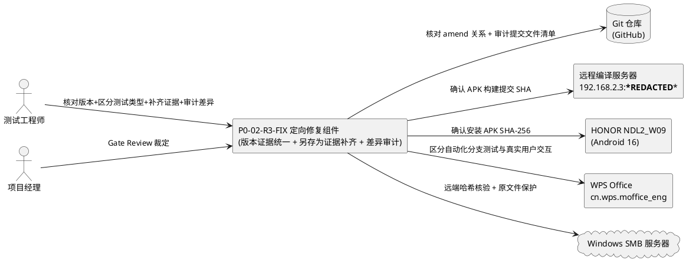
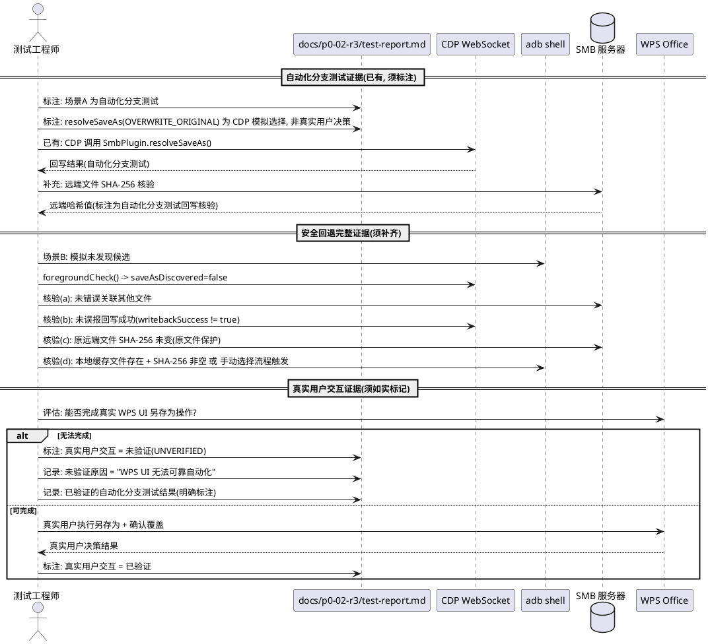
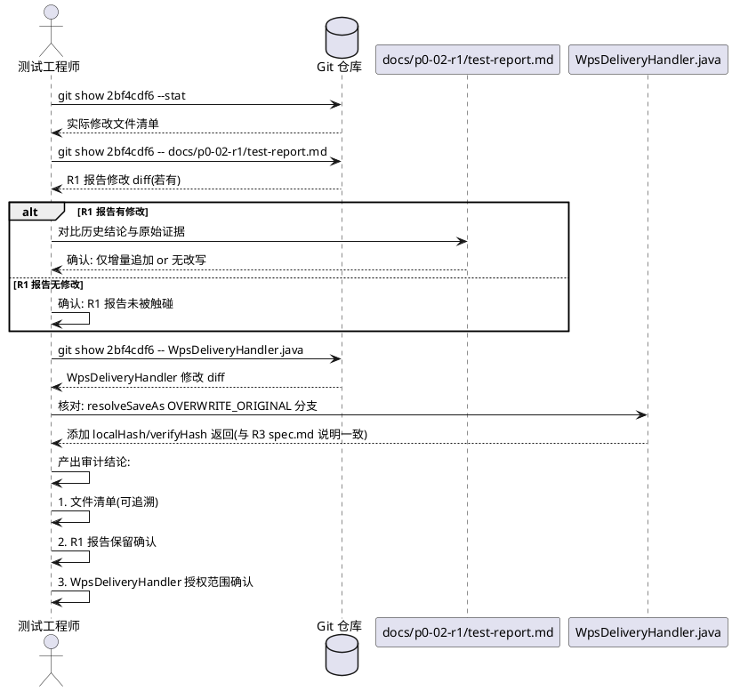

# P0-02-R3-FIX 需求规格：Hash Assertion & Save-As Evidence Repair — 定向修复

> 本文档为 P0-02-R3-FIX 定向修复任务的需求规格，基于 PM Gate Review 对 P0-02-R3 的裁定（**HOLD / TARGETED REPAIR**，2 项阻断 + 3 项定向修复任务）生成。文档定义 R3-FIX-01 ~ R3-FIX-03 三个子项的 EARS 格式需求、验收标准、阻断项根因分析与修复策略、约束声明。所有业务规则采用可测试的验收条件（触发场景 → 预期行为）描述。

> **文档定位**：本规格为 P0-02-R3 测试报告与证据链的定向修复需求，不替代 `docs/p0-02-r3/spec.md`（R3 哈希断言与另存为证据修复需求规格）中的定义，而是针对 PM 对 P0-02-R3 Gate Review 中暴露的 2 项阻断（报告 SHA 与申请验收提交 SHA 不一致、另存为测试证明处理分支不等于证明完整真实业务链）定义定向修复验收标准。P0-02 关闭与 P0-03 启动在 P0-02-R3-FIX 通过前不被授权。

> **前置基线**：
> - P0-02-R3 主体提交 SHA `2bf4cdf6a48972dec7db758526e1c8b2e2b41fb4`（已推送 GitHub，amend 后的最终提交）。
> - P0-02-R3 补充提交 `60db452`（test-report.md SHA 更新，已推送）。
> - 报告中错误记录的 SHA `b987ceb6f1b55876a8814482e548e0cd53022464`（amend 前的旧 SHA）。
> - APK SHA-256 `5e54360978399895b279f8b01217cf3275654b1b4f0911ffb808fdaa44cd95dc`（10,516,104 bytes）。
> - R3 测试结果 6/6 ALL PASSED（已有可靠证据支持的回归场景不重做）。
> - PM 裁定 P0-02-R3 = **HOLD / TARGETED REPAIR**，授权 P0-02-R3-FIX。

---

# 1. 组件定位

## 1.1 核心职责

本修复任务负责修正 P0-02-R3 在 PM Gate Review 中暴露的两项阻断：测试报告记录的代码 SHA 与实际申请验收的提交 SHA 不一致、另存为自动化分支测试被误等同于真实用户交互决策，使版本证据链可核对、另存为证据如实区分自动化测试与真实用户操作，并完成最小差异审计确认 R1 历史证据未被改写。

## 1.2 核心输入

1. **P0-02-R3 测试报告**：`docs/p0-02-r3/test-report.md` 中记录的代码 SHA `b987ceb6f1b55876a8814482e548e0cd53022464`（amend 前旧 SHA），与实际申请验收的提交 SHA `2bf4cdf6a48972dec7db758526e1c8b2e2b41fb4` 不一致。
2. **P0-02-R3 执行日志**：`docs/p0-02-r3/execution-log.md` 中记录的 APK SHA-256 `5e54360978399895b279f8b01217cf3275654b1b4f0911ffb808fdaa44cd95dc` 与编译日志，须核对与实际构建过程的对应关系。
3. **Git 提交历史**：`b987ceb6...`（amend 前 SHA）、`2bf4cdf6...`（amend 后主体提交）、`60db452`（补充提交），须明确各 SHA 对应的代码版本与 amend 关系。
4. **P0-02-R3 执行日志中的另存为测试片段**：步骤 5 显示测试通过 `adb shell` 创建候选文件，并由 CDP 直接调用 `SmbPlugin.resolveSaveAs({choice:'OVERWRITE_ORIGINAL', ...})`，须区分自动化分支测试与真实用户交互。
5. **PM Gate Review 裁定**：P0-02-R3 = HOLD / TARGETED REPAIR，含 2 项阻断（阻断项 A 版本证据不一致、阻断项 B 另存为业务链证据不足）与 3 项定向修复任务（R3-FIX-01/02/03）。
6. **R1 历史测试报告**：`docs/p0-02-r1/test-report.md` 的历史结论与原始证据，须审计确认未被 R3 提交改写。
7. **R3 提交文件清单**：`2bf4cdf6...` 提交的实际修改文件列表，须核对是否包含 `WpsDeliveryHandler.java` 的哈希字段返回修改及该修改是否在授权范围内。

## 1.3 核心输出

1. **统一的版本证据链**：测试报告与执行日志中记录的代码 SHA、APK SHA-256、构建提交 SHA 三者对应关系明确且可核对，与实际构建和测试过程相符。
2. **如实区分的另存为证据**：测试报告明确区分自动化分支测试（CDP 直接调用插件方法）与真实用户交互（WPS UI 中执行另存为并确认覆盖），无法完成真实 UI 操作的场景如实标记为"未验证"。
3. **补齐的安全回退完整证据**：场景B 的证据完整证明未错误关联其他文件、未误报回写成功、原有远端文件未被破坏、本地编辑数据和会话得到保留或进入可恢复的手动选择流程。
4. **最小差异审计结论**：核对实际提交文件清单，确认 R1 历史报告未被改写，确认 `WpsDeliveryHandler.java` 哈希字段返回修改处于本次授权范围内。
5. **新的完整提交 SHA 与更新后的报告**：提交新的完整 SHA，更新测试报告与执行日志，提供可核对的构建与测试证据。
6. **保留的已有可靠证据**：P0-02-R3 已通过且具有可靠证据支持的回归场景（6/6 ALL PASSED 中的 txt_save、docx_save、normal_save、writeback_integrity、negative_cases）不重做。

## 1.4 职责边界

本修复任务**不负责**以下事项：

1. **不负责**重做已有可靠证据支持的全部回归场景：R3 已通过的 6/6 场景中，具有可靠证据支持的场景（txt_save、docx_save、normal_save、writeback_integrity、negative_cases 的哈希断言与反例证明）不重做，仅补齐与当前阻断直接相关的证据。
2. **不负责**扩展到无关重构：本修复仅针对 PM 明确的 3 项定向修复任务（R3-FIX-01/02/03），不扩展到无关的功能重构、架构调整或测试框架重写。
3. **不负责**把模拟操作认定为真实 WPS 用户操作：测试通过 `adb shell` 创建候选文件并由 CDP 直接调用插件方法属于自动化分支测试，不得认定为真实用户在 WPS 交互界面中作出的决策。
4. **不负责**把尚未核实的 APK 版本当作已验收版本：APK 版本须与实际构建提交 SHA 对应并经核对方可标记为已验收，不得因进度压力跳过核对。
5. **不负责** P0-03（安全回写）的实现：P0-03 在 P0-02-R3-FIX 通过且 P0-02 关闭前不被授权启动。
6. **不负责**改写 P0-02-R1 与 P0-02-R2 已通过的历史证据：历史结论与原始证据须原样保留，仅允许增量追加。
7. **不负责**退回重新设计或重复所有已通过场景：本次为定向修复，不退回重新设计，不要求重复所有已通过场景。

---

# 2. 领域术语

**版本证据不一致**
: 测试报告与执行日志中记录的代码 SHA 与实际申请 PM Gate Review 验收的提交 SHA 不相同的缺陷。P0-02-R3 报告记录的 SHA 为 `b987ceb6f1b55876a8814482e548e0cd53022464`（amend 前旧 SHA），而实际申请验收的提交 SHA 为 `2bf4cdf6a48972dec7db758526e1c8b2e2b41fb4`（amend 后最终提交），两者不一致导致 PM 无法确认用于测试的 APK 确实包含当前验收的代码。
: 备注：R3-FIX-01 须修复的阻断项 A。

**amend 前 SHA**
: Git 提交在执行 `git commit --amend` 操作之前的原始提交 SHA。P0-02-R3 中 `b987ceb6f1b55876a8814482e548e0cd53022464` 为 amend 前的 SHA，amend 后变为 `2bf4cdf6a48972dec7db758526e1c8b2e2b41fb4`。amend 操作改变了提交 SHA，但测试报告未同步更新，导致版本证据不一致。
: 备注：阻断项 A 的根因。

**真实构建提交 SHA**
: 实际用于编译产出测试 APK 的源码所对应的 Git 提交 SHA。测试报告中记录的代码 SHA 须与真实构建提交 SHA 一致，且该 SHA 须可 `git log` 追溯，用于测试的 APK 须确实包含该提交的代码。
: 备注：R3-FIX-01 要求核对的 SHA。

**APK SHA-256**
: 测试 APK 文件的 SHA-256 摘要值，用于唯一标识 APK 文件内容。P0-02-R3 的 APK SHA-256 为 `5e54360978399895b279f8b01217cf3275654b1b4f0911ffb808fdaa44cd95dc`（10,516,104 bytes）。APK SHA-256 须与构建提交 SHA 对应，即该 APK 须由该提交的源码编译产出。
: 备注：R3-FIX-01 要求核对的 APK 标识。

**自动化分支测试**
: 通过 Chrome DevTools Protocol (WebSocket) 直接调用 Capacitor 插件方法（如 `SmbPlugin.resolveSaveAs({choice:'OVERWRITE_ORIGINAL', ...})`）验证候选发现与回写处理逻辑的测试方式。此类测试可验证插件方法的处理分支逻辑，但不能直接等同于真实 WPS 用户在交互界面中执行"另存为"并确认覆盖操作。
: 备注：R3-FIX-02 须明确区分的测试类型。

**真实用户交互**
: 真实用户在 WPS Office 交互界面中执行"另存为"操作、在弹出的决策对话框中选择"覆盖原文件"或"回写为新文件"或"放弃关联"的用户决策行为。真实用户交互须通过 WPS UI 操作产生，而非通过 CDP 直接调用插件方法模拟。
: 备注：R3-FIX-02 须补充或如实标记为未验证的证据类型。

**覆盖选择决策**
: 另存为场景中用户在"回写为新文件 / 覆盖原文件 / 放弃关联"三选项中选择"覆盖原文件"（OVERWRITE_ORIGINAL）的决策行为。R3 执行日志显示测试脚本直接调用 `resolveSaveAs({choice:'OVERWRITE_ORIGINAL', ...})`，此为自动化分支测试的模拟选择，不能据此证明真实用户作出了该选择。
: 备注：R3-FIX-02 须区分的决策类型。

**远端哈希核验**
: 另存为覆盖原文件后，对远端 SMB 服务器上的文件内容计算 SHA-256 并与本地候选文件哈希比对，确认远端文件确实被正确覆盖的核验过程。R3 已有 `assertWriteback` 三项全检覆盖此核验，但须确认其对应的是自动化分支测试的回写结果而非真实用户操作后的回写结果。
: 备注：R3-FIX-02 须补充的核验证据。

**无候选安全回退**
: 另存为场景中未发现候选文件时，系统进入的预期处理流程：不错误关联到其他文件、不误报回写成功、原有远端文件未被破坏、本地编辑数据和会话得到保留或明确进入可恢复的手动选择流程。R3 场景B 已展示 `saveAsDiscovered=false` 和手动选择提示，但现有日志片段未充分展示完整的安全回退结果。
: 备注：R3-FIX-02 须补齐的完整证据。

**原文件保护**
: 另存为场景中，无论是否发现候选文件、无论用户选择何种决策，原有远端文件的内容与完整性不得被破坏的保证。须通过远端文件 SHA-256 核验确认原文件在另存为处理过程中未被意外覆盖或损坏。
: 备注：R3-FIX-02 须补充的保护证据。

**未验证标记**
: 当当前测试环境无法完成真实 WPS UI 操作时，测试报告须如实将该场景标记为"未验证"（UNVERIFIED），而非伪报为已通过或把自动化分支测试结果写成真实用户决策结果。未验证标记须含未验证原因（如"WPS UI 无法可靠自动化"）与已验证的自动化分支测试结果（明确标注为自动化分支测试）。
: 备注：R3-FIX-02 的如实标记要求。

**最小差异审计**
: 核对实际提交的文件清单，确认提交仅修改授权范围内的文件，未改写历史证据，未触碰授权范围外的功能组件。本次最小差异审计须确认：R1 历史报告未被改写、新增的 `WpsDeliveryHandler.java` 哈希字段返回修改处于本次授权范围内。
: 备注：R3-FIX-03 的审计任务。

**授权范围**
: PM 在 P0-02-R3 授权中允许修改的文件与代码范围。P0-02-R3 spec.md 约束声明"仅修测试框架（R1RegressionTestSuite.java + RegressionTestConfig.java）"，但 R3 实际提交中包含 `WpsDeliveryHandler.java` 的 `resolveSaveAs()` OVERWRITE_ORIGINAL 分支哈希字段返回修改。R3-FIX-03 须确认该修改是否处于本次授权范围内（R3 spec.md 已说明此修改为解决 PM 阻断项 1 所必需）。
: 备注：R3-FIX-03 须确认的范围。

---

# 3. 角色与边界

## 3.1 核心角色

- **测试工程师**：核对版本证据链、区分自动化分支测试与真实用户交互、补齐安全回退完整证据、执行最小差异审计、更新测试报告与执行日志、提交新完整 SHA 的人员。
- **项目经理（PM）**：对 P0-02-R3-FIX 执行 Gate Review，裁定版本证据统一、另存为证据补齐、差异审计完成是否通过、P0-02 是否关闭、P0-03 是否授权启动的评审者。

## 3.2 外部系统

- **Git 仓库（GitHub wujupeng/andriodpad2）**：提交历史审计对象，须核对 `b987ceb6...`（amend 前）、`2bf4cdf6...`（amend 后）、`60db452`（补充提交）的 amend 关系与实际文件清单。
- **远程编译服务器（192.168.2.3, debian/***REDACTED***）**：APK 构建环境，须确认用于测试的 APK 确实由申请验收的提交 SHA 编译产出。
- **HONOR NDL2_W09 平板（Android 16, API 36）**：测试设备，测试 APK 安装与执行环境，须确认安装的 APK SHA-256 与报告记录一致。
- **WPS Office（cn.wps.moffice_eng）**：另存为真实用户交互验证的对象，因 UI 无法可靠自动化，真实用户交互场景须如实标记为未验证或补充真实操作证据。
- **Windows SMB 服务器（192.168.2.3/share）**：远端哈希核验与原文件保护验证的目标，须支持文件读取与 SHA-256 校验。

## 3.3 交互上下文



---

# 4. DFX约束

## 4.1 性能

1. **定向修复执行时间**：R3-FIX-01/02/03 三项定向修复的总执行时间（含版本核对、证据补齐、差异审计、报告更新、重新提交）须在 2 小时以内，不扩展为全量回归重做。
   - 验收条件：[执行 R3-FIX-01/02/03 三项定向修复] → [2 小时内完成，不含全量回归重做]
2. **差异审计执行开销**：最小差异审计（R3-FIX-03）的 Git diff 核对与文件清单审计须在 10 分钟以内完成。
   - 验收条件：[执行最小差异审计] → [10 分钟内完成 Git diff 核对与文件清单审计]

## 4.2 可靠性

1. **版本证据链须可核对**：测试报告中的代码 SHA、APK SHA-256、构建提交 SHA 三者对应关系须可独立核对，核对结果与报告声明一致。
   - 验收条件：[按报告声明的 SHA 核对 Git 历史、APK 文件、构建过程] → [三者对应关系一致，可独立核对]
2. **另存为证据须如实标注**：测试报告中的另存为场景证据须如实标注为"自动化分支测试"或"真实用户交互"或"未验证"，不得把自动化分支测试写成真实用户决策。
   - 验收条件：[审查另存为场景证据标注] → [每条证据有明确的测试类型标注，与实际执行方式一致]
3. **差异审计结论须可追溯**：最小差异审计的结论须基于实际 Git diff 与文件清单，可追溯至具体提交与具体文件变更。
   - 验收条件：[审查差异审计结论] → [结论基于 git show/diff 输出，可追溯至具体提交 SHA 与文件变更]

## 4.3 安全性

1. **证据日志脱敏**：更新的测试报告与执行日志中不得包含密码、凭据、文件敏感内容。
   - 验收条件：[审查更新后的测试报告与执行日志] → [不含密码明文与文件内容明文]
2. **代码 SHA 可追溯**：更新的测试报告中的代码 SHA 须与实际提交 SHA 一致，40 字符完整 SHA，可 `git log` 追溯。
   - 验收条件：[审查测试报告代码 SHA] → [与实际提交 SHA 一致，40 字符完整 SHA，可 git log 追溯]

## 4.4 可维护性

1. **已有可靠证据保留**：P0-02-R3 已通过且具有可靠证据支持的回归场景不重做，已有证据原样保留。
   - 验收条件：[审查修复后的证据归档] → [R3 已通过场景的可靠证据原样保留，未被改写或删除]
2. **R1 历史结论不得改写**：`docs/p0-02-r1/test-report.md` 中的历史测试结论与原始证据数据须原样保留。
   - 验收条件：[对比 R1 报告修复前后内容] → [历史结论与原始证据数据未改写，仅允许增量追加]
3. **测试类型标注须与实际一致**：测试报告声明的测试类型（自动化分支测试 / 真实用户交互 / 未验证）须与实际执行过程一致，不得把自动化分支测试声明为真实用户交互。
   - 验收条件：[对比测试报告测试类型标注与执行日志] → [标注与实际执行过程一致]

## 4.5 兼容性

1. **目标设备兼容**：修复后的测试报告须与 Honor NDL2-W09（Android 16, API 36）+ WPS cn.wps.moffice_eng 环境一致。
   - 验收条件：[审查测试报告设备信息] → [与 Honor NDL2-W09 + Android 16 + WPS cn.wps.moffice_eng 一致]
2. **不扩展到无关重构**：修复仅限 PM 明确的 3 项定向修复任务，不修改授权范围外的功能组件（除 R3 已授权的 `WpsDeliveryHandler.java` 哈希字段返回修改）。
   - 验收条件：[审查代码变更] → [仅限 R3-FIX-01/02/03 相关的文档与证据文件变更，无无关重构]

---

# 5. 核心能力

## 5.1 R3-FIX-01 统一版本证据

### 5.1.1 业务规则

1. **须明确 amend 前 SHA 与 amend 后 SHA 的对应关系**：须明确测试报告中记录的 `b987ceb6f1b55876a8814482e548e0cd53022464`（amend 前旧 SHA）与实际申请验收的 `2bf4cdf6a48972dec7db758526e1c8b2e2b41fb4`（amend 后最终提交）分别对应什么代码版本，说明 amend 操作的原因与 amend 前后代码差异。
   - 验收条件：[审查版本证据说明] → [明确 b987ceb6 为 amend 前 SHA、2bf4cdf6 为 amend 后最终提交，含 amend 原因与 amend 前后代码差异说明]
2. **须确认用于测试的 APK 确实包含当前验收的代码**：须确认 APK SHA-256 `5e54360978399895b279f8b01217cf3275654b1b4f0911ffb808fdaa44cd95dc` 确实由提交 `2bf4cdf6...` 的源码编译产出，而非 amend 前的 `b987ceb6...` 或其他提交的源码编译。
   - 验收条件：[核对 APK 构建过程] → [APK SHA-256 5e543609... 由提交 2bf4cdf6... 的源码编译产出，构建日志可追溯]
3. **须更新测试报告记录真实构建提交 SHA**：`docs/p0-02-r3/test-report.md` 中的代码 SHA 须更新为实际用于构建和测试的提交 SHA `2bf4cdf6a48972dec7db758526e1c8b2e2b41fb4`，并记录 APK SHA-256、构建时间、测试执行版本。
   - 验收条件：[审查更新后的测试报告] → [代码 SHA 为 2bf4cdf6...，含 APK SHA-256、构建时间、测试执行版本，与实际构建测试过程相符]
4. **须更新执行日志记录真实构建过程**：`docs/p0-02-r3/execution-log.md` 须记录真实构建提交 SHA、APK SHA-256、编译日志与测试执行版本，编译日志中的 APK SHA-256 须与测试报告一致。
   - 验收条件：[审查更新后的执行日志] → [含真实构建提交 SHA、APK SHA-256、编译日志，与测试报告一致]
5. **不得只把旧 SHA 替换成新 SHA**：更新版本证据不得仅执行字符串替换（把 `b987ceb6...` 替换为 `2bf4cdf6...`），须确保更新后的 SHA 与实际构建、测试过程相符，附可核对的构建与测试证据。
   - 验收条件：[审查版本证据更新过程] → [非仅字符串替换，含构建过程核对、APK SHA-256 核对、测试执行版本核对的完整证据]
6. **禁止项**：禁止仅把旧 SHA 字符串替换为新 SHA 而不核对实际构建过程；禁止保留 amend 前 SHA 作为当前验收提交 SHA；禁止 APK SHA-256 与构建提交 SHA 对应关系不明；禁止把尚未核实的 APK 版本当作已验收版本。
   - 验收条件：[审查版本证据更新] → [无禁止项描述的缺陷形式]

### 5.1.2 交互流程

```plantuml
@startuml
actor "测试工程师" as Tester
database "Git 仓库" as Git
participant "远程编译服务器" as Build
rectangle "HONOR NDL2_W09" as Device
participant "docs/p0-02-r3/test-report.md" as Report
participant "docs/p0-02-r3/execution-log.md" as Log

Tester -> Git : git log --all -20 (查看 amend 关系)
Git --> Tester : b987ceb6(amend前) -> 2bf4cdf6(amend后) -> 60db452(补充)

Tester -> Git : git show 2bf4cdf6 --stat
Git --> Tester : 实际修改文件清单

Tester -> Build : 核对编译日志(哪个提交编译产出 APK)
Build --> Tester : APK 由 2bf4cdf6 编译产出, SHA-256=5e543609...

Tester -> Device : adb shell sha256sum /data/app/.../base.apk
Device --> Tester : 安装 APK SHA-256=5e543609...

Tester -> Report : 更新代码 SHA=2bf4cdf6... + APK SHA-256 + 构建时间 + 测试版本
Tester -> Log : 更新真实构建提交 SHA + 编译日志 + APK SHA-256

Tester -> Tester : 核对: 报告SHA == 实际提交SHA == 构建提交SHA == APK对应提交SHA

@enduml
```

### 5.1.3 异常场景

1. **APK并非由申请验收的提交编译产出**
   - 触发条件：核对发现 APK SHA-256 `5e543609...` 对应的源码提交不是 `2bf4cdf6...`，而是 amend 前的 `b987ceb6...` 或其他提交。
   - 系统行为：R3-FIX-01 核对失败，须用 `2bf4cdf6...` 的源码重新编译产出新 APK，重新执行测试，更新 APK SHA-256。
   - 用户感知：PM 收到核对失败报告，要求重新构建和测试后再申请验收。
2. **amend 前后代码差异超出预期**
   - 触发条件：核对 `b987ceb6...` 与 `2bf4cdf6...` 的代码差异发现 amend 操作引入了超出修复范围的变更。
   - 系统行为：R3-FIX-01 核对失败，须分析 amend 引入的额外变更是否影响测试有效性。
   - 用户感知：PM 收到差异分析报告，要求说明 amend 引入额外变更的原因。

## 5.2 R3-FIX-02 补齐另存为决策与安全回退证据

### 5.2.1 业务规则

1. **须明确区分自动化分支测试与真实用户交互**：测试报告须明确区分另存为场景中"自动化分支测试"（通过 `adb shell` 创建候选文件 + CDP 直接调用 `SmbPlugin.resolveSaveAs()`）与"真实用户交互"（真实用户在 WPS UI 中执行另存为并确认覆盖），不得把自动化分支测试写成真实用户决策。
   - 验收条件：[审查另存为场景证据标注] → [自动化分支测试与真实用户交互有明确区分标注，CDP 直接调用 resolveSaveAs 标注为自动化分支测试]
2. **须补充覆盖选择决策的证据类型标注**：R3 执行日志显示测试脚本直接调用 `resolveSaveAs({choice:'OVERWRITE_ORIGINAL', ...})`，此为自动化分支测试的模拟选择。测试报告须将该决策标注为"自动化分支测试模拟选择"，而非"真实用户覆盖选择决策"。
   - 验收条件：[审查覆盖选择决策证据] → [标注为自动化分支测试模拟选择，非真实用户决策，含 CDP 调用记录]
3. **须补充远端哈希核验证据**：另存为覆盖原文件后，须补充远端 SMB 服务器上文件内容的 SHA-256 核验证据，确认远端文件确实被正确覆盖。该核验须标注为自动化分支测试的回写结果核验。
   - 验收条件：[审查远端哈希核验证据] → [含远端文件 SHA-256 实际值与本地候选文件哈希比对结果，标注为自动化分支测试回写核验]
4. **须补齐无候选安全回退的完整证据**：场景B 须补齐完整的安全回退结果证据，证明：(a) 没有错误关联到其他文件；(b) 没有误报回写成功；(c) 原有远端文件未被破坏；(d) 本地编辑数据和会话得到保留或明确进入可恢复的手动选择流程。
   - 验收条件：[审查场景B 安全回退证据] → [含(a)无错误关联、(b)未误报回写成功、(c)原远端文件 SHA-256 未变、(d)本地缓存文件存在且 SHA-256 非空或手动选择流程触发 四项完整证据]
5. **须补充原文件保护证据**：另存为场景中，须补充原有远端文件内容与完整性的保护证据，通过远端文件 SHA-256 核验确认原文件在另存为处理过程中未被意外覆盖或损坏。
   - 验收条件：[审查原文件保护证据] → [含另存为处理前后远端原文件 SHA-256 对比，确认未被破坏]
6. **若当前环境无法完成真实 UI 操作须如实标记为未验证**：若当前测试环境无法完成真实 WPS UI 操作（WPS UI 无法可靠自动化），测试报告须将真实用户交互场景如实标记为"未验证"（UNVERIFIED），含未验证原因与已验证的自动化分支测试结果（明确标注为自动化分支测试）。
   - 验收条件：[审查真实用户交互场景标注] → [标记为未验证(UNVERIFIED)，含未验证原因(如"WPS UI 无法可靠自动化")与已验证的自动化分支测试结果]
7. **不得把插件直接调用写成真实用户决策**：禁止将 CDP 直接调用 `SmbPlugin.resolveSaveAs({choice:'OVERWRITE_ORIGINAL', ...})` 的结果写成"真实用户选择覆盖原文件"。
   - 验收条件：[审查另存为决策证据描述] → [无把插件直接调用写成真实用户决策的描述]
8. **禁止项**：禁止把自动化分支测试认定为真实 WPS 用户操作；禁止把尚未核实的 APK 版本当作已验收版本；禁止把未验证场景伪报为已通过；禁止安全回退证据缺失四项完整结果中的任一项；禁止把 CDP 直接调用 resolveSaveAs 的模拟选择写成真实用户决策。
   - 验收条件：[审查另存为证据] → [无禁止项描述的缺陷形式]

### 5.2.2 交互流程



### 5.2.3 异常场景

1. **安全回退核验发现原远端文件被破坏**
   - 触发条件：场景B 安全回退核验发现另存为处理过程中原有远端文件 SHA-256 发生变化（原文件被意外覆盖或损坏）。
   - 系统行为：R3-FIX-02 核验失败，须分析原文件被破坏的根因（功能缺陷或测试模拟问题），如实记录。
   - 用户感知：PM 收到核验失败报告，要求分析根因并修复后再申请验收。
2. **安全回退核验发现误报回写成功**
   - 触发条件：场景B 安全回退核验发现未发现候选文件时系统误报 `writebackSuccess=true`。
   - 系统行为：R3-FIX-02 核验失败，须分析误报根因，如实记录。
   - 用户感知：PM 收到核验失败报告，要求修复误报逻辑后再申请验收。
3. **安全回退核验发现错误关联其他文件**
   - 触发条件：场景B 安全回退核验发现未发现候选文件时系统错误关联到其他无关文件。
   - 系统行为：R3-FIX-02 核验失败，须分析错误关联根因，如实记录。
   - 用户感知：PM 收到核验失败报告，要求修复关联逻辑后再申请验收。

## 5.3 R3-FIX-03 完成最小差异审计

### 5.3.1 业务规则

1. **须核对实际提交文件清单**：须核对提交 `2bf4cdf6a48972dec7db758526e1c8b2e2b41fb4` 的实际修改文件清单（`git show 2bf4cdf6 --stat`），确认修改的文件范围。
   - 验收条件：[执行 git show 2bf4cdf6 --stat] → [产出完整修改文件清单，含每个文件的增删行数]
2. **须确认 R1 历史报告未被改写**：须确认提交 `2bf4cdf6...` 及其相关提交（`60db452`）未改写 `docs/p0-02-r1/test-report.md` 中的历史测试结论与原始证据数据，R1 报告的历史结论（PASS/FAIL 判定）与原始证据（交付参数 JSON、SHA-256 哈希值）原样保留。
   - 验收条件：[审查 2bf4cdf6 与 60db452 对 docs/p0-02-r1/test-report.md 的修改] → [无改写历史结论或原始证据的变更，仅允许增量追加或无修改]
3. **须确认 WpsDeliveryHandler.java 哈希字段返回修改处于授权范围内**：须确认提交 `2bf4cdf6...` 中 `WpsDeliveryHandler.java` 的 `resolveSaveAs()` OVERWRITE_ORIGINAL 分支添加 `result.put("localHash", localHash)` 和 `result.put("verifyHash", verifyHash)` 修改处于本次授权范围内。该修改在 P0-02-R3 spec.md 中已说明为解决 PM 阻断项 1 所必需（assertWriteback 要求所有回写场景都必须有哈希），不改变功能行为（哈希计算逻辑未变），仅将已计算的哈希放入结果 Map。
   - 验收条件：[审查 WpsDeliveryHandler.java 修改内容] → [修改为 resolveSaveAs OVERWRITE_ORIGINAL 分支添加 localHash/verifyHash 返回，与 R3 spec.md 说明一致，处于授权范围内]
4. **须产出最小差异审计结论**：须产出最小差异审计结论，含实际修改文件清单、R1 报告保留确认、WpsDeliveryHandler.java 授权范围确认，结论基于 `git show/diff` 输出可追溯。
   - 验收条件：[审查最小差异审计结论] → [含文件清单、R1 保留确认、授权范围确认，基于 git show/diff 输出可追溯]
5. **禁止项**：禁止跳过实际提交文件清单核对；禁止未确认 R1 报告保留即声明审计通过；禁止未确认 WpsDeliveryHandler.java 修改授权范围即声明审计通过；禁止审计结论无 git show/diff 证据支撑。
   - 验收条件：[审查最小差异审计过程] → [无禁止项描述的缺陷形式]

### 5.3.2 交互流程



### 5.3.3 异常场景

1. **审计发现 R1 报告被改写**
   - 触发条件：审计发现提交 `2bf4cdf6...` 或 `60db452` 改写了 `docs/p0-02-r1/test-report.md` 中的历史 PASS/FAIL 判定或原始证据数据。
   - 系统行为：R3-FIX-03 审计失败，须从 Git 历史恢复被改写的历史结论与原始证据，或追加说明该改写的合理性。
   - 用户感知：PM 收到审计失败报告，要求恢复历史证据或说明改写原因后重新审计。
2. **审计发现 WpsDeliveryHandler.java 修改超出授权范围**
   - 触发条件：审计发现 `WpsDeliveryHandler.java` 的修改超出 R3 spec.md 说明的范围（如修改了哈希计算逻辑、修改了其他分支、引入了功能行为变更）。
   - 系统行为：R3-FIX-03 审计失败，须分析超范围修改的影响，回退超范围变更或追加授权说明。
   - 用户感知：PM 收到审计失败报告，要求说明超范围修改原因或回退后再审计。
3. **审计发现提交包含授权范围外的文件修改**
   - 触发条件：审计发现提交 `2bf4cdf6...` 包含 P0-02-R3 授权范围外的功能组件代码修改（除 `WpsDeliveryHandler.java` 哈希字段返回修改外）。
   - 系统行为：R3-FIX-03 审计失败，须分析越界修改的影响，回退越界变更或追加授权说明。
   - 用户感知：PM 收到审计失败报告，要求说明越界修改原因或回退后再审计。

---

# 6. 数据约束

## 6.1 版本证据链

1. **报告中原记录的代码 SHA**：`b987ceb6f1b55876a8814482e548e0cd53022464`（amend 前旧 SHA），须在修复说明中明确其为 amend 前 SHA，非当前验收提交 SHA。
2. **实际申请验收的提交 SHA**：`2bf4cdf6a48972dec7db758526e1c8b2e2b41fb4`（amend 后最终提交），须为测试报告中更新后的代码 SHA，40 字符完整十六进制，可 `git log` 追溯。
3. **补充提交 SHA**：`60db452`（test-report.md SHA 更新），须在版本证据说明中记录其与 `2bf4cdf6...` 的关系。
4. **APK SHA-256**：`5e54360978399895b279f8b01217cf3275654b1b4f0911ffb808fdaa44cd95dc`（10,516,104 bytes），须与构建提交 SHA `2bf4cdf6...` 对应，即该 APK 由该提交源码编译产出。
5. **三者对应关系**：代码 SHA == 构建提交 SHA == APK 对应提交 SHA，三者须一致且可核对。
6. **禁止值**：禁止测试报告代码 SHA 与实际提交 SHA 不一致；禁止 APK SHA-256 与构建提交 SHA 对应关系不明；禁止保留 amend 前 SHA 作为当前验收提交 SHA。

## 6.2 另存为证据标注

1. **测试类型标注**：取值范围为 `自动化分支测试`、`真实用户交互`、`未验证(UNVERIFIED)`，每条另存为证据须标注测试类型。
2. **自动化分支测试标注**：通过 `adb shell` 创建候选文件 + CDP 直接调用 `SmbPlugin.resolveSaveAs()` 的证据须标注为"自动化分支测试"。
3. **覆盖选择决策标注**：CDP 直接调用 `resolveSaveAs({choice:'OVERWRITE_ORIGINAL', ...})` 须标注为"自动化分支测试模拟选择"，非"真实用户覆盖选择决策"。
4. **真实用户交互标注**：真实用户在 WPS UI 中执行另存为并确认覆盖的证据须标注为"真实用户交互"。
5. **未验证标注**：无法完成真实 WPS UI 操作的场景须标注为"未验证(UNVERIFIED)"，含未验证原因与已验证的自动化分支测试结果。
6. **安全回退完整证据**：场景B 须含四项完整证据：(a) 无错误关联、(b) 未误报回写成功、(c) 原远端文件 SHA-256 未变、(d) 本地缓存保留或手动选择流程触发。
7. **禁止值**：禁止把自动化分支测试标注为真实用户交互；禁止把未验证场景标注为已通过；禁止安全回退证据缺失四项中的任一项；禁止把 CDP 模拟选择写成真实用户决策。

## 6.3 最小差异审计结论

1. **实际修改文件清单**：须为 `git show 2bf4cdf6 --stat` 的完整输出，含每个文件的增删行数，可追溯。
2. **R1 报告保留确认**：须为基于 `git show 2bf4cdf6 -- docs/p0-02-r1/test-report.md` 和 `git show 60db452 -- docs/p0-02-r1/test-report.md` 的核对结果，确认历史结论与原始证据未改写。
3. **WpsDeliveryHandler.java 授权范围确认**：须为基于 `git show 2bf4cdf6 -- WpsDeliveryHandler.java` 的核对结果，确认修改为 `resolveSaveAs` OVERWRITE_ORIGINAL 分支添加 localHash/verifyHash 返回，与 R3 spec.md 说明一致。
4. **审计结论**：须为"最小差异审计通过"或"最小差异审计失败（含具体失败项与根因）"，基于 git show/diff 输出可追溯。
5. **禁止值**：禁止审计结论无 git show/diff 证据支撑；禁止跳过 R1 报告保留确认；禁止跳过 WpsDeliveryHandler.java 授权范围确认。

---

# 7. 阻断项根因分析与修复策略

## 7.1 阻断项 A：报告 SHA 与申请验收的提交 SHA 不一致

- **现象**：R3 测试报告和执行日志记录的代码 SHA 是 `b987ceb6f1b55876a8814482e548e0cd53022464`，而本次申请 PM 审核的提交 SHA 是 `2bf4cdf6a48972dec7db758526e1c8b2e2b41fb4`。两者不一致，PM 无法确认用于测试的 APK 确实包含当前验收的代码。
- **影响**：版本证据链断裂，PM 无法基于测试报告判定测试结果对应的是哪个代码版本。若 APK 实际由 amend 前的 `b987ceb6...` 编译产出，则测试结果不能代表 `2bf4cdf6...` 的代码行为；若 APK 由 `2bf4cdf6...` 编译产出但报告记录旧 SHA，则报告不可核对。
- **根因**：P0-02-R3 主体提交在推送前执行了 `git commit --amend` 操作（amend 前 SHA 为 `b987ceb6...`，amend 后变为 `2bf4cdf6...`），但测试报告中的代码 SHA 未同步更新，仍记录 amend 前的旧 SHA。后续补充提交 `60db452` 更新了 test-report.md 的 SHA，但执行日志和版本证据说明未完整更新。
- **修复策略（R3-FIX-01）**：
  1. 明确 `b987ceb6...`（amend 前）与 `2bf4cdf6...`（amend 后）的对应关系，说明 amend 原因与 amend 前后代码差异。
  2. 核对 APK SHA-256 `5e543609...` 确实由 `2bf4cdf6...` 的源码编译产出（通过编译日志、构建时间、APK 文件哈希核对）。
  3. 更新测试报告和执行日志，记录真实构建提交 SHA `2bf4cdf6...`、APK SHA-256 `5e543609...`、测试执行版本，确保与实际构建测试过程相符。
  4. 不得仅把旧 SHA 字符串替换为新 SHA，须附可核对的构建与测试证据。
- **对应子项**：R3-FIX-01。

## 7.2 阻断项 B：另存为测试证明了处理分支，不等于证明了完整真实业务链

- **现象**：
  - R3 执行日志显示，另存为场景A 的测试通过 `adb shell` 创建候选文件（`echo SAVEAS CANDIDATE R3 CONTENT > /storage/emulated/0/p0-02-saveas-reachable.docx`），并由 CDP 直接调用 `SmbPlugin.resolveSaveAs({choice:'OVERWRITE_ORIGINAL', ...})`。这样的测试可以验证候选发现和回写处理逻辑，不能直接等同于真实 WPS 用户执行"另存为"并确认覆盖操作。
  - 场景B 的日志展示了未找到候选文件的提示（`saveAsDiscovered=false`，`saveAsPrompt="未自动发现另存为文件，请手动选择文件"`），但现有日志片段未充分展示完整结果：没有错误关联到其他文件、没有误报回写成功、原有远端文件未被破坏、本地编辑数据和会话得到保留或明确进入可恢复的手动选择流程。
- **影响**：PM 无法确认另存为场景的测试证据代表真实用户操作的真实业务链。自动化分支测试证明了插件方法的处理分支逻辑，但不能证明真实 WPS 用户在交互界面中的决策行为。安全回退的完整结果未充分展示，无法确认无候选回退时系统行为的安全性。
- **根因**：R3 修复另存为场景时，聚焦于"通过 CDP 调用插件方法验证候选发现与回写处理分支逻辑"的完备性目标，但未明确区分"自动化分支测试"与"真实用户交互"两种测试类型，未补充安全回退的完整结果证据。测试报告将 CDP 直接调用 `resolveSaveAs` 的结果等同于真实用户决策，违反了"不能把模拟操作认定为真实 WPS 用户操作"的 PM 指令。
- **修复策略（R3-FIX-02）**：
  1. 明确区分自动化分支测试与真实用户交互：CDP 直接调用 `resolveSaveAs` 标注为"自动化分支测试模拟选择"，非"真实用户决策"。
  2. 补充覆盖选择决策的证据类型标注：将 `resolveSaveAs({choice:'OVERWRITE_ORIGINAL'})` 标注为自动化分支测试模拟选择。
  3. 补充远端哈希核验证据：标注为自动化分支测试的回写结果核验。
  4. 补齐无候选安全回退的完整证据：四项完整结果（无错误关联、未误报回写成功、原远端文件未破坏、本地缓存保留或手动选择流程触发）。
  5. 补充原文件保护证据：远端原文件 SHA-256 核验确认未被破坏。
  6. 若当前环境无法完成真实 WPS UI 操作，如实标记为"未验证(UNVERIFIED)"，含未验证原因与已验证的自动化分支测试结果。
  7. 不得把插件直接调用写成真实用户决策。
- **对应子项**：R3-FIX-02。

## 7.3 阻断项 C：R1 历史证据保护与提交范围审计

- **现象**：PM 在 R3 Gate Review 中指出，R3 报告说明 352e296 仅补充元数据与证据索引，但尚不能仅凭这份说明替代独立的完整差异审查。同时须确认 R3 提交中新增的 `WpsDeliveryHandler.java` 哈希字段返回修改处于本次授权范围内。
- **影响**：PM 无法仅凭 R3 报告的说明确认 R1 历史证据未被改写、R3 提交范围符合授权约束。须通过独立的 Git diff 审计提供可核对的证据。
- **根因**：R3 报告中 R1 报告审核结论基于 `git show 352e296 --stat` 和 `git diff` 核实，但未对 R3 主体提交 `2bf4cdf6...` 的实际文件清单进行独立完整审计，未明确确认 `WpsDeliveryHandler.java` 修改的授权范围。
- **修复策略（R3-FIX-03）**：
  1. 核对 `2bf4cdf6...` 的实际提交文件清单（`git show 2bf4cdf6 --stat`）。
  2. 确认 R1 历史报告（`docs/p0-02-r1/test-report.md`）未被 `2bf4cdf6...` 或 `60db452` 改写。
  3. 确认 `WpsDeliveryHandler.java` 的 `resolveSaveAs()` OVERWRITE_ORIGINAL 分支添加 localHash/verifyHash 返回修改处于本次授权范围内（R3 spec.md 已说明此修改为解决 PM 阻断项 1 所必需）。
  4. 产出最小差异审计结论，基于 git show/diff 输出可追溯。
- **对应子项**：R3-FIX-03。

---

# 8. 约束声明

## 8.1 约束 1：不重做已通过场景

P0-02-R3 已通过且具有可靠证据支持的回归场景不重做，包括：

- txt_save（R3 assertWriteback 三项全检通过）
- docx_save（FILE_URI_FIRST + ACTION_VIEW + file:// verified）
- normal_save（verdict=SAVE_SUCCESS）
- writeback_integrity（R3 三项全检通过）
- negative_cases（4 个反例均正确返回 false）

**正确做法**：仅补齐与当前阻断（版本证据不一致、另存为业务链证据不足、差异审计未完成）直接相关的证据，不重复执行上述已通过场景的回归测试。

## 8.2 约束 2：不扩展到无关重构

本次定向修复仅限 PM 明确的 3 项修复任务（R3-FIX-01/02/03），不扩展到：

- 无关的功能重构或架构调整
- 测试框架的全面重写
- 新增功能需求或非阻断项的修复
- P0-03（安全回写）的实现

**正确做法**：仅修改与 R3-FIX-01/02/03 直接相关的文档（`docs/p0-02-r3/test-report.md`、`docs/p0-02-r3/execution-log.md`）与证据文件，不修改功能组件代码（R3 已授权的 `WpsDeliveryHandler.java` 哈希字段返回修改除外，该修改已在 R3 提交中完成）。

## 8.3 约束 3：不能把模拟操作认定为真实 WPS 用户操作

测试通过 `adb shell` 创建候选文件并由 CDP 直接调用 `SmbPlugin.resolveSaveAs()` 属于自动化分支测试，不得认定为真实 WPS 用户在交互界面中作出的决策。

**正确做法**：自动化分支测试证据标注为"自动化分支测试"，真实用户交互场景标注为"真实用户交互"或"未验证(UNVERIFIED)"，不得混淆。

## 8.4 约束 4：不能把尚未核实的 APK 版本当作已验收版本

APK 版本须与实际构建提交 SHA 对应并经核对方可标记为已验收。

**正确做法**：通过编译日志、构建时间、APK 文件 SHA-256 核对确认 APK 确实由申请验收的提交 SHA 编译产出，未经核对的 APK 版本不得标记为已验收。

## 8.5 约束 5：保留 R1 与 R3 已有可靠证据

P0-02-R1 测试报告中的历史结论与原始证据须原样保留，P0-02-R3 已通过场景的可靠证据须原样保留。

**正确做法**：新证据增量添加到 `docs/p0-02-r3/` 或 `docs/p0-02-r3-fix/`，R1 报告仅允许 352e296 已完成的增量追加，R3-FIX 不得再次改写 R1 报告。

---

# 9. 验收标准汇总

## 9.1 R3-FIX-01 统一版本证据验收标准

| 编号 | 触发场景 | 预期行为 | 通过判定 |
|------|---------|---------|---------|
| R3-FIX-01-AC-01 | 审查版本证据说明 | 明确 b987ceb6 为 amend 前 SHA、2bf4cdf6 为 amend 后最终提交，含 amend 原因与 amend 前后代码差异说明 | amend 关系明确可核对 |
| R3-FIX-01-AC-02 | 核对 APK 构建过程 | APK SHA-256 5e543609... 由提交 2bf4cdf6... 的源码编译产出，构建日志可追溯 | APK 与验收提交对应关系确认 |
| R3-FIX-01-AC-03 | 审查更新后的测试报告 | 代码 SHA 为 2bf4cdf6...，含 APK SHA-256、构建时间、测试执行版本，与实际构建测试过程相符 | 报告版本证据真实完整 |
| R3-FIX-01-AC-04 | 审查更新后的执行日志 | 含真实构建提交 SHA、APK SHA-256、编译日志，与测试报告一致 | 执行日志版本证据真实完整 |
| R3-FIX-01-AC-05 | 审查版本证据更新过程 | 非仅字符串替换，含构建过程核对、APK SHA-256 核对、测试执行版本核对的完整证据 | 版本证据更新有完整核对证据 |
| R3-FIX-01-AC-06 | 核对三者对应关系 | 代码 SHA == 构建提交 SHA == APK 对应提交 SHA，三者一致且可核对 | 版本证据链统一可核对 |

## 9.2 R3-FIX-02 补齐另存为决策与安全回退证据验收标准

| 编号 | 触发场景 | 预期行为 | 通过判定 |
|------|---------|---------|---------|
| R3-FIX-02-AC-01 | 审查另存为场景证据标注 | 自动化分支测试与真实用户交互有明确区分标注，CDP 直接调用 resolveSaveAs 标注为自动化分支测试 | 测试类型区分明确 |
| R3-FIX-02-AC-02 | 审查覆盖选择决策证据 | 标注为自动化分支测试模拟选择，非真实用户决策，含 CDP 调用记录 | 决策类型标注如实 |
| R3-FIX-02-AC-03 | 审查远端哈希核验证据 | 含远端文件 SHA-256 实际值与本地候选文件哈希比对结果，标注为自动化分支测试回写核验 | 远端哈希核验证据完整 |
| R3-FIX-02-AC-04 | 审查场景B 安全回退证据 | 含(a)无错误关联、(b)未误报回写成功、(c)原远端文件 SHA-256 未变、(d)本地缓存保留或手动选择流程触发 四项完整证据 | 安全回退完整证据补齐 |
| R3-FIX-02-AC-05 | 审查原文件保护证据 | 含另存为处理前后远端原文件 SHA-256 对比，确认未被破坏 | 原文件保护证据完整 |
| R3-FIX-02-AC-06 | 审查真实用户交互场景标注 | 标记为未验证(UNVERIFIED)，含未验证原因与已验证的自动化分支测试结果 | 真实用户交互如实标记 |
| R3-FIX-02-AC-07 | 审查另存为决策证据描述 | 无把插件直接调用写成真实用户决策的描述 | 无模拟操作误认为真实用户操作 |

## 9.3 R3-FIX-03 完成最小差异审计验收标准

| 编号 | 触发场景 | 预期行为 | 通过判定 |
|------|---------|---------|---------|
| R3-FIX-03-AC-01 | 执行 git show 2bf4cdf6 --stat | 产出完整修改文件清单，含每个文件的增删行数 | 实际提交文件清单可核对 |
| R3-FIX-03-AC-02 | 审查 2bf4cdf6 与 60db452 对 R1 报告的修改 | 无改写历史结论或原始证据的变更，仅允许增量追加或无修改 | R1 历史报告保留确认 |
| R3-FIX-03-AC-03 | 审查 WpsDeliveryHandler.java 修改内容 | 修改为 resolveSaveAs OVERWRITE_ORIGINAL 分支添加 localHash/verifyHash 返回，与 R3 spec.md 说明一致 | WpsDeliveryHandler 修改在授权范围内 |
| R3-FIX-03-AC-04 | 审查最小差异审计结论 | 含文件清单、R1 保留确认、授权范围确认，基于 git show/diff 输出可追溯 | 审计结论完整可追溯 |

---

# 10. PM Gate Review 裁定摘要

## 10.1 裁定结果

| 任务 | 裁定 | 说明 |
|------|------|------|
| P0-02-R3（Hash Assertion & Save-As Evidence Repair） | **HOLD / TARGETED REPAIR** | R3 测试报告存在 2 项阻断（版本证据不一致、另存为业务链证据不足），须启动 P0-02-R3-FIX 定向修复 |
| P0-02 关闭 | **NOT AUTHORIZED** | 在 P0-02-R3-FIX 通过前不批准 P0-02 关闭 |
| P0-03（安全回写） | **NOT AUTHORIZED** | 在 P0-02-R3-FIX 通过前不授权启动 P0-03 |

## 10.2 P0-02-R3 阻断项（PM 裁定依据）

| 阻断项编号 | 阻断项描述 | 对应 R3-FIX 子项 |
|-----------|-----------|-----------------|
| 阻断项 A | 报告 SHA 与申请验收的提交 SHA 不一致：报告记录 b987ceb6...，实际申请 2bf4cdf6... | R3-FIX-01 |
| 阻断项 B | 另存为测试证明了处理分支，不等于证明了完整真实业务链：自动化分支测试被误等同于真实用户交互，安全回退完整证据不足 | R3-FIX-02 |
| 阻断项 C | R1 历史证据保护与提交范围审计未独立完成：须核对实际提交文件清单、确认 R1 报告未被改写、确认 WpsDeliveryHandler.java 修改在授权范围内 | R3-FIX-03 |

## 10.3 P0-02-R3-FIX 通过条件

P0-02-R3-FIX 须满足以下全部条件方可判定为通过：

1. R3-FIX-01 ~ R3-FIX-03 三个子项全部通过验收标准。
2. 测试报告与执行日志中的代码 SHA、APK SHA-256、构建提交 SHA 三者对应关系明确且可核对，与实际构建测试过程相符。
3. 另存为场景证据明确区分自动化分支测试与真实用户交互，真实用户交互场景如实标记为未验证（若无法完成）。
4. 安全回退完整证据补齐（无错误关联、未误报回写成功、原远端文件未破坏、本地缓存保留或手动选择流程触发）。
5. 最小差异审计完成，R1 历史报告未被改写，WpsDeliveryHandler.java 修改在授权范围内。
6. 不重做已有可靠证据支持的回归场景，不扩展到无关重构。
7. 不把模拟操作认定为真实 WPS 用户操作，不把尚未核实的 APK 版本当作已验收版本。
8. 提交新的完整 SHA，更新测试报告与执行日志，提供可核对的构建与测试证据。

## 10.4 P0-02-R3-FIX 通过后的后续动作

- P0-02-R3 状态更新为 PASS。
- P0-02 状态更新为 PASS（若 P0-02-R3-FIX 为 P0-02 的最后阻断修复）。
- P0-03（安全回写）授权启动。
- PM 立即复审，材料齐备后进入下一轮 PM Gate Review。

---

# 11. 依赖关系与前置条件

## 11.1 前置条件

- P0-02-R3 已完成并提交（SHA `2bf4cdf6...` + `60db452`），PM 裁定 HOLD / TARGETED REPAIR。
- P0-02-R3 的 6/6 ALL PASSED 测试结果已有可靠证据支持（不重做）。
- Git 仓库中 `b987ceb6...`（amend 前）、`2bf4cdf6...`（amend 后）、`60db452`（补充提交）可审计。
- APK 文件 `pad2-p0-02-r3.apk`（SHA-256 `5e543609...`）可核对。
- 远程编译服务器 192.168.2.3 可用，编译日志可追溯。
- 测试设备 Honor NDL2-W09 可用，安装的 APK SHA-256 可核对。
- SMB 服务器 192.168.2.3/share 可用，远端文件 SHA-256 可核验。

## 11.2 后续依赖

- **P0-02-R3-FIX 通过 → P0-02-R3 状态更新为 PASS → P0-02 关闭 → P0-03 授权启动**。
- P0-03（安全回写）在 P0-02-R3-FIX 通过前不被授权启动。
- P0-04（冲突处理）依赖 P0-03 完成。
- P0-05（网络故障恢复）依赖 P0-03 完成。

## 11.3 不依赖

- 本定向修复任务不依赖 P0-03 ~ P0-05 的实现。
- 本定向修复任务不重做 P0-02-R3 已通过场景的回归测试。
- 本定向修复任务不扩展到无关重构或新功能开发。
- 本定向修复任务不依赖 P1 及后续阶段的功能。

---

# 12. P0-02-R3-FIX 与 P0-02-R3 关系说明

## 12.1 修复范围差异

| 维度 | P0-02-R3 | P0-02-R3-FIX |
|------|---------|-------------|
| 修复目标 | R2 Gate Review 暴露的 3 项阻断（哈希断言放水、另存为业务链证据不足、执行方式不明） | R3 Gate Review 暴露的 2 项阻断（版本证据不一致、另存为业务链证据仍不足）+ 差异审计 |
| 修复对象 | R1RegressionTestSuite.java + RegressionTestConfig.java + WpsDeliveryHandler.java + docs/p0-02-r3/* | docs/p0-02-r3/test-report.md + docs/p0-02-r3/execution-log.md + 版本证据说明 + 差异审计结论 |
| PM 裁定依据 | R2 Gate Review 暴露的 3 项阻断 | R3 Gate Review 暴露的 2 项阻断 + 差异审计要求 |
| 通过条件 | R3-01 ~ R3-05 哈希断言+另存为证据+执行方式+R1审核+新SHA 验收 | R3-FIX-01/02/03 版本证据统一+另存为证据补齐+差异审计 验收 |

## 12.2 保留不变的内容

以下内容在 P0-02-R3-FIX 中保留 P0-02-R3 状态不变：

1. **R3 已通过的测试结果**：6/6 ALL PASSED 中具有可靠证据支持的场景（txt_save、docx_save、normal_save、writeback_integrity、negative_cases）不重做。
2. **功能组件代码**：WpsDeliveryHandler、WpsSaveDetector、FileAppResolver、StreamCacheService、SaveAsDiscoveryService、SaveAsResolutionPrompt、DocxContentSniffer、DeliveryStrategySelector 等功能组件的实现代码不变（R3 已授权的 WpsDeliveryHandler.java 哈希字段返回修改除外，该修改已在 R3 提交中完成）。
3. **R1 历史结论与原始证据**：`docs/p0-02-r1/test-report.md` 中的 PASS/FAIL 判定与原始证据数据原样保留。
4. **R2 已通过的实机证据**：.docx 渲染截图、.txt 保存检测 JSON、SHA-256 回写 JSON 原样保留。
5. **测试环境**：Honor NDL2-W09 + Android 16 + API 36 + WPS cn.wps.moffice_eng — 环境不变。
6. **APK 文件**：pad2-p0-02-r3.apk（SHA-256 `5e543609...`）不变，仅核对其与构建提交 SHA 的对应关系。

## 12.3 P0-02-R3-FIX 特有的修复内容

以下内容为 P0-02-R3-FIX 特有，在 P0-02-R3 中未涉及或未完成：

1. **版本证据链统一**：明确 amend 前 SHA 与 amend 后 SHA 对应关系，核对 APK 与构建提交对应关系，更新报告与日志中的版本证据。
2. **另存为测试类型区分**：明确区分自动化分支测试与真实用户交互，标注 CDP 直接调用 resolveSaveAs 为自动化分支测试模拟选择。
3. **安全回退完整证据补齐**：补齐无错误关联、未误报回写成功、原远端文件未破坏、本地缓存保留四项完整证据。
4. **原文件保护证据**：补充远端原文件 SHA-256 核验确认未被破坏。
5. **真实用户交互未验证标记**：若无法完成真实 WPS UI 操作，如实标记为未验证(UNVERIFIED)。
6. **最小差异审计**：核对实际提交文件清单，确认 R1 报告未被改写，确认 WpsDeliveryHandler.java 修改在授权范围内。
7. **新完整提交 SHA**：提交修复后的文档与证据变更，产出新的完整 Git 提交 SHA。