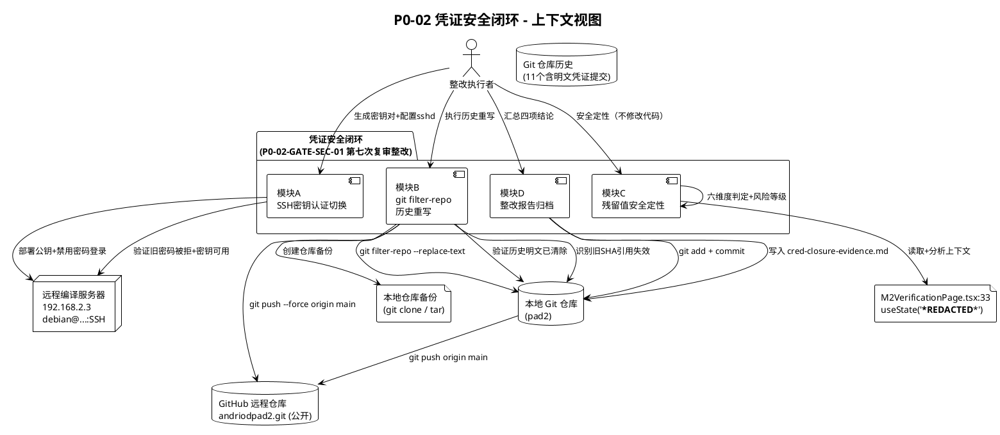
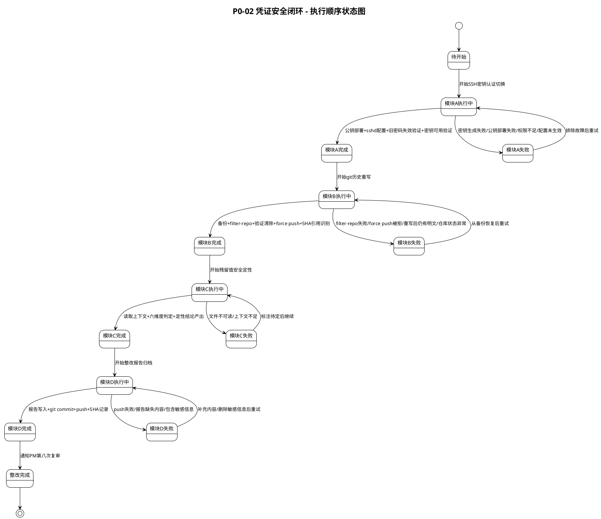
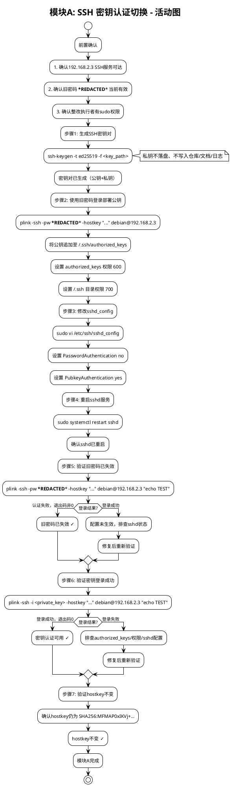
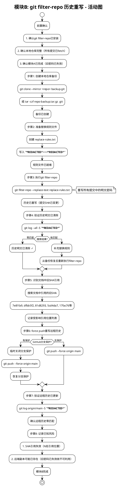
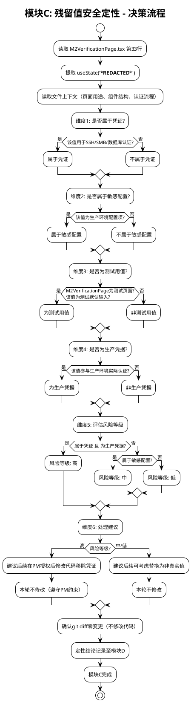
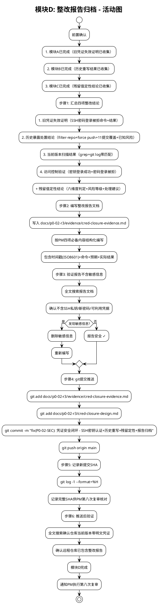
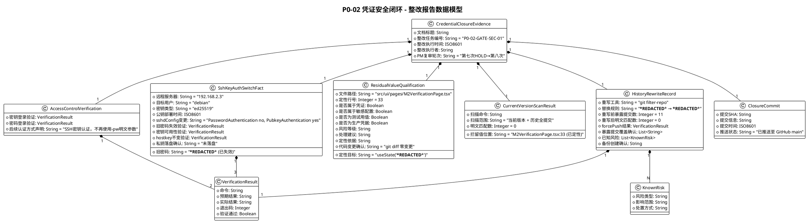
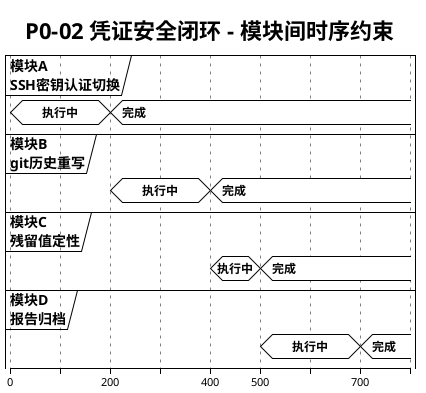
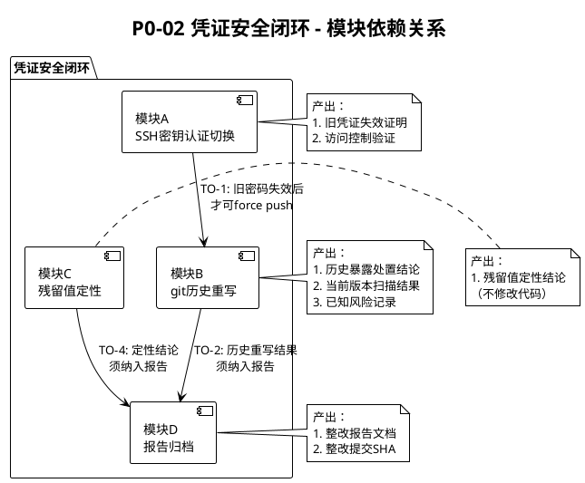

# P0-02 凭证安全闭环实现方案（技术设计）

> 本文档为 P0-02 Final Gate **第七次** PM 复审裁定 **HOLD** 的阻断项 **P0-02-GATE-SEC-01：凭证安全整改尚未闭环** 的技术设计（实现方案）。基于 `.codeartsdoer/specs/p002_cred_closure/spec.md` 需求规格（36 条 EARS 规则 + 19 异常场景），将 PM 四项最小整改要求转化为可落地的执行方案。
>
> **文档定位**：本设计针对凭证安全闭环的四项措施——SSH 密钥认证切换、git filter-repo 历史重写、残留值安全定性、整改报告归档。不涉及代码功能修改，不重做五项补验，不修改 SmbPlugin.ts，M2VerificationPage.tsx 仅安全定性不修改代码（git diff 零变更）。整改完成后进入 P0-02 Final Gate **第八次**复审。
>
> **设计依据**：`.codeartsdoer/specs/p002_cred_closure/spec.md`（本轮需求规格，36 条 EARS 规则）
>
> **前置基线**：
> - 上一轮整改规格：`.codeartsdoer/specs/p002_cred_fix/spec.md`
> - 上一轮整改设计：`docs/p0-02-r3/cred-remediation-design.md`
> - 上一轮整改证据：`docs/p0-02-r3/evidence/cred-remediation-evidence.md`
> - 上一轮整改提交 SHA：`17fac761f2d4f147d00b5888940f8d8c236378cf`（已推送）
> - 上一轮成果：29 个文档文件已脱敏（当前版本零明文匹配）；11 个暴露提交已识别（选择策略 B 不重写历史）
> - 上一轮遗留问题：旧密码 `***REDACTED***` 仍有效（轮换被跳过）；git 历史未重写（明文仍存于历史提交）
>
> **用户决策（已确认）**：
> 1. 凭证轮换方式：改用 SSH 密钥认证 — 生成 SSH 密钥对，配置 192.168.2.3 禁用密码登录仅允许密钥认证，旧密码 `***REDACTED***` 自动失效
> 2. 历史风险处置方式：重写 git 历史 — 用 git filter-repo 清除历史中的明文密码，force push 重写远程历史
> 3. M2VerificationPage.tsx 处理：仅安全定性，不修改代码
>
> **脱敏说明**：本文档中计划命令与旧密码统一用 `***REDACTED***` 脱敏表示。文档本身不含明文凭证，不含 SSH 私钥。
>
> **设计产物归档路径**：`docs/p0-02-r3/cred-closure-design.md`

---

# 一、需求与存量功能关系分析

## 1.1 需求功能与存量功能对比

### 1.1.1 已实现功能

本轮整改为纯运维/文档整改任务，不涉及代码功能实现。存量中与本轮相关的已实现功能为上一轮整改产出的文档资产、证据归档基础设施与运维环境可达性，本轮可直接复用。

| 需求功能 | 存量功能 | 代码位置 | 匹配度 |
|---------|---------|---------|--------|
| 整改证据归档至 `docs/p0-02-r3/evidence/` | evidence 目录已存在，已归档上一轮证据文件 `cred-remediation-evidence.md` | `docs/p0-02-r3/evidence/` | 100% |
| 整改证据提交至 GitHub main 分支 | git 仓库已配置 remote origin，main 分支已推送多次 | `.git/config`（origin → `https://github.com/wujupeng/andriodpad2.git`） | 100% |
| 远程服务器 SSH 可达 | 远程编译服务器 192.168.2.3 SSH 服务可用，hostkey 已知 | 运维环境（非代码仓库） | 100% |
| 当前版本文档零明文匹配 | 上一轮已脱敏 29 个文档文件，当前版本全文搜索 `***REDACTED***` 零匹配（仅 M2VerificationPage.tsx 拦留） | `docs/p0-02-r3/evidence/cred-remediation-evidence.md:82-92` | 100% |
| 暴露提交清单已识别 | 上一轮已通过 `git log --all -G "***REDACTED***"` 识别 11 个暴露提交 | `docs/p0-02-r3/evidence/cred-remediation-evidence.md:107-122` | 100% |
| 脱敏标注规范已定义 | 上一轮 spec.md 已定义 6 条脱敏替换规则 | `.codeartsdoer/specs/p002_cred_fix/spec.md` 6.2 节 | 100% |

### 1.1.2 需要扩展的功能

以下功能在存量中部分存在或以不同方式实现，本轮需在现有基础上改造或补充。

| 需求功能 | 存量功能 | 差异说明 | 扩展方向 |
|---------|---------|---------|---------|
| 旧凭证失效证明 | 上一轮证据文档声明"旧密码仍有效（开发机环境）"，未执行轮换 | 上一轮以"开发机环境"为由跳过轮换，旧密码 `***REDACTED***` 仍有效；本轮须通过 SSH 密钥认证切换使旧密码失效并提供可验证证据 | 在 192.168.2.3 上配置 sshd_config（PasswordAuthentication no）+ 部署公钥 + 验证旧密码被拒 |
| 历史暴露处置结论 | 上一轮选择策略 B（记录暴露范围 + 不重写历史），11 个暴露提交明文仍存于历史 | 上一轮未执行 git filter-repo，历史中明文密码仍可访问；本轮须重写历史清除明文并 force push | 执行 git filter-repo --replace-text + git push --force，记录已知风险 |
| 整改报告四项必备内容 | 上一轮证据文档含脱敏清单 + 历史检查结论，但缺旧凭证失效证明、访问控制验证、残留值定性结论 | 上一轮证据文档结构与本轮 PM 要求的四项必备内容（旧凭证失效证明 + 历史处置结论 + 当前版本扫描 + 访问控制验证）不一致 | 新增 `cred-closure-evidence.md`，按 PM 四项要求结构化编写 |
| 残留值安全定性结论 | 上一轮证据文档仅声明 M2VerificationPage.tsx "受 PM 约束禁止修改，建议后续单独处理"，无定性分析 | 上一轮未对 `useState('***REDACTED***')` 进行安全定性（性质判定、风险等级、处理建议）；本轮须完成六维度定性分析 | 读取 M2VerificationPage.tsx 上下文，分析 useState 用途，产出定性结论 |

### 1.1.3 需要新增的功能或接口

本轮新增的"功能"为运维操作、仓库审计操作与文档产物，不涉及代码接口新增。按业务模块分组如下：

**A. SSH 密钥认证切换模块（运维操作）**

对应 spec.md 5.1 节（9 条 EARS 规则 + 6 异常场景）。

- **输入**：远程服务器 192.168.2.3 的 SSH 连接信息（旧密码 `***REDACTED***`、hostkey）、SSH 密钥类型选择（ed25519/RSA）
- **输出**：192.168.2.3 已配置为仅允许密钥认证（PasswordAuthentication no, PubkeyAuthentication yes），旧密码 `***REDACTED***` 已失效，SSH 密钥对已生成（公钥已部署、私钥由执行者持有不落盘）
- **核心逻辑**：ssh-keygen 生成密钥对 → 使用旧密码登录部署公钥至 authorized_keys → 修改 sshd_config → 重启 sshd → 验证旧密码被拒 + 密钥登录成功
- **依赖**：远程服务器 SSH 服务可达、旧密码当前有效、整改执行者有 sudo 权限或可联系管理员

**B. git filter-repo 历史重写模块（仓库审计操作）**

对应 spec.md 5.2 节（9 条 EARS 规则 + 6 异常场景）。

- **输入**：本地 git 仓库、替换规则（`***REDACTED***` → `***REDACTED***`）、上一轮识别的 11 个暴露提交清单
- **输出**：所有提交中的明文密码 `***REDACTED***` 已替换为脱敏标注，远程仓库历史已通过 force push 更新，已知风险已记录
- **核心逻辑**：创建仓库备份 → 准备替换规则文件 → git filter-repo --replace-text → 验证历史明文已清除 → 识别旧 SHA 引用 → force push → 记录已知风险
- **依赖**：git filter-repo 已安装（pip install git-filter-repo）、GitHub 远程仓库可 force push（分支保护须临时放行）

**C. 残留值安全定性模块（代码审计操作）**

对应 spec.md 5.3 节（7 条 EARS 规则 + 3 异常场景）。

- **输入**：`src/ui/pages/M2VerificationPage.tsx` 第 33 行 `useState('***REDACTED***')` 及其上下文
- **输出**：安全定性结论（性质判定、风险等级、处理建议），不修改代码（git diff 零变更）
- **核心逻辑**：读取 M2VerificationPage.tsx → 分析第 33 行上下文（页面用途、是否测试页面、是否参与实际认证、是否默认输入值）→ 六维度判定 → 产出定性结论
- **依赖**：M2VerificationPage.tsx 文件可读

**D. 整改报告归档模块（文档产物）**

对应 spec.md 5.4 节（11 条 EARS 规则 + 4 异常场景）。

- **输入**：前三项任务执行结果（旧凭证失效证明、历史重写结果、残留值定性结论）
- **输出**：`docs/p0-02-r3/evidence/cred-closure-evidence.md`，含四项必备内容 + 残留值定性结论 + 整改提交 SHA
- **核心逻辑**：汇总四项结论 → 按 PM 要求结构化编写报告 → git add + commit + push → 记录新提交 SHA
- **依赖**：前三项任务已完成、证据归档目录存在

## 1.2 存量功能详细分析

### 1.2.1 证据归档目录（`docs/p0-02-r3/evidence/`）

- **接口契约**：目录路径固定，文件命名采用 kebab-case 描述性命名（如 `cred-remediation-evidence.md`、`apk-identity-verification.txt`）
- **业务规则**：证据文件须可被 PM 独立核对，须包含可审计的事实（时间戳 ISO8601、SHA、退出码、实际命令与结果）
- **扩展点**：可新增任意 `.md` 证据文件，无命名约束限制；本轮新增 `cred-closure-evidence.md` 与上一轮 `cred-remediation-evidence.md` 并存
- **约束**：证据文件不得包含明文凭证（`***REDACTED***`）、SSH 私钥、新密码或任何可利用的凭据值

### 1.2.2 git 提交流程

- **接口契约**：`git add <files>` → `git commit -m "<message>"` → `git push origin main`
- **业务规则**：提交信息采用 `type(scope): description` 格式（如 `fix(P0-02-SEC): ...`）；本轮提交信息为 `fix(P0-02-SEC): 凭证安全闭环 - SSH密钥认证+历史重写+残留定性+报告归档`
- **扩展点**：无
- **约束**：提交范围须严格限定为整改报告文档 + 必要的文档更新，不得包含 SmbPlugin.ts 和 M2VerificationPage.tsx 修改；force push 须在历史重写后执行

### 1.2.3 远程服务器 SSH 连接（旧密码认证方式）

- **接口契约**：`plink -ssh -pw <password> -hostkey "<hostkey>" debian@192.168.2.3 "<command>"`（Windows PuTTY 套件）
- **业务规则**：使用 plink 须指定 hostkey 防止 MITM，须带 `MSYS_NO_PATHCONV=1` 前缀防止 Git Bash 路径转译
- **扩展点**：认证方式可切换（密码 → 密钥）
- **约束**：本轮整改后须废弃 `-pw` 明文参数，改用 SSH 密钥认证（`plink -ssh -i <private_key>` 或等效方式）；hostkey 保持 `SHA256:MFMAP0xIKVj+SQYyhEVXoCHiBRdmthh5dyoqC7rNgPY` 不变

### 1.2.4 上一轮文档脱敏成果（29 个文件）

- **接口契约**：29 个文档文件中所有明文密码 `***REDACTED***` 已替换为 `***REDACTED***` 脱敏标注
- **业务规则**：脱敏仅替换密码值，不改变文档结构、章节编号、表格格式、证据数据（SHA-256 哈希值、时间戳、退出码等不变）
- **扩展点**：无
- **约束**：本轮须维持当前版本零明文匹配状态；历史重写后须重新验证当前版本仍零明文（filter-repo 重写可能影响当前版本）

### 1.2.5 上一轮暴露提交识别成果（11 个提交）

- **接口契约**：`git log --all -G "***REDACTED***"` 返回 11 个提交（`c6bd202` 至 `81d8293`）
- **业务规则**：`-G` 记录所有包含目标字符串的行变更（比 `-S` 更全面）；`5cd4da7` 经检查不属于暴露提交
- **扩展点**：无
- **约束**：本轮历史重写须覆盖全部 11 个暴露提交；重写后须验证 `git log --all -S "***REDACTED***"` 零匹配

### 1.2.6 上一轮证据文档（`cred-remediation-evidence.md`）

- **接口契约**：记录上一轮脱敏清单（29 文件）+ 历史检查结论（11 提交，策略 B 不重写）+ 整改提交 SHA（`17fac76`）
- **业务规则**：文档已脱敏，不含明文密码
- **扩展点**：可被本轮证据文档引用作为前置基线
- **约束**：本轮历史重写后，上一轮证据文档中引用的旧 SHA（如 `17fac76`、`81d8293`、`5cd4da7`）将失效，须在整改报告中记录此已知风险

---
# 二、增量设计方案

## 2.1 实现模型

### 2.1.1 上下文视图



**上下文交互说明**：

| 交互编号 | 来源 → 目标 | 交互内容 | 协议/方式 | 频率 |
|---------|-----------|---------|----------|------|
| 1 | 整改执行者 → 模块A | 发起 SSH 密钥认证切换 | 函数调用 | 1 次 |
| 2 | 模块A → 192.168.2.3 | 部署公钥 + 修改 sshd_config + 重启 sshd | SSH（旧密码登录后执行） | 1 次 |
| 3 | 模块A → 192.168.2.3 | 验证旧密码被拒 + 密钥登录成功 | SSH（两种认证方式各试一次） | 2 次 |
| 4 | 整改执行者 → 模块B | 发起历史重写 | 函数调用 | 1 次 |
| 5 | 模块B → 本地仓库备份 | 创建备份 | git clone / tar | 1 次 |
| 6 | 模块B → 本地仓库 | git filter-repo --replace-text | git CLI | 1 次 |
| 7 | 模块B → GitHub | git push --force origin main | git CLI over HTTPS | 1 次 |
| 8 | 整改执行者 → 模块C | 发起残留值安全定性 | 函数调用 | 1 次 |
| 9 | 模块C → M2VerificationPage.tsx | 读取第 33 行及上下文 | 文件读取 | 1 次 |
| 10 | 整改执行者 → 模块D | 汇总四项结论写入报告 | 函数调用 | 1 次 |
| 11 | 模块D → GitHub | 提交整改报告 | git CLI over HTTPS | 1 次 |

### 2.1.2 服务/组件总体架构

```plantuml
@startuml
!theme plain
title P0-02 凭证安全闭环 - 组件架构

package "凭证安全闭环方案" as Solution {

    package "模块A: SSH密钥认证切换" as ModA {
        component "密钥对生成器\nKeyPairGenerator" as KPG [
            + generateKeyPair(type: ed25519|rsa)
            + getPublicKey()
            + getPrivateKey()
        ]
        component "公钥部署器\nPublicKeyDeployer" as PKD [
            + deployViaOldPassword()
            + appendToAuthorizedKeys()
        ]
        component "sshd配置器\nSshdConfigurator" as SC [
            + disablePasswordAuth()
            + enablePubkeyAuth()
            + restartSshd()
        ]
        component "认证验证器\nAuthVerifier" as AV [
            + verifyOldPasswordRejected()
            + verifyKeyLoginSuccess()
            + verifyHostkeyUnchanged()
        ]
    }

    package "模块B: git历史重写" as ModB {
        component "仓库备份器\nRepoBackup" as RB [
            + createBackup(method: clone|tar)
            + verifyBackupIntegrity()
        ]
        component "历史重写器\nHistoryRewriter" as HR [
            + prepareReplaceRules()
            + executeFilterRepo()
            + verifyHistoryClean()
        ]
        component "SHA引用识别器\nShaRefIdentifier" as SRI [
            + scanShaReferences()
            + listAffectedReferences()
        ]
        component "强制推送器\nForcePusher" as FP [
            + forcePushMain()
            + verifyRemoteUpdated()
        ]
    }

    package "模块C: 残留值安全定性" as ModC {
        component "代码上下文读取器\nCodeContextReader" as CCR [
            + readM2VerificationPage()
            + extractLine33()
            + analyzeContext()
        ]
        component "安全定性判定器\nSecurityQualifier" as SQ [
            + judgeCredential()
            + judgeSensitiveConfig()
            + judgeTestValue()
            + judgeProductionCredential()
            + assessRiskLevel()
            + suggestHandling()
        ]
    }

    package "模块D: 整改报告归档" as ModD {
        component "证据收集器\nEvidenceCollector" as EC [
            + collectCredentialInvalidationProof()
            + collectHistoryRemediationConclusion()
            + collectCurrentVersionScan()
            + collectAccessControlVerification()
            + collectResidualQualification()
        ]
        component "报告编写器\nReportWriter" as RW [
            + writeClosureEvidenceDoc()
            + verifyNoSensitiveInfo()
        ]
        component "提交推送器\nCommitPusher" as CP [
            + gitAdd()
            + gitCommit()
            + gitPush()
            + recordCommitSha()
        ]
    }
}

component "脱敏规则配置\nRedactionRules" as Rules [
    ***REDACTED*** → ***REDACTED***
]
component "暴露提交清单\nExposedCommits" as Exposed [
    11个提交 (c6bd202..81d8293)
]

Rules <-- HR : 读取替换规则
Exposed <-- HR : 读取暴露范围
KPG --> PKD : 提供公钥
PKD --> SC : 公钥已部署
SC --> AV : sshd已重启
RB --> HR : 备份已创建
HR --> SRI : 历史已重写
HR --> FP : 本地历史已更新
CCR --> SQ : 提供上下文
EC --> RW : 提供四项结论
RW --> CP : 报告已写入

@enduml
```

**模块职责说明**：

| 模块 | 职责 | 对应 spec.md 章节 | EARS 规则数 |
|------|------|------------------|-----------|
| 模块A：SSH 密钥认证切换 | 生成密钥对、部署公钥、禁用密码登录、验证旧密码失效与密钥可用 | 5.1（5.1.1-5.1.3） | 9 条 |
| 模块B：git filter-repo 历史重写 | 备份仓库、重写历史、验证明文清除、force push、识别 SHA 引用失效 | 5.2（5.2.1-5.2.3） | 9 条 |
| 模块C：残留值安全定性 | 读取代码上下文、六维度判定、产出定性结论（不修改代码） | 5.3（5.3.1-5.3.3） | 7 条 |
| 模块D：整改报告归档 | 收集四项证据、编写报告、提交推送、记录 SHA | 5.4（5.4.1-5.4.3） | 11 条 |

### 2.1.3 实现设计文档

#### 2.1.3.1 整改执行顺序状态机

四项模块存在严格时序约束（spec.md 4.1 节）：**SSH 密钥认证切换（模块A）必须在 git 历史重写 force push（模块B）前完成**，确保旧密码在远程历史被重写前已失效；**历史重写（模块B）必须在整改报告提交（模块D）前完成**；**残留值定性（模块C）可在任一阶段执行但结论须在报告提交前完成**。



**关键时序约束说明**：

| 约束编号 | 约束内容 | 依据 | 理由 |
|---------|---------|------|------|
| TO-1 | 模块A（SSH 密钥认证切换）必须最先执行 | spec.md 4.1 节性能约束 1 | 确保旧密码 `***REDACTED***` 在远程历史被 force push 重写前已失效，即使 force push 过程中历史短暂暴露也不可利用 |
| TO-2 | 模块B（历史重写）必须在模块D（报告归档）前完成 | spec.md 4.1 节性能约束 2 | 整改报告须记录历史重写结果（force push 结果、已知风险） |
| TO-3 | 模块C（残留值定性）可在任一阶段执行 | spec.md 4.1 节性能约束 3 | 定性为只读操作，不改变仓库与服务器状态 |
| TO-4 | 模块C 定性结论须在模块D 报告提交前完成 | spec.md 4.1 节性能约束 3 | 报告须包含残留值定性结论 |
| TO-5 | 模块D 必须最后执行 | spec.md 5.4 节 | 须汇总前三项任务结论 |

**执行顺序**：模块A → 模块B → 模块C → 模块D（严格串行）

#### 2.1.3.2 SSH 密钥认证切换流程设计



#### 2.1.3.3 git filter-repo 历史重写流程设计



#### 2.1.3.4 残留值安全定性决策流程



#### 2.1.3.5 整改报告归档流程设计



---
## 2.2 接口设计

### 2.2.1 总体设计

本整改任务不涉及代码接口，"接口"表现为运维操作命令序列、git 命令序列与文档产物结构。所有接口均为一次性执行，执行后归档证据供 PM 第八次复审独立核对。

| 接口分类 | 接口名称 | 所属模块 | 稳定性等级 | 说明 |
|---------|---------|---------|-----------|------|
| 运维操作 | SSH 密钥对生成命令 | 模块A | 一次性 | ssh-keygen 生成 ed25519 密钥对 |
| 运维操作 | 公钥部署命令序列 | 模块A | 一次性 | 使用旧密码登录部署公钥至 authorized_keys |
| 运维操作 | sshd_config 配置命令序列 | 模块A | 一次性 | 禁用密码登录、启用密钥认证、重启 sshd |
| 运维操作 | 旧密码失效验证命令 | 模块A | 一次性 | 使用旧密码尝试登录，预期认证失败 |
| 运维操作 | 密钥认证可用性验证命令 | 模块A | 一次性 | 使用私钥尝试登录，预期登录成功 |
| 运维操作 | hostkey 不变验证命令 | 模块A | 一次性 | 检查 hostkey 仍为指定值 |
| 仓库操作 | 仓库备份命令 | 模块B | 一次性 | git clone --mirror 或 tar 打包 |
| 仓库操作 | git filter-repo 历史重写命令 | 模块B | 一次性 | --replace-text 替换明文密码 |
| 仓库操作 | 历史明文清除验证命令 | 模块B | 一次性 | git log --all -S 零匹配验证 |
| 仓库操作 | SHA 引用识别命令 | 模块B | 一次性 | 搜索文档中引用的旧 SHA |
| 仓库操作 | force push 命令 | 模块B | 一次性 | git push --force origin main |
| 代码审计 | M2VerificationPage.tsx 上下文读取 | 模块C | 一次性 | 读取第 33 行及上下文 |
| 文档产物 | 整改报告文档结构 | 模块D | 稳定 | 供 PM 第八次复审核对，含四项必备内容 |
| 仓库操作 | 整改报告提交推送命令 | 模块D | 一次性 | git add + commit + push |

**接口变更策略**：所有运维操作与仓库操作接口均为一次性执行，执行后废弃。整改报告文档结构为稳定接口，须与 PM 四项必备内容要求对齐，第八次复审后归档长期保留。

### 2.2.2 接口清单

#### 2.2.2.1 SSH 密钥对生成（模块A-步骤1）

**接口签名**（运维命令）：
```bash
ssh-keygen -t ed25519 -f <key_path> -N "<passphrase>" -C "pad2-cred-closure-20261020"
```

**业务说明**：生成 ed25519 类型的 SSH 密钥对，公钥部署至服务器，私钥由整改执行者持有不落盘。

**前置条件**：
1. 整改执行者本地环境可执行 ssh-keygen
2. 密钥保存路径 `<key_path>` 已确定（私钥不写入仓库、文档、日志）

**后置条件**：
1. SSH 密钥对已生成（公钥文件 `<key_path>.pub` + 私钥文件 `<key_path>`）
2. 私钥未写入任何归档文档、提交信息、日志文件或仓库

**异常映射**：
| 异常场景 | 错误表现 | 处理策略 |
|---------|---------|---------|
| 磁盘空间不足 | ssh-keygen 返回 No space left | 清理磁盘空间后重新生成 |
| 路径权限不足 | ssh-keygen 返回 Permission denied | 更改密钥保存路径或修复权限 |
| 密钥已存在 | ssh-keygen 提示覆盖 | 确认是否覆盖，或使用新路径 |

#### 2.2.2.2 公钥部署（模块A-步骤2）

**接口签名**（运维命令序列）：
```bash
# 使用旧密码登录远程服务器，将公钥追加至 authorized_keys
plink -ssh -pw ***REDACTED*** -hostkey "SHA256:MFMAP0xIKVj+SQYyhEVXoCHiBRdmthh5dyoqC7rNgPY" debian@192.168.2.3 "mkdir -p ~/.ssh && chmod 700 ~/.ssh && echo '<public_key_content>' >> ~/.ssh/authorized_keys && chmod 600 ~/.ssh/authorized_keys"
```

**业务说明**：使用旧密码 `***REDACTED***` SSH 登录 192.168.2.3，将生成的公钥追加至 debian 用户的 `~/.ssh/authorized_keys`，并设置正确权限。

**前置条件**：
1. 旧密码 `***REDACTED***` 当前有效（可登录）
2. SSH 密钥对已生成（公钥内容可用）
3. 远程服务器 192.168.2.3 SSH 服务可达

**后置条件**：
1. 公钥已追加至 `~/.ssh/authorized_keys`
2. `~/.ssh` 目录权限为 700，`authorized_keys` 权限为 600

**异常映射**：
| 异常场景 | 错误表现 | 处理策略 |
|---------|---------|---------|
| 旧密码登录失败 | plink 返回 Access denied | 检查旧密码是否已被他人轮换，确认服务器当前状态 |
| authorized_keys 写入权限不足 | 返回 Permission denied | 使用 sudo 提升权限或检查目录所有权 |
| 公钥格式错误 | sshd 拒绝公钥 | 确认公钥内容完整、格式正确 |

#### 2.2.2.3 sshd_config 配置与重启（模块A-步骤3/4）

**接口签名**（运维命令序列）：
```bash
# 修改 sshd_config：禁用密码登录，启用密钥认证
plink -ssh -pw ***REDACTED*** -hostkey "SHA256:MFMAP0xIKVj+SQYyhEVXoCHiBRdmthh5dyoqC7rNgPY" debian@192.168.2.3 "sudo sed -i 's/^#*PasswordAuthentication.*/PasswordAuthentication no/' /etc/ssh/sshd_config && sudo sed -i 's/^#*PubkeyAuthentication.*/PubkeyAuthentication yes/' /etc/ssh/sshd_config && sudo systemctl restart sshd"
```

**业务说明**：修改远程服务器 `/etc/ssh/sshd_config`，设置 `PasswordAuthentication no` 与 `PubkeyAuthentication yes`，重启 sshd 服务使配置生效。

**前置条件**：
1. 公钥已部署至 `~/.ssh/authorized_keys`
2. debian 用户有 sudo 权限或可联系管理员

**后置条件**：
1. `/etc/ssh/sshd_config` 中 `PasswordAuthentication no` 已生效
2. `/etc/ssh/sshd_config` 中 `PubkeyAuthentication yes` 已生效
3. sshd 服务已重启，新配置已加载

**异常映射**：
| 异常场景 | 错误表现 | 处理策略 |
|---------|---------|---------|
| sudo 权限不足 | 返回 sudo: permission denied | 联系服务器管理员执行配置修改 |
| sshd 重启失败 | systemctl 返回错误 | 检查 sshd_config 语法（sshd -t），修复后重新重启 |
| 配置未生效 | 重启后旧密码仍可登录 | 检查是否存在 PAM 认证覆盖、多个 sshd 实例，修复后重新验证 |

#### 2.2.2.4 旧密码失效验证（模块A-步骤5）

**接口签名**（运维命令）：
```bash
# 使用旧密码尝试登录，预期认证失败
plink -ssh -pw ***REDACTED*** -hostkey "SHA256:MFMAP0xIKVj+SQYyhEVXoCHiBRdmthh5dyoqC7rNgPY" debian@192.168.2.3 "echo TEST"
```

**业务说明**：使用旧密码 `***REDACTED***` 尝试 SSH 登录 192.168.2.3，验证旧密码已因密码认证被禁用而失效。

**前置条件**：
1. sshd_config 已修改并重启（PasswordAuthentication no 已生效）

**后置条件**：
1. 旧密码 `***REDACTED***` 登录被拒绝，返回认证失败错误，退出码非 0
2. 旧密码失效事实已记录至整改报告

**异常映射**：
| 异常场景 | 错误表现 | 处理策略 |
|---------|---------|---------|
| 旧密码仍可登录 | plink 返回登录成功 | 配置未生效，排查 sshd 状态与 PAM 认证，修复后重新验证 |
| 网络不可达 | plink 返回连接超时 | 检查网络连接，排除故障后重新验证 |

#### 2.2.2.5 密钥认证可用性验证（模块A-步骤6）

**接口签名**（运维命令）：
```bash
# 使用生成的私钥尝试登录，预期登录成功
plink -ssh -i <private_key_path> -hostkey "SHA256:MFMAP0xIKVj+SQYyhEVXoCHiBRdmthh5dyoqC7rNgPY" debian@192.168.2.3 "echo TEST"
```

**业务说明**：使用生成的 SSH 私钥尝试登录 192.168.2.3，验证密钥认证可正常使用。

**前置条件**：
1. SSH 密钥对已生成
2. 公钥已部署至服务器 authorized_keys
3. sshd_config 已配置 PubkeyAuthentication yes 并重启

**后置条件**：
1. 使用私钥登录成功，进入 debian 用户 shell，退出码 0
2. 密钥认证可用性已记录至整改报告

**异常映射**：
| 异常场景 | 错误表现 | 处理策略 |
|---------|---------|---------|
| 密钥登录失败 | plink 返回认证失败 | 检查 authorized_keys 内容、文件权限、sshd_config 生效状态 |
| 私钥文件权限问题 | plink 返回 UNPROTECTED PRIVATE KEY | 设置私钥文件权限 600 |

#### 2.2.2.6 仓库备份（模块B-步骤1）

**接口签名**（运维命令）：
```bash
# 方式1：git mirror clone 创建完整备份
git clone --mirror https://github.com/wujupeng/andriodpad2.git backup-before-rewrite.git

# 方式2：tar 打包 .git 目录
tar -czf repo-backup-before-rewrite.tar.gz .git
```

**业务说明**：历史重写前对本地仓库创建完整备份，防止重写失败导致数据丢失。

**前置条件**：
1. 本地 git 仓库完整
2. 备份目标路径有足够磁盘空间

**后置条件**：
1. 仓库备份已创建（mirror clone 或 tar 打包）
2. 备份完整性已验证

**异常映射**：
| 异常场景 | 错误表现 | 处理策略 |
|---------|---------|---------|
| 磁盘空间不足 | clone/tar 返回 No space left | 清理磁盘或选择其他备份路径 |
| 网络问题（mirror clone） | clone 返回网络错误 | 改用 tar 方式本地备份 |

#### 2.2.2.7 git filter-repo 历史重写（模块B-步骤3）

**接口签名**（git 命令序列）：
```bash
# 准备替换规则文件
# 文件内容：***REDACTED***==>***REDACTED***

# 执行历史重写
git filter-repo --replace-text replace-rules.txt --force
```

**业务说明**：使用 git filter-repo 将所有提交历史中的明文密码 `***REDACTED***` 替换为脱敏标注 `***REDACTED***`，重写后所有提交 SHA 将变更。

**前置条件**：
1. git filter-repo 已安装（`pip install git-filter-repo`）
2. 仓库备份已创建
3. 替换规则文件已准备

**后置条件**：
1. 所有提交中的明文密码 `***REDACTED***` 已替换为 `***REDACTED***`
2. 提交 SHA 已变更（重写后的新 SHA）
3. 上一轮识别的 11 个暴露提交中明文已全部清除

**异常映射**：
| 异常场景 | 错误表现 | 处理策略 |
|---------|---------|---------|
| git filter-repo 未安装 | 命令未找到 | 执行 `pip install git-filter-repo` 安装后重试 |
| 替换规则文件格式错误 | filter-repo 返回规则解析错误 | 修正规则文件格式（`原值==>新值`），重新执行 |
| 仓库状态异常 | filter-repo 拒绝执行 | 从备份恢复仓库，确认仓库状态干净后重新执行 |
| filter-repo 要求 --force | 提示仓库已有 remote | 添加 --force 参数或先移除 remote 后重试 |

#### 2.2.2.8 历史明文清除验证（模块B-步骤4）

**接口签名**（git 命令）：
```bash
# 验证历史中明文密码已清除（零匹配）
git log --all -S "***REDACTED***" --oneline
# 预期：无输出（零匹配）

# 同时验证 -G 模式
git log --all -G "***REDACTED***" --oneline
# 预期：无输出（零匹配）
```

**业务说明**：重写后验证所有提交历史中明文密码 `***REDACTED***` 已清除。

**前置条件**：
1. git filter-repo 已执行完成

**后置条件**：
1. `git log --all -S "***REDACTED***"` 返回零匹配
2. `git log --all -G "***REDACTED***"` 返回零匹配

**异常映射**：
| 异常场景 | 错误表现 | 处理策略 |
|---------|---------|---------|
| 仍有明文残留 | 返回 N 个匹配提交 | 补充替换规则（可能存在其他形式的明文），从备份恢复后重新执行 filter-repo |

#### 2.2.2.9 SHA 引用识别（模块B-步骤5）

**接口签名**（搜索命令）：
```bash
# 搜索文档中引用的旧 SHA
grep -rn "7e81fa9\|dfbb5f2\|81d8293\|5cd4da7\|17fac76\|c6bd202\|dac77fe\|d720262\|72a603a\|fb989dd\|110cb03\|693fb75\|c44eadf\|2bf4cdf\|a5c5364" --include="*.md" --include="*.txt" . | grep -v node_modules | grep -v ".git/"
```

**业务说明**：历史重写后，识别文档中引用旧 SHA 的位置，记录至整改报告作为已知风险。

**前置条件**：
1. git filter-repo 已执行完成（旧 SHA 已变更）

**后置条件**：
1. 所有引用旧 SHA 的位置已识别并列表记录
2. SHA 引用失效风险已记录至整改报告

#### 2.2.2.10 force push 重写远程历史（模块B-步骤6）

**接口签名**（git 命令）：
```bash
# force push 重写远程 main 分支历史
git push --force origin main
```

**业务说明**：将重写后的本地历史强制推送至 GitHub 远程仓库 main 分支，覆盖远程已有的提交历史。

**前置条件**：
1. git filter-repo 已执行完成，本地历史已重写
2. 历史明文清除验证已通过
3. GitHub 分支保护已临时放行（如有保护）

**后置条件**：
1. GitHub 远程仓库 main 分支历史已更新，不含明文密码提交
2. 分支保护已恢复（如曾临时放行）

**异常映射**：
| 异常场景 | 错误表现 | 处理策略 |
|---------|---------|---------|
| 分支保护拒绝 force push | git push 返回 protected branch | 临时关闭分支保护或联系仓库管理员放行，force push 后恢复保护 |
| 网络问题 | git push 返回网络错误 | 重试推送，检查网络与 GitHub 认证 |
| 非快进错误 | git push 返回 non-fast-forward | 确认使用 --force 参数，检查远程状态 |

#### 2.2.2.11 拋留值安全定性（模块C）

**接口签名**（代码审计操作）：
```bash
# 读取 M2VerificationPage.tsx 第 33 行及上下文
# 分析 useState('***REDACTED***') 的性质
```

**业务说明**：读取 `src/ui/pages/M2VerificationPage.tsx` 第 33 行 `useState('***REDACTED***')` 及其上下文，进行六维度安全定性判定，不修改代码。

**前置条件**：
1. `src/ui/pages/M2VerificationPage.tsx` 文件可读

**后置条件**：
1. 安全定性结论已产出，包含六维度判定（是否凭证、是否敏感配置、是否测试用值、是否生产凭据、风险等级、处理建议）
2. M2VerificationPage.tsx 文件内容不变（git diff 零变更）
3. 定性结论已记录至整改报告

**异常映射**：
| 异常场景 | 错误表现 | 处理策略 |
|---------|---------|---------|
| 文件不可读 | 读取失败 | 检查文件路径与权限，确认文件存在 |
| 上下文不足以判定性质 | 无法确定页面用途或认证流程 | 标注"性质待定"，建议后续由开发人员进一步分析 |
| 判定为生产凭证 | 该值参与生产环境实际认证 | 标注高风险，建议后续在 PM 授权后修改代码移除凭证，本轮不修改 |

#### 2.2.2.12 整改报告归档与提交（模块D）

**接口签名**（文档产物 + git 命令序列）：
```bash
# 写入整改报告文档
# 路径：docs/p0-02-r3/evidence/cred-closure-evidence.md

# 提交至 GitHub
git add docs/p0-02-r3/evidence/cred-closure-evidence.md
git add docs/p0-02-r3/cred-closure-design.md
git commit -m "fix(P0-02-SEC): 凭证安全闭环 - SSH密钥认证+历史重写+残留定性+报告归档"
git push origin main

# 记录新提交 SHA
git log -1 --format=%H
```

**业务说明**：汇总四项整改结论（旧凭证失效证明、历史暴露处置结论、当前版本扫描结果、访问控制验证）+ 残留值定性结论，写入整改报告文档，提交至 GitHub main 分支。

**前置条件**：
1. 模块A 已完成（旧凭证失效证明已收集）
2. 模块B 已完成（历史重写结果已收集）
3. 模块C 已完成（残留值定性结论已收集）

**后置条件**：
1. 整改报告已归档至 `docs/p0-02-r3/evidence/cred-closure-evidence.md`
2. 报告包含四项必备内容 + 残留值定性结论 + 整改提交 SHA
3. 报告不含 SSH 私钥、新密码、任何可利用凭据值
4. 报告已提交至 GitHub main 分支，SHA 完整可核对

**异常映射**：
| 异常场景 | 错误表现 | 处理策略 |
|---------|---------|---------|
| 推送失败 | git push 返回错误 | 重试推送，检查网络与 GitHub 认证 |
| 报告缺失必备内容 | PM 复审发现缺项 | 补充缺失内容，重新提交 |
| 报告包含敏感信息 | 全文搜索发现私钥/新密码 | 立即删除敏感信息，重新提交，评估是否需再次轮换 |
| 报告与实际不符 | PM 复审发现声明与实际不符 | 重新执行整改，更新报告 |

---
## 2.3 数据模型

### 2.3.1 设计目标

本整改任务的数据模型须支持以下业务场景：

1. 记录 SSH 密钥认证切换事实（密钥类型、公钥部署时间、sshd 配置变更、旧密码失效验证结果、密钥可用性验证结果）
2. 记录 git 历史重写结果（重写前提交数、重写后提交数、11 个暴露提交覆盖确认、force push 结果、已知风险）
3. 记录残留值安全定性结论（六维度判定、风险等级、处理建议）
4. 记录整改提交 SHA（供 PM 第八次复审核对）
5. 供 PM 第八次复审独立核对（每项结论含可验证命令与结果）

**性能与容量目标**：证据文档为单次归档，无性能要求；容量为单文件 Markdown，预计 < 15KB。

**兼容策略**：证据文档为新增文件，不影响存量文档；上一轮证据文档 `cred-remediation-evidence.md` 保留作为前置基线引用；历史重写后文档中旧 SHA 引用失效须记录但本轮不更新引用（由仓库所有者决定后续处置）。

### 2.3.2 模型实现

#### 2.3.2.1 整改报告文档核心数据结构



**对象生命周期**：
- `CredentialClosureEvidence`：本轮整改创建，第八次复审后归档，长期保留
- `SshKeyAuthSwitchFact`：本轮整改创建，SSH 密钥认证配置永久有效
- `HistoryRewriteRecord`：本轮整改创建，历史重写结果永久有效
- `ResidualValueQualification`：本轮整改创建，定性结论随代码版本演进（如后续 PM 授权修改代码则需重新定性）
- `CurrentVersionScanResult`：本轮整改创建，扫描结果随仓库版本演进
- `AccessControlVerification`：本轮整改创建，访问控制状态随服务器配置演进
- `ClosureCommit`：本轮整改创建，提交 SHA 永久有效

**持久化策略**：单文件 Markdown，归档至 `docs/p0-02-r3/evidence/cred-closure-evidence.md`，随仓库版本管理。

#### 2.3.2.2 已知风险数据结构

历史重写与 force push 引入的已知风险须结构化记录：

| 风险编号 | 风险类型 | 影响范围 | 处置方式 |
|---------|---------|---------|---------|
| RISK-01 | SHA 引用失效 | 文档中引用旧 SHA 的位置（如 `7e81fa9`、`dfbb5f2`、`81d8293`、`5cd4da7`、`17fac76` 等），重写后这些 SHA 不再存在 | 已识别受影响引用位置列表，记录至整改报告；本轮不更新引用，由仓库所有者决定后续处置 |
| RISK-02 | 远端副本可能已存在 | 其他人员可能已 clone 旧历史，force push 无法撤回其本地副本 | 旧密码 `***REDACTED***` 已通过 SSH 密钥认证切换失效，历史中的明文不可利用；由仓库所有者决定后续通知协作者 |

#### 2.3.2.3 暴露提交覆盖确认数据结构

历史重写须覆盖上一轮识别的 11 个暴露提交，重写后确认每个提交中明文已清除：

| 序号 | 原提交 SHA（重写前） | 提交信息 | 重写后状态 |
|------|---------------------|----------|-----------|
| 1 | `c6bd202` | docs: add spec, design, and tasks for Android SMB Explorer (PAD2) | 明文已替换为 `***REDACTED***` |
| 2 | `dac77fe` | fix(docs): PAD2-M1-DOC-REVIEW-REPAIR-01 document consistency repair | 明文已替换 |
| 3 | `d720262` | feat(docs): PAD2-M1-G4-FAST-DECISION-01 multi-device compatibility strategy | 明文已替换 |
| 4 | `72a603a` | docs: add product scope design.md (implementation plan) | 明文已替换 |
| 5 | `fb989dd` | docs: add product scope tasks.md (coding task plan) | 明文已替换 |
| 6 | `110cb03` | feat: M2-A WPS技术验证全部通过 V1-V7 | 明文已替换 |
| 7 | `693fb75` | fix(P0-02-R1): .docx MIME兼容+保存检测重构+回写SHA-256校验 | 明文已替换 |
| 8 | `c44eadf` | fix(P0-02-R2): 回归测试证据完整性修复 - 真实断言替换硬编码PASS | 明文已替换 |
| 9 | `2bf4cdf` | fix(P0-02-R3): 哈希断言严格化+另存为证据完整化+resolveSaveAs哈希返回 | 明文已替换 |
| 10 | `a5c5364` | docs(P0-02-R3-FIX): 统一版本证据+补齐另存为证据+最小差异审计 | 明文已替换 |
| 11 | `81d8293` | docs(P0-02): 补齐Final Gate三项证据 - 原始执行日志+截图归档+APK哈希核验 | 明文已替换 |

**合计**：11 个暴露提交全部覆盖，重写后 `git log --all -S "***REDACTED***"` 零匹配。

---

# 三、执行方案

## 3.1 模块A：SSH 密钥认证切换执行步骤

### 3.1.1 前置确认

1. 确认远程服务器 192.168.2.3 SSH 服务可达
2. 确认旧密码 `***REDACTED***` 当前有效（可登录）
3. 确认整改执行者有 sudo 权限或可联系服务器管理员
4. 确认 SSH 客户端（plink/pscp，PuTTY 套件）可用

### 3.1.2 执行步骤

**步骤1：生成 SSH 密钥对**

```bash
ssh-keygen -t ed25519 -f <key_path> -N "" -C "pad2-cred-closure-20261020"
```

预期：密钥对已生成（公钥 `<key_path>.pub` + 私钥 `<key_path>`），私钥不落盘、不写入仓库/文档/日志。

**步骤2：使用旧密码登录部署公钥**

```bash
MSYS_NO_PATHCONV=1 plink -ssh -pw ***REDACTED*** -hostkey "SHA256:MFMAP0xIKVj+SQYyhEVXoCHiBRdmthh5dyoqC7rNgPY" debian@192.168.2.3 "mkdir -p ~/.ssh && chmod 700 ~/.ssh && echo '<public_key_content>' >> ~/.ssh/authorized_keys && chmod 600 ~/.ssh/authorized_keys"
```

预期：公钥已追加至 `~/.ssh/authorized_keys`，权限设置正确。

**步骤3：修改 sshd_config 禁用密码登录、启用密钥认证**

```bash
MSYS_NO_PATHCONV=1 plink -ssh -pw ***REDACTED*** -hostkey "SHA256:MFMAP0xIKVj+SQYyhEVXoCHiBRdmthh5dyoqC7rNgPY" debian@192.168.2.3 "sudo sed -i 's/^#*PasswordAuthentication.*/PasswordAuthentication no/' /etc/ssh/sshd_config && sudo sed -i 's/^#*PubkeyAuthentication.*/PubkeyAuthentication yes/' /etc/ssh/sshd_config"
```

预期：sshd_config 已修改，`PasswordAuthentication no` 与 `PubkeyAuthentication yes` 已设置。

**步骤4：重启 sshd 服务**

```bash
MSYS_NO_PATHCONV=1 plink -ssh -pw ***REDACTED*** -hostkey "SHA256:MFMAP0xIKVj+SQYyhEVXoCHiBRdmthh5dyoqC7rNgPY" debian@192.168.2.3 "sudo systemctl restart sshd && sudo systemctl status sshd"
```

预期：sshd 已重启，状态为 active (running)。

**步骤5：验证旧密码已失效**

```bash
MSYS_NO_PATHCONV=1 plink -ssh -pw ***REDACTED*** -hostkey "SHA256:MFMAP0xIKVj+SQYyhEVXoCHiBRdmthh5dyoqC7rNgPY" debian@192.168.2.3 "echo TEST"
```

预期：认证失败（`Access denied` 或 `Authentication failed`），退出码非 0。

**步骤6：验证密钥登录成功**

```bash
MSYS_NO_PATHCONV=1 plink -ssh -i <private_key_path> -hostkey "SHA256:MFMAP0xIKVj+SQYyhEVXoCHiBRdmthh5dyoqC7rNgPY" debian@192.168.2.3 "echo TEST"
```

预期：登录成功，输出 `TEST`，退出码 0。

**步骤7：验证 hostkey 不变**

确认 hostkey 仍为 `SHA256:MFMAP0xIKVj+SQYyhEVXoCHiBRdmthh5dyoqC7rNgPY`（认证方式切换不改变 hostkey）。

### 3.1.3 验收条件

- [ ] 旧密码 `***REDACTED***` 无法登录 192.168.2.3（退出码非 0）
- [ ] SSH 私钥可正常登录 192.168.2.3（退出码 0）
- [ ] SSH hostkey 保持不变（`SHA256:MFMAP0xIKVj+SQYyhEVXoCHiBRdmthh5dyoqC7rNgPY`）
- [ ] SSH 私钥未写入任何归档文档、提交信息、日志文件或仓库
- [ ] 依赖 192.168.2.3 的编译/部署流程可通过密钥认证正常工作

## 3.2 模块B：git filter-repo 历史重写执行步骤

### 3.2.1 前置确认

1. 确认 git filter-repo 已安装（`pip install git-filter-repo`）
2. 确认本地仓库完整（所有提交已 fetch）
3. 确认模块A 已完成（旧密码 `***REDACTED***` 已失效）— **严格时序约束 TO-1**
4. 确认 GitHub 远程仓库可 force push（分支保护须临时放行）

### 3.2.2 执行步骤

**步骤1：创建本地仓库备份**

```bash
# 方式1：tar 打包 .git 目录（推荐，不依赖网络）
tar -czf repo-backup-before-rewrite.tar.gz .git

# 方式2：git mirror clone（需网络）
git clone --mirror https://github.com/wujupeng/andriodpad2.git backup-before-rewrite.git
```

预期：备份已创建，完整性可验证。

**步骤2：准备替换规则文件**

创建文件 `replace-rules.txt`，内容：
```
***REDACTED***==>***REDACTED***
```

**步骤3：执行 git filter-repo 历史重写**

```bash
git filter-repo --replace-text replace-rules.txt --force
```

预期：所有提交中的明文密码 `***REDACTED***` 已替换为 `***REDACTED***`，提交 SHA 已变更。

**步骤4：验证历史明文已清除**

```bash
git log --all -S "***REDACTED***" --oneline
git log --all -G "***REDACTED***" --oneline
```

预期：两条命令均无输出（零匹配）。

**步骤5：识别文档中旧 SHA 引用**

```bash
grep -rn "7e81fa9\|dfbb5f2\|81d8293\|5cd4da7\|17fac76\|c6bd202\|dac77fe\|d720262\|72a603a\|fb989dd\|110cb03\|693fb75\|c44eadf\|2bf4cdf\|a5c5364" --include="*.md" --include="*.txt" . | grep -v node_modules | grep -v ".git/"
```

预期：返回受影响的引用位置列表，记录至整改报告作为已知风险 RISK-01。

**步骤6：force push 重写远程历史**

```bash
git push --force origin main
```

预期：远程仓库 main 分支历史已更新，不含明文密码提交。

**步骤7：验证远程历史已更新**

```bash
git log origin/main -S "***REDACTED***" --oneline
```

预期：零匹配（远程历史明文已清除）。

**步骤8：记录已知风险**

- RISK-01：SHA 引用失效（列出步骤5 识别的受影响引用位置）
- RISK-02：远端副本可能已存在（旧密码已失效故历史明文不可利用）

### 3.2.3 验收条件

- [ ] `git log --all -S "***REDACTED***"` 零匹配
- [ ] `git log --all -G "***REDACTED***"` 零匹配
- [ ] GitHub 远程仓库 main 分支历史已更新（force push 成功）
- [ ] 11 个暴露提交中明文已全部替换为 `***REDACTED***`
- [ ] 已知风险（SHA 引用失效 + 远端副本风险）已记录
- [ ] 仓库备份已创建（可用于回滚）

## 3.3 模块C：残留值安全定性执行步骤

### 3.3.1 前置确认

1. 确认 `src/ui/pages/M2VerificationPage.tsx` 文件可读
2. 确认 PM 约束：不修改 M2VerificationPage.tsx 代码（git diff 零变更）

### 3.3.2 执行步骤

**步骤1：读取 M2VerificationPage.tsx 第 33 行及上下文**

读取 `src/ui/pages/M2VerificationPage.tsx`，提取第 33 行 `useState('***REDACTED***')`，分析其上下文：
- 页面用途（M2VerificationPage 是否为测试验证页面）
- 组件结构（useState 的初始值用途）
- 是否参与实际认证流程（是否传递给 SSH/SMB 认证组件）
- 是否为默认输入值（是否为表单初始值或测试占位符）

**步骤2：六维度安全定性判定**

| 维度 | 判定问题 | 判定依据 |
|------|---------|---------|
| 维度1 | 是否属于凭证 | 该值是否用于 SSH/SMB/数据库等认证 |
| 维度2 | 是否属于敏感配置 | 该值是否为生产环境配置项 |
| 维度3 | 是否为测试用值 | M2VerificationPage 是否为测试页面、该值是否为测试默认输入 |
| 维度4 | 是否为生产凭据 | 该值是否参与生产环境实际认证 |
| 维度5 | 风险等级 | 高（凭证+生产）/ 中（敏感配置）/ 低（测试用值） |
| 维度6 | 处理建议 | 高风险→建议后续修改；中低风险→建议后续优化；本轮不修改 |

**步骤3：确认代码不变更**

```bash
git diff src/ui/pages/M2VerificationPage.tsx
```

预期：无输出（零变更），确认未修改代码。

**步骤4：定性结论记录**

将定性结论（六维度判定 + 风险等级 + 处理建议 + 定性依据）记录至模块D 整改报告。

### 3.3.3 验收条件

- [ ] 安全定性结论已产出，包含六维度判定
- [ ] M2VerificationPage.tsx 文件内容不变（`git diff` 零变更）
- [ ] 定性结论已记录至整改报告
- [ ] 定性基于代码上下文分析（非主观声明）

## 3.4 模块D：整改报告归档执行步骤

### 3.4.1 前置确认

1. 确认模块A 已完成（旧凭证失效证明已收集）— **时序约束 TO-1**
2. 确认模块B 已完成（历史重写结果已收集）— **时序约束 TO-2**
3. 确认模块C 已完成（残留值定性结论已收集）— **时序约束 TO-4**

### 3.4.2 执行步骤

**步骤1：汇总四项整改结论**

1. 旧凭证失效证明：SSH 密码登录被拒的命令 + 预期结果 + 实际结果 + 退出码
2. 历史暴露处置结论：git filter-repo 执行结果 + force push 结果 + 11 个暴露提交覆盖确认 + 已知风险记录
3. 当前版本扫描结果：grep + git log 命令 + 扫描范围 + 零匹配确认
4. 访问控制验证：密钥登录成功（退出码 0）+ 密码登录被拒（退出码非 0）的实际结果
5. 残留值定性结论：六维度判定 + 风险等级 + 处理建议

**步骤2：编写整改报告文档**

写入 `docs/p0-02-r3/evidence/cred-closure-evidence.md`，按 PM 四项必备内容结构化编写，包含时间戳（ISO8601）+ 执行命令 + 预期结果 + 实际结果。

**步骤3：验证报告不含敏感信息**

```bash
grep -rn "***REDACTED***\|BEGIN.*PRIVATE KEY" docs/p0-02-r3/evidence/cred-closure-evidence.md
```

预期：仅匹配 `***REDACTED***` 脱敏标注（不含明文密码），不含 SSH 私钥内容。

**步骤4：git 提交推送**

```bash
git add docs/p0-02-r3/evidence/cred-closure-evidence.md
git add docs/p0-02-r3/cred-closure-design.md
git commit -m "fix(P0-02-SEC): 凭证安全闭环 - SSH密钥认证+历史重写+残留定性+报告归档"
git push origin main
```

**步骤5：记录新提交 SHA**

```bash
git log -1 --format=%H
```

记录完整 SHA 供 PM 第八次复审核对。

**步骤6：推送后验证**

```bash
# 确认仓库当前版本零明文凭证（除 M2VerificationPage.tsx 拦留值）
grep -rn "***REDACTED***" --include="*.md" --include="*.txt" --include="*.ts" --include="*.tsx" --include="*.json" . | grep -v node_modules | grep -v ".git/"
# 预期：仅 M2VerificationPage.tsx:33 拦留（已定性）
```

### 3.4.3 验收条件

- [ ] 整改报告已归档至 `docs/p0-02-r3/evidence/cred-closure-evidence.md`
- [ ] 报告包含四项必备内容（旧凭证失效证明 + 历史处置结论 + 当前版本扫描 + 访问控制验证）
- [ ] 报告包含残留值定性结论
- [ ] 报告不含 SSH 私钥、新密码、可利用凭据值
- [ ] 报告已提交至 GitHub main 分支，SHA 完整可核对
- [ ] 仓库当前版本零明文凭证（除 M2VerificationPage.tsx 拦留值已定性）

---

# 四、异常处理策略与回滚方案

## 4.1 模块A 异常处理策略

| 异常编号 | 异常场景 | 检测方式 | 处理策略 | 回滚方案 |
|---------|---------|---------|---------|---------|
| A-EX-01 | SSH 密钥生成失败 | ssh-keygen 返回非 0 | 排查磁盘空间/权限，重新生成 | 无需回滚（密钥未生成） |
| A-EX-02 | 公钥部署失败（旧密码登录失败） | plink 返回 Access denied | 检查旧密码是否已被他人轮换，确认服务器状态 | 无需回滚（公钥未部署） |
| A-EX-03 | sshd_config 修改权限不足 | sudo 返回 permission denied | 联系服务器管理员执行配置修改 | 无需回滚（配置未修改） |
| A-EX-04 | sshd 重启失败 | systemctl 返回错误 | 检查 sshd_config 语法（`sshd -t`），修复后重新重启 | 恢复 sshd_config 原配置（PasswordAuthentication yes） |
| A-EX-05 | 旧密码仍可登录（配置未生效） | 步骤5 验证登录成功 | 排查 sshd 状态、PAM 认证覆盖、多 sshd 实例 | 恢复 sshd_config 原配置，重新配置 |
| A-EX-06 | 密钥登录失败 | 步骤6 验证登录失败 | 排查 authorized_keys 内容/权限/sshd_config 生效状态 | 恢复 sshd_config 原配置（允许密码登录） |
| A-EX-07 | 编译流程因认证变更中断 | 编译/部署脚本失败 | 将相关脚本改为使用密钥认证，验证流程恢复 | 恢复 sshd_config 原配置（允许密码登录） |

**模块A 回滚方案**：若密钥认证配置后无法登录且无法修复，恢复 sshd_config 原配置（`PasswordAuthentication yes`），重启 sshd，使旧密码认证恢复可用。回滚后须记录回滚原因，重新评估凭证轮换方式。

## 4.2 模块B 异常处理策略

| 异常编号 | 异常场景 | 检测方式 | 处理策略 | 回滚方案 |
|---------|---------|---------|---------|---------|
| B-EX-01 | git filter-repo 未安装 | 命令未找到 | 执行 `pip install git-filter-repo` 安装后重试 | 无需回滚 |
| B-EX-02 | 替换规则文件格式错误 | filter-repo 返回规则解析错误 | 修正规则文件格式（`原值==>新值`），重新执行 | 从备份恢复仓库 |
| B-EX-03 | 仓库状态异常 | filter-repo 拒绝执行 | 从备份恢复仓库，确认状态干净后重新执行 | 从备份恢复仓库（`git clone backup-before-rewrite.git` 或解压 tar） |
| B-EX-04 | 重写后仍有明文残留 | `git log --all -S` 返回匹配 | 补充替换规则，从备份恢复后重新执行 filter-repo | 从备份恢复仓库 |
| B-EX-05 | force push 被分支保护拒绝 | git push 返回 protected branch | 临时关闭分支保护或联系管理员放行，force push 后恢复保护 | 无需回滚（本地历史已重写，仅远程未更新） |
| B-EX-06 | force push 后仓库状态异常 | reflog/remote 配置异常 | 从备份恢复仓库，重新执行重写与推送 | 从备份恢复仓库 |
| B-EX-07 | SHA 引用失效 | 文档中引用的旧 SHA 不再存在 | 识别受影响引用位置，记录至整改报告（RISK-01） | 不回滚（已知风险，由仓库所有者决定后续处置） |
| B-EX-08 | 远端副本已存在 | 他人已 clone 旧历史 | 记录远端副本风险至整改报告（RISK-02），旧密码已失效故不可利用 | 不回滚（force push 无法撤回他人本地副本） |

**模块B 回滚方案**：若 git filter-repo 执行失败或重写后仓库状态异常，从步骤1 创建的备份恢复仓库：
```bash
# 方式1：从 tar 备份恢复
rm -rf .git && tar -xzf repo-backup-before-rewrite.tar.gz

# 方式2：从 mirror clone 备份恢复
git clone backup-before-rewrite.git restored-repo && cp -r restored-repo/.git ./
```
回滚后本地仓库恢复至重写前状态，远程仓库未受影响（force push 未执行）。若 force push 已执行但需回滚，须从备份重新 force push 原历史（代价较大，须谨慎评估）。

## 4.3 模块C 异常处理策略

| 异常编号 | 异常场景 | 检测方式 | 处理策略 | 回滚方案 |
|---------|---------|---------|---------|---------|
| C-EX-01 | 文件不可读 | 读取 M2VerificationPage.tsx 失败 | 检查文件路径与权限，确认文件存在 | 无需回滚（只读操作） |
| C-EX-02 | 上下文不足以判定性质 | 无法确定页面用途或认证流程 | 标注"性质待定"，建议后续由开发人员进一步分析 | 无需回滚 |
| C-EX-03 | 判定为生产凭证 | 该值参与生产环境实际认证 | 标注高风险，建议后续在 PM 授权后修改代码，本轮不修改 | 无需回滚（不修改代码） |

**模块C 回滚方案**：模块C 为只读操作（不修改代码），无需回滚。若定性结论有误，更新结论重新记录至整改报告即可。

## 4.4 模块D 异常处理策略

| 异常编号 | 异常场景 | 检测方式 | 处理策略 | 回滚方案 |
|---------|---------|---------|---------|---------|
| D-EX-01 | 推送失败 | git push 返回错误 | 重试推送，检查网络与 GitHub 认证 | 无需回滚（本地已提交） |
| D-EX-02 | 报告缺失必备内容 | PM 复审发现缺项 | 补充缺失内容，重新提交（`git commit --amend` 或新提交） | 修改报告文档后重新提交 |
| D-EX-03 | 报告包含敏感信息 | 全文搜索发现私钥/新密码 | 立即删除敏感信息，重新提交，评估是否需再次轮换 | 删除敏感信息后重新提交 |
| D-EX-04 | 报告与实际不符 | PM 复审发现声明与实际不符 | 重新执行相关整改任务，更新报告 | 视具体不符项回滚对应模块 |

**模块D 回滚方案**：若报告包含敏感信息，立即从报告中删除敏感信息，创建新提交修正（不使用 --amend，避免改写已推送历史）。若敏感信息已推送至 GitHub，须评估是否需再次轮换泄露的私钥/密码。

---

# 五、时序约束与依赖关系

## 5.1 模块间时序约束



## 5.2 时序约束清单

| 约束编号 | 约束内容 | 依据 | 理由 | 违反后果 |
|---------|---------|------|------|---------|
| TO-1 | 模块A 必须在模块B 前完成 | spec.md 4.1 节性能约束 1 | 确保旧密码 `***REDACTED***` 在远程历史被 force push 重写前已失效，即使 force push 过程中历史短暂暴露也不可利用 | 若旧密码未失效即 force push，历史中的明文密码在重写过程中仍可被利用 |
| TO-2 | 模块B 必须在模块D 前完成 | spec.md 4.1 节性能约束 2 | 整改报告须记录历史重写结果（force push 结果、已知风险） | 若报告先提交，报告中将缺失历史重写结果 |
| TO-3 | 模块C 可在任一阶段执行 | spec.md 4.1 节性能约束 3 | 定性为只读操作，不改变仓库与服务器状态 | 无严重后果（但建议在模块D 前完成） |
| TO-4 | 模块C 结论须在模块D 报告提交前完成 | spec.md 4.1 节性能约束 3 | 报告须包含残留值定性结论 | 若报告先提交，报告中将缺失定性结论 |
| TO-5 | 模块D 必须最后执行 | spec.md 5.4 节 | 须汇总前三项任务结论 | 若模块D 先执行，报告内容不完整 |

## 5.3 模块间依赖关系



## 5.4 外部依赖

| 依赖项 | 依赖类型 | 说明 | 风险 |
|--------|---------|------|------|
| 远程服务器 192.168.2.3 SSH 服务可达 | 运维环境 | 模块A 须通过 SSH 连接服务器配置密钥认证 | 若服务器不可达，模块A 无法执行 |
| 旧密码 `***REDACTED***` 当前有效 | 运维环境 | 模块A 须使用旧密码登录部署公钥 | 若旧密码已被他人轮换，须确认当前密码状态 |
| 整改执行者有 sudo 权限 | 运维环境 | 模块A 须修改 sshd_config 并重启 sshd | 若无 sudo 权限，须联系管理员 |
| git filter-repo 已安装 | 工具依赖 | 模块B 须使用 git filter-repo 重写历史 | 若未安装，执行 `pip install git-filter-repo` |
| GitHub 远程仓库可 force push | 平台依赖 | 模块B 须 force push 重写远程历史 | 若分支保护阻止，须临时放行 |
| M2VerificationPage.tsx 文件可读 | 代码仓库 | 模块C 须读取文件进行安全定性 | 若文件不存在或不可读，标注待定 |
| 证据归档目录存在 | 仓库结构 | 模块D 须归档至 `docs/p0-02-r3/evidence/` | 目录已存在（上一轮已创建） |

---

# 六、约束遵守确认

| 约束项 | 本设计遵守状态 | 说明 |
|--------|--------------|------|
| 不修改 SmbPlugin.ts | ✅ 遵守 | 本设计不涉及 SmbPlugin.ts 修改 |
| 不修改 M2VerificationPage.tsx 代码 | ✅ 遵守 | 模块C 仅安全定性（git diff 零变更），不修改代码 |
| 不重做五项补验 | ✅ 遵守 | 本设计仅处理凭证安全闭环四项最小整改 |
| 不扩大验收范围 | ✅ 遵守 | 仅处理 P0-02-GATE-SEC-01 阻断项 |
| 严格时序：SSH密钥认证 → 历史重写 → 报告提交 | ✅ 遵守 | 时序约束 TO-1/TO-2/TO-5 强制串行执行 |
| 旧密码统一用 `***REDACTED***` 脱敏表示 | ✅ 遵守 | 文档中所有命令与旧密码均用 `***REDACTED***` 表示 |
| SSH 私钥不落盘 | ✅ 遵守 | 私钥由执行者持有，不写入仓库/文档/日志/提交信息 |
| 整改报告含四项必备内容 | ✅ 遵守 | 模块D 报告结构按 PM 四项要求设计 |
| 已知风险必须记录 | ✅ 遵守 | RISK-01（SHA引用失效）+ RISK-02（远端副本风险）记录至报告 |

---

> **设计完成声明**：本设计文档基于 `.codeartsdoer/specs/p002_cred_closure/spec.md` 需求规格（36 条 EARS 规则 + 19 异常场景），覆盖 PM 第七次复审四项最小整改要求，设计四个模块的技术方案（SSH 密钥认证切换、git filter-repo 历史重写、残留值安全定性、整改报告归档），包含 PlantUML 时序图/活动图/状态图、命令序列、验证步骤、异常处理策略与回滚方案、时序约束与依赖关系。整改完成后进入 P0-02 Final Gate 第八次复审。