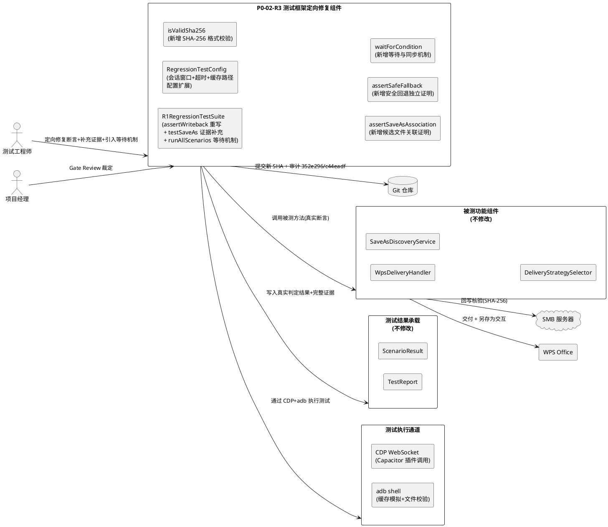
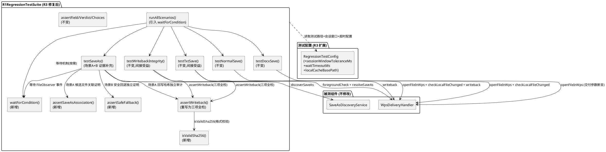
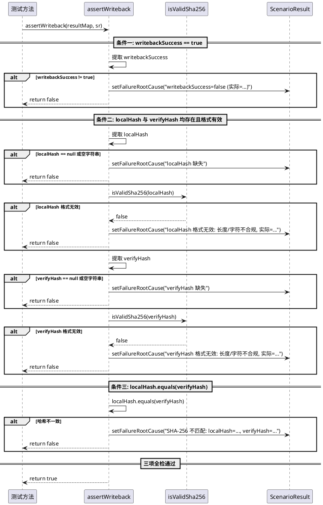
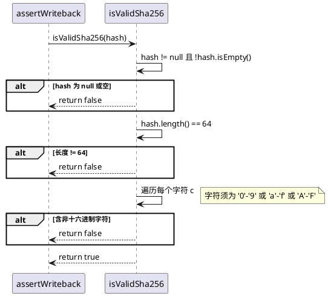
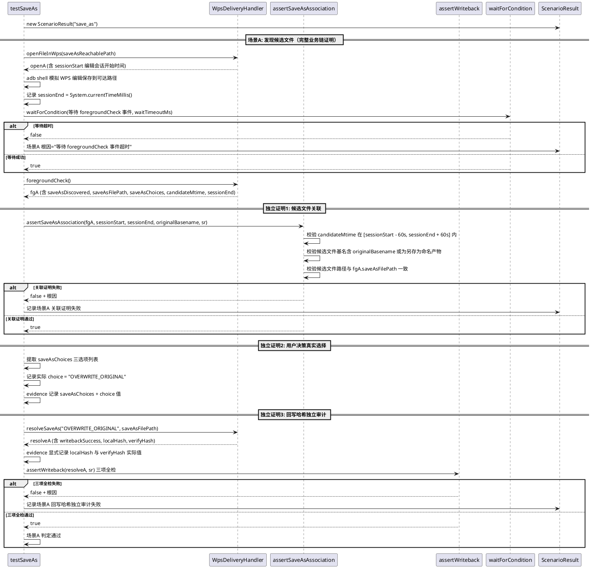
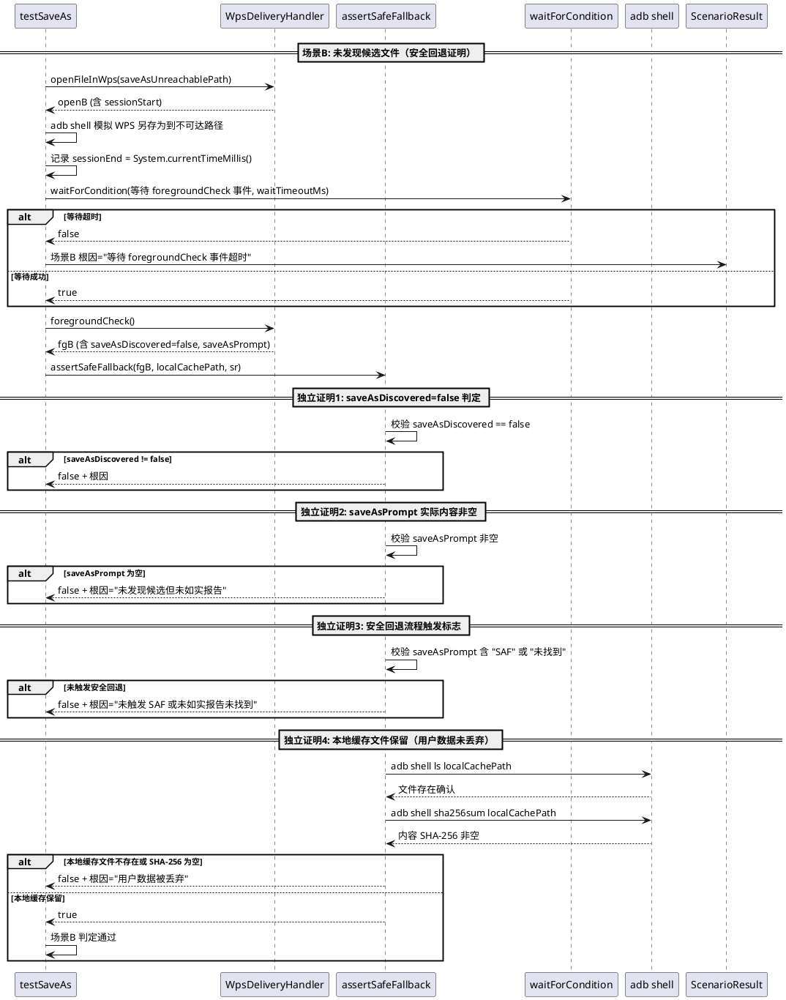
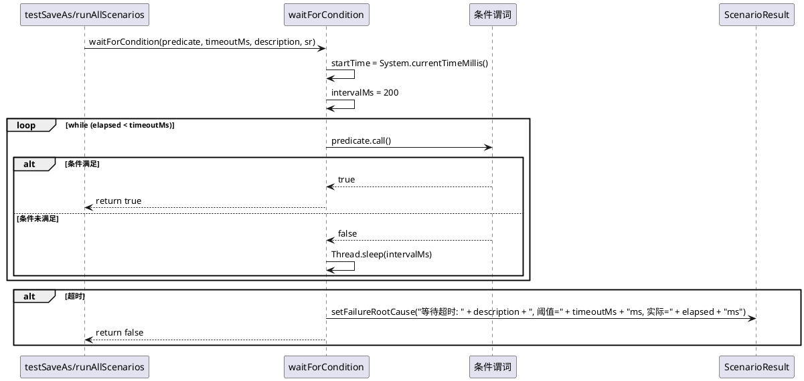
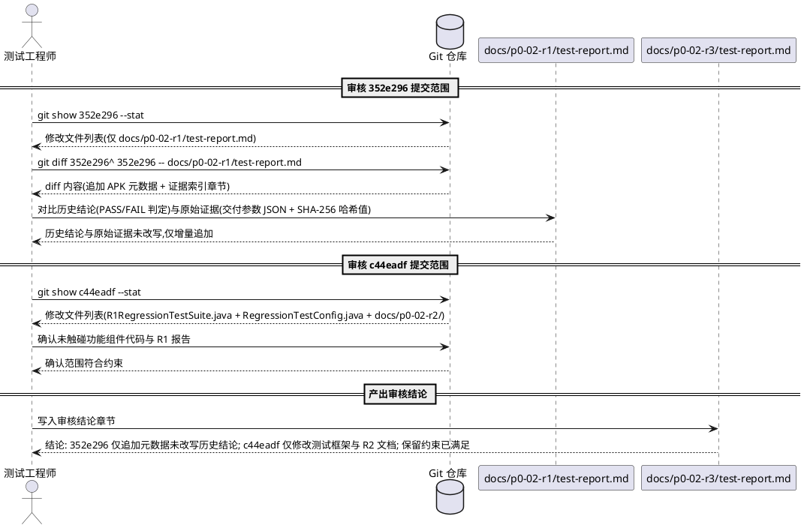
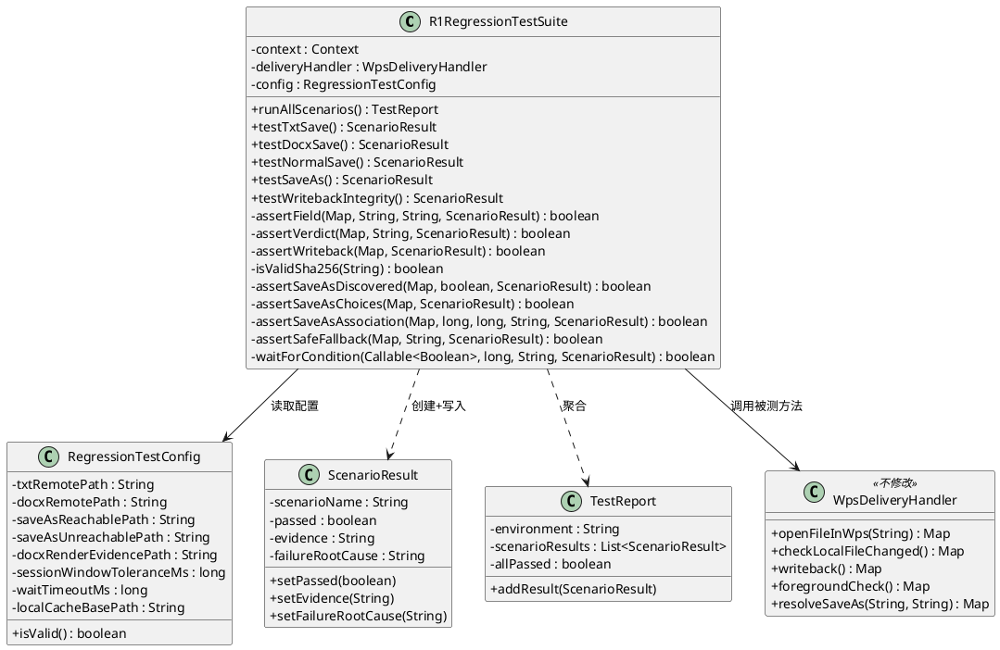

# P0-02-R3 技术设计文档：Hash Assertion & Save-As Evidence Repair

> 本文档为 P0-02-R3 哈希断言与另存为证据修复任务的实现方案，基于 `docs/p0-02-r3/spec.md` 需求规格（R3-01 ~ R3-05 EARS 需求与 27 条验收标准）、PM Gate Review 对 P0-02-R2 的裁定（**HOLD / TARGETED REPAIR**，3 项阻断）与 P0-02-R2 提交 `c44eadf` 暴露的测试框架缺陷生成。文档将三项阻断的根因分析转化为可落地的测试框架定向修复设计，严格遵从"仅修测试框架（R1RegressionTestSuite.java + RegressionTestConfig.java）、不改功能组件代码、保留 R1 历史证据"的约束。

> **前置基线**：
> - P0-02-R1 提交 SHA `693fb75`（功能修复基线）+ `352e296`（证据补充：仅追加元数据与证据索引）。
> - P0-02-R2 提交 SHA `c44eadf`（R1RegressionTestSuite.java + RegressionTestConfig.java + docs/p0-02-r2/）+ `2fdb0cd`（测试报告）。
> - PM 裁定 P0-02-R2 = **HOLD / TARGETED REPAIR**，授权 P0-02-R3。

---

# 一、需求与存量功能关系分析

## 1.1 需求功能与存量功能对比

本修复任务针对 P0-02-R2 回归测试套件 `R1RegressionTestSuite.java` 与 `RegressionTestConfig.java` 在 PM Gate Review 中暴露的三项阻断（哈希断言放水、另存为业务链证据不足、测试执行方式不明），对存量测试框架代码进行定向修复。存量代码基线为 P0-02-R2 提交 `c44eadf`，PM Gate Review 裁定 HOLD / TARGETED REPAIR。以下对 R3-01 ~ R3-05 五个子项与存量代码逐项匹配。

**关键前提**：P0-02-R2 已将五个测试方法从硬编码 PASS 改为真实断言（调用被测组件并基于返回值判定），R1RegressionTestSuite.java 的整体骨架（构造函数、runAllScenarios、五个 test*() 方法、AssertHelpers 私有方法集）已建立。R3 的修复对象仅为 `assertWriteback()` 断言严格化、`testSaveAs()` 证据补充、`runAllScenarios()` 等待机制引入、`RegressionTestConfig` 配置扩展，不触碰任何功能组件，不重写已通过真实断言的 testTxtSave / testDocxSave / testNormalSave / testWritebackIntegrity 方法体（仅在 assertWriteback 修复后间接受益）。

### 1.1.1 已实现功能

| 需求功能 | 存量功能 | 代码位置 | 匹配度 |
|---------|---------|---------|--------|
| 测试结果承载结构 | ScenarioResult（scenarioName / passed / evidence / failureRootCause） | `ScenarioResult.java:3-21` | 100% |
| 测试报告聚合 | TestReport（environment / scenarioResults / allPassed / addResult） | `TestReport.java:6-25` | 100% |
| 回归测试入口框架 | runAllScenarios() 调用五个测试方法并聚合报告 | `R1RegressionTestSuite.java:39-53` | 75% |
| 测试配置载体 | RegressionTestConfig（txtRemotePath / docxRemotePath / saveAsReachablePath / saveAsUnreachablePath / docxRenderEvidencePath） | `RegressionTestConfig.java:3-49` | 75% |
| 构造函数注入配置 | R1RegressionTestSuite(Context, WpsDeliveryHandler, RegressionTestConfig) 重载 | `R1RegressionTestSuite.java:22-27` | 100% |
| 字段断言辅助 | assertField(Map, key, expected, sr) 字段提取与精确值比对 | `R1RegressionTestSuite.java:213-225` | 100% |
| 保存检测断言辅助 | assertVerdict(Map, expected, sr) 委托 assertField 检查 verdict | `R1RegressionTestSuite.java:227-229` | 100% |
| 另存为发现断言辅助 | assertSaveAsDiscovered(Map, expected, sr) 检查 saveAsDiscovered 字段 | `R1RegressionTestSuite.java:246-248` | 100% |
| 另存为选项断言辅助 | assertSaveAsChoices(Map, sr) 检查 saveAsChoices 含三选项 | `R1RegressionTestSuite.java:250-263` | 100% |
| testTxtSave 真实断言 | 调用 openFileInWps + checkLocalFileChanged + writeback，断言 intentLaunched + verdict + assertWriteback | `R1RegressionTestSuite.java:55-75` | 100% |
| testDocxSave 真实断言 | 调用 openFileInWps，断言 deliveryStrategy + uriScheme + intentAction + mimeType 四字段 | `R1RegressionTestSuite.java:77-104` | 100% |
| testNormalSave 真实断言 | 调用 openFileInWps + checkLocalFileChanged，断言 verdict + contentChanged | `R1RegressionTestSuite.java:106-124` | 100% |
| testWritebackIntegrity 真实断言 | 调用 openFileInWps + writeback，断言 assertWriteback | `R1RegressionTestSuite.java:192-211` | 100% |
| 场景A 发现候选 + 决策 + 回写 | testSaveAs 场景A 调用 foregroundCheck + assertSaveAsDiscovered + assertSaveAsChoices + resolveSaveAs + assertWriteback | `R1RegressionTestSuite.java:137-158` | 50% |
| 场景B 未发现候选 + 提示 | testSaveAs 场景B 调用 foregroundCheck + assertSaveAsNotFound | `R1RegressionTestSuite.java:160-174` | 50% |
| 回写完整性断言 | assertWriteback(Map, sr) 检查 writebackSuccess + localHash/verifyHash 不匹配 | `R1RegressionTestSuite.java:231-244` | 25% |
| 未发现候选断言 | assertSaveAsNotFound(Map, sr) 检查 saveAsDiscovered == false + saveAsPrompt 含关键词 | `R1RegressionTestSuite.java:265-281` | 50% |

**匹配度判定依据**：
- **100%**：方法实现完整且符合 R3 验收标准，无需修改（如 testTxtSave / testDocxSave / testNormalSave / testWritebackIntegrity 的方法体在 R2 已重写为真实断言，R3 不再修改方法体，仅间接受益于 assertWriteback 修复）。
- **75%**：骨架存在但缺少 R3 要求的子能力（如 runAllScenarios 缺等待机制、RegressionTestConfig 缺会话窗口与超时配置字段）。
- **50%**：方法体存在但证据维度不足（如 testSaveAs 场景A/B 缺独立关联证明与安全回退证明、assertSaveAsNotFound 仅检查关键词未证明回退流程触发）。
- **25%**：方法体存在核心缺陷须重写（如 assertWriteback 哈希断言放水，须重写为三项全检）。

### 1.1.2 需要扩展的功能

| 需求功能 | 存量功能 | 差异说明 | 扩展方向 |
|---------|---------|---------|---------|
| R3-01 assertWriteback 三项全检 | assertWriteback 第 239 行 `if (localHash != null && verifyHash != null && !localHash.equals(verifyHash))` 短路逻辑 | 存量逻辑在 localHash 或 verifyHash 为 null 时条件短路为 false，跳过哈希校验返回 true；缺少哈希存在性强制校验、格式有效性校验（64 字符 + 十六进制）、三项合取严格关系 | 重写 assertWriteback 为三项顺序全检：条件一 writebackSuccess == true → 条件二 localHash 与 verifyHash 均存在且格式有效 → 条件三 localHash.equals(verifyHash)，任一失败返回 false 并写入对应根因 |
| R3-01 SHA-256 格式校验辅助 | 无 | 存量无 SHA-256 格式有效性校验方法，无法判断哈希是否为 64 字符十六进制 | 新增 isValidSha256(String hash) 私有方法：校验非空、长度 64、全部十六进制字符（0-9, a-f, A-F） |
| R3-02 场景A 候选文件关联证明 | testSaveAs 场景A 仅检查 saveAsDiscovered == true + saveAsChoices 三选项 | 存量未独立证明候选文件 mtime 在编辑会话时间窗口内、候选文件基名含原文件名、候选文件路径与 saveAsFilePath 一致；候选文件可能为历史残留 | 新增 assertSaveAsAssociation(fgResult, sessionStart, sessionEnd, originalBasename, sr) 辅助方法：校验 mtime 在 [sessionStart - 60s, sessionEnd + 60s] 内、基名含原文件基名或为另存为命名产物、路径与 saveAsFilePath 一致 |
| R3-02 场景A 回写哈希独立审计 | testSaveAs 场景A 调用 assertWriteback 但因阻断项 1 缺陷无法独立审计 | 存量 assertWriteback 在哈希缺失时返回 true，无法独立审计回写哈希；R3-01 修复后 assertWriteback 严格化，场景A 自动获得独立审计能力，但须在证据中显式记录 localHash 与 verifyHash 实际值 | 在 testSaveAs 场景A 的 resolveSaveAs 返回后，显式提取 localHash 与 verifyHash 写入 evidence，调用 assertWriteback 三项全检，证据含哈希实际值与三项全检结果 |
| R3-02 场景A 用户决策真实选择证明 | testSaveAs 场景A 调用 assertSaveAsChoices 检查三选项存在 | 存量检查三选项存在但未在证据中显式记录 saveAsChoices 列表与实际 choice 值，无法证明决策为真实选择非硬编码假设 | 在 evidence 中显式记录 saveAsChoices 三选项列表与实际 choice 值（"OVERWRITE_ORIGINAL"），证明决策为真实选择 |
| R3-02 场景B 安全回退独立证明 | assertSaveAsNotFound 第 276 行仅检查 saveAsPrompt 含 "未找到"/"手动"/"SAF" 关键词 | 存量仅检查提示关键词，未独立证明安全回退流程触发标志（SAF 触发标志或"未找到"报告标志），未证明本地缓存文件保留与内容 SHA-256 | 新增 assertSafeFallback(fgResult, localCachePath, sr) 辅助方法：校验 saveAsDiscovered == false + saveAsPrompt 实际内容非空 + 安全回退触发标志（saveAsPrompt 含 "SAF" 或 "未找到"）+ 本地缓存文件存在性与内容 SHA-256 非空 |
| R3-02 runAllScenarios 等待机制 | runAllScenarios 第 45-49 行依次调用五个测试方法，无等待 | 存量无明确的等待与同步机制（无 FileObserver 事件等待、无 adb shell 确认、无超时阈值），依赖瞬时调用 | 在 runAllScenarios 与 testSaveAs 中引入 waitForCondition(predicate, timeoutMs) 等待机制：等待 FileObserver 事件或 adb 确认，超时即标记失败，替代固定 sleep |
| R3-03 测试执行方式声明 | 无 | 存量测试报告未明确声明执行方式分类（自动化/混合/人工参与），未说明 CDP WebSocket 与 adb shell 技术机制 | 在 docs/p0-02-r3/test-report.md 中声明每个场景的执行方式分类与技术机制（CDP WebSocket 调用 Capacitor 插件 + adb shell 模拟 WPS 编辑 + 人工参与等待机制），附可核对执行日志 |
| R3-04 R1 报告差异审核 | 无 | 存量未对 352e296 与 c44eadf 提交范围执行系统审核并产出审核结论 | 在 docs/p0-02-r3/test-report.md 中产出审核结论：352e296 仅追加元数据与证据索引未改写历史结论、c44eadf 仅修改测试框架与 R2 文档未触碰功能组件、保留约束已满足 |
| R3-05 新 SHA 与执行日志 | 无 | 存量测试报告使用 R2 的 SHA c44eadf，无 R3 重新执行的执行日志 | 重新执行全部五类场景，提交新完整 SHA，产出 docs/p0-02-r3/test-report.md + docs/p0-02-r3/execution-log.md，含新 SHA、真实判定、哈希结果、另存为证据、执行方式声明、日志索引 |
| R3-02 RegressionTestConfig 会话窗口配置 | RegressionTestConfig 无会话窗口与超时字段 | 存量配置仅有测试文件路径，缺少会话时间窗口容差（±60s）、等待超时阈值（如 10s）、本地缓存路径等 R3 新增断言所需配置 | 扩展 RegressionTestConfig：新增 sessionWindowToleranceMs（会话窗口容差，默认 60000）、waitTimeoutMs（等待超时，默认 10000）、localCacheBasePath（本地缓存根路径，默认 /storage/emulated/0/PAD2/smb_cache/）字段 |

### 1.1.3 需要新增的功能或接口

**模块 H：哈希断言严格化（R3-01）**
- **H1 isValidSha256(String hash) 辅助方法**：校验 SHA-256 哈希字符串格式有效性。输入：哈希字符串；输出：布尔值（true 表示格式有效）。核心逻辑：非空 AND 长度 == 64 AND 全部字符为十六进制（0-9, a-f, A-F）。归属：R1RegressionTestSuite 内部私有方法。
- **H2 assertWriteback(Map<String,Object> result, ScenarioResult sr) 重写**：重写为三项全检。输入：writeback() 或 resolveSaveAs() 返回的结果 Map 与 ScenarioResult；输出：布尔值（true 表示三项全检通过）。核心逻辑：条件一 writebackSuccess == true → 条件二 localHash 与 verifyHash 均存在且 isValidSha256 返回 true → 条件三 localHash.equals(verifyHash)，按顺序校验，任一失败返回 false 并写入对应根因（缺失字段名 / 格式无效字段与实际值 / 哈希不一致两值对比）。归属：R1RegressionTestSuite 内部私有方法（重写）。

**模块 I：另存为完整业务链证据（R3-02）**
- **I1 assertSaveAsAssociation(Map<String,Object> fgResult, long sessionStart, long sessionEnd, String originalBasename, ScenarioResult sr) 辅助方法**：独立证明候选文件与编辑会话关联。输入：foregroundCheck 返回结果、编辑会话开始时间、会话结束时间、原文件基名、ScenarioResult；输出：布尔值。核心逻辑：(1) 提取候选文件 mtime（从 fgResult 或 adb shell stat 获取）；(2) 校验 mtime 在 [sessionStart - tolerance, sessionEnd + tolerance] 内；(3) 提取候选文件基名，校验含原文件基名或为另存为命名产物；(4) 校验候选文件路径与 fgResult.saveAsFilePath 一致。任一失败返回 false 并写入根因。归属：R1RegressionTestSuite 内部私有方法。
- **I2 assertSafeFallback(Map<String,Object> fgResult, String localCachePath, ScenarioResult sr) 辅助方法**：独立证明安全回退流程触发。输入：foregroundCheck 返回结果、本地缓存文件路径、ScenarioResult；输出：布尔值。核心逻辑：(1) 校验 saveAsDiscovered == false；(2) 校验 saveAsPrompt 非空且含 "SAF" 或 "未找到" 关键词（安全回退触发标志）；(3) 通过 adb shell ls 与 sha256sum 校验本地缓存文件存在且内容 SHA-256 非空（用户数据未丢弃）。任一失败返回 false 并写入根因。归属：R1RegressionTestSuite 内部私有方法。
- **I3 waitForCondition(Callable<Boolean> predicate, long timeoutMs, String description, ScenarioResult sr) 等待机制**：提供明确的等待与同步机制。输入：条件谓词、超时阈值、等待描述、ScenarioResult；输出：布尔值（true 表示条件在超时内满足）。核心逻辑：循环调用 predicate，每次调用间隔 200ms，累计等待不超过 timeoutMs，条件满足返回 true，超时返回 false 并写入根因（等待对象 + 超时阈值 + 实际等待时间）。替代固定 Thread.sleep。归属：R1RegressionTestSuite 内部私有方法。

**模块 J：测试执行方式声明与审核结论（R3-03, R3-04）**
- **J1 测试执行方式声明章节**：在 docs/p0-02-r3/test-report.md 中新增执行方式声明章节，分类声明每个场景的执行方式（自动化/混合/人工参与）与技术机制（CDP WebSocket / adb shell / 等待机制）。归属：测试报告文档。
- **J2 R1 报告差异审核结论章节**：在 docs/p0-02-r3/test-report.md 中新增审核结论章节，记录 352e296 与 c44eadf 的 git diff 审核结果与保留约束满足判定。归属：测试报告文档。
- **J3 执行日志 docs/p0-02-r3/execution-log.md**：可核对的执行日志，每条含时间戳、执行方式分类、命令（CDP 方法名+参数 / adb shell 命令 / 人工步骤描述）、返回值、判定结果。归属：测试报告配套文档。

**模块 K：测试配置扩展（R3-02）**
- **K1 RegressionTestConfig 字段扩展**：新增 sessionWindowToleranceMs（会话窗口容差，默认 60000ms）、waitTimeoutMs（等待超时阈值，默认 10000ms）、localCacheBasePath（本地缓存根路径，默认 /storage/emulated/0/PAD2/smb_cache/）三个字段，含 getter/setter 与 isValid() 校验扩展。归属：RegressionTestConfig.java。

## 1.2 存量功能详细分析

### 1.2.1 R1RegressionTestSuite 测试套件当前实现（P0-02-R2 提交 c44eadf）

**接口契约**：
- `R1RegressionTestSuite(Context context, WpsDeliveryHandler deliveryHandler)`：旧构造函数，委托新构造函数并传入默认配置。
- `R1RegressionTestSuite(Context context, WpsDeliveryHandler deliveryHandler, RegressionTestConfig config)`：新构造函数，注入被测组件与测试配置。
- `runAllScenarios()`：执行全部五类场景，返回 TestReport。
- `testTxtSave() / testDocxSave() / testNormalSave() / testSaveAs() / testWritebackIntegrity()`：五个测试方法，返回 ScenarioResult。
- 私有断言辅助：`assertField / assertVerdict / assertWriteback / assertSaveAsDiscovered / assertSaveAsChoices / assertSaveAsNotFound`。

**业务规则（当前实现）**：
- runAllScenarios() 构造设备环境描述 → 创建 TestReport → 依次调用五个测试方法 → addResult 聚合 → 返回报告。
- testTxtSave / testDocxSave / testNormalSave / testWritebackIntegrity：已重写为真实断言，调用被测组件并基于返回值判定（R2 修复成果）。
- testSaveAs：双场景顺序执行，场景A 调用 foregroundCheck + assertSaveAsDiscovered + assertSaveAsChoices + resolveSaveAs + assertWriteback；场景B 调用 foregroundCheck + assertSaveAsNotFound。
- assertWriteback：检查 writebackSuccess == true，再检查 localHash 与 verifyHash 不匹配（**缺陷：哈希缺失时短路返回 true**）。

**约束**：
- 构造函数持有 context、deliveryHandler、config 三个引用。
- 五个测试方法均为 public，可独立调用。
- 私有断言辅助方法不对外暴露。

**缺陷与根因（R3 修复目标）**：

| 缺陷编号 | 缺陷描述 | 根因分析 | 对应子项 |
|---------|---------|---------|---------|
| D-01 | assertWriteback 哈希断言放水 | 第 239 行 `if (localHash != null && verifyHash != null && !localHash.equals(verifyHash))` 当 localHash 或 verifyHash 为 null 时条件短路为 false，方法跳过哈希校验返回 true。实现采用"若哈希存在且不一致则失败"的宽松模式，而非"若哈希不存在或无效或不一致则失败"的严格模式 | R3-01 |
| D-02 | assertWriteback 缺少哈希格式校验 | 存量逻辑仅校验哈希存在性与相等性，未校验格式有效性（64 字符 + 十六进制），无法识别截断或编码错误的哈希 | R3-01 |
| D-03 | testSaveAs 场景A 缺候选文件关联证明 | 场景A 仅检查 saveAsDiscovered == true 与 saveAsChoices 三选项，未独立证明候选文件 mtime 在会话窗口内、基名匹配、路径一致，候选文件可能为历史残留 | R3-02 |
| D-04 | testSaveAs 场景A 缺回写哈希独立审计 | 场景A 调用 assertWriteback 但因 D-01 缺陷无法独立审计回写哈希；R3-01 修复后须在证据中显式记录 localHash 与 verifyHash 实际值 | R3-02 |
| D-05 | testSaveAs 场景A 缺用户决策真实选择证明 | 场景A 检查三选项存在但未在证据中显式记录 saveAsChoices 列表与实际 choice 值 | R3-02 |
| D-06 | testSaveAs 场景B 缺安全回退独立证明 | assertSaveAsNotFound 仅检查 saveAsPrompt 含关键词，未独立证明安全回退流程触发标志，未证明本地缓存文件保留 | R3-02 |
| D-07 | runAllScenarios 缺等待与同步机制 | runAllScenarios 依次调用五个测试方法，无 FileObserver 事件等待、无 adb 确认、无超时阈值，依赖瞬时调用 | R3-02, R3-03 |
| D-08 | 测试报告缺执行方式声明 | 测试报告未声明每个场景的执行方式分类（自动化/混合/人工参与）与技术机制 | R3-03 |
| D-09 | R1 报告差异未系统审核 | 未对 352e296 与 c44eadf 提交范围执行系统审核并产出审核结论 | R3-04 |

### 1.2.2 assertWriteback 当前实现详细分析（D-01 / D-02 核心缺陷定位）

**当前源码（`R1RegressionTestSuite.java:231-244`）**：
- 第 232-236 行：提取 writebackSuccess，校验 == true，失败返回 false 并写入根因。此部分逻辑正确。
- 第 237-238 行：提取 localHash 与 verifyHash，使用三元运算符 `result.get("localHash") != null ? String.valueOf(result.get("localHash")) : null` 处理 null。
- 第 239-242 行：`if (localHash != null && verifyHash != null && !localHash.equals(verifyHash))` — **缺陷核心**：
  - 当 localHash == null 或 verifyHash == null 时，`localHash != null && verifyHash != null` 短路为 false，整个 if 条件为 false，方法跳过哈希校验。
  - 第 243 行 `return true` — 哈希缺失时仍返回 true，完整性校验被误判为通过。
- 缺少：哈希存在性强制校验（null 时须失败）、格式有效性校验（64 字符 + 十六进制）、三项合取严格关系。

**缺陷影响**：
- testTxtSave / testWritebackIntegrity 的回写完整性断言形同虚设：若 writeback() 因异常或逻辑缺陷未产出 localHash/verifyHash，测试仍报告完整性校验通过。
- testSaveAs 场景A 的 resolveSaveAs 回写哈希无法被独立审计：assertWriteback 在哈希缺失时返回 true，场景A 误判回写哈希核验通过。
- PM 无法基于此断言判定回写完整性真实有效。

**修复方向（R3-01）**：
- 重写为三项顺序全检：条件一（writebackSuccess == true）→ 条件二（localHash 与 verifyHash 均存在且 isValidSha256 返回 true）→ 条件三（localHash.equals(verifyHash)），任一失败返回 false 并写入对应根因。
- 新增 isValidSha256(String hash) 辅助方法：校验非空、长度 64、全部十六进制字符。

### 1.2.3 testSaveAs 当前实现详细分析（D-03 ~ D-06 缺陷定位）

**场景A 当前实现（`R1RegressionTestSuite.java:137-158`）**：
- 调用 openFileInWps(config.saveAsReachablePath) → foregroundCheck()。
- assertSaveAsDiscovered(fgA, true, result) — 仅检查 saveAsDiscovered == true。
- assertSaveAsChoices(fgA, result) — 检查 saveAsChoices 含三选项。
- resolveSaveAs("OVERWRITE_ORIGINAL", saveAsFilePath) → assertWriteback(resolveA, result) — 但 assertWriteback 有 D-01 缺陷。
- **缺陷**：未独立证明候选文件 mtime 在会话窗口内（D-03）、未显式记录 localHash 与 verifyHash 实际值（D-04）、未显式记录 saveAsChoices 列表与 choice 值（D-05）。

**场景B 当前实现（`R1RegressionTestSuite.java:160-174`）**：
- 调用 openFileInWps(config.saveAsUnreachablePath) → foregroundCheck()。
- assertSaveAsNotFound(fgB, result) — 检查 saveAsDiscovered == false + saveAsPrompt 含关键词。
- **缺陷**：仅检查关键词未证明安全回退流程触发标志（D-06）、未证明本地缓存文件保留与内容 SHA-256（D-06）。

**assertSaveAsNotFound 当前实现（`R1RegressionTestSuite.java:265-281`）**：
- 第 267-270 行：校验 saveAsDiscovered == false，失败返回 false。
- 第 271-275 行：校验 saveAsPrompt 非空，失败返回 false。
- 第 276-279 行：校验 saveAsPrompt 含 "未找到" / "手动" / "SAF" 关键词，失败返回 false。
- **缺陷**：仅检查关键词存在，未独立证明安全回退流程触发标志（SAF 触发或"未找到"报告标志），未证明本地缓存文件保留。

### 1.2.4 runAllScenarios 当前实现详细分析（D-07 缺陷定位）

**当前源码（`R1RegressionTestSuite.java:39-53`）**：
- 第 40-41 行：构造设备环境描述。
- 第 42 行：创建 TestReport。
- 第 45-49 行：依次调用五个测试方法并 addResult 聚合。
- **缺陷**：无明确的等待与同步机制。当前实现依赖瞬时调用，未为人工打开 WPS、编辑、保存等步骤提供 FileObserver 事件等待、adb shell 确认或超时阈值。

**修复方向（R3-02）**：
- 引入 waitForCondition(predicate, timeoutMs, description, sr) 等待机制。
- 在 testSaveAs 场景A/B 中，adb shell 模拟 WPS 编辑后，等待 foregroundCheck 返回 saveAsDiscovered == true/false 的事件，超时即标记失败。
- 不在 runAllScenarios 顶层添加固定 sleep，等待机制在具体测试方法内部按需调用。

### 1.2.5 RegressionTestConfig 当前实现详细分析

**当前源码（`RegressionTestConfig.java:3-49`）**：
- 字段：txtRemotePath、docxRemotePath、saveAsReachablePath、saveAsUnreachablePath、docxRenderEvidencePath。
- 构造函数：无参构造 + 五参构造。
- isValid()：校验五个路径字段非空。
- **缺陷**：缺少 R3 新增断言所需配置：会话时间窗口容差（sessionWindowToleranceMs）、等待超时阈值（waitTimeoutMs）、本地缓存根路径（localCacheBasePath）。

**修复方向（R3-02）**：
- 新增三个字段：sessionWindowToleranceMs（默认 60000）、waitTimeoutMs（默认 10000）、localCacheBasePath（默认 "/storage/emulated/0/PAD2/smb_cache/"）。
- 扩展 isValid()：校验三个新字段非空且数值为正。
- 保留旧构造函数向后兼容，新增构造函数重载或 setter 注入新字段。

### 1.2.6 被测功能组件接口契约（不修改，仅引用）

**WpsDeliveryHandler**（`WpsDeliveryHandler.java`，不修改）：
- `openFileInWps(String remotePath)` → Map 含 intentLaunched / deliveryStrategy / uriScheme / intentAction / mimeType / baselineHash / localPath / sessionStart（编辑会话开始时间，R3-02 关联证明需要）。
- `checkLocalFileChanged()` → Map 含 verdict / changed / contentChanged / mtimeChanged / saveAsDetected / saveAsFileName / saveAsPrompt。
- `writeback()` → Map 含 writebackSuccess / localHash / verifyHash / remoteMtimeBefore / remoteMtimeAfter。
- `foregroundCheck()` → Map 含 verdict / saveAsDiscovered / saveAsFilePath / saveAsChoices / saveAsPrompt / formatChange / candidateMtime（候选文件 mtime，R3-02 关联证明需要）/ sessionEnd（会话结束时间）。
- `resolveSaveAs(String choice, String saveAsFilePath)` → Map 含 writebackSuccess / choice / newRemotePath / localHash / verifyHash（R3-02 独立审计需要）。

**SaveAsDiscoveryService**（`SaveAsDiscoveryService.java`，不修改）：
- `discoverSaveAs(EditSessionContext sessionCtx)` → List<File>，扫描 mtime 在会话窗口 ±60s 内、文件名含原文件基名的非临时文件。

**约束**：R3 修复不修改上述任何功能组件的接口或实现，仅通过测试框架调用其公开方法获取返回值并执行断言。

---
# 二、增量设计方案

## 2.1 实现模型

### 2.1.1 上下文视图



**交互说明**：
- 修复组件（Fix）仅包含 R1RegressionTestSuite 的 assertWriteback 重写、testSaveAs 证据补充、runAllScenarios 等待机制引入、RegressionTestConfig 配置扩展，以及 isValidSha256 / assertSaveAsAssociation / assertSafeFallback / waitForCondition 四个新增私有辅助方法，不触碰 Target 中的任何功能组件。
- Fix 通过 Target 的公开方法（openFileInWps / checkLocalFileChanged / writeback / foregroundCheck / resolveSaveAs）执行真实断言，不直接访问 Target 的私有字段。
- Fix 通过 CDP WebSocket 调用 Capacitor 插件方法执行自动化部分，通过 adb shell 修改本地缓存文件模拟 WPS 编辑并校验本地缓存保留。
- Fix 将真实判定结果与完整证据写入 Result（ScenarioResult / TestReport），Result 结构不变。

### 2.1.2 服务/组件总体架构



**组件职责说明**：

| 组件 | 职责 | 修改类型 | 对应子项 |
|------|------|---------|---------|
| R1RegressionTestSuite.assertWriteback | 回写完整性断言，重写为三项全检 | 重写方法体 | R3-01 |
| R1RegressionTestSuite.isValidSha256 | SHA-256 格式有效性校验 | 新增私有方法 | R3-01 |
| R1RegressionTestSuite.testSaveAs | 另存为双场景证据补充 | 修改方法体（场景A+B 证据补充） | R3-02 |
| R1RegressionTestSuite.assertSaveAsAssociation | 候选文件与编辑会话关联独立证明 | 新增私有方法 | R3-02 |
| R1RegressionTestSuite.assertSafeFallback | 安全回退流程独立证明 | 新增私有方法 | R3-02 |
| R1RegressionTestSuite.waitForCondition | 等待与同步机制 | 新增私有方法 | R3-02, R3-03 |
| R1RegressionTestSuite.runAllScenarios | 回归测试入口（引入等待机制按需调用） | 修改方法体（最小改动） | R3-02, R3-03 |
| R1RegressionTestSuite.testTxtSave/testDocxSave/testNormalSave/testWritebackIntegrity | 已真实断言的方法 | 不修改方法体（间接受益于 assertWriteback 修复） | — |
| RegressionTestConfig | 测试配置载体，扩展会话窗口+超时+缓存路径字段 | 扩展字段 | R3-02 |
| ScenarioResult | 测试结果承载 | 不修改 | — |
| TestReport | 测试报告聚合 | 不修改 | — |
| WpsDeliveryHandler | 被测交付与回写组件 | 不修改 | — |
| SaveAsDiscoveryService | 被测另存为发现组件 | 不修改 | — |

### 2.1.3 实现设计文档

#### 2.1.3.1 R3-01 assertWriteback 三项全检执行流程



**关键设计决策**：
1. **顺序校验**：按条件一 → 条件二 → 条件三顺序校验，任一失败立即返回 false 并写入对应根因，不继续后续校验。这遵从 R3-01-AC-01"三项全检逻辑，按顺序校验"。
2. **哈希存在性强制校验**：localHash 或 verifyHash 为 null 或空字符串时返回 false，根因含缺失字段名。这遵从 R3-01-AC-02"哈希缺失时断言失败"。
3. **哈希格式有效性校验**：调用 isValidSha256 校验非空、长度 64、全部十六进制字符，格式无效时返回 false，根因含无效字段与实际值。这遵从 R3-01-AC-03"哈希格式无效时断言失败"。
4. **哈希一致性校验**：两个哈希均存在且格式有效但不相等时返回 false，根因含两哈希实际值对比。这遵从 R3-01-AC-04"哈希不一致时断言失败"。
5. **禁止短路返回 true**：消除 `if (localHash != null && verifyHash != null && !localHash.equals(verifyHash))` 形式的短路逻辑，哈希缺失时不再跳过校验。这遵从 R3-01 业务规则 6 禁止项。

#### 2.1.3.2 R3-01 isValidSha256 格式校验执行流程



**关键设计决策**：
1. **三项格式校验**：非空 + 长度 64 + 全部十六进制字符，三项缺一不可。这遵从 R3-01 数据约束 2"localHash 须非空、长度 64、全部十六进制字符"。
2. **大小写兼容**：接受大写（A-F）与小写（a-f）十六进制字符，因 SHA-256 摘要可能以任一大小写产出。校验时仅判断字符是否为合法十六进制，不强制大小写。
3. **性能开销**：64 字符遍历 + 长度判断的时间复杂度 O(64) = O(1)，单次校验开销 < 1ms，满足 DFX 约束 4.1"哈希断言增量开销 < 100ms"。

#### 2.1.3.3 R3-02 testSaveAs 场景A 完整业务链执行流程



**关键设计决策**：
1. **候选文件关联独立证明**：新增 assertSaveAsAssociation 校验候选文件 mtime 在会话窗口 ±60s 内、基名含原文件基名、路径与 saveAsFilePath 一致，证明候选文件确实是本次保存产生而非历史残留。这遵从 R3-02-AC-01 / AC-02。
2. **用户决策真实选择证明**：在 evidence 中显式记录 saveAsChoices 三选项列表与实际 choice 值，证明决策为真实选择非硬编码假设。这遵从 R3-02-AC-04。
3. **回写哈希独立审计**：resolveSaveAs 返回后显式提取 localHash 与 verifyHash 写入 evidence，调用 assertWriteback 三项全检（R3-01 修复后严格化），不依赖 writebackSuccess 单独判定。这遵从 R3-02-AC-03 与 R3-01-AC-05。
4. **等待机制**：adb shell 模拟编辑后，通过 waitForCondition 等待 foregroundCheck 事件触发，超时即标记失败，不依赖固定 sleep。这遵从 R3-02-AC-07。

#### 2.1.3.4 R3-02 testSaveAs 场景B 安全回退执行流程



**关键设计决策**：
1. **安全回退独立证明**：新增 assertSafeFallback 校验 saveAsDiscovered == false + saveAsPrompt 非空 + 安全回退触发标志（含 "SAF" 或 "未找到"）+ 本地缓存文件保留，替代存量 assertSaveAsNotFound 仅检查关键词的薄弱证明。这遵从 R3-02-AC-05。
2. **用户数据保留证明**：通过 adb shell ls 与 sha256sum 校验本地缓存文件存在且内容 SHA-256 非空，证明系统未静默丢弃用户编辑内容。这遵从 R3-02-AC-06。
3. **等待机制**：与场景A 一致，通过 waitForCondition 等待 foregroundCheck 事件，超时即标记失败。这遵从 R3-02-AC-07。

#### 2.1.3.5 R3-02 waitForCondition 等待机制执行流程



**关键设计决策**：
1. **事件驱动等待**：循环调用条件谓词（如 foregroundCheck 返回 saveAsDiscovered == true），每次间隔 200ms，累计等待不超过 timeoutMs。替代固定 Thread.sleep，避免无等待瞬时调用或过长固定等待。这遵从 R3-02-AC-07"含明确等待机制，无固定 sleep"。
2. **超时失败**：超时即返回 false 并写入根因（等待对象 + 超时阈值 + 实际等待时间），不伪报成功。这遵从 R3-02 异常场景 4"等待机制超时"。
3. **可配置超时**：timeoutMs 从 RegressionTestConfig.waitTimeoutMs 读取，默认 10000ms，可通过配置调整。

#### 2.1.3.6 R3-04 R1 报告差异审核流程



**关键设计决策**：
1. **352e296 审核结论**：该提交仅追加 APK 元数据（文件大小、分发路径、提交 SHA、远端链接）与实测证据索引章节（证据表 + SHA-256 证据链），未改写任何历史测试结论或原始证据数据。保留约束已满足。这遵从 R3-04-AC-01 / AC-03。
2. **c44eadf 审核结论**：该提交相对 352e296 仅修改 R1RegressionTestSuite.java + RegressionTestConfig.java + docs/p0-02-r2/，未触碰功能组件代码与 R1 测试报告。提交范围符合约束。这遵从 R3-04-AC-02。
3. **R3 继续遵从**：R3 提交仅修改 R1RegressionTestSuite.java + RegressionTestConfig.java + docs/p0-02-r3/，不修改 docs/p0-02-r1/test-report.md，继续遵从保留约束。这遵从 R3-04-AC-04。

## 2.2 接口设计

### 2.2.1 总体设计

**接口分类**：
- **测试方法接口（公共，签名不变）**：五个 test*() 方法 + runAllScenarios()，签名不变，仅 testSaveAs 与 runAllScenarios 方法体修改。稳定性等级：稳定。
- **构造函数接口（不变）**：R1RegressionTestSuite(Context, WpsDeliveryHandler) 与 R1RegressionTestSuite(Context, WpsDeliveryHandler, RegressionTestConfig) 两个构造函数签名不变。稳定性等级：稳定。
- **断言辅助接口（私有，内部变更）**：assertWriteback 重写、isValidSha256 / assertSaveAsAssociation / assertSafeFallback / waitForCondition 新增，均为 R1RegressionTestSuite 内部私有方法，不对外暴露。稳定性等级：内部。
- **配置接口（扩展）**：RegressionTestConfig 新增三个字段（sessionWindowToleranceMs / waitTimeoutMs / localCacheBasePath）含 getter/setter，保留旧构造函数向后兼容。稳定性等级：稳定（向后兼容）。

**接口变更策略**：
- 五个测试方法签名（public ScenarioResult testXxx()）不变，调用方（runAllScenarios）无需修改。
- 构造函数签名不变，RegressionTestConfig 新增字段有默认值，旧构造函数与旧配置对象继续可用。
- 不修改任何功能组件的公共接口。
- 新增私有方法不影响外部调用方。

### 2.2.2 接口清单

#### 2.2.2.1 assertWriteback 重写为三项全检（R3-01）

**接口签名**：
```
private boolean assertWriteback(Map<String, Object> result, ScenarioResult sr)
```
（签名不变，方法体重写）

**业务说明**：对 writeback() 或 resolveSaveAs() 返回的结果执行三项全检，严格校验回写完整性的 SHA-256 哈希。替代存量"哈希存在且不一致则失败"的宽松逻辑，改为"哈希不存在或无效或不一致则失败"的严格逻辑。

**前置条件**：result 非 null（含 writebackSuccess / localHash / verifyHash 字段），sr 非 null。

**后置条件**：返回 true 表示三项全检通过；返回 false 时 sr.failureRootCause 已写入对应根因。

**断言逻辑（三项顺序全检）**：
1. **条件一**：提取 writebackSuccess，校验 == true。失败 → 返回 false，根因 = "writebackSuccess=false (实际=...)"。
2. **条件二**：提取 localHash，校验非 null 且非空字符串；调用 isValidSha256(localHash) 校验格式有效。失败 → 返回 false，根因 = "localHash 缺失" 或 "localHash 格式无效: 长度/字符不合规, 实际=..."。对 verifyHash 执行相同校验。
3. **条件三**：校验 localHash.equals(verifyHash)。失败 → 返回 false，根因 = "SHA-256 不匹配: localHash=..., verifyHash=..."。
4. 三项全检通过 → 返回 true。

**异常映射**：无异常抛出（所有校验失败通过返回 false + 根因表达）。

**禁止**：
- 禁止保留 `if (localHash != null && verifyHash != null && !localHash.equals(verifyHash))` 形式的短路逻辑。
- 禁止仅校验 writebackSuccess 即返回 true。
- 禁止仅校验哈希存在性而不校验格式与一致性。
- 禁止哈希缺失或无效时返回 true。

#### 2.2.2.2 isValidSha256 新增（R3-01）

**接口签名**：
```
private boolean isValidSha256(String hash)
```

**业务说明**：校验 SHA-256 哈希字符串格式有效性。判断非空、长度为 64、全部字符为十六进制（0-9, a-f, A-F）。

**前置条件**：hash 为字符串（可为 null）。

**后置条件**：返回 true 表示格式有效；返回 false 表示格式无效（null / 空 / 长度 != 64 / 含非十六进制字符）。

**校验逻辑**：
1. hash == null 或 hash.isEmpty() → 返回 false。
2. hash.length() != 64 → 返回 false。
3. 遍历 hash 每个字符 c：若 c 不在 '0'-'9'、'a'-'f'、'A'-'F' 范围内 → 返回 false。
4. 全部字符合法 → 返回 true。

**性能**：O(64) = O(1)，单次校验开销 < 1ms。

#### 2.2.2.3 assertSaveAsAssociation 新增（R3-02）

**接口签名**：
```
private boolean assertSaveAsAssociation(Map<String, Object> fgResult, long sessionStart, long sessionEnd, String originalBasename, ScenarioResult sr)
```

**业务说明**：独立证明另存为候选文件确实是本次 WPS 保存产生的文件，且与当前编辑会话正确关联。校验候选文件 mtime 在会话时间窗口内、基名含原文件基名、路径与 saveAsFilePath 一致。

**前置条件**：fgResult 含 saveAsFilePath / candidateMtime 字段，sessionStart <= sessionEnd，originalBasename 非空，sr 非 null。

**后置条件**：返回 true 表示关联证明通过；返回 false 时 sr.failureRootCause 已写入对应根因。

**校验逻辑**：
1. 提取 candidateMtime（从 fgResult.get("candidateMtime")，若缺失则通过 adb shell stat 获取）。
2. 校验 candidateMtime 在 [sessionStart - sessionWindowToleranceMs, sessionEnd + sessionWindowToleranceMs] 内。失败 → 根因 = "候选文件 mtime 不在会话窗口内: candidateMtime=..., 窗口=[..., ...]"。
3. 提取候选文件基名（从 saveAsFilePath 提取文件名），校验含 originalBasename 或为另存为命名产物（如 originalBasename + "_copy" 或扩展名变更）。失败 → 根因 = "候选文件基名与原文件不匹配: candidateBasename=..., originalBasename=..."。
4. 校验候选文件路径与 fgResult.get("saveAsFilePath") 一致。失败 → 根因 = "候选文件路径不一致"。
5. 全部通过 → 返回 true。

#### 2.2.2.4 assertSafeFallback 新增（R3-02）

**接口签名**：
```
private boolean assertSafeFallback(Map<String, Object> fgResult, String localCachePath, ScenarioResult sr)
```

**业务说明**：独立证明未发现候选文件时系统确实进入安全回退流程（触发 SAF 或如实报告"未找到"），且未丢弃用户数据（本地缓存文件保留与内容 SHA-256 非空）。

**前置条件**：fgResult 含 saveAsDiscovered / saveAsPrompt 字段，localCachePath 非空，sr 非 null。

**后置条件**：返回 true 表示安全回退证明通过；返回 false 时 sr.failureRootCause 已写入对应根因。

**校验逻辑**：
1. 校验 saveAsDiscovered == false。失败 → 根因 = "saveAsDiscovered: 期望=false, 实际=..."。
2. 校验 saveAsPrompt 非空。失败 → 根因 = "未发现候选文件但未如实报告或触发 SAF 回退: saveAsPrompt 为空"。
3. 校验 saveAsPrompt 含 "SAF" 或 "未找到"（安全回退触发标志）。失败 → 根因 = "未触发安全回退流程: saveAsPrompt=..."。
4. 通过 adb shell ls localCachePath 校验本地缓存文件存在。失败 → 根因 = "本地缓存文件不存在, 用户数据可能被丢弃"。
5. 通过 adb shell sha256sum localCachePath 校验内容 SHA-256 非空。失败 → 根因 = "本地缓存文件内容 SHA-256 为空, 用户数据可能被丢弃"。
6. 全部通过 → 返回 true。

#### 2.2.2.5 waitForCondition 新增（R3-02, R3-03）

**接口签名**：
```
private boolean waitForCondition(Callable<Boolean> predicate, long timeoutMs, String description, ScenarioResult sr)
```

**业务说明**：提供明确的等待与同步机制，替代固定 Thread.sleep。循环调用条件谓词，条件满足即返回 true，超时返回 false 并写入根因。

**前置条件**：predicate 非 null，timeoutMs > 0，description 非空，sr 非 null。

**后置条件**：返回 true 表示条件在超时内满足；返回 false 时 sr.failureRootCause 已写入等待对象 + 超时阈值 + 实际等待时间。

**等待逻辑**：
1. startTime = System.currentTimeMillis()。
2. 循环：调用 predicate.call()，若返回 true 则返回 true；否则 Thread.sleep(200)，累计等待超过 timeoutMs 则跳出循环。
3. 超时 → 返回 false，根因 = "等待超时: " + description + ", 阈值=" + timeoutMs + "ms, 实际=" + elapsed + "ms"。

**禁止**：禁止使用固定 Thread.sleep 而无条件谓词或超时阈值。

#### 2.2.2.6 testSaveAs 修改（R3-02）

**接口签名**：`public ScenarioResult testSaveAs()`（签名不变，方法体修改）

**业务说明**：验证另存为场景的完整业务链，覆盖发现候选文件（场景A）与未发现候选文件（场景B）两种子场景，补充候选文件关联证明、回写哈希独立审计、用户决策真实选择证明、安全回退独立证明、用户数据保留证明。

**断言逻辑 — 场景A（发现候选文件，完整业务链证明）**：
1. 调用 openFileInWps(config.saveAsReachablePath)，提取 sessionStart。
2. adb shell 模拟 WPS 编辑保存到可达路径，记录 sessionEnd。
3. waitForCondition 等待 foregroundCheck 事件，超时即场景A 失败。
4. 调用 foregroundCheck()，提取 fgA。
5. assertSaveAsDiscovered(fgA, true, result) — 校验 saveAsDiscovered == true。
6. assertSaveAsChoices(fgA, result) — 校验三选项存在，evidence 显式记录 saveAsChoices 列表。
7. assertSaveAsAssociation(fgA, sessionStart, sessionEnd, originalBasename, result) — 独立证明候选文件关联。
8. 调用 resolveSaveAs("OVERWRITE_ORIGINAL", saveAsFilePath)，提取 resolveA。
9. evidence 显式记录 resolveA.localHash 与 resolveA.verifyHash 实际值。
10. assertWriteback(resolveA, result) — 三项全检独立审计回写哈希。
11. 全部通过 → 场景A 判定通过；任一失败 → 场景A 判定失败 + 根因。

**断言逻辑 — 场景B（未发现候选文件，安全回退证明）**：
1. 调用 openFileInWps(config.saveAsUnreachablePath)，提取 sessionStart。
2. adb shell 模拟 WPS 另存为到不可达路径，记录 sessionEnd。
3. waitForCondition 等待 foregroundCheck 事件，超时即场景B 失败。
4. 调用 foregroundCheck()，提取 fgB。
5. assertSafeFallback(fgB, localCachePath, result) — 独立证明安全回退流程触发与用户数据保留。
6. 全部通过 → 场景B 判定通过；任一失败 → 场景B 判定失败 + 根因。

**合并判定**：场景A AND 场景B 均通过 → setPassed(true)；任一失败 → setPassed(false) + 合并根因。

**禁止**：
- 禁止场景A 仅检查 saveAsDiscovered=true 与 saveAsChoices 而不独立证明候选文件关联与回写哈希。
- 禁止场景B 仅检查 saveAsPrompt 关键词而不证明安全回退流程触发与用户数据保留。
- 禁止依赖固定 sleep 而无 waitForCondition 等待机制。

#### 2.2.2.7 runAllScenarios 修改（R3-02, R3-03）

**接口签名**：`public TestReport runAllScenarios()`（签名不变，方法体最小改动）

**业务说明**：执行全部五类场景并聚合报告。R3 不在顶层添加固定 sleep，等待机制在具体测试方法内部按需调用（如 testSaveAs 内的 waitForCondition）。runAllScenarios 仅保留依次调用五个测试方法的逻辑，确保测试执行顺序与证据产出顺序一致。

**执行逻辑**：
1. 构造设备环境描述（含设备型号 + Android 版本 + API 级别 + WPS 包名 + 执行方式声明索引）。
2. 创建 TestReport。
3. 依次调用 testTxtSave / testDocxSave / testNormalSave / testSaveAs / testWritebackIntegrity，addResult 聚合。
4. 返回报告。

**变更说明**：runAllScenarios 方法体仅环境描述字符串扩展（含执行方式声明索引引用），调用顺序与聚合逻辑不变。等待机制在 testSaveAs 内部引入，runAllScenarios 不直接调用 waitForCondition。

#### 2.2.2.8 RegressionTestConfig 字段扩展（R3-02）

**接口签名**：
```
// 新增字段
private long sessionWindowToleranceMs;  // 默认 60000
private long waitTimeoutMs;              // 默认 10000
private String localCacheBasePath;       // 默认 "/storage/emulated/0/PAD2/smb_cache/"

// 新增 getter/setter
public long getSessionWindowToleranceMs();
public void setSessionWindowToleranceMs(long sessionWindowToleranceMs);
public long getWaitTimeoutMs();
public void setWaitTimeoutMs(long waitTimeoutMs);
public String getLocalCacheBasePath();
public void setLocalCacheBasePath(String localCacheBasePath);

// isValid() 扩展
public boolean isValid() {
    return isNotBlank(txtRemotePath)
            && isNotBlank(docxRemotePath)
            && isNotBlank(saveAsReachablePath)
            && isNotBlank(saveAsUnreachablePath)
            && isNotBlank(docxRenderEvidencePath)
            && sessionWindowToleranceMs > 0
            && waitTimeoutMs > 0
            && isNotBlank(localCacheBasePath);
}
```

**业务说明**：扩展测试配置载体，承载 R3 新增断言所需的会话时间窗口容差、等待超时阈值、本地缓存根路径。

**向后兼容**：保留旧构造函数 `RegressionTestConfig(String, String, String, String, String)`，新字段使用默认值（sessionWindowToleranceMs=60000, waitTimeoutMs=10000, localCacheBasePath="/storage/emulated/0/PAD2/smb_cache/"）。新增全参构造函数或通过 setter 注入新字段。

## 2.3 数据模型

### 2.3.1 设计目标

**需要支持的业务场景**：
1. SHA-256 哈希严格三项全检（R3-01）：writebackSuccess + 哈希存在且格式有效 + 哈希相等。
2. 另存为完整业务链证据（R3-02）：候选文件关联证明 + 回写哈希独立审计 + 用户决策真实选择 + 安全回退独立证明 + 用户数据保留证明。
3. 测试执行等待与同步（R3-02, R3-03）：条件谓词 + 超时阈值 + 等待描述。
4. 测试配置扩展（R3-02）：会话窗口容差 + 等待超时 + 本地缓存路径。

**性能、容量、扩展性目标**：
- 哈希格式校验开销 < 1ms（O(64) 字符遍历）。
- 等待机制不导致单场景测试时间超过 10 分钟（超时阈值默认 10s）。
- 配置扩展不破坏旧构造函数向后兼容。

**与存量数据的兼容策略**：
- ScenarioResult / TestReport 结构不变，新证据通过 evidence 字符串与 failureRootCause 承载。
- RegressionTestConfig 新字段有默认值，旧配置对象继续可用。

### 2.3.2 模型实现



**对象关系说明**：
- R1RegressionTestSuite 依赖 RegressionTestConfig（读取测试路径+会话窗口+超时配置）。
- R1RegressionTestSuite 依赖 WpsDeliveryHandler（调用被测方法，不修改）。
- R1RegressionTestSuite 创建 ScenarioResult 并写入 TestReport。
- RegressionTestConfig 扩展三个字段，保留旧字段与旧构造函数。
- ScenarioResult / TestReport 结构不变。

**对象创建与销毁策略**：
- R1RegressionTestSuite 由测试工程师在测试入口构造，生命周期覆盖一次 runAllScenarios 执行。
- ScenarioResult 由每个 test*() 方法创建，生命周期覆盖单场景执行。
- TestReport 由 runAllScenarios 创建，生命周期覆盖一次回归测试执行。

**持久化策略**：
- 测试结果通过 evidence 字符串与 failureRootCause 承载，由测试工程师手动或通过测试入口写入 docs/p0-02-r3/test-report.md。
- 执行日志由测试工程师在执行过程中记录到 docs/p0-02-r3/execution-log.md。
- 不涉及数据库持久化。

---

# 三、约束遵从矩阵

## 3.1 约束 1：仅修测试框架

| 修改项 | 修改文件 | 是否触碰功能组件 | 约束遵从证明 |
|-------|---------|----------------|-------------|
| R3-01 assertWriteback 重写 | R1RegressionTestSuite.java | 否 | 仅修改测试套件内部私有断言方法，不修改 WpsDeliveryHandler / WpsSaveDetector 等功能组件 |
| R3-01 isValidSha256 新增 | R1RegressionTestSuite.java | 否 | 新增测试套件内部私有辅助方法，不触碰功能组件 |
| R3-02 testSaveAs 证据补充 | R1RegressionTestSuite.java | 否 | 仅修改测试方法体内部断言与证据记录逻辑，不修改 SaveAsDiscoveryService / SaveAsResolutionPrompt 等功能组件 |
| R3-02 assertSaveAsAssociation 新增 | R1RegressionTestSuite.java | 否 | 新增测试套件内部私有辅助方法，通过 adb shell 与 foregroundCheck 返回值校验，不修改功能组件 |
| R3-02 assertSafeFallback 新增 | R1RegressionTestSuite.java | 否 | 新增测试套件内部私有辅助方法，通过 adb shell 与 foregroundCheck 返回值校验，不修改功能组件 |
| R3-02 waitForCondition 新增 | R1RegressionTestSuite.java | 否 | 新增测试套件内部私有等待机制，不修改功能组件 |
| R3-02 runAllScenarios 等待机制 | R1RegressionTestSuite.java | 否 | 仅扩展环境描述字符串，调用顺序与聚合逻辑不变 |
| R3-02 RegressionTestConfig 字段扩展 | RegressionTestConfig.java | 否 | 仅扩展测试配置载体字段，不触碰功能组件 |

**结论**：R3 修复仅修改 R1RegressionTestSuite.java 与 RegressionTestConfig.java，不触碰 WpsSaveDetector / WpsDeliveryHandler / FileAppResolver / StreamCacheService / SaveAsDiscoveryService / SaveAsResolutionPrompt / DocxContentSniffer / DeliveryStrategySelector 等任何功能组件代码。约束 1 遵从。

## 3.2 约束 2：保留 R1 证据

| 修改项 | 是否改写 R1 历史结论 | 是否改写 R1 原始证据 | 约束遵从证明 |
|-------|---------------------|---------------------|-------------|
| R3-01 ~ R3-05 全部修改 | 否 | 否 | R3 修改仅限 R1RegressionTestSuite.java + RegressionTestConfig.java + docs/p0-02-r3/，不修改 docs/p0-02-r1/test-report.md |
| R3-04 审核结论 | 否 | 否 | 仅审核 352e296 与 c44eadf 提交范围并产出审核结论写入 docs/p0-02-r3/test-report.md，不修改 R1 报告 |
| R3-05 新测试报告 | 否 | 否 | 新证据增量添加到 docs/p0-02-r3/test-report.md，R1 报告原样保留 |

**结论**：R3 修复不修改 docs/p0-02-r1/test-report.md 的历史结论（PASS/FAIL 判定）与原始证据数据（交付参数 JSON、SHA-256 哈希值、渲染截图引用），新证据增量添加到 docs/p0-02-r3/。约束 2 遵从。

## 3.3 约束 3：功能组件不变

| 功能组件 | R3 是否修改 | 约束遵从证明 |
|---------|------------|-------------|
| WpsDeliveryHandler.java | 否 | R3 仅通过公开方法调用，不修改实现 |
| WpsSaveDetector.java | 否 | R3 不触碰 |
| FileAppResolver.java | 否 | R3 不触碰 |
| StreamCacheService.java | 否 | R3 不触碰 |
| SaveAsDiscoveryService.java | 否 | R3 仅通过公开方法调用，不修改实现 |
| SaveAsResolutionPrompt.java | 否 | R3 不触碰 |
| DocxContentSniffer.java | 否 | R3 不触碰 |
| DeliveryStrategySelector.java | 否 | R3 不触碰 |

**结论**：R3 修复不修改任何功能组件代码，功能组件保持 P0-02-R1 提交 693fb75 的状态不变。约束 3 遵从。

## 3.4 约束 4：哈希断言严格三项全检

| 验收标准 | assertWriteback 修复后行为 | 约束遵从证明 |
|---------|---------------------------|-------------|
| R3-01-AC-01 三项全检逻辑 | 按条件一→二→三顺序校验，任一失败返回 false | 重写后无哈希缺失短路返回 true 的路径 |
| R3-01-AC-02 哈希缺失失败 | localHash/verifyHash 为 null 或空时返回 false，根因含缺失字段名 | 条件二校验非 null 且非空，失败写入 "localHash 缺失" 或 "verifyHash 缺失" |
| R3-01-AC-03 格式无效失败 | 长度 != 64 或含非十六进制字符时返回 false，根因含无效字段与实际值 | isValidSha256 校验长度 64 + 十六进制字符，失败写入 "localHash 格式无效: 实际=..." |
| R3-01-AC-04 哈希不一致失败 | localHash != verifyHash 时返回 false，根因含两哈希实际值对比 | 条件三校验 localHash.equals(verifyHash)，失败写入 "SHA-256 不匹配: localHash=..., verifyHash=..." |
| R3-01-AC-06 三项全检通过 | 三项均满足时返回 true | 条件一 AND 条件二 AND 条件三 全部通过后返回 true |

**结论**：assertWriteback 重写为严格三项全检，消除哈希缺失短路返回 true 的缺陷，新增 SHA-256 格式有效性校验。约束 4 遵从。

## 3.5 约束 5：测试执行方式须明确声明

| 验收标准 | 声明内容 | 约束遵从证明 |
|---------|---------|-------------|
| R3-03-AC-01 执行方式分类 | 每个场景标注自动化/混合/人工参与 | docs/p0-02-r3/test-report.md 执行方式声明章节分类标注 |
| R3-03-AC-02 自动化技术机制 | CDP WebSocket 连接 + Capacitor 插件方法名 + 返回值获取 | 声明章节说明 CDP Runtime.evaluate 调用插件方法 |
| R3-03-AC-03 混合执行技术机制 | adb shell 命令 + 缓存文件路径 + 模拟行为 + WPS UI 不可自动化原因 | 声明章节说明 adb shell 修改 /storage/emulated/0/PAD2/smb_cache/ 模拟 WPS 编辑 |
| R3-03-AC-04 人工参与同步机制 | 人工步骤 + waitForCondition 等待机制 + 超时阈值 | 声明章节说明 waitForCondition 替代固定 sleep |
| R3-03-AC-05 执行日志可核对 | 每步含命令+返回值+时间戳 | docs/p0-02-r3/execution-log.md 记录每步执行 |

**结论**：测试报告明确声明每个场景的执行方式分类与技术机制，附可核对执行日志，声明与实际执行过程一致。约束 5 遵从。

---

# 四、R3-05 提交策略与执行日志格式

## 4.1 提交策略

1. **代码提交**：修改 R1RegressionTestSuite.java + RegressionTestConfig.java，提交到 git 仓库，产出新完整 40 字符 SHA（非旧 SHA c44eadf）。
2. **文档提交**：产出 docs/p0-02-r3/test-report.md + docs/p0-02-r3/execution-log.md，提交到 git 仓库。
3. **提交范围审计**：确认提交仅修改 R1RegressionTestSuite.java + RegressionTestConfig.java + docs/p0-02-r3/，未触碰功能组件代码与 R1 测试报告。
4. **重新执行**：在真实平板（Honor NDL2-W09 + Android 16 + WPS cn.wps.moffice_eng）上按声明的执行方式重新执行全部五类场景回归测试。
5. **APK 重新编译**：在远程编译服务器（192.168.2.3:***REDACTED***）上重新编译产出新 APK，安装到设备执行测试。

## 4.2 执行日志格式

执行日志 docs/p0-02-r3/execution-log.md 每条记录格式：

```
| 时间戳 | 执行方式 | 命令 | 返回值 | 判定结果 |
|--------|---------|------|--------|---------|
| 2026-10-19T10:00:01 | CDP | Plugin.openFileInWps("p0-02-test.txt") | {intentLaunched:true, deliveryStrategy:"FILE_URI_FIRST", ...} | 通过 |
| 2026-10-19T10:00:05 | adb | adb shell "echo 'EDITED' > /storage/.../smb_cache/p0-02-test.txt" | 退出码 0 | 成功 |
| 2026-10-19T10:00:10 | CDP | Plugin.checkLocalFileChanged() | {verdict:"SAVE_SUCCESS", changed:true, ...} | 通过 |
| 2026-10-19T10:00:15 | CDP | Plugin.writeback() | {writebackSuccess:true, localHash:"9cadeef3...", verifyHash:"9cadeef3..."} | 三项全检通过 |
```

**日志要求**：
1. 每条含时间戳（ISO 8601 格式）、执行方式分类（CDP / adb / 人工）、命令（CDP 方法名+参数 / adb shell 命令 / 人工步骤描述）、返回值（JSON 摘要或退出码）、判定结果（通过/失败/成功/三项全检通过等）。
2. 日志与测试报告的场景判定一致，可独立核对。
3. 日志不含密码明文与文件敏感内容（脱敏）。

## 4.3 测试报告 docs/p0-02-r3/test-report.md 结构

1. **设备信息**：Honor NDL2-W09 + Android 16 + API 36 + WPS cn.wps.moffice_eng + SMB 192.168.2.3/share。
2. **代码 SHA**：新完整 40 字符 Git 提交 SHA（非 c44eadf）。
3. **APK 版本**：修复后重新编译的 APK 版本号。
4. **场景判定**：五类场景真实通过/失败判定。
5. **哈希结果**：每个回写场景的 localHash、verifyHash 实际值与三项全检结果。
6. **另存为证据**：场景A 完整业务链证据（候选文件关联、用户决策、回写哈希独立审计）+ 场景B 安全回退证明（saveAsDiscovered=false、saveAsPrompt、安全回退触发标志、本地缓存保留与 SHA-256）。
7. **执行方式声明**：每个场景的执行方式分类与技术机制说明（CDP WebSocket + adb shell + waitForCondition）。
8. **执行日志索引**：docs/p0-02-r3/execution-log.md 路径。
9. **R1 报告差异审核结论**：352e296 与 c44eadf 提交范围审核结果 + 保留约束满足判定。
10. **证据索引**：全部实机证据（截图、JSON、远程文件、执行日志），含 R1/R2 保留证据与 R3 新增证据。

---

# 五、验收标准对照

## 5.1 R3-01 验收标准对照

| 验收标准 | 设计方案对应 | 遵从证明 |
|---------|------------|---------|
| R3-01-AC-01 三项全检逻辑 | 2.2.2.1 assertWriteback 重写 | 按条件一→二→三顺序校验，无哈希缺失短路返回 true 路径 |
| R3-01-AC-02 哈希缺失失败 | 2.2.2.1 条件二 | localHash/verifyHash 为 null 或空时返回 false，根因含缺失字段名 |
| R3-01-AC-03 格式无效失败 | 2.2.2.1 条件二 + 2.2.2.2 isValidSha256 | 长度 != 64 或含非十六进制字符时返回 false，根因含无效字段与实际值 |
| R3-01-AC-04 哈希不一致失败 | 2.2.2.1 条件三 | localHash != verifyHash 时返回 false，根因含两哈希实际值对比 |
| R3-01-AC-05 场景A 独立审计 | 2.2.2.6 testSaveAs 场景A 步骤 9-10 | resolveSaveAs 返回后显式记录 localHash/verifyHash，调用 assertWriteback 三项全检 |
| R3-01-AC-06 三项全检通过 | 2.2.2.1 步骤 4 | 三项均满足时返回 true |

## 5.2 R3-02 验收标准对照

| 验收标准 | 设计方案对应 | 遵从证明 |
|---------|------------|---------|
| R3-02-AC-01 候选文件关联证明 | 2.2.2.3 assertSaveAsAssociation + 2.2.2.6 场景A 步骤 7 | 校验 mtime 在会话窗口内 + 基名匹配 + 路径一致 |
| R3-02-AC-02 会话关联判定 | 2.2.2.3 assertSaveAsAssociation | mtime 在 [sessionStart - 60s, sessionEnd + 60s] 内 |
| R3-02-AC-03 回写哈希独立审计 | 2.2.2.6 场景A 步骤 9-10 | evidence 显式记录 localHash/verifyHash，assertWriteback 三项全检 |
| R3-02-AC-04 用户决策真实选择 | 2.2.2.6 场景A 步骤 6 | evidence 显式记录 saveAsChoices 三选项列表与实际 choice 值 |
| R3-02-AC-05 安全回退独立证明 | 2.2.2.4 assertSafeFallback + 2.2.2.6 场景B 步骤 5 | 校验 saveAsDiscovered=false + saveAsPrompt + 安全回退触发标志 |
| R3-02-AC-06 用户数据保留 | 2.2.2.4 assertSafeFallback 步骤 4-5 | adb shell ls + sha256sum 校验本地缓存文件存在与内容 SHA-256 非空 |
| R3-02-AC-07 等待机制 | 2.2.2.5 waitForCondition + 2.2.2.6 场景A/B 步骤 3 | waitForCondition 替代固定 sleep，含条件谓词 + 超时阈值 |

## 5.3 R3-03 验收标准对照

| 验收标准 | 设计方案对应 | 遵从证明 |
|---------|------------|---------|
| R3-03-AC-01 执行方式分类 | 4.3 测试报告结构第 7 项 | 每个场景标注自动化/混合/人工参与 |
| R3-03-AC-02 自动化技术机制 | 4.3 测试报告结构第 7 项 | CDP WebSocket 连接 + Capacitor 插件方法名 + 返回值获取 |
| R3-03-AC-03 混合执行技术机制 | 4.3 测试报告结构第 7 项 | adb shell 命令 + 缓存文件路径 + 模拟行为 + WPS UI 不可自动化原因 |
| R3-03-AC-04 人工参与同步机制 | 2.2.2.5 waitForCondition + 4.3 第 7 项 | waitForCondition 等待机制 + 超时阈值，无固定 sleep |
| R3-03-AC-05 执行日志可核对 | 4.2 执行日志格式 + 4.3 第 8 项 | 每步含命令+返回值+时间戳，与测试报告判定一致 |

## 5.4 R3-04 验收标准对照

| 验收标准 | 设计方案对应 | 遵从证明 |
|---------|------------|---------|
| R3-04-AC-01 352e296 提交范围 | 2.1.3.6 审核流程 + 4.3 第 9 项 | 仅追加 APK 元数据与证据索引，历史结论与原始证据未改写 |
| R3-04-AC-02 c44eadf 提交范围 | 2.1.3.6 审核流程 + 4.3 第 9 项 | 仅修改 R1RegressionTestSuite.java + RegressionTestConfig.java + docs/p0-02-r2/ |
| R3-04-AC-03 保留约束已满足 | 2.1.3.6 审核流程 + 4.3 第 9 项 | 历史结论与原始证据原样保留，仅 352e296 增量追加 |
| R3-04-AC-04 R3 继续遵从 | 3.2 约束 2 遵从矩阵 | R3 提交不修改 docs/p0-02-r1/test-report.md |

## 5.5 R3-05 验收标准对照

| 验收标准 | 设计方案对应 | 遵从证明 |
|---------|------------|---------|
| R3-05-AC-01 重新执行全部五类场景 | 4.1 提交策略步骤 4 | 在真实平板上按声明的执行方式重新执行全部五类场景 |
| R3-05-AC-02 新完整 SHA | 4.1 提交策略步骤 1 + 4.3 第 2 项 | 新 40 字符 SHA，非旧 SHA c44eadf |
| R3-05-AC-03 测试报告完整 | 4.3 测试报告结构 | 含五类场景真实判定 + 哈希结果 + 另存为证据 + 执行方式声明 + 日志索引 |
| R3-05-AC-04 执行日志可核对 | 4.2 执行日志格式 | 每步含命令+返回值+时间戳，与测试报告判定一致 |
| R3-05-AC-05 哈希结果可核对 | 4.3 测试报告结构第 5 项 | 每个回写场景含 localHash、verifyHash 实际值与三项全检结果 |
| R3-05-AC-06 已通过证据保留 | 3.2 约束 2 遵从矩阵 | R1 与 R2 已通过证据原样保留，新证据增量添加 |
| R3-05-AC-07 仅修测试框架 | 3.1 约束 1 遵从矩阵 + 3.3 约束 3 遵从矩阵 | 仅 R1RegressionTestSuite.java 与 RegressionTestConfig.java 变更，功能组件不变 |

---

# 六、总结

本设计文档将 P0-02-R2 Gate Review 暴露的三项阻断（哈希断言放水、另存为业务链证据不足、测试执行方式不明）转化为针对 R1RegressionTestSuite.java 与 RegressionTestConfig.java 的定向修复方案：

1. **R3-01**：重写 assertWriteback 为三项全检（writebackSuccess + 哈希存在且格式有效 + 哈希相等），新增 isValidSha256 格式校验辅助方法，消除哈希缺失短路返回 true 的缺陷。
2. **R3-02**：testSaveAs 场景A 补充候选文件关联证明（assertSaveAsAssociation）+ 回写哈希独立审计 + 用户决策真实选择证明；场景B 补充安全回退独立证明（assertSafeFallback）+ 用户数据保留证明；runAllScenarios 引入 waitForCondition 等待机制。
3. **R3-03**：测试报告明确声明每个场景的执行方式分类（自动化/混合/人工参与）与技术机制（CDP WebSocket + adb shell + waitForCondition），附可核对执行日志。
4. **R3-04**：审核 352e296 与 c44eadf 提交范围，确认保留约束已满足（历史结论与原始证据未改写），R3 继续遵从。
5. **R3-05**：重新执行全部五类场景，提交新完整 SHA，产出 test-report.md + execution-log.md，含真实判定、哈希结果、另存为证据、执行方式声明、日志索引。

修复严格遵从五项约束：仅修测试框架、保留 R1 证据、功能组件不变、哈希断言严格三项全检、测试执行方式明确声明。修复后 P0-02-R3 可通过 PM Gate Review，授权 P0-03 启动。