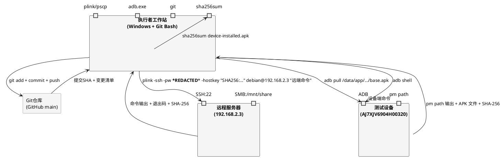
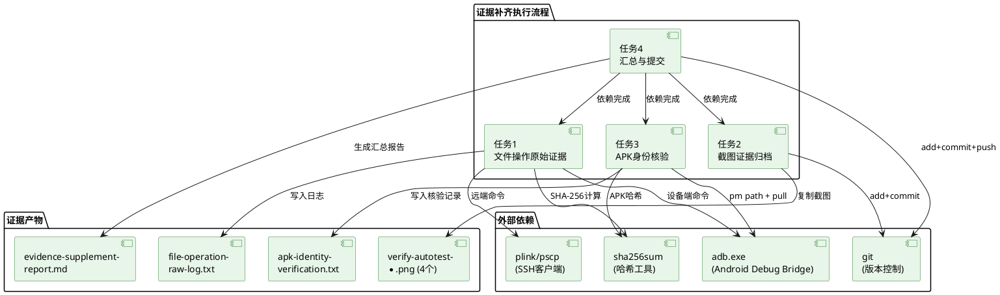
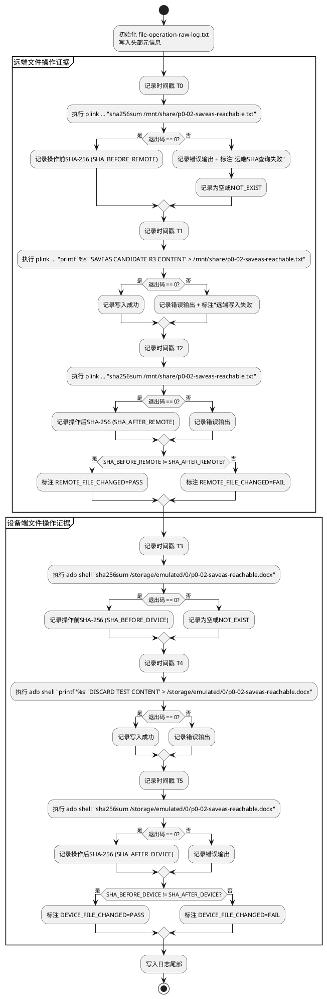
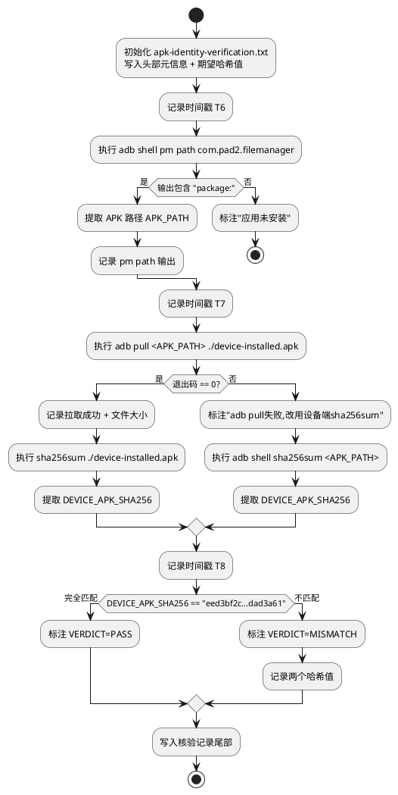
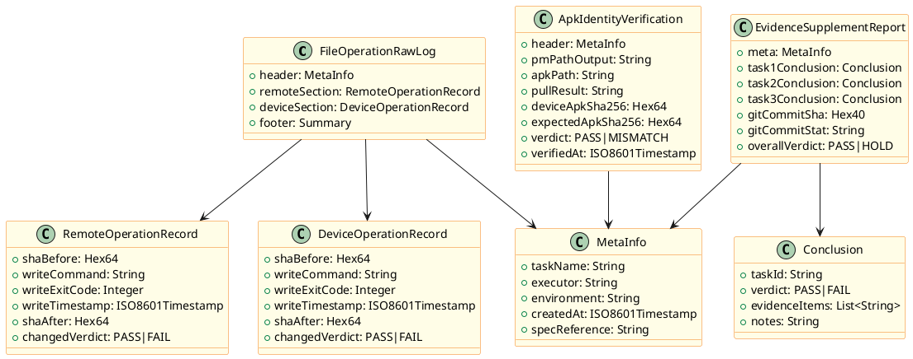

# P0-02 Final Gate 证据补齐实现方案（技术设计）

## 文档元数据

| 项目 | 值 |
|------|-----|
| 设计ID | P002-GATE-EVIDENCE-DESIGN |
| 关联规格 | `docs/p0-02-r3/evidence-supplement-spec.md` |
| 关联Gate | P0-02 Final Gate 第五次PM复审 |
| 基线提交 | 7e81fa9 (代码修复), dfbb5f2 (补验报告) |
| PM裁定 | HOLD — 要求补齐三项证据 |
| 仓库 | https://github.com/wujupeng/andriodpad2.git (main) |
| 文档版本 | v1.0 |
| 创建日期 | 2026-10-19 |
| 设计性质 | 证据收集与归档（非代码开发） |

---

# 一、需求与存量功能关系分析

## 1.1 需求功能与存量功能对比

### 1.1.1 已实现功能

本需求为证据补齐任务，不涉及源代码功能开发。存量代码功能（SmbPlugin、M2VerificationPage）保持不变，仅对现有证据产物进行盘点。

| 需求功能 | 存量功能 | 代码位置 | 匹配度 |
|---------|---------|---------|--------|
| 测试报告截图引用可解析 | test-report.md 已引用 8 个截图文件名 | `docs/p0-02-r3/test-report.md:366-369,573-575,654` | 75% |
| evidence 目录已建立 | evidence/ 目录存在，含 real-interaction 子目录 | `docs/p0-02-r3/evidence/` | 50% |
| real-interaction 截图已归档 | 8 个 screenshot_*.png 已 git 追踪 | `docs/p0-02-r3/evidence/real-interaction/*.png` | 100% |
| 现有执行日志存在 | execution-log.md 记录 CDP 调用链路 | `docs/p0-02-r3/execution-log.md` | 25% |
| 设备与远程环境已就绪 | 设备 AJ7XJV6904H00320 已连接，远程 192.168.2.3 可达 | 运行时环境 | 100% |

**匹配度判定依据**：
- **75%**：test-report.md 引用了 `verify-autotest-*.png` 系列 4 个文件名，但其中 0 个已归档到 evidence/ 根目录（仅 real-interaction/ 子目录有 `screenshot_*.png` 命名的文件），引用与归档未对齐。
- **50%**：evidence/ 目录存在但缺少规格要求的 `file-operation-raw-log.txt`、`apk-identity-verification.txt` 和 `verify-autotest-*.png` 三个关键证据文件。
- **25%**：execution-log.md 记录的是 CDP WebSocket 调用日志（`SmbPlugin.connect(...)` 等方法调用），非 PM 要求的 SSH/ADB shell 原始命令日志，缺少退出码、操作前后 SHA-256 对比。

### 1.1.2 需要扩展的功能

| 需求功能 | 存量功能 | 差异说明 | 扩展方向 |
|---------|---------|---------|---------|
| 远端文件操作原始命令日志 | execution-log.md 仅记录 CDP 方法调用 | 缺少 `ssh debian@192.168.2.3 "printf ... > /mnt/share/..."` 形式的真实 shell 命令、退出码、操作前后 SHA-256 | 新增 `evidence/file-operation-raw-log.txt`，通过 plink 执行真实远端命令并捕获输出 |
| 设备端文件操作原始命令日志 | execution-log.md 仅记录 `adb shell: echo ...` 摘要 | 缺少完整 `adb shell "printf ... > /storage/...` 命令全文、退出码、操作前后 SHA-256 | 同上文件追加设备端段落，通过 adb shell 执行并捕获 |
| verify-autotest 截图归档 | 截图仅存在于本机根目录，未提交 git | 5 个 `verify-autotest-*.png` 在工作区根目录（未追踪），evidence/ 目录无这些文件 | 复制到 `evidence/` 目录并 `git add` 提交 |
| APK 设备安装哈希独立核验 | execution-log.md 记录构建时哈希 `5e543609...` | 未从设备实际拉取已安装 APK 计算 SHA-256，期望值 `eed3bf2c...dad3a61` 未核验 | 新增 `evidence/apk-identity-verification.txt`，通过 `pm path` + `adb pull` + `sha256sum` 独立核验 |
| 证据补齐汇总报告 | 无 | 缺少汇总三项证据闭环结论的 Markdown 文档 | 新增 `evidence-supplement-report.md` |

### 1.1.3 需要新增的功能或接口

本任务不新增软件功能接口。新增的"功能"为证据收集操作流程（命令级别），按业务模块分组如下：

**模块A：远端文件操作证据收集**
- 功能点A1：通过 plink 执行远端 SHA-256 查询（操作前）
- 功能点A2：通过 plink 执行远端文件写入（重定向在 SSH 引号内）
- 功能点A3：通过 plink 执行远端 SHA-256 查询（操作后）
- 依赖：远程服务器 192.168.2.3 SSH 可达、SMB 共享 `/mnt/share` 可写

**模块B：设备端文件操作证据收集**
- 功能点B1：通过 adb shell 执行设备端 SHA-256 查询（操作前）
- 功能点B2：通过 adb shell 执行设备端文件写入（重定向在 ADB 引号内）
- 功能点B3：通过 adb shell 执行设备端 SHA-256 查询（操作后）
- 依赖：设备 AJ7XJV6904H00320 已连接并授权 USB 调试

**模块C：截图证据归档**
- 功能点C1：将本机根目录 5 个 `verify-autotest-*.png` 复制到 `evidence/` 目录
- 功能点C2：处理 `verify-autotest-panel-visible.png` 缺失（用现有截图替代或说明）
- 功能点C3：`git add` + `git commit` 提交截图到仓库
- 依赖：本机根目录截图文件存在、git 仓库可写

**模块D：APK 身份核验**
- 功能点D1：`adb shell pm path com.pad2.filemanager` 获取设备 APK 路径
- 功能点D2：`adb pull` 拉取 APK 到本机临时目录
- 功能点D3：本机 `sha256sum` 计算 APK 哈希（备选：设备端 `sha256sum`）
- 功能点D4：与期望值 `eed3bf2c...dad3a61` 逐字符比对
- 依赖：设备已安装 com.pad2.filemanager 应用

**模块E：证据归档与提交**
- 功能点E1：生成 `evidence-supplement-report.md` 汇总报告
- 功能点E2：`git add` 全部证据文件 + `git commit` + `git push`
- 依赖：模块A-D 证据收集完成

## 1.2 存量功能详细分析

### 1.2.1 现有 execution-log.md 分析

**接口契约**：
- 输入：CDP WebSocket 调用 SmbPlugin 方法
- 输出：时间戳 + 方法调用 + JSON 结果的表格记录
- 异常：未记录 shell 退出码
- 副作用：无独立证据文件产出

**业务规则**：
- 记录 CDP 方法调用链路（connect → openInWps → checkLocalFileChanged → writeback）
- 时间戳采用 UTC 毫秒精度（如 `2026-10-19T01:38:17.835Z`）
- APK 哈希记录为构建时值 `5e543609...`，非设备安装值

**约束**：
- 仅记录 CDP 调用，不记录底层 SSH/ADB 命令
- 不满足 PM 对"原始执行命令、退出码、操作前后 SHA-256"的要求
- 本设计不修改此文件，仅新增独立的原始日志文件

### 1.2.2 现有 evidence/real-interaction/ 截图分析

**接口契约**：
- 输入：adb screencap 截图
- 输出：8 个 `screenshot_*.png` 文件
- 归档状态：已 git 追踪并提交

**业务规则**：
- 文件名采用 `screenshot_<状态>.png` 命名规范
- 与 test-report.md 中 `screenshot_wps_open.png` 等 4 个引用匹配
- 不覆盖 `verify-autotest-*.png` 系列引用

**约束**：
- test-report.md 同时引用两套截图命名（`screenshot_*` 和 `verify-autotest_*`）
- `verify-autotest_*` 系列截图仅存在于本机根目录，未归档
- 本设计需将 `verify-autotest_*` 系列复制到 `evidence/` 并提交

### 1.2.3 现有 test-report.md 截图引用分析

**引用清单**（共 8 处）：

| 行号 | 引用文件名 | 本机根目录存在 | evidence/ 存在 | git 追踪 |
|------|-----------|--------------|---------------|---------|
| 366 | `screenshot_wps_open.png` | 否 | 是 (real-interaction/) | 是 |
| 367 | `screenshot_wps_edited.png` | 否 | 是 (real-interaction/) | 是 |
| 368 | `screenshot_after_saveas.png` | 否 | 是 (real-interaction/) | 是 |
| 369 | `screenshot_after_cancel.png` | 否 | 是 (real-interaction/) | 是 |
| 573 | `verify-autotest-before-saveas.png` | 是 | 否 | 否 |
| 574 | `verify-autotest-saveas-detected.png` | 是 | 否 | 否 |
| 575 | `verify-autotest-after-overwrite.png` | 是 | 否 | 否 |
| 654 | `verify-autotest-after-discard.png` | 是 | 否 | 否 |

**结论**：`screenshot_*` 系列 4 个引用已闭环；`verify-autotest_*` 系列 4 个引用未归档，为本任务重点。

### 1.2.4 APK 哈希差异分析

| 来源 | SHA-256 | 说明 |
|------|---------|------|
| execution-log.md 记录 | `5e54360978399895b279f8b01217cf3275654b1b4f0911ffb808fdaa44cd95dc` | 构建时 APK 哈希 |
| 期望值（规格要求） | `eed3bf2cbf1b182b4dca93bd188d8d10a65eee5daf0ce0f248fd29cb7dad3a61` | PM 指定核验目标 |

**约束**：两值不同，需从设备实际安装 APK 独立计算哈希并与期望值比对，以设备安装值为准。

---
# 二、增量设计方案

## 2.1 实现模型

### 2.1.1 上下文视图



**通信协议与调用频率**：
- plink SSH：单次会话执行 3 条远端命令（操作前 sha256sum + 写入 + 操作后 sha256sum）
- adb shell：单次会话执行 3 条设备端命令 + 1 条 pm path + 1 条 adb pull
- git：1 次 add + 1 次 commit + 1 次 push

### 2.1.2 服务/组件总体架构



**模块划分与职责**：
- **任务1（T1）**：通过 SSH/ADB 执行真实文件操作命令，捕获命令全文、退出码、时间戳、操作前后 SHA-256，写入 `file-operation-raw-log.txt`
- **任务2（T2）**：将本机根目录 4 个 `verify-autotest-*.png` 复制到 `evidence/` 目录
- **任务3（T3）**：从设备提取已安装 APK，计算 SHA-256，与期望值比对，写入 `apk-identity-verification.txt`
- **任务4（T4）**：汇总三项证据结论，生成 `evidence-supplement-report.md`，执行 git 提交推送

### 2.1.3 实现设计文档

#### 任务1 流程分支设计



#### 任务3 APK核验流程设计



## 2.2 接口设计

### 2.2.1 总体设计

本设计不涉及软件接口（API/函数签名），接口表现为**命令行调用契约**。所有命令分为三类：

| 接口分类 | 调用方式 | 稳定性 | 超时 |
|---------|---------|--------|------|
| 远端命令（SSH） | plink -ssh -pw ***REDACTED*** -hostkey "..." debian@192.168.2.3 "命令" | 稳定 | 30秒 |
| 设备命令（ADB） | adb shell "命令" 或 adb pull/push | 稳定 | 30秒 |
| 本地命令 | sha256sum / git / cp | 稳定 | 5秒 |

**接口变更策略**：本设计为一次性证据收集操作，无版本演进需求。

### 2.2.2 接口清单

#### 接口组1：远端文件操作命令（SSH via plink）

**公共参数**：
```
PLINK_BASE="plink -ssh -pw ***REDACTED*** -hostkey \"SHA256:MFMAP0xIKVj+SQYyhEVXoCHiBRdmthh5dyoqC7rNgPY\" debian@192.168.2.3"
```

**命令1.1：远端操作前 SHA-256 查询**
- 签名：`plink ... "sha256sum /mnt/share/p0-02-saveas-reachable.txt"`
- 业务说明：查询远端 SMB 共享文件操作前的 SHA-256 哈希值
- 前置条件：SSH 连接可达，文件可能存在也可能不存在
- 后置条件：输出 `<64位hex>  <文件路径>` 或 `sha256sum: ...: No such file` + 退出码非0
- 异常映射：退出码=1 文件不存在；退出码=255 SSH连接失败

**命令1.2：远端文件写入**
- 签名：`plink ... "printf '%s' 'SAVEAS CANDIDATE R3 CONTENT' > /mnt/share/p0-02-saveas-reachable.txt"`
- 业务说明：通过远端 shell 重定向写入文件（`>` 在 SSH 引号内，由远端 shell 处理）
- 前置条件：SSH 连接可达，`/mnt/share` 可写
- 后置条件：文件内容更新，退出码=0
- 异常映射：退出码非0 写入失败；禁止 `plink ... echo '...' > /remote/path` 形式

**命令1.3：远端操作后 SHA-256 查询**
- 签名：同命令1.1
- 业务说明：查询写入后的 SHA-256，与操作前比对证明文件已变化

#### 接口组2：设备端文件操作命令（ADB shell）

**公共参数**：
```
ADB="C:\Program Files (x86)\Android\android-sdk\platform-tools\adb.exe"
ADB_BASE="adb -s AJ7XJV6904H00320 shell"
```

**命令2.1：设备端操作前 SHA-256 查询**
- 签名：`adb -s AJ7XJV6904H00320 shell "sha256sum /storage/emulated/0/p0-02-saveas-reachable.docx"`
- 业务说明：查询设备文件操作前的 SHA-256
- 前置条件：设备已连接并授权
- 后置条件：输出哈希值或文件不存在错误

**命令2.2：设备端文件写入**
- 签名：`adb -s AJ7XJV6904H00320 shell "printf '%s' 'DISCARD TEST CONTENT' > /storage/emulated/0/p0-02-saveas-reachable.docx"`
- 业务说明：通过设备 shell 重定向写入文件（`>` 在 ADB 引号内，由设备 shell 处理）
- 前置条件：设备已连接，`/storage/emulated/0/` 可写
- 后置条件：文件内容更新，退出码=0
- 异常映射：退出码非0 写入失败；禁止 `adb shell echo '...' > /device/path` 形式

**命令2.3：设备端操作后 SHA-256 查询**
- 签名：同命令2.1

#### 接口组3：APK 身份核验命令

**命令3.1：获取设备 APK 路径**
- 签名：`adb -s AJ7XJV6904H00320 shell pm path com.pad2.filemanager`
- 业务说明：查询已安装应用 APK 在设备上的路径
- 前置条件：设备已连接，应用已安装
- 后置条件：输出 `package:/data/app/.../base.apk` 或空
- 异常映射：输出为空 应用未安装

**命令3.2：拉取 APK 到本机**
- 签名：`adb -s AJ7XJV6904H00320 pull /data/app/.../base.apk ./device-installed.apk`
- 业务说明：从设备拉取 APK 文件到本机临时目录
- 前置条件：命令3.1 成功返回路径
- 后置条件：本机生成 `device-installed.apk` 文件
- 异常映射：退出码非0 权限不足，改用命令3.3备选

**命令3.3（备选）：设备端直接计算哈希**
- 签名：`adb -s AJ7XJV6904H00320 shell sha256sum /data/app/.../base.apk`
- 业务说明：当 adb pull 失败时，在设备端直接计算 APK 哈希
- 前置条件：设备 shell 支持 sha256sum 命令

**命令3.4：本机计算 APK SHA-256**
- 签名：`sha256sum ./device-installed.apk`
- 业务说明：计算本机拉取的 APK 文件 SHA-256
- 前置条件：命令3.2 成功

#### 接口组4：截图归档命令

**命令4.1：复制截图到 evidence 目录**
- 签名：`cp verify-autotest-after-overwrite.png docs/p0-02-r3/evidence/` （对4个文件分别执行）
- 业务说明：将本机根目录的 `verify-autotest-*.png` 复制到证据归档目录
- 前置条件：本机根目录存在源文件
- 后置条件：`evidence/` 目录出现同名文件

**命令4.2：处理 panel-visible 截图缺失**
- 签名：`cp verify-autotest-saveas-detected.png docs/p0-02-r3/evidence/verify-autotest-panel-visible.png`
- 业务说明：规格 E13 要求 `verify-autotest-panel-visible.png`，本机无此文件；`verify-autotest-saveas-detected.png` 记录了按钮可见状态（saveas 检测面板出现），作为最接近的替代
- 前置条件：`verify-autotest-saveas-detected.png` 存在
- 后置条件：`evidence/verify-autotest-panel-visible.png` 存在并在提交说明中标注替代关系

#### 接口组5：Git 提交命令

**命令5.1：添加证据文件**
- 签名：`git add docs/p0-02-r3/evidence/file-operation-raw-log.txt docs/p0-02-r3/evidence/apk-identity-verification.txt docs/p0-02-r3/evidence/verify-autotest-*.png docs/p0-02-r3/evidence-supplement-report.md docs/p0-02-r3/evidence-supplement-design.md docs/p0-02-r3/evidence-supplement-spec.md`
- 业务说明：将全部证据产物加入暂存区

**命令5.2：提交**
- 签名：`git commit -m "docs(P0-02): 补齐Final Gate三项证据 - 原始执行日志+截图归档+APK哈希核验"`
- 业务说明：创建证据补齐提交

**命令5.3：推送**
- 签名：`git push origin main`
- 业务说明：推送到远程仓库

## 2.3 数据模型

### 2.3.1 设计目标

1. **支持的业务场景**：PM 审查证据时可从单一提交中获取全部三项证据闭环材料
2. **性能目标**：证据文件为文本/PNG，体积小（<1MB），无性能约束
3. **扩展性目标**：证据目录结构可复用于后续 Gate 复审
4. **兼容策略**：不修改现有 evidence/real-interaction/ 已提交文件，仅新增文件

### 2.3.2 模型实现

#### 证据文件类图



**对象生命周期**：
- `FileOperationRawLog`：任务1执行时创建，git 提交后固化，只读
- `ApkIdentityVerification`：任务3执行时创建，git 提交后固化，只读
- `EvidenceSupplementReport`：任务1-3全部完成后创建，git 提交后固化，只读

**持久化策略**：全部证据文件以纯文本/PNG 形式存储于 git 仓库，无数据库依赖。

### 2.3.3 证据归档目录结构

```
docs/p0-02-r3/
├── evidence/
│   ├── real-interaction/                    # [已有] 补验1真实交互截图
│   │   ├── screenshot_wps_open.png          # [已追踪]
│   │   ├── screenshot_wps_edited.png        # [已追踪]
│   │   ├── screenshot_after_saveas.png      # [已追踪]
│   │   ├── screenshot_after_cancel.png     # [已追踪]
│   │   ├── screenshot_after_overwrite.png   # [已追踪]
│   │   ├── screenshot_after_tap_check.png   # [已追踪]
│   │   ├── screenshot_panel_visible.png     # [已追踪]
│   │   ├── real-interaction-results.json    # [已追踪]
│   │   └── ui-click-verification.json       # [已追踪]
│   ├── file-operation-raw-log.txt           # [新增] E1-E10 文件操作原始执行日志
│   ├── apk-identity-verification.txt        # [新增] E14-E18 APK身份核验记录
│   ├── verify-autotest-before-saveas.png    # [新增] 点击另存为前
│   ├── verify-autotest-saveas-detected.png  # [新增] 候选文件发现后
│   ├── verify-autotest-after-overwrite.png  # [新增] E11 覆盖原文件后
│   ├── verify-autotest-after-discard.png    # [新增] E12 放弃关联后
│   └── verify-autotest-panel-visible.png    # [新增] E13 按钮可见(由saveas-detected替代)
├── evidence-supplement-spec.md              # [新增] 需求规格
├── evidence-supplement-design.md            # [新增] 本实现方案
├── evidence-supplement-report.md            # [新增] E19-E20 证据补齐汇总报告
├── test-report.md                           # [已有] 现有测试报告
├── execution-log.md                         # [已有] CDP执行日志(不修改)
├── spec.md                                  # [已有] 原始规格
├── design.md                                # [已有] 原始设计
└── tasks.md                                 # [已有] 原始任务
```

## 2.4 执行步骤详述

### 2.4.1 任务1：远端与设备文件操作原始执行证据

**步骤1.0：初始化日志文件**

创建 `docs/p0-02-r3/evidence/file-operation-raw-log.txt`，写入头部：
```
============================================================
P0-02 Final Gate 证据补齐 - 文件操作原始执行日志
============================================================
任务: 任务1 - 远端与设备文件操作原始执行证据
执行者: 证据补齐脚本
执行环境: Windows + plink + adb
规格引用: docs/p0-02-r3/evidence-supplement-spec.md 5.1
创建时间: <ISO8601时间戳，UTC+8>
============================================================

--- 远端文件操作 (SSH → 192.168.2.3) ---
```

**步骤1.1：远端操作前 SHA-256**

执行命令（Git Bash 下，需 `MSYS_NO_PATHCONV=1` 防止路径转译）：
```bash
MSYS_NO_PATHCONV=1 plink -ssh -pw ***REDACTED*** -hostkey "SHA256:MFMAP0xIKVj+SQYyhEVXoCHiBRdmthh5dyoqC7rNgPY" debian@192.168.2.3 "sha256sum /mnt/share/p0-02-saveas-reachable.txt"
```
记录到日志：
```
[时间戳 T0] 命令: sha256sum /mnt/share/p0-02-saveas-reachable.txt
[时间戳 T0] 退出码: <code>
[时间戳 T0] 输出: <stdout+stderr>
[时间戳 T0] 操作前SHA-256(SHA_BEFORE_REMOTE): <64位hex 或 NOT_EXIST>
```

**步骤1.2：远端文件写入**

执行命令：
```bash
MSYS_NO_PATHCONV=1 plink -ssh -pw ***REDACTED*** -hostkey "SHA256:MFMAP0xIKVj+SQYyhEVXoCHiBRdmthh5dyoqC7rNgPY" debian@192.168.2.3 "printf '%s' 'SAVEAS CANDIDATE R3 CONTENT' > /mnt/share/p0-02-saveas-reachable.txt"
```
记录到日志：
```
[时间戳 T1] 命令: printf '%s' 'SAVEAS CANDIDATE R3 CONTENT' > /mnt/share/p0-02-saveas-reachable.txt
[时间戳 T1] 退出码: <code>
[时间戳 T1] 输出: <stdout+stderr>
```

**步骤1.3：远端操作后 SHA-256**

同步骤1.1，记录为 `SHA_AFTER_REMOTE`。比对：
```
[比对] SHA_BEFORE_REMOTE != SHA_AFTER_REMOTE → REMOTE_FILE_CHANGED=<PASS|FAIL>
```

**步骤1.4：设备端操作前 SHA-256**

执行命令：
```bash
MSYS_NO_PATHCONV=1 adb -s AJ7XJV6904H00320 shell "sha256sum /storage/emulated/0/p0-02-saveas-reachable.docx"
```
记录到日志（设备端段落）。

**步骤1.5：设备端文件写入**

执行命令：
```bash
MSYS_NO_PATHCONV=1 adb -s AJ7XJV6904H00320 shell "printf '%s' 'DISCARD TEST CONTENT' > /storage/emulated/0/p0-02-saveas-reachable.docx"
```

**步骤1.6：设备端操作后 SHA-256**

同步骤1.4，记录为 `SHA_AFTER_DEVICE`，比对 `DEVICE_FILE_CHANGED`。

**步骤1.7：写入日志尾部汇总**
```
--- 汇总 ---
远端文件变化: <PASS|FAIL> (SHA_BEFORE=<前8位>... SHA_AFTER=<前8位>...)
设备文件变化: <PASS|FAIL> (SHA_BEFORE=<前8位>... SHA_AFTER=<前8位>...)
重定向位置核验: 所有 > 均在 SSH/ADB 引号内部 ✓
任务1结论: <PASS|FAIL>
```

### 2.4.2 任务2：截图证据归档

**步骤2.1：复制截图文件**

执行命令（4个文件 + 1个替代）：
```bash
cp verify-autotest-before-saveas.png docs/p0-02-r3/evidence/
cp verify-autotest-saveas-detected.png docs/p0-02-r3/evidence/
cp verify-autotest-after-overwrite.png docs/p0-02-r3/evidence/
cp verify-autotest-after-discard.png docs/p0-02-r3/evidence/
# E13 panel-visible 替代：用 saveas-detected 作为按钮可见状态截图
cp verify-autotest-saveas-detected.png docs/p0-02-r3/evidence/verify-autotest-panel-visible.png
```

**步骤2.2：验证文件名与报告引用一致**

遍历 test-report.md 中 8 处 `.png` 引用，逐一确认 `evidence/` 或 `evidence/real-interaction/` 中存在同名文件。

**步骤2.3：验证截图覆盖状态**

| 规格要求 | 归档文件 | 来源 |
|---------|---------|------|
| after-overwrite | `verify-autotest-after-overwrite.png` | 本机根目录 |
| after-discard | `verify-autotest-after-discard.png` | 本机根目录 |
| panel-visible | `verify-autotest-panel-visible.png` | `verify-autotest-saveas-detected.png` 替代 |

### 2.4.3 任务3：APK 身份核验

**步骤3.0：初始化核验记录文件**

创建 `docs/p0-02-r3/evidence/apk-identity-verification.txt`，写入头部：
```
============================================================
P0-02 Final Gate 证据补齐 - APK身份核验记录
============================================================
任务: 任务3 - APK身份核验
执行环境: adb + sha256sum
期望APK SHA-256: eed3bf2cbf1b182b4dca93bd188d8d10a65eee5daf0ce0f248fd29cb7dad3a61
规格引用: docs/p0-02-r3/evidence-supplement-spec.md 5.3
创建时间: <ISO8601时间戳，UTC+8>
============================================================
```

**步骤3.1：获取设备 APK 路径**

执行命令：
```bash
MSYS_NO_PATHCONV=1 adb -s AJ7XJV6904H00320 shell pm path com.pad2.filemanager
```
记录：
```
[时间戳 T6] 命令: pm path com.pad2.filemanager
[时间戳 T6] 退出码: <code>
[时间戳 T6] 输出: <package:/data/app/.../base.apk>
[时间戳 T6] 提取APK路径: <APK_PATH>
```

**步骤3.2：拉取 APK 到本机**

执行命令：
```bash
MSYS_NO_PATHCONV=1 adb -s AJ7XJV6904H00320 pull <APK_PATH> ./device-installed.apk
```
记录拉取结果。若失败，执行备选：
```bash
MSYS_NO_PATHCONV=1 adb -s AJ7XJV6904H00320 shell sha256sum <APK_PATH>
```

**步骤3.3：计算 APK SHA-256**

若 pull 成功：
```bash
sha256sum ./device-installed.apk
```
记录：
```
[时间戳 T8] 命令: sha256sum ./device-installed.apk
[时间戳 T8] 输出: <64位hex>  ./device-installed.apk
[时间戳 T8] 设备APK SHA-256(DEVICE_APK_SHA256): <64位hex>
```

**步骤3.4：哈希比对**

```
[比对]
设备APK SHA-256:  <DEVICE_APK_SHA256>
期望APK SHA-256:  eed3bf2cbf1b182b4dca93bd188d8d10a65eee5daf0ce0f248fd29cb7dad3a61
比对结论(VERDICT): <PASS|MISMATCH>
核验时间: <ISO8601时间戳>
```

**步骤3.5：清理临时文件**
```bash
rm -f ./device-installed.apk
```

### 2.4.4 任务4：证据汇总与 Git 提交

**步骤4.1：生成汇总报告**

创建 `docs/p0-02-r3/evidence-supplement-report.md`，内容包含：
- 三项任务结论汇总表
- Git 提交 SHA（提交后回填）
- Git 提交变更清单（`git show --stat` 输出）
- 证据项清单对照表（E1-E20 逐项标注 PASS/FAIL）

**步骤4.2：Git 添加证据文件**

```bash
git add docs/p0-02-r3/evidence/file-operation-raw-log.txt
git add docs/p0-02-r3/evidence/apk-identity-verification.txt
git add docs/p0-02-r3/evidence/verify-autotest-before-saveas.png
git add docs/p0-02-r3/evidence/verify-autotest-saveas-detected.png
git add docs/p0-02-r3/evidence/verify-autotest-after-overwrite.png
git add docs/p0-02-r3/evidence/verify-autotest-after-discard.png
git add docs/p0-02-r3/evidence/verify-autotest-panel-visible.png
git add docs/p0-02-r3/evidence-supplement-spec.md
git add docs/p0-02-r3/evidence-supplement-design.md
git add docs/p0-02-r3/evidence-supplement-report.md
```

**步骤4.3：Git 提交**

```bash
git commit -m "docs(P0-02): 补齐Final Gate三项证据 - 原始执行日志+截图归档+APK哈希核验"
```

**步骤4.4：回填提交 SHA 到汇总报告**

```bash
COMMIT_SHA=$(git rev-parse HEAD)
# 编辑 evidence-supplement-report.md 写入 COMMIT_SHA 和 git show --stat 输出
git add docs/p0-02-r3/evidence-supplement-report.md
git commit --amend --no-edit
```

**步骤4.5：Git 推送**

```bash
git push origin main
```

**步骤4.6：验证提交变更清单**

```bash
git show --stat HEAD
```
确认变更清单包含：
- `docs/p0-02-r3/evidence/file-operation-raw-log.txt`（新增）
- `docs/p0-02-r3/evidence/apk-identity-verification.txt`（新增）
- 5 个 `verify-autotest-*.png`（新增）
- `docs/p0-02-r3/evidence-supplement-report.md`（新增）
- `docs/p0-02-r3/evidence-supplement-design.md`（新增）
- `docs/p0-02-r3/evidence-supplement-spec.md`（新增）

## 2.5 异常处理设计

| 异常场景 | 检测方式 | 处理策略 |
|---------|---------|---------|
| SSH 连接失败 | plink 退出码=255 | 记录错误输出，标注"SSH连接失败"，任务1远端部分标注FAIL，继续执行设备端部分 |
| ADB 设备未连接 | adb 返回 "device not found" | 记录错误，任务1设备端部分+任务3标注FAIL |
| 远端文件不存在 | sha256sum 退出码=1 | 记录 SHA_BEFORE=NOT_EXIST，继续执行写入 |
| adb pull 权限不足 | adb pull 退出码非0 | 自动切换备选方案：`adb shell sha256sum` 设备端计算 |
| APK 哈希不匹配 | DEVICE_APK_SHA256 ≠ 期望值 | 记录 MISMATCH，标注需重新安装，任务3标注FAIL |
| panel-visible 截图缺失 | 文件不存在 | 用 `verify-autotest-saveas-detected.png` 替代并在报告中标注 |
| git push 失败 | push 退出码非0 | 记录错误，提示检查网络/权限，证据已本地提交 |

## 2.6 设计决策记录

| 决策 | 选项 | 选择 | 理由 |
|------|------|------|------|
| SSH 客户端 | plink / ssh / pscp | plink | Windows 环境下 PuTTY 套件原生支持 -pw 和 -hostkey 参数 |
| 时间戳格式 | Unix epoch / ISO8601 | ISO8601+08:00 | 规格要求标注时区，ISO8601 可读性好 |
| panel-visible 替代 | 跳过 / 用 saveas-detected 替代 | 替代 | saveas-detected 记录了另存为检测面板出现状态，最接近"按钮可见"语义 |
| APK 哈希计算位置 | 本机 / 设备端 | 本机优先，设备端备选 | adb pull 后本机 sha256sum 更可靠；权限不足时设备端 sha256sum 兜底 |
| 日志文件格式 | JSON / 纯文本 | 纯文本 | PM 审查可读性优先，文本格式直接可读 |
| 提交策略 | 单次提交 / 多次提交 | 单次提交 | 三项证据为整体闭环，单次提交便于 PM 审查变更清单 |

## 2.7 验收对照

| 规格验收项 | 设计对应 | 达成方式 |
|-----------|---------|---------|
| EV-01 远端命令全文+退出码+时间戳 | 步骤1.1-1.3 | plink 执行并记录到 file-operation-raw-log.txt |
| EV-02 设备端命令全文+退出码+时间戳 | 步骤1.4-1.6 | adb shell 执行并记录到 file-operation-raw-log.txt |
| EV-03 操作前后 SHA-256 | 步骤1.1/1.3/1.4/1.6 | 操作前后各执行 sha256sum 并比对 |
| EV-04 重定向符在引号内 | 步骤1.2/1.5 | 命令设计中 `>` 均在 SSH/ADB 双引号内 |
| EV-05 截图提交到 Git | 步骤4.2-4.3 | git add + commit 包含所有 PNG |
| EV-06 报告引用文件名一致 | 步骤2.2 | 复制时保持原文件名 |
| EV-07 三种状态截图覆盖 | 步骤2.3 | after-overwrite + after-discard + panel-visible |
| EV-08 设备 APK 提取+SHA-256 | 步骤3.1-3.3 | pm path + adb pull + sha256sum |
| EV-09 哈希逐字符比对 | 步骤3.4 | 64位hex 完全匹配比对 |
| EV-10 核验时间戳 | 步骤3.0/3.4 | ISO8601 时间戳记录 |

---