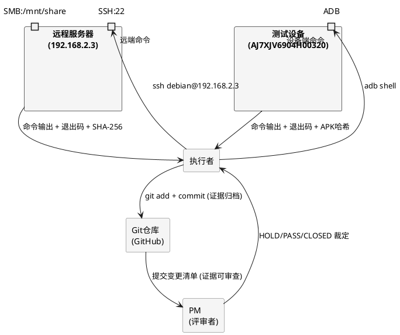
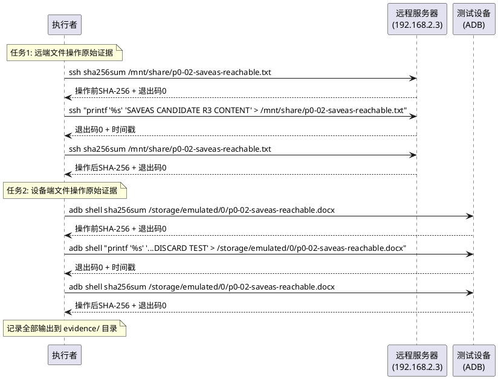
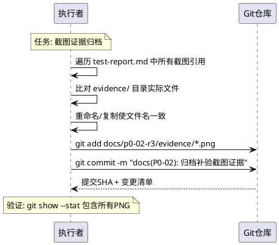
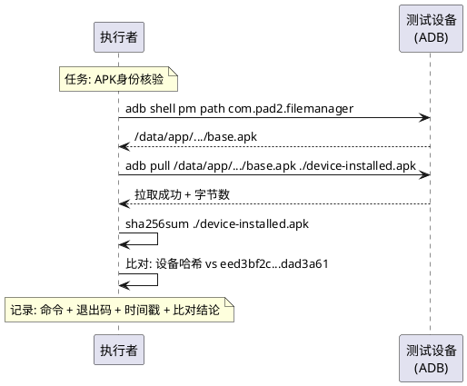

# P0-02 Final Gate 证据补齐需求规格

## 文档元数据

| 项目 | 值 |
|------|-----|
| 规格ID | P002-GATE-EVIDENCE |
| 关联Gate | P0-02 Final Gate 第五次PM复审 |
| 基线提交 | 7e81fa9 (代码修复), dfbb5f2 (补验报告) |
| PM裁定 | HOLD — 要求补齐三项证据 |
| 仓库 | https://github.com/wujupeng/andriodpad2.git (main) |
| 文档版本 | v1.0 |
| 创建日期 | 2026-10-19 |

---

# **1. 组件定位**

## **1.1 核心职责**
本组件负责补齐 P0-02 Final Gate 第五次PM复审要求的三项最小证据，实现证据链完整闭环以支持PM放行裁定。

## **1.2 核心输入**
1. PM第五次复审意见：明确三项证据缺口（文件操作原始日志、截图归档、APK哈希核验）
2. 现有测试报告：`docs/p0-02-r3/test-report.md`（提交 dfbb5f2）
3. 远程编译服务器：192.168.2.3 (debian/***REDACTED***)，SMB共享挂载路径 `/mnt/share`
4. 测试设备：HONOR NDL2_W09, serial AJ7XJV6904H00320, Android 16, API 36
5. ADB路径：`C:\Program Files (x86)\Android\android-sdk\platform-tools\adb.exe`
6. 期望APK SHA-256：`eed3bf2cbf1b182b4dca93bd188d8d10a65eee5daf0ce0f248fd29cb7dad3a61`

## **1.3 核心输出**
1. 原始执行日志文件：包含命令全文、退出码、时间戳、SHA-256输出的文本证据
2. 归档截图文件：提交到Git仓库的PNG截图，文件名与报告引用一致
3. APK身份核验记录：设备安装APK的实际SHA-256与期望值的比对结果
4. 证据补齐报告：汇总三项证据闭环结论的Markdown文档

## **1.4 职责边界**
本组件 **不负责** 以下事项：
1. 不修改 `SmbPlugin.ts` 或 `M2VerificationPage.tsx` 源代码
2. 不重做全部五项补验（仅补齐三项证据缺口）
3. 不扩大验收范围（不新增验收项）
4. 不生成 design.md 或 tasks.md（由其他agent负责）
5. 不执行任何代码实现或功能开发
6. 不将自动化UI测试标注为人工实测

---

# **2. 领域术语**

**原始执行日志**
: 包含实际执行的命令全文、shell退出码、执行时间戳和标准输出/标准错误的完整记录，用于证明文件操作确实在目标位置生效。

**远端文件操作**
: 通过SSH连接到远程服务器(192.168.2.3)并在远端shell中执行的文件写入命令，重定向符 `>` 由远端shell处理而非本机shell。

**设备端文件操作**
: 通过 `adb shell` 在Android设备shell中执行的文件写入命令，重定向符 `>` 由设备shell处理而非本机shell。

**SHA-256核验**
: 对文件内容计算SHA-256哈希值并与期望值进行逐字节比对的过程，用于证明文件身份一致性。

**证据归档**
: 将测试过程中产生的截图、日志等证据文件提交到Git仓库，使其可从提交变更清单中访问。

**EARS格式**
: Easy Approach to Requirements Syntax，一种结构化需求描述格式，使用WHEN/IF/WHILE/THEN/THE SYSTEM SHALL等关键字。

**APK身份核验**
: 从设备已安装应用中提取APK文件并计算其SHA-256，与构建产出的期望哈希值进行完整64位十六进制比对。

---

# **3. 角色与边界**

## **3.1 核心角色**
- **PM（评审者）**：裁定证据是否充分，发出HOLD/PASS/CLOSED裁定
- **执行者（补充证据）**：收集原始执行日志、归档截图、核验APK哈希

## **3.2 外部系统**
- **远程编译服务器 (192.168.2.3)**：提供SSH访问和SMB共享，用于远端文件操作和SHA-256核验
- **测试设备 (AJ7XJV6904H00320)**：提供ADB shell访问，用于设备端文件操作和APK哈希提取
- **Git仓库 (GitHub)**：接收证据文件提交，提供变更清单可追溯性

## **3.3 交互上下文**



---

# **4. DFX约束**

## **4.1 性能**
1. **证据收集时效**：每项证据收集操作必须在5分钟内完成并记录时间戳
2. **SSH连接超时**：远端命令执行超时上限为30秒
3. **ADB命令超时**：设备端命令执行超时上限为30秒

## **4.2 可靠性**
1. **命令可复现**：所有记录的命令必须可在相同环境下重新执行并产生一致结果
2. **哈希完整性**：SHA-256值必须为完整64位十六进制字符串，禁止截断或省略
3. **时间戳一致性**：所有时间戳必须标注时区（UTC或UTC+8），且与实际执行时间吻合

## **4.3 安全性**
1. **SSH hostkey核验**：连接远程服务器时必须核验hostkey `SHA256:MFMAP0xIKVj+SQYyhEVXoCHiBRdmthh5dyoqC7rNgPY`
2. **凭证安全**：密码不得明文写入归档证据文件

## **4.4 可维护性**
1. **证据可追溯**：每条证据必须标注来源命令、执行时间、执行环境
2. **归档路径规范**：证据文件统一存放于 `docs/p0-02-r3/evidence/` 目录下

## **4.5 兼容性**
1. **截图文件名一致**：归档截图文件名必须与测试报告引用的文件名完全一致
2. **报告引用有效**：补齐后测试报告中所有截图引用必须指向仓库中实际存在的文件

---

# **5. 核心能力**

## **5.1 远端与设备文件操作原始执行证据补齐**

### **5.1.1 业务规则**

1. **远端文件写入必须使用明确远端执行方式**：远端文件操作必须通过SSH将完整命令（含重定向）作为远端shell命令执行，确保 `>` 由远端shell处理。
   a. 验收条件：[执行 `ssh debian@192.168.2.3 "printf '%s' 'CONTENT' > /mnt/share/p0-02-saveas-reachable.txt"`] → [退出码=0 且远端文件内容已更新]
2. **设备端文件写入必须使用明确设备端执行方式**：设备端文件操作必须通过 `adb shell` 将完整命令（含重定向）作为设备shell命令执行，确保 `>` 由设备shell处理。
   a. 验收条件：[执行 `adb shell "printf '%s' 'CONTENT' > /storage/emulated/0/p0-02-saveas-reachable.docx"`] → [退出码=0 且设备文件内容已更新]
3. **操作前后必须记录SHA-256**：每次文件写入操作前后必须分别计算并记录目标文件SHA-256，证明文件确实发生变化。
   a. 验收条件：[执行文件写入操作] → [操作前SHA-256 ≠ 操作后SHA-256 且两者均为完整64位十六进制]
4. **必须记录命令全文与退出码**：每条执行的命令必须完整记录命令字符串、shell退出码和执行时间戳。
   a. 验收条件：[查看原始执行日志] → [包含命令全文 + 退出码 + ISO8601时间戳 + 标准输出]
5. **禁止项**：禁止使用本机shell重定向方式执行远端或设备端文件写入（即禁止 `ssh echo '...' > /remote/path` 形式，因此形式下 `>` 由本机shell处理）。
   a. 验收条件：[检查命令记录] → [所有远端/设备写入命令的重定向符均在SSH/ADB引号内部]

### **5.1.2 交互流程**



### **5.1.3 异常场景**

1. **SSH连接失败**
   a. 触发条件：网络不可达或hostkey不匹配
   b. 系统行为：记录SSH错误输出和退出码255
   c. 用户感知：证据日志中标注"SSH连接失败"，需排查网络或hostkey
2. **ADB设备未连接**
   a. 触发条件：设备未连接或未授权USB调试
   b. 系统行为：记录ADB错误输出"device not found"
   c. 用户感知：证据日志中标注"设备未连接"，需检查USB连接
3. **文件写入权限不足**
   a. 触发条件：目标路径无写入权限
   b. 系统行为：记录shell错误输出"Permission denied"和退出码非0
   c. 用户感知：证据日志中标注"权限不足"，需检查路径权限

---

## **5.2 截图证据归档**

### **5.2.1 业务规则**

1. **报告引用的截图必须存在于仓库**：测试报告中引用的所有截图文件名必须对应仓库中实际存在的文件。
   a. 验收条件：[遍历test-report.md中所有截图引用] → [每个引用的文件均可在 `docs/p0-02-r3/evidence/` 中找到]
2. **截图必须包含在Git提交中**：归档截图必须通过 `git add` + `git commit` 提交到仓库，出现在提交变更清单中。
   a. 验收条件：[执行 `git show --stat <commit>`] → [变更清单包含所有截图PNG文件]
3. **必须覆盖关键验证状态截图**：至少包含以下状态的截图：覆盖成功后状态、放弃关联后状态、按钮可见状态。
   a. 验收条件：[检查归档截图清单] → [包含 after-overwrite、after-discard、panel-visible 对应截图]
4. **截图文件名必须与报告引用一致**：归档到仓库的截图文件名必须与test-report.md中引用的文件名完全匹配。
   a. 验收条件：[比对报告引用文件名与仓库实际文件名] → [完全一致，无大小写或扩展名差异]
5. **禁止项**：禁止仅本地存在但未提交到仓库的截图作为有效证据。
   a. 验收条件：[检查git status] → [无未提交的截图PNG文件]

### **5.2.2 交互流程**



### **5.2.3 异常场景**

1. **截图文件缺失**
   a. 触发条件：报告引用的截图在本地和仓库中均不存在
   b. 系统行为：记录缺失文件名清单
   c. 用户感知：需重新执行对应测试场景并截图
2. **文件名不匹配**
   a. 触发条件：报告引用 `verify-autotest-after-overwrite.png` 但实际文件名为 `screenshot_after_overwrite.png`
   b. 系统行为：执行文件重命名或更新报告引用使两者一致
   c. 用户感知：文件名已对齐，引用有效

---

## **5.3 APK身份核验**

### **5.3.1 业务规则**

1. **必须从设备提取已安装APK并计算SHA-256**：通过ADB从设备拉取已安装应用的APK文件，计算其SHA-256哈希值。
   a. 验收条件：[执行 `adb shell pm path com.pad2.filemanager` 获取APK路径 → `adb pull` 拉取 → `sha256sum` 计算] → [得到完整64位十六进制SHA-256]
2. **设备APK哈希必须与期望值逐字符比对**：设备安装APK的实际SHA-256必须与期望值 `eed3bf2cbf1b182b4dca93bd188d8d10a65eee5daf0ce0f248fd29cb7dad3a61` 完全一致。
   a. 验收条件：[设备APK SHA-256 == 期望SHA-256] → [64位十六进制完全匹配，比对结果为PASS]
3. **必须记录核验全过程的命令与输出**：APK路径获取、文件拉取、哈希计算的每步命令、退出码和输出必须完整记录。
   a. 验收条件：[查看APK核验日志] → [包含 pm path 输出 + adb pull 输出 + sha256sum 输出 + 比对结论]
4. **核验记录必须包含时间戳**：APK身份核验必须记录执行时间，证明核验针对当前设备当前安装状态。
   a. 验收条件：[查看核验日志] → [包含ISO8601格式时间戳]
5. **禁止项**：禁止仅引用构建时哈希而不独立核验设备安装APK的哈希。
   a. 验收条件：[检查核验记录] → [包含从设备实际拉取APK并计算的独立哈希值]

### **5.3.2 交互流程**



### **5.3.3 异常场景**

1. **应用未安装**
   a. 触发条件：`pm path` 返回空或错误
   b. 系统行为：记录错误输出，标注"应用未安装"
   c. 用户感知：需先安装APK再核验
2. **APK拉取失败**
   a. 触发条件：设备权限限制无法pull APK文件
   b. 系统行为：改用 `adb shell sha256sum` 在设备端直接计算哈希
   c. 用户感知：使用设备端sha256sum替代方案完成核验
3. **哈希不匹配&**
   a. 触发条件：设备APK SHA-256 ≠ 期望值
   b. 系统行为：记录两个哈希值并标注MISMATCH
   c. 用户感知：需重新安装正确版本APK

---

# **6. 数据约束**

## **6.1 原始执行日志**
1. **命令全文**：必须为实际执行的完整命令字符串，含所有参数和引号
2. **退出码**：必须为整数（0=成功，非0=失败）
3. **时间戳**：必须为ISO8601格式，标注时区（如 `2026-10-19T16:30:00+08:00`）
4. **标准输出**：必须完整记录命令的标准输出和标准错误
5. **SHA-256值**：必须为完整64位十六进制小写字符串，禁止截断

## **6.2 截图证据文件**
1. **文件格式**：必须为PNG格式
2. **文件名规范**：必须与test-report.md中引用的文件名完全一致
3. **归档路径**：必须存放于 `docs/p0-02-r3/evidence/` 目录下
4. **Git追踪**：必须被 `git add` 并出现在提交变更清单中

## **6.3 APK身份核验记录**
1. **设备APK路径**：必须为 `pm path` 返回的实际路径
2. **设备APK SHA-256**：必须为从设备实际提取/计算的哈希值，完整64位十六进制
3. **期望APK SHA-256**：`eed3bf2cbf1b182b4dca93bd188d8d10a65eee5daf0ce0f248fd29cb7dad3a61`
4. **比对结论**：必须为 PASS（完全匹配）或 MISMATCH（不匹配），禁止留空
5. **核验时间戳**：必须为ISO8601格式，标注时区

## **6.4 证据归档路径约束**
1. **根目录**：`docs/p0-02-r3/evidence/`
2. **原始执行日志**：`docs/p0-02-r3/evidence/file-operation-raw-log.txt`
3. **APK核验记录**：`docs/p0-02-r3/evidence/apk-identity-verification.txt`
4. **截图文件**：`docs/p0-02-r3/evidence/*.png`（文件名与报告引用一致）
5. **证据补齐汇总报告**：`docs/p0-02-r3/evidence-supplement-report.md`

---

# **7. 验收标准汇总（EARS格式）**

## **7.1 任务1：远端与设备文件操作原始执行证据**

| 编号 | EARS需求 | 验收条件 |
|------|----------|----------|
| EV-01 | WHEN 执行者收集远端文件操作证据 THE SYSTEM SHALL 记录使用 `ssh debian@192.168.2.3 "printf '%s' 'CONTENT' > /mnt/share/..."` 形式的命令全文、退出码和时间戳 | 日志包含命令全文 + 退出码=0 + ISO8601时间戳 |
| EV-02 | WHEN 执行者收集设备端文件操作证据 THE SYSTEM SHALL 记录使用 `adb shell "printf '%s' 'CONTENT' > /storage/emulated/0/..."` 形式的命令全文、退出码和时间戳 | 日志包含命令全文 + 退出码=0 + ISO8601时间戳 |
| EV-03 | WHEN 执行文件写入操作 THE SYSTEM SHALL 在操作前后分别计算并记录目标文件SHA-256 | 操作前SHA-256 ≠ 操作后SHA-256，均为64位hex |
| EV-04 | IF 远端或设备文件操作命令的重定向符在SSH/ADB引号外部 THEN THE SYSTEM SHALL 标记该命令为无效证据 | 所有命令的重定向符均在引号内部 |

## **7.2 任务2：截图证据归档**

| 编号 | EARS需求 | 验收条件 |
|------|----------|----------|
| EV-05 | WHEN 归档截图证据 THE SYSTEM SHALL 将所有报告引用的PNG文件提交到Git仓库 | `git show --stat` 包含所有截图PNG |
| EV-06 | IF 测试报告引用截图文件名 THEN THE SYSTEM SHALL 确保仓库中存在同名文件 | 报告引用 → 仓库文件存在，文件名完全一致 |
| EV-07 | WHEN 检查截图覆盖状态 THE SYSTEM SHALL 至少包含覆盖成功、放弃关联、按钮可见三种状态截图 | 包含 after-overwrite + after-discard + panel-visible 截图 |

## **7.3 任务3：APK身份核验**

| 编号 | EARS需求 | 验收条件 |
|------|----------|----------|
| EV-08 | WHEN 执行者核验APK身份 THE SYSTEM SHALL 从设备提取已安装APK并计算其SHA-256 | 日志包含 pm path + adb pull/sha256sum + 完整64位hex |
| EV-09 | THE SYSTEM SHALL 将设备APB SHA-256与期望值 `eed3bf2cbf1b182b4dca93bd188d8d10a65eee5daf0ce0f248fd29cb7dad3a61` 逐字符比对 | 比对结论为 PASS，64位hex完全匹配 |
| EV-10 | WHEN 记算设备APK哈希 THE SYSTEM SHALL 记算并记录核验时间戳 | 日志包含ISO8601时间戳 |

---

# **8. 证据清单**

## **8.1 需收集的证据项**

| 编号 | 证据项 | 格式 | 归档路径 |
|------|--------|------|----------|
| E1 | 远端文件写入命令全文 | 文本 | `evidence/file-operation-raw-log.txt` |
| E2 | 远端命令退出码 | 整数 | `evidence/file-operation-raw-log.txt` |
| E3 | 远端命令时间戳 | ISO8601 | `evidence/file-operation-raw-log.txt` |
| E4 | 远端文件操作前SHA-256 | 64位hex | `evidence/file-operation-raw-log.txt` |
| E5 | 远端文件操作后SHA-256 | 64位hex | `evidence/file-operation-raw-log.txt` |
| E6 | 设备端文件写入命令全文 | 文本 | `evidence/file-operation-raw-log.txt` |
| E7 | 设备端命令退出码 | 整数 | `evidence/file-operation-raw-log.txt` |
| E8 | 设备端命令时间戳 | ISO8601 | `evidence/file-operation-raw-log.txt` |
| E9 | 设备端文件操作前SHA-256 | 64位hex | `evidence/file-operation-raw-log.txt` |
| E10 | 设备端文件操作后SHA-256 | 64位hex | `evidence/file-operation-raw-log.txt` |
| E11 | 覆盖成功后截图 | PNG | `evidence/verify-autotest-after-overwrite.png` |
| E12 | 放弃关联后截图 | PNG | `evidence/verify-autotest-after-discard.png` |
| E13 | 按钮可见状态截图 | PNG | `evidence/verify-autotest-panel-visible.png` |
| E14 | 设备APK路径 (pm path输出) | 文本 | `evidence/apk-identity-verification.txt` |
| E15 | 设备APK SHA-256 | 64位hex | `evidence/apk-identity-verification.txt` |
| E16 | 期望APK SHA-256 | 64位hex | `evidence/apk-identity-verification.txt` |
| E17 | APK哈希比对结论 | PASS/MISMATCH | `evidence/apk-identity-verification.txt` |
| E18 | APK核验时间戳 | ISO8601 | `evidence/apk-identity-verification.txt` |
| E19 | Git提交SHA | 40位hex | `evidence-supplement-report.md` |
| E20 | Git提交变更清单 | 文本 | `evidence-supplement-report.md` |

## **8.2 证据归档路径**

```
docs/p0-02-r3/
├── evidence/
│   ├── file-operation-raw-log.txt      # E1-E10: 文件操作原始执行日志
│   ├── apk-identity-verification.txt   # E14-E18: APK身份核验记录
│   ├── verify-autotest-after-overwrite.png  # E11: 覆盖成功截图
│   ├── verify-autotest-after-discard.png   # E12: 放弃关联截图
│   └── verify-autotest-panel-visible.png   # E13: 按钮可见截图
├── evidence-supplement-report.md       # E19-E20: 证据补齐汇总报告
└── test-report.md                      # 现有报告（更新截图引用）
```

---

# **9. 约束声明**

## **9.1 不涉及代码修改**
本需求规格仅涉及证据收集与归档操作， **不涉及任何源代码修改** ：
- 不修改 `SmbPlugin.ts`
- 不修改 `M2VerificationPage.tsx`
- 不修改任何 `.ts` / `.tsx` / `.java` 源文件

## **9.2 不重做全部五项补验**
本需求规格仅补齐PM指出的三项证据缺口， **不重做已通过的补验项**：
- 补验1（正式UI onClick链路）：不重做，保持自动化UI测试标注
- 补验2（APK版本与构建提交）：仅补齐设备安装APK独立哈希核对
- 补验3（回写完整性）：仅补齐原始命令执行日志
- 补验4（放弃关联保护）：仅补齐原始命令执行日志
- 补验5（正式交付页面）：不重做，App.tsx证据已充分

## **9.3 不扩大验收范围**
本需求规格 **不新增任何验收项** ，仅对PM已提出的三个问题提供证据闭环。

## **9.4 自动化测试标注规范**
- 自动化UI测试必须标注为"自动化UI测试"，不得冒充人工实测
- CDP直接调用插件方法不算UI验证