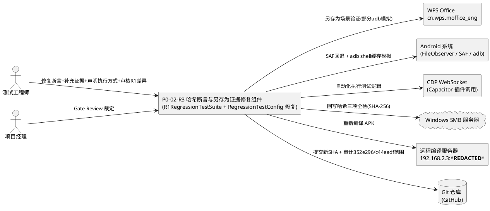
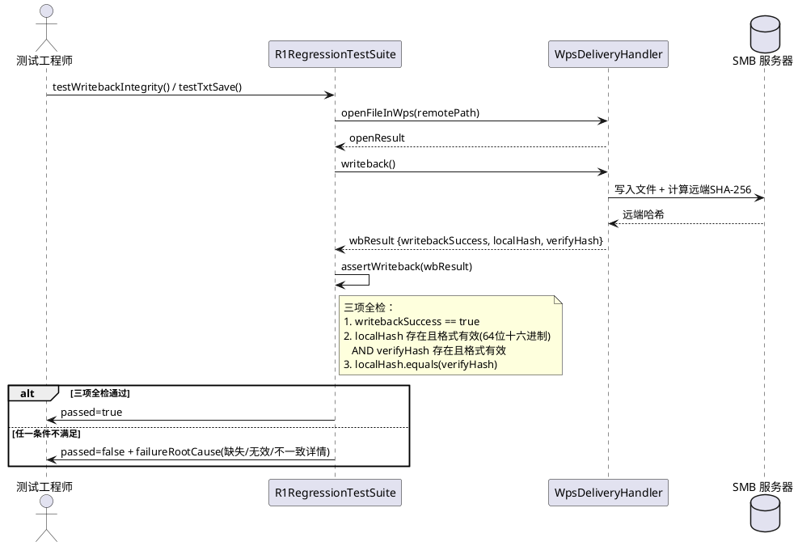
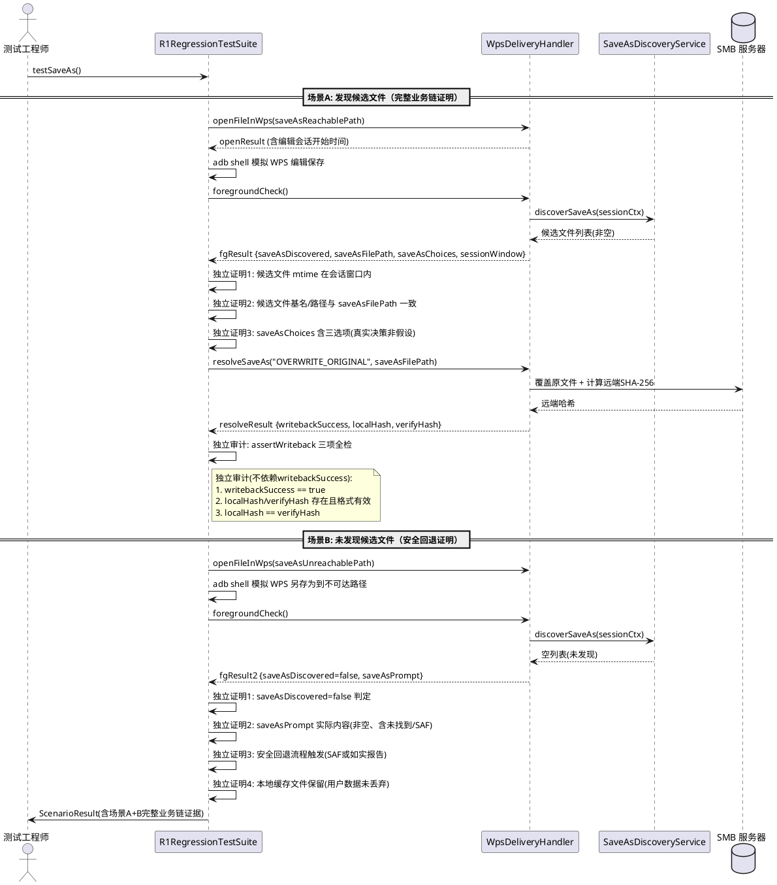
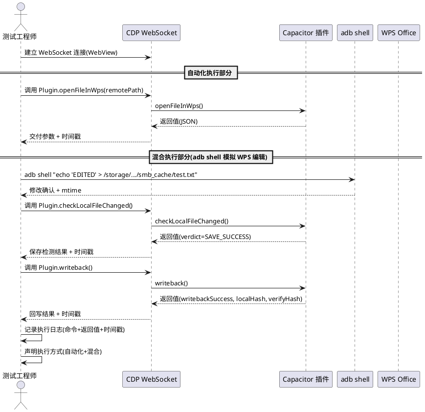
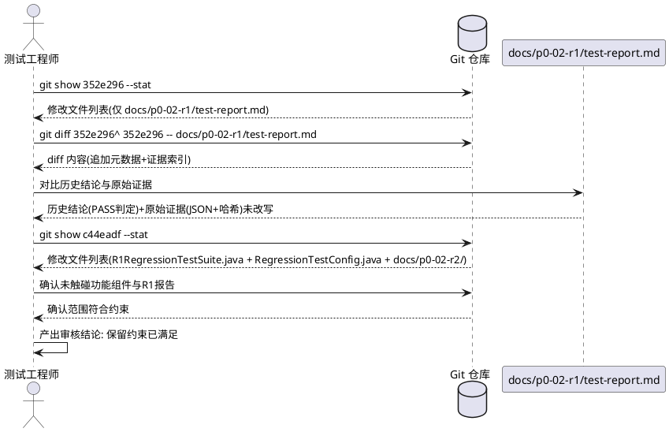
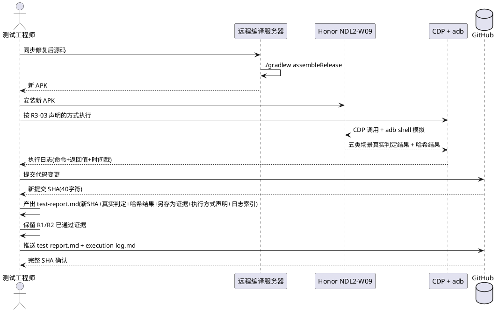

# P0-02-R3 需求规格：Hash Assertion & Save-As Evidence Repair

> 本文档为 P0-02-R3 哈希断言与另存为证据修复任务的需求规格，基于 PM Gate Review 对 P0-02-R2 的裁定（**HOLD / TARGETED REPAIR**，3 项阻断）生成。文档定义 R3-01 ~ R3-05 五个子项的 EARS 格式需求、验收标准、阻断项根因分析与修复策略、约束声明与测试执行方式声明。所有业务规则采用可测试的验收条件（触发场景 → 预期行为）描述。

> **文档定位**：本规格为 P0-02-R2 测试框架证据完整性的定向修复需求，不替代 `docs/p0-02-r2/spec.md`（R2 证据完整性修复需求规格）中的定义，而是针对 PM 对 P0-02-R2 Gate Review 中暴露的 3 项阻断（哈希断言放水、另存为业务链证据不足、测试执行方式不明）定义修复验收标准。P0-03（安全回写）在 P0-02-R3 通过前不被授权启动。

> **前置基线**：
> - P0-02-R1 提交 SHA `693fb75ffcacaf8563d30b34d46d9c139d9a2495`（功能修复基线，证据补充提交 `352e296`）。
> - P0-02-R2 提交 SHA `c44eadf`（代码：R1RegressionTestSuite.java + RegressionTestConfig.java + docs/p0-02-r2/）+ `2fdb0cd`（测试报告）。
> - PM 裁定 P0-02-R2 = **HOLD / TARGETED REPAIR**，授权 P0-02-R3。

---

# 1. 组件定位

## 1.1 核心职责

本修复任务负责修正 P0-02-R2 回归测试套件在 PM Gate Review 中暴露的三项阻断：SHA-256 哈希断言允许缺失哈希时通过、另存为测试未充分证明完整业务链、测试执行方式未明确声明，使回归测试证据达到可被 PM Gate Review 接受的真实性、完备性与可审计性。

## 1.2 核心输入

1. **P0-02-R2 回归测试套件源码**：`R1RegressionTestSuite.java` 中 `assertWriteback()` 方法（第 231-244 行）的当前实现，含哈希缺失时短路返回 true 的缺陷；`testSaveAs()` 双场景实现；`runAllScenarios()` 执行框架。
2. **P0-02-R2 测试报告**：`docs/p0-02-r2/test-report.md` 中声明的 5/5 ALL PASSED 结果与证据，含 SHA-256 证据链与另存为双场景证据。
3. **P0-02-R1 测试报告**：`docs/p0-02-r1/test-report.md` 的历史结论与原始证据，须审核差异并保留不得改写。
4. **PM Gate Review 裁定**：P0-02-R2 = HOLD / TARGETED REPAIR，含 3 项阻断项与 5 项授权修复任务。
5. **提交历史**：`352e296`（R1 证据补充，仅追加 APK 元数据与证据索引）、`c44eadf`（R2 代码+文档）、`2fdb0cd`（R2 测试报告），须审核提交范围与"保留旧证据"约束。
6. **测试环境事实**：HONOR NDL2;W09, Android 16, API 36, WPS cn.wps.moffice_eng, SMB 192.168.2.3/share；测试通过 Chrome DevTools Protocol (WebSocket) 调用 Capacitor 插件方法执行，部分场景需 adb shell 修改本地缓存文件模拟 WPS 编辑。

## 1.3 核心输出

1. **严格的哈希断言**：`assertWriteback()` 修复为三项全检（writebackSuccess == true + 两个哈希均存在且格式有效 + 两个哈希完全相等），任一不满足即失败。
2. **另存为完整业务链证据**：场景A 补充候选文件与编辑会话关联的独立证明、回写哈希独立审计；场景B 补充安全回退流程的独立证明。
3. **明确的测试执行方式声明**：测试报告明确声明自动化执行部分、混合执行部分（adb shell 模拟 WPS 编辑）与人工参与步骤，报告与实际执行过程一致。
4. **R1 报告差异审核结论**：确认 `352e296` 仅追加元数据未改写历史结论，`c44eadf` 提交范围符合约束，保留约束已满足。
5. **新提交 SHA 与执行日志**：提交新完整 SHA，更新测试报告，提供可核对的执行日志与哈希结果。
6. **保留的历史证据**：P0-02-R1 测试报告中的历史结论与原始证据不得改写。

## 1.4 职责边界

本修复任务**不负责**以下事项：

1. **不负责**改写功能组件代码：WpsDeliveryHandler、WpsSaveDetector、FileAppResolver、StreamCacheService、SaveAsDiscoveryService、SaveAsResolutionPrompt、DocxContentSniffer、DeliveryStrategySelector 等功能组件的逻辑须保持 P0-02-R1 提交 693fb75 的状态不变，仅修复 `R1RegressionTestSuite.java` 与 `RegressionTestConfig.java` 测试框架自身的断言与证据缺陷。
2. **不负责**重新实现 R1-01 ~ R1-05 的功能需求或 R2-01 ~ R2-04 的证据完整性需求：R1 功能修复与 R2 证据完整性修复均已完成，本任务仅针对 R2 Gate Review 暴露的 3 项阻断进行定向修复。
3. **不负责**改写 P0-02-R1 测试报告的历史结论与原始证据：`docs/p0-02-r1/test-report.md` 中的测试结果、交付参数、SHA-256 证据链须原样保留，仅审核其差异并确认保留约束。
4. **不负责** P0-03（安全回写）的实现：P0-03 在 P0-02-R3 通过前不被授权启动。
5. **不负责**修改 .docx 交付策略：FILE_URI_FIRST + ACTION_VIEW + file:// 方案须保留不变。
6. **不负责**为修复测试框架而重复改写已通过验证的功能：已通过的实机证据（.docx 渲染、.txt 保存检测、SHA-256 回写）须原样保留，不得重复验证或改写。

---

# 2. 领域术语

**哈希断言放水**
: 测试框架中 SHA-256 哈希断言逻辑在哈希缺失时仍判定通过的行为。P0-02-R2 中 `assertWriteback()` 第 239 行 `if (localHash != null && verifyHash != null && !localHash.equals(verifyHash))` 当 localHash 或 verifyHash 为 null 时条件短路为 false，方法返回 true，使缺失哈希的回写被误判为完整性校验通过。
: 备注：P0-02-R3 阻断项 1 的核心缺陷，R3-01 须修正。

**三项全检**
: SHA-256 回写完整性断言须同时满足三个条件方可判定通过：(1) writebackSuccess == true；(2) localHash 与 verifyHash 均存在且格式有效（非空、64 字符、十六进制）；(3) localHash 与 verifyHash 完全相等。三项缺一不可，任一不满足即断言失败。
: 备注：R3-01 要求的修复目标，替代哈希断言放水。

**SHA-256 格式有效**
: 哈希字符串符合 SHA-256 摘要格式规范：非空、长度为 64 字符、全部为十六进制字符（0-9, a-f, A-F）。
: 备注：R3-01 中哈希格式校验的标准。

**另存为完整业务链**
: 另存为场景从"WPS 执行另存为"到"候选文件被发现 → 与编辑会话关联 → 用户决策 → 回写 → 远端 SHA-256 核验"的全链路。完整业务链要求每一步均有独立证据，不依赖单一字段（如 writebackSuccess）判定整体通过。
: 备注：R3-02 要求补充的证据维度。

**候选文件与编辑会话关联**
: 另存为候选文件确实是本次保存产生的文件，且与当前编辑会话正确关联的证明。关联证据包括：候选文件 mtime 在编辑会话时间窗口内、候选文件基名含原文件名、候选文件内容 SHA-256 与编辑后本地缓存一致或为格式转换产物。
: 备注：R3-02 场景A 须独立证明的关联关系。

**回写哈希独立审计**
: 另存为覆盖原文件路径的回写结果须返回可审计的哈希（localHash + verifyHash），测试方法对该哈希执行独立的三项全检断言，不依赖 writebackSuccess 字段单独判定。
: 备注：R3-02 场景A 须补充的独立审计。

**安全回退流程**
: 未发现候选文件时，系统进入的预期处理流程：触发 SAF（Storage Access Framework）用户手动指定文件选择器，或如实报告"另存为结果未找到"并保留编辑会话状态，不伪报保存成功，不静默丢弃用户数据。
: 备注：R3-02 场景B 须独立证明的回退流程。

**测试执行方式**
: 回归测试的实际执行机制，分为三类：(1) 自动化执行 — 通过 Chrome DevTools Protocol (WebSocket) 调用 Capacitor 插件方法执行测试逻辑；(2) 混合执行 — 自动化调用结合 adb shell 修改本地缓存文件模拟 WPS 编辑（因 WPS UI 无法可靠自动化）；(3) 人工参与 — 需人工打开 WPS、编辑、保存等步骤的场景，须有明确的等待与同步机制。
: 备注：R3-03 要求明确声明的执行方式。

**Chrome DevTools Protocol (CDP) WebSocket 执行**
: 通过 Chrome DevTools Protocol 的 WebSocket 接口连接 WebView，调用 Capacitor 插件暴露的 JavaScript 方法（如 WpsDeliveryHandler.openFileInWps / checkLocalFileChanged / writeback / foregroundCheck / resolveSaveAs）执行测试逻辑并获取返回值的自动化执行方式。
: 备注：R3-03 中自动化执行部分的技术机制。

**adb shell 缓存模拟**
: 通过 adb shell 命令直接修改本地 SMB 缓存文件（如 `/storage/emulated/0/PAD2/smb_cache/` 下的文件）内容与 mtime，模拟 WPS 编辑保存行为，用于在 WPS UI 无法可靠自动化时驱动保存检测与回写核验逻辑的混合执行方式。
: 备注：R3-03 中混合执行部分的技术机制，因 WPS UI 自动化不可靠而采用。

**保留旧证据约束**
: P0-02-R1 测试报告中的历史测试结论（PASS/FAIL 判定）与原始证据数据（交付参数 JSON、SHA-256 哈希值、渲染截图）不得因后续修复而改写或删除的约束。新证据须增量添加，旧证据原样保留。
: 备注：R3-04 须审核确认的约束。

**提交范围审计**
: 对 Git 提交修改的文件范围进行审核，确认提交仅修改授权范围内的文件（测试框架 + 测试文档），未触碰功能组件代码，未改写历史证据。
: 备注：R3-04 须对 352e296 与 c44eadf 执行的审计。

---

# 3. 角色与边界

## 3.1 核心角色

- **测试工程师**：在真实平板上修复 R1RegressionTestSuite.java 哈希断言与另存为证据缺陷、明确测试执行方式、审核 R1 报告差异、重新执行回归验证并产出完整证据的人员。
- **项目经理（PM）**：对 P0-02-R3 执行 Gate Review，裁定哈希断言修复、另存为证据补充、执行方式声明、R1 证据保留是否通过、P0-03 是否授权启动的评审者。

## 3.2 外部系统

- **WPS Office（cn.wps.moffice_eng）**：另存为场景验证的交互对象，其另存为行为是 R3-02 验证的核心适配对象；因 UI 无法可靠自动化，部分场景须通过 adb shell 模拟其编辑保存行为。
- **Android 系统（FileObserver / SAF / adb）**：另存为发现验证的系统能力依赖，提供文件变更监听、SAF 文件选择器与 adb shell 命令通道。
- **Chrome DevTools Protocol (WebSocket)**：自动化测试执行的通道，通过 WebView 调用 Capacitor 插件方法执行测试逻辑。
- **Windows SMB 服务器（192.168.2.3/share）**：回写完整性验证的远端目标，须支持文件读取与 SHA-256 校验。
- **远程编译服务器（192.168.2.3, debian/***REDACTED***）**：APK 构建环境，须在修复后重新编译产出新 APK。
- **Git 仓库（GitHub wujupeng/andriodpad2）**：提交历史审计对象，须审核 352e296 与 c44eadf 的修改范围。

## 3.3 交互上下文

---

# 4. DFX约束

## 4.1 性能

1. **回归测试执行时间**：修复后的回归测试套件执行全部五类场景的总时间须在 30 分钟以内（含 CDP 自动化执行、adb shell 模拟、WPS 交互等待、保存检测、回写核验）。
   - 验收条件：[执行 R1RegressionTestSuite.runAllScenarios()] → [30 分钟内完成全部五类场景测试，含混合执行等待时间]
2. **哈希断言执行开销**：三项全检引入的哈希格式校验（64 字符 + 十六进制判断）不导致单场景测试时间显著增加（增量 < 100ms）。
   - 验收条件：[对比修复前后单场景执行时间] → [哈希断言增量开销 < 100ms]

## 4.2 可靠性

1. **哈希断言须严格三项全检**：`assertWriteback()` 须同时校验 writebackSuccess == true、两个哈希均存在且格式有效、两个哈希完全相等，任一不满足即返回 false，不得因哈希缺失而短路返回 true。
   - 验收条件：[审查 assertWriteback() 源码] → [三项全检逻辑，无哈希缺失短路返回 true 的路径]
2. **测试失败须如实报告**：真实断言条件不满足时（含哈希缺失、哈希格式无效、哈希不一致），测试方法必须失败并记录失败根因含期望值与实际值。
   - 验收条件：[哈希缺失或无效或不一致] → [测试方法返回 passed=false，failureRootCause 含具体差异]
3. **证据须可复现**：修复后的回归测试须可在相同环境（Honor NDL2-W09 + Android 16 + WPS cn.wps.moffice_eng + CDP + adb）上复现，复现结果与报告一致。
   - 验收条件：[在相同环境按报告声明的执行方式重新执行] → [结果与测试报告一致，可复现]
4. **执行日志须可核对**：测试报告须附带可核对的执行日志，记录每一步执行的命令（CDP 调用 / adb shell）、返回值、时间戳，日志与测试结果一致。
   - 验收条件：[审查执行日志] → [每步执行有命令、返回值、时间戳记录，与测试报告判定一致]

## 4.3 安全性

1. **证据日志脱敏**：更新的测试报告与执行日志中不得包含密码、凭据、文件敏感内容。
   - 验收条件：[审查更新后的测试报告与执行日志] → [不含密码明文与文件内容明文]
2. **代码 SHA 可追溯**：更新的测试报告中的代码 SHA 须与重新执行测试时使用的代码版本一致，可 git log 追溯。
   - 验收条件：[审查测试报告代码 SHA] → [与实际提交 SHA 一致，40 字符完整 SHA，可 git log 追溯]

## 4.4 可维护性

1. **测试执行方式声明须与实际一致**：测试报告声明的执行方式（自动化 / 混合 / 人工参与）须与实际执行过程一致，不得声明全自动化而实际依赖人工操作。
   - 验收条件：[对比测试报告执行方式声明与执行日志] → [声明与实际执行过程一致]
2. **已通过证据保留**：修复测试框架不得破坏 P0-02-R1 与 P0-02-R2 已通过的实机证据。
   - 验收条件：[审查修复后的证据归档] → [R1 与 R2 已通过证据原样保留，未被改写或删除]
3. **R1 历史结论不得改写**：`docs/p0-02-r1/test-report.md` 中的历史测试结论（PASS/FAIL 判定）与原始证据数据须原样保留。
   - 验收条件：[对比 R1 报告修复前后内容] → [历史结论与原始证据数据未改写，仅允许增量追加]

## 4.5 兼容性

1. **目标设备兼容**：修复后的回归测试须在 Honor NDL2-W09（Android 16, API 36）+ WPS cn.wps.moffice_eng 上通过实测验证。
   - 验收条件：[在 Honor NDL2-W09 + Android 16 + WPS cn.wps.moffice_eng 上执行] → [R3-01 ~ R3-05 全部通过]
2. **不改写无关功能**：修复仅限 `R1RegressionTestSuite.java` 与 `RegressionTestConfig.java` 测试框架，不修改任何功能组件。
   - 验收条件：[审查代码变更] → [仅 R1RegressionTestSuite.java 与 RegressionTestConfig.java 发生变更，功能组件代码不变]
3. **CDP 与 adb 通道兼容**：自动化执行须兼容 Chrome DevTools Protocol WebSocket 接口与 adb shell 命令通道，不依赖特定 Chrome 版本或 adb 版本的私有 API。
   - 验收条件：[在目标设备上执行 CDP + adb 混合测试] → [通道连接成功，测试逻辑可执行]

---

# 5. 核心能力

## 5.1 R3-01 修复 SHA-256 哈希断言

### 5.1.1 业务规则

1. **哈希断言须三项全检**：`R1RegressionTestSuite.java` 中 `assertWriteback(Map<String,Object> result, ScenarioResult sr)` 方法须同时校验以下三个条件，全部满足方可返回 true，任一不满足即返回 false 并写入 failureRootCause：
   - 条件一：`writebackSuccess == true`（回写操作成功）
   - 条件二：`localHash` 与 `verifyHash` 均存在（非 null）且格式有效（非空字符串、长度 64、全部十六进制字符）
   - 条件三：`localHash.equals(verifyHash)`（两个哈希完全相等）
   - 验收条件：[审查 assertWriteback() 源码] → [三项全检逻辑，按条件一→条件二→条件三顺序校验，任一失败即返回 false 并记录根因]
2. **哈希缺失须失败**：当 `localHash` 或 `verifyHash` 为 null 或空字符串时，`assertWriteback()` 必须返回 false，failureRootCause 须指明缺失的字段名（"localHash 缺失" 或 "verifyHash 缺失"）。
   - 验收条件：[assertWriteback 传入 localHash=null 或 verifyHash=null 或空字符串] → [返回 false，failureRootCause 含缺失字段名]
3. **哈希格式无效须失败**：当 `localHash` 或 `verifyHash` 存在但格式无效（长度 != 64 或含非十六进制字符）时，`assertWriteback()` 必须返回 false，failureRootCause 须指明无效字段与实际值。
   - 验收条件：[assertWriteback 传入 localHash 长度 != 64 或含非十六进制字符] → [返回 false，failureRootCause 含 "localHash 格式无效" 与实际值]
4. **哈希不一致须失败**：当两个哈希均存在且格式有效但不相等时，`assertWriteback()` 必须返回 false，failureRootCause 须含 localHash 与 verifyHash 的实际值对比。
   - 验收条件：[assertWriteback 传入 localHash != verifyHash（均有效）] → [返回 false，failureRootCause 含两哈希实际值对比]
5. **另存为覆盖原文件路径须返回可审计哈希**：`testSaveAs()` 场景A 中 `resolveSaveAs("OVERWRITE_ORIGINAL", saveAsFilePath)` 返回的结果须经 `assertWriteback()` 独立三项全检，不依赖 writebackSuccess 字段单独判定通过。
   - 验收条件：[testSaveAs 场景A 执行 resolveSaveAs(OVERWRITE_ORIGINAL)] → [对返回结果执行 assertWriteback 三项全检，含 localHash 与 verifyHash 的存在性、格式与一致性校验]
6. **禁止项**：禁止在 `assertWriteback()` 中保留 `if (localHash != null && verifyHash != null && !localHash.equals(verifyHash))` 形式的短路逻辑（该逻辑在哈希缺失时跳过校验返回 true）；禁止仅校验 writebackSuccess 而不校验哈希；禁止仅校验哈希存在性而不校验格式与一致性。
   - 验收条件：[审查 assertWriteback() 源码] → [无哈希缺失短路返回 true 的路径，无仅校验单字段即返回 true 的路径]

### 5.1.2 交互流程

### 5.1.3 异常场景

1. **回写成功但哈希缺失**
   - 触发条件：`writeback()` 返回 `writebackSuccess=true` 但 `localHash=null` 或 `verifyHash=null`（回写逻辑异常，未产出哈希）。
   - 系统行为：`assertWriteback()` 返回 false，failureRootCause = "localHash 缺失" 或 "verifyHash 缺失"（含 writebackSuccess=true 的事实），测试方法设置 passed=false。
   - 用户感知：测试报告中该场景标记为失败，根因含"回写声称成功但哈希缺失，完整性无法证明"。
2. **回写成功但哈希格式无效**
   - 触发条件：`writeback()` 返回的哈希长度 != 64 或含非十六进制字符（如截断、编码错误）。
   - 系统行为：`assertWriteback()` 返回 false，failureRootCause 含无效字段名与实际值，测试方法设置 passed=false。
   - 用户感知：测试报告中该场景标记为失败，根因含"哈希格式无效，完整性校验无法执行"。
3. **回写成功但本地与远端哈希不一致**
   - 触发条件：`writeback()` 返回 `writebackSuccess=true`，两个哈希均有效但不相等（回写后远端内容与本地不一致，如并发写入、传输损坏）。
   - 系统行为：`assertWriteback()` 返回 false，failureRootCause 含 localHash 与 verifyHash 实际值对比，测试方法设置 passed=false。
   - 用户感知：测试报告中该场景标记为失败，根因含"本地与远端 SHA-256 不一致，回写完整性受损"。

## 5.2 R3-02 补充另存为完整业务链证据

### 5.2.1 业务规则

1. **场景A 须独立证明候选文件为本次保存产生**：`testSaveAs()` 场景A 须独立证明发现的候选文件确实是本次 WPS 另存为操作产生的文件，而非历史残留或无关文件。证明证据须包含：候选文件 mtime 在编辑会话时间窗口内、候选文件基名含原文件名或为另存为命名产物、候选文件路径与 saveAsFilePath 一致。
   - 验收条件：[testSaveAs 场景A 执行] → [证据含候选文件 mtime、基名、路径与编辑会话时间窗口的关联证明，非仅检查 saveAsDiscovered=true]
2. **场景A 须独立证明候选文件与编辑会话关联**：`testSaveAs()` 场景A 须证明候选文件与当前编辑会话正确关联，关联证据须含编辑会话开始时间、会话结束时间、候选文件 mtime 落入会话时间窗口 ±60s 内的判定结果。
   - 验收条件：[testSaveAs 场景A 执行] → [证据含编辑会话时间窗口与候选文件 mtime 的关联判定，证明候选文件属于本次会话]
3. **场景A 须独立审计回写哈希**：`testSaveAs()` 场景A 中 `resolveSaveAs()` 返回的回写结果须经 `assertWriteback()` 三项全检独立审计，不依赖 `writebackSuccess` 字段单独判定通过。审计证据须含 localHash 与 verifyHash 的实际值与三项全检结果。
   - 验收条件：[testSaveAs 场景A resolveSaveAs 返回] → [证据含 assertWriteback 三项全检的独立审计结果，含 localHash、verifyHash 实际值，非仅 writebackSuccess=true]
4. **场景A 须证明用户决策为真实选择**：`testSaveAs()` 场景A 须证明用户决策（WRITE_AS_NEW / OVERWRITE_ORIGINAL / DISCARD）为真实选择或测试模拟选择的结果，不自动假设为覆盖原文件。证据须含决策选项列表与实际选择值。
   - 验收条件：[testSaveAs 场景A 执行] → [证据含 saveAsChoices 三选项列表与实际 choice 值，证明决策为真实选择非硬编码假设]
5. **场景B 须独立证明进入安全回退流程**：`testSaveAs()` 场景B 须独立证明未发现候选文件时系统确实进入预期的安全回退流程（触发 SAF 文件选择器或如实报告"另存为结果未找到"），不伪报保存成功。证明证据须含 saveAsDiscovered=false 的判定、saveAsPrompt 的实际内容、SAF 回退触发标志或"未找到"报告标志。
   - 验收条件：[testSaveAs 场景B 执行] → [证据含 saveAsDiscovered=false 判定、saveAsPrompt 实际内容、安全回退流程触发证明，非仅检查提示关键词]
6. **场景B 须证明不丢弃用户数据**：`testSaveAs()` 场景B 须证明未发现候选文件时系统保留编辑会话状态与本地缓存文件，不静默丢弃用户编辑内容。证据须含编辑后本地缓存文件存在性与内容 SHA-256。
   - 验收条件：[testSaveAs 场景B 执行] → [证据含编辑后本地缓存文件存在性与内容 SHA-256，证明用户数据未丢弃]
7. **runAllScenarios 须提供等待与同步机制**：`runAllScenarios()` 须为人工打开 WPS、编辑、保存等步骤提供明确的等待与测试交互同步机制（如等待 FileObserver 事件、等待 adb shell 确认、超时阈值），不依赖固定 sleep 或无等待的瞬时调用。
   - 验收条件：[审查 runAllScenarios() 与 testSaveAs() 实现] → [含明确的等待机制（事件等待 / adb 确认 / 超时阈值），无固定 sleep 或无等待瞬时调用]
8. **禁止项**：禁止场景A 仅检查 saveAsDiscovered=true 与 saveAsChoices 而不独立证明候选文件关联与回写哈希；禁止场景B 仅检查 saveAsPrompt 关键词而不证明安全回退流程触发；禁止 runAllScenarios 依赖固定 sleep 而无同步机制。
   - 验收条件：[审查 testSaveAs() 与 runAllScenarios() 源码] → [无禁止项描述的缺陷形式]

### 5.2.2 交互流程

### 5.2.3 异常场景

1. **候选文件 mtime 不在会话时间窗口内**
   - 触发条件：发现的候选文件 mtime 早于编辑会话开始时间或晚于会话结束时间 +60s（可能为历史残留文件）。
   - 系统行为：场景A 关联证明失败，记录候选文件 mtime 与会话时间窗口的差异，测试方法标记场景A 关联证明未通过。
   - 用户感知：测试报告中场景A 标记关联证明失败，根因含"候选文件 mtime 不在会话窗口内，可能为历史残留"。
2. **resolveSaveAs 返回成功但哈希缺失**
   - 触发条件：场景A 中 `resolveSaveAs("OVERWRITE_ORIGINAL")` 返回 `writebackSuccess=true` 但 localHash 或 verifyHash 缺失。
   - 系统行为：`assertWriteback()` 三项全检失败（R3-01 修复后），场景A 独立审计失败，记录哈希缺失。
   - 用户感知：测试报告中场景A 标记回写哈希独立审计失败，根因含"resolveSaveAs 声称成功但哈希缺失"。
3. **场景B 未触发安全回退且未如实报告**
   - 触发条件：未发现候选文件时，saveAsPrompt 为空或伪报保存成功，未触发 SAF 文件选择器。
   - 系统行为：场景B 安全回退证明失败，记录 saveAsPrompt 实际内容与预期行为的差异。
   - 用户感知：测试报告中场景B 标记安全回退证明失败，根因含"未发现候选但未触发安全回退或如实报告"。
4. **等待机制超时**
   - 触发条件：`runAllScenarios()` 等待 FileObserver 事件或 adb 确认超过超时阈值（如 WPS 未响应、adb 连接断开）。
   - 系统行为：测试方法标记超时失败，记录等待对象、超时阈值与实际等待时间。
   - 用户感知：测试报告中该场景标记超时失败，根因含等待对象与超时详情。

## 5.3 R3-03 明确测试执行方式

### 5.3.1 业务规则

1. **测试报告须声明执行方式分类**：`docs/p0-02-r3/test-report.md` 须明确声明每个测试场景的执行方式分类：自动化执行（CDP WebSocket 调用 Capacitor 插件）、混合执行（CDP + adb shell 模拟 WPS 编辑）、人工参与（需人工操作 WPS UI 的步骤），不得笼统声明"自动化"而实际依赖人工操作。
   - 验收条件：[审查测试报告执行方式声明] → [每个场景标注执行方式分类（自动化/混合/人工参与），与实际执行过程一致]
2. **自动化执行部分须说明技术机制**：测试报告须说明自动化执行的技术机制为 Chrome DevTools Protocol (WebSocket) 调用 Capacitor 插件方法，含连接方式、调用的插件方法名、返回值获取方式。
   - 验收条件：[审查测试报告自动化执行说明] → [含 CDP WebSocket 连接方式、Capacitor 插件方法名、返回值获取方式]
3. **混合执行部分须说明 adb shell 模拟原因**：测试报告须说明混合执行中 adb shell 修改本地缓存文件模拟 WPS 编辑的原因（WPS UI 无法可靠自动化），含 adb shell 命令、修改的缓存文件路径、模拟的编辑行为。
   - 验收条件：[审查测试报告混合执行说明] → [含 adb shell 命令、缓存文件路径、模拟行为、WPS UI 不可自动化的原因说明]
4. **人工参与部分须说明步骤与同步机制**：若某场景需人工参与（如人工打开 WPS、编辑、保存），测试报告须说明人工步骤、等待机制（事件等待 / adb 确认 / 超时阈值）与测试交互同步方式。
   - 验收条件：[审查测试报告人工参与说明] → [含人工步骤、等待机制、同步方式，无固定 sleep]
5. **执行日志须可核对**：测试报告须附带可核对的执行日志，记录每一步执行的命令（CDP 调用方法名 + 参数 / adb shell 命令）、返回值、时间戳，日志与测试结果判定一致。
   - 验收条件：[审查执行日志] → [每步含命令、返回值、时间戳，与测试报告判定一致，可独立核对]
6. **禁止项**：禁止声明全自动化而实际依赖人工操作；禁止执行日志缺失或与测试结果不一致；禁止使用固定 sleep 而无同步机制说明。
   - 验收条件：[审查测试报告与执行日志] → [无禁止项描述的缺陷形式]

### 5.3.2 交互流程

### 5.3.3 异常场景

1. **CDP WebSocket 连接失败**
   - 触发条件：Chrome DevTools Protocol WebSocket 连接 WebView 失败（WebView 未启用调试、端口未开放）。
   - 系统行为：测试报告记录连接失败原因，标记自动化执行部分未完成。
   - 用户感知：测试报告中自动化执行部分标记连接失败，含排查建议。
2. **adb shell 命令执行失败**
   - 触发条件：adb shell 修改缓存文件失败（设备未连接、权限不足、路径不存在）。
   - 系统行为：测试报告记录 adb 命令与失败原因，标记混合执行部分未完成。
   - 用户感知：测试报告中混合执行部分标记失败，含 adb 命令与错误信息。
3. **执行方式声明与实际不一致**
   - 触发条件：测试报告声明自动化执行但执行日志显示依赖人工操作，或声明混合执行但无 adb shell 命令记录。
   - 系统行为：PM Gate Review 标记执行方式声明不一致，要求修正。
   - 用户感知：PM 反馈声明与实际不一致，要求重新声明或重新执行。

## 5.4 R3-04 审核 R1 报告差异与保留旧证据

### 5.4.1 业务规则

1. **须审核 352e296 提交范围**：须审核提交 `352e296`（"docs(P0-02-R1): 补充测试报告提交SHA与证据索引"）的修改范围，确认该提交仅追加 APK 元数据（文件大小、分发路径、提交 SHA、远端链接）与实测证据索引章节（证据表 + SHA-256 证据链），未改写任何历史测试结论或原始证据数据。
   - 验收条件：[审查 352e296 的 git diff] → [仅追加元数据与证据索引，历史结论（PASS/FAIL 判定）与原始证据数据（交付参数 JSON、SHA-256 哈希值）未改写]
2. **须审核 c44eadf 提交范围**：须审核提交 `c44eadf`（P0-02-R2 代码提交）相对 `352e296` 的修改范围，确认该提交仅修改 `R1RegressionTestSuite.java`、`RegressionTestConfig.java` 与 `docs/p0-02-r2/` 三份文档，未触碰功能组件代码与 R1 测试报告。
   - 验收条件：[审查 c44eadf 相对 352e296 的 git diff] → [仅修改 R1RegressionTestSuite.java + RegressionTestConfig.java + docs/p0-02-r2/，功能组件代码与 docs/p0-02-r1/test-report.md 未修改]
3. **须确认保留约束已满足**：须确认 P0-02-R1 测试报告中的历史测试结论与原始证据在 R2 与 R3 修复过程中均未被改写或删除，保留约束已满足。
   - 验收条件：[对比 docs/p0-02-r1/test-report.md 在 352e296、c44eadf、2fdb0cd 及 R3 提交中的内容] → [历史结论与原始证据数据原样保留，仅允许 352e296 的增量追加]
4. **R3 须继续遵从保留约束**：R3 修复过程中不得改写 `docs/p0-02-r1/test-report.md` 的历史结论与原始证据，新证据须增量添加到 R3 报告或 R1 报告的增量章节，不得覆盖旧证据。
   - 验收条件：[审查 R3 提交对 docs/p0-02-r1/test-report.md 的修改] → [无改写历史结论或原始证据的变更，仅允许增量追加]
5. **禁止项**：禁止以任何理由改写 R1 测试报告的历史 PASS/FAIL 判定；禁止改写 R1 报告中的原始交付参数 JSON、SHA-256 哈希值、渲染截图引用；禁止删除 R1 已通过证据文件。
   - 验收条件：[审查 R1 报告与证据归档] → [历史结论与原始证据原样保留，无改写或删除]

### 5.4.2 交互流程

### 5.4.3 异常场景

1. **审核发现 352e296 改写了历史结论**
   - 触发条件：审核 `352e296` 的 diff 发现该提交改写了 R1 报告中的 PASS/FAIL 判定或原始证据数据（而非仅追加）。
   - 系统行为：R3-04 审核结论标记"保留约束未满足"，须从 Git 历史恢复被改写的历史结论与原始证据。
   - 用户感知：PM 收到审核失败报告，要求恢复历史证据后重新审核。
2. **审核发现 c44eadf 触碰了功能组件**
   - 触发条件：审核 `c44eadf` 的 diff 发现该提交修改了功能组件代码（WpsDeliveryHandler 等）或 R1 测试报告。
   - 系统行为：R3-04 审核结论标记"提交范围越界"，须分析越界修改是否影响功能基线。
   - 用户感知：PM 收到审核失败报告，要求说明越界修改原因或回退越界变更。

## 5.5 R3-05 提交新 SHA 与执行日志

### 5.5.1 业务规则

1. **须重新执行全部五类场景**：修复哈希断言与另存为证据后，须在真实平板上重新执行 `R1RegressionTestSuite.runAllScenarios()` 的全部五类场景，按 R3-03 声明的执行方式（CDP 自动化 + adb shell 混合）执行，不得仅执行修改的场景。
   - 验收条件：[修复后] → [在真实平板上按声明的执行方式重新执行全部五类场景回归测试]
2. **须产出新的完整代码 SHA**：重新执行回归测试后，须提交代码变更并记录新的完整 Git 提交 SHA（40 字符十六进制），更新测试报告中的代码 SHA，不得复用 R2 的旧 SHA（c44eadf）。
   - 验收条件：[提交代码变更] → [测试报告含新的完整 40 字符代码 SHA，可 git log 追溯，非旧 SHA c44eadf]
3. **须更新测试报告**：重新执行回归测试后，须产出 `docs/p0-02-r3/test-report.md`，含全部五类场景的真实通过/失败判定、哈希三项全检结果、另存为完整业务链证据、执行方式声明、执行日志索引、证据索引、代码 SHA 与设备信息。
   - 验收条件：[重新执行回归测试] → [产出 docs/p0-02-r3/test-report.md，含五类场景真实判定、哈希结果、另存为证据、执行方式声明、执行日志索引、新代码 SHA]
4. **须提供可核对的执行日志**：测试报告须附带可核对的执行日志（如 `docs/p0-02-r3/execution-log.md` 或日志文件），记录每一步执行的命令（CDP 调用方法名 + 参数 / adb shell 命令）、返回值、时间戳，日志与测试结果判定一致，可独立核对。
   - 验收条件：[审查执行日志] → [每步含命令、返回值、时间戳，与测试报告判定一致，可独立核对]
5. **须提供哈希结果**：测试报告须提供每个回写场景的哈希结果（localHash、verifyHash 实际值与三项全检结果），可核对。
   - 验收条件：[审查测试报告哈希结果] → [每个回写场景含 localHash、verifyHash 实际值与三项全检结果，可核对]
6. **须保留已通过实机证据**：P0-02-R1 与 P0-02-R2 已通过的实机证据须原样保留，不得因 R3 修复而改写或删除。
   - 验收条件：[审查更新后的证据归档] → [R1 与 R2 已通过证据原样保留，新证据增量添加]
7. **禁止项**：禁止仅更新测试报告而不重新执行测试；禁止使用旧代码 SHA 作为新测试报告的代码 SHA；禁止执行日志缺失或与测试结果不一致；禁止破坏已通过证据。
   - 验收条件：[审查测试报告更新过程] → [有重新执行测试的证据，代码 SHA 为新提交，执行日志完整且一致，已通过证据保留]

### 5.5.2 交互流程

### 5.5.3 异常场景

1. **重新执行测试时某场景失败**
   - 触发条件：修复后重新执行回归测试，某场景真实断言失败（如哈希三项全检失败暴露回写缺陷、另存为关联证明失败）。
   - 系统行为：记录失败场景、失败现象、失败根因分析，标记该场景未通过，不伪报成功。须分析失败是测试框架问题还是功能缺陷。
   - 用户感知：PM 收到失败报告，决定是否要求进一步修复。
2. **远程编译失败**
   - 触发条件：修复后的源码在远程编译服务器上构建失败。
   - 系统行为：记录编译错误日志，修复编译错误后重新构建，不跳过编译直接使用旧 APK。
   - 用户感知：测试报告中记录编译失败与修复过程。
3. **执行日志与测试结果不一致**
   - 触发条件：执行日志记录的返回值与测试报告判定的通过/失败不一致（如日志显示哈希不一致但报告标记通过）。
   - 系统行为：R3-05 验收失败，须修正测试报告或重新执行测试使日志与结果一致。
   - 用户感知：PM 标记执行日志不可核对，要求修正。

---

# 6. 数据约束

## 6.1 assertWriteback 哈希断言

1. **writebackSuccess**：布尔值，须为 true 方可通过条件一；为 false 或缺失时条件一失败。
2. **localHash**：字符串，须非空、长度 64、全部十六进制字符（0-9, a-f, A-F）方可通过条件二；为 null、空、长度 != 64 或含非十六进制字符时条件二失败。
3. **verifyHash**：字符串，格式约束同 localHash；须与 localHash 完全相等方可通过条件三。
4. **三项关系**：条件一 AND 条件二 AND 条件三，三项缺一不可，任一失败即 assertWriteback 返回 false。
5. **禁止值**：禁止 localHash 或 verifyHash 为 null 时判定通过；禁止仅校验 writebackSuccess 即判定通过；禁止哈希长度 != 64 或含非十六进制字符时判定通过。

## 6.2 另存为完整业务链证据

1. **候选文件 mtime**：长整型（毫秒），须落在编辑会话时间窗口 [sessionStart - 60000, sessionEnd + 60000] 内方为有效关联。
2. **编辑会话时间窗口**：由 sessionStart（会话开始时间）与 sessionEnd（会话结束时间）界定，候选文件 mtime 须在此窗口 ±60s 内。
3. **候选文件基名**：字符串，须含原文件基名或为另存为命名产物（如原文件 "test.txt" 另存为 "test.doc" 或 "test_copy.txt"）。
4. **saveAsChoices**：列表，须含 "WRITE_AS_NEW"、"OVERWRITE_ORIGINAL"、"DISCARD" 三个选项。
5. **用户决策 choice**：字符串，取值范围为 saveAsChoices 中的元素，须为真实选择或测试模拟选择，不得硬编码假设。
6. **回写哈希独立审计结果**：含 localHash、verifyHash 实际值与三项全检结果，须独立于 writebackSuccess 判定。
7. **安全回退触发标志**：布尔值，场景B 须为 true（触发 SAF 或如实报告"未找到"）。
8. **本地缓存文件保留**：场景B 须证明编辑后本地缓存文件存在且内容 SHA-256 非空。

## 6.3 测试执行方式声明

1. **执行方式分类**：取值范围为 `自动化执行`、`混合执行`、`人工参与`，每个场景须标注分类。
2. **自动化执行技术机制**：须为 Chrome DevTools Protocol (WebSocket) 调用 Capacitor 插件方法，含连接方式与插件方法名。
3. **混合执行 adb 命令**：须记录 adb shell 命令、修改的缓存文件路径、模拟的编辑行为。
4. **人工参与步骤**：须记录人工步骤、等待机制（事件等待 / adb 确认 / 超时阈值）、同步方式。
5. **执行日志条目**：每条须含命令（CDP 方法名+参数 / adb shell 命令）、返回值、时间戳。
6. **禁止值**：禁止执行方式声明为"自动化"而实际依赖人工操作；禁止执行日志缺失返回值或时间戳。

## 6.4 R1 报告差异审核结论

1. **352e296 修改范围**：须为仅追加 APK 元数据与证据索引章节，不含改写历史结论或原始证据的变更。
2. **c44eadf 修改范围**：须为仅修改 R1RegressionTestSuite.java + RegressionTestConfig.java + docs/p0-02-r2/，不含功能组件代码或 R1 报告的修改。
3. **保留约束满足标志**：布尔值，须为 true（历史结论与原始证据原样保留）。
4. **禁止值**：禁止审核结论为"保留约束未满足"而继续后续修复；禁止 R3 提交改写 R1 历史结论或原始证据。

## 6.5 更新的测试报告

1. **代码 SHA**：须为重新执行测试时实际提交的 40 字符十六进制 Git SHA，不得复用 R2 的旧 SHA（c44eadf）或 R1 的旧 SHA（693fb75）。
2. **APK 版本**：须为修复后重新编译的 APK 版本号，不得复用 R2 或 R1 的旧 APK。
3. **设备信息**：须为 HONOR NDL2-W09 + Android 16 + API 36 + WPS cn.wps.moffice_eng，与 R1/R2 一致。
4. **场景判定**：五类场景均须有真实通过/失败判定，不得缺失或硬编码。
5. **哈希结果**：每个回写场景须含 localHash、verifyHash 实际值与三项全检结果。
6. **另存为证据**：须含场景A 完整业务链证据（候选文件关联、用户决策、回写哈希独立审计）与场景B 安全回退证明。
7. **执行方式声明**：须含每个场景的执行方式分类与技术机制说明。
8. **执行日志索引**：须索引执行日志文件路径，日志可独立核对。
9. **证据索引**：须索引全部实机证据（截图、JSON、远程文件、执行日志），含 R1/R2 保留证据与 R3 新增证据。

---

# 7. 阻断项根因分析与修复策略

## 7.1 阻断项 1：SHA-256 断言允许缺失哈希时通过

- **现象**：`R1RegressionTestSuite.java` 第 231-244 行 `assertWriteback()` 方法中，第 239 行 `if (localHash != null && verifyHash != null && !localHash.equals(verifyHash))` 当 `localHash` 或 `verifyHash` 为 null 时，`localHash != null && verifyHash != null` 短路为 false，整个 if 条件为 false，方法跳过哈希校验直接返回 true。即回写声称成功但未产出哈希时，完整性校验被误判为通过。
- **影响**：回写完整性的 SHA-256 校验形同虚设。若 `writeback()` 因异常或逻辑缺陷未产出 localHash/verifyHash，测试仍报告完整性校验通过，无法证明远端文件与本地一致。PM 无法基于此断言判定回写完整性真实有效。另存为覆盖原文件的路径同样依赖此断言，其回写哈希无法被独立审计。
- **根因**：`assertWriteback()` 的哈希校验逻辑采用"若哈希存在且不一致则失败"的宽松模式，而非"若哈希不存在或无效或不一致则失败"的严格模式。缺少哈希存在性校验、格式有效性校验与"三项缺一不可"的严格合取关系。实现时将哈希缺失视为"无法校验故跳过"，而非"完整性无法证明故失败"。
- **修复策略（R3-01）**：
  1. 重写 `assertWriteback()` 为三项全检：条件一（writebackSuccess == true）→ 条件二（localHash 与 verifyHash 均存在且格式有效：非空、长度 64、十六进制）→ 条件三（localHash.equals(verifyHash)），按顺序校验，任一失败即返回 false 并写入对应根因。
  2. 新增 SHA-256 格式校验辅助方法 `isValidSha256(String hash)`：校验非空、长度 64、全部十六进制字符。
  3. `testSaveAs()` 场景A 中 `resolveSaveAs()` 返回结果须经 `assertWriteback()` 独立三项全检，不依赖 writebackSuccess 单独判定。
- **对应子项**：R3-01。

## 7.2 阻断项 2：另存为测试未充分证明完整业务链

- **现象**：
  - 场景A 仅检查返回的候选路径（saveAsFilePath）和提示选项（saveAsChoices），未独立证明候选文件确实是本次保存产生的文件（可能为历史残留），未证明与当前编辑会话正确关联（mtime 是否在会话窗口内）。
  - 场景A 的 `assertWriteback()` 主要依赖 `writebackSuccess`，因阻断项 1 的缺陷无法独立审计回写哈希。
  - 场景B 检查了"未找到、手动选择"等提示关键词，但未证明没有候选文件时系统确实进入安全回退流程（SAF 触发或如实报告），未证明不丢弃用户数据（本地缓存保留）。
  - `runAllScenarios()` 未为人工打开 WPS、编辑、保存等步骤提供明确的等待与测试交互同步机制，可能依赖固定 sleep 或无等待的瞬时调用。
- **影响**：另存为场景的证据不足以证明完整业务链有效。PM 无法确认候选文件关联正确、回写哈希真实核验、安全回退流程真实触发。测试执行过程不透明，无法确认测试是自动化、人工参与还是混合执行。
- **根因**：R2 修复另存为场景时，聚焦于"覆盖发现与未发现两种场景"的完备性目标，但忽略了"每一步独立证明"的真实性目标。场景A 的关联证明、回写哈希独立审计，场景B 的安全回退流程证明、用户数据保留证明均未实现。`runAllScenarios()` 的等待机制未明确设计。
- **修复策略（R3-02）**：
  1. 场景A 补充独立证明：候选文件 mtime 在编辑会话窗口内、基名/路径与 saveAsFilePath 一致、saveAsChoices 三选项为真实决策非假设。
  2. 场景A 补充回写哈希独立审计：`resolveSaveAs()` 返回结果经 `assertWriteback()` 三项全检（R3-01 修复后），证据含 localHash、verifyHash 实际值。
  3. 场景B 补充安全回退独立证明：saveAsDiscovered=false 判定、saveAsPrompt 实际内容、SAF 触发或"未找到"报告标志、本地缓存文件保留与内容 SHA-256。
  4. `runAllScenarios()` 与 `testSaveAs()` 引入明确等待机制：FileObserver 事件等待、adb shell 确认、超时阈值，替代固定 sleep。
- **对应子项**：R3-02。

## 7.3 阻断项 3：提交范围与"保留旧证据"约束

- **现象**：PM 称 `c44eadf` 修改了 `docs/p0-02-r1/test-report.md`。经核实：该修改实际在提交 `352e296`（"docs(P0-02-R1): 补充测试报告提交SHA与证据索引"）中完成，仅追加了 APK 元数据（文件大小、分发路径、提交 SHA、远端链接）和实测证据索引章节（证据表 + SHA-256 证据链），未改写任何历史测试结论或原始证据数据。`c44eadf` 本身（相对 352e296）只修改了 R1RegressionTestSuite.java、RegressionTestConfig.java 和 docs/p0-02-r2/ 三份文档。
- **影响**：PM 对提交范围与证据保留约束的合规性存疑，须在 R3 中审核确认。若审核发现历史结论或原始证据被改写，须恢复；若审核确认仅增量追加，则保留约束已满足。
- **根因**：PM 在 Gate Review 时对 `c44eadf` 的修改范围产生了误判（将 `352e296` 的追加误归为 `c44eadf` 的改写）。实际提交历史中，`352e296` 为 R1 证据补充提交（仅追加），`c44eadf` 为 R2 代码提交（仅测试框架+R2文档），两者修改范围不重叠。须通过 git diff 审核澄清。
- **修复策略（R3-04）**：
  1. 审核 `352e296` 的 git diff：确认仅追加 APK 元数据与证据索引，历史结论（PASS/FAIL 判定）与原始证据数据（交付参数 JSON、SHA-256 哈希值）未改写。
  2. 审核 `c44eadf` 相对 `352e296` 的 git diff：确认仅修改 R1RegressionTestSuite.java + RegressionTestConfig.java + docs/p0-02-r2/，未触碰功能组件与 R1 报告。
  3. 产出审核结论：保留约束已满足（历史结论与原始证据原样保留，仅 352e296 增量追加）。
  4. R3 提交须继续遵从保留约束，不得改写 R1 历史结论或原始证据。
- **对应子项**：R3-04。

---

# 8. 约束声明

## 8.1 约束 1：仅修测试框架

修复仅限 `R1RegressionTestSuite.java` 与 `RegressionTestConfig.java` 测试框架，不修改以下功能组件：

- `WpsSaveDetector.java` — 保存检测逻辑
- `WpsDeliveryHandler.java` — 文件交付与回写逻辑
- `FileAppResolver.java` — 应用解析与 MIME type 映射
- `StreamCacheService.java` — 流式缓存与 SHA-256 计算
- `SaveAsDiscoveryService.java` — 另存为发现服务
- `SaveAsResolutionPrompt.java` — 另存为决策交互
- `DocxContentSniffer.java` — .docx 内容嗅探
- `DeliveryStrategySelector.java` — 交付策略选择

**正确做法**：仅修改 `assertWriteback()` 断言逻辑、`testSaveAs()` 证据补充逻辑、`runAllScenarios()` 等待机制与 `RegressionTestConfig` 配置，不修改被测组件的接口或实现。

## 8.2 约束 2：保留 R1 证据

P0-02-R1 测试报告中的历史结论与原始证据须原样保留，不得因 R3 修复而改写或删除：

- `docs/p0-02-r1/test-report.md` 中的 PASS/FAIL 判定（历史测试结论）
- 交付参数 JSON（deliveryStrategy=FILE_URI_FIRST, uriScheme=file, intentAction=ACTION_VIEW）
- SHA-256 哈希值（基线 fb124569...、编辑后 9cadeef3...、回写后 9cadeef3...）
- 渲染截图（pad2-test-final-docx.png、pad2-test-docx-open.png）
- 远程文件证据（/mnt/share/p0-02-test.txt）

**正确做法**：R3 新证据增量添加到 `docs/p0-02-r3/`，R1 报告仅允许 352e296 已完成的增量追加，R3 不得再次改写。

## 8.3 约束 3：功能组件不变

WpsDeliveryHandler、WpsSaveDetector、FileAppResolver、StreamCacheService、SaveAsDiscoveryService、SaveAsResolutionPrompt、DocxContentSniffer、DeliveryStrategySelector 等功能组件须保持 P0-02-R1 提交 693fb75 的状态不变。R3 修复不触碰任何功能组件代码。

## 8.4 约束 4：哈希断言严格三项全检

`assertWriteback()` 须严格三项全检（writebackSuccess == true + 两个哈希均存在且格式有效 + 两个哈希完全相等），不得保留哈希缺失短路返回 true 的逻辑，不得仅校验单字段即返回 true。

## 8.5 约束 5：测试执行方式须明确声明

测试报告须明确声明每个场景的执行方式分类（自动化 / 混合 / 人工参与）与技术机制（CDP WebSocket / adb shell / 等待机制），声明须与实际执行过程一致，附可核对执行日志。

---

# 9. 测试执行方式声明

## 9.1 自动化执行部分

- **技术机制**：Chrome DevTools Protocol (WebSocket) 连接 WebView，调用 Capacitor 插件暴露的 JavaScript 方法执行测试逻辑。
- **适用场景**：testTxtSave、testDocxSave、testNormalSave、testWritebackIntegrity 的被测组件调用（openFileInWps / checkLocalFileChanged / writeback / foregroundCheck / resolveSaveAs），以及 testSaveAs 场景B 的 foregroundCheck 调用。
- **调用方法**：通过 CDP Runtime.evaluate 调用 Capacitor 插件方法，获取返回值 JSON。
- **返回值获取**：CDP 返回值的 JSON 解析，提取关键字段（verdict、writebackSuccess、localHash、verifyHash、saveAsDiscovered、saveAsChoices、saveAsPrompt）。

## 9.2 混合执行部分（adb shell 模拟 WPS 编辑）

- **技术机制**：通过 adb shell 命令直接修改本地 SMB 缓存文件（`/storage/emulated/0/PAD2/smb_cache/` 下的文件）内容与 mtime，模拟 WPS 编辑保存行为。
- **适用场景**：testTxtSave、testNormalSave、testWritebackIntegrity 的"编辑保存"步骤，testSaveAs 场景A 的"另存为到可达路径"步骤，testSaveAs 场景B 的"另存为到不可达路径"步骤。
- **模拟原因**：WPS UI 无法可靠自动化（WPS 未暴露自动化接口，UI 自动化框架如 UiAutomator 无法稳定操作 WPS 编辑器），故通过 adb shell 修改缓存文件模拟编辑保存行为，驱动保存检测与回写核验逻辑。
- **adb 命令示例**：
  - 模拟编辑：`adb shell "echo 'EDITED CONTENT' > /storage/emulated/0/PAD2/smb_cache/p0-02-test.txt"`
  - 模拟另存为：`adb shell "cp /storage/emulated/0/PAD2/smb_cache/test.txt /storage/emulated/0/p0-02-saveas-reachable.docx"`
  - 修改 mtime：`adb shell "touch -m /storage/emulated/0/PAD2/smb_cache/p0-02-test.txt"`

## 9.3 人工参与部分

- **适用场景**：若某场景需人工打开 WPS 验证渲染结果（如 testDocxSave 的渲染验证），须人工操作 WPS UI 并截图。
- **等待与同步机制**：
  - FileObserver 事件等待：等待保存检测的 FileObserver 事件触发（带超时阈值，如 10s）。
  - adb shell 确认：adb shell 命令执行后确认返回值与文件修改成功。
  - 超时阈值：每步等待有明确超时阈值，超时即标记失败，不依赖固定 sleep。
- **禁止**：禁止使用固定 `Thread.sleep()` 而无事件等待或确认机制。

## 9.4 执行日志要求

- **日志格式**：每条日志含时间戳、执行方式分类（CDP / adb / 人工）、命令（CDP 方法名+参数 / adb shell 命令 / 人工步骤描述）、返回值、判定结果。
- **日志位置**：`docs/p0-02-r3/execution-log.md`（或日志文件），测试报告索引其路径。
- **可核对性**：日志每步的返回值须与测试报告的场景判定一致，可独立核对。

---

# 10. 验收标准汇总

## 10.1 R3-01 修复 SHA-256 哈希断言验收标准

| 编号 | 触发场景 | 预期行为 | 通过判定 |
|------|---------|---------|---------|
| R3-01-AC-01 | 审查 assertWriteback() 源码 | 三项全检逻辑（writebackSuccess + 哈希存在且格式有效 + 哈希相等），任一失败返回 false | 无哈希缺失短路返回 true 的路径 |
| R3-01-AC-02 | assertWriteback 传入 localHash=null 或 verifyHash=null | 返回 false，failureRootCause 含缺失字段名 | 哈希缺失时断言失败 |
| R3-01-AC-03 | assertWriteback 传入哈希长度 != 64 或含非十六进制字符 | 返回 false，failureRootCause 含格式无效字段与实际值 | 哈希格式无效时断言失败 |
| R3-01-AC-04 | assertWriteback 传入 localHash != verifyHash（均有效） | 返回 false，failureRootCause 含两哈希实际值对比 | 哈希不一致时断言失败 |
| R3-01-AC-05 | testSaveAs 场景A 执行 resolveSaveAs(OVERWRITE_ORIGINAL) | 对返回结果执行 assertWriteback 三项全检独立审计 | 含 localHash、verifyHash 存在性、格式与一致性校验，不依赖 writebackSuccess 单独判定 |
| R3-01-AC-06 | assertWriteback 传入三项全检均满足 | 返回 true | 哈希完整且一致时断言通过 |

## 10.2 R3-02 补充另存为完整业务链证据验收标准

| 编号 | 触发场景 | 预期行为 | 通过判定 |
|------|---------|---------|---------|
| R3-02-AC-01 | testSaveAs 场景A 执行 | 证据含候选文件 mtime、基名、路径与编辑会话时间窗口的关联证明 | 独立证明候选文件为本次保存产生，非仅 saveAsDiscovered=true |
| R3-02-AC-02 | testSaveAs 场景A 执行 | 证据含编辑会话时间窗口与候选文件 mtime 的关联判定 | 证明候选文件与当前编辑会话正确关联 |
| R3-02-AC-03 | testSaveAs 场景A resolveSaveAs 返回 | 证据含 assertWriteback 三项全检独立审计结果，含 localHash、verifyHash 实际值 | 回写哈希独立审计，非仅 writebackSuccess=true |
| R3-02-AC-04 | testSaveAs 场景A 执行 | 证据含 saveAsChoices 三选项列表与实际 choice 值 | 证明用户决策为真实选择非硬编码假设 |
| R3-02-AC-05 | testSaveAs 场景B 执行 | 证据含 saveAsDiscovered=false、saveAsPrompt 实际内容、安全回退流程触发证明 | 独立证明进入安全回退流程，非仅检查提示关键词 |
| R3-02-AC-06 | testSaveAs 场景B 执行 | 证据含编辑后本地缓存文件存在性与内容 SHA-256 | 证明未丢弃用户数据 |
| R3-02-AC-07 | 审查 runAllScenarios() 与 testSaveAs() 实现 | 含明确等待机制（事件等待 / adb 确认 / 超时阈值） | 无固定 sleep 或无等待瞬时调用 |

## 10.3 R3-03 明确测试执行方式验收标准

| 编号 | 触发场景 | 预期行为 | 通过判定 |
|------|---------|---------|---------|
| R3-03-AC-01 | 审查测试报告执行方式声明 | 每个场景标注执行方式分类（自动化/混合/人工参与） | 声明与实际执行过程一致 |
| R3-03-AC-02 | 审查测试报告自动化执行说明 | 含 CDP WebSocket 连接方式、Capacitor 插件方法名、返回值获取方式 | 自动化技术机制说明完整 |
| R3-03-AC-03 | 审查测试报告混合执行说明 | 含 adb shell 命令、缓存文件路径、模拟行为、WPS UI 不可自动化的原因 | 混合执行技术机制说明完整 |
| R3-03-AC-04 | 审查测试报告人工参与说明 | 含人工步骤、等待机制、同步方式 | 无固定 sleep，有明确同步机制 |
| R3-03-AC-05 | 审查执行日志 | 每步含命令、返回值、时间戳，与测试报告判定一致 | 执行日志可独立核对 |

## 10.4 R3-04 审核 R1 报告差异与保留旧证据验收标准

| 编号 | 触发场景 | 预期行为 | 通过判定 |
|------|---------|---------|---------|
| R3-04-AC-01 | 审查 352e296 的 git diff | 仅追加 APK 元数据与证据索引，历史结论与原始证据未改写 | 352e296 提交范围符合保留约束 |
| R3-04-AC-02 | 审查 c44eadf 相对 352e296 的 git diff | 仅修改 R1RegressionTestSuite.java + RegressionTestConfig.java + docs/p0-02-r2/ | c44eadf 提交范围符合约束，未触碰功能组件与 R1 报告 |
| R3-04-AC-03 | 对比 R1 报告在各提交中的内容 | 历史结论与原始证据原样保留，仅 352e296 增量追加 | 保留约束已满足 |
| R3-04-AC-04 | 审查 R3 提交对 R1 报告的修改 | 无改写历史结论或原始证据的变更 | R3 继续遵从保留约束 |

## 10.5 R3-05 提交新 SHA 与执行日志验收标准

| 编号 | 触发场景 | 预期行为 | 通过判定 |
|------|---------|---------|---------|
| R3-05-AC-01 | 修复后 | 按声明的执行方式重新执行全部五类场景回归测试 | 五类场景均有重新执行的测试结果 |
| R3-05-AC-02 | 提交代码变更 | 测试报告含新的完整 40 字符代码 SHA | 代码 SHA 可 git log 追溯，非旧 SHA c44eadf |
| R3-05-AC-03 | 重新执行回归测试 | 产出 docs/p0-02-r3/test-report.md，含五类场景真实判定、哈希结果、另存为证据、执行方式声明、日志索引 | 测试报告完整且真实 |
| R3-05-AC-04 | 审查执行日志 | 每步含命令、返回值、时间戳，与测试报告判定一致 | 执行日志可独立核对 |
| R3-05-AC-05 | 审查测试报告哈希结果 | 每个回写场景含 localHash、verifyHash 实际值与三项全检结果 | 哈希结果可核对 |
| R3-05-AC-06 | 审查更新后的证据归档 | R1 与 R2 已通过证据原样保留 | 新证据增量添加，旧证据未改写或删除 |
| R3-05-AC-07 | 审查代码变更 | 仅 R1RegressionTestSuite.java 与 RegressionTestConfig.java 变更，功能组件不变 | WpsSaveDetector/WpsDeliveryHandler 等代码不变 |

---

# 11. 子项与 P0-02-R2 阻断项对照

| P0-02-R3 子项 | 对应 P0-02-R2 阻断项 | PM 授权修复任务 | 修复内容 |
|--------------|---------------------|----------------|---------|
| R3-01 修复 SHA-256 哈希断言 | 阻断项 1（哈希断言允许缺失哈希时通过） | 任务 1（修复哈希断言） | 重写 assertWriteback() 为三项全检，哈希缺失/无效/不一致时失败；另存为覆盖原文件路径返回可审计哈希 |
| R3-02 补充另存为完整业务链证据 | 阻断项 2（另存为测试未充分证明完整业务链） | 任务 2（补充另存为证据）+ 任务 3（明确测试执行方式，部分） | 场景A 补充候选文件关联、会话关联、回写哈希独立审计、用户决策真实选择证明；场景B 补充安全回退流程、用户数据保留证明；runAllScenarios 引入等待机制 |
| R3-03 明确测试执行方式 | 阻断项 2（runAllScenarios 未提供等待与同步机制） | 任务 3（明确测试执行方式） | 测试报告声明自动化/混合/人工分类与 CDP+adb 技术机制，附可核对执行日志 |
| R3-04 审核 R1 报告差异与保留旧证据 | 阻断项 3（提交范围与保留旧证据约束） | 任务 4（审核 R1 报告差异） | 审核 352e296 与 c44eadf 提交范围，确认保留约束已满足，R3 继续遵从 |
| R3-05 提交新 SHA 与执行日志 | 阻断项 1+2+3（综合） | 任务 5（提交新 SHA） | 重新执行全部五类场景，提交新完整 SHA，更新报告，提供执行日志与哈希结果 |

---

# 12. PM Gate Review 裁定摘要

## 12.1 裁定结果

| 任务 | 裁定 | 说明 |
|------|------|------|
| P0-02-R2（证据完整性修复） | **HOLD / TARGETED REPAIR** | R2 提交 c44eadf 的测试报告存在 3 项阻断，须启动 P0-02-R3 哈希断言与另存为证据修复任务 |
| P0-03（安全回写） | **NOT AUTHORIZED** | 在 P0-02-R3 通过前不被授权启动 |

## 12.2 P0-02-R2 阻断项（PM 裁定依据）

| 阻断项编号 | 阻断项描述 | 对应 R3 子项 |
|-----------|-----------|-------------|
| 阻断项 1 | SHA-256 断言允许缺失哈希时通过：assertWriteback() 当 localHash 和 verifyHash 缺失时仍返回 true | R3-01 |
| 阻断项 2 | 另存为测试未充分证明完整业务链：场景A 未独立证明候选文件关联与回写哈希，场景B 未证明安全回退，runAllScenarios 未提供等待与同步机制 | R3-02, R3-03 |
| 阻断项 3 | 提交范围与"保留旧证据"约束：须审核 c44eadf/352e296 差异并确认保留约束 | R3-04 |

## 12.3 P0-02-R3 通过条件

P0-02-R3 须满足以下全部条件方可判定为通过：

1. R3-01 ~ R3-05 五个子项全部通过验收标准。
2. `assertWriteback()` 严格三项全检，哈希缺失/无效/不一致时必须失败。
3. 另存为场景A 补充候选文件关联、会话关联、回写哈希独立审计、用户决策真实选择证明。
4. 另存为场景B 补充安全回退流程触发与用户数据保留证明。
5. 测试报告明确声明执行方式（自动化/混合/人工参与）与 CDP+adb 技术机制，附可核对执行日志。
6. R1 报告差异审核完成，保留约束已满足，历史结论与原始证据未改写。
7. 重新执行回归测试，提交新完整 SHA，更新测试报告，提供执行日志与哈希结果。
8. P0-02-R1 与 P0-02-R2 已通过证据原样保留。
9. 不改写功能组件代码（WpsDeliveryHandler 等不变），仅修 R1RegressionTestSuite.java 与 RegressionTestConfig.java。

## 12.4 P0-02-R3 通过后的后续动作

- P0-02 状态更新为 PASS。
- P0-03（安全回写）授权启动。
- 更新已验证环境清单（Honor NDL2-W09 + Android 16 + WPS cn.wps.moffice_eng + CDP + adb 组合）。

---

# 13. 依赖关系与前置条件

## 13.1 前置条件

- P0-02-R2 已完成并提交（SHA c44eadf + 2fdb0cd），PM 裁定 HOLD / TARGETED REPAIR。
- P0-02-R1 的功能修复代码（WpsDeliveryHandler 等）已实现且不变。
- P0-02-R1 与 P0-02-R2 已通过的实机证据可用且须保留。
- 测试设备 Honor NDL2-W09 可用，WPS cn.wps.moffice_eng 已安装，CDP WebSocket 与 adb 通道可用。
- 远程编译服务器 192.168.2.3 可用。
- Git 仓库中 352e296 与 c44eadf 提交可审计。

## 13.2 后续依赖

- **P0-02-R3 通过 → P0-02 状态更新为 PASS → P0-03 授权启动**。
- P0-03（安全回写）在 P0-02-R3 通过前不被授权启动。
- P0-04（冲突处理）依赖 P0-03 完成。
- P0-05（网络故障恢复）依赖 P0-03 完成。

## 13.3 不依赖

- 本修复任务不依赖 P0-03 ~ P0-05 的实现。
- 本修复任务不修改功能组件代码，不依赖功能层面的新增变更。
- 本修复任务不依赖 P1 及后续阶段的功能。

---

# 14. P0-02-R3 与 P0-02-R2 关系说明

## 14.1 修复范围差异

| 维度 | P0-02-R2 | P0-02-R3 |
|------|---------|---------|
| 修复目标 | 回归测试套件的证据完整性缺陷（硬编码 PASS、描述不一致、另存为验证缺失） | R2 Gate Review 暴露的 3 项阻断（哈希断言放水、另存为业务链证据不足、执行方式不明） |
| 修复对象 | R1RegressionTestSuite.java 测试框架（五个测试方法重写） | R1RegressionTestSuite.java（assertWriteback + testSaveAs + runAllScenarios）+ RegressionTestConfig.java |
| PM 裁定依据 | R1 测试报告审查中暴露的三类证据完整性缺陷 | R2 Gate Review 暴露的 3 项阻断 |
| 通过条件 | R2-01 ~ R2-04 证据完整性验收 + 重新执行回归测试 + 新 SHA | R3-01 ~ R3-05 哈希断言+另存为证据+执行方式+R1审核+新SHA 验收 |

## 14.2 保留不变的内容

以下内容在 P0-02-R3 中保留 P0-02-R2 状态不变：

1. **功能组件代码**：WpsDeliveryHandler、WpsSaveDetector、FileAppResolver、StreamCacheService、SaveAsDiscoveryService、SaveAsResolutionPrompt、DocxContentSniffer、DeliveryStrategySelector 等功能组件的实现代码。
2. **.docx 交付方案**：FILE_URI_FIRST + ACTION_VIEW + file:// URI 方案保留不变。
3. **R2 已通过的实机证据**：.docx 渲染截图、.txt 保存检测 JSON、SHA-256 回写 JSON 原样保留。
4. **R1 历史结论与原始证据**：`docs/p0-02-r1/test-report.md` 中的 PASS/FAIL 判定与原始证据数据原样保留。
5. **PM 三项关键技术约束**：不全盘监控、.docx 不得仅凭扩展名、保存检测不等于回写成功 — 约束不变，R3 须继续遵从。
6. **测试环境**：Honor NDL2-W09 + Android 16 + API 36 + WPS cn.wps.moffice_eng — 环境不变。

## 14.3 P0-02-R3 特有的修复内容

以下内容为 P0-02-R3 特有，在 P0-02-R2 中未涉及：

1. **assertWriteback 三项全检**：重写哈希断言逻辑，消除哈希缺失短路返回 true 的缺陷，新增 SHA-256 格式有效性校验。
2. **另存为候选文件关联证明**：场景A 补充候选文件 mtime、基名、路径与编辑会话时间窗口的独立关联证明。
3. **另存为回写哈希独立审计**：场景A 的 resolveSaveAs 返回结果经 assertWriteback 三项全检独立审计。
4. **另存为安全回退独立证明**：场景B 补充 SAF 触发或"未找到"报告标志、本地缓存文件保留与内容 SHA-256 证明。
5. **runAllScenarios 等待机制**：引入 FileObserver 事件等待、adb shell 确认、超时阈值，替代固定 sleep。
6. **测试执行方式声明**：测试报告明确声明自动化/混合/人工分类与 CDP+adb 技术机制。
7. **可核对执行日志**：测试报告附带执行日志，每步含命令、返回值、时间戳。
8. **R1 报告差异审核结论**：审核 352e296 与 c44eadf 提交范围，确认保留约束已满足。
9. **新代码 SHA**：提交修复后的代码变更，产出新的完整 Git 提交 SHA。