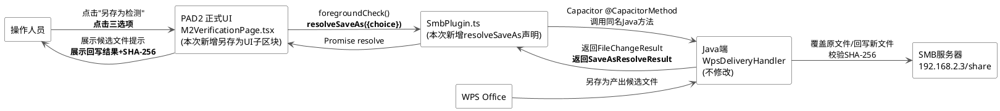
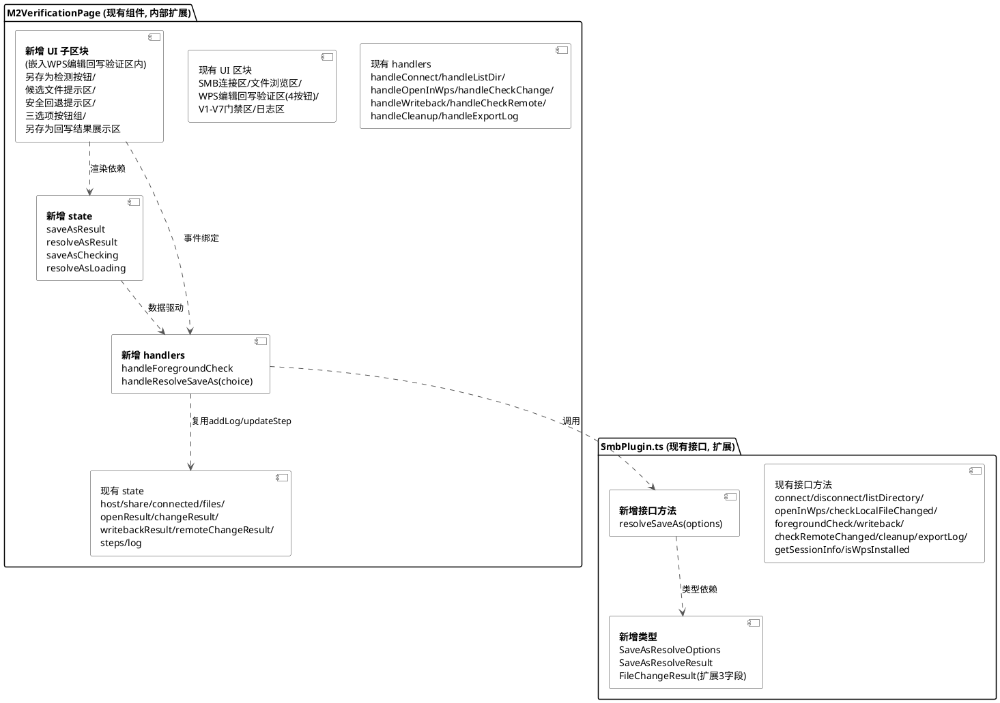
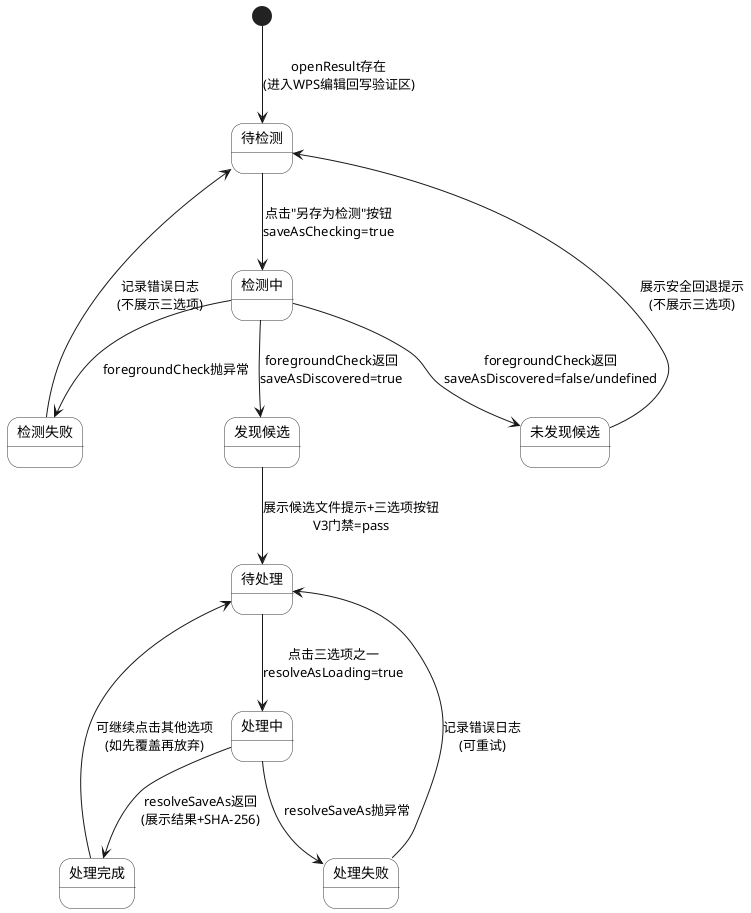
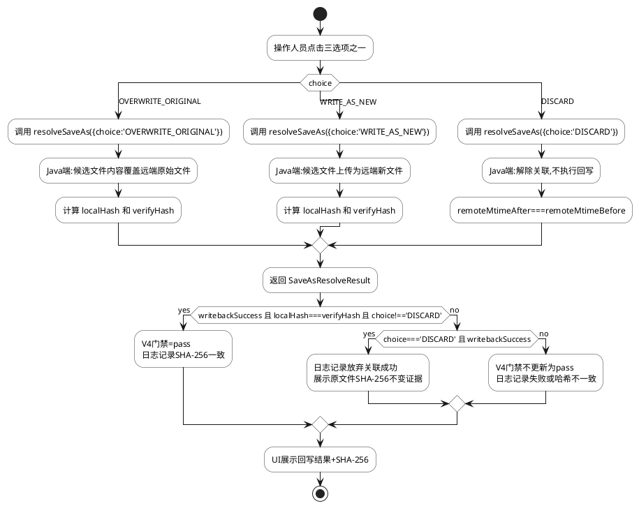
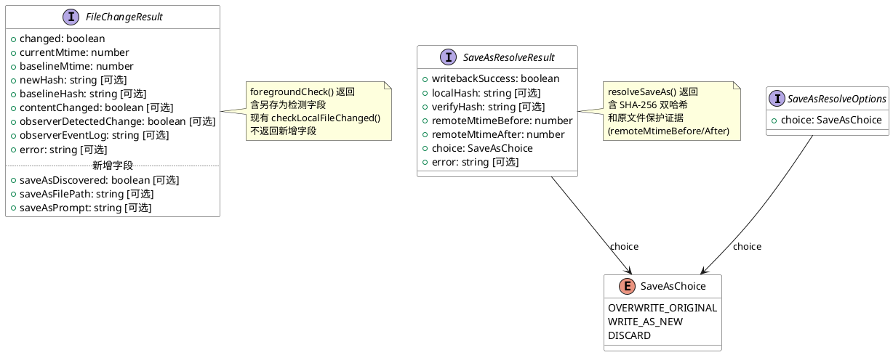
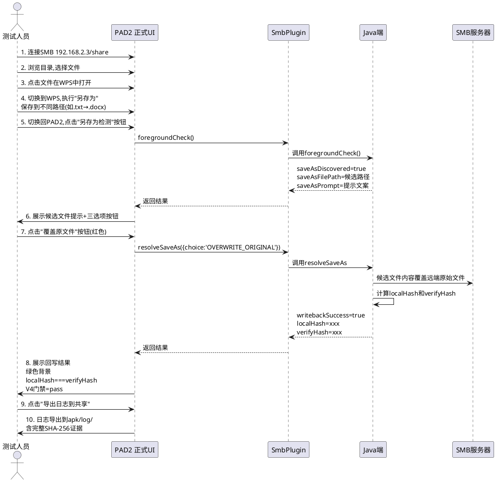

# P0-02 UI-FIX 实现方案 — 另存为处理正式 UI 接入

> 本文档将 `docs/p0-02-ui-fix/spec.md` 中的需求规格（WHAT）转化为可落地的技术实现方案（HOW），作为 spec-task-agent 任务分解的输入。

---

# 一、需求与存量功能关系分析

## 1.1 需求功能与存量功能对比

### 1.1.1 已实现功能

下表列出需求中与存量代码完全匹配或高度相似的功能点，本次修改**不涉及**这些功能的实现逻辑，仅复用其模式。

| 需求功能 | 存量功能 | 代码位置 | 匹配度 |
|---------|---------|---------|--------|
| SMB 连接/断开 UI | `handleConnect` / `handleDisconnect` + 连接表单 | `M2VerificationPage.tsx:61-88, 289-330` | 100% |
| 文件浏览与目录导航 | `handleListDir` / `handleBack` + 文件列表渲染 | `M2VerificationPage.tsx:90-104, 187-192, 332-384` | 100% |
| WPS 打开文件 | `handleOpenInWps` + openResult 展示 | `M2VerificationPage.tsx:106-126, 386-398` | 100% |
| 检查本地变更 UI | `handleCheckChange` + changeResult 展示区 | `M2VerificationPage.tsx:128-148, 406-425` | 100% |
| 执行回写 UI | `handleWriteback` + writebackResult 展示区（含 SHA-256 双哈希展示） | `M2VerificationPage.tsx:150-169, 427-433` | 100% |
| 检查远程变更 UI | `handleCheckRemote` + remoteChangeResult 展示区 | `M2VerificationPage.tsx:171-185, 435-439` | 100% |
| V1-V7 验证门禁框架 | `steps` state + `updateStep` + 门禁表格渲染 | `M2VerificationPage.tsx:18-26, 55-59, 443-471` | 100% |
| 操作日志与导出 | `addLog` + `handleExportLog` + 日志区渲染 | `M2VerificationPage.tsx:50-53, 208-273, 480-504` | 100% |
| inline 样式工具 | `inputStyle` / `btnStyle(color)` | `M2VerificationPage.tsx:509-526` | 100% |
| `foregroundCheck()` 插件方法声明 | `SmbPluginInterface.foregroundCheck` | `SmbPlugin.ts:103` | 100% |
| `FileChangeResult` 基硎字段 | `changed/currentMtime/baselineMtime/newHash/baselineHash/contentChanged/error` | `SmbPlugin.ts:51-61` | 75% |

**判定依据**：
- 100% 匹配项表示存量代码已完整实现该功能，本次修改仅复用其代码模式（hooks 写法、inline 样式、addLog/updateStep 调用方式）。
- `FileChangeResult` 标注 75% 是因为该接口已存在基硎字段，但**缺少** spec.md 6.3 节要求的 `saveAsDiscovered` / `saveAsFilePath` / `saveAsPrompt` 三个另存为相关字段，需扩展。
- `foregroundCheck()` 方法声明标注 100% 是因为方法签名已存在于 `SmbPlugin.ts:103`，但**未在 UI 中被任何按钮调用**，属于"声明已实现、UI 接入未实现"。

### 1.1.2 需要扩展的功能

下表列出需求与存量代码部分匹配、需在现有基础上改造的功能点。

| 需求功能 | 存量功能 | 差异说明 | 扩展方向 |
|---------|---------|---------|---------|
| `FileChangeResult` 含另存为字段 | `SmbPlugin.ts:51-61` 仅有基硎字段 | 缺少 `saveAsDiscovered?: boolean`、`saveAsFilePath?: string`、`saveAsPrompt?: string` 三个可选字段 | 在 `FileChangeResult` 接口内追加三个可选字段，保持向后兼容（现有 `checkLocalFileChanged` 调用不受影响） |
| WPS 编辑回写验证区含另存为检测入口 | `M2VerificationPage.tsx:386-441` 已有该区域，含"检查本地变更/执行回写/检查远程变更/清理"四个按钮 | 缺少"另存为检测"按钮、候选文件提示区、三选项操作按钮、另存为回写结果展示区 | 在该区域内追加另存为相关 UI 子区块，复用现有 `btnStyle` / `addLog` / `updateStep` 模式 |
| `buildLogContent` 日志导出含另存为结果 | `M2VerificationPage.tsx:208-247` 已有详细结果导出段 | 缺少 `saveAsResult` 和 `resolveAsResult` 的导出条目 | 在 `buildLogContent` 函数的"详细结果"段追加两个 `if` 块，导出另存为检测和处理结果 |

**扩展方向共性约束**：
1. 所有扩展均以**新增字段/新增 UI 子区块/新增导出条目**方式进行，不修改现有字段签名、不替换现有按钮、不删除现有导出条目。
2. 新增字段一律设为**可选字段**（`?:`），保证现有 `checkLocalFileChanged()` 调用的返回值无需变更即可通过类型检查。
3. 新增 UI 子区块采用与现有 `changeResult` / `writebackResult` 展示区相同的 inline 样式（`marginTop: 12, padding: 8, background, borderRadius: 4, fontSize: 13`）。

### 1.1.3 需要新增的功能或接口

下表列出需求在存量代码中完全没有对应实现、需新增的功能点，按模块分组。

**模块 A：SmbPlugin.ts 接口声明新增**

| 功能点 | 输入 | 输出 | 核心逻辑 | 依赖关系 |
|--------|------|------|----------|----------|
| `SaveAsResolveOptions` 接口 | — | — | 定义 `choice: 'OVERWRITE_ORIGINAL' \| 'WRITE_AS_NEW' \| 'DISCARD'` 字段 | 被 `resolveSaveAs` 入参引用 |
| `SaveAsResolveResult` 接口 | — | — | 定义 `writebackSuccess` / `localHash` / `verifyHash` / `remoteMtimeBefore` / `remoteMtimeAfter` / `choice` / `error` 字段 | 被 `resolveSaveAs` 出参引用 |
| `resolveSaveAs(options)` 方法声明 | `SaveAsResolveOptions` | `Promise<SaveAsResolveResult>` | 在 `SmbPluginInterface` 中追加方法签名 | 桥接 Java 端 `WpsDeliveryHandler.resolveSaveAs` |

**模块 B：M2VerificationPage.tsx 状态管理新增**

| 功能点 | 输入 | 输出 | 核心逻辑 | 依赖关系 |
|--------|------|------|----------|----------|
| `saveAsResult` state | — | `FileChangeResult \| null` | 存储 `foregroundCheck()` 返回结果 | 驱动候选文件提示区渲染 |
| `resolveAsResult` state | — | `SaveAsResolveResult \| null` | 存储 `resolveSaveAs()` 返回结果 | 驱动另存为回写结果展示区渲染 |
| `saveAsChecking` state | — | `boolean` | `foregroundCheck` 调用期间 loading 标志 | 驱动"另存为检测"按钮 disabled 与文案 |
| `resolveAsLoading` state | — | `boolean` | `resolveSaveAs` 调用期间 loading 标志 | 驱动三选项按钮 disabled |

**模块 C：M2VerificationPage.tsx 事件处理新增**

| 功能点 | 输入 | 输出 | 核心逻辑 | 依赖关系 |
|--------|------|------|----------|----------|
| `handleForegroundCheck` | — | `Promise<void>` | 调用 `SmbPlugin.foregroundCheck()`，更新 `saveAsResult` / `saveAsChecking`，记录日志，按 `saveAsDiscovered` 更新 V3 门禁 | 依赖 `saveAsResult` / `saveAsChecking` state、`addLog` / `updateStep` |
| `handleResolveSaveAs` | `choice: 'OVERWRITE_ORIGINAL' \| 'WRITE_AS_NEW' \| 'DISCARD'` | `Promise<void>` | 调用 `SmbPlugin.resolveSaveAs({choice})`，更新 `resolveAsResult` / `resolveAsLoading`，记录日志，按 `writebackSuccess && localHash===verifyHash` 更新 V4 门禁 | 依赖 `resolveAsResult` / `resolveAsLoading` state、`addLog` / `updateStep` |

**模块 D：M2VerificationPage.tsx UI 组件新增**

| 功能点 | 输入 | 输出 | 核心逻辑 | 依赖关系 |
|--------|------|------|----------|----------|
| "另存为检测"按钮 | `openResult` 存在 | 按钮 DOM | `openResult` 存在时渲染，onClick 调用 `handleForegroundCheck`，loading 时显示"检测中..." | 依赖 `saveAsChecking` state |
| 候选文件提示区 | `saveAsResult` | 提示区 DOM | `saveAsResult.saveAsDiscovered===true` 时渲染，展示 `saveAsFilePath` 和 `saveAsPrompt` | 依赖 `saveAsResult` state |
| 安全回退提示区 | `saveAsResult` | 提示区 DOM | `saveAsResult` 存在且 `saveAsDiscovered!==true` 时渲染，展示 `saveAsPrompt` 和本地缓存 SHA-256 | 依赖 `saveAsResult` / `openResult` state |
| 三选项操作按钮 | `saveAsResult.saveAsDiscovered===true` | 按钮组 DOM | 渲染"覆盖原文件"（红 `#f44336`）、"回写为新文件"（绿 `#4caf50`）、"放弃关联"（灰 `#666`）三个按钮 | 依赖 `resolveAsLoading` state |
| 另存为回写结果展示区 | `resolveAsResult` | 结果区 DOM | `resolveAsResult` 存在时渲染，展示 `writebackSuccess` / `localHash` / `verifyHash` / 哈希一致性标注 | 依赖 `resolveAsResult` state |

**模块间依赖关系**：模块 A（接口声明）是模块 C（事件处理）的类型依赖；模块 B（状态管理）是模块 C 和模块 D 的数据依赖；模块 C 是模块 D 的行为依赖。新增顺序应为 A → B → C → D。

## 1.2 存量功能详细分析

本节对 1.1.1 中"已实现功能"的关键项进行深入解读，识别其接口契约、业务规则、扩展点和约束，作为增量设计的复用基础。

### 1.2.1 `handleWriteback` 回写处理函数（`M2VerificationPage.tsx:150-169`）

- **接口契约**：
  - 入参：无（内部读取 state）
  - 出参：`Promise<void>`（通过 setState 副作用输出）
  - 异常：捕获所有异常，记录日志并更新 V4 门禁为 fail，不向调用方抛出
  - 副作用：调用 `SmbPlugin.writeback()`，更新 `writebackResult` state，调用 `addLog` 3-4 次，调用 `updateStep('V4', ...)`
- **业务规则**：
  - 成功分支：`result.writebackSuccess===true` → V4 门禁 pass，日志记录本地/远程 SHA-256
  - 失败分支：`result.writebackSuccess===false` → V4 门禁 fail，日志记录"SHA-256 不匹配"
  - 异常分支：catch → V4 门禁 fail，日志记录异常信息
- **扩展点**：无显式扩展点，但模式可被 `handleResolveSaveAs` 完整复用（同样的 try/catch + addLog + updateStep 三段式）
- **约束**：
  - 必须先调用 `updateStep('V4', 'running')` 再调用插件方法
  - SHA-256 展示采用 `?.substring(0, 16)` 截断前 16 位用于门禁详情，完整哈希在结果展示区显示
- **复用结论**：`handleResolveSaveAs` 将完整复用此函数结构，仅替换插件方法名（`writeback` → `resolveSaveAs`）、入参（无 → `{choice}`）、结果 state（`writebackResult` → `resolveAsResult`）、loading state（无 → `resolveAsLoading`）。

### 1.2.2 `handleCheckChange` 本地变更检查函数（`M2VerificationPage.tsx:128-148`）

- **接口契约**：
  - 入参：无
  - 出参：`Promise<void>`
  - 副作用：调用 `SmbPlugin.checkLocalFileChanged()`，更新 `changeResult` state，按 `result.changed` / `result.contentChanged` 更新 V2/V3 门禁
- **业务规则**：
  - `result.changed===true` → V2 门禁 pass，记录 mtime 变更
  - `result.contentChanged===true` → V3 门禁 pass，记录内容 SHA-256 变更
- **复用结论**：`handleForegroundCheck` 将复用此函数的 try/catch + addLog + updateStep 模式，差异在于：调用 `foregroundCheck()` 而非 `checkLocalFileChanged()`，更新 `saveAsResult` 而非 `changeResult`，按 `saveAsDiscovered` 更新 V3 门禁。

### 1.2.3 回写结果展示区（`M2VerificationPage.tsx:427-433`）

- **接口契约**：输入 `writebackResult: WritebackResult | null`，输出 React 元素
- **业务规则**：
  - `writebackResult.writebackSuccess===true` → 背景色 `#e8f5e9`（浅绿），文案"✅ 成功 (SHA-256 校验通过)"
  - `writebackResult.writebackSuccess===false` → 背景色 `#ffebee`（浅红），文案"❌ 失败"
  - 完整展示 `localHash` 和 `verifyHash`，使用 `<code style={{ fontSize: 11 }}>` 标签
- **约束**：哈希值完整展示（64 位），不截断
- **复用结论**：另存为回写结果展示区将完整复用此样式和结构，仅替换数据源（`writebackResult` → `resolveAsResult`），并追加哈希一致性显式标注（`localHash === verifyHash` ? "✅ 一致" : "❌ 不一致"）。

### 1.2.4 `btnStyle(color)` 样式工具（`M2VerificationPage.tsx:516-526`）

- **接口契约**：入参 `color: string`，出参 `React.CSSProperties`
- **业务规则**：返回固定 padding/background/border/radius/fontSize/cursor 的按钮样式对象
- **约束**：颜色由调用方传入，已有调用使用 `#1976d2`（蓝）、`#f44336`（红）、`#4caf50`（绿）、`#666`（灰）、`#ff9800`（橙）、`#9c27b0`（紫）、`#009688`（青）
- **复用结论**：三选项按钮将复用 `btnStyle`，颜色选择：覆盖原文件 → `#f44336`（红，警示），回写为新文件 → `#4caf50`（绿，安全），放弃关联 → `#666`（灰，中性）。这与 spec.md 5.2.1 规则 1 的"红色/绿色/灰色"要求一致，且与现有"断开连接"（红）、"执行回写"（绿）、"清理"（灰）的配色语义对齐。

### 1.2.5 `SmbPluginInterface` 接口（`SmbPlugin.ts:96-113`）

- **接口契约**：定义所有 Capacitor 插件方法签名，通过 `registerPlugin<SmbPluginInterface>('SmbPlugin')` 注册
- **业务规则**：每个方法返回 `Promise<T>`，入参为 options 对象
- **扩展点**：接口为开放式 TypeScript interface，追加新方法签名不影响现有方法
- **约束**：
  - 方法名必须与 Java 端 `@CapacitorMethod` 注解的 name 一致
  - 入参/出参类型必须与 Java 端 `JSObject` 字段名一一对应（camelCase）
  - 现有 `foregroundCheck(): Promise<FileChangeResult>` 已声明（第 103 行），Java 端已实现
- **复用结论**：`resolveSaveAs(options: SaveAsResolveOptions): Promise<SaveAsResolveResult>` 将追加到该接口，方法名与 Java 端 `WpsDeliveryHandler.resolveSaveAs` 对齐，入参/出参字段名与 Java 端 `JSObject` key 对齐（spec.md 6.1/6.2 节已定义）。

### 1.2.6 `buildLogContent` 日志导出函数（`M2VerificationPage.tsx:208-247`）

- **接口契约**：入参无，出参 `string`（多行日志文本）
- **业务规则**：
  - 固定段：标题、导出时间、SMB 服务器信息、当前路径、选中文件
  - 门禁段：V1-V7 状态遍历
  - 操作日志段：`log` 数组遍历
  - 详细结果段：按 `openResult` / `changeResult` / `writebackResult` / `remoteChangeResult` 顺序追加，每个以 `if (xxxResult)` 守卫
- **约束**：详细结果段每个结果对象独立 `if` 守卫，互不依赖
- **复用结论**：在详细结果段末尾追加两个 `if` 块（`saveAsResult` 和 `resolveAsResult`），不修改现有四个 `if` 块。

---
# 二、增量设计方案

## 2.1 实现模型

### 2.1.1 上下文视图

本方案涉及的前端模块与外部系统的交互关系如下。新增交互链路用 **加粗** 标注，现有链路保留不变。



**交互链路说明**：
1. **新增链路 1**：操作人员 → UI "另存为检测"按钮 → `SmbPlugin.foregroundCheck()` → Java 端扫描 → 返回 `FileChangeResult`（含 `saveAsDiscovered` 等字段）→ UI 展示候选文件提示。
2. **新增链路 2**：操作人员 → UI 三选项按钮 → `SmbPlugin.resolveSaveAs({choice})` → Java 端执行覆盖/回写新文件/放弃关联 → 返回 `SaveAsResolveResult` → UI 展示回写结果和 SHA-256 证据。
3. **保留链路**：SMB 连接、文件浏览、WPS 打开、检查本地变更、执行回写、检查远程变更、清理、日志导出等现有链路完全不变。

### 2.1.2 服务/组件总体架构

本方案不新增独立模块或服务，所有新增内容均作为 `M2VerificationPage` 函数组件的内部成员（state、callback、JSX 子区块）。组件内部结构如下：



**架构决策与理由**：
1. **决策：不新增独立组件文件，所有新增内容嵌入 `M2VerificationPage.tsx`**。
   - 理由：spec.md 8.1 节约束"仅修改两个文件"，且现有 `M2VerificationPage` 已是单文件大组件（526 行），新增约 120 行另存为子区块仍处于可维护范围。拆分独立组件会引入第三个文件，违反约束。
2. **决策：新增 state 采用与现有 state 相同的 `useState` 声明模式，新增 handler 采用相同的 `useCallback` 包装**。
   - 理由：spec.md 4.4 节"代码风格一致"要求，且 `useCallback` 可避免子组件无谓重渲染（虽然本组件无 memo 子组件，但保持一致性）。
3. **决策：新增 UI 子区块嵌入现有"WPS 编辑回写验证区"（`openResult` 守卫的 div）内部，而非独立顶层 div**。
   - 理由：spec.md 5.1.1 规则 1 要求"另存为检测按钮在 WPS 编辑回写验证区可见"，嵌入该区可复用 `openResult` 守卫，无需额外可见性判断。

### 2.1.3 实现设计文档

#### 2.1.3.1 另存为检测状态流转



**状态流转说明**：
- **待检测 → 检测中**：由 `handleForegroundCheck` 触发，`saveAsChecking` 置 true。
- **检测中 → 发现候选/未发现候选**：根据 `saveAsResult.saveAsDiscovered` 分支。`undefined` 或 `null` 视为未发现（spec.md 5.1.3 异常场景 2）。
- **发现候选 → 待处理**：渲染三选项按钮，V3 门禁更新为 pass（spec.md 5.1.1 规则 5）。
- **待处理 → 处理中 → 处理完成**：由 `handleResolveSaveAs(choice)` 触发，`resolveAsLoading` 置 true，完成后展示结果。V4 门禁按 `writebackSuccess && localHash===verifyHash && choice!=='DISCARD'` 更新（spec.md 5.2.1 规则 6）。
- **处理完成 → 待处理**：允许操作人员切换决策（如先覆盖发现哈希不匹配，再选择放弃关联），不锁定状态。

#### 2.1.3.2 三选项决策分支设计



**分支设计说明**：
- **OVERWRITE_ORIGINAL 分支**：红色按钮（`#f44336`），语义"覆盖原文件"，回写后远端原始文件 SHA-256 更新为候选文件 SHA-256。
- **WRITE_AS_NEW 分支**：绿色按钮（`#4caf50`），语义"回写为新文件"，远端原始文件不变，新增同名文件。
- **DISCARD 分支**：灰色按钮（`#666`），语义"放弃关联"，不执行回写，`remoteMtimeAfter===remoteMtimeBefore` 作为原文件保护证据（spec.md 4.3 节"取消操作证据保留"）。
- **V4 门禁更新条件**：`choice!=='DISCARD'` 排除放弃关联场景，因为 DISCARD 不涉及回写成功判定。

#### 2.1.3.3 异常处理策略

所有新增 handler 采用与现有 `handleWriteback` / `handleCheckChange` 一致的 try/catch 三段式异常处理：

1. **try 段**：调用插件方法，更新结果 state，按业务规则更新门禁，记录成功日志。
2. **catch 段**：捕获 `e: any`，记录错误日志（`addLog(\`xxx失败: ${e.message || e}\`)`），不更新门禁为 pass，UI 不崩溃。
3. **finally 段**（loading state）：将 `saveAsChecking` / `resolveAsLoading` 置 false，恢复按钮可点击。

**异常场景映射**（对应 spec.md 5.1.3 和 5.2.3）：

| 异常场景 | 触发条件 | 系统行为 | UI 感知 |
|---------|---------|---------|---------|
| foregroundCheck 调用失败 | 插件未注册/Java 端异常 | catch 记录日志，`saveAsChecking=false`，不展示三选项 | 日志显示"另存为检测失败: [错误]" |
| foregroundCheck 字段缺失 | `saveAsDiscovered` 为 undefined/null | 视为 false，走安全回退路径 | 展示安全回退提示，不展示三选项 |
| resolveSaveAs 调用失败 | 插件未注册/Java 端异常/SMB 断开 | catch 记录日志，`resolveAsLoading=false`，结果区显示失败 | 日志显示"另存为处理失败: [错误]" |
| 覆盖时 SHA-256 不匹配 | `writebackSuccess=false` 或 `localHash!==verifyHash` | 结果区红色背景，完整展示双哈希，V4 不更新 | 显示"❌ 回写失败，SHA-256 不匹配" |
| 未检测候选时三选项被触发 | `saveAsDiscovered=false` 时点击三选项 | 三选项按钮不渲染（由 JSX 守卫保证），无法触发 | UI 不显示三选项按钮 |

## 2.2 接口设计

### 2.2.1 总体设计

本方案接口设计分为两部分：
1. **SmbPlugin.ts 接口扩展**：新增 `resolveSaveAs` 方法声明和两个 TypeScript 接口，扩展 `FileChangeResult` 三个可选字段。
2. **M2VerificationPage.tsx 内部 handler 接口**：新增两个 `useCallback` handler，签名与现有 handler 风格一致。

**接口分类与稳定性等级**：

| 接口名 | 类别 | 稳定性 | 变更策略 |
|--------|------|--------|----------|
| `SaveAsResolveOptions` | TypeScript 类型 | 稳定 | 新增，后续不修改字段 |
| `SaveAsResolveResult` | TypeScript 类型 | 稳定 | 新增，后续不修改字段 |
| `FileChangeResult`（扩展） | TypeScript 类型 | 稳定 | 仅追加可选字段，向后兼容 |
| `SmbPluginInterface.resolveSaveAs` | Capacitor 插件方法 | 稳定 | 新增，方法名与 Java 端对齐 |
| `handleForegroundCheck` | React useCallback | 内部 | 新增，不对外暴露 |
| `handleResolveSaveAs` | React useCallback | 内部 | 新增，不对外暴露 |

**接口变更策略**：
- 所有新增字段均为**可选字段**（`?:`），保证现有调用方无需变更即可通过 TypeScript 编译。
- `resolveSaveAs` 方法名与 Java 端 `WpsDeliveryHandler.resolveSaveAs` 的 `@CapacitorMethod` name 严格对齐（camelCase）。
- 入参/出参字段名与 Java 端 `JSObject` key 严格对齐（camelCase），由 spec.md 6.1/6.2 节定义。

### 2.2.2 接口清单

#### 接口 1：`SaveAsResolveOptions`

**接口签名**：
```typescript
export interface SaveAsResolveOptions {
  choice: 'OVERWRITE_ORIGINAL' | 'WRITE_AS_NEW' | 'DISCARD';
}
```

**业务说明**：`resolveSaveAs` 方法的入参，封装操作人员的另存为处理决策。

**前置条件**：操作人员已通过"另存为检测"按钮触发 `foregroundCheck()`，且返回 `saveAsDiscovered===true`，三选项按钮已渲染。

**后置条件**：`choice` 值被传递给 Java 端 `WpsDeliveryHandler.resolveSaveAs`，驱动对应分支执行。

**异常映射**：若 `choice` 值不在枚举范围内，TypeScript 编译期即可拦截；运行期由 Java 端校验并返回 `error` 字段。

#### 接口 2：`SaveAsResolveResult`

**接口签名**：
```typescript
export interface SaveAsResolveResult {
  writebackSuccess: boolean;
  localHash?: string;
  verifyHash?: string;
  remoteMtimeBefore: number;
  remoteMtimeAfter: number;
  choice: 'OVERWRITE_ORIGINAL' | 'WRITE_AS_NEW' | 'DISCARD';
  error?: string;
}
```

**业务说明**：`resolveSaveAs` 方法的返回值，包含回写成功标志、SHA-256 双哈希、远端文件 mtime 处理前后值、回传 choice 和错误信息。

**前置条件**：已调用 `SmbPlugin.resolveSaveAs(options)` 并 await 返回。

**后置条件**：
- `writebackSuccess===true` 且 `choice!=='DISCARD'` → UI 展示绿色结果区，完整显示 `localHash` 和 `verifyHash`，标注一致性，V4 门禁 pass。
- `writebackSuccess===true` 且 `choice==='DISCARD'` → UI 展示灰色结果区，展示"已放弃关联"，展示 `remoteMtimeBefore===remoteMtimeAfter` 证据。
- `writebackSuccess===false` → UI 展示红色结果区，展示 `error` 和已有哈希。

**异常映射**：`error` 字段在操作失败时填充，UI 在结果区展示该字段并记录到日志。

**字段约束**（对应 spec.md 6.2 节）：
- `localHash` / `verifyHash`：`choice` 为 `OVERWRITE_ORIGINAL` 或 `WRITE_AS_NEW` 时必填且为 64 位十六进制；`choice` 为 `DISCARD` 时可选。
- `remoteMtimeAfter`：`choice` 为 `DISCARD` 时应与 `remoteMtimeBefore` 一致（原文件保护证据）。

#### 接口 3：`FileChangeResult`（扩展）

**接口签名**（仅展示新增字段，现有字段不变）：
```typescript
export interface FileChangeResult {
  // ...现有字段不变...
  saveAsDiscovered?: boolean;
  saveAsFilePath?: string;
  saveAsPrompt?: string;
}
```

**业务说明**：扩展 `foregroundCheck()` 返回的 `FileChangeResult`，追加另存为相关三个可选字段。

**前置条件**：无（向后兼容，现有 `checkLocalFileChanged` 调用不返回这三个字段，TypeScript 可选字段保证编译通过）。

**后置条件**：`foregroundCheck()` 返回时，UI 读取 `saveAsDiscovered` / `saveAsFilePath` / `saveAsPrompt` 渲染候选文件提示区。

**字段约束**（对应 spec.md 6.3 节）：
- `saveAsDiscovered`：可选，未发现时为 false 或 undefined，UI 视为 false 处理。
- `saveAsFilePath`：仅在 `saveAsDiscovered===true` 时有值。
- `saveAsPrompt`：必填（未发现时为安全回退提示文案）。

#### 接口 4：`SmbPluginInterface.resolveSaveAs`

**接口签名**（在 `SmbPluginInterface` 内追加）：
```typescript
resolveSaveAs(options: SaveAsResolveOptions): Promise<SaveAsResolveResult>;
```

**业务说明**：Capacitor 插件方法，桥接 UI 层 `handleResolveSaveAs` 与 Java 端 `WpsDeliveryHandler.resolveSaveAs`。

**前置条件**：SMB 已连接，WPS 已打开文件，`foregroundCheck` 已返回 `saveAsDiscovered===true`。

**后置条件**：Java 端执行对应分支文件操作，返回 `SaveAsResolveResult`。

**调用示例**：
```typescript
const result = await SmbPlugin.resolveSaveAs({ choice: 'OVERWRITE_ORIGINAL' });
if (result.writebackSuccess && result.localHash === result.verifyHash) {
  // 回写成功且 SHA-256 一致
}
```

#### 接口 5：`handleForegroundCheck`（内部 handler）

**接口签名**：
```typescript
const handleForegroundCheck = useCallback(async (): Promise<void> => {
  // 实现
}, []);
```

**业务说明**："另存为检测"按钮的 onClick handler，调用 `SmbPlugin.foregroundCheck()`，更新 `saveAsResult` / `saveAsChecking`，记录日志，按 `saveAsDiscovered` 更新 V3 门禁。

**前置条件**：`openResult` 存在（按钮在该条件下才渲染）。

**后置条件**：`saveAsResult` 更新为 foregroundCheck 返回值，`saveAsChecking` 恢复 false，V3 门禁按 `saveAsDiscovered` 更新，操作日志新增检测调用和结果记录。

#### 接口 6：`handleResolveSaveAs`（内部 handler）

**接口签名**：
```typescript
const handleResolveSaveAs = useCallback(async (
  choice: 'OVERWRITE_ORIGINAL' | 'WRITE_AS_NEW' | 'DISCARD'
): Promise<void> => {
  // 实现
}, []);
```

**业务说明**：三选项按钮的 onClick handler，调用 `SmbPlugin.resolveSaveAs({choice})`，更新 `resolveAsResult` / `resolveAsLoading`，记录日志，按 `writebackSuccess && localHash===verifyHash && choice!=='DISCARD'` 更新 V4 门禁。

**前置条件**：`saveAsResult.saveAsDiscovered===true`（三选项按钮在该条件下才渲染）。

**后置条件**：`resolveAsResult` 更新为 resolveSaveAs 返回值，`resolveAsLoading` 恢复 false，V4 门禁按条件更新，操作日志新增调用（含 choice 值）和结果记录。

**调用示例**（三选项按钮绑定）：
```typescript
<button onClick={() => handleResolveSaveAs('OVERWRITE_ORIGINAL')} style={btnStyle('#f44336')}>覆盖原文件</button>
<button onClick={() => handleResolveSaveAs('WRITE_AS_NEW')} style={btnStyle('#4caf50')}>回写为新文件</button>
<button onClick={() => handleResolveSaveAs('DISCARD')} style={btnStyle('#666')}>放弃关联</button>
```

## 2.3 数据模型

### 2.3.1 设计目标

本方案数据模型需支持以下业务场景：
1. **另存为检测场景**：存储 `foregroundCheck()` 返回的 `FileChangeResult`（含另存为字段），驱动候选文件提示区渲染。
2. **另存为处理场景**：存储 `resolveSaveAs()` 返回的 `SaveAsResolveResult`，驱动回写结果展示区渲染。
3. **loading 状态场景**：存储 `saveAsChecking` / `resolveAsLoading` 布尔值，驱动按钮 disabled 和文案。
4. **日志导出场景**：`saveAsResult` 和 `resolveAsResult` 纳文本序列化后追加到 `buildLogContent` 输出。

**性能与容量目标**：
- 新增 state 均为单值（非数组），无容量增长风险。
- `saveAsResult` 和 `resolveAsResult` 各持有一个结果对象，内存占用可忽略。
- 无新增持久化需求（结果仅展示和导出日志，不写入本地存储）。

**与存量数据兼容策略**：
- `FileChangeResult` 扩展字段均为可选，现有 `changeResult` state（由 `checkLocalFileChanged` 赋值）不含新字段，TypeScript 编译通过。
- 新增 state 与现有 state 命名空间无冲突（`saveAsResult` / `resolveAsResult` / `saveAsChecking` / `resolveAsLoading` 均为新名称）。
- `buildLogContent` 追加 `if` 守卫块，现有四个结果对象导出不变。

### 2.3.2 模型实现

本方案核心领域对象为 `SaveAsResolveOptions`、`SaveAsResolveResult` 和扩展后的 `FileChangeResult`，均为 TypeScript interface（结构类型）。对象关系如下：



**对象生命周期**：
- `FileChangeResult`（saveAsResult）：`handleForegroundCheck` 调用后创建，存储于 React state，组件卸载时销毁。可被后续 `handleForegroundCheck` 调用覆盖。
- `SaveAsResolveResult`（resolveAsResult）：`handleResolveSaveAs` 调用后创建，存储于 React state，组件卸载时销毁。可被后续 `handleResolveSaveAs` 调用覆盖（支持切换决策）。
- `SaveAsResolveOptions`：仅在 `handleResolveSaveAs` 调用时作为入参临时构造，调用结束即销毁。

**持久化策略**：
- 不引入本地存储或 IndexedDB。
- 结果对象通过 `buildLogContent` 序列化为纯文本，经现有 `handleExportLog` 导出到 SMB 共享 `apk/log/` 目录，复用现有持久化路径。

**类型安全约束**：
- `SaveAsChoice` 枚举值采用字符串字面量联合类型（`'OVERWRITE_ORIGINAL' | 'WRITE_AS_NEW' | 'DISCARD'`），不使用 TypeScript `enum`（与现有代码风格一致，现有代码无 enum 使用）。
- 所有可选字段标注 `?:`，调用方访问时使用可选链（`?.`）或显式 null 检查。
- `handleResolveSaveAs` 的 `choice` 入参类型与 `SaveAsResolveOptions.choice` 严格一致，避免运行期字符串校验。

---

# 三、修改清单与最小差异审查

## 3.1 修改文件清单

| 文件 | 修改类型 | 修改内容 | 行数预估 |
|------|----------|----------|----------|
| `src/adapter/smb/SmbPlugin.ts` | 扩展接口 | 1. `FileChangeResult` 追加 3 个可选字段（`saveAsDiscovered` / `saveAsFilePath` / `saveAsPrompt`）<br>2. 新增 `SaveAsResolveOptions` 接口<br>3. 新增 `SaveAsResolveResult` 接口<br>4. `SmbPluginInterface` 追加 `resolveSaveAs` 方法签名 | +20 行 |
| `src/ui/pages/M2VerificationPage.tsx` | 扩展组件 | 1. import 追加 `SaveAsResolveOptions` / `SaveAsResolveResult`<br>2. 新增 4 个 useState（`saveAsResult` / `resolveAsResult` / `saveAsChecking` / `resolveAsLoading`）<br>3. 新增 2 个 useCallback（`handleForegroundCheck` / `handleResolveSaveAs`）<br>4. WPS 编辑回写验证区追加另存为 UI 子区块（按钮 + 提示区 + 三选项 + 结果区）<br>5. `buildLogContent` 追加 2 个 `if` 守卫块 | +120 行 |

**总修改量**：约 +140 行，涉及 2 个文件，不删除任何现有代码。

## 3.2 最小差异审查清单

| 审查项 | 审查内容 | 预期结果 |
|--------|----------|----------|
| 文件范围 | 修改是否仅限 `M2VerificationPage.tsx` 和 `SmbPlugin.ts` | 是，不涉及 Java 端、测试脚本、测试报告 |
| 现有功能不回归 | SMB 连接/浏览/WPS 打开/检查本地变更/执行回写/检查远程变更/清理/日志导出逻辑是否不变 | 是，新增内容均为追加，不修改现有 handler 和 JSX |
| 现有证据保留 | `docs/p0-02-r3/test-report.md` 等现有测试报告是否不变 | 是，不修改 docs 目录下任何现有文件 |
| 接口向后兼容 | `FileChangeResult` 新增字段是否为可选 | 是，三个字段均标注 `?:` |
| 现有调用不破坏 | `checkLocalFileChanged` 调用是否仍通过编译 | 是，返回值不含新字段，可选字段兼容 |
| UI 风格一致 | 新增 UI 是否复用 `btnStyle` / `inputStyle` / inline 样式 | 是，三选项按钮使用 `btnStyle('#f44336')` / `btnStyle('#4caf50')` / `btnStyle('#666')` |
| 代码风格一致 | 新增 handler 是否使用 `useCallback` + try/catch + `addLog` + `updateStep` 模式 | 是，与 `handleWriteback` / `handleCheckChange` 一致 |
| 门禁更新一致 | V3/V4 门禁更新是否复用 `updateStep` | 是，V3 由 `handleForegroundCheck` 更新，V4 由 `handleResolveSaveAs` 更新 |
| 日志导出兼容 | `buildLogContent` 是否仅追加不修改现有段 | 是，在详细结果段末尾追加两个 `if` 块 |

## 3.3 不修改项清单

| 不修改项 | 理由 |
|---------|------|
| Java 端 `WpsDeliveryHandler.java` | spec.md 8.1 节约束，resolveSaveAs 三个分支已实现且测试通过 |
| 现有 R3 测试脚本（`run-regression-r3.mjs`） | spec.md 8.1 节约束，现有测试证据保留不变 |
| 现有测试报告（`docs/p0-02-r3/test-report.md`） | spec.md 8.2 节约束，6/6 ALL PASSED 结论保留 |
| R3-FIX 文档 | spec.md 8.1 节约束 |
| `SmbPlugin.ts` 现有方法签名 | 仅追加新方法和新接口，不修改现有签名 |
| `M2VerificationPage.tsx` 现有 handler | 仅追加新 handler，不修改现有 handler 逻辑 |
| `M2VerificationPage.tsx` 现有 JSX 区块 | 仅在 WPS 编辑回写验证区内部追加子区块，不替换现有按钮和展示区 |

---

# 四、验证方案

## 4.1 正式 UI 覆盖操作验证流程

本方案交付后，按以下流程在正式 UI 中执行覆盖操作验证，对应 spec.md AC-02 验收标准。



## 4.2 验证场景清单

| 场景编号 | 场景描述 | 操作步骤 | 预期结果 | 对应 AC |
|---------|---------|----------|----------|---------|
| VS-01 | 另存为检测发现候选 | WPS 打开文件 → 另存为到不同路径 → 点击"另存为检测" | UI 展示候选文件路径和提示文案，展示三选项按钮，V3 门禁 pass | AC-01 |
| VS-02 | 覆盖原文件成功 | VS-01 后点击"覆盖原文件" | UI 展示绿色结果区，localHash===verifyHash，V4 门禁 pass，日志含完整 SHA-256 | AC-02、AC-03 |
| VS-03 | 回写为新文件成功 | VS-01 后点击"回写为新文件" | UI 展示绿色结果区，localHash===verifyHash，远端原始文件不变，V4 门禁 pass | AC-02、AC-03 |
| VS-04 | 放弃关联 | VS-01 后点击"放弃关联" | UI 展示灰色结果区，"已放弃关联"，remoteMtimeBefore===remoteMtimeAfter，远端原始文件 SHA-256 不变 | AC-03 |
| VS-05 | 未发现候选安全回退 | WPS 打开文件但未另存为 → 点击"另存为检测" | UI 展示安全回退提示，不展示三选项按钮，展示本地缓存 SHA-256 | AC-03 |
| VS-06 | foregroundCheck 失败 | 模拟插件异常 → 点击"另存为检测" | UI 日志显示"另存为检测失败: [错误]"，不展示三选项，UI 不崩溃 | — |
| VS-07 | resolveSaveAs 失败 | VS-01 后模拟 SMB 断开 → 点击"覆盖原文件" | UI 日志显示"另存为处理失败: [错误]"，结果区红色，远端原始文件未被破坏 | AC-03 |
| VS-08 | 日志导出含另存为证据 | VS-02 后点击"导出日志到共享" | 导出日志文件含 saveAsResult 和 resolveAsResult 详细段，含完整 SHA-256 | AC-03 |
| VS-09 | 现有功能不回归 | 执行现有 6 个场景测试 | 6/6 ALL PASSED，现有功能不受影响 | AC-04 |

## 4.3 自动化测试标注策略

若使用 CDP 自动化触摸执行上述场景（作为测试手段而非产品交付路径），必须在测试报告和操作日志中标注"自动化 UI 测试"，对应 spec.md AC-02 和 5.3.1 规则 4。

**标注方式**：
1. 测试报告标题追加"[自动化 UI 测试]"前缀。
2. 操作日志首行追加"⚠️ 本操作由自动化 UI 测试触发，非操作人员亲自点击"。
3. 不声称是操作人员亲自点击。

## 4.4 Final Gate 重新申请证据清单

最小差异审查通过后，重新申请 P0-02 Final Gate 需附以下三项证据：

| 证据编号 | 证据名称 | 证据内容 | 产出方式 |
|---------|---------|---------|----------|
| EV-01 | 正式 UI 接入证据 | M2VerificationPage.tsx 含"另存为检测"按钮和三选项按钮的截图 + 代码 diff | 正式 UI 操作截图 + git diff |
| EV-02 | 三方 SHA-256 一致回写证据 | VS-02 场景的 localHash 和 verifyHash 完整 64 位哈希值 + 一致标注 | 正式 UI 结果区截图 + 导出日志 |
| EV-03 | 取消操作原文件不变证据 | VS-04 场景的 remoteMtimeBefore===remoteMtimeAfter + 远端原始文件 SHA-256 处理前后一致 | 正式 UI 结果区截图 + 导出日志 |

---

# 五、方案决策汇总

| 决策编号 | 决策内容 | 决策理由 | 对应约束 |
|---------|---------|---------|----------|
| D-01 | 不新增独立组件文件，所有新增内容嵌入 `M2VerificationPage.tsx` | spec.md 8.1 节"仅修改两个文件"约束 | 修改范围约束 |
| D-02 | 新增 state 采用 `useState`，新增 handler 采用 `useCallback` | spec.md 4.4 节"代码风格一致"约束 | 可维护性 |
| D-03 | 新增 UI 子区块嵌入现有"WPS 编辑回写验证区"内部 | spec.md 5.1.1 规则 1"另存为检测按钮在 WPS 编辑回写验证区可见" | 核心能力 5.1 |
| D-04 | `FileChangeResult` 新增字段均为可选（`?:`） | spec.md 4.5 节"接口兼容"约束 | 兼容性 |
| D-05 | 三选项按钮颜色：红 `#f44336` / 绿 `#4caf50` / 灰 `#666` | spec.md 5.2.1 规则 1 + 与现有"断开连接/执行回写/清理"配色语义对齐 | UI 风格一致 |
| D-06 | V4 门禁更新条件排除 DISCARD（`choice!=='DISCARD'`） | DISCARD 不涉及回写成功判定 | 核心能力 5.2 |
| D-07 | `saveAsDiscovered` 为 undefined/null 时视为 false | spec.md 5.1.3 异常场景 2 | 异常处理 |
| D-08 | 处理完成后不锁定状态，允许切换决策 | 支持操作人员先覆盖发现哈希不匹配后再放弃关联 | 交互灵活性 |
| D-09 | 不引入本地存储，结果通过 `buildLogContent` 序列化导出 | 复用现有日志导出路径，无新增持久化需求 | 最小差异 |
| D-10 | `SaveAsChoice` 采用字符串字面量联合类型而非 `enum` | 与现有代码风格一致（现有代码无 enum 使用） | 代码风格一致 |

---

> **文档状态**：本实现方案文档已生成，位于 `docs/p0-02-ui-fix/design.md`。
> **下一步**：等待用户审查确认后，由 spec-task-agent 进行任务分解。本 agent 不负责 tasks.md 生成和代码实现。
