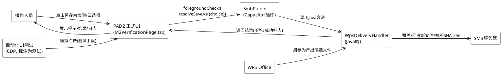
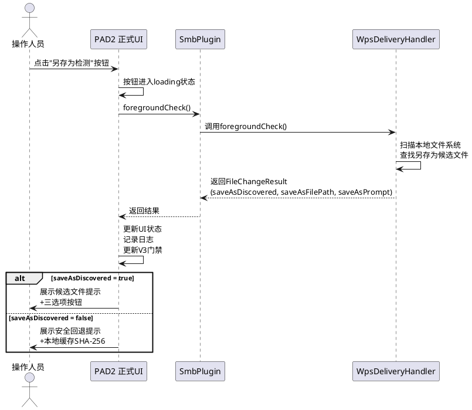
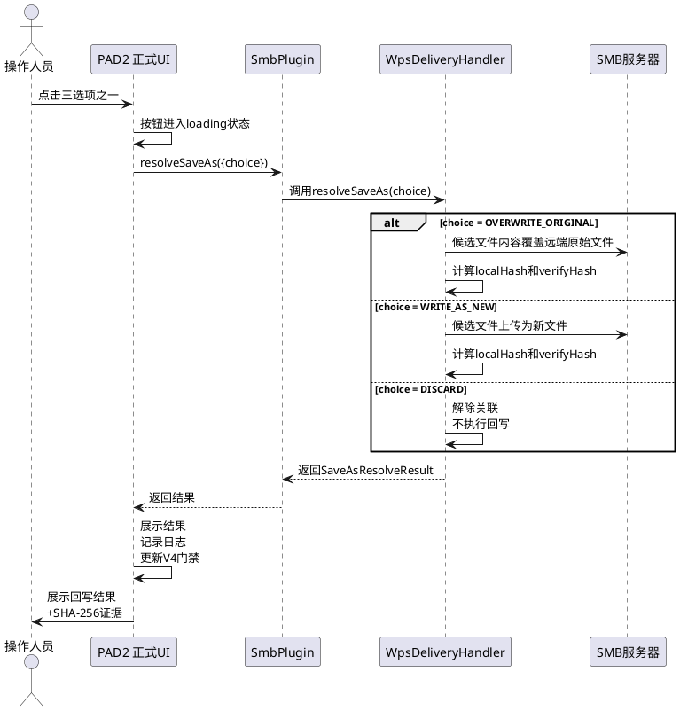
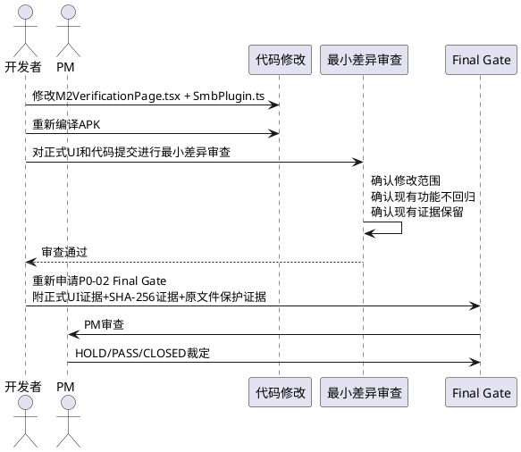

# P0-02 UI-FIX 需求规格 — 另存为处理正式 UI 接入

## 需求背景与目标

### 背景

PAD2 是安卓平板 SMB 文件管理器（Capacitor + React + TypeScript 架构），当前处于 **P0-02 Final Gate** 阶段。PM 裁定 P0-02 仍 **HOLD**，原因如下：

- 另存为候选文件提示及"覆盖原文件／回写为新文件／放弃关联"选项此前仅通过 **CDP 自动化测试**和**临时注入面板**验证，未接入 PAD2 **正式产品 UI**。
- Java 端 `WpsDeliveryHandler` 已实现 `resolveSaveAs` 逻辑（OVERWRITE_ORIGINAL / WRITE_AS_NEW / DISCARD 三个分支），`SmbPlugin.ts` 已声明 `foregroundCheck()` 方法，但两者均**缺少正式 UI 按钮和提示界面**。
- 已有充分的自动化测试证据（6/6 ALL PASSED）和三方 SHA-256 一致证据，PM 只要求补齐正式产品 UI。

### 目标

在 PAD2 正式产品 UI（`M2VerificationPage.tsx`）中补齐另存为检测与处理功能，使操作人员可通过正式 UI 完成另存为候选文件检测和覆盖/回写新文件/放弃关联决策，保留现有全部功能和测试证据不变，随后重新申请 P0-02 Final Gate。

### 涉及代码范围

| 文件 | 当前状态 | 本次修改 |
|------|----------|----------|
| `src/ui/pages/M2VerificationPage.tsx` | 已有 SMB 连接、文件浏览、WPS 打开、检查本地变更、执行回写、检查远程变更等 UI；**缺少** foregroundCheck 和 resolveSaveAs 的 UI 按钮与提示界面 | 新增另存为检测按钮、候选文件提示区、三选项操作按钮、结果展示区 |
| `src/adapter/smb/SmbPlugin.ts` | 已声明 `foregroundCheck(): Promise<FileChangeResult>`（第 103 行）；**未声明** `resolveSaveAs()` 方法 | 新增 `resolveSaveAs()` 方法声明及 `SaveAsResolveOptions`、`SaveAsResolveResult` 接口 |
| Java 端 `WpsDeliveryHandler.java` | 已实现 `resolveSaveAs` 三个分支逻辑，OVERWRITE_ORIGINAL 分支已返回 localHash/verifyHash | 不修改（已满足要求） |

---

# **1. 组件定位**

## **1.1 核心职责**

本组件负责在 PAD2 正式产品 UI 中展示另存为候选文件检测结果并提供"覆盖原文件／回写为新文件／放弃关联"三项决策操作入口，实现 WPS 另存为场景下的人工可操作回写闭环。

## **1.2 核心输入**

1. **操作人员触发**：操作人员在正式 UI 中点击"另存为检测"按钮，触发 `foregroundCheck()` 调用。
2. **foregroundCheck 返回结果**：来自 SmbPlugin 的 `FileChangeResult`，包含 `saveAsDiscovered`（是否发现另存为候选文件）、`saveAsFilePath`（候选文件路径）、`saveAsPrompt`（提示文案）等字段。
3. **操作人员决策**：操作人员在正式 UI 的三选项中点击其一，触发 `resolveSaveAs({choice})` 调用，choice 取值为 `OVERWRITE_ORIGINAL` / `WRITE_AS_NEW` / `DISCARD`。
4. **resolveSaveAs 返回结果**：来自 SmbPlugin 的 `SaveAsResolveResult`，包含 `writebackSuccess`、`localHash`、`verifyHash`、`remoteMtimeBefore`、`remoteMtimeAfter` 等字段。

## **1.3 核心输出**

1. **UI 提示展示**：在正式 UI 中向操作人员展示另存为候选文件提示文案（含候选文件名、格式变化说明、三选项操作说明）。
2. **回写结果展示**：在正式 UI 中向操作人员展示 resolveSaveAs 执行结果（成功/失败、本地 SHA-256、远程校验 SHA-256、是否一致）。
3. **操作日志记录**：将另存为检测和处理的每一步操作记录到页面操作日志区，支持导出。
4. **V3 验证门禁更新**：根据另存为检测结果更新 V3（保存行为识别）验证门禁状态。

## **1.4 职责边界**

本组件**不负责**以下事项：

1. **不负责**另存为候选文件的实际扫描算法实现——该逻辑由 Java 端 `WpsDeliveryHandler.foregroundCheck()` 完成，UI 仅调用并展示结果。
2. **不负责**覆盖/回写新文件/放弃关联的实际文件操作实现——该逻辑由 Java 端 `WpsDeliveryHandler.resolveSaveAs()` 完成，UI 仅传递用户决策并展示结果。
3. **不负责**重新构建 APK 的构建流程——本次需修改 UI 代码并重新编译 APK，但构建流程本身不属于本组件职责。
4. **不负责**重复已通过的哈希测试、R3-FIX 文档修订——现有测试证据保留不变。
5. **不负责**临时注入面板或 CDP 自动化测试脚本的维护——自动化触摸仅作为测试手段，不作为产品交付路径。

---

# **2. 领域术语**

**另存为（Save-As）**
: WPS 编辑过程中，用户通过"另存为"菜单将文件保存到与原始打开路径不同的位置（可能伴随格式变化，如 .txt 变更为 .docx），导致原始本地缓存文件未被修改而新文件出现在其他路径。

**候选文件（Candidate File）**
: foregroundCheck 扫描发现的、疑似用户另存为产出的文件，满足基名匹配、mtime 在会话时间窗口内、路径一致等关联条件。

**覆盖原文件（OVERWRITE_ORIGINAL）**
: 将候选文件内容回写到 SMB 远端原始文件路径，使远端原始文件被候选文件内容覆盖，远端文件 SHA-256 更新为候选文件 SHA-256。

**回写为新文件（WRITE_AS_NEW）**
: 将候选文件作为新文件上传到 SMB 远端，保留远端原始文件不变，在远端新增与候选文件同名的文件。

**放弃关联（DISCARD）**
: 不执行任何回写操作，解除当前编辑会话与候选文件的关联，保留本地缓存和远端原始文件现状不变。

**foregroundCheck**
: 前台另存为检测方法，扫描本地文件系统发现另存为候选文件，返回候选文件路径、提示文案和关联标志。

**resolveSaveAs**
: 另存为处理方法，接收用户决策（OVERWRITE_ORIGINAL / WRITE_AS_NEW / DISCARD）并执行对应文件操作，返回回写结果和 SHA-256 校验哈希。

**三方 SHA-256 一致**
: 候选文件 SHA-256（localHash）、回写后远端文件 SHA-256（verifyHash）二者一致，且与回写前候选文件内容哈希一致，证明回写过程中数据未被篡改或损坏。

**正式产品 UI**
: PAD2 通过 React + Capacitor WebView 渲染的、面向最终操作人员的正式界面（`M2VerificationPage.tsx`），区别于 CDP 自动化测试注入的临时面板。

---

# **3. 角色与边界**

## **3.1 核心角色**

- **操作人员**：通过 PAD2 正式 UI 进行 SMB 文件浏览、WPS 编辑、另存为检测和处理的最终用户。在正式 UI 中点击按钮、查看提示、做出覆盖/回写新文件/放弃关联决策。
- **PM（评审者）**：对 P0-02 Final Gate 进行 HOLD/PASS/CLOSED 裁定，审查正式 UI 接入情况和最小差异审查结果。
- **自动化 UI 测试**：通过 CDP WebSocket 远程调用 Capacitor 插件方法模拟操作人员点击，作为测试手段。必须标注为"自动化 UI 测试"，不声称是操作人员亲自点击。

## **3.2 外部系统**

- **WPS Office（cn.wps.moffice_eng）**：用户在 WPS 中执行另存为操作，产出候选文件到本地文件系统其他路径。
- **SMB 服务器（192.168.2.3/share）**：远端文件存储，覆盖原文件/回写为新文件的目标位置，回写后通过 SHA-256 校验远端文件完整性。
- **SmbPlugin（Capacitor 插件）**：连接 UI 层与 Java 端 `WpsDeliveryHandler` 的桥梁，提供 `foregroundCheck()` 和 `resolveSaveAs()` 方法供 UI 调用。
- **Java 端 WpsDeliveryHandler**：实现 foregroundCheck 扫描算法和 resolveSaveAs 三个分支的文件操作逻辑，UI 不重复实现。

## **3.3 交互上下文**

---

# **4. DFX约束**

## **4.1 性能**

1. **foregroundCheck 响应时间**：另存为检测按钮点击后，UI 到收到 foregroundCheck 返回结果的时间不超过 10 秒（含本地文件系统扫描）。
2. **resolveSaveAs 响应时间**：操作人员选择三选项之一后，UI 到收到 resolveSaveAs 返回结果的时间不超过 15 秒（含 SMB 回写和 SHA-256 校验）。
3. **UI 渲染无阻塞**：foregroundCheck 和 resolveSaveAs 调用期间 UI 不卡顿，按钮显示 loading 状态，操作日志实时追加。

## **4.2 可靠性**

1. **原文件保护**：选择"放弃关联（DISCARD）"或 foregroundCheck 未发现候选文件时，远端原始文件 SHA-256 必须与处理前一致，不得被破坏。
2. **回写完整性**：选择"覆盖原文件"或"回写为新文件"且回写成功时，localHash 与 verifyHash 必须一致且均为有效 64 位十六进制 SHA-256。
3. **失败不破坏**：resolveSaveAs 执行失败时，远端原始文件不得被部分写入破坏。
4. **现有功能不回归**：本次修改不得破坏 M2VerificationPage 现有的 SMB 连接、文件浏览、WPS 打开、检查本地变更、执行回写、检查远程变更、日志导出等全部功能。

## **4.3 安全性**

1. **SHA-256 证据保留**：resolveSaveAs 返回的 localHash 和 verifyHash 必须在 UI 结果展示区完整显示（64 位），并记录到操作日志，作为三方 SHA-256 一致的回写证据。
2. **取消操作证据保留**：选择 DISCARD 或 foregroundCheck 未发现候选文件时，UI 必须展示并记录远端原始文件 SHA-256 处理前后一致的证据。
3. **自动化测试标注**：若使用自动化触摸执行覆盖操作，必须在测试报告和操作日志中明确标注为"自动化 UI 测试"，不得声称是操作人员亲自点击。

## **4.4 可维护性**

1. **最小化修改**：本次修改仅限于 `M2VerificationPage.tsx`（新增 UI 组件）和 `SmbPlugin.ts`（新增 resolveSaveAs 声明及相关接口），不修改 Java 端逻辑、不修改现有测试脚本、不修改现有测试报告。
2. **代码风格一致**：新增 UI 组件的样式（inputStyle、btnStyle）、状态管理（useState/useCallback）、日志记录（addLog）、门禁更新（updateStep）方式与现有代码保持一致。
3. **日志可导出**：另存为检测和处理的操作记录纳入现有操作日志区，支持通过"导出日志到共享"按钮导出。

## **4.5 兼容性**

1. **SmbPlugin 接口兼容**：新增 `resolveSaveAs()` 方法声明和 `SaveAsResolveOptions`、`SaveAsResolveResult` 接口不得修改现有接口方法签名，保持向后兼容。
2. **FileChangeResult 字段兼容**：foregroundCheck 返回的 FileChangeResult 中 `saveAsDiscovered`、`saveAsFilePath`、`saveAsPrompt` 等另存为相关字段以可选字段形式存在，不影响现有 checkLocalFileChanged 调用。
3. **APK 重新构建**：本次修改 UI 代码后需重新编译 APK，新 APK 需通过现有 6 个场景测试不回归。

---

# **5. 核心能力**

## **5.1 另存为检测（foregroundCheck UI 接入）**

### **5.1.1 业务规则**

1. **检测按钮可见性规则**：当 WPS 已打开文件（openResult 存在且 intentLaunched 为 true）时，"另存为检测"按钮必须在正式 UI 的 WPS 编辑回写验证区可见且可点击。
   - 验收条件：[WPS 打开文件成功后] → [正式 UI 显示"另存为检测"按钮，按钮可点击]
2. **检测执行规则**：操作人员点击"另存为检测"按钮后，UI 必须调用 `SmbPlugin.foregroundCheck()`，按钮进入 loading 状态，调用完成后恢复。
   - 验收条件：[点击"另存为检测"按钮] → [调用 foregroundCheck()，按钮显示 loading，完成后恢复]
3. **候选文件发现展示规则**：foregroundCheck 返回 `saveAsDiscovered` 为 true 时，UI 必须在正式 UI 中展示候选文件提示区，包含候选文件路径（saveAsFilePath）和提示文案（saveAsPrompt），并展示"覆盖原文件""回写为新文件""放弃关联"三个操作按钮。
   - 验收条件：[foregroundCheck 返回 saveAsDiscovered=true] → [UI 展示候选文件路径、提示文案、三选项按钮]
4. **未发现候选展示规则**：foregroundCheck 返回 `saveAsDiscovered` 为 false 时，UI 必须展示安全回退提示（含 saveAsPrompt 文案，如"未自动发现另存为文件，请手动选择文件"），不展示三选项按钮，并展示当前本地缓存文件 SHA-256 作为原文件保护证据。
   - 验收条件：[foregroundCheck 返回 saveAsDiscovered=false] → [UI 展示安全回退提示，不展示三选项按钮，展示本地缓存 SHA-256]
5. **V3 门禁更新规则**：foregroundCheck 返回后，必须根据 saveAsDiscovered 结果更新 V3（保存行为识别）验证门禁状态——发现另存为则标记为 pass 并记录"另存为已识别"，未发现则保持原状态。
   - 验收条件：[foregroundCheck 返回 saveAsDiscovered=true] → [V3 门禁状态更新为 pass，详情记录另存为识别]
6. **日志记录规则**：foregroundCheck 的调用、返回结果（saveAsDiscovered、saveAsFilePath、saveAsPrompt）必须记录到操作日志区。
   - 验收条件：[执行 foregroundCheck] → [操作日志区新增检测调用和结果记录]

### **5.1.2 交互流程**

### **5.1.3 异常场景**

1. **foregroundCheck 调用失败**
   - 触发条件：SmbPlugin.foregroundCheck() 抛出异常（如插件未注册、Java 端异常）
   - 系统行为：捕获异常，在操作日志区记录错误信息，按钮恢复可点击状态，不展示三选项按钮
   - 用户感知：操作日志区显示"另存为检测失败: [错误信息]"，UI 不崩溃
2. **foregroundCheck 返回字段缺失**
   - 触发条件：返回的 FileChangeResult 中 saveAsDiscovered 字段为 undefined 或 null
   - 系统行为：将 saveAsDiscovered 视为 false，走未发现候选的安全回退展示路径
   - 用户感知：UI 展示安全回退提示，不展示三选项按钮
3. **WPS 未打开文件时点击检测**
   - 触发条件：openResult 为 null 或 intentLaunched 为 false 时操作人员点击"另存为检测"
   - 系统行为：按钮不显示（由按钮可见性规则约束），无法点击
   - 用户感知：UI 不显示"另存为检测"按钮

## **5.2 另存为处理（resolveSaveAs UI 接入）**

### **5.2.1 业务规则**

1. **三选项按钮可见性规则**：仅当 foregroundCheck 返回 saveAsDiscovered 为 true 且候选文件提示区已展示时，"覆盖原文件""回写为新文件""放弃关联"三个按钮才在正式 UI 中可见且可点击。
   - 验收条件：[foregroundCheck 返回 saveAsDiscovered=true 并展示提示区] → [三选项按钮可见可点击]；[saveAsDiscovered=false] → [三选项按钮不可见]
2. **覆盖原文件执行规则**：操作人员点击"覆盖原文件"按钮后，UI 必须调用 `SmbPlugin.resolveSaveAs({choice: 'OVERWRITE_ORIGINAL'})`，按钮进入 loading 状态，调用完成后展示回写结果（writebackSuccess、localHash、verifyHash）。
   - 验收条件：[点击"覆盖原文件"] → [调用 resolveSaveAs({choice:'OVERWRITE_ORIGINAL'})，展示回写结果和 SHA-256]
3. **回写为新文件执行规则**：操作人员点击"回写为新文件"按钮后，UI 必须调用 `SmbPlugin.resolveSaveAs({choice: 'WRITE_AS_NEW'})`，按钮进入 loading 状态，调用完成后展示回写结果。
   - 验收条件：[点击"回写为新文件"] → [调用 resolveSaveAs({choice:'WRITE_AS_NEW'})，展示回写结果和 SHA-256]
4. **放弃关联执行规则**：操作人员点击"放弃关联"按钮后，UI 必须调用 `SmbPlugin.resolveSaveAs({choice: 'DISCARD'})`，展示放弃关联确认信息，并展示远端原始文件 SHA-256 处理前后一致的原文件保护证据。
   - 验收条件：[点击"放弃关联"] → [调用 resolveSaveAs({choice:'DISCARD'})，展示放弃确认和原文件 SHA-256 一致证据]
5. **SHA-256 证据展示规则**：resolveSaveAs 返回 writebackSuccess 为 true 时，UI 必须在结果展示区完整显示 localHash 和 verifyHash（64 位十六进制），并明确标注二者是否一致；为 false 时展示失败信息和已有哈希。
   - 验收条件：[resolveSaveAs 返回 writebackSuccess=true] → [UI 完整展示 localHash、verifyHash 并标注一致]；[writebackSuccess=false] → [UI 展示失败信息和哈希]
6. **V4 门禁更新规则**：resolveSaveAs 返回后，当 choice 为 OVERWRITE_ORIGINAL 或 WRITE_AS_NEW 且 writebackSuccess 为 true 且 localHash 等于 verifyHash 时，必须更新 V4（回写成功）门禁为 pass。
   - 验收条件：[覆盖/回写新文件成功且哈希一致] → [V4 门禁更新为 pass]
7. **日志记录规则**：resolveSaveAs 的调用（含 choice 值）、返回结果（writebackSuccess、localHash、verifyHash）必须记录到操作日志区。
   - 验收条件：[执行 resolveSaveAs] → [操作日志区新增调用和结果记录]
8. **禁止项：不在正式 UI 外执行覆盖操作**
   - 验收条件：[覆盖操作] → [必须通过正式 UI 的"覆盖原文件"按钮触发，禁止仅依赖临时注入面板或 CDP 脚本作为产品交付路径]

### **5.2.2 交互流程**

### **5.2.3 异常场景**

1. **resolveSaveAs 调用失败**
   - 触发条件：SmbPlugin.resolveSaveAs() 抛出异常（如插件未注册、Java 端异常、SMB 连接断开）
   - 系统行为：捕获异常，在操作日志区记录错误信息，按钮恢复可点击状态，结果展示区显示失败
   - 用户感知：操作日志区显示"另存为处理失败: [错误信息]"，UI 不崩溃
2. **覆盖原文件时 SHA-256 不匹配**
   - 触发条件：resolveSaveAs 返回 writebackSuccess 为 false 或 localHash 不等于 verifyHash
   - 系统行为：在结果展示区以红色背景展示失败信息，完整显示 localHash 和 verifyHash 并标注不一致，V4 门禁不更新为 pass
   - 用户感知：UI 显示"❌ 回写失败，SHA-256 不匹配"，展示两个哈希值供排查
3. **SMB 连接断开导致回写失败**
   - 触发条件：resolveSaveAs 执行期间 SMB 连接断开
   - 系统行为：Java 端返回失败结果，UI 展示失败信息和错误原因，远端原始文件未被破坏（由 Java 端保证）
   - 用户感知：UI 显示回写失败和网络错误提示
4. **未检测到候选文件时三选项被触发**
   - 触发条件：saveAsDiscovered 为 false 时操作人员尝试触发三选项（理论上按钮不可见）
   - 系统行为：三选项按钮不渲染，无法触发
   - 用户感知：UI 不显示三选项按钮

## **5.3 最小差异审查与 Final Gate 重新申请**

### **5.3.1 业务规则**

1. **最小差异审查规则**：本次代码修改完成后，必须对正式产品 UI（M2VerificationPage.tsx）和最终代码提交进行最小差异审查，确认修改范围仅限于新增另存为 UI 组件和 resolveSaveAs 声明，未修改现有功能逻辑。
   - 验收条件：[代码修改完成] → [产出最小差异审查记录，确认未破坏现有功能]
2. **现有证据保留规则**：本次修改不得修改或删除现有测试报告（docs/p0-02-r3/test-report.md）、R3-FIX 文档、已通过的哈希测试证据。
   - 验收条件：[本次修改] → [现有测试报告和证据文件内容不变]
3. **Final Gate 重新申请规则**：最小差异审查通过后，必须重新申请 P0-02 Final Gate，提交正式 UI 接入证据、三方 SHA-256 一致回写证据、取消操作原文件不变证据。
   - 验收条件：[最小差异审查通过] → [重新提交 P0-02 Final Gate 申请，附三项证据]
4. **自动化测试标注规则**：若 Final Gate 申请中使用自动化触摸作为 UI 测试证据，必须明确标注为"自动化 UI 测试"，不声称是操作人员亲自点击。
   - 验收条件：[自动化触摸执行覆盖操作] → [测试报告标注"自动化 UI 测试"，不声称操作人员亲自点击]

### **5.3.2 交互流程**

### **5.3.3 异常场景**

1. **最小差异审查发现越界修改**
   - 触发条件：审查发现本次修改涉及现有功能逻辑变更或现有测试报告修改
   - 系统行为：回退越界修改，仅保留另存为 UI 新增部分
   - 用户感知：审查报告标注越界项，开发者修正后重新审查
2. **APK 重新构建后测试回归**
   - 触发条件：新 APK 运行现有 6 个场景测试出现失败
   - 系统行为：定位回归原因并修复，确保 6/6 ALL PASSED 后再申请 Final Gate
   - 用户感知：测试报告标注回归项，修复后重新测试

---

# **6. 数据约束**

## **6.1 SaveAsResolveOptions（resolveSaveAs 入参）**

1. **choice**：用户决策选项，取值范围为 `OVERWRITE_ORIGINAL`（覆盖原文件）、`WRITE_AS_NEW`（回写为新文件）、`DISCARD`（放弃关联）三个枚举值之一，必填，不允许为空或其他值。

## **6.2 SaveAsResolveResult（resolveSaveAs 返回）**

1. **writebackSuccess**：回写是否成功，布尔值，必填。choice 为 DISCARD 时可为 true（表示放弃操作成功执行）。
2. **localHash**：本地候选文件 SHA-256，64 位十六进制字符串，choice 为 OVERWRITE_ORIGINAL 或 WRITE_AS_NEW 时必填且格式有效；choice 为 DISCARD 时可选。
3. **verifyHash**：回写后远端文件 SHA-256，64 位十六进制字符串，choice 为 OVERWRITE_ORIGINAL 或 WRITE_AS_NEW 时必填且格式有效；choice 为 DISCARD 时可选。
4. **remoteMtimeBefore**：处理前远端文件修改时间，Unix 时间戳（毫秒），必填。
5. **remoteMtimeAfter**：处理后远端文件修改时间，Unix 时间戳（毫秒），必填。choice 为 DISCARD 时应与 remoteMtimeBefore 一致。
6. **choice**：回传用户选择的决策选项，用于结果确认，必填。
7. **error**：错误信息字符串，可选，仅在操作失败时填充。

## **6.3 FileChangeResult 中另存为相关字段（foregroundCheck 返回）**

1. **saveAsDiscovered**：是否发现另存为候选文件，布尔值，可选（未发现时为 false 或 undefined）。
2. **saveAsFilePath**：候选文件本地路径，字符串，仅在 saveAsDiscovered 为 true 时有值。
3. **saveAsPrompt**：另存为提示文案，字符串，包含候选文件名、格式变化说明和操作引导，必填（未发现时为安全回退提示文案）。

## **6.4 UI 状态约束**

1. **saveAsResult**：UI 中存储 foregroundCheck 返回结果的状态变量，类型为 FileChangeResult | null，初始为 null，foregroundCheck 调用后更新。
2. **resolveAsResult**：UI 中存储 resolveSaveAs 返回结果的状态变量，类型为 SaveAsResolveResult | null，初始为 null，resolveSaveAs 调用后更新。
3. **saveAsChecking**：另存为检测 loading 状态，布尔值，foregroundCheck 调用期间为 true，完成后为 false。
4. **resolveAsLoading**：另存为处理 loading 状态，布尔值，resolveSaveAs 调用期间为 true，完成后为 false。

---

# **7. 验收标准（PM 四项要求）**

| 编号 | PM 要求 | 验收条件 | 对应章节 |
|------|---------|----------|----------|
| AC-01 | 将另存为候选文件提示及"覆盖原文件／回写为新文件／放弃关联"选项接入 PAD2 正式 UI，而不是依赖临时注入面板 | 正式 UI（M2VerificationPage.tsx）中存在"另存为检测"按钮，点击后展示候选文件提示和三选项按钮；三选项按钮分别触发 resolveSaveAs 的 OVERWRITE_ORIGINAL / WRITE_AS_NEW / DISCARD 调用 | 5.1、5.2 |
| AC-02 | 在正式 UI 中执行覆盖操作；自动化触摸可以作为测试手段，但必须标注为自动化 UI 测试，不声称是操作人员亲自点击 | 覆盖操作通过正式 UI 的"覆盖原文件"按钮触发；若使用自动化触摸，测试报告和操作日志中标注"自动化 UI 测试" | 5.2.1 规则 8、5.3.1 规则 4 |
| AC-03 | 保留三方 SHA-256 一致的回写证据，以及取消操作后原文件未变的证据 | resolveSaveAs 返回的 localHash 和 verifyHash 在 UI 完整展示并记录到日志；选择 DISCARD 或未发现候选时展示远端原始文件 SHA-256 处理前后一致证据 | 4.3、5.2.1 规则 5、5.2.1 规则 4 |
| AC-04 | 对正式产品 UI 和最终代码提交进行最小差异审查，然后重新申请 P0-02 Final Gate | 产出最小差异审查记录，确认修改范围仅限 M2VerificationPage.tsx 和 SmbPlugin.ts；重新提交 P0-02 Final Gate 申请附三项证据 | 5.3 |

---

# **8. 约束条件汇总**

## **8.1 修改范围约束**

1. **仅修改两个文件**：`src/ui/pages/M2VerificationPage.tsx`（新增 UI 组件）和 `src/adapter/smb/SmbPlugin.ts`（新增 resolveSaveAs 声明及接口）。
2. **不修改 Java 端**：`WpsDeliveryHandler.java` 的 resolveSaveAs 三个分支逻辑已实现且测试通过，不修改。
3. **不修改现有测试**：现有 R3 测试脚本（run-regression-r3.mjs）、测试报告（test-report.md）、R3-FIX 文档保留不变。
4. **不修改现有 UI 功能**：SMB 连接、文件浏览、WPS 打开、检查本地变更、执行回写、检查远程变更、清理、日志导出等现有功能逻辑不变。

## **8.2 证据保留约束**

1. **保留三方 SHA-256 一致回写证据**：现有 test-report.md 中场景 4（save_as）的 SHA-256 证据链不变。
2. **保留原文件保护证据**：现有 test-report.md 中场景 B（未发现候选）的原文件 SHA-256 处理前后一致证据不变。
3. **保留 6/6 ALL PASSED 结论**：现有测试报告总体判定不变。

## **8.3 交付约束**

1. **重新编译 APK**：本次修改 UI 代码后需重新编译 APK，新 APK 需通过现有 6 个场景测试不回归。
2. **正式 UI 优先**：产品交付路径必须是正式 UI，自动化触摸仅作为测试手段。
3. **Final Gate 重新申请**：最小差异审查通过后重新申请 P0-02 Final Gate。