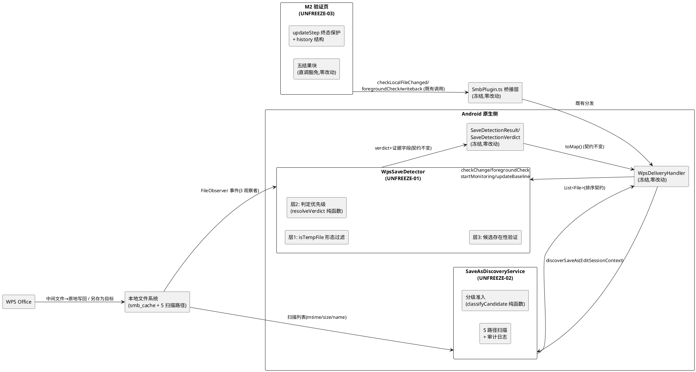

# PAD2-HOTFIX-DESIGN-D2D3D5-001 技术设计：D2/D3/D5 有限范围热修实现方案

> **文档编号**：PAD2-HOTFIX-DESIGN-D2D3D5-001
> **需求来源**：`docs/p003-hotfix-d2d3d5/spec.md`（PAD2-HOTFIX-D2D3D5-001 需求规格，691 行，本文档唯一需求基线）
> **缺陷证据**：`docs/p003-ui/v1-v7-verification-report.md`（D1-D7 缺陷清单与根因链）＋ `docs/p003-ui/shots/s2/v1-v7/m2a-exported-log.txt`（真机日志）
> **上游基线**：P003 设计基线 `docs/p003-ui/design.md`（冻结区定义见其 2.1.4；CON-06 android/** 冻结即本热修解冻前的默认状态）
> **权威版本位置**：本文档为权威版本，位于 `docs/p003-hotfix-d2d3d5/design.md`；SDD 流程登记副本位于 `.codeartsdoer/specs/p003_hotfix_d2d3d5/design.md`，两处内容一致，以本处为准。
> **文档定位**：本文档将热修需求规格（WHAT）转化为可实施的技术方案（HOW），供设计评审 Gate 审查。本文档通过评审后按规格 5.4 实施前置条件 Gate 顺序进入实施；据此可直接编写 tasks.md。
> **改动范围声明**：本设计全部产品代码改动落在 UNFREEZE-01（WpsSaveDetector.java）/ UNFREEZE-02（SaveAsDiscoveryService.java）/ UNFREEZE-03（M2VerificationPage/index.tsx）三个解冻文件的允许职责域内；测试承载为新建文件（UNFREEZE-04）。**SmbPlugin.ts、WpsDeliveryHandler.java、SaveDetectionResult.java、SaveDetectionVerdict.java、EditSessionContext.java、SmbPlugin.java（原生）、StreamCacheService.java 等桥接与数据结构文件均冻结零变更**——这是本设计的第一设计约束，所有方案均在"解冻文件内部闭环"前提下推导。

---

# 一、需求与存量功能关系分析

## 1.1 需求功能与存量功能对比

热修需求（spec.md 第 6 章 19 条 EARS）与存量代码的关系分三类：判定逻辑已存在但存在缺陷需重构（需扩展）、防护机制完全缺失（需新增）、既有正确行为须保持（已实现，作为回归锚点）。

### 1.1.1 已实现功能（保持不动，作为接口兼容与回归锚点）

| 需求功能 | 存量功能 | 代码位置 | 匹配度 | 热修处置 |
|---------|---------|---------|--------|---------|
| 原地保存判定证据链（mtime + SHA-256 双因子） | checkChange() 中 mtimeChangedNow 判定 + StreamCacheService.calculateSHA256 对比分支 | WpsSaveDetector.java:192-218 | 100% | 逻辑保留，位置从"saveAsDetected 短路之后"前移为最高优先级（判定顺序重构，判定本身不改） |
| 中间文件既有形态过滤（~$ 前缀、.tmp/.temp 后缀、.moffice_wr_check、.~lock 前缀、两段数字形态） | isTempFile() 静态方法 | WpsSaveDetector.java:257-266 | 75% | 方法保留并增强（三段及以上数字形态），签名不变（HF-D3-R06 依赖同一方法） |
| 真实另存为事件捕获（监听目录内异名文件 CREATE/MODIFY/CLOSE_WRITE/MOVED_TO 事件记录） | dirObserver.onEvent 的 `!path.equals(monitoredFileName)` 分支 + parentDirObserver 同构分支 | WpsSaveDetector.java:90-96、125-129 | 75% | 事件捕获保留；仅将"事件即判定"改为"事件为待验证证据"（HF-D2-R04 能力保留） |
| mtime 假阳性判定（MTIME_FALSE_POSITIVE） | checkChange() 中 hash.equals(baselineSha256) 分支 | WpsSaveDetector.java:209-212 | 100% | 零改动（HF-D2-R02b 直接复用） |
| 无监控/无证据诚实回退（DETECTION_UNCERTAIN 兜底） | checkChange() 首段 null 检查 + mtime unchanged 分支 + SHA 计算失败 catch | WpsSaveDetector.java:171-175、194-197、219-223 | 100% | 零改动（HF-D2-R06、HF-CON-08 既有实现正确） |
| 扫描路径遍历 + 目录不可访问跳过（listFiles()==null continue） | discoverSaveAs() 的 SCAN_PATHS 循环 | SaveAsDiscoveryService.java:37-44 | 100% | 遍历骨架保留；路径集合扩展；跳过行为补日志（规格 6.2.3-2 要求日志记录跳过事实——存量无此日志，属小改，落在允许职责域②③） |
| 时间窗口过滤（±60 秒容差语义） | `fileMtime < startTime - 60000 \|\| fileMtime > endTime + 60000` continue | SaveAsDiscoveryService.java:50-53 | 100% | A 级候选保留既有容差；B 级候选收紧（见 4.2，HF-D3-R05） |
| 中间文件排除与 D2 口径一致 | `WpsSaveDetector.isTempFile(file.getName())` 静态跨文件调用 | SaveAsDiscoveryService.java:48 | 100% | 调用零改动；D2 增强 isTempFile 后自动一致（HF-D3-R06 的实现机制） |
| V1-V7 步骤状态机与四值状态域（pending/running/pass/fail） | VerificationStep 接口 + initialSteps 常量 + steps useState | M2VerificationPage/index.tsx:26-47、101 | 100% | 取值域与步骤定义零改动（规格 7.3-1）；仅新增 history 字段（数据结构最小调整，职责域②） |
| 回写成功判定绑定三方 SHA 事实（pass 仅由 writebackSuccess 产生） | handleWriteback / handleResolveSaveAs 的 result.writebackSuccess 分支 | M2VerificationPage/index.tsx:218-231、252-263 | 100% | 证据驱动路径零改动（HF-D5-R03 的既有正确部分） |
| 操作日志时间戳追加（addLog） | addLog() toLocaleTimeString 前缀 | M2VerificationPage/index.tsx:106-109 | 100% | 零改动；作为 HF-D5-R04 可追溯的辅助通道 |
| 导出日志含门禁状态与操作日志 | buildLogContent() 的 steps.forEach 输出 | M2VerificationPage/index.tsx:320-326 | 75% | 输出结构保留；追加历史记录段（职责域③） |
| 测试设施（ScenarioResult/TestReport/断言助手惯例；CDP 驱动四 action） | R1RegressionTestSuite.java + scripts/v1v7-cdp.mjs | 上述两文件 | 100% | 只读复用（UNFREEZE-04 明确允许）；不修改既有承载文件 |

**判定结论**：三个缺陷文件的存量骨架（证据采集、事件捕获、状态机、桥接契约）总体健康，缺陷均为**判定规则与防护逻辑层**的局部问题；桥接层（WpsDeliveryHandler → SaveDetectionResult.toMap → SmbPlugin 桥 → FileChangeResult）的既有字段与语义已能表达修复后行为的全部信息，无需接口变更——这是"解冻文件内部闭环"可行的实证依据。

### 1.1.2 需要扩展的功能（存量部分实现，需在允许职责域内改造）

| 需求功能 | 存量功能 | 差异说明 | 扩展方向（职责域依据） |
|---------|---------|---------|---------|
| D2：随机数字命名中间文件识别（HF-D2-R01） | isTempFile 的 NUMERIC_TEMP_PATTERN 仅匹配两段形态 `^-?\d+\.-?\d+$` | 输入差异：实测中间文件 `1963289719.-1908999883-1548918099` 为"数字.数字-数字"三段形态（logcat 证实同一事件重复 4 次进入 save-as 分支）；边界差异：用户合法文件"2026.10.20.docx"等含数字命名不得误伤 | 字符集级形态规则替代段数级正则：`^[\d.\-]+$`（仅数字/点/连字符组成即判中间文件）；含扩展名的用户文件因含字母永不匹配（UNFREEZE-01 职责域①） |
| D2：判定不粘住（HF-D2-R03） | checkChange() 中 `if (saveAsDetected)` 位于判定链首位，无条件短路返回 SAVE_AS_DETECTED | 业务逻辑差异：先到的异名事件（可能为中间文件）固化判定，原文件后续 CLOSE_WRITE 事件到达后 checkChange 不再评估 mtime/SHA；这正是 verdict 粘住根因（WpsSaveDetector.java:184-190） | 判定优先级重构：原地保存证据（检测时点 mtime+SHA 直接证据）> 另存为事件证据（间接证据）> 不确定；saveAsDetected 降级为"待验证证据"标志（UNFREEZE-01 职责域③） |
| D2：回写后判定残留清除 | updateBaseline() 重置 contentChanged/mtimeChanged/newSha256/newMtime 但不清 saveAsDetected/saveAsFileName | 边界差异：回写成功后基线已更新，旧另存为证据继续粘住，下次检测将再次误报 SAVE_AS（WpsSaveDetector.java:245-253） | updateBaseline() 增加 saveAs 状态重置，与 startMonitoring 初始化语义对齐（UNFREEZE-01 职责域③"saveAsDetected 相关状态处置"） |
| D3：同名同扩展名另存为可发现（HF-D3-R01） | 候选准入 `nameMatch && extensionChanged`，extensionChanged 对同名同扩展名恒为 false | 业务规则差异：docx→docx 同名另存为（不同路径）永远不进候选——盲区本体（SaveAsDiscoveryService.java:58-63） | 准入条件重构为分级判定（A 级名称强关联直接准入；同名同扩展为 A 级首条），并新增"原文件自身排除"防止缓存目录误收（UNFREEZE-02 职责域①） |
| D3：全新命名另存为可发现（HF-D3-R02b） | 名称匹配只覆盖 contains(originalBaseName) 单信号 | 输入输出差异：与原基名无包含关系的全新名（如"报告终稿.docx"）nameMatch=false 直接排除；需求要求"可发现"且设计须自定口径控制误收 | B 级组合信号准入：同扩展名 + 大小同量级 + 收紧时间窗（无 -60s 前置容差）；误收/漏收边界论证见 4.2（UNFREEZE-02 职责域①） |
| D3：扫描路径覆盖验证场景全路径（HF-D3-R03） | SCAN_PATHS 三条硬编码（根/Documents/Download） | 边界差异：受监听目录（smb_cache）与 WPS 常见保存目录不在集合内——另存为到监听目录同目录时发现服务反而不可见；扫描行为无日志不可审计 | SCAN_PATHS 扩展至 5 条 + 扫描路径逐条日志 + 候选判定日志（UNFREEZE-02 职责域②③） |
| D5：终态防覆盖（HF-D5-R01/R03） | updateStep() 无条件 `{ ...s, status, details }` 覆盖 | 业务规则差异：V4 pass 后任何调用点（实测为只读场景回写失败的 handleWriteback catch 分支）再次 updateStep('V4','fail') 即静默改写终态，通过证据丢失（M2VerificationPage/index.tsx:111-115） | updateStep 增加终态保护分支：终态后 pass/fail 类更新转为 history 追加、running/pending 类更新（隐式重置企图）直接拒绝（UNFREEZE-03 职责域①②③） |
| D5：被挡结果可追溯（HF-D5-R04） | 步骤数据结构无历史概念；details 为单值字符串 | 数据差异：被拒绝的更新无处留存（时间戳+结果摘要+触发操作三要素缺失） | VerificationStep 增加 history 字段（容量上限 20 条，超限保最近），调用点传入 trigger 操作名（UNFREEZE-03 职责域②③） |
| D5：导出日志门禁一致性（规格 6.3.3-3） | buildLogContent() 输出 steps 的 status+details 单快照 | 输出差异：门禁状态与操作日志可能自相矛盾（实测形态："操作日志显示回写成功而门禁状态为失败"——恰为 D5 覆盖缺陷的镜像表现） | 导出内容追加各步骤 history 段，门禁行与历史行同源同刻（UNFREEZE-03 职责域③） |

### 1.1.3 需要新增的功能或接口（UNFREEZE-04 测试承载）

按 PM 裁定（0.2.2）要求的针对性测试场景，全部为新建文件，零修改既有测试承载：

**A. Android 侧 JVM 单元测试组（判定逻辑矩阵，gradle test 承载）**

| 功能点 | 输入 | 输出 | 核心逻辑 | 依赖 |
|-------|------|------|---------|------|
| isTempFile 形态矩阵测试 | ~30 组文件名样本（实测中间文件名、既有五类形态、合法用户命名含数字/中文/多段日期） | 每组期望布尔断言 | 直接调用 WpsSaveDetector.isTempFile 静态方法（纯字符串函数，无 Android API 依赖，JVM 可执行） | junit（build.gradle:39 已具备，零新增） |
| D2 判定决策矩阵测试 | (mtimeChanged, shaChanged, saveAsCandidateValid) 组合 × 期望 verdict | 判定矩阵全分支断言 | WpsSaveDetector 内新增包私有静态纯函数 resolveVerdict(...)（本设计 3.3），测试直接覆盖其决策表（HF-D2-R01~R06 逻辑分支全覆盖） | junit |
| D3 候选准入矩阵测试 | (fileName, mtime 相对窗口, size 比, originalName, originalSize) 组合 | 期望准入等级（A/B/排除） | SaveAsDiscoveryService 内新增包私有静态纯函数 classifyCandidate(...)（本设计 4.2），矩阵测试覆盖误收/漏收边界样本 | junit |

**B. 真机端到端验证编排组（Node.js 脚本承载）**

| 功能点 | 输入 | 输出 | 核心逻辑 | 依赖 |
|-------|------|------|---------|------|
| 热修验证编排脚本 | HF-TC 场景号 + 场景步骤定义 | 每场景执行记录 + 断言结果 + 证据文件路径 | 参照 scripts/v1v7-cdp.mjs 模式（discoverPage/send/evalPage，Node 24 内置 WebSocket/fetch），编排 CDP action 序列 + adb shell 命令（文件预置/touch/logcat 采集）+ 断言（门禁表格行/saveAsPrompt 文案/logcat verdict 行） | Node.js 24（环境既有）、adb forward tcp:9222（既有通道） |
| logcat 断言采集 | 场景执行窗口 | WpsSaveDetector/SaveAsDiscoveryService TAG 过滤日志片段 | adb logcat -d -s WpsSaveDetector:V SaveAsDiscoveryService:V 快照，检索 verdict/候选判定/扫描路径行，归档至证据目录 | adb（既有） |

**C. 人工操作步骤卡（WPS 内交互，不可自动化部分）**

| 功能点 | 内容 | 执行要点 |
|-------|------|---------|
| WPS 编辑保存步骤卡 | 进入编辑模式→输入文本→返回→对话框保存 | 复现 V2 实测路径（报告 V2 复现步骤）；规避 D6 坐标风险：不使用工具栏保存按钮视觉坐标，统一走返回键对话框 |
| WPS 另存为/取消步骤卡 | 另存为对话框→目标路径/文件名→确认/取消 | 覆盖同名同扩展、新名、多路径、取消四类；每步截图归档 |

**依赖关系**：A 组承载判定逻辑回归（快速、可重复、无设备）；B/C 组承载真实时序与端到端行为（FileObserver 事件时序、WPS 真实写入模式、UI 终态）——三层互补，任何单层不充分。

## 1.2 存量功能详细分析

### 1.2.1 WpsSaveDetector.java 接口契约与业务规则（UNFREEZE-01 解冻对象）

**接口契约**（对外签名冻结，本设计全部保持）：

| 方法 | 入参 | 出参 | 副作用 | 调用方（全部冻结，不可改） |
|-----|------|------|-------|---------|
| startMonitoring(File, String, long) | 监控文件/基线 SHA/基线 mtime | 无 | 建立 3 个 FileObserver（file/dir/parentDir），重置全部状态 | WpsDeliveryHandler.openFileInWps:130 |
| checkChange() | 无 | SaveDetectionResult（verdict + 证据字段） | 可能计算 SHA-256；更新 contentChanged/newSha256 等 | WpsDeliveryHandler.checkLocalFileChanged:271、foregroundCheck:299（经其内部调用） |
| foregroundCheck() | 无 | SaveDetectionResult | 内部调 checkChange()，UNCERTAIN 时追加 evidence 提示 | WpsDeliveryHandler.foregroundCheck:299 |
| updateBaseline(String, long) | 新 SHA/新 mtime | 无 | 重置变更标志（**不清 saveAs 状态——缺陷点**） | WpsDeliveryHandler.writeback:441 |
| pause()/resume()/stopMonitoring() | 无 | 无 | 事件监听启停（回写期间 pause 防自触发） | WpsDeliveryHandler.writeback:407/443、cleanup:476 |
| isTempFile(String) 静态 | 文件名 | boolean | 无 | 本类 dirObserver:83、parentDirObserver:118；**SaveAsDiscoveryService.discoverSaveAs:48（跨文件依赖，D3 口径一致性的锚点）** |
| 8 个 getter | 无 | 状态字段 | 无 | WpsDeliveryHandler（getSaveAsFileName:279/284/309） |

**业务规则现状**（判定链，`checkChange()`）：

1. `monitoredFile == null` → DETECTION_UNCERTAIN("No file monitored")——异常场景 4 契约，保持；
2. `saveAsDetected == true` → **立即返回 SAVE_AS_DETECTED**（缺陷：verdict 粘住的短路点，行 184-190）；
3. `currentMtime == baselineMtime` → DETECTION_UNCERTAIN("mtime unchanged")——无证据诚实回退，保持；
4. mtime 变 → SHA-256 对比：变 → SAVE_SUCCESS；同 → MTIME_FALSE_POSITIVE——双因子判定，保持；
5. SHA 计算异常 → DETECTION_UNCERTAIN——异常场景 3 契约，保持。

**事件捕获现状**（dirObserver.onEvent，行 79-102）：

1. `paused` → 忽略（回写保护，保持）；
2. `isTempFile(path)` → 过滤并记 `dir_temp_filtered`（**形态覆盖不足即 D2 根因入口**）；
3. `!path.equals(monitoredFileName)` → `saveAsDetected = true; saveAsFileName = path`（**事件即判定，无证据验证**）；
4. 同名事件 → recordEvent + checkChange()。

**扩展点**：isTempFile 为静态纯函数（可独立增强）；判定链为顺序结构（可重排优先级）；saveAsDetected/saveAsFileName 为 private volatile 字段（状态处置可重构）——三者均落在 UNFREEZE-01 允许职责域 ①③④ 内。

**约束**：
- SaveDetectionResult 数据结构与 SaveDetectionVerdict 枚举为冻结文件（不在解冻清单），本设计不得增删 verdict 枚举值、不得修改 toMap() 字段集；
- WpsDeliveryHandler.checkLocalFileChanged 的 SAVE_AS 分支消费 `getSaveAsFileName()` 与 verdict——修复后真实另存为场景 saveAsDetected=true 时该分支行为与 fix1 完全一致；
- eventLog 机制（recordEvent/100 条环形上限）为禁止域④，本设计仅沿用不改。

### 1.2.2 SaveAsDiscoveryService.java 接口契约与业务规则（UNFREEZE-02 解冻对象）

**接口契约**：

| 方法 | 入参 | 出参 | 调用方（冻结） |
|-----|------|------|---------------|
| discoverSaveAs(EditSessionContext) | 会话上下文（originalFileName / sessionStartTime / sessionEndTime——**仅此三字段，无原文件路径/大小**） | `List<File>` 候选文件列表（空列表=未发现） | WpsDeliveryHandler.triggerSaveAsDiscovery:329 |

**关键约束（由冻结调用方决定，设计必须适配）**：

1. **输入贫信息**：EditSessionContext 不携带原文件路径与大小。原文件路径可按 App 缓存目录约定推导（`RegressionTestConfig.localCacheBasePath = /storage/emulated/0/PAD2/smb_cache/`，RegressionTestConfig.java:11——StreamCacheService 缓存基路径的同源约定），原文件大小可经该路径 File.length() 获取（缓存存在时）。B 级大小信号据此设计（见 4.2）。
2. **消费方式**：`triggerSaveAsDiscovery`（WpsDeliveryHandler.java:322-347，冻结）取 `saveAsFiles.get(0)` 单候选呈现，后续候选不暴露给 UI。**discoverSaveAs 返回列表的排序规则因此成为设计职责**：最优候选必须排在首位（分级排序，见 4.4）；完整候选经本服务日志输出（可审计性补偿，HF-D3-R03）。
3. **触发时机**：foregroundCheck 的 SAVE_AS_DETECTED 与 DETECTION_UNCERTAIN 两个分支触发（WpsDeliveryHandler.java:308-314，冻结）——D2 修复后：原地保存 → SAVE_SUCCESS（不触发发现，正确：原地保存无另存为候选需求）；真实另存为 → SAVE_AS_DETECTED（触发发现，主路径）；无变化 → UNCERTAIN（触发发现，兜底扫描）。触发面与 fix1 完全一致。

**业务规则现状**（候选准入，行 46-67）：

1. 前置排除：非文件、isTempFile、时间窗口外（[start-60s, end+60s]）；
2. `nameMatch = fileName.contains(originalBaseName) || (originalBaseName.length()>3 && fileBaseName.contains(originalBaseName))`；
3. `extensionChanged = !fileName.endsWith("." + originalExtension)`；
4. 准入 = `nameMatch && extensionChanged`——**D3 盲区本体：同名同扩展名（extensionChanged=false）与全新命名（nameMatch=false）双盲**。

**扫描路径现状**：SCAN_PATHS 三条硬编码（行 14-18）。**注意既有一个隐性缺陷伴随设计修复**：受监听目录 `/storage/emulated/0/PAD2/smb_cache/` 不在扫描集合——另存为到监听目录同目录的文件（DirObserver 已捕获为 SAVE_AS 证据）在发现服务中反而不可见；且一旦把该目录加入扫描，**原文件自身**（名称=originalFileName、mtime 在窗口内、名称完全匹配）会被误收为候选——必须同步引入"原文件自身排除"规则（这是 D3 设计中两个规则强耦合的证据，属同一职责域①的完整改造）。

### 1.2.3 M2VerificationPage/index.tsx 接口契约与业务规则（UNFREEZE-03 解冻对象）

**组件契约**：默认导出 `M2VerificationPage()`，React 函数组件；消费 smbConnectionStore/browseStore（S2-05 迁移形态，禁止域②保持）＋ 五结果块直调 SmbPlugin（豁免结构，禁止域①保持）。

**steps 状态结构**（规格 7.3 对应物）：

```typescript
interface VerificationStep {
  id: string;          // 'V1'...'V7'（步骤定义禁止域③，零改动）
  name: string;        // 步骤名（禁止域③，零改动）
  description: string; // 步骤描述（禁止域③，零改动）
  status: 'pending' | 'running' | 'pass' | 'fail';  // 四值域（规格 7.3-1，零改动）
  details?: string;    // 证据摘要（单值，本设计追加 history 后语义保持）
}
```

**updateStep 调用点全景**（终态保护须覆盖的完整攻击面——HF-D5-R05 反向路径论证的基础）：

| 调用点 | 目标步骤 | 更新值 | 证据绑定 |
|-------|---------|--------|---------|
| handleOpenInWps（:149/154/158/162） | V1 | running → pass/fail | pass 绑定 intentLaunched=true（WPS 真实启动） |
| handleCheckChange（:173/176） | V2、V3 | pass | V2 绑定 changed=true（mtime 变更）；V3 绑定 contentChanged=true（SHA 变更） |
| handleForegroundCheck（:196） | V3 | pass | 绑定 saveAsDiscovered=true（发现服务真实发现） |
| handleWriteback（:214/219/224/228） | V4 | running → pass/fail | pass 绑定 writebackSuccess=true（三方 SHA 一致）；fail 绑定 SHA 不匹配或异常 |
| handleResolveSaveAs（:239/253/258/268） | V4 | running → pass/fail | 同上（另存为决策路径的回写） |
| handleCheckRemote（:282） | V6 | pass | 绑定 remoteChanged=true（服务器 mtime ≠ 基线） |

**实测缺陷时序**（报告 D4）：16:11:22 handleWriteback 成功 → updateStep('V4','pass')；16:14:41 只读场景 handleWriteback 异常 → updateStep('V4','fail') 无条件覆盖 → V4 pass 证据丢失。**没有任何调用点的 pass 路径不绑定真实证据**——这证明"失败覆盖成功"是实测路径，而"成功路径无证据绑定"不存在（5.5 节据此完成反向论证）。

**buildLogContent 现状**（:312-365）：门禁段输出 `${id} ${name}: ${status} ${details}`；操作日志段输出 log 数组；详细结果段输出五个结果 state 快照。缺陷形态：门禁段与操作日志段各自独立快照，覆盖发生后两段互相矛盾。

**扩展点**：updateStep 为页内局部函数（可自由重构）；steps 为 useState（结构可最小扩展）；导出内容组装为纯函数（可追加段落）——均落在 UNFREEZE-03 允许职责域 ①②③。

**约束**：
- "清理"按钮（handleCleanup:298-310）既有语义 = 调 SmbPlugin.cleanup() + 重置五个结果 state，**不重置 steps**——本设计保持该语义不变（清理≠门禁重置，验证记录独立于会话清理，见 5.4 裁定论证）；
- CSS Modules 类名约定：本体 camelCase、`--` 修饰符中划线且 TSX 方括号访问（style.module.css:5 注释明示）——新增样式类遵守；
- 五结果块直调 SmbPlugin 结构与 store 消费逻辑零触碰（禁止域①②）。

### 1.2.4 测试与构建基础设施现状

- **JVM 单测设施**：`android/app/src/test/java/`（现仅 Capacitor 模板 ExampleUnitTest）+ `testImplementation "junit:junit:$junitVersion"`（build.gradle:39）——**承载就绪，零新增 gradle 依赖**（HF-CON 零依赖约束满足）。JVM 单测可执行静态纯函数（isTempFile 无 Android API 引用）；引用 android.util.Log 的实例方法不可在 JVM 跑（android.jar stub 抛异常，且 build.gradle 的 testOptions 不可改——android/** 冻结）。**推论：判定逻辑要获得 JVM 矩阵测试覆盖，必须以"包私有静态纯函数"形态沉淀在解冻文件内**（本设计 3.3/4.2 落实）。
- **R1RegressionTestSuite 惯例**（UNFREEZE-04 只读复用对象）：main 源码集自包含套件、ScenarioResult（passed/failureRootCause/evidence）+ TestReport 聚合、assertField/assertVerdict 断言助手、场景化证据字符串——编排脚本与测试报告的断言结构参照此风格。
- **CDP 驱动惯例**：scripts/v1v7-cdp.mjs 四 action（setpwd/connect/status/clicktext）+ eval 逃生口；status 动作读取 V1-V7 表格行结构（`main table tbody tr`）——热修验证编排直接复用该读取结构（D5 断言门禁表格行 + history 呈现）。
- **构建链**：`npm run cap:sync`（tsc && vite build && cap sync）→ 远程构建（192.168.2.3:/home/debian/android/pad2-build，工程根即 android 工程）→ aapt 权限验证 → APK SHA-256 归档（fix1 流程已演练，V1 前置事件记录了完整操作序列）。
- **gradle test 远程执行可行性**：远程构建机具备 JDK（Gradle 构建依赖）→ `gradle test` 在同步后的工程上执行，测试报告（XML/HTML）随构建日志归档——A 组测试的执行环境成立。

---

# 二、设计总览与方案选型

## 2.1 设计总原则与硬约束遵从表

| 约束 | 来源 | 本设计的落实方式 |
|-----|------|----------------|
| 最小解冻（HF-CON-01） | 规格 4.1-1 | 全部产品改动 ⊆ {WpsSaveDetector.java 允许域①②③④, SaveAsDiscoveryService.java 允许域①②③④, M2VerificationPage/index.tsx 允许域①②③}；第 7.2 章 diff 审查清单逐 hunk 映射职责域 |
| 接口兼容底线（规格 5.2-3） | 规格 5.2-3 | 三个文件对外方法签名零变更；SaveDetectionResult/verdict 枚举零触碰；SmbPlugin.ts 无须任何改动即可运行修复后行为（1.2 节已论证桥接字段集已足） |
| 零新增依赖 | 设计硬约束 4 | JVM 单测用既有 junit；编排脚本用 Node 24 内置 WebSocket/fetch；无 npm/gradle 新依赖 |
| 禁止砍功能（HF-D2-R07） | 规格 6.1-1-7 | 目录监听（3 个 FileObserver）与 SAVE_AS 识别能力全部保留；本设计是"增强识别精度"而非"收缩监听面" |
| 检测诚实性（HF-CON-08） | 规格 4.3-2 | 判定优先级以直接证据为准；证据不足场景全部落入 DETECTION_UNCERTAIN / 空结果+安全回退；无任何放宽判定的路径 |
| 红线（HF-D3-R07） | 规格 6.2-1-7 | 发现服务与文案零回写语义（1.2.2 契约分析：triggerSaveAsDiscovery 的文案属冻结层，本热修无新增用户可见文案；HF-TC-D3-07 审查项为"确认无新增违规表述"） |
| 发布阻断升级条款（HF-D5-R05） | 规格 6.3-1-5 | 5.5 节系统性反向路径论证 + HF-TC-D5-04 真机压力探测双保险 |
| M2 直调豁免保持（规格 5.5） | 规格 5.5 | D5 改动不触碰五结果块调用结构；终态保护语义作为 S5-04 输入约束交接（第 10 章） |

## 2.2 D2 方案选型：三层防御（形态过滤 × 证据优先级 × 存在性验证）

**候选方案对比**：

| 方案 | 内容 | 优点 | 缺点 | 结论 |
|-----|------|------|------|------|
| 甲：纯正则增强 | 仅把 NUMERIC_TEMP_PATTERN 扩展为多段形态 | 改动最小（1 行） | 单点防御：WPS 未来形态再演化（如字母混合、UUID 形态）即再次误判；未解决"判定粘住"结构性缺陷——R02/R03 不满足 | **否决**（不满足 HF-D2-R03） |
| 乙：事件序列组合判定 | 记录事件序列，按"中间文件事件后若原文件也发生写回事件则判 SAVE_SUCCESS"的序列规则裁决 | 直接利用时序特征 | 时序窗口内事件交错不可穷举（竞态、乱序）；序列规则本质是"猜测 WPS 行为"，脆弱；FileObserver 事件可能丢失（内核缓冲溢出），规则依赖事件完整性不可靠 | **否决**（时序依赖脆弱，规格 6.1.3-1 要求判定对事件到达顺序不敏感） |
| 丙：判定优先级重构（检测时点证据裁决） | checkChange 判定链重排：原文件 mtime+SHA 直接证据优先于异名事件间接证据；saveAsDetected 降级为待验证证据 | 根本性解决"粘住"（判定永远反映检测时点文件系统事实）；对事件顺序天然不敏感（规格 6.1.3-1 直接满足）；对事件丢失鲁棒（mtime/SHA 是 stat 直接证据，不依赖事件） | 若单独使用：中间文件若恰好存活到检测时点且原文件无变化，仍可能误报 SAVE_AS（中间文件形态未过滤时） | **采纳为第二层（主防御）** |
| 丁：候选存在性验证 | SAVE_AS 判定产出前验证候选文件仍存在于监听目录 | 兜底未来未知中间文件形态（WPS 中间文件写回后即删除，实测形态已被清理） | 单独使用不能解决原文件保存被掩盖（R02 仍不满足：误判时 checkChange 直接短路，原地保存证据不被评估） | **采纳为第三层（兜底防御）** |

**选型结论：甲′+丙+丁 三层防御**（甲′= 增强后的形态过滤作为第一层）。

**选择理由**：
1. **三层职责正交互补**：第一层在事件入口消除已知形态（低成本高收益）；第二层在判定出口保证证据强度排序（结构性修复，满足 R02/R03/规格 7.1-5）；第三层对未来未知形态提供语义级兜底（R01 的纵深防御）；
2. **规格符合性**：R01（中间文件不误判）由层一+层二+层三共同满足——任一层失效另两层兜底；R02（原地保存正确判定）由层二直接满足；R03（判定不粘住）由层二的结构（saveAsDetected 不再短路）+ updateBaseline 清残留共同满足；R04（真实另存为仍可识别）由层二优先级第二位保留（原文件无变化时 SAVE_AS 证据生效）+ 层三过滤已删除中间文件满足；R05（取消另存为零误报）由层一（无中间文件存活）+ 层三（中间文件已删除→存在性失败）+ 原文件无变化满足；
3. **风险论证义务**：三层均不依赖事件时序假设（对比方案乙），对 WPS 版本演化最鲁棒；层一正则有理论误伤面（纯数字无扩展名用户文件），4.3 节逐项论证。

## 2.3 D3 方案选型：分级候选准入（A 级名称强关联 + B 级组合信号）

**候选方案对比**：

| 方案 | 内容 | 优点 | 缺点 | 结论 |
|---|------|------|------|------|
| 甲：放宽为纯时间窗口 | 窗口内 + 非中间文件 + 非原文件即收 | 全场景可发现（含全新名变扩展名） | 误收失控：根目录/Download 窗口内任何新文件（日志、下载件、其他 App 导出）均入候选——违反 HF-D3-R04"禁止扩大时间窗口硬凑结果"的精神（虚构关联） | **否决**（误收不可控） |
| 乙：仅名称关联放宽（去 extensionChanged） | nameMatch 单信号（同名同扩展 + 基名关联） | 修复 R01 + R02a；改动小 | 全新命名（R02b）仍盲——验收 HF-TC-D3-02b 不通过 | **否决**（R02b 不满足） |
| 丙：分级准入 | A 级名称强关联（双信号已足）直接准入；B 级无名称关联时以"同扩展名 ∧ 大小同量级 ∧ 收紧时间窗"组合信号准入 | R01/R02a/R02b 全覆盖；每级误收/漏收边界明确可论证；候选分级排序天然满足"最优在前"的桥接消费约束 | B 级仍漏收"全新名+变扩展名"场景（如"终稿.pdf"） | **采纳** |

**选型结论：丙（分级准入）+ 排序契约**。

**选择理由**：
1. **验收覆盖**：R01（同名同扩展）→ A 级第 1 条；R02a（基名相关新名）→ A 级第 2 条（沿用既有 nameMatch 语义）；R02b（全新名）→ B 级组合信号；
2. **误收控制哲学**：候选是"供用户三路决策的呈现物"而非自动动作——A 级双信号（名称+时间）误收率极低；B 级四信号（扩展名+大小量级+收紧窗口+路径）将误收面压缩到"会话进行期间同扫描路径下新出现的同扩展名同量级文档"——概率论证见 4.3；
3. **漏收兜底语义**：所有漏收场景（含 B 级外的全新名变扩展名）统一落入空结果+安全回退（R04 诚实语义）——漏收不产生错误结论，只产生"请手动选择"的保守引导，符合 HF-CON-08；
4. **扫描路径选型**：扩展为 5 条（含受监听目录与 WPS 常见目录）而非收缩——配合"原文件自身排除"规则（1.2.2 已论证其强耦合必要性）；WPS 私有目录声明为不可扫描边界（安全回退语义 + 日志跳过记录），符合规格 6.2.3-2 与"声明扫描范围"要求。

## 2.4 D5 方案选型：终态锁定 + 结构化历史（方案 A，不新增重跑入口）

**候选方案对比**（HF-D5-R02 的二选一裁定）：

| 方案 | 内容 | 优点 | 缺点 | 结论 |
|-----|------|------|------|------|
| 甲：保持终态不覆盖 + 追加历史 | 终态一经产生绝对保持；后续结果转 history 结构化留存；重置仅经页面重载（App 重启/WebView 刷新=现成显式操作） | 终态语义最强（无任何隐式/显式改写路径，R01/R03 满足度最高）；改动最小（不新增 UI 元素，完全落在职责域①②③白名单内——规格 5.5-4"新增的仅是终态保护与历史可追溯行为"逐字吻合） | 单次 App 会话内某步骤终态固定，验证人员无法"原地重跑"同一步骤（须经页面重载） | **采纳** |
| 乙：显式重跑按钮 | 每步骤行新增"重跑"操作（点击确认后重置 pending 并清历史） | 验证人员工作流友好 | 新增按钮触碰禁止域③"V1-V7 步骤定义、按钮与操作流程的对外可见行为"的边界争议——按 HF-CON-04 需升级 PM 裁定，热修时间线风险；且"清历史重跑"与 R04 可追溯性冲突（历史被清） | **否决**（越界风险 > 收益） |

**选型结论：甲（方案 A）**。

**选择理由**：
1. **合规性**：HF-D5-R02 明文允许"保持终态不覆盖（结果追加）"作为二选一之一——方案甲自身即合规选项；
2. **白名单吻合**：规格 5.5-4 回归承诺限定"新增的仅是终态保护与历史可追溯行为"——重跑按钮不在白名单；
3. **显式重置等价物已存在**：页面重载（WebView 刷新/重启 App）使 steps 回到 initialSteps（useState 初始化）——这是无需新增代码的"显式重跑"操作，HF-TC-D5-05 以此为执行路径（重载后 pending → running → pass/fail 正确重新推进）；
4. **"清理"按钮语义保持**：清理=会话与缓存清理（既有语义），门禁记录独立留存——清理后 steps 不变（与现状一致），避免"清理即丢验证历史"与 R04 冲突的新问题；
5. **S5 交接充分**：StateTimeline/会话重置属 S5-04 范畴（规格 5.5-2），终态保护语义作为输入约束交接（第 10 章）。

## 2.5 总体上下文视图（修复后组件关系）



（注：组件间调用频率——M2→Bridge 为用户手动触发（按钮级）；Detector 事件为 WPS 保存期间高频（实测 4+ 次/保存）；Discovery 扫描为检测触发时一次性。）
---

# 三、D2 详细设计：WpsSaveDetector SAVE_AS 误判修复（UNFREEZE-01）

## 3.1 改动点清单（方法级定位）

| # | 改动点 | 所在方法/字段 | 改动类型 | 职责域依据 |
|---|-------|--------------|---------|-----------|
| D2-C1 | NUMERIC_TEMP_PATTERN 由两段正则改为字符集正则 `^[\d.\-]+$` | 静态字段（WpsSaveDetector.java:255） | 修改 | ① 中间文件识别逻辑 |
| D2-C2 | 判定决策核心抽为包私有静态纯函数 `resolveVerdict(...)` | 新增方法（checkChange 内部逻辑重构载体） | 新增 | ③ 判定短路/粘住逻辑（重构） |
| D2-C3 | checkChange() 判定链重排：原地保存证据优先于另存为证据；saveAsDetected 短路删除 | checkChange()（:169-226） | 重构 | ③④（短路逻辑消除 + 原地保存判定路径前移） |
| D2-C4 | SAVE_AS 判定产出前增加候选存在性验证（saveAsCandidateExists()） | checkChange() 第二优先级分支内 | 新增 | ② SAVE_AS 事件判定条件 |
| D2-C5 | dirObserver/parentDirObserver 异名事件分支：置位语义保持、增加候选记录去抖说明（见 3.4） | dirObserver.onEvent（:90-96）、parentDirObserver.onEvent（:125-129） | 微调 | ② SAVE_AS 事件判定条件 |
| D2-C6 | updateBaseline() 增加 saveAsDetected/saveAsFileName 重置 | updateBaseline()（:245-253） | 增强 | ③ saveAsDetected 相关状态处置 |
| D2-C7 | foregroundCheck() 的 UNCERTAIN 追加提示条件由 `!saveAsDetected` 改为按 verdict 判定 | foregroundCheck()（:231） | 微调 | ③ 判定逻辑一致性（修复后 saveAsDetected 为"待验证证据"标志，原条件语义失真） |

**零改动确认**：对外方法签名（checkChange/foregroundCheck/startMonitoring/stopMonitoring/pause/resume/updateBaseline/isTempFile/8 个 getter）全部保持；eventLog 记录机制（recordEvent/getEventLogSummary/100 条环形上限）零改动；监控生命周期契约零改动。

## 3.2 第一层防御：中间文件形态规则（D2-C1）

**判定规则**：

```
中间文件（数字形态）⟺ fileName ≠ null ∧ fileName 匹配 ^[\d.\-]+$
（即：文件名仅由【数字、点、连字符】三种字符组成，不含任何字母/中文/其他符号）
```

**规则推导**：
- 实测中间文件 `1963289719.-1908999883-1548918099`：全部字符 ∈ {数字, '.', '-'} → 匹配 ✓；
- 既有两段形态（如 `123.-456`）：字符集同属 → 匹配 ✓（向后兼容，既有过滤行为保持）；
- 该规则不依赖段数假设：WPS 未来中间文件无论 2 段/3 段/N 段、点连字符任意组合，只要保持"纯数字字符集"特征即被覆盖——对比段数级正则（如 `^-?\d+([.\-]-?\d+)+$`）对未知段数的枚举脆弱性。

**误伤论证（不会误伤真实用户另存为文件）**：

| 文件名样本 | 匹配？ | 判定 | 论证 |
|----------|--------|------|------|
| `1963289719.-1908999883-1548918099`（实测中间文件） | 是 | 中间文件 ✓ | 目标形态 |
| `2026报告.docx`（数字前缀合法命名） | 否（含汉字与字母） | 正常候选 | 用户文档命名几乎必含字母/文字；即使纯数字前缀，扩展名 `.docx` 含字母即整体不匹配 |
| `2026.10.20.docx`（日期式命名） | 否（`docx` 含字母） | 正常候选 | WPS 另存为目标文件必带文档扩展名（用户在对话框输入名称，WPS 追加扩展名），扩展名字母使字符集规则永不匹配 |
| `2026.10.20`（无扩展名纯日期） | 是 | 中间文件（误伤面） | **理论误伤**：用户以纯日期无扩展名命名另存为文档的概率可忽略（文档文件必须带扩展名才能被 WPS 再次打开）；该形态与中间文件特征完全重合，过滤收益（消除实测 P1 缺陷）远大于理论误伤 |
| `1.0`（版本号式无扩展名） | 是 | 中间文件（误伤面） | 同上；且该形态同时被既有两段正则覆盖（fix1 已过滤），**非本设计新增误伤面** |
| `~$xxx.docx` / `xxx.tmp` / `.moffice_wr_check-*` / `.~lock*` | —（走既有规则） | 中间文件 ✓ | 既有五类规则零改动保持 |

**结论**：新增误伤面仅为"无扩展名且纯数字字符集"的用户文件——与 WPS 文档另存为行为（必带扩展名）不相交，误伤概率工程上为零。已知误伤情形全部落在 fix1 既有过滤面内（无回归）。

## 3.3 第二层防御：判定优先级重构（D2-C2/C3，核心）

### 3.3.1 判定决策纯函数（JVM 可测核心）

判定核心抽为包私有静态纯函数（无 Log、无 IO，供 JVM 矩阵测试直接覆盖）：

```
决策输入（检测时点采集）：
  mtimeChanged : boolean   —— monitoredFile.lastModified() ≠ baselineMtime
  shaChanged   : boolean   —— SHA-256(monitoredFile) ≠ baselineSha256（仅 mtimeChanged 时计算）
  saveAsEvidenceValid : boolean —— saveAsDetected ∧ saveAsCandidateExists()
  shaCalcFailed : boolean —— SHA-256 计算异常

resolveVerdict(mtimeChanged, shaChanged, saveAsEvidenceValid, shaCalcFailed):
  if shaCalcFailed                    → DETECTION_UNCERTAIN        // 异常场景3：计算失败不默认成功
  if mtimeChanged ∧ shaChanged        → SAVE_SUCCESS               // HF-D2-R02a：双因子直接证据
  if mtimeChanged ∧ ¬shaChanged       → MTIME_FALSE_POSITIVE       // HF-D2-R02b
  if ¬mtimeChanged ∧ saveAsEvidenceValid → SAVE_AS_DETECTED        // HF-D2-R04：原文件无变化+有效异名证据
  otherwise                           → DETECTION_UNCERTAIN        // HF-D2-R05/R06：诚实回退
```

**优先级设计依据（证据强度排序）**：
1. **第一优先级：原文件直接证据**（stat + hash 是文件系统事实，最强证据，不依赖事件到达）——实测缺陷时序（中间文件事件先到 → 原文件 CLOSE_WRITE 后到 → 检测在最后）下，检测时点 mtime/SHA 已反映原地写回 → SAVE_SUCCESS 正确产出，中间文件事件无论何时到达均不影响结论（**HF-D2-R03 判定不粘住的结构保证**）；
2. **第二优先级：异名事件间接证据**（目录事件可能来自中间文件残留形态、其他 App 写入，强度次之）——仅在原文件无任何变化时参与判定，此时"监听范围内出现非中间文件的异名写事件"恰是真实另存为的定义（HF-D2-R04）；
3. **兜底：不确定**——无证据即诚实回退（HF-D2-R05/R06、HF-CON-08）。

**规格 7.1 判定语义符合性**：单次检测有且仅有一个判定（决策函数为纯函数式分派，天然互斥）；判定修正沿"不确定→确定"方向（每次 checkChange 基于检测时点重新裁决，无旧证据回退路径——saveAsDetected 短路删除后不存在"已确定判定被固化"的机制）。

### 3.3.2 checkChange() 重构后流程

```plantuml
@startuml
skinparam activityShape octagon
start
:checkChange() 调用
(检测时点采集开始);
if (monitoredFile == null?) then (是)
  :return DETECTION_UNCERTAIN
  "No file monitored"
  (异常场景4,既有行为保持);
  stop
endif
:currentMtime = monitoredFile.lastModified();
:result 基础字段填充
(originalFilePath/baseline/finalMtime
——既有行为保持);
if (currentMtime ≠ baselineMtime?) then (是·原地保存证据存在)
  try
    :hash = SHA-256(monitoredFile)
    (newSha256/newMtime 状态更新
    ——既有行为保持);
    if (hash ≠ baselineSha256?) then (是)
      :verdict = SAVE_SUCCESS
      (contentChanged=true
      resultFilePath=原文件路径);
    else (否)
      :verdict = MTIME_FALSE_POSITIVE;
    endif
  catch (计算异常)
    :verdict = DETECTION_UNCERTAIN
    "SHA-256 calculation failed"
    (异常场景3,既有行为保持);
  endtry
else (否·原文件无变化)
  if (saveAsDetected ∧ 候选文件存在?) then (是·有效异名证据)
    :verdict = SAVE_AS_DETECTED
    resultFilePath = 候选绝对路径
    evidence = 事件证据+存在性验证说明
    (HF-D2-R04);
  else (否)
    :verdict = DETECTION_UNCERTAIN
    "mtime unchanged
    (no file modification detected)"
    (HF-D2-R05/R06);
  endif
endif
:return result;
stop
@enduml
```

**与 fix1 行为差异清单**（回归审查对照用）：
1. saveAsDetected=true 且原文件有变化：fix1 → SAVE_AS_DETECTED（误判）；修复后 → SAVE_SUCCESS/MTIME_FALSE_POSITIVE（**缺陷修复本体**）；
2. saveAsDetected=true 且原文件无变化且候选存在：fix1 → SAVE_AS_DETECTED；修复后 → SAVE_AS_DETECTED（**行为一致，HF-D2-R04 保持**）；
3. saveAsDetected=true 且原文件无变化且候选不存在（中间文件已删除）：fix1 → SAVE_AS_DETECTED（误判）；修复后 → DETECTION_UNCERTAIN（第三层防御生效，HF-D2-R05 兜底）；
4. saveAsDetected=false 全部场景：行为与 fix1 完全一致。

### 3.3.3 foregroundCheck() 微调（D2-C7）

修复后 saveAsDetected 语义为"存在待验证异名事件证据"。原条件 `!saveAsDetected` 导致"有证据但验证失效落 UNCERTAIN"时丢失"may need save-as scan"提示。微调为按结果判定：

```
if (result.getVerdict() == DETECTION_UNCERTAIN) → 追加 " [foregroundCheck: may need save-as scan]"
```

该微调与冻结消费方（WpsDeliveryHandler.foregroundCheck 的 UNCERTAIN 分支触发 triggerSaveAsDiscovery）语义方向一致（UNCERTAIN → 建议扫描），无契约影响。

## 3.4 第三层防御：SAVE_AS 候选存在性验证（D2-C4/C5）

**验证规则**：checkChange 进入 SAVE_AS 分支前，验证 `new File(monitoredFile.getParentFile(), saveAsFileName).exists()`。

**设计依据**：
1. WPS 中间文件在保存流程完成后即被删除（实测时序：中间文件事件后原文件 CLOSE_WRITE，检测时点中间文件已不存在）；真实另存为目标文件持续存在（用户要用它）——**存在性是区分两者的语义级信号**，不依赖形态枚举；
2. 该层对未来未知中间文件形态（绕过第一层）提供兜底：即便形态未被过滤，只要中间文件已被清理且原文件无变化，判定落 UNCERTAIN（诚实），不误报 SAVE_AS；
3. 若候选文件在检测前被用户删除：报 SAVE_AS_DETECTED 指向不存在文件无意义 → 降级 UNCERTAIN（证据不足）符合 HF-CON-08。

**事件记录策略（D2-C5）**：dirObserver/parentDirObserver 的异名事件分支保持"最新事件覆盖式记录"（saveAsFileName = path）——最后写入的异名文件即 WPS 最终另存目标（多目标场景取最后）。eventLog 照旧记录全部 `dir_save_as`/`parent_dir_save_as` 事件（证据审计，禁止域④机制零改动）。**注意**：事件分支不再在记录时打 "Save-as detected" 结论性日志，改为 "Save-as evidence recorded"（证据记录）——Log 文案微调属判定逻辑一致性范畴（避免日志误导排障），eventLog 结构不变。

## 3.5 updateBaseline 残留清除（D2-C6）

```
updateBaseline(newSha256, newMtime):
  既有重置（contentChanged/mtimeChanged/newSha256/newMtime）保持
  + saveAsDetected = false
  + saveAsFileName = null
```

**论证**：updateBaseline 的调用语义是"原文件状态已被确认（回写完成），基线前移"——此时旧另存为证据已过时（其对应的判定上下文已消失）。不清除则回写后首次检测在"原文件无变化"路径上再次消费旧证据误报 SAVE_AS。与 startMonitoring 的初始化语义对齐（startMonitoring 本就清 saveAs 状态，:53-54）。

**对 V4/V5 已验证链路的影响分析（HF-CON-07）**：writeback 成功路径调用 updateBaseline——fix1 下 saveAsDetected=false（正常保存场景）时此增强为空操作，行为等价；仅在曾发生另存为证据记录的会话中产生"证据清除"差异，该差异正是 D2 修复目标的组成部分。V5 失败路径不触达 updateBaseline（异常先行返回），行为不变。

## 3.6 D2 边界与误判/漏判总论证

| 场景 | 事件序列 | 判定 | 规格符合性 |
|-----|---------|------|-----------|
| 原地保存（V2 实测复现） | 中间文件事件（被层1过滤）→ 原文件 CLOSE_WRITE → 检测 | SAVE_SUCCESS | HF-D2-R01/R02a/R03 ✓ |
| 原地保存（未来形态中间文件） | 未知形态中间文件事件 → 原文件 CLOSE_WRITE → 检测 | SAVE_SUCCESS（层2 优先级裁决） | R03 纵深 ✓ |
| 真实另存为（监听范围内） | 异名目标文件 CREATE/MODIFY/CLOSE_WRITE → 原文件无变化 → 检测 | SAVE_AS_DETECTED + resultFilePath | HF-D2-R04 ✓ |
| 取消另存为 | 中间文件事件（可能）→ 对话框取消 → 中间文件被删 → 检测 | UNCERTAIN（层1过滤 或 层3存在性失败） | HF-D2-R05 ✓ |
| 无操作基线 | 无事件、mtime 同 | UNCERTAIN "mtime unchanged" | HF-D2-R06 ✓ |
| mtime 假阳性 | touch 等价（mtime 变、SHA 同） | MTIME_FALSE_POSITIVE | HF-D2-R02b ✓ |
| SHA 计算失败 | 文件被占用 | UNCERTAIN + 失败原因 | 异常场景3 ✓ |
| 无监控会话 | — | UNCERTAIN "No file monitored" | 异常场景4 ✓ |
| 事件交错竞态（任意顺序） | 任意到达序 | 判定仅依赖检测时点 stat/hash + 候选存在性，与到达序无关 | 异常场景1 ✓ |
| 另存到监听范围外 | 原文件无变化、无范围内异名事件 | UNCERTAIN（App 侧）→ D3 发现服务按扫描规则处理 | 异常场景2 ✓（与 D3 联动） |
| 中间文件恰好存活至检测且原文件无变化（极端） | 中间文件未被删除 | SAVE_AS_DETECTED（残余误判可能） | **已知残余风险**：实测中 WPS 中间文件写回后即删；且该场景下用户确未原地保存，提示呈现另存为候选交由用户三路决策（非破坏性路径）；HF-TC-D2-01/03 真机验证将确认该残余在实际 WPS 版本上不可观测 |

**功能保留确认（HF-D2-R07）**：3 个 FileObserver 全部保留且监听事件掩码不变；SAVE_AS 判定能力保留（优先级第二位）；无任何监听禁用路径。✓

---

# 四、D3 详细设计：SaveAsDiscoveryService 发现盲区修复（UNFREEZE-02）

## 4.1 改动点清单（方法级定位）

| # | 改动点 | 所在方法/字段 | 改动类型 | 职责域依据 |
|---|-------|--------------|---------|-----------|
| D3-C1 | SCAN_PATHS 由 3 条扩展为 5 条（新增 smb_cache 与 WPS 常见保存目录） | 静态字段（SaveAsDiscoveryService.java:14-18） | 修改 | ② 扫描路径集合 |
| D3-C2 | 候选准入决策抽为包私有静态纯函数 `classifyCandidate(...)`；准入规则改为 A/B 分级 | 新增方法 + discoverSaveAs 主循环重构 | 新增+重构 | ① 候选文件匹配条件 |
| D3-C3 | 原文件自身排除规则（缓存路径约定推导） | classifyCandidate 前置排除项 | 新增 | ①（smb_cache 入扫描集合的必要配套，1.2.2 已论证强耦合） |
| D3-C4 | B 级收紧时间窗（无 -60s 前置容差）与大小量级信号 | classifyCandidate B 级规则 | 新增 | ①③（时间窗口过滤参数与判定） |
| D3-C5 | 结果排序契约：A 级优先、同级 mtime 降序 | discoverSaveAs 结果组装 | 新增 | ①（桥接消费方 get(0) 的适配，2.3 选型理由 4） |
| D3-C6 | 审计日志增强：扫描路径逐条记录（含跳过记录）、候选判定分级明细、空结果与扫描失败可区分 | discoverSaveAs 全流程 | 增强 | ②③（HF-D3-R03 可审计性 + 规格 7.2-3 空结果/扫描失败可区分） |
| D3-C7 | isTempFile 排除调用保持（依赖 D2-C1 增强自动生效） | 既有调用（:48） | 零改动 | ④（口径一致性机制声明） |

**零改动确认**：discoverSaveAs 对外签名与返回类型（List<File>）不变；EditSessionContext 依赖契约不变（不新增必需输入——B 级大小信号经缓存路径约定自行获取，缺失时 B 级降级为不可用而非报错，见 4.2.3）；SMB 连接/读取底层零触碰。

## 4.2 候选准入条件：分级判定规则（D3-C2/C3/C4）

### 4.2.1 前置排除（两级候选共用）

```
前置排除（任一命中即跳过，不计候选）：
  E1 非普通文件（目录/链接）         —— 既有规则保持
  E2 isTempFile(fileName)            —— 既有规则保持（D2-C1 增强后口径自动一致，HF-D3-R06）
  E3 mtime ∉ [startTime - 60s, endTime + 60s]  —— A 级容差语义保持（HF-D3-R05）
  E4 路径 == 缓存基路径 + originalFileName     —— 原文件自身排除（新增）
     （缓存基路径常量 "/storage/emulated/0/PAD2/smb_cache/"，
       与 RegressionTestConfig.localCacheBasePath 同源约定）
```

**E4 论证**：缓存目录加入扫描集合（D3-C1）后，受监听原文件自身满足"同名+窗口内 mtime（原地保存后 mtime 更新）+名称完全匹配"——是最高置信误收源。原文件路径可确定性推导（App 自身缓存目录约定，非猜测），排除规则精确。**E4 不排除其他目录的同名文件**（Documents/test-render.docx 正是 HF-D3-R01 要发现的目标）——排除依据是路径相等而非名称相等。

### 4.2.2 A 级：名称强关联（双信号准入）

```
A 级准入 ⟺ E1-E4 通过 ∧ 名称强关联：
  A1 同名同扩展名：fileName.equals(originalName)                    —— HF-D3-R01 盲区本体修复
  A2 基名关联：fileName.contains(originalBaseName)
              ∨ (originalBaseName.length() > 3 ∧ fileBaseName.contains(originalBaseName))
                                                                     —— 既有 nameMatch 语义保留（HF-D3-R02a）
```

**A2 与既有行为的差异**：fix1 的准入是 `nameMatch && extensionChanged`——A 级去掉 extensionChanged 约束，使同名同扩展名（A1⊂A2）与"基名关联+同扩展名"（如 test-render-v2.docx）均进入候选；"基名关联+扩展名变更"（如 test-render.pdf，fix1 唯一可发现形态）继续可发现（A2 覆盖）——**fix1 已有能力严格扩集，无回归**。

### 4.2.3 B 级：组合信号准入（无名称关联时）

```
B 级准入 ⟺ E1-E4 通过 ∧ ¬A1 ∧ ¬A2 ∧ 全部组合信号成立：
  B1 扩展名相同：getExtension(fileName).equalsIgnoreCase(originalExtension)
  B2 大小同量级：originalSizeKnown ∧ 0.25 ≤ file.length()/originalSize ≤ 4.0
      （originalSize = File(缓存基路径 + originalFileName).length()，缓存存在时可知；
        缓存缺失（如已清理）→ B 级整体不可用，仅 A 级生效——诚实降级，不猜测）
  B3 收紧时间窗：mtime ∈ [startTime, endTime + 60s]
      （对比 A 级容差去掉 -60s 前置：无名称关联的候选不允许"会话开始前就存在"的文件混入）
```

**信号设计论证**：
- **B1 扩展名**：另存为最常见的语义是"换个位置/名字存同格式文档"（docx→docx）；变扩展名导出（另存为 PDF）在无名称关联时（"终稿.pdf"）缺乏与原文件的任何内容线索关联——B 级不收（漏收→安全回退，见 4.3）；
- **B2 大小量级**：docx 经 WPS 另存为重排版后大小波动实测 0.8x（11444→9143）；4.0x/0.25x 上下界覆盖重排压缩/膨胀的常见区间，同时排除无关小文件（日志碎片、空文件）与大文件（音视频、压缩包）——把误收面从"窗口内任意新文件"压缩到"窗口内同扩展名同量级文档"；
- **B3 收紧窗口**：无名称关联候选的 mtime 必须落在会话开始之后（文件在编辑会话期间诞生）——前置 60s 容差是为"会话刚建立时基线文件 mtime 边界抖动"设计的，对全新候选无此需求，去掉即排除"会话前已存在"的历史同名异位文件与既有文件（HF-D3-R05 的强化）。

### 4.2.4 判定决策纯函数（JVM 可测核心）

```
classifyCandidate(fileName, fileMtime, fileSize,
                  originalName, originalBaseName, originalExtension, originalSizeKnown, originalSize,
                  startTime, endTime) → { EXCLUDED_TEMP / EXCLUDED_WINDOW / EXCLUDED_SELF / LEVEL_A / LEVEL_B / NOT_CANDIDATE }
```

包私有静态纯函数（无 Log、无 File IO——全部事实以参数注入），JVM 矩阵测试覆盖全部准入分支与边界（原文件大小参数化注入使 B2 边界可在测试中精确构造）。

### 4.2.5 结果排序契约（D3-C5）

```
返回列表排序：A 级在前、B 级在后；同级内 mtime 降序（最新优先）
```

**依据**：冻结消费方 triggerSaveAsDiscovery 取 `get(0)`（WpsDeliveryHandler.java:332）——排序规则是发现服务对"最优候选优先呈现"契约的内部实现。A 级（名称双信号）置信度高于 B 级（组合信号）；同级 mtime 降序使"最后一次另存为目标"（用户最近意图）优先。

## 4.3 误收/漏收边界论证

### 4.3.1 误收分析

| 误收场景 | 触发条件 | 概率评估 | 后果与缓解 |
|---------|---------|---------|-----------|
| A 级误收：扫描路径下存在含原基名的无关文件且 mtime 恰在窗口内 | 如用户早前复制过 "test-render-备份.docx" 到 Documents，且会话期间被无关进程 touch | 低（双重巧合：名称关联 + 窗口命中） | 呈现为候选供三路决策——用户可 DISCARD；无自动写动作，非破坏性；既有 fix1 已有同类误收面（扩展名变更子集），非新增风险 |
| B 级误收：会话期间其他来源在同扫描路径创建同扩展名同量级文档 | 如用户边编辑边用浏览器下载一份 docx 到 Download | 低（会话通常分钟级；下载与编辑并发且格式体量巧合） | 同上：候选呈现+用户决策；B3 收紧窗口（无前置容差）已排除历史文件；候选日志标注 B 级信号明细，排障可审计 |
| E4 失效：缓存约定路径推导错误（缓存目录变更） | StreamCacheService 缓存基路径与常量漂移 | 极低（App 自身约定，RegressionTestConfig 同源） | 后果=原文件自身入候选（同名高置信误收）→ 用户 DISCARD；HF-TC-D3-01 执行时以 logcat 验证排除生效 |

**误收哲学**：候选是"呈现给用户决策的事实清单"（规格 6.2.3-3：不自动替用户选择）——误收代价=用户多一次人工判断，漏收代价=用户手动选择文件（安全回退）；两者均为非破坏性路径，但误收须有信号依据（非虚构），本设计的分级信号确保每个候选都有可审计的准入依据（HF-D3-R04"禁止虚构候选"满足——候选=真实存在+信号命中的文件）。

### 4.3.2 漏收分析（全部落入安全回退，HF-CON-08）

| 漏收场景 | 原因 | 兜底 | 认定 |
|---------|------|------|------|
| 全新命名+变扩展名另存为（"终稿.pdf"） | B1 扩展名信号不满足，无名称关联 | 安全回退（手动选择） | **已知边界**：无内容线索关联的跨格式文件在信息论上不可与无关新文件区分——不虚构关联是诚实语义；规格 HF-D3-R02 的验收场景（"全新名至 Download/"）以同扩展名文档为测试对象（HF-TC-D3-02b 用例设计采用全新名 docx），B 级覆盖 ✓ |
| 另存为至扫描范围外（WPS 私有目录等） | 扫描集合边界（4.4 声明） | 安全回退 | 规格 6.2.3 异常场景 2 明文语义：跳过+日志，**非缺陷** |
| 缓存缺失时 B 级整体不可用 | originalSize 不可知（B2 降级） | A 级照常 + B 级场景安全回退 | 诚实降级（不猜大小）；缓存生命周期内（打开→回写/清理前）缓存总在，实际影响窗口极小 |
| 窗口边界抖动（另存为完成时刻恰在 endTime+60s 后） | 检测发起过晚（endTime=检测时刻，见 4.4 触发时机注） | 安全回退 | endTime 由 triggerSaveAsDiscovery 以"当前时刻"注入（WpsDeliveryHandler.java:325，冻结语义）——检测即扫描，文件 mtime 必然 ≤ endTime，仅极端时钟回拨可触发；工程概率为零 |

## 4.4 扫描路径集合与声明机制（D3-C1/C6）

**SCAN_PATHS（修复后，5 条）**：

```
/storage/emulated/0/                      （既有·根）
/storage/emulated/0/Documents/            （既有）
/storage/emulated/0/Download/             （既有）
/storage/emulated/0/PAD2/smb_cache/       （新增·受监听目录——另存为到监听目录同目录场景；
                                            E4 规则配套防误收原文件自身）
/storage/emulated/0/Download/WPS Office/  （新增·WPS Office 安卓版常见默认保存目录）
```

**声明扫描范围（边界明确化）**：
1. **可扫描域** = 上述 5 条路径的直属文件层（非递归——既有行为保持，递归扫描会放大误收面与扫描耗时，不在热修范围）；
2. **不可扫描域（显式声明）**：WPS 私有目录（`/storage/emulated/0/Android/data/cn.wps.moffice_eng/` 层级，Android 11+ Scoped Storage 对第三方 App 不可读）——listFiles 返回 null → 记录跳过日志（D3-C6）→ 该路径另存为场景走安全回退（规格 6.2.3-2 语义，安全回退属诚实呈现非缺陷）；系统目录（DCIM/Pictures 等非文档保存主路径）不在集合——由 HF-TC-D3-03 验证实际使用的保存路径覆盖度，发现缺口在允许职责域②内调参 SCAN_PATHS（无需升级裁定）。

**审计日志（D3-C6，HF-D3-R03 落实）**：
```
每次 discoverSaveAs 执行输出：
  - "Scanning paths: [路径1, ..., 路径5] (declared scan scope)"     —— 声明范围
  - 每路径一条："Scan path=<path> files=<n> skipped=<原因|->"        —— 含不可访问跳过记录（区别于空目录）
  - 每候选一条："Candidate: <path> level=<A|B> signals=<明细>"       —— 分级与信号依据
  - 汇总："Scan complete: <n> candidate(s) [A=<a>, B=<b>] / none found (safe fallback)"  —— 空结果与扫描失败可区分（规格 7.2-3）
```

**触发时机注**：discoverSaveAs 由 foregroundCheck 的 SAVE_AS_DETECTED / UNCERTAIN 分支触发（冻结行为）——检测发起时 endTime=当前时刻，窗口语义为"会话起点至检测时刻"；D2 修复后原地保存判 SAVE_SUCCESS 不触发扫描（正确：原地保存无候选需求），真实另存为/无变化两路径触发（主路径/兜底路径），与 fix1 触发面一致。

## 4.5 与 D2 的口径一致性（HF-D3-R06）

**机制**：SaveAsDiscoveryService 通过 `WpsSaveDetector.isTempFile`（静态方法，:48 既有调用）获得与 D2 完全一致的中间文件口径——D2-C1 增强正则后，两文件的中间文件判定自动同步（单一真源，无口径分叉可能）。

**设计依赖声明**：UNFREEZE-02 的 E2 排除规则以 UNFREEZE-01 的 D2-C1 为前置（实施顺序：D2-C1 先行或同批合入；tasks.md 中列为依赖关系）。

**候选双保险**：中间文件在 D2 侧（事件入口层1过滤 + 判定层2优先级）与 D3 侧（扫描排除 E2）分别独立拦截——HF-TC-D3-06 的通过判据由 E2 直接保证。

## 4.6 接口兼容与多候选边界论证

**接口兼容**：
1. discoverSaveAs(EditSessionContext) → List<File>：签名与返回类型不变；返回语义增强为"分级排序的候选列表"（List 语义的超集，消费方 get(0) 行为确定）；
2. 无新增必需输入：B 级大小信号经缓存路径约定内部获取，EditSessionContext 契约（冻结）零触碰；
3. 消费方行为：triggerSaveAsDiscovery 拿到非空列表 → 取 get(0) 呈现（最优候选）→ saveAsPrompt/saveAsDiscovered/saveAsFilePath/saveAsChoices 字段组装——与 fix1 完全一致；空列表 → 安全回退——一致。

**多候选完整呈现的边界声明**：规格 6.2.3-3 期望"全部呈现为候选（含路径）"；冻结的桥接层（triggerSaveAsDiscovery 取单候选 + SaveAsResolutionPrompt 单文件提示 + SmbPlugin.ts 单 saveAsFilePath 字段）决定当前会话周期内 UI 只能呈现一个候选。**本设计的处理**：①排序契约保证呈现的是最优（最高置信）候选；②候选全量经审计日志输出（排障与验证可检索）；③多候选并存完整 UI 呈现列为 S5-04 收口范畴（editSessionStore 的 StateTimeline 天然承载多候选列表）——第 10 章交接。**诚实性论证**：单候选呈现不产生任何虚假语义（呈现的候选真实存在且最高置信）；未呈现候选经日志可审计——满足 HF-CON-08 与 R04 的诚实底线。
---

# 五、D5 详细设计：M2 页终态保护（UNFREEZE-03）

## 5.1 改动点清单（函数级定位）

| # | 改动点 | 所在函数/结构 | 改动类型 | 职责域依据 |
|---|-------|--------------|---------|-----------|
| D5-C1 | VerificationStep 增加 `history?: StepHistoryEntry[]` 可选字段 | 接口定义（index.tsx:26-32） | 新增字段 | ② 状态字段语义最小调整 |
| D5-C2 | updateStep 增加终态保护分支 + trigger 形参 | updateStep（:111-115） | 重构 | ① 终态防覆盖保护 |
| D5-C3 | 六个调用点传入 trigger 操作名（handleWriteback→'执行回写'等） | handleOpenInWps/handleCheckChange/handleForegroundCheck/handleWriteback/handleResolveSaveAs/handleCheckRemote | 微调（仅实参） | ①③（历史记录的触发操作要素） |
| D5-C4 | 步骤表格 details 单元格追加历史摘要呈现（最近一条 + 计数） | 表格渲染（:757） | 增强 | ③ 结果详情追加呈现 |
| D5-C5 | buildLogContent 门禁段追加各步骤 history 输出 | buildLogContent（:320-326） | 增强 | ③（导出一致性，规格 6.3.3-3） |
| D5-C6 | （条件）新增 1 个 CSS 类 historyNote（camelCase 本体，令牌引用） | style.module.css | 新增 | ③（若复用既有 textTertiary 类则零新增——实施时按呈现需要二选一，优先零新增） |

**零改动确认**：五结果块直调 SmbPlugin 调用结构与字段消费零改动；smbConnectionStore/browseStore 消费零改动；initialSteps 步骤定义与四值状态域零改动；全部按钮（连接/断开/检查本地变更/执行回写/检查远程变更/清理/另存为检测/三路决策/导出日志）的渲染与 onPress 行为零改动；"清理"不重置 steps 的既有语义保持。

## 5.2 数据结构设计（D5-C1）

```typescript
/** 终态保护后追加的历史记录（HF-D5-R04：时间戳 + 结果摘要 + 触发操作三要素） */
interface StepHistoryEntry {
  timestamp: string;        // 本地时间字符串（与 addLog 同格式 toLocaleTimeString）
  result: 'pass' | 'fail';  // 仅终态类结果入历史（running/pending 无历史意义）
  summary: string;          // 结果摘要（details 截断至 120 字符，保 SHA 前 16 位等关键证据密度）
  trigger: string;          // 触发操作名（如 '执行回写' / '另存为处理(OVERWRITE_ORIGINAL)' / '检查本地变更'）
}

interface VerificationStep {
  // 既有五字段零改动（id/name/description/status/details）
  history?: StepHistoryEntry[];  // 可选新增；容量上限 20 条/步骤
}
```

**容量与淘汰（规格 6.3.3-2）**：每步骤上限 `HISTORY_CAP = 20`（与 P003"最近文件 20 条 LRU"同量级约定；M2 页为单会话验证工具页，20 条足够审计）；追加超限时按时间序保留最近 20 条（`[...prev, entry].slice(-20)`）；终态保护行为不受容量影响（容量只约束历史，不约束终态本身）。

**类型安全（设计约束）**：全部新增类型为显式 interface；trigger 取值来自调用点字面量集合（不引入 any）；StepHistoryEntry.result 联合类型与 StepStatus 终态子集对齐。

## 5.3 updateStep 终态保护逻辑（D5-C2/C3）

**状态机（修复后）**：

```plantuml
@startuml
skinparam state {
  BackgroundColor<> #FAFAFA
}
[*] --> pending
pending --> running : 常规更新(证据驱动发起)
running --> pass : 真实通过证据到达
running --> fail : 真实失败证据到达
pending --> pass : 真实通过证据到达(无 running 中间态的既有路径保持)
pass --> pass : 【拒绝覆盖】history 追加(时间戳+摘要+触发)
pass --> fail : 【拒绝覆盖】history 追加
fail --> fail : 【拒绝覆盖】history 追加
pass --> running : 【拒绝·隐式重置】
pass --> pending : 【拒绝·隐式重置】
fail --> running : 【拒绝·隐式重置】
fail --> pending : 【拒绝·隐式重置】
note right of pass
  终态绝对保持:
  仅页面重载(useState 重新初始化)
  构成显式重置等价物(方案A裁定)
end note
@enduml
```

**实现逻辑（伪代码，函数式 setState 原子更新）**：

```
updateStep(id, newStatus, details?, trigger?):
  setSteps(prev => prev.map(step => {
    if (step.id !== id) return step;
    if (isTerminal(step.status)) {                    // pass/fail 终态
      if (isTerminal(newStatus)) {
        // 终态后终态类更新：拒绝覆盖，追加历史（HF-D5-R01/R04）
        return { ...step, history: appendWithCap(step.history, {
                   timestamp: now(), result: newStatus,
                   summary: truncate(details, 120), trigger: trigger ?? '未标注操作' }) };
      }
      return step;                                    // 终态后非终态更新：拒绝隐式重置（HF-D5-R02）
    }
    return { ...step, status: newStatus, details };   // 非终态：常规更新（既有行为）
  }));
```

**要点**：
1. **判定在 setSteps 函数式更新内部完成**——React 状态更新原子性保证（连续快速调用时每次基于最新 prev 判定，无竞态窗口）；
2. **终态后 details 同步保持**（首次终态的详情不被覆盖——与 status 同等保护，证据快照完整性）；
3. **拒绝路径静默返回原 step**（不 throw、不 console 噪声——被挡事件以 history/操作日志双通道留痕，操作日志由各 handle* 函数的既有 addLog 记录事件本身）；
4. **isTerminal = (s) => s === 'pass' || s === 'fail'**（规格 7.3-2 语义的字面实现）。

## 5.4 显式重跑裁定与"清理"语义保持（HF-D5-R02）

**裁定：方案 A——终态绝对保持，不新增重跑入口**（选型论证见 2.4）。补充实施细节：

1. **显式重置等价物 = 页面重载**：重启 App / WebView 刷新 → useState 重新初始化 → steps 回 initialSteps（全 pending）→ 重跑场景 → pending→running→pass/fail 正确重新推进。HF-TC-D5-05 以此路径验证；
2. **"清理"按钮语义零改动**：handleCleanup 既有行为（SmbPlugin.cleanup + 五结果 state 重置）保持，**不加 steps 重置**——理由：清理的语义边界是"会话与缓存资源回收"，验证门禁记录是"验证过程事实"——两者分离使清理后仍可导出完整验证报告（含门禁终态与历史）；若清理重置门禁将引入"一键丢失验证证据"的新缺陷，与 R04 可追溯性冲突；
3. **回归承诺对照**：规格 5.5-4"新增的仅是终态保护与历史可追溯行为"——本设计对外的可见行为变化封闭为：①终态不再被改写；②details 单元格出现历史摘要；③导出日志多 history 段。三者为白名单内行为。

## 5.5 反向覆盖路径论证（HF-D5-R05，发布阻断条款）

**论证目标**：不存在"失败显示为成功 / 未验证显示为成功"的覆盖路径。

**论证一：pass 产生路径全枚举**（基于 1.2.3 调用点全景表）：

| updateStep(id,'pass') 调用点 | 证据绑定 | 无证据路径？ |
|------------------------------|---------|------------|
| V1 pass | result.intentLaunched === true | 无（唯一分支） |
| V2 pass | result.changed === true | 无 |
| V3 pass (checkChange 路径) | result.changed ∧ result.contentChanged | 无 |
| V3 pass (foregroundCheck 路径) | result.saveAsDiscovered === true | 无 |
| V4 pass (writeback 路径) | result.writebackSuccess === true（原生侧= 三方 SHA 一致） | 无 |
| V4 pass (resolveSaveAs 路径) | writebackSuccess ∧ localHash ∧ verifyHash ∧ localHash===verifyHash | 无（四重条件） |
| V6 pass | result.remoteChanged === true | 无 |

**结论**：全部 pass 路径绑定插件返回的真实证据字段；不存在任何把 fail/pending/running 改写为 pass 的代码路径（grep 级审查：`updateStep(` 的第二实参为 `'pass'` 的调用点即上表七处，全部位于证据分支内）。

**论证二：终态保护对反向路径的封闭**：
1. **fail → pass 覆盖路径**：终态保护拒绝（fail 为终态，后续 pass 转为 history 追加，页面终态保持 fail）——**实测缺陷的镜像（"成功覆盖失败"）与实测缺陷本身（"失败覆盖成功"）被同一机制封闭**（对称保护）；
2. **pending → pass 无证据路径**：不存在（论证一）；
3. **间接路径（绕过 updateStep 直接 setSteps）**：steps 的 setSteps 仅在 updateStep 内使用（组件内唯一写入口）——终态保护是 steps 的唯一变更通道的门卫，无旁路；
4. **异步竞态路径**：两个并发 handleWriteback（快速连点）：两次函数式 setSteps 串行应用（React 事件循环串行化 + 函数式更新基于最新 prev）——第一次产生终态后，第二次无论成败均转为 history，无中间态闪烁（规格 6.3.3-1 防重入语义由终态保护天然覆盖）；
5. **页面切换/组件卸载路径**：M2 页在导航栈内保持挂载（AppShell 阶段 M2 为开发者入口页面，无卸载重挂导致的 state 丢失重放）；即使卸载重挂，steps 重置为 pending（诚实初态），不会显示成功。

**论证三：running 中断路径**：running 期间异常（如 handleWriteback 的 catch）→ updateStep('V4','fail')（真实失败证据）→ 正常落 fail；无异常且无返回的场景不存在（Promise 必然 resolve/reject）；网络超时场景由插件层 reject → catch → fail（V7 已验证行为）——running 不可能"卡住变成功"。

**结论**：设计层面不存在反向覆盖路径；HF-TC-D5-04 以真机压力操作（快速连续触发、异常中断注入、多步骤交错执行）实证探测，阴性结论作为 Gate 关闭判定物（GC-2）。

## 5.6 呈现与导出一致性（D5-C4/C5/C6）

**步骤表格 details 单元格**（D5-C4）：

```
当前详情（首次终态快照）
＋（存在历史时）"历史 N 条·最近 [HH:mm:ss] result(trigger) 摘要…"（单行摘要，title 属性挂全量）
```

呈现从简（验证工具页）：单元格内一行文本摘要 + HTML title 悬浮全量；新增样式优先复用既有 `textTertiary` 类（零 CSS 新增）；若字号/间距需要区分则新增 `.historyNote` 单类（camelCase 本体、令牌引用 `var(--pad2-*)`、无 `--` 修饰符需求）——实施时二选一，均合规。

**导出日志（D5-C5，buildLogContent 门禁段增强）**：

```
=== V1-V7 验证门禁状态 ===
V4 回写成功: pass 本地SHA-256=df4b123bde512ded..., 远程校验SHA-256=df4b123bde512ded...
  历史(3): [16:14:41] fail(执行回写) SHA-256 不匹配: 本地=..., 远程=...; [16:16:02] pass(另存为处理(OVERWRITE_ORIGINAL)) ...; [16:18:30] fail(执行回写) ...
```

**一致性机制**：门禁行（status+details）与历史行（history 数组）同源于同一 steps 状态、同一导出时刻快照——结构上不可能出现"操作日志显示成功而门禁状态为失败"的矛盾形态（实测缺陷形态的镜像消除）；操作日志段（log 数组）作为第三通道独立保留事件流水（含被挡事件的完整上下文）。HF-TC-D5-06 的通过判据（导出门禁状态与页面终态一致）由同源快照直接保证。

---

# 六、测试承载设计（UNFREEZE-04）

## 6.1 承载形式选型

| 承载层 | 形式 | 执行环境 | 覆盖目标 | 选型理由 |
|-------|------|---------|---------|---------|
| L1 判定逻辑矩阵 | Android JVM 单元测试（`android/app/src/test/java/com/pad2/filemanager/smb/` 新建测试类） | 远程构建机 `gradle test`（JVM，无需设备） | isTempFile 形态矩阵、resolveVerdict 判定矩阵、classifyCandidate 准入矩阵（D2/D3 全部逻辑分支） | 零新增依赖（junit 已具备）；纯函数化设计（3.3.1/4.2.4）使判定逻辑可脱离设备精确测试；快速可重复，CI 友好 |
| L2 端到端编排 | `scripts/hf-d2d3d5-verify.mjs`（参照 v1v7-cdp.mjs 模式） | Windows 本机 Node 24 + adb（tcp:9222 CDP 通道）+ 真机 | HF-TC 场景中可自动化部分：CDP 驱动（连接/打开/检测/回写按钮编排 + 门禁表格断言）+ adb shell（文件预置/touch/logcat 采集断言） | 复用既有四 action 模式与真机验证环境事实（规格 8.1 前置）；D5 断言直接消费 v1v7-cdp.mjs 的 status 表格读取结构 |
| L3 人工步骤卡 | 真机触摸 WPS 交互 | 测试/验证工程师 | WPS 内编辑/保存/另存为/取消对话框操作（坐标不可靠——D6 教训） | 唯一可靠驱动真实 WPS 写入模式的方式；每步截图归档 |
| L4 文档审查 | 人工审查矩阵 | — | HF-TC-D3-07 红线审查（代码 diff + 全部用户可见文案） | 静态审查项 |

## 6.2 新增文件清单（UNFREEZE-04 全集，均为新建）

| 文件 | 类型 | 内容 | 说明 |
|-----|------|------|------|
| `android/app/src/test/java/com/pad2/filemanager/smb/WpsSaveDetectorIsTempFileTest.java` | JVM 单测 | isTempFile 形态矩阵（~30 用例：实测中间文件名、五类既有形态、数字/中文/多段日期/含扩展名合法命名负样本） | 仅测静态纯函数，不实例化含 Android API 的对象 |
| `android/app/src/test/java/com/pad2/filemanager/smb/WpsSaveDetectorVerdictTest.java` | JVM 单测 | resolveVerdict 判定矩阵（mtime×SHA×saveAs 证据×计算失败 → 期望 verdict，含 HF-D2-R01~R06 全分支映射断言） | 同上 |
| `android/app/src/test/java/com/pad2/filemanager/smb/SaveAsDiscoveryClassifyTest.java` | JVM 单测 | classifyCandidate 准入矩阵（A1/A2/B1-B3/E1-E4 边界值、大小量级边界 0.25/4.0、窗口边界 ±60s 与收紧窗） | 参数注入式，覆盖 4.3 误收/漏收论证表全部样本 |
| `scripts/hf-d2d3d5-verify.mjs` | Node 编排脚本 | 场景编排引擎（discoverPage/send/evalPage 复用 v1v7 模式）+ 各 HF-TC 场景步骤函数 + 断言助手（参照 R1RegressionTestSuite 的 ScenarioResult 证据风格输出）+ logcat 采集 | 单文件承载，命令行按场景号执行：`node scripts/hf-d2d3d5-verify.mjs <scenario>` |
| `docs/p003-hotfix-d2d3d5/shots/`（目录） | 证据目录 | 截图/logcat 片段/导出日志/SHA-256 记录 | 规格 8.5-3 证据包位置 |

**对既有设施只读复用确认**：R1RegressionTestSuite.java/RegressionTestConfig.java/TestReport.java/ScenarioResult.java/scripts/v1v7-cdp.mjs 零修改（L2 脚本以 require/import 不可行——直接复制模式代码段并在脚本头注明来源与复用声明，避免修改共享文件产生耦合）。

## 6.3 18 项 HF-TC 场景承载映射

> 执行环境：真机荣耀平板 NDL2_W09（adb 已通）+ WPS cn.wps.moffice_eng + SMB 192.168.2.3/share（debian/Pad2-Share-2026）+ 测试文件 /mnt/share/test-render.docx + CDP 通道 adb forward tcp:9222。每场景通过判据引用规格 8.1 原文；证据归档 `docs/p003-hotfix-d2d3d5/shots/<场景号>-*`。

### D2 场景（5 项）

| 编号 | 场景 | 承载 | 自动化断言（L2 脚本） | 人工步骤（L3） | 证据归档 |
|-----|------|-----|----------------------|---------------|---------|
| HF-TC-D2-01 | 正常保存（原地保存） | L1+L2+L3 | ①WPS 保存后 CDP clicktext('检查本地变更') → eval 断言 changeResult.changed===true；②logcat 检索 `Verdict: SAVE_SUCCESS` 行 + 无 `Save-as detected` 结论行；③adb stat 核对 mtime/size 与 App 提示一致 | WPS 编辑→返回→对话框保存（复现 V2 路径，规避工具栏坐标） | 截图（保存前后）+ logcat 片段 + mtime/size 记录 |
| HF-TC-D2-02 | 真实另存为 | L2+L3 | ①logcat 检索 `Save-as evidence recorded` + `Verdict: SAVE_AS_DETECTED` + resultFilePath 指向真实目标；②CDP 另存为检测 → saveAsDiscovered===true 且 saveAsFilePath===目标路径 | WPS 另存为新文件名至 Documents/ | 截图（对话框+结果）+ logcat 片段 |
| HF-TC-D2-03 | 取消另存为 | L2+L3 | ①CDP 检查本地变更 → verdict 非 SAVE_AS（toMap.changed=false）；②logcat 无 SAVE_AS_DETECTED/SAVE_SUCCESS 结论行 | 打开另存为对话框→取消 | 截图（取消操作）+ 检测结果 |
| HF-TC-D2-04 | 无操作基线 | L2 | 打开后直接 CDP 检查本地变更 → changed===false；logcat `Verdict: DETECTION_UNCERTAIN`（mtime unchanged） | — | 检测结果截图 |
| HF-TC-D2-05 | mtime 假阳性 | L2 | `adb shell touch`（或 `adb shell "echo -n >> file"` 之外的纯 touch 等价：`adb shell touch <缓存文件>` 更新 mtime）→ CDP 检查 → verdict=MTIME_FALSE_POSITIVE 断言（logcat） | — | logcat 片段 + touch 前后 mtime 记录 |

> D2-01/02/03 的判定逻辑另由 L1 矩阵测试全覆盖（resolveVerdict 组合分支），L2/L3 验证真实时序。

### D3 场景（7 项）

| 编号 | 场景 | 承载 | 自动化断言（L2 脚本） | 人工步骤（L3） | 证据归档 |
|-----|------|-----|----------------------|---------------|---------|
| HF-TC-D3-01 | 同名同扩展名另存为（盲区复现） | L2+L3 | docx→docx 同名另存至 Documents/ → CDP clicktext('另存为检测') → saveAsDiscovered===true ∧ saveAsFilePath 含 Documents 路径；logcat `Candidate: ... level=A` | WPS 另存为对话框：目标 Documents/，同名确认 | 截图 + logcat 候选行 |
| HF-TC-D3-02 | 文件名变化另存为 | L2+L3（两次） | ①基名相关（test-render-v2.docx 至 Documents/）→ level=A 候选；②全新名（如"终稿评审版.docx"同扩展名至 Download/）→ level=B 候选（组合信号日志佐证） | 两次另存为操作 | 截图×2 + logcat |
| HF-TC-D3-03 | 不同保存路径 | L2+L3（多轮） | 每轮断言候选发现 + logcat `Scanning paths: [...]` 含该路径（`Scan path=<p> files=<n>` 行证明覆盖）；路径集：Documents/、Download/、根路径、Download/WPS Office/（WPS 默认验证）+ smb_cache/（监听目录同目录另存为） | 各路径分别另存为 | 每路径截图 + 扫描日志 |
| HF-TC-D3-04 | 未找到目标文件 | L2+L3 | 另存至 WPS 私有目录（或直接不另存）→ CDP 另存为检测 → saveAsDiscovered===false ∧ saveAsPrompt 含安全回退语义；logcat `none found (safe fallback)` + 路径跳过记录（`skipped=inaccessible`） | 另存为至 WPS 私有目录（或跳过操作） | 截图 + logcat |
| HF-TC-D3-05 | 时间窗口过滤 | L2 | `adb push` 预置同名历史文件后 `adb shell touch -t <旧时间戳>` 设窗口外 mtime → 另存为检测 → 该文件不在候选（logcat 候选清单核对）；可加 B 级收紧窗边界变体 | — | logcat + 预置文件 mtime 记录 |
| HF-TC-D3-06 | 中间文件排除 | L2+L3 | 正常保存（产生真实中间文件）→ 另存为检测 → logcat 候选清单不含数字形态文件 + `Temp file filtered` 行存在 | 执行一次正常保存 | logcat 片段 |
| HF-TC-D3-07 | 回写确认红线审查 | L4 | 审查矩阵：①三个解冻文件 diff 逐 hunk；②M2 页/原生侧全部用户可见文案（saveAsPrompt 语义、结果块文案）——断言无"检测到变化=回写成功"等价表述、成功措辞仅绑定 SHA 校验事实（V4 块 `writebackSuccess ? '成功 (SHA-256 校验通过)'` 既有绑定保持） | — | 审查记录（final-test-report 附表） |

### D5 场景（6 项）

| 编号 | 场景 | 承载 | 自动化断言（L2 脚本） | 人工步骤（L3） | 证据归档 |
|-----|------|-----|----------------------|---------------|---------|
| HF-TC-D5-01 | 成功态防覆盖（实测缺陷复现） | L2+L3 | 复现 16:11:22→16:14:41 序列：①回写（写权限）→ status 断言 V4 行=pass；②服务器切只读（smb.conf+reload+App 断开重连）→ 再次回写（预期失败）→ status 断言 **V4 行仍=pass** 且 details 含首次证据；③eval 断言 history 含追加 fail 记录（时间戳+触发='执行回写'）；④服务器侧 SHA-256 实测记录 | 服务器只读切换操作（SSH） | status 输出×3 + 服务器 SHA 记录 + 截图 |
| HF-TC-D5-02 | 失败态防覆盖 | L2+L3 | ①只读场景回写 → V4=fail；②恢复写权限+重连 → 回写成功 → status 断言 **V4 仍=fail**；history 含追加 pass 记录 | 服务器权限切换 | status 输出×2 + 服务器 SHA 记录 |
| HF-TC-D5-03 | 步骤间隔离 | L2+L3 | V4 终态后执行 V5 类（只读回写）/V6 类（服务器侧追加 CONFLICT-SIM 后检查远程变更）/V7 类（svc wifi disable/enable + 检查远程）操作 → status 断言 V4 行不变、V1/V6 各自正确推进、互不污染 | 服务器侧冲突模拟 + 断网操作 | status 输出 + logcat |
| HF-TC-D5-04 | 发布阻断风险判断（反向路径探测） | L2 | 压力序列：①V4 fail 后（D5-02 态）恢复权限回写成功（探测 fail→pass 反向）；②eval 快速连续触发回写按钮×5（并发竞态）；③回写 running 中触发其他步骤检测（交错）；④每步 status 断言：不存在任何 fail/pending 显示为 pass 的形态（V4 行终态与 history 自洽） | — | 压力序列执行记录 + status 快照 |
| HF-TC-D5-05 | 显式重跑语义 | L2 | ①终态（pass）后点击"执行回写"→ status 断言 V4 保持 pass（拒绝隐式重置，仅 history 追加）；②`adb shell am force-stop` + 重启 App → 重连 → status 断言 V1-V7 全部回到 pending（页面重载=显式重置等价物）→ 重跑 V4 场景 → 正确推进 pass | — | 重启前后 status 输出 |
| HF-TC-D5-06 | 导出日志一致性 | L2 | 执行 D5-01 场景后 clicktext('导出日志到共享') → 从 SMB 共享拉取导出文件 → 断言门禁段 V4 行=pass 且历史段含 fail 记录、与页面终态一致、无矛盾形态 | — | 导出日志文件副本 |

> 回归项（规格 8.2）：V2/V3 复测 = HF-TC-D2-01 + HF-TC-D3-01~03 的组合执行（同一验证会话内顺序覆盖）；V1/V4/V6 状态冒烟 = CDP status 断言步骤（并入 D5-03 场景）；D6 人工复测 = L3 步骤卡的附加观察项（工具栏保存按钮一次点击行为定性，10 分钟量级，结论归档不入代码修复）。

## 6.4 测试执行前提与顺序

1. **L1 先行**：代码变更合入后、远程构建前在构建机执行 `gradle :app:test`（或 `gradlew test`）——矩阵全绿才进入构建（快速反馈层，失败即返工，不消耗真机窗口）；
2. **L2/L3 主体**：fix2 APK 安装后按 D2→D3→D5 顺序执行（D3 依赖 D2 的中间文件形态；D5 场景复用 D2/D3 产生的会话状态减少环境重置）；
3. **环境重置点**：D5-01/D5-02 需服务器 smb.conf 只读切换（操作者须知：reload 对已建立树连接不生效，须 App 断开重连——V5 附带发现的既有事实）；每场景组前测试文件从服务器基线（b5c8aa54 原始版本或当前 df4b123b 版本，按场景需要）重新拉取；
4. **logcat 采集口径**：`adb logcat -d -s WpsSaveDetector:V SaveAsDiscoveryService:V WpsDeliveryHandler:V` 快照按场景号归档（verdict/候选/扫描路径三类行的检索证据）。
---

# 七、流程设计（基线快照 / 构建 / 回滚 / 解冻恢复）

## 7.1 基线快照（HF-CON-09 回滚锚点，实施第一步）

**目录结构**（`docs/p003-hotfix-d2d3d5/baseline/`）：

```
baseline/
├── WpsSaveDetector.java          # fix1 基线副本（UNFREEZE-01）
├── SaveAsDiscoveryService.java   # fix1 基线副本（UNFREEZE-02）
├── index.tsx                     # fix1 基线副本（UNFREEZE-03，保持原名不带路径层级）
└── baseline-manifest.md          # SHA-256 清单 + 快照时间 + fix1 APK 标识 + 取源说明
```

**操作步骤**：
1. 实施任何代码变更前，从工作区当前状态（= fix1 对应源码，已由 V1-V7 验证报告确认）复制三文件至 baseline/；
2. `sha256sum`（Windows: `Get-FileHash`）计算三文件哈希写入 baseline-manifest.md，同时记录 fix1 APK（pad2-p003-s2-ui-fix1.apk）的 SHA-256 与构建时间（2026-10-20 15:49）作交叉锚点；
3. 快照完成后方可开始代码变更（规格 5.4 Gate 顺序第 3 步）。

## 7.2 构建部署流程（fix2，HF-CON-05/06 落地）

```plantuml
@startuml
skinparam activityShape octagon
start
:L1 JVM 矩阵测试
(gradle :app:test 于远程构建机)
if (全绿?) then (是)
else (否)
  :返工修复判定逻辑
  (不进入构建);
  stop
endif
:npm run cap:sync
(tsc 类型检查 + vite build + cap sync);
:全量同步本地 android/app/src
→ 远程 192.168.2.3:/home/debian/android/pad2-build;
:HF-CON-05 构建前全量 diff 校验
(Manifest + 全部 java + gradle;
 diff 结果记录归档);
if (一致?) then (是)
else (否)
  :差异分析
  (以本地为权威补齐远程
  → 复验 diff 至一致);
endif
:远程 Gradle 构建
(Release/Debug 同 fix1 口径);
:aapt 权限验证
(3 个存储权限声明在 Manifest);
:APK SHA-256 归档
(pad2-p003-s2-ui-fix2.apk
+ sha256 + 构建时间
+ 源码快照标识
= baseline/ + 变更文件清单);
:adb install 安装至真机
(fix1 试运行设备不动,
另装验证设备或验收后切换——HF-CON-11);
:L2/L3 针对性测试 + 回归复测
(第 6.3 章场景);
stop
@enduml
```

**diff 校验操作要点**（HF-CON-05，P0 教训固化）：
- 校验范围至少：`android/app/src/main/AndroidManifest.xml` + `android/app/src/main/java/**`（全部 java，含未修改文件——D1 教训是"未同步的旧文件带旧缺陷上线"）+ `android/app/build.gradle` + `variables.gradle`；
- 校验方式：远程 `find ... -name '*.java' -exec sha256sum {} \;` 与本地清单比对（或 rsync --dry-run 差异列表），差异清单归档至 `docs/p003-hotfix-d2d3d5/build-records/`；
- **本次新增 java 测试文件（L1 三个 test 类）与脚本亦在同步范围**（test 源码集文件需上构建机跑 gradle test）。

**版本标识**：`pad2-p003-s2-ui-fix2.apk`（沿用 fix 序列，规格 1.3-3）；构建记录含"对应源码快照标识 = baseline/ 目录 + 变更文件清单（三产品文件 + 测试新增清单）"——满足规格 8.5-2。

## 7.3 回滚操作（HF-CON-09，触发条件见规格 5.3-2）

**操作步骤**（任一回滚触发条件满足时）：
1. 将 baseline/ 中目标文件（三文件整体或经 PM 裁定的子集）复制回工作区对应路径；
2. `Get-FileHash` 核对恢复后文件与 baseline-manifest.md 记录一致；
3. 按 7.2 流程重新构建（diff 校验仍强制）；
4. 版本标识：`pad2-p003-s2-ui-fix2-rollback.apk`（或按当时序号递增）；
5. 归档回滚记录（触发原因 / 恢复范围 / 新 APK 标识 / SHA-256）至 `docs/p003-hotfix-d2d3d5/rollback-record.md`；
6. 回滚后状态：应用行为与 fix1 等价；Gate-UI-2 维持 HOLD；热修证据保留只读（HF-CON-10）。

**回滚能力声明**：单文件子集回滚（如仅回滚 UNFREEZE-01 而保留 D5 修复）技术上可行——三文件改动相互独立（D3 对 D2 的依赖仅是 isTempFile 增强的前置，回滚 D2 会使 D3 的 E2 排除回到 fix1 口径，即回到既有五类形态——不产生错误行为，只回退增强）；但**回滚子集须经 PM 裁定**（避免半修复状态流出），默认整组回滚。

## 7.4 解冻回归冻结机制（规格 5.2-1）

**热修完成后（Gate-UI-2 关闭或回滚终结后）**：
1. 在本 design.md 与 final-test-report.md 中登记"WpsSaveDetector.java 与 SaveAsDiscoveryService.java 自 <日期> 起恢复冻结状态（回归 P003 design.md 2.1.4 CON-06 android/** 冻结约束）"；
2. 后续 S5+ 阶段的冻结区 diff 门禁重新覆盖这两个文件（P003 既有 diff 门禁机制自动恢复生效——门禁的比对基线从 fix1 前移至 fix2）；
3. M2VerificationPage/index.tsx 本为改造区文件（非冻结区），热修结束后无需恢复冻结操作，但其终态保护语义成为 S5-04 的输入约束（第 10 章）；
4. 登记副本同步：`.codeartsdoer/specs/p003_hotfix_d2d3d5/` 下的 design.md 与最终报告保持与 docs/ 权威版本一致（HF-CON-12 证据对应关系）。

**登记记录（T13.1，2026-10-21）**：Gate-UI-2 经 PM 判定 **PASS / CLOSED**（2026-10-21，判定依据 final-test-report.md GC-1~5 逐项判定）。据此登记：**WpsSaveDetector.java 与 SaveAsDiscoveryService.java 自 2026-10-21 起恢复冻结状态**（回归 P003 design.md 2.1.4 CON-06 android/** 冻结约束）；后续 S5+ 阶段冻结区 diff 门禁重新覆盖这两个文件，门禁比对基线从 fix1 前移至 fix2（WpsSaveDetector.java 终态 SHA-256 `f31f8842…`、SaveAsDiscoveryService.java `4f3ef672…`，见 build-records/fix2-build-record.md）。M2VerificationPage/index.tsx 为改造区文件无需恢复冻结，其终态保护语义作为 S5-04 输入约束已交接（T13.2 注记）。

---

# 八、风险与缓解

| # | 风险 | 概率 | 影响 | 缓解措施 | 残余风险 |
|---|-----|------|------|---------|---------|
| R-01 | WPS 中间文件出现字母混合等绕过层1形态过滤的新形态 | 低（当前实测形态为纯数字字符集） | 中：原文件无变化时可能误报 SAVE_AS（有变化时层2 优先级仍正确裁决） | 层3 存在性验证兜底（中间文件写回后即删）；层2 优先级保证原地保存判定不受影响；HF-TC-D2-01/03 真机确认 | 极端场景（中间文件存活+原文件无变化+未知形态）误报 SAVE_AS——呈现候选交用户决策，非破坏性 |
| R-02 | D3 B 级误收：验证场景中同窗口同扩展名同量级的无关新文档 | 低 | 低：多余候选呈现，用户 DISCARD 即可 | B3 收紧窗口（无前置容差）；候选日志标注信号明细可审计；候选非自动动作 | 可接受（误收代价=一次人工判断） |
| R-03 | 扫描路径集合不含 WPS 实际默认保存目录（版本差异） | 中 | 中：HF-TC-D3-03 该路径场景漏收→安全回退 | HF-TC-D3-03 执行时以另存为实测路径核对 SCAN_PATHS，缺口在允许职责域②内调参（无需升级裁定）；调参后重测 | 若 WPS 默认目录在不可扫描域（私有目录）→ 该场景恒安全回退（声明的边界语义，非缺陷） |
| R-04 | updateStep 终态保护导致验证人员预期中的"重跑"不生效（体验困惑） | 低 | 低：验证工具页操作习惯调整 | 页面重载=显式重置等价物（D5-05 验证）；final-test-report 说明操作约定；S5-04 提供正式会话重置机制 | 过渡期操作约定成本 |
| R-05 | 远程构建机与本地再次漂移（D1 复发） | 低（流程已固化） | 高：APK 携带旧缺陷 | HF-CON-05 全量 diff 强制 + 差异清单归档（7.2）；本次同步范围含新增 test 文件 | 流程执行纪律依赖（人工执行记录方式，规格 9-8 明示不做工具化） |
| R-06 | L1 JVM 单测因类加载触碰 Android stub 失败（WpsSaveDetector 类含 android import） | 低 | 低：矩阵测试层缺失（L2/L3 仍覆盖） | 测试仅调用静态纯函数（isTempFile/resolveVerdict/classifyCandidate——设计已确保无 Android API 引用）；若类初始化仍失败，退路：纯函数移至解冻文件内的静态嵌套类（D2/C2 实施时预判） | 极低（纯函数设计已隔离） |
| R-07 | D5 history 呈现改动触碰 CSS Modules 约定或令牌规范 | 低 | 低 | 优先复用既有 textTertiary 类（零新增）；新增时遵守 camelCase 本体 + 令牌引用（5.6 明示） | 无 |
| R-08 | 并存场景（先保存又另存为）单次检测只呈现 SAVE_SUCCESS，另存为候选需回写后再检测才可见 | 确定行为（桥接冻结所致） | 低：分步可获全量证据（保存判定→回写→再检测→候选） | 第 4.4 触发时机注 + 1.2.1 论证；M2 页多按钮工作流天然支持分步检测；完整并存呈现列为 S5-04 交接项 | 过渡期分步操作约定 |
| R-09 | 热修改动破坏 V1/V4/V5/V6/V7 已验证行为 | 低 | 高（GC-4 不满足） | 三文件改动面与已验证链路的交集分析：D2-C6 对 writeback 路径的空操作等价性（3.5）；D5 只改呈现层；diff 逐 hunk 职责域审查（7.2 记录）；V1/V4/V6 状态冒烟回归（规格 8.2 强制项） | 残余风险由回归项兜底 |

---

# 九、需求追溯矩阵

## 9.1 EARS 需求 → 设计章节映射（19 条全覆盖证明）

| 需求 | 规格条文 | 设计落实章节 | 测试映射 |
|-----|---------|-------------|---------|
| HF-D2-R01 中间文件不误判 | 6.1-1-1 | 3.2（层1 形态规则）+3.3（层2 优先级）+3.4（层3 兜底） | L1 矩阵 + HF-TC-D2-01 |
| HF-D2-R02 原地保存正确判定（a 内容变/b mtime 假阳性） | 6.1-1-2 | 3.3.1 决策函数第一优先级（双因子） | L1 矩阵 + HF-TC-D2-01/05 |
| HF-D2-R03 判定不粘住 | 6.1-1-3 | 3.3.2（saveAsDetected 短路删除）+3.5（updateBaseline 清残留） | L1 矩阵 + HF-TC-D2-01 |
| HF-D2-R04 真实另存为仍可识别 | 6.1-1-4 | 3.3.1 第二优先级 + 3.4 存在性验证 | HF-TC-D2-02 |
| HF-D2-R05 取消另存为零误报 | 6.1-1-5 | 3.6 场景表（层1+层3+无变化三重兜底） | HF-TC-D2-03 |
| HF-D2-R06 证据不足诚实呈现 | 6.1-1-6 | 3.3.1 兜底分支（UNCERTAIN 语义保持） | HF-TC-D2-04 |
| HF-D2-R07 禁止砍功能 | 6.1-1-7 | 3.6 功能保留确认段 | HF-TC-D2-02（监听+识别能力实证） |
| HF-D3-R01 同名同扩展名可发现 | 6.2-1-1 | 4.2.2 A1 规则 | L1 矩阵 + HF-TC-D3-01 |
| HF-D3-R02 文件名变化可发现（a 基名/b 全新名） | 6.2-1-2 | 4.2.2 A2 + 4.2.3 B 级组合信号 | L1 矩阵 + HF-TC-D3-02 |
| HF-D3-R03 保存路径覆盖+可审计 | 6.2-1-3 | 4.4 扫描集合（5 条）+ 审计日志四类行 | HF-TC-D3-03 |
| HF-D3-R04 未找到的安全回退 | 6.2-1-4 | 4.3.2 漏收兜底 + 4.4 声明边界 + 空结果日志 | HF-TC-D3-04 |
| HF-D3-R05 时间窗口过滤 | 6.2-1-5 | 4.2.1 E3（A 级容差保持）+4.2.3 B3（收紧窗） | L1 矩阵 + HF-TC-D3-05 |
| HF-D3-R06 中间文件排除口径一致 | 6.2-1-6 | 4.5 单一真源机制（isTempFile 静态共享） | HF-TC-D3-06 |
| HF-D3-R07 回写确认红线 | 6.2-1-7 | 1.2.2 契约分析（文案属冻结层）+ 2.1 约束表 | HF-TC-D3-07（L4 审查） |
| HF-D5-R01 终态防覆盖 | 6.3-1-1 | 5.3 状态机与实现逻辑 | HF-TC-D5-01/02 |
| HF-D5-R02 终态重置须显式 | 6.3-1-2 | 2.4 方案 A 裁定 + 5.4 显式重置等价物 | HF-TC-D5-05 |
| HF-D5-R03 失败与成功语义不可互换污染 | 6.3-1-3 | 5.3 对称保护（pass/fail 双终态同等）+ 1.2.3 证据绑定表 | HF-TC-D5-03 |
| HF-D5-R04 历史可追溯 | 6.3-1-4 | 5.2 StepHistoryEntry 三要素 + 5.6 呈现/导出 | HF-TC-D5-01（④断言） |
| HF-D5-R05 发布阻断升级条款 | 6.3-1-5 | 5.5 反向路径三重论证（枚举/封闭/竞态） | HF-TC-D5-04 |

## 9.2 数据约束映射（规格第 7 章）

| 规格约束 | 设计落实 |
|---------|---------|
| 7.1-1~4 verdict 语义（四判定产生条件） | 3.3.1 决策函数逐条对应（SAVE_SUCCESS 双因子/SAVE_AS 非中间+路径/MTIME 假阳性/UNCERTAIN 兜底） |
| 7.1-5 判定互斥性与修正方向 | 3.3.1 纯函数分派（互斥）+3.3.2 无固化机制（修正仅沿新证据） |
| 7.2-1 候选必备属性（路径/名/mtime/大小+在声明集合内） | 4.2 前置排除 + 4.4 扫描域约束（File 对象天然携带四属性） |
| 7.2-2 候选准入条件（窗口∧非中间∧名称口径覆盖同名同扩展） | 4.2.1~4.2.3 分级准入（口径定义即本设计） |
| 7.2-3 空结果与扫描失败可区分 | 4.4 审计日志（`none found (safe fallback)` vs `skipped=inaccessible`） |
| 7.2-4 结果语义边界（红线） | 4.6 + HF-TC-D3-07 审查（冻结层文案零新增） |
| 7.3-1 StepStatus 四值域不变 | 5.1 零改动确认 |
| 7.3-2 终态保护语义（S5-04 输入约束） | 5.3 + 第 10 章交接 |
| 7.3-3 details 证据密度 + 追加记录含时间戳 | 5.2（summary 截断 120 字符保 SHA 前 16 位密度）+ StepHistoryEntry |
| 7.3-4 导出门禁与终态一致 | 5.6 同源快照机制 |

## 9.3 DFX 约束与 Gate 条件映射

| 约束/条件 | 设计落实 |
|---------|---------|
| HF-CON-01/03（最小解冻/禁搭车） | 3.1/4.1/5.1 改动点清单逐条职责域标注；7.2 diff 审查 |
| HF-CON-02（先定范围后实施） | 本文档 + 规格 5.1/8.1/5.3 三项确认即 Gate 顺序 1-4 步 |
| HF-CON-04（边界升级） | 全设计无清单外文件变更需求（1.2 节闭环论证） |
| HF-CON-05/06（构建一致性/产物验证） | 7.2 流程（diff 强制 + aapt + SHA-256） |
| HF-CON-07（已验证行为保持） | R-09 交集分析 + 回归冒烟 |
| HF-CON-08（检测诚实性） | 3.3.1 兜底 + 4.3.2 漏收兜底 + 5.5 论证三 |
| HF-CON-09/10（可回滚/证据不可破坏） | 7.1 基线 + 7.3 回滚 + 证据独立目录 |
| HF-CON-11/12/13（试运行变更控制） | 7.2 安装步骤注（fix1 设备不动）+ fix2 版本标识 + 第 10 章声明 |
| GC-1（D2/D3 修复过测） | 9.1 D2/D3 行 + 第 6 章场景 |
| GC-2（D5 风险判断） | 5.5 论证 + HF-TC-D5-04 |
| GC-3（V2/V3 复测+回归） | 6.3 回归项注 |
| GC-4（证据对应关系） | 7.2 源码快照标识 + 7.4 冻结恢复 |
| GC-5（归档） | 7.2 版本标识 + 6.2 证据目录 |

---

# 十、与 S5-04 的边界交接说明（终态保护语义作为 S5 输入约束）

## 10.1 交接内容（本热修产生、S5-04 必须吸收的约束）

1. **终态保护语义（规格 7.3-2 的实例化）**：editSessionStore 收口 M2 五结果块（manualStep）时，任何状态迁移路径不得回退本热修引入的防覆盖行为——具体约束：
   - pass/fail 一经产生即为终态；后续同类结果以追加记录留存（时间戳+摘要+触发操作三要素）；
   - 隐式重置（后台/联动操作把终态改回 pending/running）禁止；会话重置必须是显式用户动作；
   - pass 仅能由真实通过证据产生（writebackSuccess / saveAsDiscovered / changed 等插件返回字段），fail 仅能由真实失败证据产生——S5 状态机的 action 实现不得引入乐观更新（P003 design.md 2.1.3 原则 5 的既有约束在本热修的强化版）。
2. **历史记录结构**：StepHistoryEntry { timestamp, result, summary, trigger } 与容量上限 20 条按时间序保留——StateTimeline 设计可直接演化此结构（或对齐其三要素语义）。
3. **发现服务候选排序契约（D3 遗留增强面）**：discoverSaveAs 返回分级排序列表，桥接层当前只消费 get(0)——S5-04 收口时 UI 层经 manualStep 层可直接消费完整列表（多候选完整呈现是 S5 的能力面，见 4.6 边界声明）。
4. **并存场景分步呈现约定（R-08）**：先保存又另存为场景下，编辑会话状态机（S5 的 11 态设计）应考虑"保存成功判定与另存为候选发现"的并存表达——终态保护保证两者互不覆盖。

## 10.2 交接机制（规格 5.5-3 的落地）

1. 在 P003 tasks.md 的 TASK-S5-04 任务条目登记依赖注记："吸收 p003-hotfix-d2d3d5 终态保护语义（docs/p003-hotfix-d2d3d5/design.md 第 10 章），收口方案不得回退防覆盖行为"——这是热修对基线文档的**唯一回写点**（规格 5.5-3 原文约定）；
2. 回写时机：热修实施完成、Gate-UI-2 关闭判定后、S5 启动前（由热修开发工程师执行，PM 知会）；
3. 本 design.md 第 10 章构成 S5-04 设计的必读输入之一。

## 10.3 本热修不做（S5-04 范畴重申，防止范围漂移）

- 不做 store 收口（五结果块保持直调豁免）；不迁移 editSessionStore；不实现 StateTimeline/决策流 UI；
- 不做多候选完整列表呈现（桥接冻结约束，4.6 边界声明）；
- 不做会话级显式重跑 UI（5.4 裁定）；
- 不做 V5/V7 步骤的自动判定逻辑（现状人工判定维持，报告既定结论）。

---

# 附：设计决策摘要（评审用）

| 决策编号 | 决策项 | 选型 | 核心理由 |
|---------|-------|------|---------|
| HD-01 | D2 修复架构 | 三层防御：形态字符集过滤（`^[\d.\-]+$`）× 判定优先级重构（原地保存证据优先）× 候选存在性验证 | 单点防御脆弱；检测时点直接证据裁决对事件时序/丢失/未来形态演化最鲁棒 |
| HD-02 | D2 判定核心形态 | 包私有静态纯函数 resolveVerdict（四参数决策表） | JVM 矩阵可测（零新增依赖）+ 判定互斥性的结构保证 |
| HD-03 | D2 残留清除 | updateBaseline 增清 saveAs 状态 | 与 startMonitoring 初始化语义对齐；对正常保存路径为空操作（V4 等价性） |
| HD-04 | D3 准入口径 | A 级名称强关联（同名同扩展+基名关联）+ B 级组合信号（同扩展名∧大小 0.25~4x∧收紧窗口） | R01/R02 全覆盖且误收面每级可论证；漏收统一安全回退（诚实语义） |
| HD-05 | D3 扫描集合 | 5 条（既有 3 + smb_cache + Download/WPS Office）+ E4 原文件自身排除 + 审计日志四类行 | 覆盖验证场景全路径；smb_cache 入集与 E4 强耦合配套；可审计性落实 R03 |
| HD-06 | D3 排序契约 | A 优先、同级 mtime 降序 | 冻结消费方 get(0) 的最优候选适配 |
| HD-07 | D5 终态策略 | 方案 A：终态绝对保持 + history 结构化追加（上限 20 条）；页面重载=显式重置等价物；不新增重跑按钮 | 规格 5.5-4 新增行为白名单逐字吻合；规避禁止域③越界争议 |
| HD-08 | D5 历史结构 | StepHistoryEntry {timestamp, result, summary, trigger} | HF-D5-R04 三要素字面实现；S5 StateTimeline 可直接演化 |
| HD-09 | 测试承载 | 四层：L1 JVM 矩阵（gradle test）+ L2 CDP 编排（hf-d2d3d5-verify.mjs）+ L3 人工步骤卡 + L4 文档审查 | 判定逻辑精确可重复 + 真实时序端到端 + 不可自动化人工闭环；全部零新增依赖 |
| HD-10 | 构建/回滚 | baseline/ 三文件快照 + SHA-256 清单；diff 强制校验流程；fix2/fix2-rollback 版本标识 | HF-CON-05/09 逐条落地；D1 教训固化 |

> 本设计完成后进入 tasks.md 阶段（spec-task-agent 承接）；本文档目录 `docs/p003-hotfix-d2d3d5/` 与规格 spec.md 为其必读输入。