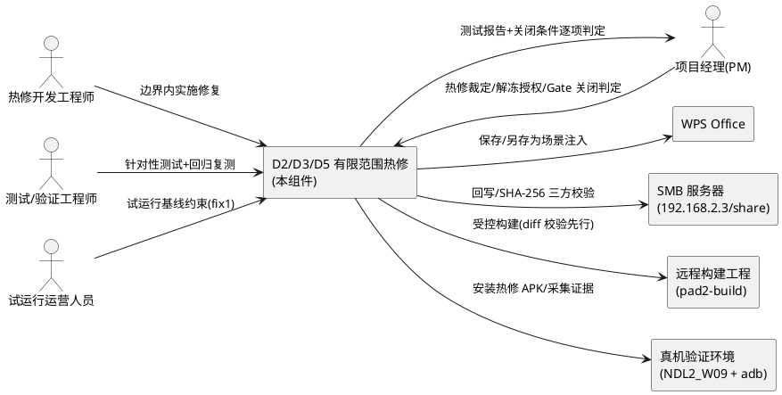
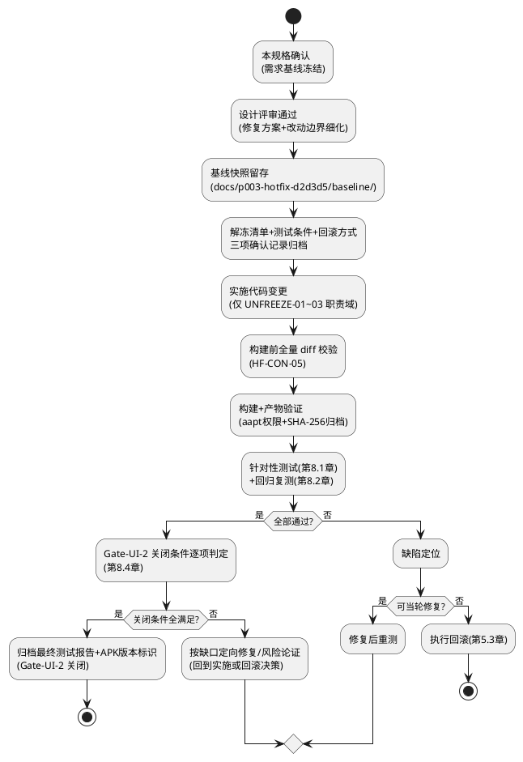
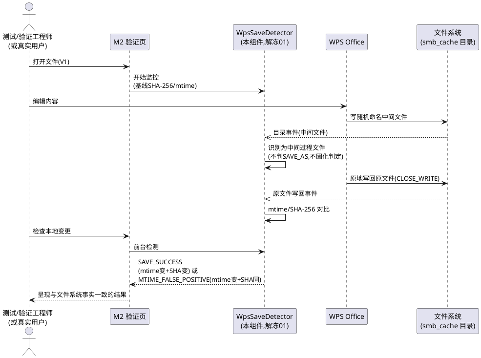
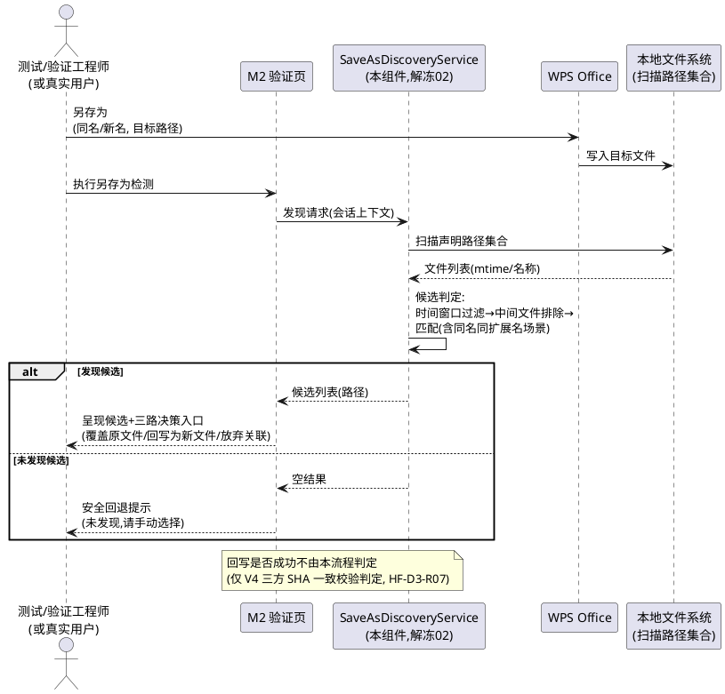
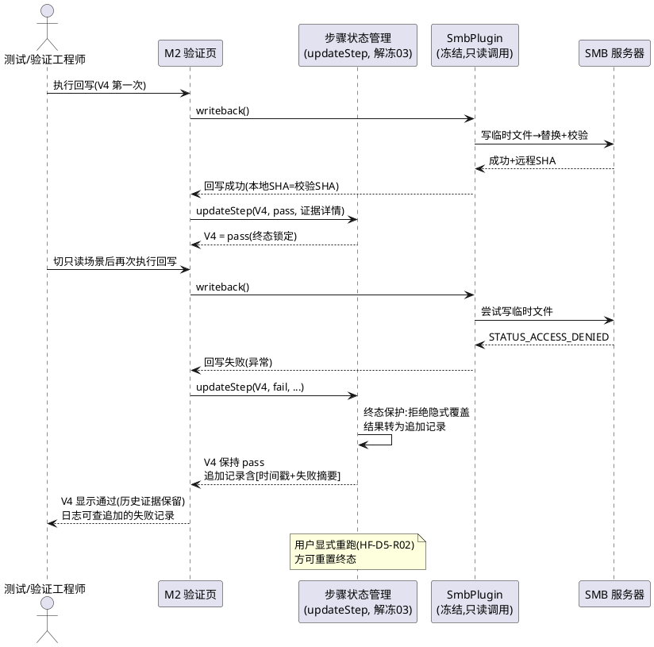

# PAD2-HOTFIX-D2D3D5-001 需求规格：D2/D3/D5 有限范围热修

> **文档编号**：PAD2-HOTFIX-D2D3D5-001
> **任务名称**：D2/D3/D5 有限范围热修（WPS 保存检测误判 / 另存为发现盲区 / M2 页 V4 状态覆盖）
> **需求来源**：PM（大G项目经理）2026-10-20 裁定 + TASK-S2-06 V1-V7 真机验证报告（`docs/p003-ui/v1-v7-verification-report.md`，含缺陷清单 D1-D7）
> **上游基线**：P003 需求规格（`.codeartsdoer/specs/p003_ui_productization/spec.md`）｜P003 设计基线（`docs/p003-ui/design.md`，冻结区定义见其 2.1.4）｜P003 任务规划（`docs/p003-ui/tasks.md`，41 任务 S0-S6）
> **权威版本位置**：本文档为权威版本，位于 `docs/p003-hotfix-d2d3d5/spec.md`（遵循 docs/ 下按任务建目录惯例，参照 docs/p0-02-r3-fix/）。SDD 流程登记副本位于 `.codeartsdoer/specs/p003_hotfix_d2d3d5/spec.md`，两处内容一致，以本处为准。
> **文档定位**：本规格仅定义本次热修的范围边界、每个缺陷的期望行为（EARS 需求）、验收标准、回归测试范围与 Gate-UI-2 关闭条件映射，不规定修复实现方案（HOW 由后续设计阶段确定）。本规格构成热修实施授权的需求基础——**热修实施前必须先通过本规格确认及后续设计评审，方可执行代码变更**。
> **语言约定**：本规格中"EARS 需求"指以 EARS 句式（当…时/在…期间/如果…则…，系统必须/禁止…）表述的可验证需求；每条需求附验收条件，格式为 [触发场景] → [预期行为]。

---

# 0. 任务背景与 PM 裁定引用

## 0.1 任务背景

P003 UI 产品化 S2 阶段 TASK-S2-06（Gate-UI-2 验证）于 2026-10-20 在荣耀平板 NDL2_W09 真机完成 V1-V7 验证，产出 fix1 APK（pad2-p003-s2-ui-fix1.apk）。验证结论：**核心业务闭环（浏览→打开→编辑→保存→回写→校验→失败保护→冲突检测→断网恢复）端到端有效，7 项中 5 项完全通过（V1/V4/V5/V6/V7），但 2 项（V2/V3）业务链路实际可用而检测组件存在缺陷**。据此 PM 于同日出具有限范围热修裁定，授权针对缺陷 D2、D3、D5（PM 编号，映射关系见 0.3）开展一次范围受限的热修。

## 0.2 PM 裁定要点（2026-10-20，须完整纳入，构成本规格的需求输入）

### 0.2.1 V1-V7 验收结果（背景基线）

| 项 | 名称 | 验证判定 | 备注 |
|---|---|---|---|
| V1 | WPS 打开 | **PASS** | file:// URI + ACTION_VIEW 投递，基线 SHA-256 记录 |
| V2 | WPS 保存 | **CONDITIONAL PASS** | 文件实际变化（11444→9143 bytes，mtime 15:54:50→16:09:09）但检测组件误报未变更（缺陷 D2） |
| V3 | 保存行为识别 | **HOLD** | SAVE_AS 误判 + 另存为发现盲区（缺陷 D2/D3） |
| V4 | 回写成功 | **PASS** | 三方 SHA-256 一致（App 本地 = App 远程校验 = 服务器实测 = df4b123b…） |
| V5 | 回写失败不破坏 | **PASS** | 只读共享下 STATUS_ACCESS_DENIED 拒绝写回，三方完好、无 tmp 残留 |
| V6 | 并发冲突 | **PASS** | 服务器侧独立修改被正确检测（remote mtime ≠ 基线） |
| V7 | 断网恢复 | **PASS** | ENETUNREACH 正确报告、App 不崩溃；网络恢复后重连正常 |

**Gate-UI-2 暂定 HOLD**：本次热修仅针对 Gate 的完整关闭，**不要求已通过功能返工**。

### 0.2.2 热修范围（有限范围、最小解冻）

1. **D2（P1 优先修复）**：WpsSaveDetector SAVE_AS 误判——仅解冻保存检测相关代码。修复判定逻辑，避免把另存为操作误判为普通保存或未变更；补充正常保存、另存为、取消另存为等针对性测试。
2. **D3（P1 优先修复）**：SaveAsDiscoveryService 另存为发现盲区——仅解冻另存为文件发现及路径识别相关代码。验证不同保存路径、文件名变化和未找到目标文件的情况。**不得用"检测到文件变化"代替"已确认正确回写"**。
3. **D5（P2 定向修复）**：M2 页 V4 状态被覆盖——重点验证回写成功、失败、冲突等最终状态不会被后续 UI 更新覆盖；**若覆盖会造成"失败显示成功"或"未验证却显示成功"，则升级为发布阻断项**。

### 0.2.3 授权边界（硬约束）

1. 仅为 D2、D3、D5 建立一次范围受限的热修任务，对必要的冻结文件作**最小解冻**；
2. **先明确文件范围、测试条件和回滚方式，再实施**；
3. 不允许借机重构 SMB 核心、改写无关状态管理或扩展新功能；
4. 修复后只重跑受影响的测试和必要的回归项，不要求无差别重跑全部测试。

### 0.2.4 Gate-UI-2 最终关闭条件（验收总纲，映射见第 8.4 章）

1. D2、D3 修复并通过对应测试；
2. D5 经风险判断后修复，或证明不影响成功状态真实性；
3. V1-V7 中受影响的项目复测通过（**V2/V3 复测为最小集**）；
4. 现有 V1、V4、V5、V6、V7 的有效证据仍对应最终交付版本（热修不得破坏已验证行为）；
5. 归档最终测试报告和实际 APK 的版本标识。

### 0.2.5 并行背景：受控内部试运行

受控内部试运行已获授权，基于当前 fix1 APK（pad2-p003-s2-ui-fix1.apk）开展。试运行限制（作为背景约束体现，运营事项、非本热修研发内容）：

1. 不把保存检测结果直接视为回写成功；
2. 对保存检测异常的文件，人工确认目标路径并核对服务器端文件内容或 SHA-256；
3. 不用唯一副本、重要业务文件或不可恢复文件做试验；
4. 未完成热修与验证前，不宣布完整编辑回写链路已通过生产验收。

**本热修的版本变更须受控、不得影响试运行基线证据对应关系**（约束见第 4.5 章）。

### 0.2.6 其他 P2 缺陷排期（不入本次热修，列为非目标）

1. 重装后权限引导（报告 D5）→ 下个 UI 体验修复批次；
2. WPS 保存按钮待复测（报告 D6）→ **纳入 D2/D3 定向回归**（避免重复安排独立项目）；
3. 错误信息误导（checkCacheSpace 误报"空间不足"，报告 D7）→ 下一批 UI 文案修复；**若会误导用户覆盖文件或误认回写成功则提前处理**。

## 0.3 缺陷编号映射澄清（重要，全规格统一口径）

| PM 裁定编号 | 验证报告编号 | 内容 | 本次热修处置 |
|---|---|---|---|
| **D2** | D2 | WpsSaveDetector SAVE_AS 误判（P1） | **修复** |
| **D3** | D3 | SaveAsDiscoveryService 另存为发现盲区（P1） | **修复** |
| **D5** | **D4** | M2 页 V4 状态被后续操作覆盖（P2） | **定向修复** |
| — | D5 | 重装后权限引导（P2） | **不修**，排期至下个 UI 体验修复批次 |
| — | D6 | WPS 保存按钮待复测（P2） | 不单独立项，**人工复测纳入 D2/D3 定向回归** |
| — | D7 | checkCacheSpace 错误信息误导（P2） | **不修**，下一批 UI 文案修复（含提前处理触发条件） |

**约定**：本规格正文一律按 **PM 编号（D2/D3/D5）** 引用；凡引用验证报告原始编号处，均注明"报告编号"。规格中"D5"特指"报告 D4（M2 页 V4 状态被后续操作覆盖）"，禁止与报告 D5（重装后权限引导）混淆。

## 0.4 技术根因引用（缺陷上下文，细节以验证报告为准）

以下根因信息引自验证报告与真机日志（`docs/p003-ui/shots/s2/v1-v7/m2a-exported-log.txt`），作为需求上下文引用；**修复的具体技术方案（HOW）由后续设计阶段确定，本规格不预设**：

1. **D2**：WPS 保存时先写随机命名中间文件（实测名 `1963289719.-1908999883-1548918099`），WpsSaveDetector 的 FileObserver 将其误判为 SAVE_AS_DETECTED 且 verdict 粘住，短路了 mtime/hash 对比分支；logcat 证实 DirObserver 随后收到 `CLOSE_WRITE path: test-render.docx`（真实原地写回事件）被忽略。涉及文件：`android/app/src/main/java/com/pad2/filemanager/smb/WpsSaveDetector.java`（冻结区，P003 design.md 2.1.4 CON-06 android/**）。
2. **D3**：SaveAsDiscoveryService.discoverSaveAs 仅收 `nameMatch && extensionChanged` 的文件（docx→docx 同名另存为是盲区），扫描路径仅 /storage/emulated/0/、Documents/、Download/ 三处。涉及文件：`android/app/src/main/java/com/pad2/filemanager/smb/SaveAsDiscoveryService.java`（冻结区）。
3. **D5（=报告 D4）**：M2 页 updateStep 状态被后续点击覆盖（实测：16:11:22 V4 回写通过 → 16:14:41 只读场景预期失败把 V4 覆盖为"失败"，历史证据丢失）。涉及文件：`src/ui/pages/M2VerificationPage/index.tsx`（非冻结区；注意 P003 约定 M2 页五结果块保持直调豁免至 S5——本次热修对该页的改动需界定与 S5 任务的边界，见第 5.5 章）。
4. **构建约束（P0 教训，必须写入规格，见第 4.2 章）**：远程构建工程（192.168.2.3:/home/debian/android/pad2-build，工程根即 android 工程，app/ 在顶层）曾与本地 android/ 严重漂移，任何远程构建前必须全量 diff 校验 android/（至少 Manifest + java + gradle）。

---

# 1. 组件定位

## 1.1 核心职责

本热修负责对 P003 S2 阶段真机验证暴露的缺陷 D2（保存检测误判）、D3（另存为发现盲区）、D5（M2 页状态覆盖）实施一次范围受限的定向修复，实现 Gate-UI-2 完整关闭且不破坏 V1/V4/V5/V6/V7 已验证行为。

## 1.2 核心输入

1. **PM 热修裁定**（2026-10-20）：热修范围（D2/D3/D5）、授权边界、Gate-UI-2 关闭条件（第 0.2 章，本规格的直接需求输入）。
2. **V1-V7 真机验证报告与缺陷清单**：D1-D7 缺陷描述、根因、复现步骤、证据索引（`docs/p003-ui/v1-v7-verification-report.md`）。
3. **App 导出验证日志**：V1-V7 门禁状态、操作日志与详细结果（`docs/p003-ui/shots/s2/v1-v7/m2a-exported-log.txt`）。
4. **fix1 APK 基线**：pad2-p003-s2-ui-fix1.apk（2026-10-20 15:49 构建），热修前的版本基线与试运行基线。
5. **P003 既有基线**：需求规格、设计基线（冻结区定义）、任务规划（S0-S6 阶段约定，含 M2 直调豁免至 S5 的约定）。

## 1.3 核心输出

1. **修复后的检测行为**：WPS 原地保存、真实另存为、取消另存为三类场景下保存检测与另存为发现返回与文件系统事实一致的判定结果。
2. **修复后的 M2 页状态行为**：V1-V7 验证步骤的终态（pass/fail）不被后续操作覆盖，历史证据可追溯。
3. **热修版本 APK**：fix1 之后的热修版本（建议命名 pad2-p003-s2-ui-fix2.apk，沿用 fix 序列），带版本标识归档。
4. **最终测试报告**：针对性测试 + 回归复测结果 + Gate-UI-2 关闭条件逐项判定记录，归档于 docs/p003-hotfix-d2d3d5/。
5. **回滚预案与解冻范围记录**：解冻文件清单、改动边界、回滚方式（本规格第 5 章），作为热修实施与审计依据。

## 1.4 职责边界（本热修不做什么）

1. **不重构 SMB 核心**：SmbClient、SmbPlugin、传输引擎、回写执行链路（写临时文件→替换策略）等一律不改写；冻结区中未列入第 5.1 章解冻清单的文件零变更。
2. **不改写无关状态管理**：M2 页之外的 stores、产品页面（HomePage/ConnectionPage/BrowsePage 等）、设计令牌与组件库零变更。
3. **不扩展新功能**：不新增产品范围功能；不做 S5 阶段任务（EditSessionPage、editSessionStore、GlobalStatusRail、M2 直调收口等）提前实施。
4. **不要求已通过功能返工**：V1/V4/V5/V6/V7 已验证链路不因热修改动而返工（PM 裁定 0.2.1）。
5. **不做无差别全量回归**：不重跑全部 V1-V7 测试，仅重跑受影响项与必要回归项（PM 裁定 0.2.3-4，范围见第 8.2 章）。
6. **不处理非热修范围缺陷**：报告 D5（重装后权限引导）、D7（错误文案）不在本次范围（触发提前处理的条件见第 9 章）；D6（WPS 保存按钮）仅人工复测定性，不做代码修复立项。
7. **不宣布生产验收通过**：热修完成并通过验证后仅关闭 Gate-UI-2，完整编辑回写链路的生产验收声明仍受试运行限制第 4 条约束（0.2.5）。

---

# 2. 领域术语

**热修（Hotfix）**
: 在版本基线（fix1）之上，针对已验证暴露的特定缺陷实施的范围受限、可回滚的定向修复活动。

**最小解冻**
: 仅对修复缺陷所必需的冻结文件解除只读约束，且对每个解冻文件明确允许变更的职责域与禁止触碰的职责域（第 5.1 章）；超出清单或边界的变更须重新裁定。

**冻结区**
: P003 design.md 2.1.4 定义的只读范围（src/adapter/smb/SmbPlugin.ts、src/core/**、android/**），依据 M1 冻结与 CON-02/CON-06 约束。本热修经 PM 授权对其中的两个文件作最小解冻。

**SAVE_AS 误判（D2）**
: WpsSaveDetector 将 WPS 保存过程产生的随机命名中间文件误判为"用户另存为新文件"（SAVE_AS_DETECTED）且判定结果粘住、短路后续对比判定的缺陷行为。

**verdict 粘住**
: 检测判定结果一旦置为 SAVE_AS_DETECTED 后不再被后续证据（原文件原地写回事件）修正的状态保持缺陷。

**另存为发现盲区（D3）**
: SaveAsDiscoveryService 仅能发现"文件名匹配且扩展名变更"的候选文件、且仅扫描三条固定路径，导致同名同扩展名另存为等真实场景不可见的缺陷行为。

**安全回退**
: 系统未自动发现另存为候选文件时，不虚构结果、提示用户手动选择文件的行为。属于诚实呈现"未发现"的安全语义，非缺陷。

**状态覆盖（D5）**
: M2 页已达到终态（pass/fail）的验证步骤被后续操作的更新无条件改写，导致历史证据丢失的缺陷行为（实测：V4 通过态被只读场景的预期失败覆盖为"失败"）。

**终态**
: 验证步骤状态机中 pass（通过）与 fail（失败）两类不可被后续常规操作隐式改写的状态；pending/running 为非终态。

**三方 SHA 一致**
: App 本地哈希 = App 远程校验哈希 = 服务器实测哈希的回写成功判据（V4 证据标准）。本规格中"已确认正确回写"仅指满足此判据的事实。

**Gate-UI-2**
: P003 S2 阶段（应用外壳与文件首页）的验收门禁，当前状态暂定 HOLD；本热修的验收总纲即其最终关闭条件（PM 裁定 0.2.4，映射见第 8.4 章）。

**fix1 APK**
: pad2-p003-s2-ui-fix1.apk（2026-10-20 15:49 构建，含全量原生源码同步修复），当前试运行基线与本热修的版本基线。

**受控内部试运行**
: 基于 fix1 APK、附四条限制（0.2.5）的运营活动；与热修研发活动并行，热修版本变更不得破坏其证据对应关系。

**定向回归**
: 将特定待复测事项（如报告 D6 WPS 保存按钮人工复测）并入相关热修验证窗口执行、不单独立项的回归安排方式。

---

# 3. 角色与边界

## 3.1 核心角色

- **项目经理（PM）**：热修范围与授权边界的裁定者；解冻清单的批准人；Gate-UI-2 最终关闭的判定人；超出边界变更的重新裁定人。
- **热修开发工程师**：在第 5 章授权边界内实施 D2/D3/D5 修复的人员；须先获得文件范围、测试条件与回滚方式的确认再动代码。
- **测试/验证工程师**：执行第 8 章针对性测试与回归复测、产出证据（截图、日志、SHA-256 记录）与最终测试报告的人员。
- **试运行运营人员**：受控内部试运行的执行者（背景角色）；其试运行基线（fix1）与限制条款构成本热修的变更控制约束输入。

## 3.2 外部系统

- **WPS Office（cn.wps.moffice_eng）**：保存行为的发起方；其写入模式（随机命名中间文件→原地写回/另存为目标文件）是 D2/D3 检测需求的事实来源。
- **SMB 服务器（192.168.2.3/share，debian 用户）**：回写目标与三方 SHA 校验的服务器端事实来源；只读切换（smb.conf read only + reload）用于复测 V5 类场景。
- **远程构建工程（192.168.2.3:/home/debian/android/pad2-build）**：热修 APK 的构建环境；受第 4.2 章构建一致性约束（构建前强制全量 diff 校验）。
- **Android 真机（荣耀平板 NDL2_W09）**：验证执行设备；adb/logcat/svc wifi 等为验证手段。

## 3.3 交互上下文

---

# 4. DFX 约束

## 4.1 范围与变更控制（最高优先级约束）

1. **最小解冻约束（HF-CON-01）**：本次热修仅允许变更第 5.1 章解冻清单内的文件；冻结区其余文件与改造区其余文件必须零变更。
   - 验收条件：[热修完成后对全部工程做 diff 审查] → [变更文件集合 ⊆ 解冻清单；清单外文件零 diff]
2. **先定范围后实施约束（HF-CON-02）**：热修实施前必须先明确并确认文件范围（第 5.1 章）、测试条件（第 8.1 章）与回滚方式（第 5.3 章）；三者未确认前禁止任何代码变更。
   - 验收条件：[实施前的流程审查] → [存在已确认的解冻清单、测试条件清单、回滚预案记录]
3. **禁止搭车变更约束（HF-CON-03）**：禁止借机重构 SMB 核心、改写无关状态管理或扩展新功能；与 D2/D3/D5 修复无因果关系的代码改动一律不允许。
   - 验收条件：[diff 审查中发现的任何变更] → [均可追溯到 D2/D3/D5 某条需求（第 6 章），否则判定为违规变更]
4. **边界升级约束（HF-CON-04）**：修复过程中若发现必须触碰清单外文件（含因接口耦合需同步修改的关联文件），必须停止实施并回到 PM 重新裁定解冻范围，不得自行扩大。
   - 验收条件：[出现清单外变更需求] → [实施暂停并记录升级裁定请求，无未经裁定的越界合入]

## 4.2 构建一致性（P0 教训，强制）

1. **构建前全量 diff 校验（HF-CON-05）**：任何远程构建前，必须对本地 android/ 与远程构建工程（192.168.2.3:/home/debian/android/pad2-build，工程根即 android 工程，app/ 在顶层）执行全量 diff 校验，至少覆盖 Manifest、全部 java 源码、gradle 配置；发现任何不一致必须先同步再构建。
   - 验收条件：[每次远程构建的流程记录] → [存在构建前 diff 校验记录，且校验通过（或同步后复验通过）后才执行构建]
2. **构建产物验证（HF-CON-06）**：热修 APK 构建后必须验证权限声明（aapt 级验证，确认 3 个存储权限在 Manifest 中）并归档 APK 的 SHA-256 与文件名、构建时间。
   - 验收条件：[热修 APK 交付] → [aapt 权限验证通过记录 + APK SHA-256 归档记录齐备]

## 4.3 可靠性（不破坏已验证行为）

1. **已验证行为保持约束（HF-CON-07）**：热修不得改变 V1（打开）、V4（回写）、V5（失败保护）、V6（冲突检测）、V7（断网恢复）已验证链路的对外行为；这些链路的行为等价性由"冻结区零变更（HF-CON-01）+ 构建一致性（HF-CON-05）+ diff 审查"共同保证。
   - 验收条件：[最终交付版本的 diff 审查 + 第 8.2 章回归复测] → [受影响项复测通过，未重跑项的链路代码与 fix1 一致（M2 页状态呈现层除外，其为 D5 授权变更域）]
2. **检测诚实性约束（HF-CON-08）**：修复后的保存检测与另存为发现在证据不足时必须返回不确定/未发现（安全语义），禁止为通过测试而放宽判定、伪报成功。
   - 验收条件：[无文件变化证据时执行检测] → [返回不确定或未变更判定，不返回成功/另存为判定]

## 4.4 可回滚性

1. **逐文件回滚能力（HF-CON-09）**：热修必须具备按文件回滚到 fix1 基线的能力（见第 5.3 章）；回滚后应用行为与 fix1 等价。
   - 验收条件：[触发回滚决策] → [可在一次构建周期内恢复三个文件（或其子集）至 fix1 基线并重建 APK]
2. **证据不可破坏（HF-CON-10）**：回滚与重试不得删除或改写既有验证证据（fix1 的报告、日志、截图归档）；热修验证证据独立归档。
   - 验收条件：[热修任何阶段] → [docs/p003-ui/ 下既有证据文件零改动；热修证据仅写入 docs/p003-hotfix-d2d3d5/]

## 4.5 试运行期间变更控制

1. **试运行基线隔离（HF-CON-11）**：受控内部试运行继续基于 fix1 APK 开展；热修版本 APK 在通过本规格第 8 章验收前，不得分发给试运行、不得替换试运行设备上的 fix1。
   - 验收条件：[热修验证周期内检查试运行设备] → [试运行设备安装版本仍为 fix1，直至热修验收通过并完成版本切换决策]
2. **证据对应关系保持（HF-CON-12）**：试运行期间产生的日志与证据按 APK 版本标识归档；热修版本切换时必须建立新的版本标识，不得混用或覆盖 fix1 的证据基线。
   - 验收条件：[版本切换实施] → [新版本证据以新版本标识（建议 fix2）归档，fix1 证据保持只读]
3. **试运行限制延续（HF-CON-13）**：试运行四条限制（0.2.5）在热修完成并关闭 Gate-UI-2 前持续有效；热修关闭 Gate-UI-2 不自动解除试运行限制第 4 条（生产验收声明）。
   - 验收条件：[Gate-UI-2 关闭后的对外声明审查] → [不出现"完整编辑回写链路已通过生产验收"表述]

---

# 5. 解冻范围与授权边界

## 5.1 解冻文件清单（最小范围，逐文件列明解冻理由与改动边界）

| 编号 | 文件 | 所属缺陷 | 冻结状态 | 解冻理由 | 允许变更的职责域 | 禁止触碰的职责域 |
|---|---|---|---|---|---|---|
| UNFREEZE-01 | `android/app/src/main/java/com/pad2/filemanager/smb/WpsSaveDetector.java` | D2 | 冻结区（CON-06 android/**） | SAVE_AS 误判根因在此文件的事件判定逻辑中，不经此文件无法修复 D2（PM 裁定：仅解冻保存检测相关代码） | ① 中间文件识别逻辑（isTempFile 及其调用点）；② 另存为（SAVE_AS）事件判定条件；③ 判定结果短路/粘住逻辑（saveAsDetected 相关状态处置）；④ 原地保存判定路径（CLOSE_WRITE/MODIFY → mtime/SHA-256 对比） | ① SMB 连接/传输/回写执行逻辑；② 对外方法签名与 SaveDetectionResult 数据结构语义（若设计发现必须扩展结果字段，按 HF-CON-04 升级裁定）；③ 监控生命周期管理（start/stop/pause/resume）既有契约；④ eventLog 证据记录机制 |
| UNFREEZE-02 | `android/app/src/main/java/com/pad2/filemanager/smb/SaveAsDiscoveryService.java` | D3 | 冻结区（CON-06 android/**） | 另存为发现盲区根因在此文件的候选匹配条件与扫描路径定义中（PM 裁定：仅解冻另存为文件发现及路径识别相关代码） | ① 候选文件匹配条件（基名匹配与扩展名变更判定的组合逻辑）；② 扫描路径集合（SCAN_PATHS 定义）；③ 时间窗口过滤参数与判定；④ 对 isTempFile 的排除调用口径（与 UNFREEZE-01 保持一致） | ① SMB 连接/读取底层逻辑；② discoverSaveAs 对外方法签名与 EditSessionContext 依赖契约；③ 会话管理逻辑 |
| UNFREEZE-03 | `src/ui/pages/M2VerificationPage/index.tsx` | D5 | 改造区（非冻结；受 S5 边界约定约束） | V4 状态覆盖根因在此文件的 updateStep 无条件覆盖逻辑中（PM 裁定：定向修复） | ① 步骤状态更新逻辑（updateStep）的终态防覆盖保护；② 为支持历史可追溯所需的步骤状态数据结构最小调整（仅限状态字段语义，见第 7.3 章）；③ 与终态保护配套的结果详情追加呈现（时间戳级历史） | ① 五结果块直调 SmbPlugin 的豁免结构（保持至 S5，见 5.5）；② 连接/浏览 store 消费逻辑（S2-05 已迁移形态）；③ V1-V7 步骤定义、按钮与操作流程的对外可见行为；④ 页面样式与令牌化改造成果 |
| UNFREEZE-04 | （新增）D2/D3/D5 针对性测试所需的测试文件/脚本（目录与形式由设计阶段确定，如 android 侧测试类或验证脚本） | D2/D3/D5 | 非冻结（新建文件） | PM 裁定要求补充针对性测试（正常保存/另存为/取消另存为/不同保存路径/文件名变化/未找到目标/V4 状态不被覆盖），需要测试承载物 | ① 新建测试文件的全部内容；② 对既有测试设施（如 R1RegressionTestSuite 惯例）的**只读复用** | ① 不得修改既有冻结区测试承载文件；② 不得为测试便利修改产品代码超出 UNFREEZE-01~03 边界 |

**清单完备性声明**：上表为本热修变更文件的全集。热修产物（docs/p003-hotfix-d2d3d5/ 下的规格、设计、任务、测试报告文档）属文档新增，不受本清单约束，但按 HF-CON-10 独立归档。

## 5.2 解冻授权规则

1. **一次授权一次用尽**：本解冻授权仅对本热修任务有效（PM 裁定 0.2.3-1"建立一次范围受限的热修任务"）；热修关闭或回滚后，UNFREEZE-01/02 所列文件自动恢复冻结状态（回归 P003 design.md 2.1.4 冻结区约束）。
   - 验收条件：[热修结束后的冻结区状态审查] → [WpsSaveDetector.java 与 SaveAsDiscoveryService.java 重新标记为冻结；后续 S5+ 阶段 diff 门禁重新覆盖这两个文件]
2. **授权粒度为文件+职责域双层**：解冻不等于整文件放开；第 5.1 章"禁止触碰的职责域"列在授权生效期间同样具有约束力，违反等同越界变更（按 HF-CON-04 处理）。
   - 验收条件：[diff 逐 hunk 审查] → [每个变更 hunk 均落在对应文件的允许变更职责域内]
3. **接口兼容底线**：三个解冻文件的对外接口（方法签名、返回结构语义）在本热修中保持兼容；确需变更的（例如结果字段扩展）须按 HF-CON-04 升级 PM 裁定，且变更后 SmbPlugin.ts 桥接层（冻结区，未解冻）无须改动方可执行——若必须改桥接层即超界。
   - 验收条件：[设计评审对接口变更项的审查] → [凡涉及桥接层改动的方案被驳回并升级裁定]

## 5.3 回滚方式

回滚承诺（PM 裁定 0.2.3-2 要求先明确回滚方式再实施）：

1. **基线留存**：热修实施前，对 UNFREEZE-01/02/03 三个文件保存 fix1 基线副本（基线快照目录：`docs/p003-hotfix-d2d3d5/baseline/`，含逐文件副本与 SHA-256 清单），作为回滚锚点。
2. **回滚触发条件**（满足其一即触发）：
   - 修复引入新缺陷且当轮无法定位；
   - 回归复测发现已验证行为（V1/V4/V5/V6/V7）被破坏；
   - 变更越界（违反 HF-CON-03）且无法收敛；
   - PM 主动叫停。
3. **回滚操作**：将目标文件（三个文件整体或经裁定的子集）恢复为基线副本 → 按第 4.2 章流程重新构建 APK（构建前 diff 校验仍强制）→ 版本标识在 fix 序列上递增（如 fix2-rollback 或按当时版本序号）→ 归档回滚记录（触发原因、恢复范围、新 APK 标识）。
4. **回滚后状态**：应用行为与 fix1 等价；Gate-UI-2 维持 HOLD；已归档热修证据保留只读（HF-CON-10）。

## 5.4 实施前置条件（Gate 顺序）

## 5.5 与 S5 任务的边界界定（M2 页）

P003 约定：M2 页五结果块（changeResult/writebackResult/remoteChangeResult/saveAsResult/resolveAsResult）保持直调 SmbPlugin 豁免至 S5，由 TASK-S5-04 收口至 editSessionStore.manualStep()。本次热修对该页的边界：

1. **本次热修做**：updateStep 终态防覆盖（含必要的数据结构最小调整），解决 V4 状态被覆盖缺陷；改动保持直调豁免结构不变。
2. **本次热修不做**：不做 store 收口、不迁移五结果块至 editSessionStore、不实现 StateTimeline/决策流（均为 S5-04 范畴）。
3. **交接约定**：本次热修引入的终态保护语义（第 7.3 章）构成 S5-04 的输入约束——S5 设计收口方案时必须吸收该语义，不得在收口过程中回退防覆盖行为（在 P003 tasks.md 的 S5-04 任务中登记此依赖，作为热修对基线文档的唯一回写点）。
4. **回归承诺**：热修对 M2 页的改动不改变 V1-V7 步骤对外可见操作流程（按钮、入口、结果呈现语义不变；新增的仅是终态保护与历史可追溯行为）。

---

# 6. 核心能力（EARS 需求）

> 本章每个缺陷模块按"业务规则（EARS）→ 交互流程 → 异常场景"组织。规则编号：HF-D2-Rxx / HF-D3-Rxx / HF-D5-Rxx。每条规则附验收条件（[触发场景] → [预期行为]），对应测试场景编号见第 8.1 章。

## 6.1 D2：WPS 保存检测 SAVE_AS 误判修复

### 6.1.1 业务规则

1. **中间文件不误判（HF-D2-R01）**：当 WPS 保存过程在受监听目录产生中间过程文件（如随机数字命名文件，实测形态 `1963289719.-1908999883-1548918099`，及 `~$` 前缀、`.tmp`/`.temp` 后缀等既有已知形态）时，保存检测器必须将其识别为中间过程文件，禁止将其判定为另存为事件。
   - a. 验收条件：[WPS 对受监听文件执行原地保存（复现 V2 场景：编辑→返回→对话框保存）] → [检测判定不为 SAVE_AS_DETECTED；最终判定由原文件实际变化证据驱动]
2. **原地保存正确判定（HF-D2-R02）**：当受监听文件本身发生写回（CLOSE_WRITE/MODIFY 事件，mtime 与基线不一致）时，系统必须执行 mtime 与 SHA-256 对比判定：内容变化 → SAVE_SUCCESS；仅 mtime 变化 → MTIME_FALSE_POSITIVE。
   - a. 验收条件：[WPS 原地保存且内容实际修改（字数/字节变化）] → [判定 SAVE_SUCCESS，新 SHA-256 记录在案]
   - b. 验收条件：[文件 mtime 变化但内容未变] → [判定 MTIME_FALSE_POSITIVE，不报保存成功]
3. **判定不粘住（HF-D2-R03）**：当中间文件事件先于原文件写回事件到达时，先到的中间文件事件不得固化判定结果、不得短路后续 mtime/hash 对比；最终判定必须以受监听文件的真实变化证据为准。
   - a. 验收条件：[按实测时序注入：中间文件事件 → 原文件 CLOSE_WRITE 事件 → 执行检测] → [判定反映原文件真实状态（SAVE_SUCCESS/MTIME_FALSE_POSITIVE），不残留 SAVE_AS_DETECTED]
4. **真实另存为仍可识别（HF-D2-R04）**：当用户在 WPS 中真实执行另存为（产生与受监听文件不同名的目标文件、且目标路径在监听范围内）时，检测器必须仍能判定 SAVE_AS_DETECTED 并提供结果文件路径。
   - a. 验收条件：[WPS 内"另存为"新文件名（监听范围内路径）] → [判定 SAVE_AS_DETECTED，结果文件路径指向真实另存为目标]
5. **取消另存为零误报（HF-D2-R05）**：当用户在另存为对话框中取消操作（未产生目标文件、原文件无内容修改）时，检测器不得产生另存为误报，也不得报保存成功。
   - a. 验收条件：[打开另存为对话框 → 点取消 → 执行检测] → [判定为未变更/不确定类，无 SAVE_AS_DETECTED、无 SAVE_SUCCESS]
6. **证据不足诚实呈现（HF-D2-R06）**：当无任何文件变化证据（无监听事件、mtime 与基线一致）时，检测必须返回不确定判定，禁止伪报成功或另存为。
   - a. 验收条件：[无任何保存操作后执行"检查本地变更"] → [判定不确定/未变更，App 提示与文件系统事实一致]
7. **禁止项（HF-D2-R07）**：禁止为规避误判而整体禁用目录监听或另存为识别能力（即不得以"砍掉功能"方式通过测试）。
   - a. 验收条件：[审查修复方案与真机演练（HF-TC-D2-02 另存为场景）] → [目录监听与 SAVE_AS 识别能力保留且正确]

### 6.1.2 交互流程（修复后期望的主干时序）

### 6.1.3 异常场景

1. **事件交错竞态**
   - a. 触发条件：中间文件事件与原文件写回事件到达顺序不定（WPS 保存策略时序差异）。
   - b. 系统行为：判定以最终检测时点对原文件采集的 mtime/SHA-256 证据为准；先到事件不固化判定。
   - c. 用户感知：检测结果与文件实际状态一致（保存了报已保存/内容未变报未变更）。
2. **另存到监听范围外路径**
   - a. 触发条件：用户将文件另存至监听与扫描范围之外的路径（如 WPS 私有目录）。
   - b. 系统行为：检测器不误判原地保存为另存为；另存为发现按 D3 规则处理（未发现 → 安全回退）。
   - c. 用户感知：原文件检测为未变更；另存为检测提示"未发现候选，请手动选择"（安全回退，非缺陷）。
3. **SHA-256 计算失败**
   - a. 触发条件：检测时文件读取异常（被占用/损坏）。
   - b. 系统行为：返回不确定判定并携带失败原因，不得默认为成功。
   - c. 用户感知：提示检测不确定及技术性原因（供排障），不显示保存成功。
4. **监控未启动/已停止**
   - a. 触发条件：无监控会话时执行检测。
   - b. 系统行为：返回不确定判定（"No file monitored"语义保持）。
   - c. 用户感知：提示无监控会话，不产生任何成功/另存为结论。

## 6.2 D3：另存为发现盲区修复

### 6.2.1 业务规则

1. **同名同扩展名另存为可发现（HF-D3-R01）**：当用户将文件另存为**同名同扩展名**文件（如 docx→docx）到不同路径时，发现服务必须能将其识别为另存为候选。
   - a. 验收条件：[WPS 另存为相同文件名相同扩展名到扫描范围内的另一路径] → [该文件出现在另存为候选结果中]
2. **文件名变化可发现（HF-D3-R02）**：当用户另存为时修改文件名（含基名相关变化与全新命名）到扫描范围内路径时，发现服务必须能将其识别为候选。
   - a. 验收条件：[WPS 另存为新文件名（如 test-render-v2.docx）至 Documents/] → [该文件被识别为候选并呈现路径]
   - b. 验收条件：[WPS 另存为与原基名无包含关系的全新名至 Download/] → [该文件被识别为候选并呈现路径]（识别口径由设计阶段在允许职责域内定义，需求要求"可发现"这一结果）
3. **保存路径覆盖（HF-D3-R03）**：发现服务的扫描范围必须覆盖验证场景声明的保存路径集合——至少包含既有三条路径（/storage/emulated/0/ 根、Documents/、Download/）与验证测试中实际使用的全部保存路径（含 WPS 常见默认保存目录）；扫描行为须可审计（日志记录扫描路径与候选判定）。
   - a. 验收条件：[在验证场景声明的任一路径执行另存为] → [候选发现成功，且扫描日志可证明该路径被覆盖]
4. **未找到目标的安全回退（HF-D3-R04）**：当扫描未发现任何候选文件时，必须返回空结果并触发安全回退提示（"未自动发现另存为文件，请手动选择文件"），禁止虚构候选或扩大时间窗口硬凑结果。
   - a. 验收条件：[另存为到扫描范围外路径（或未执行另存为）→ 执行另存为检测] → [返回未发现 + 安全回退提示，无虚构候选]
5. **时间窗口过滤（HF-D3-R05）**：候选文件必须落在会话时间窗口内（含既有 ±60 秒容差语义）；窗口外文件不得进入候选，防止误收历史文件。
   - a. 验收条件：[扫描目录中存在与基名同名但 mtime 在窗口外的历史文件 → 执行检测] → [历史文件不进入候选]
6. **中间文件排除（HF-D3-R06）**：WPS 中间过程文件（D2 定义的形态）必须被排除在候选之外，与 WpsSaveDetector 的识别口径保持一致。
   - a. 验收条件：[保存过程产生随机命名中间文件 → 执行另存为检测] → [中间文件不进入候选]
7. **回写确认红线（HF-D3-R07，PM 红线）**：另存为发现结果仅代表"发现候选文件"，**禁止用"检测到文件变化"代替"已确认正确回写"**；回写成功的确认必须且只能以独立校验（三方 SHA 一致，V4 证据标准）为准。
   - a. 验收条件：[审查另存为发现/保存检测相关的全部用户可见文案与状态语义] → [无任何"检测到变化 = 回写成功"的等价表述；成功措辞仅绑定校验通过事实]

### 6.2.2 交互流程

### 6.2.3 异常场景

1. **候选与原地保存并存**
   - a. 触发条件：同一会话中既有原地写回又有另存为目标（用户先保存又另存为）。
   - b. 系统行为：两类证据分别呈现（保存检测给原地判定；另存为发现给候选清单），不互斥、不互相掩盖。
   - c. 用户感知：可分别看到"原文件已保存"与"发现另存为候选"两类事实。
2. **扫描目录不可访问**
   - a. 触发条件：声明扫描路径不存在或无权限（listFiles 返回空）。
   - b. 系统行为：跳过该路径并继续其余路径扫描；日志记录跳过事实。
   - c. 用户感知：正常获得其余路径的发现结果；排障可从日志看到路径跳过记录。
3. **多候选并存**
   - a. 触发条件：窗口内匹配到多个候选文件。
   - b. 系统行为：全部呈现为候选（含路径），由用户决策，不自动替用户选择。
   - c. 用户感知：看到完整候选清单与三路决策入口，无静默处理。
4. **会话上下文缺失**
   - a. 触发条件：无原始文件名或会话时间信息时发起发现。
   - b. 系统行为：返回空结果并记录告警日志（既有语义保持）。
   - c. 用户感知：走安全回退，无异常崩溃。

## 6.3 D5：M2 页 V4 状态被覆盖修复

### 6.3.1 业务规则

1. **终态防覆盖（HF-D5-R01）**：当任一验证步骤（V1-V7）已达终态（pass/fail）后，后续常规操作触发的状态更新禁止隐式改写该终态；后续同类结果须以追加记录（历史）方式留存。
   - a. 验收条件：[复现实测序列：V4 回写成功（pass，16:11:22 等价场景）→ 只读场景回写失败（预期 fail）] → [V4 保持 pass 呈现；失败事件以追加记录可查，原通过证据不丢失]
2. **终态重置须显式（HF-D5-R02）**：当用户需要重新执行某步骤（重跑验证）时，必须通过显式的重跑操作（如明确的重新执行入口或用户确认）将步骤从终态重置，禁止后台/联动操作隐式重置。
   - a. 验收条件：[步骤终态后再次点击该步骤对应操作按钮] → [要么保持终态不覆盖（结果追加），要么经显式确认后重置并重新进入 running——二选一由设计裁定，但禁止无痕静默覆盖]
3. **失败与成功语义不可互换污染（HF-D5-R03）**：验证步骤的 pass 仅能由真实的通过证据（如回写成功且 SHA 校验通过）产生；fail 仅能由真实失败证据产生；后续无关操作（如另一场景的预期失败、页面切换、其他步骤执行）不得改变既有终态的语义归属。
   - a. 验收条件：[V4 pass 后执行 V5/V6/V7 场景操作] → [V4 终态保持 pass 不变；各步骤终态互不污染]
   - b. 验收条件：[V4 fail 后执行无关操作] → [V4 保持 fail，除非满足 HF-D5-R02 的显式重跑条件]
4. **历史可追溯（HF-D5-R04）**：当终态保护生效后，被"挡下"的后续结果必须可追溯（时间戳 + 结果摘要 + 触发操作），供验证人员审计完整过程。
   - a. 验收条件：[执行 HF-TC-D5-01 覆盖场景] → [操作日志/步骤详情中可检索到被保护前的 pass 证据与追加的 fail 记录（含时间戳）]
5. **发布阻断升级条款（HF-D5-R05，PM 裁定）**：当验证发现覆盖缺陷存在反向路径——**"失败被覆盖显示为成功"或"未验证却显示成功"**——则 D5 从定向修复升级为发布阻断项（Gate-UI-2 关闭的前置阻断条件，热修不得在存在该路径的情况下宣布完成）。
   - a. 验收条件：[D5 风险判断测试（第 8.1 章 HF-TC-D5-04）执行] → [不存在任何使失败/未验证呈现为成功的覆盖路径；若存在，则热修结论为"阻断"，直至修复该路径并复测通过]

### 6.3.2 交互流程

### 6.3.3 异常场景

1. **同步骤快速连续触发**
   - a. 触发条件：running 中再次触发同步骤操作（并发点击）。
   - b. 系统行为：按既有按钮态/进行中语义处理（防重入），不产生中间态闪烁覆盖终态。
   - c. 用户感知：操作反馈一致，终态不被瞬时中间态破坏。
2. **追加记录量增长**
   - a. 触发条件：同步骤多次追加结果（反复操作）。
   - b. 系统行为：追加记录有容量上限（与既有日志容量策略一致的量级），超限按时间序保留最近记录；终态保护行为不受影响。
   - c. 用户感知：最新历史可查；页面性能无可感知退化（M2 页为验证工具页，不设性能专项指标，但不得卡死）。
3. **D5 修复与既有导出日志的衔接**
   - a. 触发条件：执行"导出日志到共享"（既有能力）。
   - b. 系统行为：导出内容包含终态与追加历史记录（V4 门禁状态与操作日志一致，不再出现"操作日志显示成功而门禁状态为失败"的自相矛盾）。
   - c. 用户感知：导出日志可独立佐证步骤真实结论。

---

# 7. 数据约束

## 7.1 保存检测结果判定（SaveDetectionVerdict 语义，逻辑约束）

1. **SAVE_SUCCESS**：仅当受监听原文件 mtime 变化**且** SHA-256 较基线变化时允许产生；必须携带新 SHA-256 与新 mtime。
2. **SAVE_AS_DETECTED**：仅当监听范围内出现**非中间文件**的异名目标文件写事件时允许产生；必须携带结果文件路径；禁止由中间过程文件事件产生。
3. **MTIME_FALSE_POSITIVE**：仅当 mtime 变化但 SHA-256 与基线一致时产生。
4. **DETECTION_UNCERTAIN**：无监控会话、无变化证据、校验计算失败等证据不足场景必须落入本判定；本判定为安全兜底，禁止升级为成功类判定。
5. **判定互斥性**：单次检测结果有且仅有一个判定；判定修正仅允许沿"新证据到达"方向发生（不确定 → 确定），禁止已确定的判定被旧证据回退。

## 7.2 另存为发现结果（逻辑约束）

1. **候选文件必备属性**：绝对路径、文件名、mtime、大小；路径必须位于声明扫描路径集合内。
2. **候选准入条件**：mtime 落在会话时间窗口（含容差）内 ∧ 非中间文件 ∧ 满足设计阶段定义的名称匹配口径（该口径必须覆盖同名同扩展名场景，HF-D3-R01）。
3. **空结果语义**：未发现候选时空结果 + 安全回退提示；空结果必须与"扫描失败"（路径不可访问等）在日志中可区分。
4. **结果语义边界（红线）**：发现结果的任何字段与文案不得表述为"回写成功/已确认回写"；回写确认仅存在于回写校验结果（V4 证据标准）。

## 7.3 M2 验证步骤状态（逻辑约束）

1. **StepStatus 取值**：pending（待验证）/ running（进行中）/ pass（通过，终态）/ fail（失败，终态）——取值域保持既有四值不变。
2. **终态保护语义**：pass/fail 一经产生即为终态；非显式重跑（HF-D5-R02）不得改写；本语义为 S5-04 收口的输入约束（第 5.5 章交接约定）。
3. **步骤详情（details）**：必须携带关键证据摘要（V4：本地 SHA-256 前 16 位 + 远程校验 SHA-256 前 16 位等既有信息密度保持）；追加记录含时间戳。
4. **一致性要求**：导出日志中的门禁状态与页面步骤终态一致（HF-D5 修复后消除"日志显示成功、门禁显示失败"的矛盾形态）。

---

# 8. 验收：测试场景、回归范围与 Gate-UI-2 关闭条件

## 8.1 针对性测试场景（强制，PM 裁定要求的全部场景）

> 执行环境：真机（荣耀平板 NDL2_W09）+ WPS + SMB 服务器（192.168.2.3/share），参照 V1-V7 验证报告的复现方法。每场景须归档证据（截图/logcat/日志导出/SHA-256 记录）。

### D2 场景

| 编号 | 场景 | 操作要点 | 通过判据（映射规则） |
|---|---|---|---|
| HF-TC-D2-01 | 正常保存（原地保存） | 复现 V2 场景：编辑→保存→检查本地变更 | 判定 SAVE_SUCCESS（内容变化）；无 SAVE_AS_DETECTED（HF-D2-R01/R02/R03）；App 提示与文件系统事实（mtime/大小/字数）一致 |
| HF-TC-D2-02 | 真实另存为 | WPS 另存为新文件名（监听范围内路径） | 判定 SAVE_AS_DETECTED + 正确结果路径（HF-D2-R04） |
| HF-TC-D2-03 | 取消另存为 | 打开另存为对话框→取消→检查本地变更 | 无 SAVE_AS_DETECTED、无 SAVE_SUCCESS（HF-D2-R05） |
| HF-TC-D2-04 | 无操作基线 | 打开后不编辑直接检查本地变更 | 判定不确定/未变更（HF-D2-R06） |
| HF-TC-D2-05 | mtime 假阳性 | 触发 mtime 变化但内容不变（如仅 touch 等价场景或复用既有验证手段） | 判定 MTIME_FALSE_POSITIVE，不报成功（HF-D2-R02b） |

### D3 场景

| 编号 | 场景 | 操作要点 | 通过判据（映射规则） |
|---|---|---|---|
| HF-TC-D3-01 | 同名同扩展名另存为（盲区复现） | docx→docx 同名另存为至扫描范围内不同路径 | 候选被发现并呈现路径（HF-D3-R01） |
| HF-TC-D3-02 | 文件名变化另存为 | 新文件名（基名相关 + 全新名两种）分别另存 | 均被发现（HF-D3-R02） |
| HF-TC-D3-03 | 不同保存路径 | 在验证声明的多条路径（至少含 Documents/、Download/、根路径、WPS 默认保存目录）分别另存为 | 各路径均被发现；扫描日志证明路径覆盖（HF-D3-R03） |
| HF-TC-D3-04 | 未找到目标文件 | 另存为至扫描范围外路径（如 WPS 私有目录）或未另存为 | 空结果 + 安全回退提示，无虚构候选（HF-D3-R04） |
| HF-TC-D3-05 | 时间窗口过滤 | 预置窗口外同名历史文件后执行检测 | 历史文件不进候选（HF-D3-R05） |
| HF-TC-D3-06 | 中间文件排除 | 正常保存过程后执行另存为检测 | 中间文件不进候选（HF-D3-R06） |
| HF-TC-D3-07 | 回写确认红线审查 | 审查另存为/保存检测相关文案与状态语义 | 无"检测到变化=回写成功"等价表述（HF-D3-R07） |

### D5 场景

| 编号 | 场景 | 操作要点 | 通过判据（映射规则） |
|---|---|---|---|
| HF-TC-D5-01 | 成功态防覆盖（实测缺陷复现） | 复现 16:11:22→16:14:41 序列：回写成功（pass）→ 切只读→再次回写（预期失败） | V4 保持 pass；失败以追加记录可查（含时间戳）（HF-D5-R01/R04） |
| HF-TC-D5-02 | 失败态防覆盖 | V4 fail（只读场景回写失败）→ 恢复写权限→回写成功 | V4 保持 fail 至显式重跑；成功事件追加可查（HF-D5-R01/R03） |
| HF-TC-D5-03 | 步骤间隔离 | V4 终态后执行 V5/V6/V7 类操作（只读回写、远程变更检查、断网恢复） | V4 终态不变；各步骤终态互不污染（HF-D5-R03） |
| HF-TC-D5-04 | 发布阻断风险判断（反向路径探测） | 系统性探测是否存在"失败→显示成功/未验证→显示成功"的覆盖路径（含快速连续操作、异常中断、状态竞争等压力操作） | 不存在反向覆盖路径；若存在则 D5 升级为发布阻断，热修不得关闭（HF-D5-R05） |
| HF-TC-D5-05 | 显式重跑语义 | 终态后经显式重跑操作重新执行步骤 | 重置仅经显式操作发生；重跑后状态正确重新推进（HF-D5-R02） |
| HF-TC-D5-06 | 导出日志一致性 | 执行 HF-TC-D5-01 后导出日志 | 导出门禁状态与页面终态一致（HF-D5 衔接场景，第 7.3-4 条） |

## 8.2 回归测试范围（只重跑受影响项 + 必要回归，明确列出）

| 类别 | 项目 | 是否强制 | 理由与说明 |
|---|---|---|---|
| **复测最小集** | V2（WPS 可保存） | **强制** | D2/D3 直接修复对象；预期从 CONDITIONAL PASS 转为自动判定通过 |
| **复测最小集** | V3（保存行为识别） | **强制** | D2/D3 直接修复对象；预期从 HOLD 转为通过（SAVE_AS 识别 + 另存为发现正确） |
| **D5 专项** | 第 8.1 章 HF-TC-D5-01~06 | **强制** | D5 修复的直接验证 |
| **受影响回归** | V1（WPS 打开）状态呈现 | 强制（低成本冒烟） | updateStep 为 V1-V7 共用逻辑，D5 改动影响全部步骤状态呈现；确认 V1 状态记录正确 |
| **受影响回归** | V4（回写成功）状态呈现 + 回写链路冒烟 | 强制（低成本冒烟） | 同上；并确认回写链路行为与 fix1 一致（三方 SHA 一致复验） |
| **受影响回归** | V6（并发冲突）状态呈现 | 强制（低成本冒烟） | 同上；确认冲突检测与状态记录正确 |
| **定向回归** | 报告 D6：WPS 工具栏"保存按钮"人工复测 | 强制（纳入本窗口，10 分钟量级） | PM 裁定 0.2.6-2：纳入 D2/D3 定向回归，避免独立立项；复测结论（坐标问题/产品行为差异）归档定性，不在本热修做代码修复 |
| **不重跑（证据延续）** | V5（失败保护）、V7（断网恢复）全场景 | 不强制 | 链路代码零触碰（冻结区零变更 + diff 审查保证，HF-CON-07）；既有证据延续性按第 8.3 章声明 |
| **不重跑** | V1-V7 之外的全部测试（41 任务既有验收项、设计令牌检查、组件验收等） | 不重跑 | PM 裁定 0.2.3-4：不做无差别重跑；热修改动域与其无交集（diff 审查佐证） |

**回归通过标准**：强制项全部通过；D6 人工复测获得明确定性结论（无论哪种结论均不影响 Gate-UI-2 关闭，仅归档——除非复测发现保存按钮失效属产品缺陷且符合 D7 提前处理触发条件口径，则按第 9 章第 3 条处理）。

## 8.3 既有证据延续性声明（PM 关闭条件 4 的落地机制）

1. V1/V4/V5/V6/V7 的既有有效证据（验证报告、截图、导出日志、服务器侧 hash 记录）基于 fix1 APK 产生；
2. 热修最终交付版本与 fix1 的代码差异必须且仅须为第 5.1 章清单内文件的授权变更（diff 审查记录归档）；
3. 其中 M2 页（UNFREEZE-03）的变更仅影响 V1-V7 的**状态呈现层**（终态保护），其链路行为与操作流程保持不变（第 5.5-4 条回归承诺）；
4. 满足上述三点时，未重跑项（V5/V7 及深场景）的既有证据视为仍对应最终交付版本；任何一点不满足则对应项必须重跑后方可关闭 Gate。

## 8.4 Gate-UI-2 关闭条件映射（验收总纲落地）

| PM 关闭条件 | 规格落地条款 | 判定物 |
|---|---|---|
| GC-1：D2、D3 修复并通过对应测试 | 第 6.1/6.2 章 EARS 规则 + HF-TC-D2-01~05 + HF-TC-D3-01~07 全通过 | 测试记录 + 证据归档 |
| GC-2：D5 经风险判断后修复，或证明不影响成功状态真实性 | 第 6.3 章规则 + HF-TC-D5-01~06 全通过（含 HF-TC-D5-04 反向路径探测阴性结论） | 测试记录 + 风险判断结论（若选择"证明不影响"路径须附论证） |
| GC-3：V1-V7 受影响项复测通过（V2/V3 最小集） | 第 8.2 章强制项全部通过（含 V2/V3 复测、D5 专项、V1/V4/V6 状态冒烟、D6 定性） | 复测记录 |
| GC-4：既有证据仍对应最终交付版本 | 第 8.3 章三点声明全部成立 + HF-CON-01/05/07 diff 与构建审查记录 | diff 审查记录 + 证据延续性声明 |
| GC-5：归档最终测试报告和实际 APK 的版本标识 | 第 8.5 章归档要求全部满足 | 归档清单核验 |

**关闭判定权**：PM。全部 GC 条目满足方可关闭；任一不满足维持 HOLD。

## 8.5 归档要求

1. **最终测试报告**：`docs/p003-hotfix-d2d3d5/final-test-report.md`（含 8.1 全场景结果、8.2 回归结果、8.4 GC 逐项判定、缺陷修复前后对照、证据索引）。
2. **APK 版本标识**：热修 APK 文件名（建议 `pad2-p003-s2-ui-fix2.apk`）+ SHA-256 + 构建时间 + 对应源码快照标识（基线快照目录 + 变更文件清单）。
3. **证据包**：截图、logcat 关键片段、导出日志、服务器侧 SHA-256 实测记录，归档于 `docs/p003-hotfix-d2d3d5/shots/`（目录名可按执行轮次细分）。
4. **流程记录**：解冻清单确认记录、构建前 diff 校验记录、回滚预案（若触发则含回滚记录）。
5. **基线只读**：docs/p003-ui/ 既有证据零改动（HF-CON-10）。

---

# 9. 非目标（明确排除项，PM 裁定 0.2.6 + 1.4 汇总）

1. **重装后权限引导（报告 D5）**：不在本次热修范围，排期至下个 UI 体验修复批次（权限引导页 + isExternalStorageManager() 检测为该批次范畴）。
2. **checkCacheSpace 错误信息误导（报告 D7）**：不在本次热修范围，排期至下一批 UI 文案修复；**提前处理触发条件**：若在热修验证或试运行中发现该误导会导致用户覆盖文件或误认回写成功，则提前处理（届时按 HF-CON-04 升级 PM 裁定是否并入本热修或紧随其后单独热修）。
3. **WPS 保存按钮代码修复（报告 D6）**：本次仅人工复测定性（纳入 D2/D3 定向回归窗口），不做代码修复立项；若复测定性为产品缺陷，其修复排期由 PM 后续裁定。
4. **S5 阶段任务提前实施**：EditSessionPage、editSessionStore、GlobalStatusRail、M2 直调收口（TASK-S5-04）等均不在本次范围（第 5.5 章边界）。
5. **SMB 核心重构 / 无关状态管理改写 / 新功能扩展**：PM 授权边界明令禁止（HF-CON-03）。
6. **无差别全量回归**：不做 V1-V7 之外及未受影响项的全量重跑（第 8.2 章）。
7. **生产验收声明**：热修完成 ≠ 生产验收通过；试运行限制第 4 条（不宣布完整编辑回写链路通过生产验收）在 Gate-UI-2 关闭后依然有效，直至试运行独立评估得出结论（HF-CON-13）。
8. **构建流程工具化**：D1 的"构建前强制 diff 校验"本次以流程约束（HF-CON-05）+ 人工执行记录方式落实，不开发自动化 diff 工具（工具化属后续流程改进范畴）。

---

# 附：需求追溯与统计

| 维度 | 数量 | 编号段 |
|---|---|---|
| PM 裁定条款纳入 | 6 组（验收结果/热修范围/授权边界/关闭条件/试运行/排期） | 第 0.2 章 |
| DFX/流程约束 | 13 条 | HF-CON-01 ~ HF-CON-13 |
| D2 业务规则 | 7 条 | HF-D2-R01 ~ R07 |
| D3 业务规则 | 7 条 | HF-D3-R01 ~ R07 |
| D5 业务规则 | 5 条 | HF-D5-R01 ~ R05 |
| 解冻文件 | 3 + 1（测试新增） | UNFREEZE-01 ~ 04 |
| 针对性测试场景 | 18 项 | HF-TC-D2-01~05 / HF-TC-D3-01~07 / HF-TC-D5-01~06 |
| Gate 关闭条件 | 5 条 | GC-1 ~ GC-5 |
| 非目标 | 8 项 | 第 9 章 |

> 本规格完成确认后进入设计阶段（design.md），由 spec-design-agent 承接；本文档目录 `docs/p003-hotfix-d2d3d5/` 为其必读输入。