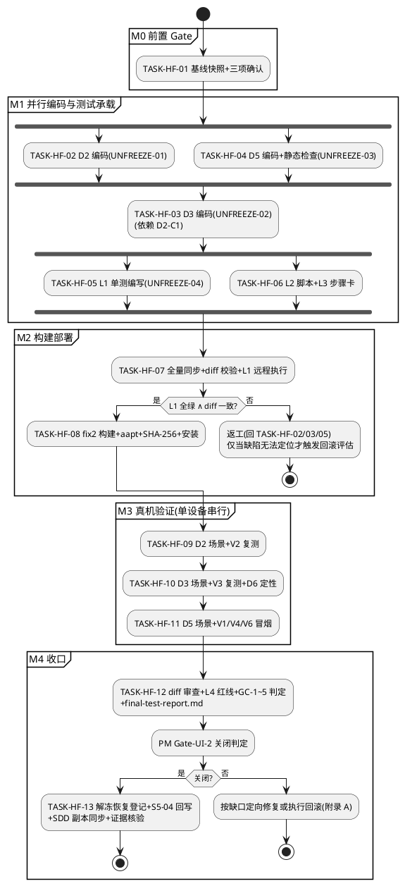

# PAD2-HOTFIX-TASKS-D2D3D5-001 编码任务清单：D2/D3/D5 有限范围热修

> **文档编号**：PAD2-HOTFIX-TASKS-D2D3D5-001
> **需求基线**：`docs/p003-hotfix-d2d3d5/spec.md`（PAD2-HOTFIX-D2D3D5-001，19 条 EARS + 13 条 HF-CON + 18 项 HF-TC + GC-1~5）
> **设计基线**：`docs/p003-hotfix-d2d3d5/design.md`（PAD2-HOTFIX-DESIGN-D2D3D5-001，D2 三层防御 / D3 分级准入 / D5 终态绝对保持 / 四层测试承载 / 基线快照与回滚流程）
> **缺陷实证**：`docs/p003-ui/v1-v7-verification-report.md`（D1-D7 缺陷清单）＋ `docs/p003-ui/shots/s2/v1-v7/m2a-exported-log.txt`
> **权威版本位置**：本文档为权威版本，位于 `docs/p003-hotfix-d2d3d5/tasks.md`；SDD 流程登记副本位于 `.codeartsdoer/specs/p003_hotfix_d2d3d5/tasks.md`，两处内容一致，以本处为准。
> **文档定位**：SDD 第三阶段（编码任务规划）产出。将 spec（WHAT）与 design（HOW）分解为可执行、可验收、有依赖顺序的编码任务清单，供 PM 审定后进入第四阶段（编码执行）。**本文档不包含任何代码实现。**
> **任务编号体系**：`TASK-HF-01 ~ TASK-HF-13`（HF = HotFix），与 P003 主线任务 `TASK-Sx-xx` 严格区分；改动点编号沿用 design.md 的 `D2-C1~C7 / D3-C1~C7 / D5-C1~C6`，需求编号沿用 `HF-D2/D3/D5-Rxx / HF-CON-xx / HF-TC-xx / GC-x / UNFREEZE-xx`。
> **组织惯例参照**：`docs/p0-02-r3-fix/tasks.md`（任务组 → 步骤级操作指引 → 验收条件 → 依赖 → 标准映射的收口格式）。
> **规模控制声明**：本清单为三缺陷定向热修（PM 裁定"不为这些事项新建多层治理流程"），共 13 个主任务，粒度务实、不过度拆分；回滚操作作为应急附录而非常规任务（第四章）。

---

## 0. 环境事实基线（任务执行细节依据，不可凭空假设）

| 项 | 事实 |
|---|---|
| adb | `C:\Users\DELL\Android\platform-tools\adb.exe`；Git Bash 调用须前缀 `MSYS_NO_PATHCONV=1`；下文简写 `adb` |
| 验证设备 | 荣耀平板 NDL2_W09，序列号 `AJ7XJV6904H00320`（1200x1920，可横屏 1920x1200），Android 16 / API 36 |
| PAD2 包名 | `com.pad2.filemanager`（applicationId，android/app/build.gradle:7） |
| CDP 通道 | `adb forward tcp:9222 localabstract:webview_devtools_remote_<pid>`（pid 经 `adb shell pidof com.pad2.filemanager` 动态获取）；Node.js v24 内置 WebSocket/fetch；页面发现用 `fetch http://127.0.0.1:9222/json/list`（**勿硬编码 page id**，参照 scripts/v1v7-cdp.mjs discoverPage） |
| 远程构建 | `ssh -i ~/.ssh/pad2_cred_closure debian@192.168.2.3`；工程根 `/home/debian/android/pad2-build`（工程根即 android 工程，app/ 在顶层）；aapt 位于 `/home/debian/android-sdk/build-tools/36.0.0/aapt`；gradle 入口 `./gradlew` |
| 同步方式 | tar czf + scp + 远程解包 `tar xzf --strip-components=1`（**解包前清理远程旧 assets 防混版**，D1 教训）；fix1 轮全量同步面 = `android/app/src` + `android/app/build.gradle` + `android/variables.gradle`（v1-v7 报告 D1 修复行实证） |
| SMB 服务器 | 192.168.2.3/share，debian/Pad2-Share-2026；测试文件 `/mnt/share/test-render.docx`；服务器侧操作（sha256sum/stat/只读切换）走上述 SSH；smb.conf 有 immutable 属性：修改前 `chattr -i`、后 `chattr +i` 恢复；**reload 对已建立树连接不生效，须 App 断开重连**（V5 附带发现的既有事实） |
| WPS | 包名 `cn.wps.moffice_eng`；activity 不 exported，须 `monkey -p cn.wps.moffice_eng -c android.intent.category.LAUNCHER 1` 拉起；保存对话框坐标须 `uiautomator dump` 获取（视觉估算不可靠，D6 教训）；WPS 抢占前台后须 `adb shell am start -n com.pad2.filemanager/.MainActivity` 切回 PAD2 |
| 安装 | 荣耀安装确认框需用户手动点按（无法全自动）；用 `adb install -r` 覆盖安装可保留 appops 授权（不触发报告 D5 重装权限引导缺陷） |
| 本地静态检查 | `npm run typecheck`（tsc strict）+ `node scripts/check-design-tokens.mjs` + `node scripts/check-contrast.mjs` 三项全绿（D5 改 TSX 后必须重跑）；`npm run cap:sync` = tsc + vite build + cap sync |
| 版本基线 | fix1 = `pad2-p003-s2-ui-fix1.apk`（2026-10-20 15:49 构建）；热修产物 = `pad2-p003-s2-ui-fix2.apk`（fix 序列递增） |
| logcat 采集口径 | `adb logcat -d -s WpsSaveDetector:V SaveAsDiscoveryService:V WpsDeliveryHandler:V` 快照按场景号归档 |

---

## 一、任务总览表

| 编号 | 任务名称 | 依赖 | 并行性 | DoD 摘要 | 覆盖需求（详见第五章核对表） |
|---|---|---|---|---|---|
| TASK-HF-01 | 实施前置 Gate：基线快照与三项确认归档 | 无（文档确认已完成的 spec/design 评审为前置） | 独立，**必须最先执行** | baseline/ 三文件副本 + SHA-256 清单 + 三项确认记录归档完成，此后方可动代码 | HF-CON-02/09/10；GC-4 佐证 |
| TASK-HF-02 | D2 编码：WpsSaveDetector 三层防御 | TASK-HF-01 | **与 TASK-HF-04 可并行** | D2-C1~C7 七个改动点全部落地，对外签名/eventLog/生命周期零改动 | HF-D2-R01~R07；HF-CON-01/03/08 |
| TASK-HF-03 | D3 编码：SaveAsDiscoveryService 分级候选准入 | TASK-HF-02（至少 D2-C1 isTempFile 增强先行或同批合入，design 4.5） | 依赖 D2-C1，其余部分可与 TASK-HF-04 并行 | D3-C1~C7 全部落地，discoverSaveAs 签名与 EditSessionContext 契约零变更 | HF-D3-R01~R07；HF-CON-01/03/08 |
| TASK-HF-04 | D5 编码：M2VerificationPage 终态保护 + 本地静态检查 | TASK-HF-01 | **与 TASK-HF-02 可并行** | D5-C1~C6 全部落地，三项静态检查全绿 | HF-D5-R01~R05；HF-CON-01/03 |
| TASK-HF-05 | L1 JVM 矩阵单测编写（3 个测试类） | TASK-HF-02/03（被测纯函数存在） | 编写可与 TASK-HF-04/06 并行 | 3 个测试类编写完成，用例覆盖 design 全部矩阵样本（远程执行并入 TASK-HF-07） | UNFREEZE-04；L1 承载 |
| TASK-HF-06 | L2 CDP 脚本与 L3 人工步骤卡产出 | TASK-HF-02/03/04（断言契约来自改后行为定义） | 与 TASK-HF-05 可并行 | scripts/hf-d2d3d5-verify.mjs 可按场景号执行；manual-steps.md 步骤卡产出（含 D6 复测项） | UNFREEZE-04；L2/L3 承载 |
| TASK-HF-07 | 远程全量同步、构建前 diff 校验与 L1 远程执行 | TASK-HF-02/03/04/05 全部完成 | — | diff 校验一致记录归档 + gradle test 全绿（L1 通过是构建的强制 Gate） | HF-CON-05；GC-4 佐证 |
| TASK-HF-08 | fix2 构建、产物验证与真机安装 | TASK-HF-07 | — | aapt 权限验证记录 + APK SHA-256 归档 + fix2 安装成功 + HF-CON-11 处理记录 | HF-CON-06/11/12；GC-5 部分 |
| TASK-HF-09 | D2 真机验证：HF-TC-D2-01~05 + V2 复测 | TASK-HF-08（fix2 安装后） | 真机单设备串行（D2 → D3 → D5，design 6.4-2） | 5 场景全通过 + V2 复测 CONDITIONAL PASS → PASS + 证据归档 | HF-TC-D2-01~05；GC-1 部分；GC-3 V2 |
| TASK-HF-10 | D3 真机验证：HF-TC-D3-01~06 + V3 复测 + D6 定性复测 | TASK-HF-09（D3 依赖 D2 的中间文件形态；会话状态复用） | 同上串行 | 6 场景全通过 + V3 复测 HOLD → PASS + D6 定性结论归档 | HF-TC-D3-01~06；GC-1 部分；GC-3 V3/D6 |
| TASK-HF-11 | D5 真机验证：HF-TC-D5-01~06 + V1/V4/V6 冒烟 | TASK-HF-10 | 同上串行 | 6 场景全通过（含 D5-04 反向路径探测阴性结论）+ V1/V4/V6 冒烟通过 | HF-TC-D5-01~06；GC-2；GC-3 冒烟 |
| TASK-HF-12 | 收口判定：diff 审查、L4 红线审查、GC-1~5 判定与最终测试报告 | TASK-HF-09/10/11 | — | 变更文件集合 ⊆ 解冻清单结论 + HF-TC-D3-07 红线审查通过 + GC-1~5 逐项判定表 + final-test-report.md 归档 | HF-CON-01/03/04/13；HF-TC-D3-07；GC-1~5 |
| TASK-HF-13 | 收尾登记：解冻恢复、S5-04 交接回写与证据归档核验 | TASK-HF-12（PM 出具 Gate-UI-2 关闭判定后执行，design 10.2-2） | — | 解冻文件回归冻结登记 + P003 tasks.md S5-04 注记（唯一回写点）+ SDD 登记副本同步 + HF-CON-10 核验 | HF-CON-10/12；规格 5.2-1/5.5-3 |

**任务总数**：13 个主任务（编码 3 + 测试承载 2 + 前置 1 + 构建 2 + 真机验证 3 + 收口 2）；回滚操作不入常规任务序列（应急附录 A）。

---

## 二、执行顺序与里程碑

### 2.1 执行顺序图



### 2.2 里程碑表

| 里程碑 | 内容 | 退出条件（Gate） | 对应规格 Gate 步骤（5.4） |
|---|---|---|---|
| **M0 前置 Gate** | 基线快照 + 解冻清单/测试条件/回滚方式三项确认 | baseline/ 四文件齐备 + preflight-confirmation.md 归档，**未确认前禁止任何代码变更** | 第 3-4 步 |
| **M1 编码完成** | D2/D3/D5 三文件改动 + L1 测试类 + L2/L3 承载物 | 全部改动点落地、静态检查三项全绿、改动未越出解冻职责域（自查） | 第 5 步 |
| **M2 fix2 就绪** | 同步、diff 校验、L1 执行、构建、产物验证、安装 | HF-CON-05 diff 一致记录 + L1 全绿 + aapt 权限验证 + APK SHA-256 归档 + fix2 上机 | 第 6-8 步 |
| **M3 验证完成** | 18 项 HF-TC + V2/V3 复测 + V1/V4/V6 冒烟 + D6 定性 | 全部强制项通过、证据归档齐备（V5/V7 依证据延续性不重跑，规格 8.2/8.3） | 第 9 步 |
| **M4 Gate 关闭** | diff/红线审查、GC-1~5 判定、最终报告、解冻恢复与交接 | final-test-report.md 归档 + PM 出具 Gate-UI-2 关闭判定 + S5-04 交接回写完成 | 第 10-11 步 |

---

## 三、任务详情

### TASK-HF-01 实施前置 Gate：基线快照与三项确认归档

> **定位**：PM 裁定 0.2.3-2"先明确文件范围、测试条件和回滚方式，再实施"的落地；design.md 7.1（基线快照）+ 规格 5.4（Gate 顺序第 3-4 步）。**本任务未完成前，禁止执行 TASK-HF-02/03/04 的任何代码变更。**
> **涉及文件**：（新建）`docs/p003-hotfix-d2d3d5/baseline/{WpsSaveDetector.java, SaveAsDiscoveryService.java, index.tsx, baseline-manifest.md}`、`docs/p003-hotfix-d2d3d5/preflight-confirmation.md`——全部为文档新增，不受解冻清单约束（规格 5.1 完备性声明）。

- [ ] **T01.1 建立 fix1 基线快照目录并复制三文件**（工作区当前状态 = fix1 对应源码，已由 V1-V7 验证报告确认）
  ```bash
  mkdir -p docs/p003-hotfix-d2d3d5/baseline
  cp android/app/src/main/java/com/pad2/filemanager/smb/WpsSaveDetector.java   docs/p003-hotfix-d2d3d5/baseline/
  cp android/app/src/main/java/com/pad2/filemanager/smb/SaveAsDiscoveryService.java docs/p003-hotfix-d2d3d5/baseline/
  cp src/ui/pages/M2VerificationPage/index.tsx docs/p003-hotfix-d2d3d5/baseline/
  ```
- [ ] **T01.2 计算三文件 SHA-256 并写 baseline-manifest.md**（回滚锚点 + PM 关闭条件 GC-4 的源码快照标识基础）
  ```bash
  cd docs/p003-hotfix-d2d3d5/baseline && sha256sum WpsSaveDetector.java SaveAsDiscoveryService.java index.tsx
  ```
  manifest 内容：三文件 SHA-256 + 快照时间 + fix1 APK 交叉锚点（`pad2-p003-s2-ui-fix1.apk`，2026-10-20 15:49 构建，SHA-256 引用 v1-v7 报告归档值）+ 取源说明（工作区 = fix1 源码）。
- [ ] **T01.3 产出三项确认记录 preflight-confirmation.md**：①解冻清单确认（引用 spec 5.1 UNFREEZE-01~04 逐文件职责域表，PM 授权日期 2026-10-20）；②测试条件确认（引用 spec 8.1 十八项 HF-TC + 8.2 回归范围表）；③回滚方式确认（引用 spec 5.3：基线留存位置/触发条件四条/回滚操作步骤）。每项附"已确认"标记与确认依据（PM 裁定 + spec/design 评审记录）。
- [ ] **T01.4 Gate 自检**：确认 baseline/ 下四文件存在且哈希与 manifest 记录一致；确认三项确认记录齐备；此后方可进入 TASK-HF-02。

**完成判据（DoD）**：`docs/p003-hotfix-d2d3d5/baseline/` 含三文件副本 + baseline-manifest.md（SHA-256 齐备）；preflight-confirmation.md 三项确认齐备；满足 HF-CON-02 验收条件（存在已确认的解冻清单、测试条件清单、回滚预案记录）。
**覆盖需求**：HF-CON-02（先定范围后实施）、HF-CON-09（回滚锚点）、HF-CON-10（热修证据独立归档于 docs/p003-hotfix-d2d3d5/）。
**验证方式**：L4 流程审查（diff 审查时核对归档记录）。
**证据归档**：`docs/p003-hotfix-d2d3d5/baseline/`、`docs/p003-hotfix-d2d3d5/preflight-confirmation.md`。

---

### TASK-HF-02 D2 编码：WpsSaveDetector 三层防御（UNFREEZE-01）

> **定位**：design.md 第三章（3.1 改动点清单 D2-C1~C7、3.2~3.6 详细设计）；spec 6.1（HF-D2-R01~R07）。
> **涉及文件**：仅 `android/app/src/main/java/com/pad2/filemanager/smb/WpsSaveDetector.java`（304 行，冻结区，UNFREEZE-01 解冻）。
> **并行性**：与 TASK-HF-04（D5，TSX 文件）完全并行；TASK-HF-03 依赖本任务的 D2-C1。
> **越界即停**（HF-CON-04）：若实施中发现必须触碰 SaveDetectionResult.java / SaveDetectionVerdict.java / WpsDeliveryHandler.java / StreamCacheService.java 等冻结文件，立即停止并升级 PM 裁定——design 1.2.1 已论证"解冻文件内部闭环"可行，不应出现此情形。

- [ ] **T02.1【D2-C1】第一层防御：中间文件形态规则增强**——静态字段 `NUMERIC_TEMP_PATTERN`（:255）由两段正则 `^-?\d+\.-?\d+$` 改为字符集正则 `^[\d.\-]+$`（仅数字/点/连字符组成即判中间文件）。`isTempFile()` 方法签名与其余五类既有规则（~$ 前缀/.tmp/.temp/.moffice_wr_check/.~lock）零改动（HF-D3-R06 跨文件口径依赖此方法，SaveAsDiscoveryService.java:48 静态调用自动同步增强）。
- [ ] **T02.2【D2-C2】第二层防御核心：新增判定决策纯函数**——在 WpsSaveDetector 类内新增**包私有静态纯函数**（无 Log、无 IO，供 L1 JVM 矩阵测试直接覆盖，design 3.3.1）：
  ```java
  static SaveDetectionVerdict resolveVerdict(boolean mtimeChanged, boolean shaChanged,
                                             boolean saveAsEvidenceValid, boolean shaCalcFailed)
  ```
  决策表（优先级即证据强度排序）：
  1. `shaCalcFailed` → `DETECTION_UNCERTAIN`（异常场景 3，计算失败不默认成功）；
  2. `mtimeChanged ∧ shaChanged` → `SAVE_SUCCESS`（HF-D2-R02a 双因子直接证据）；
  3. `mtimeChanged ∧ ¬shaChanged` → `MTIME_FALSE_POSITIVE`（HF-D2-R02b）；
  4. `¬mtimeChanged ∧ saveAsEvidenceValid` → `SAVE_AS_DETECTED`（HF-D2-R04）；
  5. otherwise → `DETECTION_UNCERTAIN`（HF-D2-R05/R06 诚实回退）。
- [ ] **T02.3【D2-C3】checkChange() 判定链重排**（:169-226）：**删除 saveAsDetected 短路块**（:184-190，verdict 粘住根因）；判定顺序改为——①`monitoredFile == null` → UNCERTAIN "No file monitored"（既有行为保持）；②`currentMtime ≠ baselineMtime` → SHA-256 对比分支（SAVE_SUCCESS / MTIME_FALSE_POSITIVE，既有证据字段填充、状态更新、Log 行为零改动保持）；③`currentMtime == baselineMtime` 且 `saveAsDetected ∧ 候选存在` → SAVE_AS_DETECTED（resultFilePath = 候选绝对路径，evidence 携带事件证据+存在性验证说明）；④否则 UNCERTAIN "mtime unchanged (no file modification detected)"。判定裁决统一经 `resolveVerdict(...)`（SHA 计算异常场景在 catch 内直接落 UNCERTAIN，与决策表第 1 条一致）。
- [ ] **T02.4【D2-C4】第三层防御：候选存在性验证**——新增私有方法 `saveAsCandidateExists()`：`saveAsFileName != null && new File(monitoredFile.getParentFile(), saveAsFileName).exists()`；SAVE_AS 分支产出前必须通过此验证（WPS 中间文件写回后即删除，真实另存为目标持续存在——语义级区分，design 3.4）。
- [ ] **T02.5【D2-C5】事件分支微调**——dirObserver.onEvent（:90-96）与 parentDirObserver.onEvent（:125-129）的异名事件分支：`saveAsDetected = true; saveAsFileName = path` 置位语义保持（最新事件覆盖式记录，多目标取最后写入者）；Log 文案由 `"Save-as detected: "` / `"Save-as detected (parent dir): "` 改为 `"Save-as evidence recorded: "` / `"Save-as evidence recorded (parent dir): "`（证据记录而非结论，避免日志误导排障）；eventLog 记录（recordEvent "dir_save_as"/"parent_dir_save_as"）零改动（禁止域④）。
- [ ] **T02.6【D2-C6】updateBaseline() 残留清除**（:245-253）：在既有重置（contentChanged/mtimeChanged/newSha256/newMtime）基础上追加 `saveAsDetected = false; saveAsFileName = null;`——与 startMonitoring 初始化语义对齐（:53-54），消除回写后旧另存为证据粘住（design 3.5 已论证对 V4/V5 已验证链路为空操作等价/不触达）。
- [ ] **T02.7【D2-C7】foregroundCheck() 微调**（:231）：追加提示条件由 `UNCERTAIN && !saveAsDetected` 改为按结果判定 `result.getVerdict() == SaveDetectionVerdict.DETECTION_UNCERTAIN`（修复后 saveAsDetected 为"待验证证据"标志，原复合条件语义失真；方向与冻结消费方 UNCERTAIN → triggerSaveAsDiscovery 语义一致）。
- [ ] **T02.8 编码自查**：对照 design 3.1"零改动确认"逐项核对——对外方法签名（checkChange/foregroundCheck/startMonitoring/stopMonitoring/pause/resume/updateBaseline/isTempFile/8 个 getter）全部保持；eventLog 机制（recordEvent/100 条环形上限）零改动；对照 design 3.3.2"与 fix1 行为差异清单"四条核对实现方向。

**完成判据（DoD）**：D2-C1~C7 七个改动点全部落地；自查表（签名零变更/职责域逐项/行为差异四条）通过；代码可被 TASK-HF-05 的测试类以包私有可见性直接引用（`com.pad2.filemanager.smb` 同包）。
**覆盖需求**：HF-D2-R01（层 1+2+3 纵深）、HF-D2-R02（决策表第 1-2 优先级）、HF-D2-R03（短路删除 + 残留清除）、HF-D2-R04（第二优先级 + 存在性验证）、HF-D2-R05（三重兜底）、HF-D2-R06（兜底分支）、HF-D2-R07（3 个 FileObserver 与监听掩码全部保留，无砍功能路径）；HF-CON-01/03（改动 ⊆ UNFREEZE-01 职责域①②③④）、HF-CON-08（证据不足落 UNCERTAIN）。
**验证方式**：L1（TASK-HF-05 矩阵单测）+ L2/L3（TASK-HF-09 真机）。
**证据归档**：改动本身由 TASK-HF-12 diff 审查对照 baseline/ 记录。
**依赖**：TASK-HF-01。

---

### TASK-HF-03 D3 编码：SaveAsDiscoveryService 分级候选准入（UNFREEZE-02）

> **定位**：design.md 第四章（4.1 改动点清单 D3-C1~C7、4.2 分级规则、4.3 边界论证、4.4 扫描路径、4.5 口径一致性、4.6 接口兼容）；spec 6.2（HF-D3-R01~R07）。
> **涉及文件**：仅 `android/app/src/main/java/com/pad2/filemanager/smb/SaveAsDiscoveryService.java`（90 行，冻结区，UNFREEZE-02 解冻）。
> **依赖**：TASK-HF-02 的 D2-C1（isTempFile 增强）先行或同批合入（design 4.5 设计依赖声明：E2 排除规则以 D2-C1 为前置）。

- [ ] **T03.1【D3-C1】扫描路径集合扩展**——静态字段 `SCAN_PATHS`（:14-18）由 3 条扩展为 5 条：
  ```java
  private static final String[] SCAN_PATHS = {
      "/storage/emulated/0/",
      "/storage/emulated/0/Documents/",
      "/storage/emulated/0/Download/",
      "/storage/emulated/0/PAD2/smb_cache/",          // 新增：受监听目录（配套 E4 原文件排除）
      "/storage/emulated/0/Download/WPS Office/"       // 新增：WPS 安卓版常见默认保存目录
  };
  ```
  声明扫描边界：直属文件层非递归（既有行为保持）；WPS 私有目录（Android/data/cn.wps.moffice_eng/ 层级）显式声明为不可扫描域（listFiles 返回 null → 记跳过日志 → 安全回退，规格 6.2.3-2 语义）。
- [ ] **T03.2【D3-C2】候选准入决策抽为包私有静态纯函数**——新增（无 Log、无 File IO，全部事实以参数注入，design 4.2.4）：
  ```java
  static int classifyCandidate(String fileName, String filePath, long fileMtime, long fileSize,
                               String originalName, String originalBaseName, String originalExtension,
                               boolean originalSizeKnown, long originalSize,
                               long startTime, long endTime)
  ```
  返回六级常量：`EXCLUDED_TEMP / EXCLUDED_WINDOW / EXCLUDED_SELF / LEVEL_A / LEVEL_B / NOT_CANDIDATE`。discoverSaveAs() 主循环重构为调用此函数判定。
  **实施修订登记（T03.7 自查发现）**：相对本任务书初版签名增加第 2 参数 `filePath`（扫描文件的绝对路径）——E4 前置排除（路径 == 缓存基路径+originalName → EXCLUDED_SELF）是路径级判定，按 design 4.2.4"全部事实以参数注入"原则以参数承载，使 T05.3 矩阵用例"原文件自身 → EXCLUDED_SELF"可直接测纯函数；E1（非普通文件）仍由主循环 `file.isFile()` 判定（File 事实不可参数化，任务书 T05.3 已注明其测试等价类）。
- [ ] **T03.3【D3-C3】前置排除 E1~E4 落地**（两级候选共用，design 4.2.1）：E1 非普通文件（既有）；E2 `WpsSaveDetector.isTempFile(fileName)`（既有调用 :48 零改动，D3-C7）；E3 mtime ∉ [startTime−60s, endTime+60s]（A 级容差语义保持）；**E4 新增原文件自身排除**——`"/storage/emulated/0/PAD2/smb_cache/" + originalName` 路径相等即排除（缓存基路径常量与 RegressionTestConfig.localCacheBasePath 同源约定；排除依据是路径相等而非名称相等，不误伤 Documents/ 下同名另存为目标——HF-TC-D3-01 的目标恰在 Documents/）。
- [ ] **T03.4【D3-C4】A/B 分级准入规则落地**：
  - **A 级（名称强关联，双信号直接准入）**：A1 同名同扩展名 `fileName.equals(originalName)`（HF-D3-R01 盲区本体修复）；A2 基名关联 `fileName.contains(originalBaseName) ∨ (originalBaseName.length() > 3 ∧ fileBaseName.contains(originalBaseName))`（既有 nameMatch 语义保留，HF-D3-R02a）。A 级去掉 fix1 的 `extensionChanged` 约束——fix1 已有能力严格扩集，无回归。
  - **B 级（组合信号准入，无名称关联时）**：B1 扩展名相同（equalsIgnoreCase）；B2 大小同量级 `originalSizeKnown ∧ 0.25 ≤ file.length()/originalSize ≤ 4.0`（originalSize 经缓存路径 `new File(缓存基路径 + originalName).length()` 获取，**缓存缺失 → originalSizeKnown=false → B 级整体降级不可用，仅 A 级生效——诚实降级不猜测**）；B3 收紧时间窗 `mtime ∈ [startTime, endTime + 60s]`（对比 A 级去掉 −60s 前置容差，排除会话前已存在的历史文件）。
- [ ] **T03.5【D3-C5】结果排序契约**——discoverSaveAs 返回列表排序：**A 级在前、B 级在后；同级内 mtime 降序（最新优先）**。依据：冻结消费方 `triggerSaveAsDiscovery` 取 `get(0)`（WpsDeliveryHandler.java:332），排序规则即"最优候选优先呈现"契约的内部实现。
- [ ] **T03.6【D3-C6】审计日志增强**（HF-D3-R03 可审计性 + 规格 7.2-3 空结果/扫描失败可区分）——每次 discoverSaveAs 执行输出四类行：①`"Scanning paths: [路径1, ..., 路径5] (declared scan scope)"`；②每路径一条 `"Scan path=<path> files=<n> skipped=<原因|->"`（含不可访问跳过记录）；③每候选一条 `"Candidate: <path> level=<A|B> signals=<明细>"`；④汇总 `"Scan complete: <n> candidate(s) [A=<a>, B=<b>] / none found (safe fallback)"`。
- [ ] **T03.7 编码自查**：discoverSaveAs 对外签名与返回类型（List\<File\>）不变；EditSessionContext 依赖契约零触碰（B 级大小信号内部获取，无新增必需输入）；SMB 连接/读取底层零触碰；`getBaseName/getExtension` 既有实现保持。

**完成判据（DoD）**：D3-C1~C7 全部落地；classifyCandidate 可被同包 L1 测试类直接引用；E4 与 5 路径强耦合配套逻辑齐备（smb_cache 入集必有原文件排除）。
**覆盖需求**：HF-D3-R01（A1）、HF-D3-R02（A2+B 级）、HF-D3-R03（5 路径+四类审计行）、HF-D3-R04（空结果+安全回退，禁虚构）、HF-D3-R05（E3 A 级容差+B3 收紧窗）、HF-D3-R06（E2 单一真源口径）、HF-D3-R07（文案零回写语义，由 TASK-HF-12 L4 审查闭环）；HF-CON-01/03/08。
**验证方式**：L1（TASK-HF-05）+ L2/L3（TASK-HF-10 真机）。
**依赖**：TASK-HF-02（至少 D2-C1）。

---

### TASK-HF-04 D5 编码：M2VerificationPage 终态保护 + 本地静态检查（UNFREEZE-03）

> **定位**：design.md 第五章（5.1 改动点清单 D5-C1~C6、5.2 数据结构、5.3 终态保护逻辑、5.4 方案 A 裁定、5.6 呈现与导出）；spec 6.3（HF-D5-R01~R05）。
> **涉及文件**：`src/ui/pages/M2VerificationPage/index.tsx`（813 行，改造区，UNFREEZE-03）；（可选）`src/ui/pages/M2VerificationPage/style.module.css`（仅当需要区分样式时新增 1 个类，优先零新增）。
> **并行性**：与 TASK-HF-02 完全并行（不同文件、不同缺陷）。

- [ ] **T04.1【D5-C1】数据结构最小调整**——在 index.tsx:26-32 的 `VerificationStep` 接口处新增可选字段与历史结构（design 5.2，全部显式 interface、无 any）：
  ```typescript
  interface StepHistoryEntry {
    timestamp: string;        // toLocaleTimeString（与 addLog 同格式）
    result: 'pass' | 'fail';  // 仅终态类结果入历史
    summary: string;          // details 截断至 120 字符（保 SHA 前 16 位证据密度）
    trigger: string;          // 触发操作名（调用点字面量集合）
  }
  interface VerificationStep {
    // 既有五字段零改动（id/name/description/status/details）
    history?: StepHistoryEntry[];  // 容量上限 20 条/步骤
  }
  ```
  模块级常量 `const HISTORY_CAP = 20;`（与 P003"最近文件 20 条 LRU"同量级约定）；追加即 `[...(step.history ?? []), entry].slice(-HISTORY_CAP)`。
- [ ] **T04.2【D5-C2】updateStep 终态保护重构**（:111-115）——签名扩为 `updateStep(id: string, newStatus: StepStatus, details?: string, trigger?: string)`；**判定在 setSteps 函数式更新内部完成**（React 状态原子性保证，连续快速调用每次基于最新 prev 判定，无竞态窗口，design 5.3 要点 1）：
  ```typescript
  const updateStep = (id, newStatus, details?, trigger?) => {
    setSteps(prev => prev.map(step => {
      if (step.id !== id) return step;
      if (isTerminal(step.status)) {                 // pass/fail 终态
        if (isTerminal(newStatus)) {
          return { ...step, history: [ ...(step.history ?? []), {
            timestamp: new Date().toLocaleTimeString(),
            result: newStatus,
            summary: (details ?? '').slice(0, 120),
            trigger: trigger ?? '未标注操作',
          } ].slice(-HISTORY_CAP) };                 // 终态后终态类：拒绝覆盖，追加历史（R01/R04）
        }
        return step;                                 // 终态后非终态：拒绝隐式重置（R02）
      }
      return { ...step, status: newStatus, details }; // 非终态：常规更新（既有行为）
    }));
  };
  ```
  其中 `const isTerminal = (s: StepStatus) => s === 'pass' || s === 'fail';`。终态后 details 同步保持（首次终态证据快照完整性）；拒绝路径静默返回原 step（被挡事件以 history + 既有 addLog 双通道留痕）。
- [ ] **T04.3【D5-C3】六个调用点传入 trigger 操作名**（仅实参微调，更新逻辑零改动）——handleOpenInWps（:149/154/158/162）→ `'在 WPS 中打开'`；handleCheckChange（:173/176）→ `'检查本地变更'`；handleForegroundCheck（:196）→ `'另存为检测'`；handleWriteback（:214/219/224/228）→ `'执行回写'`；handleResolveSaveAs（:239/253/258/268）→ `` `另存为处理(${choice})` ``；handleCheckRemote（:282）→ `'检查远程变更'`。
- [ ] **T04.4【D5-C4】步骤表格 details 单元格历史摘要呈现**（:757）——存在历史时追加单行摘要 `"历史 N 条·最近 [HH:mm:ss] result(trigger) 摘要…"`，HTML title 属性挂全量历史；**优先复用既有 `styles.textTertiary` 类（零 CSS 新增）**；确需区分样式才新增单个 `.historyNote` 类（camelCase 本体、令牌引用 var(--pad2-*)、无 -- 修饰符——CSS Modules 约定，design 5.6）。
- [ ] **T04.5【D5-C5】导出日志门禁段增强**（buildLogContent :320-326）——门禁段 `${s.id} ${s.name}: ${s.status} ${s.details}` 行后，存在 history 时追加一行历史段（含全部条目：`[时间戳] result(trigger) summary`），门禁行与历史行同源于同一 steps 状态、同一导出时刻快照——结构上消除"操作日志显示成功而门禁状态为失败"的矛盾形态（实测缺陷的镜像，HF-TC-D5-06 判据由同源快照直接保证）。
- [ ] **T04.6【D5-C6】样式收尾**——确认若零新增 CSS 则跳过；若新增 .historyNote 则核对 style.module.css 既有约定（camelCase 本体/`--` 修饰符中划线/TSX 方括号访问）。
- [ ] **T04.7 本地静态检查三项全绿**（D5 为本次唯一 TSX 改动，强制重跑）：
  ```bash
  npm run typecheck                    # tsc strict（--noEmit）
  node scripts/check-design-tokens.mjs # 设计令牌检查
  node scripts/check-contrast.mjs      # 对比度检查
  ```
- [ ] **T04.8 编码自查**：五结果块直调 SmbPlugin 结构零触碰（禁止域①）；smbConnectionStore/browseStore 消费零改动（禁止域②）；initialSteps 步骤定义与四值状态域零改动（禁止域③）；全部按钮渲染与 onPress 行为零改动；"清理"按钮不重置 steps 的既有语义保持（design 5.4-2 裁定：清理 = 会话与缓存资源回收，验证门禁记录独立留存）。

**完成判据（DoD）**：D5-C1~C6 落地；三项静态检查全绿；自查表通过（对外可见行为变化封闭为 design 5.4-3 三项白名单：终态不再被改写 / details 出现历史摘要 / 导出日志多 history 段）。
**覆盖需求**：HF-D5-R01（终态防覆盖）、HF-D5-R02（方案 A：终态绝对保持，页面重载 = 显式重置等价物，不新增重跑按钮）、HF-D5-R03（对称保护：pass/fail 双终态同等）、HF-D5-R04（StepHistoryEntry 三要素 + 呈现/导出双通道）、HF-D5-R05（终态保护为反向路径的结构封闭，实证由 TASK-HF-11 的 HF-TC-D5-04 完成）；HF-CON-01/03。
**验证方式**：本地静态检查（本任务）+ L2（TASK-HF-11 真机 CDP status 断言）。
**依赖**：TASK-HF-01。

---

### TASK-HF-05 L1 JVM 矩阵单测编写（UNFREEZE-04，3 个测试类）

> **定位**：design.md 6.1（L1 承载选型）+ 6.2（新增文件清单）+ 1.1.3-A（矩阵定义）；承载就绪依据 design 1.2.4（android/app/src/test/java/ 现仅 Capacitor 模板，junit 依赖 build.gradle:39 已具备，**零新增 gradle 依赖**；引用 android.util.Log 的实例方法不可 JVM 跑——被测对象必须为静态纯函数，TASK-HF-02/03 已按此形态沉淀）。
> **涉及文件**：（新建）`android/app/src/test/java/com/pad2/filemanager/smb/` 下三个测试类——全部新建，零修改既有测试设施（R1RegressionTestSuite 等只读复用其断言风格）。
> **并行性**：编写可与 TASK-HF-04/06 并行（依赖 TASK-HF-02/03 的纯函数已存在）；远程执行并入 TASK-HF-07。

- [ ] **T05.1 编写 WpsSaveDetectorIsTempFileTest.java**——isTempFile 形态矩阵（~30 用例），样本来源 design 3.2 误伤论证表全量：
  - 正样本（断言 true）：实测中间文件 `1963289719.-1908999883-1548918099`、既有两段形态（`123.-456`、`-1.0`、`1.0`）、纯日期无扩展名（`2026.10.20`）、`~$xxx.docx`、`xxx.tmp`、`xxx.temp`、`.moffice_wr_check-xxx`、`.~lockxxx.docx`、多段变体（`1.2-3.4.5`）；
  - 负样本（断言 false，不得误伤）：`2026报告.docx`、`2026.10.20.docx`（日期式带扩展名）、`test-render.docx`、中文名文档（`终稿评审版.docx`）、含字母/下划线命名（`report_v2.pdf`）。
- [ ] **T05.2 编写 WpsSaveDetectorVerdictTest.java**——resolveVerdict 判定决策矩阵：(mtimeChanged, shaChanged, saveAsEvidenceValid, shaCalcFailed) 有效组合 × 期望 verdict，含 HF-D2-R01~R06 全分支映射断言：
  - shaCalcFailed=true（任意其余）→ UNCERTAIN；
  - (T,T,*,F) → SAVE_SUCCESS；(T,F,*,F) → MTIME_FALSE_POSITIVE；
  - (F,*,T,F) → SAVE_AS_DETECTED；(F,*,F,F) → UNCERTAIN；
  - 优先级冲突样本：shaCalcFailed ∧ mtimeChanged∧shaChanged → UNCERTAIN（计算失败最优先）；mtimeChanged ∧ saveAsEvidenceValid → 按 mtime/SHA 裁决（中间文件先到不粘住，HF-D2-R03 结构保证）。
- [ ] **T05.3 编写 SaveAsDiscoveryClassifyTest.java**——classifyCandidate 准入矩阵（参数注入式，覆盖 design 4.3 误收/漏收论证表全部样本）：
  - A1 同名同扩展（test-render.docx 于 Documents/ → LEVEL_A）；A2 基名关联（test-render-v2.docx / test-render.pdf → LEVEL_A）；
  - B 级：全新名同扩展（终稿评审版.docx，mtime ∈ [start, end+60s]、size 比 ∈ [0.25,4.0] → LEVEL_B）；B2 边界值 0.25 与 4.0（含/越界两侧）；B3 收紧窗边界（mtime = start−1s → 排除；mtime = start → 准入）；originalSizeKnown=false → B 级路径全降级 NOT_CANDIDATE；
  - E1~E4：目录（非普通文件等价：isTempFile 命中 → EXCLUDED_TEMP）、窗口外（mtime < start−60s → EXCLUDED_WINDOW）、原文件自身（路径 == 缓存基路径+originalName → EXCLUDED_SELF）；
  - 窗口外历史文件（HF-TC-D3-05 逻辑层样本）→ EXCLUDED_WINDOW。
- [ ] **T05.4 用例-需求映射自查**：三测试类的每个用例以注释标注对应 HF-Rxx / design 章节号（证据字符串风格参照 R1RegressionTestSuite 的 ScenarioResult 惯例，零修改该文件）。

**完成判据（DoD）**：三个测试类文件存在于 `android/app/src/test/java/com/pad2/filemanager/smb/`；用例覆盖上述全部矩阵样本；仅调用静态纯函数（无 Android API 引用、不实例化解冻类，规避 android.jar stub 异常——design R-06 缓解）；无任何既有文件修改。
**覆盖需求**：UNFREEZE-04 承载；L1 层覆盖 HF-D2-R01~R06 与 HF-D3-R01/R02/R05 的逻辑分支（真机实证由 TASK-HF-09/10 补齐，三层互补）。
**验证方式**：L1（远程 `./gradlew :app:test` 执行，并入 TASK-HF-07 T07.5）。
**依赖**：TASK-HF-02、TASK-HF-03。

---

### TASK-HF-06 L2 CDP 脚本与 L3 人工步骤卡产出（UNFREEZE-04）

> **定位**：design.md 6.1（L2/L3 承载选型）+ 6.2（新增文件清单）+ 6.3（18 场景承载映射表，断言定义的直接来源）；脚本模式复制自 scripts/v1v7-cdp.mjs（discoverPage/send/evalPage 四 action 模式，**以复制模式代码段方式复用并在脚本头注明来源与复用声明，不 import 不修改共享文件**——design 6.2 只读复用确认）。
> **涉及文件**：（新建）`scripts/hf-d2d3d5-verify.mjs`、`docs/p003-hotfix-d2d3d5/manual-steps.md`。
> **并行性**：可与 TASK-HF-05 并行编写（断言契约来自 design.md 已定的改后行为）；**执行依赖 TASK-HF-08（fix2 安装后）**。

- [ ] **T06.1 编写 scripts/hf-d2d3d5-verify.mjs 骨架**——单文件承载，命令行按场景号执行：`node scripts/hf-d2d3d5-verify.mjs <scenario>`（scenario ∈ d2-01~05 / d3-01~06 / d5-01~06 / smoke-v1v4v6）。骨架组成：
  1. CDP 通道段（复制 v1v7-cdp.mjs :11-57 模式）：`fetch('http://127.0.0.1:9222/json/list')` 动态发现页面 → WebSocket 连接 → send/evalPage 助手；脚本头注释注明"模式复制自 scripts/v1v7-cdp.mjs（TASK-S2-06），未修改原文件"；
  2. adb 包装段：`child_process.execFileSync` 调用 `C:\Users\DELL\Android\platform-tools\adb.exe`（Windows 路径直接传参避免 MSYS 路径转换问题）；封装 `adbShell(cmd)` / `adbPull(remote, local)` / `logcatSnapshot(tag 过滤)` 助手；
  3. 断言与记录段：ScenarioResult 风格输出（passed / failureRootCause / evidence 字符串，参照 R1RegressionTestSuite 惯例）；门禁表格断言复用 v1v7 status 的 `main table tbody tr` 行读取结构（D5 断言消费）。
- [ ] **T06.2 实现各场景步骤函数**（断言逻辑逐条落实 design 6.3 三张场景表的"自动化断言"列，详见 TASK-HF-09/10/11 各任务）：
  - D2 场景：clicktext('检查本地变更') → eval 断言 changeResult.changed / contentChanged / saveAsDiscovered 字段；logcat 检索 `Verdict: SAVE_SUCCESS|SAVE_AS_DETECTED|MTIME_FALSE_POSITIVE|DETECTION_UNCERTAIN` 行与 `Save-as evidence recorded` 行；adb stat 核对 mtime/size；
  - D3 场景：clicktext('另存为检测') → saveAsDiscovered/saveAsFilePath/saveAsPrompt 断言；logcat 检索 `Candidate: ... level=A|B`、`Scanning paths:`、`Scan path=`、`none found (safe fallback)`、`skipped=` 行；
  - D5 场景：status 断言 V4 行状态保持 + eval 断言 history 数组内容（时间戳/result/trigger）；压力序列（快速连续触发×5、交错触发）编排。
- [ ] **T06.3 产出 L3 人工步骤卡 manual-steps.md**（WPS 内交互不可自动化的部分，design 6.2-C）：
  - **卡 1「WPS 编辑保存」**（复现 V2 实测路径，规避 D6 工具栏坐标风险）：monkey 拉起 WPS → 进入编辑模式 → 输入文本 → 系统返回键 → WPS 保存对话框 → 点"保存" → `adb shell am start -n com.pad2.filemanager/.MainActivity` 切回 PAD2；每步截图（`adb exec-out screencap -p > shots/<场景>-<步骤>.png`）；
  - **卡 2「WPS 另存为」**：另存为对话框 → 路径/文件名输入（坐标经 `adb shell uiautomator dump /sdcard/ui.xml && adb pull /sdcard/ui.xml` 解析获得，**禁止视觉估算**）→ 确认；覆盖卡内子表：同名同扩展 / 新名（基名相关+全新名）/ 目标路径（Documents、Download、根、Download/WPS Office、smb_cache）；
  - **卡 3「取消另存为」**：打开另存为对话框 → 点取消 → 切回 PAD2；
  - **附 D6 观察项（定向回归，PM 裁定 0.2.6-2 并入）**：工具栏保存按钮一次点击行为定性——uiautomator dump 取坐标 → 点击 → 观察 logcat（WpsSaveDetector 事件行）与 stat（mtime/size）→ 产出定性结论（坐标问题 / 产品行为差异），结论归档入 final-test-report.md 附表，**不做代码修复立项**（10 分钟量级）；
  - 通用注意事项：WPS 抢占前台后切回 PAD2 的 am start 命令；每场景组前测试文件从服务器基线重新拉取（design 6.4-3）。
- [ ] **T06.4 脚本自检**：`node scripts/hf-d2d3d5-verify.mjs`（无参数）输出场景列表与用法说明；任意单场景在不连接设备时给出可读错误（不抛未捕获异常）。

**完成判据（DoD）**：脚本存在且按场景号可执行（断言在真机上生效于 TASK-HF-09/10/11）；manual-steps.md 含三张操作卡 + D6 观察项 + 通用注意事项；两文件均为新建（既有 scripts/ 与测试设施零修改）。
**覆盖需求**：UNFREEZE-04 承载（L2/L3 层）；18 项 HF-TC 的自动化断言与人工步骤定义。
**验证方式**：L2/L3（真机执行于 TASK-HF-09/10/11）。
**依赖**：编写依赖 TASK-HF-02/03/04（契约）；执行依赖 TASK-HF-08。

---

### TASK-HF-07 远程全量同步、构建前 diff 校验与 L1 远程执行（HF-CON-05）

> **定位**：design.md 7.2（构建部署流程前半）+ 1.2.4（gradle test 远程执行可行性）；spec 4.2-1（HF-CON-05，P0 教训强制——远程工程曾与本地严重漂移：Manifest 缺 3 权限、19 类缺失、6 核心文件旧版）。
> **涉及文件**：本地 `android/app/src/**`（含 TASK-HF-05 新增 test 源码集）→ 远程 `/home/debian/android/pad2-build`；（产出）`docs/p003-hotfix-d2d3d5/build-records/build-diff-check.md`、`build-records/l1-test/`。
> **Gate 地位**：本任务三项校验（diff 一致 / L1 全绿）是进入构建的强制前置；失败 → 返工（不进构建、不消耗真机窗口）。

- [ ] **T07.1 前端构建与 Capacitor 同步**：
  ```bash
  npm run cap:sync   # = npm run build (tsc && vite build) + npx cap sync
  ```
- [ ] **T07.2 构建前静态检查复跑确认**（三项全绿，与 T04.7 结果一致）：`npm run typecheck` + `node scripts/check-design-tokens.mjs` + `node scripts/check-contrast.mjs`。
- [ ] **T07.3 远程同步前基线清单生成**（供变更集证明——TASK-HF-12 的 HF-CON-01 审查依据）：
  ```bash
  ssh -i ~/.ssh/pad2_cred_closure debian@192.168.2.3 \
    "cd /home/debian/android/pad2-build && find app -path '*/build' -prune -o -type f \( -name '*.java' -o -name '*.xml' -o -name '*.gradle' \) -print0 | sort -z | xargs -0 sha256sum > /tmp/remote-before.sha && wc -l /tmp/remote-before.sha"
  scp -i ~/.ssh/pad2_cred_closure debian@192.168.2.3:/tmp/remote-before.sha docs/p003-hotfix-d2d3d5/build-records/
  ```
- [ ] **T07.4 全量同步**（tar 打包 → scp → 远程清理旧 assets → 解包；**清理旧 assets 防混版为强制步骤**）：
  ```bash
  tar czf /tmp/pad2-android-fix2.tgz --exclude='android/app/build' --exclude='android/.gradle' android/app/src android/app/build.gradle android/variables.gradle
  scp -i ~/.ssh/pad2_cred_closure /tmp/pad2-android-fix2.tgz debian@192.168.2.3:/tmp/
  ssh -i ~/.ssh/pad2_cred_closure debian@192.168.2.3 \
    "cd /home/debian/android/pad2-build && rm -rf app/src/main/assets && tar xzf /tmp/pad2-android-fix2.tgz --strip-components=1"
  ```
  （tar 成员路径 `android/app/src/...` 经 --strip-components=1 落位为 `pad2-build/app/src/...`；同步面与 fix1 轮一致：app/src + build.gradle + variables.gradle。）
- [ ] **T07.5 HF-CON-05 构建前全量 diff 校验**（至少覆盖 Manifest + 全部 java（含未修改文件与新增 test 文件）+ gradle 配置）：
  ```bash
  # 本地清单（路径归一化去掉 android/ 前缀）
  find android/app -path '*/build' -prune -o -type f \( -name '*.java' -o -name '*.xml' -o -name '*.gradle' \) -print0 | sort -z | xargs -0 sha256sum | sed 's| android/| |' > /tmp/local-manifest.sha
  # 远程同步后清单
  ssh -i ~/.ssh/pad2_cred_closure debian@192.168.2.3 \
    "cd /home/debian/android/pad2-build && find app -path '*/build' -prune -o -type f \( -name '*.java' -o -name '*.xml' -o -name '*.gradle' \) -print0 | sort -z | xargs -0 sha256sum > /tmp/remote-after.sha"
  scp -i ~/.ssh/pad2_cred_closure debian@192.168.2.3:/tmp/remote-after.sha /tmp/
  diff /tmp/local-manifest.sha /tmp/remote-after.sha && echo "HF-CON-05 PASS: 本地与远程完全一致"
  ```
  **判定**：diff 为空 → 校验通过；任何不一致 → 以本地为权威补齐远程 → 复验至一致。diff 结果与 remote-before/after 对比（变更文件集 = 本次预期变更：三产品文件 + 3 测试类 + assets 构建产物）一并归档 `build-records/build-diff-check.md`。
- [ ] **T07.6 L1 JVM 矩阵测试远程执行**（快速反馈层，失败即返工）：
  ```bash
  ssh -i ~/.ssh/pad2_cred_closure debian@192.168.2.3 \
    "cd /home/debian/android/pad2-build && ./gradlew :app:test"
  # 测试报告回传归档
  scp -i ~/.ssh/pad2_cred_closure -r debian@192.168.2.3:/home/debian/android/pad2-build/app/build/test-results docs/p003-hotfix-d2d3d5/build-records/l1-test/
  ```
  **判定**：三个测试类全部通过（BUILD SUCCESSFUL，0 failed）→ L1 Gate 通过；失败 → 定位返工 TASK-HF-02/03/05 后重跑本任务。

**完成判据（DoD）**：build-diff-check.md 归档（含"一致"结论 + remote-before/after 变更文件集）；L1 测试报告归档且全绿。
**覆盖需求**：HF-CON-05（构建前全量 diff 校验）；GC-4 佐证（构建一致性记录）。
**验证方式**：流程记录（L4 级，TASK-HF-12 审查）。
**回滚检查点**：L1 失败属返工路径（非回滚触发）；仅当缺陷无法定位且符合规格 5.3-2 触发条件才进入附录 A 回滚评估。
**依赖**：TASK-HF-02/03/04/05。

---

### TASK-HF-08 fix2 构建、产物验证与真机安装（HF-CON-06）

> **定位**：design.md 7.2（构建部署流程后半）；spec 4.2-2（HF-CON-06 产物验证）+ 4.5（HF-CON-11/12 试运行变更控制）。
> **涉及文件**：（产出）`docs/p003-hotfix-d2d3d5/artifacts/pad2-p003-s2-ui-fix2.apk`、`build-records/fix2-build-record.md`。

- [ ] **T08.1 远程 Gradle 构建**（构建变体与 fix1 轮口径一致，构建前核对 fix1 构建记录；默认 Release）：
  ```bash
  ssh -i ~/.ssh/pad2_cred_closure debian@192.168.2.3 \
    "cd /home/debian/android/pad2-build && ./gradlew assembleRelease"
  ```
- [ ] **T08.2 aapt 权限验证**（确认 3 个存储权限声明在 Manifest 中：READ_EXTERNAL_STORAGE / WRITE_EXTERNAL_STORAGE / MANAGE_EXTERNAL_STORAGE）：
  ```bash
  ssh -i ~/.ssh/pad2_cred_closure debian@192.168.2.3 \
    "/home/debian/android-sdk/build-tools/36.0.0/aapt dump permissions /home/debian/android/pad2-build/app/build/outputs/apk/release/app-release.apk"
  ```
- [ ] **T08.3 APK 回传、命名与 SHA-256 归档**：
  ```bash
  mkdir -p docs/p003-hotfix-d2d3d5/artifacts
  scp -i ~/.ssh/pad2_cred_closure debian@192.168.2.3:/home/debian/android/pad2-build/app/build/outputs/apk/release/app-release.apk docs/p003-hotfix-d2d3d5/artifacts/pad2-p003-s2-ui-fix2.apk
  sha256sum docs/p003-hotfix-d2d3d5/artifacts/pad2-p003-s2-ui-fix2.apk
  ```
  写 `build-records/fix2-build-record.md`：APK 文件名（pad2-p003-s2-ui-fix2.apk）+ SHA-256 + 构建时间 + **源码快照标识 = baseline/ 目录 + 变更文件清单**（三产品文件 + 测试新增清单，取自 T07.5 变更文件集）——满足规格 8.5-2。
- [ ] **T08.4 HF-CON-11 处置记录（试运行基线隔离）**：安装 fix2 前确认——①试运行基于 fix1 的既有证据已归档完毕（docs/p003-ui/ 只读）；②fix2 安装即进入验证窗口（单设备现实约束：验证设备与试运行设备为同一台 NDL2_W09，安装动作作为"版本切换决策"的验证窗口实施，验收不通过则按附录 A 回滚重装 fix1）；③fix1 APK 副本留存（既有归档位置），以备回滚重装。处置过程记入 fix2-build-record.md。
- [ ] **T08.5 真机安装**（覆盖安装保留 appops 授权；**荣耀安装确认框需用户手动点按"继续安装"**——已知环境约束，执行时提示用户配合）：
  ```bash
  MSYS_NO_PATHCONV=1 /c/Users/DELL/Android/platform-tools/adb.exe -s AJ7XJV6904H00320 install -r docs/p003-hotfix-d2d3d5/artifacts/pad2-p003-s2-ui-fix2.apk
  # 安装后核对
  MSYS_NO_PATHCONV=1 adb -s AJ7XJV6904H00320 shell dumpsys package com.pad2.filemanager | grep -E "versionName|lastUpdateTime"
  ```
- [ ] **T08.6 验证环境就绪确认**：App 启动正常（am start 拉起 MainActivity）→ 建立 CDP 通道（`adb forward tcp:9222 localabstract:webview_devtools_remote_$(adb shell pidof com.pad2.filemanager | tr -d '\r')`）→ `node scripts/v1v7-cdp.mjs status` 可读页面（冒烟确认 WebView 调试可用）。

**完成判据（DoD）**：aapt 权限验证记录 + APK SHA-256/构建时间/源码快照标识归档齐备；fix2 安装成功且 App 可启动、CDP 通道可用。
**覆盖需求**：HF-CON-06（产物验证）、HF-CON-11（试运行基线隔离处置）、HF-CON-12（fix2 新版本标识建立，fix1 证据保持只读）；GC-5 前半（APK 版本标识归档）。
**验证方式**：构建记录 + 安装核对（L4 审查于 TASK-HF-12）。
**依赖**：TASK-HF-07（diff 一致 + L1 全绿）。

---

### TASK-HF-09 D2 真机验证：HF-TC-D2-01~05 + V2 复测

> **定位**：design.md 6.3 D2 场景表 + 6.4（测试执行前提与顺序）；spec 8.1 D2 场景 + 8.2 复测最小集 V2。
> **执行环境**：真机 NDL2_W09 + WPS cn.wps.moffice_eng + SMB 192.168.2.3/share（debian/Pad2-Share-2026）+ 测试文件 /mnt/share/test-render.docx。
> **前置**：TASK-HF-08（fix2 已安装）；L2 脚本（TASK-HF-06）与 L3 步骤卡 manual-steps.md 就绪。
> **场景通用流程**：连接 SMB（setpwd/connect）→ 浏览 → 点击 test-render.docx 打开（V1 路径）→ WPS 操作（L3 卡）→ 切回 PAD2 → CDP 检测（clicktext）→ 断言 → logcat 快照归档。每组前从服务器重新拉取基线文件（保证 mtime/SHA 基线干净）。
> **logcat 采集**：每场景执行后 `adb logcat -d -s WpsSaveDetector:V SaveAsDiscoveryService:V WpsDeliveryHandler:V > docs/p003-hotfix-d2d3d5/shots/<场景号>-logcat.txt`。

- [ ] **T09.1 执行 HF-TC-D2-01 正常保存（原地保存，V2 场景复现）**：L3 卡 1（编辑→返回→对话框保存）→ `node scripts/hf-d2d3d5-verify.mjs d2-01`：①CDP 检查本地变更 → 断言 changed===true ∧ contentChanged===true；②logcat 断言 `Verdict: SAVE_SUCCESS` 行存在 ∧ 无 `Verdict: SAVE_AS_DETECTED` 结论行；③adb stat 核对 mtime/size 与 App 提示一致。通过判据映射 HF-D2-R01/R02/R03。
- [ ] **T09.2 执行 HF-TC-D2-02 真实另存为**：L3 卡 2（另存为新文件名至 Documents/）→ `node scripts/hf-d2d3d5-verify.mjs d2-02`：①logcat 断言 `Save-as evidence recorded` + `Verdict: SAVE_AS_DETECTED` + resultFilePath 指向真实目标；②CDP 另存为检测 → saveAsDiscovered===true ∧ saveAsFilePath 匹配目标路径。映射 HF-D2-R04（含 R07 能力保留实证：目录监听与 SAVE_AS 识别能力保留且正确）。
- [ ] **T09.3 执行 HF-TC-D2-03 取消另存为**：L3 卡 3（对话框→取消）→ `node scripts/hf-d2d3d5-verify.mjs d2-03`：①CDP 检查 → changed===false；②logcat 无 `Verdict: SAVE_AS_DETECTED` 与 `Verdict: SAVE_SUCCESS` 结论行。映射 HF-D2-R05。
- [ ] **T09.4 执行 HF-TC-D2-04 无操作基线**：打开后不编辑直接检查 → changed===false ∧ logcat `Verdict: DETECTION_UNCERTAIN`（mtime unchanged）。映射 HF-D2-R06。
- [ ] **T09.5 执行 HF-TC-D2-05 mtime 假阳性**：`adb shell touch /storage/emulated/0/PAD2/smb_cache/test-render.docx`（mtime 变、内容不变）→ CDP 检查 → logcat 断言 `Verdict: MTIME_FALSE_POSITIVE`，不报成功。映射 HF-D2-R02b。
- [ ] **T09.6 V2 复测判定**：HF-TC-D2-01 通过即 V2 复测通过（CONDITIONAL PASS → **PASS**，自动判定而非"文件变化人工确认"）；复测结论记入验证记录。
- [ ] **T09.7 证据归档**：每场景截图（保存前后/对话框/检测结果）+ logcat 片段 + mtime/size 记录 → `docs/p003-hotfix-d2d3d5/shots/d2-01-*` 等（目录按场景号细分，规格 8.5-3）。

**完成判据（DoD）**：五场景全部通过（断言全绿）+ V2 复测 PASS + 证据归档齐备。
**覆盖需求**：HF-TC-D2-01~05；GC-1（D2 部分）；GC-3（V2 复测最小集）。
**验证方式**：L2（CDP 断言）+ L3（WPS 人工操作）+ L1 已由 TASK-HF-07 前置覆盖。
**回滚检查点**：V2 复测失败且当轮无法定位 → 触发回滚评估（附录 A 触发条件 1）；已验证行为破坏仅在 V4/V6 冒烟（TASK-HF-11）判定。
**依赖**：TASK-HF-08；真机串行首位。

---

### TASK-HF-10 D3 真机验证：HF-TC-D3-01~06 + V3 复测 + D6 定性复测

> **定位**：design.md 6.3 D3 场景表；spec 8.1 D3 场景 + 8.2 V3 复测 + D6 定向回归。
> **前置**：TASK-HF-09（D3 依赖 D2 修复后的中间文件形态口径；会话状态复用减少环境重置）。

- [ ] **T10.1 执行 HF-TC-D3-01 同名同扩展名另存为（盲区复现）**：L3 卡 2 子项（docx→docx 同名另存至 Documents/）→ `node scripts/hf-d2d3d5-verify.mjs d3-01`：CDP 另存为检测 → saveAsDiscovered===true ∧ saveAsFilePath 含 Documents 路径；logcat 断言 `Candidate: ... level=A` 行。映射 HF-D3-R01。
- [ ] **T10.2 执行 HF-TC-D3-02 文件名变化另存为（两次）**：①基名相关（test-render-v2.docx 至 Documents/）→ level=A 候选；②全新名（终稿评审版.docx 同扩展名至 Download/）→ level=B 候选（组合信号日志佐证 signals 明细）。两次另存为操作 + 两次断言。映射 HF-D3-R02（a+b）。
- [ ] **T10.3 执行 HF-TC-D3-03 不同保存路径（多轮）**：路径集 = Documents/、Download/、根路径、Download/WPS Office/（WPS 默认验证）+ smb_cache/（监听目录同目录另存为）；每轮断言候选发现 + logcat `Scanning paths: [...]` 含该路径 + `Scan path=<p> files=<n>` 行证明覆盖。**若发现实际使用的保存路径不在 SCAN_PATHS，缺口在允许职责域②内调参后重测（design R-03 缓解，无需升级裁定）**。映射 HF-D3-R03。
- [ ] **T10.4 执行 HF-TC-D3-04 未找到目标文件**：另存至 WPS 私有目录（/storage/emulated/0/Android/data/cn.wps.moffice_eng/ 下，预期不可访问）或直接不另存 → CDP 另存为检测 → saveAsDiscovered===false ∧ saveAsPrompt 含安全回退语义；logcat 断言 `none found (safe fallback)` + 路径跳过记录（`skipped=inaccessible`）——空结果与扫描失败在日志中可区分。映射 HF-D3-R04。
- [ ] **T10.5 执行 HF-TC-D3-05 时间窗口过滤**：`adb push` 预置同名历史文件至扫描目录 → `adb shell touch -t <旧时间戳>` 设窗口外 mtime → 另存为检测 → 断言该文件不在候选（logcat 候选清单核对）；可加 B 级收紧窗边界变体（会话开始前 mtime 的同扩展名文件不入选）。映射 HF-D3-R05。
- [ ] **T10.6 执行 HF-TC-D3-06 中间文件排除**：执行一次正常保存（L3 卡 1，产生真实中间文件）→ 另存为检测 → logcat 候选清单不含数字形态文件 ∧ `Temp file filtered` 行存在。映射 HF-D3-R06（与 D2 口径一致性实证）。
- [ ] **T10.7 V3 复测判定**：D2-02 + D3-01~03 组合在同一验证会话内顺序覆盖 → V3 复测通过（HOLD → **PASS**：SAVE_AS 识别正确 + 另存为发现正确）。
- [ ] **T10.8 D6 定向人工复测（WPS 工具栏保存按钮）**：按 manual-steps.md 附 D6 观察项执行——uiautomator dump 取工具栏保存按钮坐标 → 一次点击 → 观察 logcat（WpsSaveDetector 事件行）与 stat（mtime/size 变化）→ 产出定性结论（坐标问题 / 产品行为差异），10 分钟量级；结论归档（**无论何种结论均不影响 Gate-UI-2 关闭，仅归档**；若定性为产品缺陷且符合 D7 提前处理触发条件口径，按 spec 9-2 升级 PM 裁定）。
- [ ] **T10.9 证据归档**：每场景截图 + logcat（含 Candidate/Scanning paths/Scan path 行）→ `docs/p003-hotfix-d2d3d5/shots/d3-xx-*`；D6 复测记录 → `shots/d6-manual-recheck/`。

**完成判据（DoD）**：六场景全部通过 + V3 复测 PASS + D6 定性结论归档。
**覆盖需求**：HF-TC-D3-01~06；GC-1（D3 部分）；GC-3（V3 复测 + D6 定性）。（HF-TC-D3-07 红线审查为 L4 静态项，归 TASK-HF-12。）
**验证方式**：L2 + L3。
**回滚检查点**：同 TASK-HF-09。
**依赖**：TASK-HF-09。

---

### TASK-HF-11 D5 真机验证：HF-TC-D5-01~06 + V1/V4/V6 冒烟

> **定位**：design.md 6.3 D5 场景表 + 5.5（反向路径论证的真机实证）；spec 8.1 D5 场景 + 8.2 受影响回归（V1/V4/V6 冒烟）。
> **前置**：TASK-HF-10。
> **服务器只读切换操作要领**（D5-01/02 用）：SSH `chattr -i /etc/samba/smb.conf` → 修改 [share] 段 read only（yes/no）→ reload 配置 → `chattr +i /etc/samba/smb.conf` 恢复 immutable；**reload 对已建立树连接不生效，须 App 断开重连**（V5 附带发现的既有事实）。
> **V5/V7 不重跑声明**：本任务不执行 V5/V7 全场景重跑（规格 8.2"不重跑（证据延续）"）；其证据延续性由 HF-CON-01/05/07 diff 与构建审查保证（规格 8.3 三点声明，TASK-HF-12 落地判定）。

- [ ] **T11.1 执行 HF-TC-D5-01 成功态防覆盖（实测缺陷复现，16:11:22→16:14:41 序列等价）**：①回写（写权限正常）→ status 断言 V4 行 = pass（首次证据含本地/远程 SHA 前 16 位）；②服务器切只读（chattr→read only→reload→chattr）+ App 断开重连 → 再次回写（预期失败）→ status 断言 **V4 行仍 = pass** ∧ details 含首次证据；③eval 断言 history 含追加 fail 记录（时间戳 + trigger='执行回写'）；④服务器侧 SHA-256 实测记录（`ssh ... "sha256sum /mnt/share/test-render.docx"`）。映射 HF-D5-R01/R04。
- [ ] **T11.2 执行 HF-TC-D5-02 失败态防覆盖**：①只读场景回写 → V4 = fail；②恢复写权限 + 重连 → 回写成功 → status 断言 **V4 仍 = fail** ∧ history 含追加 pass 记录。映射 HF-D5-R01/R03（对称保护实证）。
- [ ] **T11.3 执行 HF-TC-D5-03 步骤间隔离 + V1/V4/V6 冒烟回归**：V4 终态后执行——V5 类（只读回写）、V6 类（服务器侧独立修改远程文件后检查远程变更：`ssh ... "echo CONFLICT-SIM >> /mnt/share/test-render.docx"` 等价手段后 CDP 检查远程变更）、V7 类（`adb shell svc wifi disable/enable` + 检查远程）→ status 断言 V4 行不变、V1/V6 各自正确推进、互不污染；**同时并入 V1（打开状态呈现）/V4（回写链路冒烟 + 三方 SHA 一致复验）/V6（冲突检测与状态记录）三项冒烟断言**（design 6.3 回归项注：冒烟 = CDP status 断言步骤）。映射 HF-D5-R03。
- [ ] **T11.4 执行 HF-TC-D5-04 发布阻断风险判断（反向路径探测，GC-2 判定物）**：压力序列——①V4 fail 态（D5-02 后）恢复权限回写成功（探测 fail→pass 反向覆盖）；②eval 快速连续触发回写按钮×5（并发竞态）；③回写 running 中触发其他步骤检测（交错执行）；④每步 status 断言：**不存在任何 fail/pending 显示为 pass 的形态**（V4 行终态与 history 自洽）。阴性结论 = D5 不升级发布阻断（HF-D5-R05）；若发现反向路径 → **热修结论即"阻断"，不得关闭 Gate，定向修复该路径并复测**。
- [ ] **T11.5 执行 HF-TC-D5-05 显式重跑语义**：①终态（pass）后点击"执行回写"→ status 断言 V4 保持 pass（拒绝隐式重置，仅 history 追加）；②`adb shell am force-stop com.pad2.filemanager` + 重启 App → 重连 → status 断言 V1-V7 全部回到 pending（页面重载 = 显式重置等价物，方案 A 裁定）→ 重跑 V4 场景 → 正确推进 pass。映射 HF-D5-R02。
- [ ] **T11.6 执行 HF-TC-D5-06 导出日志一致性**：执行 D5-01 场景后 clicktext('导出日志到共享') → 从 SMB 共享拉取导出文件（`ssh ... "cat /mnt/share/apk/log/m2a-log-*.txt"` 或等价）→ 断言门禁段 V4 行 = pass ∧ 历史段含 fail 记录 ∧ 与页面终态一致（无矛盾形态）。映射规格 6.3.3-3/7.3-4。
- [ ] **T11.7 证据归档**：status 输出（每断言步）+ 服务器 SHA 记录 + 截图 + logcat → `docs/p003-hotfix-d2d3d5/shots/d5-xx-*`。

**完成判据（DoD）**：六场景全部通过（含 D5-04 阴性结论）+ V1/V4/V6 冒烟通过 + 证据归档齐备。
**覆盖需求**：HF-TC-D5-01~06；GC-2（D5 风险判断 + 反向路径探测阴性结论）；GC-3（V1/V4/V6 冒烟）。
**验证方式**：L2（status/eval 断言）+ L3（服务器权限切换操作）。
**回滚检查点**：**V4/V6 冒烟失败 = HF-CON-07（已验证行为被破坏）→ 直接触发回滚评估（附录 A 触发条件 2）**。
**依赖**：TASK-HF-10；真机串行末位。

---

### TASK-HF-12 收口判定：diff 审查、L4 红线审查、GC-1~5 判定与最终测试报告

> **定位**：design.md 7.2（diff 审查要点）+ 2.1（红线约束表）；spec 4.1/4.3/4.5（HF-CON-01/03/04/13）、8.4（Gate-UI-2 关闭条件映射）、8.5（归档要求）。
> **涉及文件**：（产出）`docs/p003-hotfix-d2d3d5/final-test-report.md`（命名依规格 8.5-1 权威定义）、`build-records/diff-review.md`。

- [x] **T12.1 变更集审查（HF-CON-01/03）**——三源证据合成"变更文件集合 ⊆ 解冻清单"结论：
  1. 三解冻文件 vs 基线副本逐行 diff（逐 hunk 对照 spec 5.1 职责域表）：
     ```bash
     diff -u docs/p003-hotfix-d2d3d5/baseline/WpsSaveDetector.java   android/app/src/main/java/com/pad2/filemanager/smb/WpsSaveDetector.java
     diff -u docs/p003-hotfix-d2d3d5/baseline/SaveAsDiscoveryService.java android/app/src/main/java/com/pad2/filemanager/smb/SaveAsDiscoveryService.java
     diff -u docs/p003-hotfix-d2d3d5/baseline/index.tsx src/ui/pages/M2VerificationPage/index.tsx
     ```
  2. 新增文件枚举：3 个 L1 测试类 + scripts/hf-d2d3d5-verify.mjs + docs/p003-hotfix-d2d3d5/ 文档（UNFREEZE-04 与文档新增）；
  3. TASK-HF-07 的 remote-before/remote-after 变更文件集佐证（源码层面无清单外变更）。
  审查结论写入 build-records/diff-review.md：每个变更 hunk 均可追溯到 D2/D3/D5 某条需求（HF-CON-03 验收条件），否则判定违规并升级 PM（HF-CON-04）。
- [x] **T12.2 L4 红线审查（HF-TC-D3-07，回写确认红线）**——审查矩阵：①三解冻文件 diff 中的全部用户可见文案变更（D2-C5 的 Log 文案等）；②M2 页与原生侧既有用户可见文案（saveAsPrompt 语义、结果块文案、V4 块 `成功 (SHA-256 校验通过)` 绑定）——断言**无任何"检测到变化 = 回写成功"等价表述；成功措辞仅绑定 SHA 校验通过事实**（HF-D3-R07/规格 7.2-4）。审查记录作为 final-test-report.md 附表。
- [x] **T12.3 GC-1~5 逐项判定**（spec 8.4 映射表逐条落地，判定物引用各任务证据索引）：
  - GC-1：D2/D3 修复过测 ← HF-TC-D2-01~05 + HF-TC-D3-01~07 全通过记录；
  - GC-2：D5 风险判断 ← HF-TC-D5-01~06 全通过 + D5-04 反向路径探测阴性结论；
  - GC-3：受影响项复测 ← V2/V3 复测 PASS + D5 专项 + V1/V4/V6 冒烟 + D6 定性归档；
  - GC-4：既有证据对应最终交付版本 ← spec 8.3 三点声明（①fix1 证据已归档 ②代码差异 ⊆ 解冻清单 [T12.1] ③M2 页变更仅影响状态呈现层 [diff hunk 审查]）+ HF-CON-01/05/07 审查记录；
  - GC-5：归档齐备 ← final-test-report.md + APK 版本标识（fix2-build-record.md）。
- [x] **T12.4 产出 final-test-report.md**（规格 8.5-1 结构）：8.1 全场景结果表（18 项 HF-TC，含执行轮次与证据索引）+ 8.2 回归结果（V2/V3 复测、冒烟、D6 定性、V5/V7 证据延续性声明）+ 8.4 GC 逐项判定表 + 缺陷修复前后对照（D2/D3/D5 各一节：实测缺陷形态 → 修复后行为 → 证据）+ 证据索引总表 + **HF-CON-13 表述审查**（全文不得出现"完整编辑回写链路已通过生产验收"表述——试运行限制第 4 条在 Gate 关闭后依然有效）。
- [x] **T12.5 提交 PM 关闭判定**：Gate-UI-2 关闭判定权属 PM（spec 8.4）；材料 = final-test-report.md + diff-review.md + fix2-build-record.md + 证据包索引；全部 GC 条目满足方可建议关闭，任一不满足维持 HOLD。

**完成判据（DoD）**：diff-review.md 归档且结论为"变更文件集合 ⊆ UNFREEZE-01~04"；HF-TC-D3-07 红线审查通过；GC-1~5 逐项判定表完成；final-test-report.md 归档（含 HF-CON-13 表述审查）；PM 判定材料齐备。
**覆盖需求**：HF-CON-01/03/04/13；HF-TC-D3-07；GC-1~5 全部。
**验证方式**：L4（静态审查矩阵）。
**回滚检查点**：diff 审查发现越界且无法收敛 → 回滚（附录 A 触发条件 3）。
**依赖**：TASK-HF-09/10/11。

---

### TASK-HF-13 收尾登记：解冻恢复、S5-04 交接回写与证据归档核验

> **定位**：design.md 7.4（解冻回归冻结机制）+ 10.2（S5 交接机制与回写时机）；spec 5.2-1（一次授权一次用尽）、5.5-3（唯一回写点约定）、8.5-5（基线只读）。
> **执行时机**：TASK-HF-12 完成 **且 PM 出具 Gate-UI-2 关闭判定后**（design 10.2-2；若 PM 维持 HOLD 或触发回滚，本任务按实际终态登记）。
> **涉及文件**：（修改）`docs/p003-hotfix-d2d3d5/design.md` 与 `final-test-report.md`（各追加登记行）；（修改）`docs/p003-ui/tasks.md`（仅 TASK-S5-04 条目追加注记——**热修对基线文档的唯一回写点**）；（同步）`.codeartsdoer/specs/p003_hotfix_d2d3d5/` 登记副本。

- [x] **T13.1 解冻文件回归冻结状态登记**：在 design.md 第 7.4 章与 final-test-report.md 中登记——"WpsSaveDetector.java 与 SaveAsDiscoveryService.java 自 <实际日期> 起恢复冻结状态（回归 P003 design.md 2.1.4 CON-06 android/** 冻结约束）"；后续 S5+ 阶段冻结区 diff 门禁重新覆盖这两个文件（门禁比对基线从 fix1 前移至 fix2）。M2VerificationPage/index.tsx 为改造区文件无需恢复冻结，但其终态保护语义成为 S5-04 输入约束（T13.2）。
- [x] **T13.2 S5-04 边界交接回写（唯一回写点）**：在 `docs/p003-ui/tasks.md` 的 TASK-S5-04 条目（"### TASK-S5-04 实现 StateTimeline 时间线、决策流与 M2 迁移第二阶段收口"，约 :548 起）追加依赖注记行：
  > **热修交接约束（p003-hotfix-d2d3d5）**：吸收终态保护语义（docs/p003-hotfix-d2d3d5/design.md 第 10 章）——pass/fail 一经产生即为终态，后续同类结果以追加记录（StepHistoryEntry 三要素）留存；隐式重置禁止，会话重置须显式用户动作；收口方案不得回退防覆盖行为。
  仅此一处回写（规格 5.5-3 原文约定）；**HF-CON-10 的"docs/p003-ui/ 既有证据文件零改动"指报告/日志/截图类证据文件，tasks.md 的本注记是规格明文授权的唯一例外**——在 diff 核验（T13.4）中按此口径说明。
- [x] **T13.3 SDD 登记副本同步（HF-CON-12）**：`tasks.md`、`final-test-report.md`、`design.md`（含 T13.1 登记行）同步至 `.codeartsdoer/specs/p003_hotfix_d2d3d5/`，保持与 docs/ 权威版本一致；fix2 版本标识下的证据按新标识归档，fix1 证据保持只读。
- [x] **T13.4 HF-CON-10 证据核验**：核对 docs/p003-ui/ 全目录——除 T13.2 的 S5-04 注记外零改动（报告/日志/截图归档文件逐目录核对）；热修证据全部位于 docs/p003-hotfix-d2d3d5/（spec/baseline/shots/build-records/artifacts/final-test-report/preflight-confirmation）。
- [x] **T13.5 版本切换记录（HF-CON-11 收口）**：登记试运行版本切换决策——fix2 验收通过后是否将试运行基线切换至 fix2 由 PM 决策；记录试运行限制条款状态（第 1-3 条随热修验证结论可解除对应项、第 4 条持续有效，HF-CON-13）；fix1 APK 与其证据基线保持只读可追溯。

**完成判据（DoD）**：两份文档含解冻恢复登记行；P003 tasks.md S5-04 注记完成（唯一回写点）；SDD 副本与权威版本一致；证据核验记录归档。
**覆盖需求**：HF-CON-10/12（+HF-CON-11 收口）；规格 5.2-1（一次授权一次用尽）、5.5-3（交接约定）。
**验证方式**：L4（文档核验）。
**依赖**：TASK-HF-12 + PM Gate-UI-2 关闭判定。

---

## 四、回滚应急附录（非常规任务，触发时执行）

> 依据：spec 5.3（回滚方式）+ design 7.3（回滚操作）。回滚不进入常规任务序列——以下为触发时的标准操作卡。

### A.1 回滚触发条件（满足其一即触发，检查点已内置于对应任务）

| # | 触发条件 | 检查点位置 |
|---|---|---|
| 1 | 修复引入新缺陷且当轮无法定位 | TASK-HF-07（L1 反复失败）/ TASK-HF-09/10（场景反复失败） |
| 2 | 回归复测发现已验证行为（V1/V4/V5/V6/V7）被破坏 | **TASK-HF-11（V4/V6 冒烟断言失败 = HF-CON-07 违反，直接触发）** |
| 3 | 变更越界（违反 HF-CON-03）且无法收敛 | TASK-HF-12（diff 审查违规） |
| 4 | PM 主动叫停 | 任意时点 |

### A.2 回滚操作步骤（design 7.3 六步）

1. **恢复基线副本**（三文件整体或经 PM 裁定的子集）：
   ```bash
   cp docs/p003-hotfix-d2d3d5/baseline/WpsSaveDetector.java      android/app/src/main/java/com/pad2/filemanager/smb/WpsSaveDetector.java
   cp docs/p003-hotfix-d2d3d5/baseline/SaveAsDiscoveryService.java android/app/src/main/java/com/pad2/filemanager/smb/SaveAsDiscoveryService.java
   cp docs/p003-hotfix-d2d3d5/baseline/index.tsx                  src/ui/pages/M2VerificationPage/index.tsx
   ```
   （L1 测试类与 L2 脚本视恢复范围同步处置：纯函数被回滚则对应测试一并删除或随子集裁定。）
2. **哈希核对**：`sha256sum` 三文件与 baseline-manifest.md 记录一致（PowerShell 环境用 `Get-FileHash -Algorithm SHA256`）。
3. **按 TASK-HF-07/08 流程重新构建**（**构建前 diff 校验仍强制**，HF-CON-05 不因回滚豁免）。
4. **版本标识**：`pad2-p003-s2-ui-fix2-rollback.apk`（或按当时 fix 序号递增）。
5. **归档回滚记录** `docs/p003-hotfix-d2d3d5/rollback-record.md`：触发原因 / 恢复范围（整体或子集）/ 新 APK 标识与 SHA-256 / 服务器侧状态还原说明。
6. **回滚后状态**：应用行为与 fix1 等价；Gate-UI-2 维持 HOLD；已归档热修证据保留只读（HF-CON-10）；解冻文件同样恢复冻结登记（回滚终结视同热修结束，spec 5.2-1）。

### A.3 子集回滚约束

单文件子集回滚（如仅回滚 UNFREEZE-01 保留 D5 修复）技术上可行——三文件改动相互独立（D3 对 D2 的依赖仅为 isTempFile 增强前置，回滚 D2 使 D3 的 E2 排除回到 fix1 既有五类形态口径，不产生错误行为只回退增强）；**但子集回滚须经 PM 裁定**（避免半修复状态流出），默认整组回滚（design 7.3 回滚能力声明）。

---

## 五、需求覆盖核对表

### 5.1 EARS 需求（19 条）→ 任务映射

| 需求 | 编码落点 | 真机/L1 验证 | 收口 |
|---|---|---|---|
| HF-D2-R01 中间文件不误判 | TASK-HF-02（T02.1/T02.3/T02.4 三层） | TASK-HF-05（L1 矩阵）+ TASK-HF-09（D2-01/03） | TASK-HF-12 |
| HF-D2-R02 原地保存正确判定（a/b） | TASK-HF-02（T02.2 决策表 1-2 优先级） | TASK-HF-05 + TASK-HF-09（D2-01/05） | TASK-HF-12 |
| HF-D2-R03 判定不粘住 | TASK-HF-02（T02.3 短路删除 + T02.6 残留清除） | TASK-HF-05 + TASK-HF-09（D2-01） | TASK-HF-12 |
| HF-D2-R04 真实另存为仍可识别 | TASK-HF-02（T02.3 第二优先级 + T02.4 存在性验证） | TASK-HF-09（D2-02） | TASK-HF-12 |
| HF-D2-R05 取消另存为零误报 | TASK-HF-02（三重兜底结构） | TASK-HF-09（D2-03） | TASK-HF-12 |
| HF-D2-R06 证据不足诚实呈现 | TASK-HF-02（T02.2 兜底分支） | TASK-HF-09（D2-04） | TASK-HF-12 |
| HF-D2-R07 禁止砍功能 | TASK-HF-02（3 个 FileObserver 全保留，T02.8 自查） | TASK-HF-09（D2-02 能力实证） | TASK-HF-12 |
| HF-D3-R01 同名同扩展名可发现 | TASK-HF-03（T03.4 A1） | TASK-HF-05 + TASK-HF-10（D3-01） | TASK-HF-12 |
| HF-D3-R02 文件名变化可发现（a/b） | TASK-HF-03（T03.4 A2 + B 级） | TASK-HF-05 + TASK-HF-10（D3-02） | TASK-HF-12 |
| HF-D3-R03 保存路径覆盖+可审计 | TASK-HF-03（T03.1 五路径 + T03.6 审计日志） | TASK-HF-10（D3-03） | TASK-HF-12 |
| HF-D3-R04 未找到的安全回退 | TASK-HF-03（空结果+回退语义） | TASK-HF-10（D3-04） | TASK-HF-12 |
| HF-D3-R05 时间窗口过滤 | TASK-HF-03（T03.3 E3 + T03.4 B3） | TASK-HF-05 + TASK-HF-10（D3-05） | TASK-HF-12 |
| HF-D3-R06 中间文件排除口径一致 | TASK-HF-03（T03.3 E2 单一真源） | TASK-HF-10（D3-06） | TASK-HF-12 |
| HF-D3-R07 回写确认红线 | （文案零新增——冻结层） | — | **TASK-HF-12（T12.2 L4 审查，HF-TC-D3-07）** |
| HF-D5-R01 终态防覆盖 | TASK-HF-04（T04.2） | TASK-HF-11（D5-01/02） | TASK-HF-12 |
| HF-D5-R02 终态重置须显式 | TASK-HF-04（方案 A，不新增重跑按钮） | TASK-HF-11（D5-05） | TASK-HF-12 |
| HF-D5-R03 失败与成功语义不可互换污染 | TASK-HF-04（对称保护） | TASK-HF-11（D5-02/03） | TASK-HF-12 |
| HF-D5-R04 历史可追溯 | TASK-HF-04（T04.1/T04.4/T04.5） | TASK-HF-11（D5-01 断言③） | TASK-HF-12 |
| HF-D5-R05 发布阻断升级条款 | TASK-HF-04（结构封闭）+ design 5.5 论证 | TASK-HF-11（D5-04 反向路径探测） | TASK-HF-12（GC-2） |

### 5.2 HF-CON 约束（13 条）→ 任务映射

| 约束 | 落点任务 |
|---|---|
| HF-CON-01 最小解冻 | TASK-HF-12（T12.1 变更集审查） |
| HF-CON-02 先定范围后实施 | TASK-HF-01（三项确认） |
| HF-CON-03 禁止搭车变更 | TASK-HF-02/03/04（职责域自查）+ TASK-HF-12（逐 hunk 追溯） |
| HF-CON-04 边界升级 | TASK-HF-02/03/04（越界即停规则）+ TASK-HF-12 |
| HF-CON-05 构建前全量 diff 校验 | TASK-HF-07（T07.5） |
| HF-CON-06 构建产物验证 | TASK-HF-08（T08.2/T08.3） |
| HF-CON-07 已验证行为保持 | TASK-HF-11（V1/V4/V6 冒烟）+ TASK-HF-12（GC-4） |
| HF-CON-08 检测诚实性 | TASK-HF-02/03（编码）+ TASK-HF-09/10（真机） |
| HF-CON-09 逐文件回滚能力 | TASK-HF-01（基线快照）+ 附录 A |
| HF-CON-10 证据不可破坏 | TASK-HF-01（独立归档）+ TASK-HF-13（T13.4 核验） |
| HF-CON-11 试运行基线隔离 | TASK-HF-08（T08.4 处置记录）+ TASK-HF-13（T13.5） |
| HF-CON-12 证据对应关系 | TASK-HF-08（fix2 版本标识）+ TASK-HF-13（T13.3 副本同步） |
| HF-CON-13 试运行限制延续 | TASK-HF-12（T12.4 表述审查）+ TASK-HF-13（T13.5） |

### 5.3 HF-TC 场景（18 项）→ 承载与执行任务

| 场景 | 承载 | 执行任务 | 证据归档 |
|---|---|---|---|
| HF-TC-D2-01~05 | L1+L2+L3 / L2+L3 / L2+L3 / L2 / L2 | TASK-HF-05（L1）+ TASK-HF-09 | shots/d2-xx-* |
| HF-TC-D3-01~06 | L1（逻辑层）+L2+L3 | TASK-HF-05（L1）+ TASK-HF-10 | shots/d3-xx-* |
| HF-TC-D3-07 | **L4** | TASK-HF-12（T12.2） | final-test-report.md 附表 |
| HF-TC-D5-01~06 | L2+L3 / L2+L3 / L2+L3 / L2 / L2 / L2 | TASK-HF-11 | shots/d5-xx-* |

### 5.4 Gate-UI-2 关闭条件（GC-1~5）→ 判定任务

| GC | 判定物来源 | 判定任务 |
|---|---|---|
| GC-1 | HF-TC-D2-01~05 + HF-TC-D3-01~07 全通过 | TASK-HF-09/10（执行）+ TASK-HF-12（T12.3 判定） |
| GC-2 | HF-TC-D5-01~06 全通过 + D5-04 阴性结论 | TASK-HF-11（执行）+ TASK-HF-12 |
| GC-3 | 8.2 强制项全部通过 | TASK-HF-09/10/11（执行）+ TASK-HF-12 |
| GC-4 | 8.3 三点声明 + diff/构建审查记录 | TASK-HF-01/07（记录）+ TASK-HF-12（判定） |
| GC-5 | final-test-report.md + APK 版本标识归档 | TASK-HF-08（标识）+ TASK-HF-12（T12.4）+ TASK-HF-13（同步） |

**覆盖结论**：19 条 EARS、13 条 HF-CON、18 项 HF-TC、GC-1~5 每项至少被一个任务覆盖，无遗漏；UNFREEZE-01~04 与回滚能力均有对应承载。

---

## 附：任务统计

| 维度 | 数量 |
|---|---|
| 主任务 | 13（TASK-HF-01 ~ TASK-HF-13） |
| 子任务（checkbox 步骤项） | 58 |
| 里程碑 | 5（M0 前置 Gate / M1 编码 / M2 构建部署 / M3 真机验证 / M4 收口） |
| 产品代码改动文件 | 3（UNFREEZE-01/02/03，改动点 20 个：D2-C1~C7 / D3-C1~C7 / D5-C1~C6） |
| 新增承载文件 | 5（3 个 L1 测试类 + hf-d2d3d5-verify.mjs + manual-steps.md，UNFREEZE-04） |
| 真机验证场景 | 18 项 HF-TC + V2/V3 复测 + V1/V4/V6 冒烟 + D6 定性（V5/V7 依证据延续性不重跑） |
| 回滚 | 应急附录 A（触发条件 4 条 / 操作 6 步 / 子集回滚须 PM 裁定） |

> 本任务清单经 PM 审定后进入第四阶段（编码执行），由编码执行 agent 按 TASK-HF-01 起序执行；执行期间任何清单外变更需求按 HF-CON-04 停止并升级裁定。