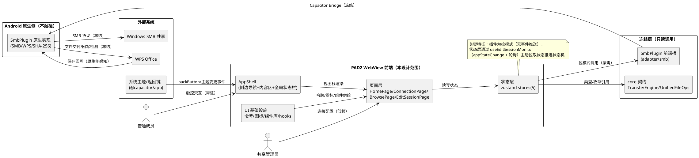
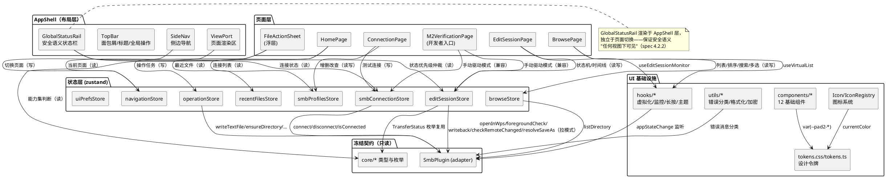
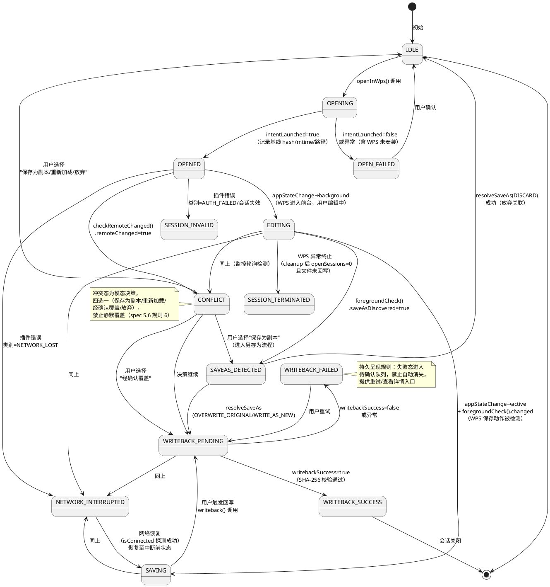
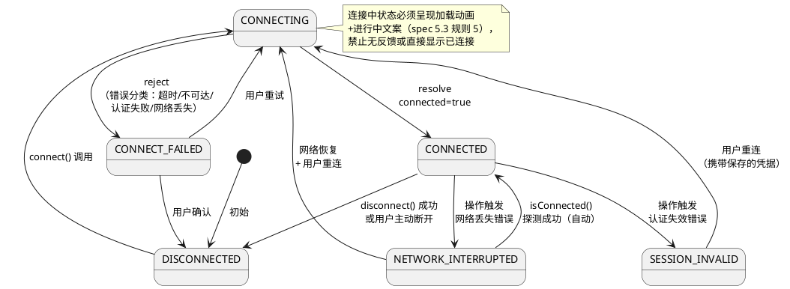
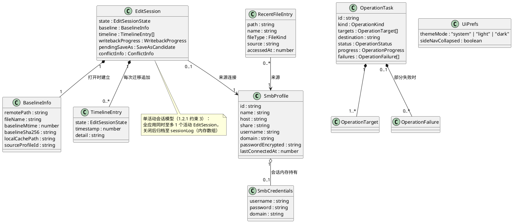

# PAD2-UI-DESIGN-003 技术设计：PAD2 UI 产品化实现方案

> **文档编号**：PAD2-UI-DESIGN-003
> **需求来源**：`.codeartsdoer/specs/p003_ui_productization/spec.md`（PAD2-UI-PRODUCTIZATION-003 需求规格，825 行，本文档唯一需求基线）
> **设计方向**：方向 A（现代专业工作台）为主 + 方向 B（轻盈现代风格）视觉融合（PM 已裁定，不可变更）
> **目标设备**：荣耀平板 NDL2_W09（Android 16 / API 36），Capacitor 8 WebView 内渲染
> **文档定位**：本文档将需求规格（WHAT）转化为可实施的技术方案（HOW），供设计评审 Gate 审查。本文档通过 Gate 评审不等于已授权修改代码，代码实施仍按"一项任务、一个 Gate"流程执行。

## 0. 约束声明与冻结边界

本设计在以下硬性约束内开展，任何章节不得突破：

| 约束编号 | 约束内容 | 本设计的落实方式 |
|---------|---------|----------------|
| CON-01 | Gate 约束：设计先行，代码须过 Gate | 见 2.8.1 分阶段 Gate 时机表 |
| CON-02 | 不重构 SMB 核心逻辑（SmbPlugin.ts 等已冻结） | 见 2.1.4 冻结边界定义 |
| CON-03 | 安全语义不可牺牲（失败不隐藏、不伪报成功） | 见 2.5 安全语义可视化方案 |
| CON-04 | 平板大屏目标（不针对手机小屏适配） | 见 2.4.1 AppShell 断点策略 |
| CON-05 | 技术栈限定 Capacitor + React + TS + WebView | 见 2.1.1 架构选型 |
| CON-06 | 不引入新的后端/原生模块，仅前端 UI 层改造 | 见 2.1.1 依赖决策表 |
| CON-07 | 设计令牌单一来源，禁止硬编码视觉属性 | 见 2.3.1 设计令牌体系 |
| CON-08 | 禁止 emoji 作为正式图标 | 见 2.3.4 图标系统 |

---

# 一、需求与存量功能关系分析

## 1.1 需求功能与存量功能对比

### 1.1.1 已实现功能

已实现功能指需求所需的**后端能力契约与基础交互**在存量代码中已完全具备、UI 产品化可直接调用的部分。判定依据：接口签名完整覆盖需求的数据输入输出，且已通过 M2-A 验证（V1-V7 全部 PASS）。

| 需求功能 | 存量功能 | 代码位置 | 匹配度 |
|---------|---------|---------|--------|
| SMB 连接建立/断开/状态查询（连接页与全局状态的数据源） | `connect` / `disconnect` / `isConnected` 完整封装 | src/adapter/smb/SmbPlugin.ts:115-117 | 100% |
| 目录列表数据获取（浏览页数据源，含名称/大小/时间/目录标记/路径） | `listDirectory` 返回 `SmbFileEntry[]` | src/adapter/smb/SmbPlugin.ts:118、SmbFileEntry 定义 :17-23 | 100% |
| WPS 打开与编辑基线记录（状态页"已打开"状态与基线信息数据源） | `openInWps` 返回 uri/localPath/baselineHash/baselineMtime/intentLaunched | src/adapter/smb/SmbPlugin.ts:119、WpsOpenResult :29-49 | 100% |
| 保存检测与另存为发现（"正在保存""另存为检测"状态数据源） | `checkLocalFileChanged` / `foregroundCheck`（含 saveAsDiscovered/saveAsFilePath/saveAsPrompt） | src/adapter/smb/SmbPlugin.ts:120-121、FileChangeResult :51-64 | 100% |
| 回写执行与 SHA-256 校验（"回写中/成功/失败"状态数据源） | `writeback` 返回 writebackSuccess/localHash/verifyHash | src/adapter/smb/SmbPlugin.ts:123、WritebackResult :81-88 | 100% |
| 远程冲突检测（"冲突"状态数据源） | `checkRemoteChanged`（remoteMtime vs baselineMtime） | src/adapter/smb/SmbPlugin.ts:124、RemoteChangeResult :90-95 | 100% |
| 另存为决策执行（覆盖原文件/回写为新文件/放弃关联） | `resolveSaveAs`（OVERWRITE_ORIGINAL / WRITE_AS_NEW / DISCARD） | src/adapter/smb/SmbPlugin.ts:122、:66-79 | 100% |
| 编辑会话信息查询（会话卡数据源） | `getSessionInfo`（sessionId/status/baselineSha256/openSessions） | src/adapter/smb/SmbPlugin.ts:130、SessionInfoResult :97-107 | 100% |
| WPS 安装检测（"无法打开"异常场景数据源） | `isWpsInstalled` | src/adapter/smb/SmbPlugin.ts:131 | 100% |
| 文件属性查询（属性菜单项数据源） | `getFileAttributes` | src/adapter/smb/SmbPlugin.ts:125 | 100% |
| V1-V7 回归验证面板（M2 验收门禁资产，须保留） | 验证步骤表格 + 步骤状态机（pending/running/pass/fail） | src/ui/pages/M2VerificationPage.tsx:19-27、612-640 | 100% |
| 密码掩码输入（安全性基础要求） | `input type="password"` | src/ui/pages/M2VerificationPage.tsx:398-404 | 75% |
| 回写结果反馈（有色有文案的雏形） | writebackResult 结果块（绿/红背景 + 成功失败文案） | src/ui/pages/M2VerificationPage.tsx:556-562 | 50% |
| 另存为候选提示与三路决策按钮（交互闭环雏形） | saveAsResult 面板 + 覆盖/回写为新文件/放弃关联按钮 | src/ui/pages/M2VerificationPage.tsx:493-533 | 75% |
| 连接状态文字反馈（"● 已连接"） | connected/connecting useState + 文字呈现 | src/ui/pages/M2VerificationPage.tsx:35-36、413 | 50% |
| 文件列表基础呈现（行渲染 + 选中高亮 + 大小显示） | files.map 渲染行、选中态 `#e3f2fd`、`(size/1024).toFixed(1) KB` | src/ui/pages/M2VerificationPage.tsx:433-464 | 25% |
| 路径显示与上级返回（路径导航雏形） | "路径: {currentPath}" 文字 + "↑ 上级目录"按钮（字符串截取父路径） | src/ui/pages/M2VerificationPage.tsx:421-425、257-262 | 25% |
| 加载/空目录/错误提示（状态提示雏形） | "加载中...""空目录"文字、error 红底块 | src/ui/pages/M2VerificationPage.tsx:426-431、643-647 | 25% |
| 传输任务状态枚举（UI 状态映射可复用资产） | TransferStatus 十态枚举 + TransferTask 接口 + onProgress/onComplete/onError 回调契约 | src/core/transfer/TransferEngine.ts:1-51 | 75% |
| 文件操作能力接口契约（操作菜单可用性判断资产） | UnifiedFileOperations 接口（copy/move/rename/delete 等签名）+ ProtocolCapabilities 能力集 | src/core/file/UnifiedFileOperations.ts:26-38、ProtocolCapabilities.ts:15-22 | 75% |

**判定结论**：需求 7 大模块的**后端数据源与能力契约 100% 就绪**；缺口集中在 UI 呈现层（设计系统、页面结构、状态可视化、导航、组件规范），即本设计的全部工作量在 WebView 前端层，与 spec"仅 UI 层改造"的边界完全吻合。

### 1.1.2 需要扩展的功能

需要扩展的功能指存量代码已有**部分实现或雏形**，需在现有基础上改造升级的部分。差异说明覆盖输入输出、业务逻辑、边界条件三个维度。

| 需求功能 | 存量功能 | 差异说明 | 扩展方向 |
|---------|---------|---------|---------|
| SMB 连接页（spec 5.3：表单+列表+测试+校验） | M2 页内联 4 个输入框 + 单个"连接"按钮（M2VerificationPage.tsx:375-412） | 输入输出差异：无连接名称/域输入、无已保存连接列表、无测试连接流程；业务逻辑差异：无表单校验、无凭据错误定位到输入项；边界差异：无删除确认、无进行中操作警告 | 新建 ConnectionPage 页面组件；表单状态与校验抽离为 `useSmbConnectionForm` hook；连接列表数据层新建 `smbProfilesStore`（见 2.6.2） |
| 共享目录浏览页完整能力（spec 5.4：面包屑/排序/搜索/多选/长按菜单/虚拟化） | 文件行 onClick：目录进入 / 文件直接 WPS 打开（M2VerificationPage.tsx:436-441） | 输入输出差异：无排序/搜索输入、无多选状态；业务逻辑差异：点击文件直接打开（需求要求先呈现操作菜单）；边界差异：无 5000 条虚拟化、无会话失效呈现 | 新建 BrowsePage；列表渲染改为 `FileList`（虚拟化）+ `FileRow` 组件；点击行为改为触发 FileActionSheet；新增 `useVirtualList` hook 与排序/搜索/多选状态（browseStore） |
| 文件操作菜单（spec 5.5：统一菜单+状态适配+批量+确认+进度+冲突入口） | 无对应实现（文件点击直达 WPS） | 完全缺失交互层，仅后端能力（UnifiedFileOperations 契约）就绪 | 新建 FileActionSheet（底部菜单）+ ConfirmDialog（删除/重命名）+ OperationProgressPanel（进度）+ ConflictDialog（冲突决策） |
| WPS 编辑与回写状态页（spec 5.6：状态机+时间线+基线信息+决策） | 分散的 5 个结果块（changeResult/writebackResult/remoteChangeResult/saveAsResult/resolveAsResult，M2VerificationPage.tsx:535-608） | 输入输出差异：结果块由手动按钮触发、无自动状态推进；业务逻辑差异：无统一状态机、无状态优先级、无持久呈现机制；边界差异：从 WPS 返回后状态不自动刷新（需用户手动点检测） | 新建 EditSessionPage + `editSessionStore`（11 态状态机，见 2.2.3）+ `useEditSessionMonitor` hook（应用 resume/前台切换时自动调用 foregroundCheck 推进状态，纯 UI 层轮询，不改插件） |
| 连接配置持久化（spec 5.3 规则 3"已保存的连接列表"） | useState 持有凭据，刷新/重启即丢失（M2VerificationPage.tsx:30-34） | 边界差异：内存态 vs 持久态；安全差异：spec 6.3.2 要求密码加密存储 | `@capacitor/preferences`（依赖已具备，package.json:21）持久化 SmbProfile；密码默认仅会话内存保存，"记住密码"开启时经 Web Crypto AES-GCM 加密落盘（见 2.7.2） |
| 视图导航与应用外壳 | 无路由，App.tsx 仅渲染单页（src/App.tsx:1-7） | 5 个产品页面 + 1 个验证页共存需要导航；平板返回键需要拦截 | 轻量视图栈导航（`navigationStore` + `@capacitor/app` backButton 拦截，依赖已具备 package.json:18），不引入 react-router（决策理由见 2.1.1） |
| 状态管理（跨页面共享连接/会话/浏览上下文） | M2 页内 20+ 个 useState（M2VerificationPage.tsx:30-53） | 页面级局部状态 vs 应用级共享状态；页面切换后浏览上下文与编辑会话状态必须保持（spec 4.5.2 横竖屏/页面切换不丢状态） | zustand（依赖已具备 package.json:25）划分 5 个 store（见 2.6.2 接口清单）；M2 页面原 useState 逻辑迁移至 store，M2 页面改为 store 消费方 |
| 深色/浅色模式适配（spec 4.2.4/4.5.4） | 全部硬编码浅色值（#ddd/#eee/#f5f5f5/#666 等） | 单一主题 vs 双主题；spec 4.2.4 要求双模式下安全语义均可辨 | 令牌双值 + `[data-theme='dark']` CSS 变量覆盖 + `useThemeSync` hook 监听系统主题（见 2.3.3） |
| M2 验证页保留迁移 | M2 页为当前主页面（App.tsx 直接渲染） | 产品化后不应作为主界面，但 V1-V7 回归验证能力必须保留 | 移入"设置 → 开发者选项 → M2 技术验证"入口，页面内部功能不变（见 2.4.1 导航结构） |
| 日志导出入口（现有 exportLog 能力的产品化入口） | "导出日志到共享"按钮位于 M2 页日志区（M2VerificationPage.tsx:650-658） | 功能保留，入口位置随页面迁移调整 | 随 M2 页迁移；产品页面的诊断日志入口挂接同一 `exportLog` 插件方法 |

### 1.1.3 需要新增的功能或接口

需要新增的功能指需求在存量代码中**完全没有对应实现**、需从零建设的部分。按业务模块分组如下：

**A. UI 设计基线组（spec 5.1，全部新增）**

| 功能点 | 输入 | 输出 | 核心逻辑 | 依赖 |
|-------|------|------|---------|------|
| 设计令牌系统 | 方向 A+B 融合视觉参数决策 | `tokens.css`（CSS 自定义属性，双主题值）+ `tokens.ts`（类型安全的令牌引用函数） | 令牌单一真源：CSS 变量为运行时真源，TS 侧仅按名引用 `var(--pad2-*)`，不复制色值 | 无外部依赖 |
| 基础组件库 | 设计令牌 | 12 个基础组件（见 2.3.2 组件规格） | 每组件单一职责、props 类型化、样式走 CSS Modules + 令牌 | 令牌系统 |
| SVG 图标系统 | 图标清单（文件类型 10 类 + 操作 18 项 + 状态 8 项） | `IconRegistry`（名称→SVG 组件映射）+ `FileIcon`（扩展名→类型图标映射） | 内联 SVG 函数组件，24×24 viewBox，线性 1.5px stroke 统一风格，状态图标为填充型 | 令牌系统 |
| 硬编码检查工具 | src/ 源码 | 违规清单（硬编码色值/emoji 使用） | 沿用项目 check-\*.mjs 脚本惯例，正则扫描 hex 色值与 emoji 字符，白名单豁免 tokens.css | Node 脚本 |

**B. 应用导航与布局组（spec 5.2，全部新增）**

| 功能点 | 输入 | 输出 | 核心逻辑 | 依赖 |
|-------|------|------|---------|------|
| AppShell 双栏布局 | 视口宽度断点 | 侧边导航 + 内容区骨架 | ≥900px 常驻侧边栏（240px）/ 600-899px 图标收起栏（72px）/ <600px 抽屉栏；横竖屏切换布局自适应且状态不丢 | 基础组件库 |
| 视图栈导航 | 页面跳转意图、Android 返回键 | 当前页面 + 历史栈 | zustand 栈式导航，`@capacitor/app` backButton 出栈，栈底为文件首页 | zustand、@capacitor/app |
| 最近文件记录 | 文件打开事件 | 最近文件列表（名称/类型/来源/时间） | 前端记录（openInWps 成功后写入），Preferences 持久化，容量上限 20 条 LRU 淘汰 | Preferences |
| 存储空间概览数据 | — | — | **依赖缺口**：现有 SmbPlugin 无磁盘配额查询方法；按 CON-06 不新增原生接口，SMB 共享空间卡片以"连接状态 + 根路径"信息呈现替代（详见 2.4.1 落地说明），本地存储配额通过 `navigator.storage.estimate()` Web API 获取（WebView 支持） | Web Storage API |

**C. 页面与交互组（spec 5.2-5.6，页面组件全部新增，已在 1.1.2 说明数据层扩展）**

| 功能点 | 输入 | 输出 | 核心逻辑 | 依赖 |
|-------|------|------|---------|------|
| HomePage 文件首页 | 连接列表、最近文件、会话状态 | 工作台首页 | 存储概览卡 + 快速操作 + 最近文件 + SMB 状态卡组合 | stores、基础组件 |
| ConnectionPage 连接页 | 表单输入、连接列表操作 | 连接管理 | 表单校验（必填/格式）、测试连接（复用 connect + 立即 disconnect）、删除二次确认 | smbProfilesStore |
| BrowsePage 浏览页 | 目录数据、排序/搜索/多选输入 | 文件列表视图 | 虚拟化渲染、面包屑、长按多选、会话状态条 | browseStore、useVirtualList |
| FileActionSheet 操作菜单 | 选中文件（单/多）、能力上下文 | 操作执行分发 | 菜单项按文件类型/连接状态/能力动态启用禁用；危险操作分流确认 | UnifiedFileOperations 能力集 |
| EditSessionPage 状态页 | 编辑会话状态机 | 会话卡 + 时间线 + 决策入口 | 11 态状态机（见 2.2.3）+ 基线信息 + 状态历史 | editSessionStore |
| 全局状态栏 GlobalStatusRail | 安全语义事件 | 常驻状态横幅 | 优先级仲裁（失败 > 冲突 > 断网 > 另存为 > 进行中 > 成功），失败态不自动消失 | 安全语义规格（2.5） |

**D. 安全语义可视化组（spec 5.7，全部新增）**

| 功能点 | 输入 | 输出 | 核心逻辑 | 依赖 |
|-------|------|------|---------|------|
| 安全语义状态规格引擎 | 状态值（10 类安全语义状态） | 语义色 + 图标 + 文案 + 持续性策略 | 状态→视觉资源映射表（单一来源常量 `safetySemanticMap`），全部页面消费同一映射 | 令牌、图标系统 |
| 失败持久呈现机制 | 失败/警告类状态 | 需确认队列 | 进入"待确认队列"后仅用户显式操作可移除，禁止超时自动隐藏 | GlobalStatusRail |
| SMB 错误分类器 | 插件错误消息（字符串） | 结构化错误 `{category, userMessage}` | `smbErrorMapper`：按错误消息特征映射为认证失败/超时/不可达/网络丢失/权限不足/空间不足/未知七类，输出用户可读文案（不暴露技术细节） | 无 |

## 1.2 存量功能详细分析

### 1.2.1 SmbPlugin 前端接口契约（冻结资产，只调用不修改）

**接口契约**：18 个方法、13 个结果接口（src/adapter/smb/SmbPlugin.ts:3-132），经 `registerPlugin<SmbPluginInterface>('SmbPlugin')` 桥接 Android 原生侧。关键契约特征：

1. **拉模式（Pull）而非推模式（Push）**：除 Promise 返回值外，插件前端接口不提供事件监听通道。`checkLocalFileChanged`/`foregroundCheck`/`checkRemoteChanged`/`writeback` 均需 UI 层主动调用。**约束推论**：编辑会话状态的自动推进必须由 UI 层监控循环驱动（应用 resume、定时轮询），这是 2.2.3 状态机监控设计的根因，也是唯一不修改插件即可实现产品化状态页的途径。
2. **单活动会话模型**：`getSessionInfo` 返回单个会话上下文（sessionId/remotePath/baselineSha256），`cleanup` 清理会话。**约束推论**：编辑会话 UI 按单活动会话设计，"会话历史"由 UI 层自行记录（sessionLogStore 的 timeline 数组），不依赖插件多会话能力。
3. **`openInWps` 是文件交付动作而非浏览动作**：返回 `intentLaunched` 布尔与 `errorType`（含 `fallbackTried`），UI 层须处理"Intent 启动失败/WPS 未安装"分支（`isWpsInstalled` 预检）。
4. **校验语义内建于返回值**：`WritebackResult.writebackSuccess` 隐含 SHA-256 校验（localHash === verifyHash 语义由原生侧保证），UI 层不重复实现校验，只呈现结果。
5. **异常契约**：所有方法 reject 时携带 `message`（字符串），M2 页面统一 `e.message || String(e)` 处理（M2VerificationPage.tsx:75-77）。**约束推论**：错误分类只能基于消息字符串匹配，`smbErrorMapper` 须容忍未识别消息（兜底"未知错误"类）。

**扩展点**：无钩子、无事件订阅接口——这正是 CON-02 冻结约束的结果，UI 层的一切"自动化"只能建立在其上层的调用编排。

### 1.2.2 M2VerificationPage 现状与可迁移逻辑

**现状**：695 行单文件，承载连接、浏览、WPS 验证、结果呈现、V1-V7 门禁、日志六合一（M2VerificationPage.tsx:29-676）。样式全部内联（`style={{...}}` 对象 + `inputStyle`/`btnStyle` 工厂函数 :678-695），硬编码色值 17 处（#1976d2/#f44336/#4caf50/#ff9800/#9c27b0/#009688/#666/#ddd/#eee/#e3f2fd/#e8f5e9/#ffebee/#fff3e0/#f5f5f5/#888/#666 等），emoji 图标 7 类（📁📄✅❌⚠️ℹ️⏳）。

**可迁移的业务逻辑**（迁往 hooks/stores，M2 页面改为消费方，逻辑本身不变）：

| 逻辑块 | 现有位置 | 迁移目标 |
|-------|---------|---------|
| 连接建立/断开流程（connect → listDir('') → 错误处理） | handleConnect/handleDisconnect :66-93 | `useSmbConnection` hook → smbConnectionStore |
| 目录浏览流程（listDirectory → files/currentPath → loading/error） | handleListDir :95-109 | browseStore |
| WPS 打开流程（openInWps → intentLaunched 分支 → 基线记录） | handleOpenInWps :111-131 | editSessionStore.openFile() |
| 变更检测/回写/远程检查流程 | handleCheckChange/handleWriteback/handleCheckRemote :133-197、241-255 | editSessionStore 状态机 action |
| 另存为检测与三路决策流程 | handleForegroundCheck/handleResolveSaveAs :155-176、199-239 | editSessionStore 决策 action |
| 日志导出流程 | handleExportLog :333-357 | 保留于 M2 页（验证工具属性） |

**业务规则识别**：现有代码已隐含的安全语义雏形——回写失败时显示红底 ❌ 而非绿底（:556-561）、另存为发现后强制三选一决策按钮组（:509-533）、`remoteChanged` 呈现"⚠️ 可能冲突"（:564-568）。这些行为规则在新状态机中**全部保留并强化**（加入持久性与优先级机制），不得弱化。

**约束**：M2 页面是 M2-A 验收门禁的操作载体，迁移期间其对外可见行为（按钮、结果呈现、日志导出）必须保持可用，仅在 AppShell 接入时移入开发者入口。

### 1.2.3 core 层接口资产（类型定义就绪，实现未接线）

- `TransferEngine.ts`：TransferStatus 十态枚举（PENDING/IN_PROGRESS/WAITING_NETWORK/RETRYING/VERIFYING/SUCCESS/FAILED/CONFLICT/CANCELLED/PAUSED，:1-12）与 TransferTaskEngine 接口（含 onProgress/onComplete/onError 回调注册，:40-51）。spec 6.4/6.5 的状态值集合与之高度对齐（多出"部分失败"一态）。**决策**：UI 层文件操作状态直接复用该枚举，"部分失败"（PARTIAL_FAILED）作为 UI 层聚合态叠加（批量操作结果聚合时由 operationStore 计算），不修改 core 文件。
- `UnifiedFileOperations.ts`：listDirectory/readFile/writeFile/deleteFile/renameFile/copyFile/moveFile/createDirectory/getFileAttributes/exists 完整签名（:26-38）。**现状**：SMB 协议的该接口实现位于 Android 原生侧（SmbPlugin），前端 TS 层的这份接口是契约定义。**决策**：FileActionSheet 的菜单项可用性判断消费 ProtocolCapabilities 能力集与连接状态，操作执行桥接 SmbPlugin 对应方法（writeTextFile/ensureDirectory 已有，copy/move/rename/delete 在原生侧由 P0 实现，前端按现有插件方法调用；若个别操作方法前端接口缺失，该菜单项灰显并在设计文档标注，**不新增插件方法**）。
- `ProtocolCapabilities.ts`：能力枚举含 COPY/MOVE/RENAME/DELETE（:1-13），供操作菜单动态启用禁用。

### 1.2.4 构建与工程基础设施

- **构建链**：`tsc && vite build`（package.json:8），产物 dist/，`cap:sync` 同步至 Android 工程（:10）。CSS Modules 由 Vite 原生支持，零配置。
- **路径别名**：vite.config.ts 已预置 `@ui`/`@orchestration`/`@core`/`@adapter`/`@infrastructure` 五个别名（:8-14），当前仅 @core/@adapter/@ui 有实体目录。**决策**：UI 层新代码全部挂在 `@ui` 别名下，不新增别名。
- **依赖现状**：zustand 4.5（已安装未使用）、@capacitor/app 8（已安装）、@capacitor/preferences 8（已安装）、@capacitor/filesystem 8（已安装）。**结论**：本设计零新增 npm 依赖（见 2.1.1 决策表）。
- **验证脚本惯例**：项目根目录存在 40+ 个 check-\*.mjs / \*-test.mjs 验证脚本（CDP 驱动 WebView 检查），沿用此惯例新增 UI 验证脚本（见 2.8.2）。
- **入口 HTML**：index.html theme-color #1976d2（:6）——随品牌令牌更新为设计基线品牌色。

### 1.2.5 约束条件识别（存量代码对设计的约束）

1. **插件无事件推送**（1.2.1 推论）：状态自动化只能 UI 层轮询/resume 钩子驱动 → `useEditSessionMonitor` 设计。
2. **错误分类依赖字符串匹配**：`smbErrorMapper` 必须有"未知"兜底类，且映射表可配置可扩展（不修改插件前提下应对原生侧消息变化）。
3. **单会话模型**：编辑会话页按单活动会话设计，多文件并发编辑不在本需求范围（spec 5.6 亦为单会话叙述）。
4. **M2 页面须持续可用**：所有 store 设计必须允许 M2 页面以"手动驱动"模式运行（保留其按钮驱动状态推进），状态机不能独占锁定状态迁移路径。
5. **Android 16 / API 36 WebView**：Chrome 内核 ≥ 120，CSS 自定义属性/Grid/现代选择器/`:focus-visible`/`prefers-color-scheme` 全部可用，无兼容性降级需求；`navigator.storage.estimate()` 可用。
6. **横竖屏切换 = WebView 不销毁**：Capacitor Android 下旋转仅触发 resize，React 状态天然保留，视图栈导航无 URL 依赖故旋转不丢状态——满足 spec 4.5.2。
---

# 二、增量设计方案

## 2.1 技术方案总览

### 2.1.1 架构选型与决策

总原则：**在现有 Capacitor + React + TypeScript + Vite 技术栈上做纯前端 UI 层增量改造，零新增 npm 依赖，零原生侧变更**。关键选型决策及理由：

| 决策编号 | 决策项 | 选型 | 备选方案 | 选择理由 |
|---------|-------|------|---------|---------|
| D-01 | 样式方案 | 原生 CSS Modules + CSS 自定义属性（设计令牌） | CSS-in-JS（emotion）、Tailwind、全局 CSS | ① Vite 原生零配置支持 CSS Modules；② 编译期类名作用域、无运行时开销（WebView 性能上限，spec 4.1）；③ CSS 自定义属性天然支持 `[data-theme]` 深色切换；④ 不引入任何新依赖（CON-06） |
| D-02 | 状态管理 | zustand（已安装）多 store 划分 | Redux Toolkit、Context API | ① 依赖已具备（package.json:25）；② 跨页面共享（连接/会话/浏览上下文）且页面切换不丢状态（spec 4.5.2）；③ Context 大列表高频更新会引发全树重渲染，zustand 选择器订阅规避此问题（5000 条列表渲染性能，spec 4.1.2） |
| D-03 | 页面导航 | 自研轻量视图栈（zustand navigationStore） | react-router-dom | ① WebView 内无 URL 地址栏、无深链接需求（企业内部分发 APK）；② Android 返回键须与栈式出栈天然配合（@capacitor/app 已具备）；③ 避免 ~20KB 依赖与 HashRouter 的 WebView history 兼容性问题 |
| D-04 | 图标系统 | 内联 SVG 函数组件 + IconRegistry 映射 | 图标库（lucide-react 等）、iconfont | ① 禁 emoji（CON-08）且需文件类型/操作/状态三类定制映射；② 内联 SVG 无网络请求、可 tree-shaking、颜色走 `currentColor` 令牌联动；③ 图标总量约 36 个，自绘成本可控 |
| D-05 | 大目录列表渲染 | 自研 `useVirtualList` 固定行高虚拟化 | react-window、分页加载 | ① 行高统一 64px（组件规格冻结后行高恒定，虚拟化计算简单可靠）；② 5000 条全量 DOM 渲染在 WebView 有卡顿风险，分页加载累计 DOM 仍可达 5000 节点；③ 自研约百行代码，避免新依赖；④ 降级预案：滚动异常时回退分页加载（见 2.8.3 风险 R-01） |
| D-06 | 持久化 | @capacitor/preferences（已安装） | localStorage、Filesystem 插件 | ① 依赖已具备；② Preferences 映射 Android SharedPreferences，适合小体量结构化配置（连接配置/最近文件/界面偏好）；③ 密码加密方案见 D-07 |
| D-07 | 密码存储 | 默认仅会话内存保存；"记住密码"用 Web Crypto AES-GCM 加密后落盘 | 明文落盘（否决）、原生 Keystore（CON-06 禁新增原生模块） | spec 6.3.2 要求加密存储。不存储是最安全默认态；显式开启记住密码时以 PBKDF2（310k 迭代 + 随机盐）派生密钥做 AES-GCM 加密，防设备存储 dump 场景下的明文泄露。后续若原生侧提供 Keystore 接口可升级（需另立 Gate） |
| D-08 | 深色模式 | CSS 变量双值 + `useThemeSync` 监听 `prefers-color-scheme` | 双套样式文件 | 令牌层一次性解决（`:root` 浅色值 / `[data-theme='dark']` 覆盖值），组件零改动；语义色深色变体预先校验对比度 ≥ 4.5:1（spec 4.2.4） |
| D-09 | 主题注入方式 | tokens.css 为运行时唯一真源，TS 侧 `token()` 函数按名引用 | TS 常量真源生成 CSS | 单一来源无同步漂移风险；TS 联合类型约束令牌名实现类型安全；检查脚本只须扫描 hex 值豁免 tokens.css |

### 2.1.2 目标代码结构

在现有 `src/` 基础上的增量目录规划（加粗为新增，其余为存量保留）：

```
src/
├── main.tsx                        # 存量，仅追加 ThemeProvider 挂载（不改结构）
├── App.tsx                         # 改造：AppShell + 视图栈路由（原 7 行）
├── adapter/smb/SmbPlugin.ts        # 冻结，不改
├── core/                           # 冻结，不改
├── ui/
│   ├── tokens/                     # 新增：设计令牌
│   │   ├── tokens.css              # CSS 自定义属性（双主题值，唯一真源）
│   │   └── tokens.ts               # 令牌名联合类型 + token() 引用函数 + 安全语义映射
│   ├── icons/                      # 新增：图标系统
│   │   ├── Icon.tsx                # 通用 Icon 组件（名称→SVG）
│   │   ├── registry.ts             # 图标注册表（操作/状态/导航图标）
│   │   └── fileTypeIcons.ts        # 文件类型图标映射（扩展名→图标）
│   ├── components/                 # 新增：基础组件库（12 个）
│   │   ├── BaseButton/  Card/  ListRow/  StatusBadge/
│   │   ├── StatusBanner/  ProgressBar/  Spinner/
│   │   ├── Dialog/  BottomSheet/  EmptyState/
│   │   ├── SkeletonList/  Breadcrumb/
│   │   └── (每组件 index.tsx + style.module.css)
│   ├── layouts/
│   │   └── AppShell/               # 新增：双栏外壳（SideNav + TopBar + GlobalStatusRail）
│   ├── pages/                      # 页面
│   │   ├── HomePage/               # 新增
│   │   ├── ConnectionPage/         # 新增
│   │   ├── BrowsePage/             # 新增（含 FileList/ 虚拟化列表子组件）
│   │   ├── EditSessionPage/        # 新增
│   │   ├── FileActionSheet/        # 新增（操作菜单，页面级浮层组件）
│   │   └── M2VerificationPage.tsx  # 存量保留，迁入开发者入口
│   ├── hooks/                      # 新增
│   │   ├── useVirtualList.ts       # 虚拟化列表
│   │   ├── useEditSessionMonitor.ts# 编辑会话自动监控（resume/轮询驱动）
│   │   ├── useThemeSync.ts         # 系统主题同步
│   │   ├── useConnectionStatus.ts  # 连接状态聚合
│   │   └── useLongPress.ts         # 长按手势
│   └── styles/
│       └── global.css              # 新增：reset + 全局基础样式 + 字体族
├── state/                          # 新增：zustand stores
│   ├── navigationStore.ts          # 视图栈
│   ├── smbConnectionStore.ts       # 活动连接状态机
│   ├── smbProfilesStore.ts         # 已保存连接配置（持久化）
│   ├── browseStore.ts              # 浏览上下文（列表/排序/搜索/多选）
│   ├── editSessionStore.ts         # 编辑会话状态机 + 时间线
│   ├── operationStore.ts           # 文件操作任务与进度
│   ├── recentFilesStore.ts         # 最近文件（持久化）
│   └── uiPrefsStore.ts             # 界面偏好（主题模式/侧栏状态，持久化）
└── utils/                          # 新增
    ├── smbErrorMapper.ts           # SMB 错误分类器
    ├── fileUtils.ts                # 格式化（大小/时间/类型识别）
    └── crypto.ts                   # Web Crypto 密码加密
```

命名遵循项目 camelCase 惯例（组件文件 PascalCase 目录 + index.tsx，hooks 以 use 前缀，store 以 Store 后缀）。

### 2.1.3 设计原则

1. **安全语义优先原则**（spec 5.7 规则 10）：任何视觉/动效决策与安全语义冲突时，安全语义获胜。状态指示器（色彩+图标）切换零延迟呈现，动画只允许用于非状态承载元素（面板位移、遮罩淡入）。
2. **令牌唯一来源原则**（spec 4.4.1）：视觉属性只经令牌引用，`check-design-tokens.mjs` 作为 CI 门禁。
3. **存量契约只读原则**（spec 7.2）：SmbPlugin.ts 与 core/ 目录视为只读依赖，UI 层经由 adapter 薄封装调用（封装层可新增，如 `utils/smbErrorMapper`，但不得改变插件调用语义）。
4. **渐进增强原则**：每个页面独立成阶段、独立过 Gate、独立可回滚（APK 命名沿用 pad2-ui-sN-rM 系列）；任一阶段失败不影响已验收页面。
5. **状态真实呈现原则**（spec 4.2.1）：UI 状态是后端事实的投影——store 的状态迁移只能由插件调用的真实返回值驱动，禁止乐观更新（optimistic update）在成功/失败类状态上使用（进行中状态可先行标记"进行中"，因其语义即"尚未知结果"）。

### 2.1.4 与现有代码的关系（改造边界）

**冻结区（只读）**：

| 文件 | 冻结依据 | 允许的操作 |
|-----|---------|-----------|
| src/adapter/smb/SmbPlugin.ts | M1 冻结 + CON-02 | 仅 import 调用；禁止修改任何接口签名、类型、方法 |
| src/core/**（3 文件） | M1 冻结 | 仅 import 类型与枚举；禁止修改 |
| android/**（原生工程） | CON-06 | 不触碰；UI 改造不需要任何原生变更 |

**改造区（可修改）**：

| 文件/位置 | 改造内容 | 约束 |
|----------|---------|------|
| src/App.tsx | 从渲染 M2VerificationPage 改为渲染 AppShell + 视图栈 | 保持默认导出签名 |
| src/main.tsx | 追加 global.css 引入与主题初始化（3 行内） | 不改挂载结构 |
| src/ui/pages/M2VerificationPage.tsx | ① 业务逻辑迁往 stores（1.2.2 迁移表）；② 内联样式可换为令牌引用（可选，不强制本周期完成）；③ 移入开发者入口路由 | 按钮与结果呈现行为不变（V1-V7 门禁可用性） |
| index.html | theme-color 与标题随基线更新 | 仅 meta 属性 |

**新增区**：src/ui/tokens|icons|components|layouts|hooks|pages、src/state、src/utils、scripts/check-design-tokens.mjs——全部为新增文件，不与冻结区冲突。

### 2.2 实现模型

### 2.2.1 上下文视图



交互频率标注：Member→Shell 高频（每次触控）；Stores→SmbBridge 中频（用户操作触发 + 会话监控轮询 5s/次·仅会话活跃时）；SysEnv→Shell 低频（返回键/主题切换）。

### 2.2.2 UI 层总体架构



架构分层规则（依赖方向单向向下，禁止反向依赖）：

- **布局层 → 页面层 → 状态层 → 冻结契约**；**基础设施被所有层引用但不引用任何层**。
- 页面组件禁止直接 import SmbPlugin——所有插件调用收敛到 store action 或 hooks（保证状态与后端事实的一致性，spec 4.2.1）。
- M2 页面例外豁免：其存量直调逻辑迁移后走 store，迁移完成前允许并存（过渡期约束，S2 阶段收口）。

### 2.2.3 核心状态机设计

**A. 编辑会话状态机（editSessionStore，spec 6.2 十一态）**

现状问题：M2 页面的状态散落在 5 个独立 useState 的结果块中，无统一迁移规则，状态间可非法并存（如 writebackResult 与 saveAsResult 同时显示）。



**状态机实现要点**：

1. **单一状态字段**：`editSessionStore.state: EditSessionState`（11 态字符串字面量联合类型），任何时刻仅一态，杜绝 M2 页面多结果块并存的歧义。
2. **迁移合法性表**：`transitionTable: Record<EditSessionState, EditSessionState[]>` 约束合法迁移，非法迁移调用（如 IDLE→WRITEBACK_SUCCESS）在开发模式 console.error 并拒绝——状态真实性的代码级保证（spec 4.2.1）。
3. **时间线记录**：每次成功迁移 push `{ state, timestamp, detail }` 至 `timeline` 数组（spec 6.2.4 状态历史可追溯），渲染于状态页时间线组件。
4. **中断前状态记忆**：`NETWORK_INTERRUPTED` 迁入时记录 `previousState`，网络恢复后回迁（回写类中断恢复后重新进入对应流程）。
5. **安全语义映射**：状态→视觉资源经 `safetySemanticMap` 单一来源映射（见 2.5.1 总表）。

**B. SMB 连接状态机（smbConnectionStore，spec 6.3 六态）**



错误分类驱动：`smbErrorMapper` 将插件 reject 的消息映射为 `AUTH_FAILED / TIMEOUT / UNREACHABLE / NETWORK_LOST / PERMISSION_DENIED / DISK_FULL / UNKNOWN` 七类，映射表配置于 `utils/smbErrorMapper.ts`（正则匹配表 + 未知兜底），CONNECT_FAILED 态携带 `{category, userMessage}` 供连接页呈现可读原因（spec 5.3 规则 6、异常场景 1-4）。

**C. 文件操作任务状态（operationStore，spec 6.4 七态）**

复用 core 已有 `TransferStatus` 十态枚举（1.2.3），UI 层聚合规则：批量操作全部子任务完成时，若存在失败子任务则整体呈现 `PARTIAL_FAILED`（UI 层叠加态）并附失败清单（文件名 + 失败原因，spec 6.4.3）；操作可取消（cancel 动作映射插件/引擎现有能力，取消后已完成部分保留，spec 5.5 规则 8）。
## 2.3 UI 设计基线技术方案

设计基线是全部页面与组件的视觉一致性基础（spec 5.1），须先冻结本节令牌取值再推进页面实施（spec 5.1 规则 10）。方向 A+B 融合的视觉参数落位：**方向 A**（专业工作台）→ 品牌深蓝、侧边导航结构、信息密度、清晰状态标识；**方向 B**（轻盈现代）→ 浅灰背景、白色圆角卡片、轻阴影、充足留白。

### 2.3.1 设计令牌体系（Design Tokens）

**令牌命名规范**：`--pad2-{类别}-{名称}[-{变体}]`，前缀 pad2 隔离 WebView 默认变量。类别：color / font / space / radius / shadow / duration / easing / size / z-index。

#### T-1 色彩令牌（浅色模式默认值 / 深色模式覆盖值）

**品牌色（方向 A 专业蓝，延续现有 theme-color #1976d2 的蓝色认知但更现代）**

| 令牌 | 浅色值 | 深色值 | 用途 |
|-----|--------|--------|------|
| `--pad2-color-brand-500` | #2563EB | #60A5FA | 主按钮、选中态、链接、进度填充 |
| `--pad2-color-brand-600` | #1D4ED8 | #3B82F6 | 主按钮按下态 |
| `--pad2-color-brand-700` | #1E40AF | #93C5FD | 深色模式文字型品牌元素 |
| `--pad2-color-brand-50` | #EFF6FF | rgba(96,165,250,.14) | 选中背景、信息类浅底 |

**语义色（专用于状态，禁止装饰用途——spec 5.1 规则 2）**

| 令牌 | 浅色值 | 深色值 | 语义绑定 |
|-----|--------|--------|---------|
| `--pad2-color-success` | #16A34A | #4ADE80 | 成功（回写成功/连接成功/操作成功） |
| `--pad2-color-success-bg` | #F0FDF4 | rgba(74,222,128,.12) | 成功横幅/徽章背景 |
| `--pad2-color-success-text` | #15803D | #86EFAC | 成功背景上的正文 |
| `--pad2-color-warning` | #D97706 | #FBBF24 | 警告（冲突/网络中断/另存为检测） |
| `--pad2-color-warning-bg` | #FFFBEB | rgba(251,191,36,.12) | 警告横幅/徽章背景 |
| `--pad2-color-warning-text` | #B45309 | #FCD34D | 警告背景上的正文 |
| `--pad2-color-danger` | #DC2626 | #F87171 | 失败（回写失败/连接失败/操作失败/会话失效） |
| `--pad2-color-danger-bg` | #FEF2F2 | rgba(248,113,113,.12) | 失败横幅/徽章背景 |
| `--pad2-color-danger-text` | #B91C1C | #FCA5A5 | 失败背景上的正文 |
| `--pad2-color-info` | #0284C7 | #38BDF8 | 信息提示（进行中辅色/中性通知） |
| `--pad2-color-info-bg` | #F0F9FF | rgba(56,189,248,.12) | 信息横幅背景 |

对比度承诺：浅色/深色两模式下，语义色与对应背景组合的文本对比度均 ≥ 4.5:1（WCAG AA），由 `check-contrast.mjs` 脚本验证（spec 4.2.4、5.7.3 异常场景 4）。

**中性色（结构/装饰专用，方向 B 浅色基调）**

| 令牌 | 浅色值 | 深色值 | 用途 |
|-----|--------|--------|------|
| `--pad2-color-bg-page` | #F5F7FA | #111418 | 页面背景（方向 B 浅灰，非纯白） |
| `--pad2-color-bg-surface` | #FFFFFF | #1C2128 | 卡片/列表/菜单表面 |
| `--pad2-color-bg-surface-alt` | #FAFBFC | #232932 | 次级表面（侧边导航、表单区） |
| `--pad2-color-bg-hover` | #F0F2F5 | #2A313C | 悬停/按压反馈 |
| `--pad2-color-text-primary` | #1F2937 | #F3F4F6 | 主文本（近黑，非纯黑） |
| `--pad2-color-text-secondary` | #4B5563 | #CBD5E1 | 次文本 |
| `--pad2-color-text-tertiary` | #9CA3AF | #6B7280 | 辅助文本/占位符 |
| `--pad2-color-text-disabled` | #C4C9D0 | #4B5563 | 禁用文本 |
| `--pad2-color-border` | #E5E7EB | #2F3742 | 输入框/卡片边框 |
| `--pad2-color-divider` | #F0F1F4 | #262D37 | 列表分隔线 |
| `--pad2-color-scrim` | rgba(15,23,42,.45) | rgba(0,0,0,.55) | 对话框遮罩 |

#### T-2 字体令牌

| 令牌 | 值 | 用途 |
|-----|-----|------|
| `--pad2-font-family` | system-ui, -apple-system, "HarmonyOS Sans", "MiSans", "Microsoft YaHei", sans-serif | 全局字体族（Android WebView 落到系统字体，无网络字体） |
| `--pad2-font-size-display` | 24px | 页面主标题（首页问候/页面大标题） |
| `--pad2-font-size-title-lg` | 20px | 区块大标题 |
| `--pad2-font-size-title` | 17px | 卡片标题、列表主文本 |
| `--pad2-font-size-body` | 15px | 正文、按钮文案 |
| `--pad2-font-size-caption` | 13px | 辅助信息（时间/大小/路径） |
| `--pad2-font-size-micro` | 11px | 标注（SHA-256 摘要、徽章小字） |
| `--pad2-font-weight-regular` | 400 | 正文 |
| `--pad2-font-weight-medium` | 500 | 次强调 |
| `--pad2-font-weight-semibold` | 600 | 标题、状态文案、按钮 |
| `--pad2-line-height-tight` | 1.25 | 标题 |
| `--pad2-line-height-normal` | 1.5 | 正文 |
| `--pad2-line-height-relaxed` | 1.65 | 多行说明文案 |

系统字体缩放适配（spec 4.5.3）：Android WebView 的 textZoom 跟随系统设置缩放全部 px 字号；布局防破版策略见 2.3.3 节 F。

#### T-3 间距令牌（4px 栅格，方向 B 留白）

| 令牌 | 值 | 用途 |
|-----|-----|------|
| `--pad2-space-1` | 4px | 图标与文字间距、紧凑元素内距 |
| `--pad2-space-2` | 8px | 表单项间距、徽章内距、按钮组间距 |
| `--pad2-space-3` | 12px | 列表项内距、输入框内距 |
| `--pad2-space-4` | 16px | 卡片内边距、区块标题与内容间距 |
| `--pad2-space-5` | 24px | 卡片间距、表单分组间距 |
| `--pad2-space-6` | 32px | 页面内容区左右边距 |
| `--pad2-space-7` | 48px | 空状态图标与文案间距 |
| `--pad2-space-8` | 64px | 空状态区块上下留白 |

布局栅格：内容区采用 12 列 Grid（`grid-template-columns: repeat(12, 1fr)`），卡片间距 `space-5`，首页存储概览卡 3 列（每卡 span 4）、最近文件区 span 12。

#### T-4 圆角与阴影令牌（方向 B 圆角卡片 + 轻阴影）

| 令牌 | 值 | 用途 |
|-----|-----|------|
| `--pad2-radius-sm` | 6px | 输入框、小按钮、徽章方角 |
| `--pad2-radius-md` | 10px | 标准按钮、列表项 |
| `--pad2-radius-lg` | 14px | 卡片 |
| `--pad2-radius-xl` | 20px | 对话框、底部菜单 |
| `--pad2-radius-full` | 999px | 徽章、圆形图标按钮 |
| `--pad2-shadow-sm` | 0 1px 2px rgba(16,24,40,.06) | 卡片默认（轻，方向 B） |
| `--pad2-shadow-md` | 0 4px 12px rgba(16,24,40,.10) | 悬浮菜单、下拉 |
| `--pad2-shadow-lg` | 0 12px 32px rgba(16,24,40,.16) | 对话框、底部菜单 |
| 深色模式阴影 | 0 1px 2px rgba(0,0,0,.4) 系列 | 深色下阴影加深 + `--pad2-color-border` 提亮区分层级 |

#### T-5 动效令牌（含安全语义约束）

| 令牌 | 值 | 用途 |
|-----|-----|------|
| `--pad2-duration-fast` | 120ms | 按压反馈、选中态 |
| `--pad2-duration-base` | 200ms | 面板出入、状态横幅滑动 |
| `--pad2-duration-slow` | 300ms | 页面转场、BottomSheet |
| `--pad2-easing-standard` | cubic-bezier(0.2, 0, 0, 1) | 标准过渡 |
| `--pad2-easing-decelerate` | cubic-bezier(0.2, 0, 0.6, 1) | 入场 |
| `--pad2-duration-state-swap` | 0ms | **状态指示器（色彩+图标）切换：零延迟，禁用过渡动画**（spec 4.1.3、5.7.3 异常场景 1） |

#### T-6 尺寸与层级令牌

| 令牌 | 值 | 用途 |
|-----|-----|------|
| `--pad2-size-touch-min` | 48px | 触控目标最小边长（spec 5.1 规则 9、领域术语"平板触控目标"） |
| `--pad2-size-sidenav` | 240px | 侧边导航展开宽 |
| `--pad2-size-sidenav-collapsed` | 72px | 侧边导航收起宽 |
| `--pad2-size-list-row` | 64px | 文件列表行高（虚拟化固定行高依据） |
| `--pad2-z-nav` | 100 | 侧边导航抽屉 |
| `--pad2-z-sheet` | 200 | BottomSheet |
| `--pad2-z-dialog` | 300 | 对话框 |
| `--pad2-z-rail` | 400 | **全局状态栏（最高层，任何遮罩不可覆盖——安全语义不丢失的层级保证）** |

**TS 侧类型安全引用**（tokens.ts 契约，非实现代码）：

```typescript
// 令牌名联合类型（类型安全，拼写错误编译期暴露）
export type ColorToken = `--pad2-color-${string}`;
export type FontSizeToken = `--pad2-font-size-${'display'|'title-lg'|'title'|'body'|'caption'|'micro'}`;
// ... 其余类别同构定义

// 引用函数：按名返回 var() 引用，不复制色值（单一真源）
export function token(name: ColorToken | FontSizeToken | /* ... */): string;
// 返回 'var(--pad2-color-brand-500)' 形式
```

### 2.3.2 基础组件规范（12 个）

每组件一个目录（index.tsx + style.module.css），props 全部 TypeScript 显式类型，禁 any。规格如下：

| 编号 | 组件 | 规格要点 | 关键 Props 契约 |
|-----|------|---------|----------------|
| C-01 | **BaseButton** | 类型 4 种：primary（品牌底白字）/ secondary（白底品牌字品牌边框）/ text（无边框文字钮）/ danger（danger 底白字）；尺寸 3 种：lg 高 48px / md 高 44px / sm 高 36px，内距横 16px；状态：normal / pressed（scale(0.98) + brand-600）/ disabled（text-disabled + 不可点）/ loading（Spinner 替换图标 + 禁点 + 保留文案）；全部满足 48px 触控目标（sm 用于行内次要操作） | `variant: 'primary'|'secondary'|'text'|'danger'`、`size: 'lg'|'md'|'sm'`、`loading?: boolean`、`disabled?: boolean`、`onPress` |
| C-02 | **Card** | radius-lg 14px、bg-surface、shadow-sm、内边距 space-4；可选 `interactive`（按压 bg-hover + 120ms 反馈）；标题区（title-lg）+ 内容区结构化插槽 | `interactive?: boolean`、`title?: ReactNode`、`actions?: ReactNode` |
| C-03 | **ListRow** | 高 64px（虚拟化行高基准）、内距横 space-3、radius-md、三段布局：图标区 40×40（文件类型图标/头像位）+ 主文本（title 字号）与次文本（caption 字号 text-secondary）两行 + 尾部辅助区（时间/大小/chevron）；选中态：brand-50 背景 + 左缘 3px brand-500 条；多选态：图标区替换 24px 复选框 | `icon?: ReactNode`、`title: string`、`subtitle?: string`、`trailing?: ReactNode`、`selected?: boolean`、`selectionMode?: boolean`、`onPress`、`onLongPress` |
| C-04 | **StatusBadge** | 高 28px、radius-full、语义浅底（\*-bg）+ 深语义字（\*-text）+ 16px 填充状态图标 + caption 字号 semibold；五类：success / warning / danger / info / neutral；**颜色与图标经 safetySemanticMap 映射，组件不接受裸色值** | `semantic: 'success'|'warning'|'danger'|'info'|'neutral'`、`icon: IconName`、`label: string` |
| C-05 | **StatusBanner** | 全宽横幅、min-height 48px、radius-md、左缘 4px 语义色条 + 20px 填充图标 + 标题（body semibold）+ 描述（caption）+ 右侧操作按钮区（最多 2 个 text 按钮）；语义五类同上；**danger/warning 类不提供自动消失行为**（由父级持久性策略控制，见 2.5.2） | `semantic`、`title: string`、`description?: string`、`actions?: BannerAction[]`（`{label, onPress, variant}`） |
| C-06 | **ProgressBar** | 确定进度：轨道高 8px radius-full（divider 色）+ 填充条（brand-500 或指定语义色）+ 百分比文案（caption）；不确定进度：8px 动画条纹（1.2s 循环位移）+ "处理中"文案；批量场景支持整体/单文件双行展示 | `value?: number`（缺省为不确定态）、`semantic?: 'brand'|'success'|...`、`label?: string`、`sublabel?: string` |
| C-07 | **Spinner** | 24px 圆环旋转（800ms/圈），颜色 currentColor 继承；仅用于"进行中"语义，**禁止与 success/danger 图标混用位置** | `size?: number` |
| C-08 | **Dialog** | 居中模态、max-width 560px、radius-xl 20px、shadow-lg、scrim 遮罩；结构：标题（title-lg semibold）+ 内容（body）+ 按钮排（右对齐，主操作 primary 次操作 text）；危险操作变体：标题区前置 danger 警告图标；出入场 200ms 淡入缩放（0.96→1.0）；**不适用于安全语义状态呈现（改用 Banner/状态卡），仅用于确认决策** | `title: string`、`children`、`confirmLabel?: string`、`onConfirm?`、`onDismiss?`、`danger?: boolean` |
| C-09 | **BottomSheet** | 底部弹出、顶部圆角 radius-xl、shadow-lg、顶部 4×32px 拖拽条、max-height 60vh 内容可滚动、scrim 遮罩；出场 300ms decelerate 上滑、退场 200ms 下滑；供 FileActionSheet 与移动窄幅菜单 | `title?: string`、`open: boolean`、`onDismiss`、`children` |
| C-10 | **EmptyState** | 垂直居中布局：64px 线性图标（text-tertiary）+ 标题（body semibold）+ 描述（caption text-secondary）+ 可选操作按钮（secondary md）；上下留白 space-8 | `icon: IconName`、`title: string`、`description?: string`、`action?: {label, onPress}` |
| C-11 | **SkeletonList** | 列表骨架屏：N 行 64px 灰块（bg-hover 色、radius-md）+ shimmer 扫光（1.2s 循环）；目录加载中呈现，替代空白与旧数据（spec 5.4 规则 8） | `rows?: number`（默认 8） |
| C-12 | **Breadcrumb** | 水平路径段：根段（共享名 + 服务器图标）+ 子段（chevron-right 分隔符）+ 当前段（semibold brand-700）；每段为 48px 高触控目标；超长路径中段折叠为"…"（点击展开浮层）；点击任意祖先段跳转该目录 | `segments: {name, path}[]`、`onNavigate(path: string)` |

组件一致性保证（spec 4.4.2）：相同交互模式只允许经由上述组件实现，页面禁止自行手写按钮/横幅/列表项样式——由代码评审与 check 脚本双门禁。

### 2.3.3 样式组织与主题方案

**A. 文件组织**：

- `tokens.css`：全部 CSS 自定义属性定义，唯一含裸色值的文件（检查脚本白名单仅此一份）。
- `global.css`：CSS reset（margin/padding 归零、box-sizing border-box）、html/body 基础（bg-page、字体族、-webkit-tap-highlight-color 透明）、滚动条样式、安全区域 padding（viewport-fit=cover 已配置，index.html:5）。
- 组件级：`*.module.css`（CSS Modules，类名编译期哈希作用域）。
- 页面级：页面目录内 `style.module.css`（仅布局组装，视觉属性一律令牌）。

**B. 深色模式机制**：

- `tokens.css` 中 `:root { ...浅色值... }` 与 `[data-theme='dark'] { ...覆盖值... }` 两段定义。
- `useThemeSync` hook：监听 `matchMedia('(prefers-color-scheme: dark)')` 变化 + 读取 uiPrefsStore 用户覆盖（"跟随系统/浅色/深色"三态），将结果写入 `<html data-theme>`。
- uiPrefsStore 持久化用户选择；默认"跟随系统"（spec 4.5.4）。
- 语义色深色变体已预置于 T-1 表，验证方式见 2.8.2（对比度脚本）。

**C. 主题切换不闪烁**：main.tsx 挂载前同步读取 Preferences 中主题偏好（Capacitor Preferences 是同步桥接的异步 API，启动时一次性 await 后再 render），避免首帧浅色→深色闪变。

**D. 触控反馈统一**：全局 `:active` 态经 CSS（`transition: background var(--pad2-duration-fast)`）实现按压反馈，长按经 `useLongPress` hook（500ms 阈值 + 移动取消）实现，触控目标最小值由组件规格保证并经 `check-touch-target.mjs` 抽查（关键交互元素 computed 尺寸 ≥ 48px）。

**E. CSS 变量与 TS 协作边界**：CSS 文件内直接 `var(--pad2-*)`；TS 内（如图表颜色、canvas、逻辑判断）经 `token('--pad2-color-brand-500')` 引用；`getComputedStyle` 读取仅在需要运行时具体值的场景（如对比度自检）使用。

**F. 字体缩放防破版策略**（spec 4.5.3）：① 文本容器用 `min-height` 而非固定 `height`；② 长文本（文件名/路径/哈希）统一 `text-overflow: ellipsis` + 单行截断（详情可展开）；③ 表单区 flex-wrap；④ 断点以 min-width 的 px 值计算（不受文字缩放影响的布局尺寸）+ 内容自适应。

### 2.3.4 图标系统

**风格规范**（方向 A 清晰辨识优先）：24×24 viewBox 线性图标，stroke-width 1.5px、round 线帽/拐角，颜色 `currentColor`（随文字令牌联动）；**状态图标为填充型**（实心对勾/警告三角/叉号），与线性操作图标形成视觉区分，强化"一眼可辨"（spec 领域术语）。

**图标清单（36 个，IconRegistry 名称统一 `icon-` 前缀注册）**：

- 文件类型（10，`fileTypeIcons.ts` 按扩展名映射，folder 为填充型与其他线性区分）：

| 图标 | 映射扩展名 | 视觉特征 |
|-----|-----------|---------|
| icon-folder | 目录 | 填充型，浅品牌蓝底折叠形状（方向 A 清晰目录辨识） |
| icon-file-doc | doc docx txt md pdf wps | 线性文档页 + 文字线 |
| icon-file-sheet | xls xlsx csv et | 线性表格页 + 网格线 |
| icon-file-slides | ppt pptx dps | 线性演示页 + 播放条 |
| icon-file-image | jpg jpeg png gif webp bmp heic | 线性图片页 + 山形 |
| icon-file-video | mp4 mov avi mkv | 线性播放页 + 三角 |
| icon-file-audio | mp3 wav flac m4a | 线性音符页 |
| icon-file-archive | zip rar 7z tar gz | 线性压缩页 + 拉链 |
| icon-file-apk | apk | 线性安卓机器人页 |
| icon-file-unknown | 其余 | 线性空白页 |

- 操作图标（18）：icon-open、icon-edit、icon-copy、icon-move、icon-rename、icon-delete、icon-info、icon-sort、icon-search、icon-multiselect、icon-select-all、icon-upload、icon-download、icon-settings、icon-plus、icon-chevron-right、icon-arrow-left、icon-close、icon-eye / icon-eye-off（密码显隐）、icon-more（⋮ 菜单入口）。
- 状态图标（8，全部填充型）：icon-check-circle（成功）、icon-alert-triangle（警告/冲突）、icon-x-circle（失败）、icon-info-circle（信息）、icon-loader（进行中，旋转动画）、icon-cloud-off（网络中断）、icon-conflict（冲突分叉，两箭头相向）、icon-file-question（另存为检测）。
- 导航/信息图标（8）：icon-server、icon-hard-drive、icon-sd-card、icon-clock（最近）、icon-wifi、icon-user、icon-shield（安全/开发者）、icon-share-smb。

**映射单一来源**：状态图标与语义色的绑定关系在 `safetySemanticMap`（2.5.1）中定义，StatusBadge/StatusBanner 只接收 IconName 与 semantic，不接受裸 SVG/裸色值——图标与语义色的一致性由类型系统与映射表共同锁死（spec 5.1 规则 4、5.7 规则 4）。
## 2.4 关键页面技术方案

五页面共享 AppShell 外壳。断点策略（CON-04 平板优先）：视口宽 ≥ 900px 侧边导航常驻展开（240px）；600-899px 常驻收起（72px 图标栏，hover/点击展开浮层）；< 600px 抽屉式（z-nav 遮罩）。荣耀平板横竖屏（约 1060-1600px 视口宽）均落在"常驻"区间，满足 spec 4.5.1 双栏常驻要求。

### 2.4.1 AppShell 应用外壳（全部页面公共骨架）

**布局线框（横屏展开态）**：

```
┌────────────┬──────────────────────────────────────────────────┐
│            │  GlobalStatusRail（安全语义横幅，最高层级 z-rail）  │
│  SideNav   ├──────────────────────────────────────────────────┤
│  (240px)   │  TopBar：页面标题 / Breadcrumb / 排序·搜索·多选     │
│            ├──────────────────────────────────────────────────┤
│ ◆ 工作台   │                                                  │
│ ◆ SMB 连接 │                 ViewPort                         │
│   ├ 服务器1│           （当前页面渲染区，                        │
│   ├ 服务器2│             12 列 Grid 内容布局）                  │
│   └ + 添加 │                                                  │
│ ◆ 最近文件 │                                                  │
│ ◆ 设置     │                                                  │
│            │                                                  │
│ ────────── │                                                  │
│ 主题切换    │                                                  │
│ M2 验证    │                                                  │
└────────────┴──────────────────────────────────────────────────┘
```

- SideNav 分区：主导航（工作台/最近文件/设置）+ SMB 连接动态区（smbProfilesStore 列表实时渲染，每项含连接状态徽章点）+ 底部工具区（主题切换、M2 技术验证开发者入口）。
- GlobalStatusRail 渲染于 Shell 层而非页面层——**页面切换不影响安全语义呈现**（spec 4.2.2 安全语义不丢失的结构性保证）。
- 组件树：`AppShell → [SideNav, TopBar, GlobalStatusRail, ViewPort]`；ViewPort 按 navigationStore.currentView 渲染页面。

### 2.4.2 文件首页（HomePage）

**布局线框（内容区，spec 5.2 方向 A 工作台）**：

```
┌─────────────────────────────────────────────────────┐
│  工作台（display 标题）          [＋ 添加 SMB 连接]   │
├──────────────┬──────────────┬───────────────────────┤
│ 存储卡：本地  │ 存储卡：SD    │ 存储卡：SMB 服务器1    │  ← 存储概览行（3 列）
│ ▓▓▓▓░░ 60%  │ （未挂载）    │ ●已连接 · 共享 share   │     Card + ProgressBar
│ 82/128 GB   │  不可用态     │ 进入浏览 →             │
├──────────────┴──────────────┴───────────────────────┤
│  快速操作： [浏览共享] [打开本地] [最近文件]           │  ← 快速操作行
├──────────────────────────────────────────────────────┤
│  最近文件（title-lg）                     查看全部 >   │
│  ┌ ListRow：[doc 图标] 报告.docx  · 服务器1 · 昨天   │  ← recentFilesStore
│  ├ ListRow：[sheet] 预算.xlsx  · 服务器2 · 3 天前    │
│  └ …（最多 8 条，空则 EmptyState"去浏览文件"）        │
└──────────────────────────────────────────────────────┘
```

**组件树与数据流**：

```
HomePage
├── StorageOverviewRow（Grid 12 列 / 每卡 span 4）
│   ├── StorageCard × N（Card + ProgressBar + StatusBadge）
│   │     ← 本地卡：navigator.storage.estimate()（Web API）
│   │     ← SMB 卡：smbConnectionStore.state + smbProfilesStore
│   └── （空态：无任何存储 → EmptyState）
├── QuickActionsRow（BaseButton secondary × 3）
│     → navigationStore.push('connection' | 'browse-local' | 'recent')
└── RecentFilesSection（Card）
    ├── ListRow × ≤8 ← recentFilesStore（LRU 20 条持久化）
    │     onPress → editSessionStore.openFile()（文件）或 browseStore（目录）
    └── EmptyState（无记录："还没有访问过文件" + 去浏览引导）
```

**与现有代码映射**：全新页面，无存量组件。数据源依赖：recentFilesStore 为全新实现（openInWps 成功后记录 `{name, path, source, fileType, accessedAt}`，spec 5.2 规则 3）。

**关键交互与状态**：
- SMB 卡点击 → 连接态为 CONNECTED 时 push 浏览页并进入根目录；DISCONNECTED 时 push 连接页（对应 profile 预填表单）。
- 存储查询失败降级（spec 5.2.3 异常 2）：单卡呈现"不可用"态（danger 中性化呈现 + 禁用跳转），不阻塞其余卡与页面。
- SMB 状态查询失败降级（spec 5.2.3 异常 1）：状态徽章呈现 neutral"状态未知"，本地功能不受影响。
- **存储空间概览的落地说明（依赖缺口披露）**：现有冻结插件无 SMB 磁盘配额查询方法（1.1.3-B）。SMB 存储卡本期呈现"连接状态 + 共享名 + 进入入口"信息卡（不含已用/可用空间），本地存储卡呈现完整配额（Web API）。若后续原生侧提供配额接口（需另立 Gate），SMB 卡升级为配额卡——组件接口已预留 `quota?: {used, total}` 可选字段，升级零改版。

### 2.4.3 SMB 连接页（ConnectionPage）

**布局线框（spec 5.3，左列表右表单双卡布局）**：

```
┌───────────────────────────────────────────────────────────┐
│  SMB 连接                                    [＋ 新建连接] │
├──────────────────────┬────────────────────────────────────┤
│  已保存连接           │  连接配置（表单 Card）                │
│ ┌──────────────────┐ │  连接名称*   [___________________]  │
│ │ 服务器1           │ │  服务器地址* [___________________]  │
│ │ 192.168.2.3/share │ │  共享名*     [___________________]  │
│ │ ●已连接  [⋮]      │ │  用户名*     [___________________]  │
│ ├──────────────────┤ │  密码*       [*********] [👁] 显隐   │
│ │ 服务器2           │ │  域（可选）  [___________________]  │
│ │ ○未连接  [⋮]      │ │  ☐ 记住密码（AES-GCM 加密存储）     │
│ └──────────────────┘ │        [测试连接]  [保存并连接]      │
│   （空：EmptyState    │  校验提示：内联于对应输入项下方        │
│    "添加第一个连接"）  │  （danger 色 caption + 具体原因）     │
└──────────────────────┴────────────────────────────────────┘
```

**组件树与数据流**：

```
ConnectionPage
├── ProfilesListPanel（左列，Card）
│   ├── ConnectionCard × N（ListRow 变体：名称 + host/share + StatusBadge + icon-more）
│   │     ← smbProfilesStore.list（持久化）× smbConnectionStore.state（状态）
│   │     ⋮ 菜单：编辑 / 测试 / 连接 / 删除（BottomSheet）
│   │     状态徽章：已连接(success) / 连接中(info+Spinner) / 未连接(neutral) /
│   │              会话失效(danger) / 网络中断(warning)   ← spec 6.3 六态
│   └── EmptyState（无连接）
└── ConnectionFormPanel（右列，Card，新建/编辑复用）
    ├── FormField × 6（label + input + 校验提示位）
    │     密码项：type=password + icon-eye 显隐切换（spec 5.3 规则 2）
    ├── rememberPassword Checkbox
    └── [测试连接(secondary)] [保存并连接(primary, loading 态)]
          → useSmbConnectionForm（校验）→ smbConnectionStore.connect()
```

**与现有代码映射**：表单逻辑迁移自 M2VerificationPage 的 4 输入框 + handleConnect（M2VerificationPage.tsx:30-34、66-81），迁移目标 `useSmbConnectionForm` + smbConnectionStore；M2 页面保留自己的表单（验证工具属性）。

**关键交互与状态转换**：
- **表单校验**（spec 5.3 规则 8）：必填（名称/地址/共享名/用户名/密码）+ 地址格式（IP 或主机名正则）；校验失败在对应 FormField 下方内联呈现（danger caption），禁止仅弹窗。
- **测试连接**（spec 5.3 规则 4）：调用 `connect()` → 成功立即 `disconnect()`，按钮 loading + "连接中"StatusBadge（info + Spinner）→ 结果 Banner（success"连接成功"4s 自动消失 / danger"连接失败：{可读原因}"持久）。
- **凭据错误定位**（spec 5.3.3 异常 2）：smbErrorMapper 分类 AUTH_FAILED 时，错误呈现于密码输入项内联位置，文案统一"用户名或密码不正确"（不区分具体哪项错误，避免泄露可探测性）。
- **删除确认**（spec 5.3 规则 7）：Dialog 二次确认；若该连接存在进行中操作（operationStore 或 editSessionStore 活跃会话），Dialog 升级为 danger 变体并警告"该连接有正在进行的操作"（spec 5.3.3 异常 5）。
- **连接中状态**（spec 5.3 规则 5）：connect() pending 期间，按钮 loading + 对应 ConnectionCard 徽章切"连接中"（info + Spinner 动画 + "正在连接..."文案），禁止提前显示已连接。
- **密码安全**（spec 4.3.1）：默认不持久化（仅 store 内存，应用生命周期）；"记住密码"勾选时 Web Crypto AES-GCM 加密落 Preferences（D-07）；日志与错误信息中永不输出密码字段（addLog 类操作经 sanitize 过滤）。

### 2.4.4 共享目录浏览页（BrowsePage）

**布局线框（spec 5.4，方向 A 信息架构 + 方向 B 轻盈列表）**：

```
┌─────────────────────────────────────────────────────────────┐
│ TopBar: [←] 服务器1 › 资料 › 2026 › 报告       🔍  ⇅排序  ☑多选│
├─────────────────────────────────────────────────────────────┤
│ （会话状态条：网络中断/会话失效时呈现，常态隐藏）               │
├─────────────────────────────────────────────────────────────┤
│ ┌ ListRow: [📁填充] 2026 归档          —     2026-09-30  ┐   │
│ ├ ListRow: [📄doc] 年度报告.docx     245 KB  2026-10-12  ┤   │
│ ├ ListRow: [📊sheet] 预算.xlsx       1.2 MB  2026-10-15  ┤   │  ← FileList
│ ├ ListRow: [🖼️image] 截图.png        3.4 MB  2026-10-18  ┤   │    (虚拟化
│ ├ …（仅渲染可视区 ±8 行）                                 ┤   │     5000 条)
│ └────────────────────────────────────────────────────────┘   │
│ （加载中：SkeletonList ×8）（空目录：EmptyState）              │
│ （搜索无结果：EmptyState"未找到匹配"{清空搜索}）                │
├─────────────────────────────────────────────────────────────┤
│ 多选模式条（仅多选态）：已选 3 项  [复制][移动][删除] [取消]    │
└─────────────────────────────────────────────────────────────┘
```

**组件树与数据流**：

```
BrowsePage
├── Breadcrumb（TopBar 内）← browseStore.currentPath 解析
├── SearchField（TopBar 内，icon-search，输入即过滤当前目录）
├── SortMenu（TopBar 内，icon-sort，BottomSheet：名称/大小/修改时间/类型 + 升降序）
├── SessionStatusStrip（条件渲染：网络中断/会话失效 Banner）
│     ← smbConnectionStore.state（轮询 isConnected 于操作失败时触发）
├── FileList（虚拟化容器）
│   ├── useVirtualList(browseStore.files, {rowHeight:64, overscan:8})
│   ├── FileRow × 可视区（ListRow + fileTypeIcons 映射 + 大小/时间格式化）
│   │     onPress → 目录：browseStore.enterDirectory()
│   │               文件：打开 FileActionSheet（单文件）
│   │     onLongPress → 进入多选模式 + 选中首项（useLongPress 500ms）
│   ├── SkeletonList（loading 态）
│   └── EmptyState（空目录 / 搜索无结果两种文案与图标）
└── MultiSelectBar（多选态底部固定条）
      已选数量 + 批量操作按钮 → FileActionSheet（批量模式）
```

**与现有代码映射**：handleListDir/handleBack 逻辑迁移至 browseStore（M2VerificationPage.tsx:95-109、257-262）；"↑ 上级目录"按钮由 Breadcrumb 点击祖先段替代；文件行点击直达 WPS 的行为改为打开 FileActionSheet（spec 5.4 规则 7）；"空目录"文字升级为 EmptyState。

**关键交互与状态转换**：
- **加载状态**（spec 5.4 规则 8）：目录切换即呈现 SkeletonList（旧列表立即卸载，不残留旧数据），listDirectory resolve 后渲染。
- **排序/搜索**（spec 5.4 规则 4/5）：browseStore 内 `useMemo` 派生 `sortedAndFilteredFiles`（排序字段+方向 + 名称大小写不敏感包含匹配）；搜索匹配高亮：FileRow 文件名以 `<mark>` 语义组件高亮匹配段（brand-50 背景）；排序状态在 SortMenu 入口图标旁持久可见（当前字段缩写徽章）。
- **多选**（spec 5.4 规则 6）：长按进入 → 顶部出现"已选 N"、取消按钮；点击追加/移除；MultiSelectBar 呈现批量操作；系统返回键或"取消"退出多选（保留列表位置）。
- **会话失效/断网呈现**（spec 5.4 规则 11）：listDirectory reject 且错误分类为 NETWORK_LOST/AUTH_FAILED 时，列表区上方呈现 SessionStatusStrip（warning/danger Banner，含"重连"按钮→ smbConnectionStore.reconnect()），持续呈现直至恢复。
- **虚拟化实现要点**（D-05）：固定行高 64px（`--pad2-size-list-row`）；scroll 事件 + rAF 节流计算可视区间；overscan 上下各 8 行缓冲；总行数撑高容器（absolute 定位 + translateY 偏移）；排序/搜索变更后 scrollTop 归零。验证标准：5000 条目录滚动无可感知卡顿（Chrome DevTools Performance 长任务 < 50ms，spec 4.1.2）。

### 2.4.5 文件操作菜单（FileActionSheet）

**布局线框（spec 5.5，BottomSheet 形态）**：

```
┌──────────────────────────────────────┐
│            ━━━━（拖拽条）              │
│  年度报告.docx · 245 KB              │  ← 上下文头（单文件）
│  （多选模式：已选 3 个文件）           │
├──────────────────────────────────────┤
│  [📄打开]        用 WPS/预览打开       │  ← icon-open
│  [✏️编辑]         用 WPS 编辑并回写     │  ← icon-edit（仅文档类且已连接）
│  [📋复制]         复制到…              │
│  [↗️移动]         移动到…              │
│  [🔤重命名]       重命名               │
│  [🗑删除]         删除（远程·不可恢复） │  ← danger 色（远程删除）
│  [ℹ️属性]         大小/时间/路径        │
└──────────────────────────────────────┘
（禁用项示例：文件夹无"编辑"项；未连接时"编辑/复制/移动/删除"灰显）
（批量模式：打开/编辑隐藏，呈现 批量复制/批量移动/批量删除）
```

**组件树与数据流**：

```
FileActionSheet（BottomSheet）
├── ContextHeader（单文件：图标+名称+大小；批量：已选数量）
├── ActionList（MenuItem × N）
│   可用性计算 ← useActionAvailability(selection, connectionState, capabilities)
│     · isDirectory → 无"编辑/打开（WPS）"，目录点击本就直接进入
│     · smbConnectionStore.state ≠ CONNECTED → 远程操作全部禁用（灰显 + "未连接"提示）
│     · 文件类型 ∉ WPS 支持类型（isWpsInstalled() 预检失败）→ "编辑"禁用
│     · ProtocolCapabilities 能力集不含对应能力 → 灰显
│   danger 项（删除）独立红色呈现，与普通项视觉区分
└── 分发目标
    ├── 打开/编辑 → editSessionStore.openFile()（isWpsInstalled 预检 → 失败呈现
    │              "无法打开"状态 + 原因，spec 5.6.3 异常 5）
    ├── 复制/移动 → DestinationPickerDialog（目标目录选择）→ operationStore.enqueue()
    ├── 重命名 → RenameDialog（见下）
    ├── 删除 → DeleteConfirmDialog（见下）
    └── 属性 → FileInfoDialog（getFileAttributes 数据）
```

**与现有代码映射**：全新组件；操作执行桥接 SmbPlugin 现有方法（writeTextFile/ensureDirectory 及原生侧 P0 实现的复制/移动/重命名/删除方法，经 adapter 调用）；能力判断消费 ProtocolCapabilities（core 只读引用）。

**关键交互与状态转换**：
- **删除双语义**（spec 5.5 规则 5，安全关键）：本地文件删除 → Dialog"移入回收站，可恢复"（secondary）；远程 SMB 删除 → danger Dialog"**此操作不可恢复**"措辞 + 需勾选"我了解此操作不可恢复"复选框或二次点击确认；两者文案、图标（icon-delete 普通灰 vs danger 红）、按钮类型（secondary vs danger）三重区分——禁止共用措辞。
- **重命名校验**（spec 5.5 规则 4）：RenameDialog 行内输入；非法字符（`\/:*?"<>|`）、超长（>255）、目标重名三类校验，失败内联 danger 提示，确认按钮禁用至合法。
- **进度呈现**（spec 5.5 规则 6）：操作入队后 BrowsePage 底部呈现 OperationProgressPanel（ProgressBar + 整体进度 + 当前文件名；展开显示单文件进度列表）；支持"取消"（spec 5.5 规则 8，取消保留已完成部分）。
- **冲突入口**（spec 5.5 规则 9）：复制/移动目标存在同名 → ConflictDialog 四选一：跳过 / 覆盖 / 保留两者（自动重命名"文件名 (2)"）/ 重命名（行内输入）——**任何路径不得静默覆盖**（spec 5.5 规则 10 禁止项）。
- **结果呈现**（spec 5.5 规则 7）：成功 → success Banner（4s 自动消失）；失败 → danger Banner 持久 + 原因 + 重试入口；部分失败 → warning Banner + "查看失败清单"（Dialog 列表：文件名 + 原因 + 单项重试）。

### 2.4.6 WPS 编辑与回写状态页（EditSessionPage）

**布局线框（spec 5.6，单活动会话卡 + 时间线）**：

```
┌────────────────────────────────────────────────────────────┐
│  编辑会话                              （历史会话入口 ›）    │
├────────────────────────────────────────────────────────────┤
│ ┌──────────── 会话卡（Card，状态区高 96px 语义底色）────────┐│
│ │  ⏳（48px 填充状态图标）   正在保存                      ││  ← 状态大字
│ │  年度报告.docx · 服务器1 › 资料 › 2026                   ││  ← 语义色底
│ │  ───────────────────────────────────────────────        ││
│ │  基线信息（展开区）                                       ││
│ │   文件路径    \\192.168.2.3\share\资料\2026\年度报告.docx ││
│ │   基线修改时间 2026-10-12 14:32                          ││
│ │   基线 SHA-256  a3f8…e92c（前 8 位）[展开完整值]          ││
│ │  ───────────────────────────────────────────────        ││
│ │  [主操作按钮区，随状态迁移]                                ││
│ │   回写中：进度条 + 百分比 + "正在回写到共享…"              ││
│ │   冲突：⚠ [保存为副本][重新加载][覆盖(需确认)][放弃]      ││
│ │   另存为：❓[覆盖原文件][回写为新文件][放弃关联]           ││
│ │   失败：✖ 原因 + [重试回写][查看详情]                     ││
│ └─────────────────────────────────────────────────────────┘│
├────────────────────────────────────────────────────────────┤
│  状态历史（Card）                                           │
│   14:32 ● 已打开（基线 SHA-256: a3f8…e92c）                 │
│   15:07 ● 正在编辑                                          │
│   15:42 ● 正在保存                                          │
│   15:42 ● 回写中（48%）                                     │
│   15:43 ● 回写成功（SHA-256 校验通过）  ← 时间线纵向列表     │
└────────────────────────────────────────────────────────────┘
```

**组件树与数据流**：

```
EditSessionPage
├── SessionCard（Card 变体：状态区 96px 语义底 + 状态图标 48px + 状态标题 + 文件上下文）
│     ← editSessionStore.state 经 safetySemanticMap → {semantic, icon, titleText}
│     ← editSessionStore.baseline {remotePath, baselineMtime, baselineSha256}
│   ├── BaselineInfoSection（spec 5.6 规则 9：路径 + mtime + SHA-256 摘要，展开完整值）
│   ├── ActionArea（状态驱动的操作区，见下方状态-操作映射）
│   └── ProgressBar（回写中态，spec 5.6 规则 3 含进度）
├── StateTimeline（Card：时间线列表 ← editSessionStore.timeline）
└── useEditSessionMonitor（页面级挂载）
      · App.addListener('appStateChange')：active 且 state ∈ {OPENED, EDITING}
        → 自动 foregroundCheck() 推进状态机（从 WPS 返回检测保存）
      · 会话活跃时 5s 轮询 checkRemoteChanged()（冲突监控）
      · 仅在挂载页面或会话活跃时运行，避免无效桥调用
```

**与现有代码映射**：五个结果块（changeResult/writebackResult/remoteChangeResult/saveAsResult/resolveAsResult，M2VerificationPage.tsx:535-608）的逻辑统一收编为 editSessionStore 状态机 action；M2 页面原按钮（检查本地变更/执行回写/检查远程变更/另存为检测/三决策按钮）功能保留在 M2 页（手动驱动模式），产品页面由状态机与监控 hook 自动驱动。

**状态-操作区映射（状态机 11 态 → 会话卡呈现）**：

| 状态 | 状态区呈现（semantic/图标/标题） | 操作区 |
|-----|------------------------------|--------|
| OPENING | info / icon-loader 旋转 / "正在打开…" | 无（禁用操作） |
| OPEN_FAILED | danger / icon-x-circle / "无法打开" | 原因文案 + [返回]；WPS 未安装时附原因（spec 5.6.3 异常 5） |
| OPENED | info / icon-file-doc / "已打开，可编辑" | 基线信息 + [在 WPS 中继续编辑]（重新唤起） |
| EDITING | info / icon-edit / "正在编辑" | 基线信息 + 提示"在 WPS 中保存后将自动检测" |
| SAVING | info / icon-loader / "正在保存" | Spinner + "正在保存…"（spec 5.6 规则 2） |
| WRITEBACK_PENDING | info / icon-loader / "回写中" | ProgressBar + 进度文案（spec 5.6 规则 3） |
| WRITEBACK_SUCCESS | success / icon-check-circle / "回写成功" | "SHA-256 校验通过" + 摘要对照（本地=远程）+ [关闭会话] |
| WRITEBACK_FAILED | danger / icon-x-circle / "回写失败" | 失败原因 + [重试回写][查看详情]；**原文件未被破坏**说明（spec 5.6.3 异常 1） |
| CONFLICT | warning / icon-conflict / "检测到冲突" | 冲突说明（远程已变更，mtime 对比）+ 四决策：[保存为副本][重新加载][覆盖（需二次确认）][放弃]（spec 5.6 规则 6） |
| SAVEAS_DETECTED | warning / icon-file-question / "检测到另存为" | 候选文件路径 + 三决策：[覆盖原文件][回写为新文件][放弃关联]（spec 5.6 规则 8） |
| NETWORK_INTERRUPTED | warning / icon-cloud-off / "网络中断" | "网络恢复后可继续" + [重试连接]；恢复后自动回迁（spec 5.6 规则 7） |
| SESSION_INVALID / SESSION_TERMINATED | danger / icon-x-circle / "会话失效"/"会话异常终止" | 保留基线信息 + 本地缓存说明 + [重新连接][放弃会话]（spec 5.6.3 异常 6） |

**关键交互细节**：
- "覆盖"冲突决策须二次确认（Dialog danger 变体："确认覆盖远程文件？其他人的修改将丢失"）——冲突处理的默认倾向是保存为副本而非覆盖。
- 时间线（spec 5.6 规则 10）：每次状态迁移自动追加，含相对时间与绝对时间、状态语义色圆点、变更详情（如哈希摘要）；会话关闭后归档至 sessionLog（内存 + 可选导出）。
- 基线 SHA-256 呈现（spec 5.6 规则 9）：默认前 8 位 + "…"，点击展开完整 64 位（monospace 风格 micro 字号），展开态可长按复制。
## 2.5 安全语义可视化技术方案

本章为 spec 5.7（12 条规则）+ spec 4.2/4.3 可靠性安全性的统一落地方案，**优先级高于一切视觉美化决策**（CON-03）。

### 2.5.1 安全语义状态呈现规格总表（safetySemanticMap，单一来源）

spec 5.7 规则 1 定义的安全语义状态集合（10 态）→ 视觉资源映射，全部页面（StatusBadge/StatusBanner/SessionCard/GlobalStatusRail）消费此表，禁止绕过：

| 安全语义状态 | semantic | 图标（填充型） | 文案模板（用户语言，无技术细节） | 持续性策略 | 必备操作入口 |
|-------------|----------|--------------|--------------------------------|-----------|------------|
| 正在保存 | info | icon-loader（旋转） | "正在保存…" | 至状态变更（自动） | — |
| 回写中 | info | icon-loader（旋转） | "正在回写…（{percent}%）" | 至状态变更（自动） | 取消（如引擎支持） |
| 回写成功 | success | icon-check-circle | "回写成功，校验通过" | 会话卡：持续至会话关闭；Toast：4s 自动消失（非失败态允许自动消失） | 关闭会话 |
| 回写失败 | danger | icon-x-circle | "回写失败：{可读原因}"（"原文件未被修改"） | **持久——用户确认或重试前不消失** | 重试 / 查看详情 |
| 冲突 | warning | icon-conflict | "文件已被他人修改，存在冲突" | **持久（模态决策强制）** | 保存为副本 / 重新加载 / 覆盖（二次确认）/ 放弃 |
| 网络中断 | warning | icon-cloud-off | "网络连接中断，恢复后可继续" | **持久——恢复或用户操作前不消失** | 重试连接 / 查看详情 |
| 另存为检测 | warning | icon-file-question | "检测到另存为文件：{文件名}" | **持久——决策前不消失** | 覆盖原文件 / 回写为新文件 / 放弃关联 |
| 会话失效 | danger | icon-x-circle | "连接会话已失效，请重新连接" | **持久——重连前不消失** | 重新连接 |
| 传输/操作失败 | danger | icon-x-circle | "{操作名}失败：{可读原因}" | **持久——用户确认前不消失** | 重试 / 查看详情 |
| 操作进行中（排队/加载） | info | icon-loader（旋转） | "{操作名}进行中…" / "加载中…" | 至状态变更 | 取消（长时间操作） |

**一眼可辨三要素**（spec 领域术语"一眼可辨"判据的实现）：① 语义色（浅色模式实色 / 深色模式提亮变体，均为大面积色块——徽章底色或横幅整条底色，非仅文字变色）；② 填充型状态图标（与线性操作图标视觉分层）；③ 状态文案 ≥ 15px semibold（正文以上层级）。三者同时满足方判定"一眼可辨"，验收时按此三要素逐状态检查。

**文案可读性**（spec 5.7 规则 8）：错误文案经 smbErrorMapper 转译为用户语言（"服务器无法连接，请检查网络或地址"而非 "SMB2 negotiate timeout: timeout after 5000ms"）；技术细节收纳于"查看详情"二级层（时间线 + 原始错误），不占用一级状态呈现。

### 2.5.2 全局状态栏与失败持久机制

**GlobalStatusRail（全局状态栏）**：

- 渲染位置：AppShell 内容区顶部、TopBar 之上，`z-index: var(--pad2-z-rail)`（400）——**高于对话框（300）与底部菜单（200）**，任何浮层出现时安全语义状态不被遮挡（spec 4.2.2 安全语义不丢失的层级保证）。
- 呈现条件：仅"跨页面影响"的安全语义状态进入 Rail（编辑会话失败/冲突/断网、连接断网/失效、操作失败）；页面局部状态（表单校验、加载中）在页面内呈现。
- 多状态并存仲裁（优先级从高到低）：`回写失败/会话失效 > 冲突 > 网络中断 > 另存为检测 > 进行中 > 成功`。Rail 同一时刻呈现 1 条最高优先级状态（Stack 模式显示"另有 N 个状态"入口展开列表），会话卡内并行呈现完整状态——**仲裁只影响 Rail 展示顺序，绝不丢弃任何状态**。
- 页面切换行为：Rail 常驻于 Shell，切换页面不清除；Rail 状态来源 store 不随页面卸载（zustand 应用级），满足 spec 5.7 规则 5"不得因页面切换被隐藏"。

**失败持久机制（PersistencePolicy）**：

- 进入 Rail/Banner 的 danger 与 warning 状态写入 store 的 `acknowledgmentQueue`（待确认队列），携带 `{id, semantic, title, createdAt}`。
- 移除条件（仅二选一）：① 用户显式操作（点击"知道了/处理/重试"）；② 状态源自然变迁（如断网恢复、冲突完成决策）。**不存在超时自动移除路径**（spec 5.7.3 异常场景 2 的代码级预防：PersistencePolicy 类型上不提供 TTL 参数）。
- 应用重启恢复：待确认队列中"未决"的失败态（如上次回写失败未确认）在启动时从 editSessionStore 持久化快照恢复提示（"上次会话有未确认的失败状态"，点击查看详情）——避免重启后失败状态静默丢失。

**失败不伪报的代码级防线**（spec 5.7 规则 6/7、spec 4.3.3）：

- 状态机迁移表（2.2.3-A）：`WRITEBACK_SUCCESS` 仅由 `writebackSuccess === true` 的事实路径可达，无任何 UI 直设接口（store 不暴露 `setState('WRITEBACK_SUCCESS')` 类方法，仅暴露语义化 action `applyWritebackResult(result: WritebackResult)`，内部按事实迁移）。
- 成功措辞白名单：success semantic 的文案模板仅绑定校验通过事实（"回写成功，校验通过"），禁止复用于"已提交/进行中"语义。
- Spinner 与 check/x 图标互斥：StatusBadge 组件 props 中 `icon ∈ {loading 类}` 与 `semantic ∈ {success, danger}` 的组合经类型联合约束为非法（编译期拦截）。

### 2.5.3 状态切换动效约束规范

**核心规则**：动画服务于入场/位移/遮罩等非状态承载元素；**状态指示器（语义色块 + 状态图标）的切换是即时的（0ms）**（`--pad2-duration-state-swap`，T-5）。

| 动效场景 | 允许的动画 | 时长/缓动 | 约束 |
|---------|-----------|----------|------|
| 状态指示器切换 | 无（色彩与图标立即替换） | 0ms | spec 4.1.3"状态切换响应"、5.7.3 异常 1 |
| StatusBanner 入场 | 高度展开 + 淡入 | 200ms standard | Banner 出现即刻渲染完整状态内容，动画不阻塞首帧内容 |
| BottomSheet / Dialog | 上滑/淡入缩放 | 300ms decelerate / 200ms | 遮罩淡入不掩盖 Rail（z-rail 更高） |
| 列表项选中反馈 | 背景色过渡 | 120ms fast | — |
| 加载动画 | Spinner 旋转 | 800ms/圈 循环 | **仅限进行中状态**；与成功/失败图标位置互斥 |
| 进度条推进 | width 过渡 | 120ms fast | 进度回退（重试场景）立即跳变，不做回退动画 |

**禁止清单**（评审检查项）：① 状态图标切换的旋转/缩放/翻转过渡（延迟认知）；② 失败 Banner 的延迟出现（等待前一个成功动画播完）；③ 全屏庆祝类动画覆盖失败状态呈现；④ 深色模式下依赖动画区分语义（色彩对比是唯一判据）。

**验证方式**：安全语义状态切换场景（模拟 writeback 失败/断网/冲突）录屏逐帧检查——状态指示器在事件后首帧（≤16ms）即完成切换；`check-semantics.mjs` 脚本断言 DOM 中状态元素无 transition 属性。

## 2.6 接口设计

### 2.6.1 总体设计

UI 层新增接口分四类，全部为前端 TypeScript 接口（无网络 API、无跨进程契约）：

| 类别 | 数量 | 稳定性 | 变更策略 |
|-----|------|--------|---------|
| Store 公开接口（zustand state + actions） | 8 个 | 稳定 | 页面迁移完成后冻结签名；变更须评审 |
| Hooks 接口 | 5 个 | 稳定 | 同上 |
| 基础组件 Props | 12 个 | 稳定 | 组件规格（2.3.2）即契约 |
| 工具/映射接口 | 3 个 | 稳定 | smbErrorMapper 映射表可扩展（配置非接口） |

命名规范遵循项目 camelCase 惯例；全部接口显式类型、禁 any（lint 规则 `@typescript-eslint/no-explicit-any` 已可用）。

### 2.6.2 接口清单

**A. editSessionStore（编辑会话状态机，最核心接口）**

```typescript
// 状态值（spec 6.2 十一态，字符串字面量联合）
export type EditSessionState =
  | 'idle' | 'opening' | 'open_failed' | 'opened' | 'editing'
  | 'saving' | 'writeback_pending' | 'writeback_success' | 'writeback_failed'
  | 'conflict' | 'saveas_detected' | 'network_interrupted'
  | 'session_invalid' | 'session_terminated';

export interface BaselineInfo {
  remotePath: string;        // 远程完整路径（呈现时按脱敏规则）
  fileName: string;
  baselineMtime: number;     // spec 6.2.2
  baselineSha256: string;    // spec 6.2.3
  localCachePath: string;
  sourceProfileId: string;   // 来源连接（最近文件"来源"呈现用）
}

export interface TimelineEntry {          // spec 6.2.4 状态变更时间线
  state: EditSessionState;
  timestamp: number;
  detail?: string;           // 如哈希摘要、冲突 mtime 对比
}

export interface EditSessionStore {
  // 状态（只读，页面经选择器订阅）
  state: EditSessionState;
  baseline: BaselineInfo | null;
  timeline: TimelineEntry[];
  writebackProgress: { percentage: number; bytesTransferred: number; totalBytes: number } | null;
  pendingSaveAs: { candidatePath: string; prompt: string } | null;
  conflictInfo: { remoteMtime: number; baselineMtime: number } | null;
  lastError: { category: SmbErrorCategory; userMessage: string; raw?: string } | null;

  // 事实驱动 action（唯一合法迁移入口，语义化命名，无裸 setState）
  openFile(profileId: string, filePath: string): Promise<void>;
  applyForegroundCheckResult(result: FileChangeResult): void;
  applyWritebackResult(result: WritebackResult): void;
  applyRemoteCheckResult(result: RemoteChangeResult): void;
  applySaveAsDiscovery(result: FileChangeResult): void;
  resolveSaveAs(choice: 'OVERWRITE_ORIGINAL' | 'WRITE_AS_NEW' | 'DISCARD'): Promise<void>;
  resolveConflict(choice: 'SAVE_AS_COPY' | 'RELOAD' | 'OVERWRITE_CONFIRMED' | 'DISCARD'): Promise<void>;
  applyError(error: { category: SmbErrorCategory; message: string }): void;
  notifyAppStateChange(active: boolean): void;   // 供 useEditSessionMonitor 驱动
  closeSession(): void;
  // 手动驱动兼容（M2 页面模式，spec 1.2.2 约束 4）
  manualStep(action: 'check-change' | 'writeback' | 'check-remote' | 'foreground-check'): Promise<void>;
}
```

前置条件：openFile 须 smbConnectionStore.state === 'connected'；后置条件：openFile 成功后 baseline 非空且 timeline 首条为 opened。异常映射：插件 reject → applyError（分类后）→ 状态机迁移至对应失败/中断态，UI 层不抛出未分类异常。

**B. smbConnectionStore + smbProfilesStore**

```typescript
export type SmbConnectionState =
  | 'disconnected' | 'connecting' | 'connected'
  | 'connect_failed' | 'session_invalid' | 'network_interrupted';   // spec 6.3 六态

export type SmbErrorCategory =
  | 'auth_failed' | 'timeout' | 'unreachable' | 'network_lost'
  | 'permission_denied' | 'disk_full' | 'unknown';

export interface SmbConnectionStore {
  state: SmbConnectionState;
  activeProfileId: string | null;
  lastError: { category: SmbErrorCategory; userMessage: string } | null;
  connect(profileId: string, credentials: SmbCredentials): Promise<void>;
  disconnect(): Promise<void>;
  reconnect(): Promise<void>;               // 携带已存凭据重试
  probe(): Promise<void>;                    // isConnected 探测（断网恢复检测）
  applyOperationError(error: unknown): void; // 操作失败回流状态机（网络/认证类）
}

export interface SmbProfile {               // 持久化连接配置
  id: string;                                // profile-{uuid}
  name: string;
  host: string;
  share: string;
  username: string;
  domain?: string;
  passwordEncrypted?: string;               // 仅勾选记住密码时存在（AES-GCM 密文）
  createdAt: number;
  lastConnectedAt?: number;
}

export interface SmbProfilesStore {
  profiles: SmbProfile[];
  load(): Promise<void>;                     // 启动时从 Preferences 恢复
  save(profile: SmbProfileInput): Promise<void>;
  remove(id: string): Promise<void>;         // 前置：调用方完成二次确认
  hasActiveOperations(id: string): boolean;  // 供删除警告判断（spec 5.3.3 异常 5）
}
```

**C. browseStore（浏览上下文）**

```typescript
export type SortField = 'name' | 'size' | 'lastModified' | 'type';
export interface BrowseStore {
  currentPath: string;
  files: SmbFileEntry[];                     // 原始列表（插件返回）
  loading: boolean;
  loadError: { category: SmbErrorCategory; userMessage: string } | null;
  sort: { field: SortField; ascending: boolean };
  searchQuery: string;
  selection: Set<string>;                    // 多选 path 集合
  selectionMode: boolean;
  // 派生选择器（useMemo 语义）：sortedAndFilteredFiles —— 排序+搜索过滤结果
  enterDirectory(path: string): Promise<void>;
  refresh(): Promise<void>;
  setSort(sort: { field: SortField; ascending: boolean }): void;
  setSearchQuery(q: string): void;
  enterSelectionMode(initialPath: string): void;
  toggleSelection(path: string): void;
  exitSelectionMode(): void;                 // 保留列表与滚动位置
}
```

**D. operationStore（文件操作任务，spec 6.4）**

```typescript
export type OperationStatus = 'pending' | 'in_progress' | 'success'
  | 'failed' | 'partial_failed' | 'cancelled' | 'conflict';   // spec 6.4.1 七态

export interface OperationTask {
  id: string;
  kind: 'copy' | 'move' | 'rename' | 'delete' | 'batch';
  targets: { path: string; name: string }[];        // 批量为多目标
  destination?: string;
  status: OperationStatus;
  progress: { completed: number; total: number; currentFile?: string;
              percentage: number };                  // spec 6.4.2 整体+单文件
  failures?: { path: string; name: string; reason: string }[];  // spec 6.4.3 失败清单
  createdAt: number;
}

export interface OperationStore {
  activeTask: OperationTask | null;
  recentTasks: OperationTask[];
  enqueueCopy(paths: string[], destination: string): Promise<void>;
  enqueueMove(paths: string[], destination: string): Promise<void>;
  executeRename(path: string, newName: string): Promise<void>;
  executeDelete(paths: string[], scope: 'local' | 'remote'): Promise<void>;
  cancel(taskId: string): Promise<void>;             // spec 5.5 规则 8
  acknowledge(taskId: string): void;                 // 结果确认（持久性移除条件①）
}
```

冲突处理约定：enqueueCopy/Move 过程中检测到同名冲突时任务进入 `conflict` 态并触发 ConflictDialog（四选一，2.4.5），决策后任务续跑——引擎侧由现有能力承载，UI 层呈现决策入口。

**E. Hooks 接口**

```typescript
// useVirtualList —— D-05 自研虚拟化
export interface VirtualListResult<T> {
  visibleItems: { item: T; index: number }[];   // 可视区 ± overscan
  totalHeight: number;                          // 撑高容器
  offsetY: number;                              // 首项偏移
  onScroll: React.UIEventHandler<HTMLElement>;
  scrollToTop(): void;
}
export function useVirtualList<T>(items: T[],
  options: { rowHeight: number; overscan?: number }): VirtualListResult<T>;

// useEditSessionMonitor —— 拉模式状态自动推进（1.2.1 约束 1 的落地）
export function useEditSessionMonitor(options: {
  pollIntervalMs?: number;        // 默认 5000，仅活跃会话生效
  onStateChange?: (next: EditSessionState) => void;
}): { monitoring: boolean };

// useLongPress —— 500ms 长按（多选入口）
export function useLongPress<T extends HTMLElement>(handlers: {
  onLongPress: () => void; onPress: () => void; cancelOnMove?: boolean;
}): { ref: React.RefObject<T>; };

// useThemeSync —— 深色模式（D-08）
export function useThemeSync(): { theme: 'light' | 'dark'; mode: ThemeMode };

// useConnectionStatus —— 聚合呈现用（首页/SideNav/浏览页共用）
export function useConnectionStatus(): { semantic: SemanticKind; label: string; icon: IconName };
```

**F. 工具接口**

```typescript
// smbErrorMapper —— 错误分类器（1.2.1 约束 2）
export function mapSmbError(error: unknown): { category: SmbErrorCategory; userMessage: string };
// 映射表为可配置常量：{ pattern: RegExp; category; userMessage }[]，未命中 → unknown 兜底

// fileUtils —— 格式化
export function formatFileSize(bytes: number): string;          // 智能单位（B/KB/MB/GB）
export function formatTimestamp(ms: number): string;            // 相对时间（刚刚/N分钟前/昨天/日期）
export function getFileType(name: string): FileKind;            // 扩展名→10 类图标键

// crypto —— D-07 密码加密
export async function encryptPassword(plain: string, passphrase: string): Promise<string>;
export async function decryptPassword(cipher: string, passphrase: string): Promise<string>;
```

**调用时序示例（编辑回写主链路，说明接口协作而非实现代码）**：

用户在 BrowsePage 长按文件 → FileActionSheet → 选择"编辑" → `editSessionStore.openFile()`（内部：`isWpsInstalled` 预检 → `openInWps` → 事实迁移 opened）→ 用户在 WPS 编辑保存 → 返回 PAD2（appStateChange active）→ `useEditSessionMonitor` 调 `foregroundCheck()` → `applyForegroundCheckResult()`（检测到 changed → 迁移 saving → 提示可回写）→ 用户点击"回写"或自动 → `manualStep('writeback')` / 状态机自动 → `writeback()` → `applyWritebackResult()` → writeback_success（Banner success）/ writeback_failed（Banner danger 持久 + Rail 置顶 + 待确认队列）。**全链路状态呈现均由插件真实返回值驱动**（设计原则 5）。
## 2.7 数据模型

### 2.7.1 设计目标

1. **支撑的业务场景**：连接管理（多配置持久化）、浏览上下文（5000 条列表 + 排序搜索多选）、单活动编辑会话（11 态 + 时间线）、文件操作任务（进度 + 失败清单）、最近文件（LRU 20）。
2. **性能与容量目标**：内存态 store 总量 < 10MB（5000 条 SmbFileEntry 约 1.5MB）；Preferences 持久化总量 < 256KB；状态更新引发的重渲染范围经 zustand 选择器约束到订阅组件（列表行级）。
3. **存量数据兼容**：无存量持久化数据（现版本零持久化），首版即定义版本化 schema，向后兼容策略内建（见下）。

### 2.7.2 模型实现

**领域对象关系（PlantUML 类图，仅属性与方法签名）**：



**对象生命周期**：

| 对象 | 创建 | 销毁 | 持久化 |
|-----|------|------|--------|
| SmbProfile | 连接页保存 | 用户删除（二次确认后） | Preferences `pad2.profiles.v1` |
| SmbCredentials | 连接发起时 | 断开/应用退出 | **不持久化**（记住密码场景以 SmbProfile.passwordEncrypted 加密态存在） |
| EditSession | openFile 成功 | 会话关闭/异常终止确认 | 内存态；**未确认失败态快照**持久化 `pad2.sessionSnapshot.v1`（2.5.2 重启恢复） |
| OperationTask | enqueue/execute | 结果确认后移入 recentTasks（保留最近 10 条） | 内存态（重启丢弃，符合操作即时性） |
| RecentFileEntry | openInWps 成功 | LRU 超 20 条淘汰 | Preferences `pad2.recent.v1` |
| UiPrefs | 首次启动默认值 | 不销毁 | Preferences `pad2.prefs.v1` |

**持久化 schema 版本化**：所有 Preferences 键携带 `.v1` 版本后缀；读取时校验版本，不匹配则降级迁移或安全丢弃重建（防 schema 演进导致解析崩溃）；敏感字段（passwordEncrypted）读取失败时静默清除并要求重新输入（fail-secure）。

**与冻结类型的关系**：SmbFileEntry / WritebackResult 等插件返回类型直接 import 复用（adapter 只读）；OperationStatus 与 core TransferStatus 的映射：`TransferStatus.SUCCESS→'success'`、`FAILED→'failed'`、`CONFLICT→'conflict'`、`CANCELLED→'cancelled'`、`PENDING→'pending'`、`IN_PROGRESS→'in_progress'`，UI 聚合态 `partial_failed` 仅由批量结果计算产生（2.2.3-C）。

## 2.8 实施策略

### 2.8.1 分阶段实施顺序与 Gate 时机

严格对齐 PM 指定执行顺序（spec 文档头"PM 指定执行顺序"）："一项任务、一个 Gate"。每阶段独立分支与 APK 产物（命名沿用项目惯例：`pad2-ui-s{N}-r{M}.apk`）。

| 阶段 | 交付物 | Gate 编号 | Gate 审查内容 | 依赖 |
|-----|--------|----------|--------------|------|
| S0 | 本设计文档评审冻结 | **Gate-UI-0** | 设计令牌取值表（T-1~T-6）、组件规格、状态机、安全语义规格总表 | — |
| S1 | 设计令牌 + 基础组件库 + 图标系统 + 检查脚本 | **Gate-UI-1** | 组件演示页（临时路由）逐组件验收；check-design-tokens.mjs 通过（零硬编码/零 emoji）；深色模式双主题切换演示 | S0 |
| S2 | AppShell + 视图栈导航 + HomePage + M2 页迁移（开发者入口） | **Gate-UI-2** | 双栏布局横竖屏截图；侧边导航/最近文件/空状态验收；M2 页回归可用（V1-V7 流程手动走通） | S1 |
| S3 | ConnectionPage + 连接状态机 + 错误分类器 + 持久化 | **Gate-UI-3** | 表单校验/测试连接/删除确认/凭据错误定位逐项验收；密码加密落盘验证（Preferences 内容为密文）；六态连接徽章验收 | S2 |
| S4 | BrowsePage + 虚拟化 + FileActionSheet + operationStore | **Gate-UI-4** | 5000 条目录滚动性能（长任务 <50ms）；排序/搜索/多选/长按交互验收；删除双语义确认；冲突四选一流程验收 | S3 |
| S5 | EditSessionPage + editSessionStore 状态机 + 安全语义全局机制（Rail/持久性） | **Gate-UI-5**（安全语义专项） | 11 态逐态演练（含断网/冲突/失败注入）；失败持久性验收（页面切换/重启不丢失）；动效约束逐帧检查；"一眼可辨"三要素逐态核对 | S4 |
| S6 | 横竖屏/深浅色/字体缩放全量适配 + 性能终验 + 收尾 | **Gate-UI-6**（终验收） | spec 第 8 章验收门禁全项：8.1 基线完整性一致性、8.2 五页面 + 方向 A+B 融合、8.3 安全语义、8.4 约束遵守（diff 审查冻结文件零变更） | S5 |

**顺序刚性**：S0 未冻结不得启动 S1 编码（spec 5.1 规则 10 / 7.1 规则 2）；每阶段合并前由 PM 执行 HOLD/PASS 裁定，PASS 方可进入下一阶段。

### 2.8.2 各阶段验证方式

沿用项目现有验证资产惯例（根目录 40+ check-\*.mjs CDP 脚本、adb 截图、真机演练）：

| 验证类型 | 方式 | 工具/脚本 |
|---------|------|----------|
| 令牌合规（静态） | 扫描 src/ 硬编码 hex 色值与 emoji，白名单仅 tokens.css | scripts/check-design-tokens.mjs（新增） |
| 语义色对比度 | 双模式下语义色组合对比度计算 ≥4.5:1 | scripts/check-contrast.mjs（新增，取值来自 tokens.css 解析） |
| 触控目标 | 关键交互元素 computed 尺寸 ≥48px 抽查 | scripts/check-touch-target.mjs（新增，CDP DOM 遍历） |
| 动效约束 | 状态指示器元素断言无 transition | scripts/check-semantics.mjs（新增） |
| 功能回归 | 连接→浏览→打开→编辑→回写全链路自动演练 | 复用 connect-smb.mjs / connect-and-open.mjs / open-file.mjs / full-test.mjs 扩展 |
| 视觉验收 | 真机截图（横/竖 × 浅/深 四象限）逐页归档 | adb screenshot（现有流程），截图归档 docs/p003-ui/shots/s{N}/ |
| 性能 | 大目录滚动长任务分析；首屏渲染时间 | Chrome DevTools Performance via CDP（现有 test-devtools.mjs 桥） |
| 安全语义场景注入 | 断网（adb shell svc wifi disable/enable）、冲突（第二设备改文件）、失败（错误凭据/中断共享） | 现有真机操作流程 + 录屏逐帧检查 |
| 冻结区零变更 | git diff 审查 src/adapter/smb/SmbPlugin.ts、src/core/**、android/** | 阶段合并前 diff 门禁（Gate 必审项，spec 8.4.2） |
| 类型安全 | tsc --noEmit + eslint（含 no-explicit-any） | npm run typecheck / lint（现有命令） |

### 2.8.3 风险与回滚预案

| 风险编号 | 风险 | 概率/影响 | 缓解措施 | 回滚预案 |
|---------|------|----------|---------|---------|
| R-01 | 自研虚拟化快速滚动白屏/性能不达标（spec 4.1.2） | 中/高 | overscan 缓冲 + rAF 节流；S4 阶段 5000 条专项压测前置 | 回退分页加载方案（每批 100 条滚动加载，接口 useVirtualList 签名不变，FileList 内部替换实现） |
| R-02 | 拉模式状态监控轮询造成桥调用过频/功耗问题 | 中/中 | 轮询仅在会话活跃 + 页面可见时运行；5s 间隔可配置；appStateChange 优先驱动 | 延长间隔至 15s 或降级为手动刷新模式（保留 M2 式按钮驱动） |
| R-03 | 错误消息字符串映射失效（原生侧消息变化导致分类漂移） | 中/中 | unknown 兜底类始终可用（呈现"操作失败，请重试"）；映射表正则集中配置可热修 | 更新映射表正则即可（单文件单表，无接口变更） |
| R-04 | M2 页面迁移导致 V1-V7 回归验证能力受损 | 低/高 | M2 页面功能保持只迁不改（1.2.2）；S2 Gate 强制手动走通 V1-V7 | M2 页面回退为独立入口直挂（不经过 AppShell），功能零影响 |
| R-05 | 深色模式语义色对比度不足（spec 5.7.3 异常 4） | 低/高 | 深色变体值在 S0 即预校验（check-contrast.mjs）；令牌双值独立调整不动组件 | 调整 tokens.css 深色段单点修复，全组件生效 |
| R-06 | Web Crypto 密码加密在部分 WebView 环境异常 | 低/中 | crypto.subtle 特性检测，不可用则禁用"记住密码"选项（降级为仅会话内存） | 同左（功能降级而非故障） |
| R-07 | 阶段并行开发导致 store 接口冲突返工 | 中/中 | S1 阶段冻结全部 store 接口签名（2.6.2 作为契约）；页面开发只消费不修改 | 接口变更走评审（Gate-UI-1 后的变更须 PM 知会） |
| R-08 | 字体缩放大倍率下布局破版（spec 4.5.3） | 中/低 | min-height 策略（2.3.3-F）+ S6 阶段 1.3×/1.5× 缩放专项截图验收 | 破版点单点修复（组件级，不涉及架构） |

**回滚总策略**：每阶段独立 APK（pad2-ui-sN-rM.apk），任一阶段 Gate HOLD 且短期无法修复时，回退上一 PASS 阶段 APK 继续可用；已合入代码以分支隔离（feature/ui-s{N}），主干始终保持最近 PASS 态。

## 2.9 需求规格追溯矩阵

### 2.9.1 功能需求追溯（spec 第 5 章 77 条业务规则 → 设计章节）

| spec 模块（规则数） | 规则要点归纳 | 设计落点 | 覆盖判定 |
|-------------------|-------------|---------|---------|
| 5.1 UI 设计基线（12 条） | 色彩/字体/图标/间距/卡片/按钮/状态/交互八项统一定义 + 禁硬编码 + 禁 emoji + 基线先冻结 | 2.3.1 令牌体系（T-1~T-6）、2.3.2 组件规格、2.3.4 图标系统、2.1.1 D-09 单一真源、check 脚本（2.8.2）、Gate-UI-0 先冻结（2.8.1） | 全覆盖 |
| 5.2 文件首页（8 条） | 侧边导航/存储概览/最近文件/SMB 状态/空状态/快速入口/方向 A 布局/方向 B 视觉 | 2.4.1 AppShell、2.4.2 HomePage（布局/组件树/交互/空态/降级）、依赖缺口披露（存储配额） | 全覆盖（存储卡降级说明见 2.4.2 披露） |
| 5.3 SMB 连接页（9 条） | 表单/掩码/列表/测试/连接中/失败呈现/删除确认/校验提示/轻盈表单 | 2.4.3 ConnectionPage（表单校验、测试流程、六态徽章、删除确认、凭据定位）、2.3.2 C-01~C-04、D-07 密码 | 全覆盖 |
| 5.4 共享目录浏览页（13 条） | 路径导航/列表/类型图标/排序/搜索/多选/操作入口/加载/空态/虚拟化/会话状态/方向 A/方向 B | 2.4.4 BrowsePage（Breadcrumb、FileList 虚拟化、SortMenu、SearchField、多选、SessionStatusStrip、SkeletonList、EmptyState）、D-05、fileTypeIcons | 全覆盖 |
| 5.5 文件操作菜单（10 条） | 统一菜单/状态适配/批量/重命名校验/删除双语义/进度/结果/可取消/冲突入口/禁静默覆盖 | 2.4.5 FileActionSheet（可用性计算、RenameDialog、DeleteConfirmDialog、OperationProgressPanel、ConflictDialog 四选一）、2.6.2-D operationStore | 全覆盖 |
| 5.6 WPS 编辑与回写状态页（13 条） | 11 态呈现/正在保存/回写中/成功/失败/冲突/断网/另存为/基线信息/时间线/安全优先/禁隐藏/禁静默覆盖 | 2.4.6 EditSessionPage（状态-操作映射表 11 行、BaselineInfoSection、StateTimeline）、2.2.3-A 状态机、2.5 安全语义 | 全覆盖 |
| 5.7 安全语义可视化（12 条） | 状态集合/一眼可辨判据/语义色一致/图标一致/失败不隐藏/不伪报/加载不伪完成/文案可读/可操作/安全优先/两条禁止项 | 2.5.1 规格总表、2.5.2 持久机制 + 代码级防线、2.5.3 动效约束、2.3.4 填充型状态图标、z-rail 层级（T-6） | 全覆盖 |

### 2.9.2 DFX 与数据约束追溯（spec 第 4、6 章）

| spec 条目 | 设计落点 |
|----------|---------|
| 4.1.1 首屏渲染 | Gate-UI-6 性能终验（CDP Performance）；无重运行时（D-01 CSS Modules、D-04 内联 SVG） |
| 4.1.2 大目录 500/1000/5000 虚拟化 | D-05 useVirtualList + S4 压测（长任务 <50ms）+ R-01 回退预案 |
| 4.1.3 状态切换响应 | `--pad2-duration-state-swap: 0ms`（T-5）+ check-semantics.mjs |
| 4.1.4 触控延迟 | 触控目标 48px（T-6）+ CSS 反馈 120ms + check-touch-target.mjs |
| 4.2.1 状态真实呈现 | 设计原则 5（禁乐观更新）+ 状态机事实驱动 action（2.6.2-A） |
| 4.2.2 安全语义不丢失 | GlobalStatusRail Shell 层渲染 + z-rail 最高层级 + acknowledgmentQueue（2.5.2） |
| 4.2.3 UI 不阻塞后端 | 纯前端渲染层改造，插件调用异步 Promise；轮询受控（R-02） |
| 4.2.4 / 4.5.4 深浅色可辨 | D-08 双主题 + 对比度 ≥4.5:1 预校验 + R-05 |
| 4.3.1 密码安全 | D-07（掩码 + 显隐切换 + AES-GCM + 日志脱敏 sanitize） |
| 4.3.2 不可恢复警告 | DeleteConfirmDialog 双语义三重区分（2.4.5） |
| 4.3.3 失败不伪报 | 2.5.2 代码级防线（类型联合约束 + 成功措辞白名单） |
| 4.3.4 敏感信息脱敏 | 路径呈现默认折叠（Breadcrumb 中段折叠、基线路径详情层展示）；密码永不入日志 |
| 4.4.1 令牌单一来源 | D-09 + check-design-tokens.mjs 门禁 |
| 4.4.2 组件一致性 | 2.3.2 十二组件唯一实现 + 评审双门禁 |
| 4.4.3 基线可冻结演进 | tokens.css 版本化 + Gate-UI-0 冻结 + 变更走评审（2.8.1） |
| 4.5.1 平板双栏 | 2.4.1 断点策略（≥900px 常驻） |
| 4.5.2 横竖屏不丢状态 | 1.2.5 约束 6（WebView 不销毁）+ zustand 应用级 store + 视图栈无 URL 依赖 |
| 4.5.3 字体缩放 | 2.3.3-F 防破版策略 + S6 专项验收 |
| 4.5.5 WebView 兼容 | 1.2.5 约束 5（API 36 现代内核，无降级需求）；CSS 特性均为主流支持项 |
| 6.1 设计令牌数据约束 | T-1~T-6 全类令牌唯一标识（`--pad2-*` 命名空间） |
| 6.2 编辑会话状态 11 值 + 基线 + 时间线 | EditSessionState 联合类型 + BaselineInfo + TimelineEntry（2.6.2-A / 2.7.2） |
| 6.3 连接状态 6 值 + 配置加密 | SmbConnectionState + SmbProfile（2.6.2-B） |
| 6.4 操作状态 7 值 + 进度 + 失败清单 | OperationStatus + OperationTask.progress/failures（2.6.2-D） |
| 6.5 传输状态 7 值 + 校验结果 | 复用 TransferStatus 映射 + 校验失败不标完成（成功措辞白名单，2.5.2） |

### 2.9.3 约束与验收门禁追溯（spec 第 7、8 章）

| spec 条目 | 设计落点 |
|----------|---------|
| 7.1.1 Gate 约束 | 2.8.1 七阶段七 Gate，"一项任务、一个 Gate"逐段执行 |
| 7.1.2 基线先冻结 | Gate-UI-0 前置，S1 编码不得启动 |
| 7.2.1 不重构 SmbPlugin | 2.1.4 冻结区清单 + 每阶段 diff 门禁（2.8.2 冻结区零变更） |
| 7.2.2 UI 层不实现后端逻辑 | 架构分层规则（2.2.2：页面禁直调插件，操作经 store 转发引擎/插件能力） |
| 7.3 安全语义不可牺牲 | CON-03 + 2.5 全章 + Gate-UI-5 专项 |
| 7.4.1 不新增产品范围功能 | 组件与页面全部映射现有能力；唯一依赖缺口（SMB 配额查询）以降级呈现处理而非新增原生接口（2.4.2 披露） |
| 7.4.2~7.4.5 非目标遵守 | 本设计零涉及 SMB 核心需求变更/像素级规格前置强制（S0 评审冻结）/M1 冻结代码/手机适配 |
| 8.1 基线验收 | Gate-UI-0（冻结）+ Gate-UI-1（八项规范实现验收 + 零硬编码检查） |
| 8.2 五页面验收 | Gate-UI-2~UI-5 分页验收 + Gate-UI-6 融合特征终审（方向 A 结构 + 方向 B 视觉落点见 2.3 开篇） |
| 8.3 安全语义验收 | Gate-UI-5 专项（11 态演练 + 双模式 + 持久性 + 一眼可辨三要素核对） |
| 8.4 约束遵守验收 | 2.8.2 冻结区 diff 审查（8.4.2）+ Gate 记录留档（8.4.1） |

### 2.9.4 关键禁止项专项核对（设计红线）

| spec 禁止项 | 本设计的技术性预防 |
|------------|------------------|
| 禁止硬编码视觉属性（5.1 规则 11） | tokens.css 唯一白名单 + CI 脚本门禁（2.8.2） |
| 禁止 emoji 图标（5.1 规则 12） | IconRegistry 36 图标 + emoji 扫描检查 |
| 禁止静默覆盖（5.5 规则 10、5.6 规则 13） | ConflictDialog 四选一强制决策；冲突态为模态，无跳过路径（2.2.3-A 状态机 CONFLICT 迁移仅经用户决策出态） |
| 禁止隐藏失败状态（5.6 规则 12） | acknowledgmentQueue 无 TTL 路径（类型级预防，2.5.2）+ Rail 层级最高 + 重启恢复快照 |
| 禁止为视觉效果隐藏/延迟/弱化失败（5.7 规则 11） | 状态指示器 0ms 切换令牌 + 动效禁止清单（2.5.3）+ 逐帧录屏检查 |
| 禁止伪报成功（5.7 规则 12） | 事实驱动 action + 成功措辞白名单 + Spinner/结果图标类型互斥（2.5.2） |

---

## 附录 A：术语与本文档编号体系

- 决策编号 D-01~D-09（2.1.1）；令牌类别 T-1~T-6（2.3.1）；组件 C-01~C-12（2.3.2）；约束 CON-01~CON-08（第 0 章）；风险 R-01~R-08（2.8.3）；阶段 S0~S6 与 Gate-UI-0~6（2.8.1）。
- 状态机状态值沿用 2.6.2 定义的小写字面量；spec 状态中文名（如"回写成功"）与本设计状态值（`writeback_success`）一一对应，映射关系见 2.4.6 状态-操作映射表。

## 附录 B：与既有文档的关系

| 文档 | 关系 |
|-----|------|
| `.codeartsdoer/specs/p003_ui_productization/spec.md` | 本文档唯一需求基线（WHAT），本文档实现其 HOW |
| `docs/product_scope/PAD2-PRODUCT-SCOPE-001.md` | 产品范围总规格，本设计不越其界（spec 7.4.1） |
| M1/M2 各阶段 design/tasks 文档 | SMB 核心基线，本设计不替代不修改（spec 7.4.2） |
| 本文档（PAD2-UI-DESIGN-003） | UI 产品化技术设计，Gate-UI-0 评审对象；实施任务分解（tasks）由后续阶段产出 |

**文档结束**