# PAD2-UI-TASKS-003 编码任务规划：PAD2 UI 产品化

> **文档编号**：PAD2-UI-TASKS-003
> **需求基线**：`.codeartsdoer/specs/p003_ui_productization/spec.md`（PAD2-UI-PRODUCTIZATION-003，825 行，77 条业务规则 + 19 条 DFX + 4 类验收门禁）
> **设计基线**：`docs/p003-ui/design.md`（PAD2-UI-DESIGN-003，1570 行，已过设计评审）
> **文档定位**：本文档将 design.md 技术方案转化为第四阶段（编码执行）可直接使用的任务清单。每任务粒度为"一次编码会话内完成并验证"。本文档通过评审后构成 S0 阶段 Gate-UI-0 的实施授权基础——**通过评审不等于免除后续各阶段 Gate**，仍按"一项任务、一个 Gate"推进（spec 7.1-1）。
> **引用约定**：`spec 5.x.x-R{n}` = spec.md 第 5.x.1 节业务规则第 n 条；`spec 4.x-n` = DFX 第 x 节第 n 条；`spec 6.x/7.x/8.x-n` = 对应章节条目；`design.md {章节/编号}` = design.md 章节号或规格编号（D-01~09 / T-1~6 / C-01~12 / R-01~08 / CON-01~08 / Gate-UI-0~6）。

---

# 1. 任务总览

## 1.1 分解原则

1. **垂直切割**：按阶段（S0~S6）→ 业务交付物分组，不按技术层次分组；每个任务对应一个可独立验证的交付物。
2. **依赖有序**：被依赖者在前（令牌 → 组件 → 外壳 → 页面 → 安全语义机制 → 适配收尾）；安全语义类任务优先级标注为**高**，不排在纯美化任务之后（spec PM 指定执行顺序第 3 条）。
3. **增量改造**：全部任务基于现有代码增量改造，逐任务指明涉及现有文件；冻结区（§4.1）零触碰。
4. **可追溯**：每任务映射 design.md 规格编号与 spec.md EARS 规则编号（追溯矩阵见 §5）。

## 1.2 任务分解结构与阶段对应（WBS）

共 **41 个任务**：S0 × 1、S1 × 11、S2 × 6、S3 × 5、S4 × 7、S5 × 7、S6 × 4。

| 阶段 | 任务编号区间 | 交付物（design.md 2.8.1） | Gate | 任务数 |
|-----|------------|--------------------------|------|-------|
| S0 基线冻结 | TASK-S0-01 | 设计基线冻结 + 本任务清单评审授权 | Gate-UI-0 | 1 |
| S1 设计基线与基础设施 | TASK-S1-01~11 | 设计令牌 + 基础组件库 + 图标系统 + 工具层 + store 契约 + 检查脚本 + 组件演示页 | Gate-UI-1 | 11 |
| S2 应用外壳与文件首页 | TASK-S2-01~06 | AppShell + 视图栈导航 + HomePage + M2 页迁移第一阶段 | Gate-UI-2 | 6 |
| S3 SMB 连接页 | TASK-S3-01~05 | ConnectionPage + 连接状态机 + 错误分类器接线 + 持久化加密 | Gate-UI-3 | 5 |
| S4 共享目录浏览与文件操作 | TASK-S4-01~07 | BrowsePage + 虚拟化 + FileActionSheet + operationStore | Gate-UI-4 | 7 |
| S5 编辑会话与安全语义专项 | TASK-S5-01~07 | EditSessionPage + editSessionStore 状态机 + GlobalStatusRail + 失败持久机制 + 动效约束 | Gate-UI-5（安全语义专项） | 7 |
| S6 全量适配与终验收 | TASK-S6-01~04 | 四象限视觉适配 + 字体缩放 + 性能终验 + 冻结区审查 | Gate-UI-6（终验收） | 4 |

## 1.3 实施细化裁定（两个跨阶段时序问题的处理）

design.md 阶段交付物与代码依赖之间存在两处时序需要细化，本规划裁定如下（不改变接口契约与最终行为，仅细化实现完成度的分阶段节奏）：

1. **store 分级实现策略**（解决"S2 的 AppShell/HomePage/M2 迁移依赖 store，而完整状态机分属 S3/S4/S5"的依赖倒置）：
   - S1（TASK-S1-09）：冻结全部 8 个 store + 5 个 hooks 的接口签名（design.md 2.6.2 契约，R-07）；
   - S2：实现 navigationStore / uiPrefsStore / recentFilesStore 完整功能，以及 smbConnectionStore / browseStore 的**基础形态**（connect/disconnect/probe/enterDirectory/refresh 等基础 action，不含错误分类与完整状态迁移）——支撑 AppShell 状态徽章、HomePage 呈现与 M2 页迁移；
   - S3/S4/S5：补全 smbConnectionStore 六态（S3）、browseStore 排序搜索多选（S4）、editSessionStore 十四值状态机（S5）。
2. **M2 页迁移两阶段**（解决"editSessionStore 状态机 S5 才完成，而 M2 迁移在 S2"的矛盾）：
   - S2 第一阶段（TASK-S2-05）：M2 页挂入开发者入口 + 连接/浏览逻辑迁往 store，M2 页改消费方；**编辑回写部分暂保持直调 SmbPlugin**（design.md 2.2.2 分层规则的 M2 过渡期豁免），V1-V7 门禁可用性不受影响；
   - S5 第二阶段（TASK-S5-04）：editSessionStore 完成后，M2 页编辑回写按钮收口至 `manualStep()` 手动驱动模式（design.md 2.6.2-A 手动驱动兼容契约），移除直调豁免，完成分层规则收口。

## 1.4 任务依赖图

```plantuml
@startuml
skinparam activityShape octagon

start
:S0-01 基线冻结\n(Gate-UI-0);
partition "S1 基础设施" {
  :S1-01 tokens.css;
  :S1-02 tokens.ts+safetySemanticMap;
  :S1-03 global.css+接线;
  :S1-04 图标系统(36);
  :S1-05 组件C-01~03;
  :S1-06 组件C-04~07\n(状态呈现);
  :S1-07 组件C-08~12;
  :S1-08 utils三件套;
  :S1-09 store/hooks契约冻结;
  :S1-10 检查脚本×2;
  :S1-11 演示页+Gate-UI-1;
}
partition "S2 外壳与首页" {
  :S2-01 navigation+uiPrefs;
  :S2-02 主题/连接hooks\n+smbConnection基础态;
  :S2-03 AppShell双栏;
  :S2-04 recentFiles+HomePage;
  :S2-05 M2迁移一阶段+App.tsx;
  :S2-06 Gate-UI-2;
}
partition "S3 连接页" {
  :S3-01 连接六态状态机;
  :S3-02 profiles持久化+加密;
  :S3-03 连接表单面板;
  :S3-04 连接列表+删除确认;
  :S3-05 Gate-UI-3;
}
partition "S4 浏览与操作" {
  :S4-01 browseStore完整态;
  :S4-02 虚拟化+长按;
  :S4-03 BrowsePage主体;
  :S4-04 operationStore;
  :S4-05 FileActionSheet+对话框组;
  :S4-06 进度与结果面板;
  :S4-07 Gate-UI-4\n(5000条压测);
}
partition "S5 编辑会话与安全语义" {
  :S5-01 editSession状态机;
  :S5-02 会话自动监控;
  :S5-03 会话卡+基线信息;
  :S5-04 时间线+决策流\n+M2迁移收口;
  :S5-05 GlobalStatusRail\n+失败持久机制;
  :S5-06 动效约束+检查脚本;
  :S5-07 Gate-UI-5\n(11态演练);
}
partition "S6 终验收" {
  :S6-01 四象限视觉验收;
  :S6-02 字体缩放专项;
  :S6-03 性能终验;
  :S6-04 冻结区审查+Gate-UI-6;
}
stop
@enduml
```

**关键路径**（串行依赖链，决定最短工期）：
S0-01 → S1-01 → S1-02 → S1-06 → S1-11 → S2-03 → S2-05 → S3-01 → S3-03 → S4-03 → S4-05 → S5-01 → S5-03 → S5-05 → S5-07 → S6-04

**可并行任务组**（不同执行者可同时进行）：
- S1 内部：S1-08（utils）与 S1-04（图标）与 S1-01（令牌）三线并行；
- S4 内部：S4-02（虚拟化）与 S4-04（operationStore）并行；S6-01/S6-02/S6-03 三项并行；
- 跨阶段：S4-04（operationStore，仅依赖 S1-09+S3-01）可在 S4-03 完成前启动。

---

# 2. 任务清单

> 字段说明：每个任务含【前置依赖 / 涉及文件 / 任务描述 / 验收标准 / 风险点 / 约束影响】。涉及文件标注（新建）或（修改）；约束影响标注触碰的 CON 编号（design.md 第 0 章）。全部任务默认约束：仅新增区/改造区文件、零新增 npm 依赖、`npm run typecheck && npm run lint` 通过。

## 2.1 S0 阶段：基线冻结（1 任务）

### TASK-S0-01 设计基线冻结与实施授权确认（Gate-UI-0）
- **阶段**：S0 ｜ **优先级**：高（流程阻塞项） ｜ **类型**：流程任务
- **前置依赖**：design.md 已通过设计评审（前置条件已满足）
- **涉及文件**：（新建）docs/p003-ui/tasks.md（本文档）；（只读确认）docs/p003-ui/design.md
- **任务描述**：PM 按裁定矩阵对以下四项执行 HOLD/PASS 裁定并记录归档：①设计令牌取值表 T-1~T-6（design.md 2.3.1）；②12 个基础组件规格 C-01~C-12（design.md 2.3.2）；③三个状态机设计（design.md 2.2.3）；④安全语义规格总表 safetySemanticMap 十态（design.md 2.5.1）。PASS 即冻结基线版本（tokens 基线 v1.0.0），并授权本任务清单进入 S1 编码。首屏渲染时间上限在此阶段于代表性设备测定基线后设定（spec 4.1-1 的前置条件）。
- **验收标准**：
  - [ ] Gate-UI-0 裁定记录（PASS）归档于 docs/p003-ui/；
  - [ ] 本任务清单经用户确认（spec 7.1-1：任务范围已经过评审）；
  - [ ] S1 编码启动前基线已冻结（spec 5.1.1-R10、spec 7.1-2）。
- **风险点**：无技术风险；基线未冻结即启动编码将构成流程违规（spec 5.1.3 异常 1）。
- **约束影响**：CON-01。

## 2.2 S1 阶段：设计基线与 UI 基础设施（11 任务）

### TASK-S1-01 建立设计令牌单一真源 tokens.css（双主题）
- **阶段**：S1 ｜ **优先级**：高（全部后续任务的前置）
- **前置依赖**：TASK-S0-01
- **涉及文件**：（新建）src/ui/tokens/tokens.css
- **任务描述**：按 design.md 2.3.1 实现 T-1~T-6 全部令牌，`:root` 浅色值 + `[data-theme='dark']` 覆盖值两段定义，命名 `--pad2-{类别}-{名称}[-{变体}]`：①T-1 色彩（品牌 4 项 + 语义色 11 项 + 中性色 12 项，逐值抄录 design.md 2.3.1 取值表，深色值用预校验变体）；②T-2 字体（族 1 + 字号 6 + 字重 3 + 行高 3）；③T-3 间距（space-1~8 + 12 列栅格约定注释）；④T-4 圆角 5 + 阴影 3（深色加深系列）；⑤T-5 动效（duration-fast/base/slow + easing 2 + **`--pad2-duration-state-swap: 0ms` 状态指示器零延迟**）；⑥T-6 尺寸与层级（touch-min 48px / sidenav 240/72 / list-row 64 / z-nav 100 / z-sheet 200 / z-dialog 300 / **z-rail 400 最高层**）。
- **验收标准**：
  - [ ] 令牌名与取值与 design.md 2.3.1 逐项一致（评审对照表核对）；
  - [ ] 每个令牌有唯一标识，命名空间 `--pad2-*`（spec 6.1）；
  - [ ] 色彩/字体/间距/卡片/按钮八类规范全部有令牌承载（spec 5.1.1-R1/R3/R5/R6/R7/R8）；
  - [ ] 深色段与浅色段令牌键名一一对应（spec 4.5-4 前置）。
- **风险点**：R-05（深色语义色对比度不足）——本任务完成后立即由 TASK-S1-10 的 check-contrast.mjs 预校验，不达标仅调整 tokens.css 深色段单点值。
- **约束影响**：CON-07（令牌单一来源；此文件是全项目唯一允许裸色值的文件）。

### TASK-S1-02 建立 tokens.ts 类型安全引用与 safetySemanticMap 单一来源
- **阶段**：S1 ｜ **优先级**：**高（安全语义核心）**
- **前置依赖**：TASK-S1-01
- **涉及文件**：（新建）src/ui/tokens/tokens.ts
- **任务描述**：按 design.md 2.3.1 TS 侧契约与 2.5.1 总表实现：①令牌名联合类型（模板字面量类型，拼写错误编译期暴露）+ `token()` 引用函数——按名返回 `var(--pad2-*)` 形式，**不复制色值**（D-09 单一真源）；②`safetySemanticMap` 常量：10 类安全语义状态（正在保存/回写中/回写成功/回写失败/冲突/网络中断/另存为检测/会话失效/传输操作失败/操作进行中）→ `{semantic, icon, 文案模板, 持续性策略, 必备操作入口}` 完整映射（design.md 2.5.1 表逐行实现）；③失败持久性类型防线：`PersistencePolicy` 类型**不提供 TTL 参数**（spec 5.7.3 异常 2 的类型级预防）；④Spinner（loading 类图标）与 success/danger 语义的组合经类型联合约束为非法（design.md 2.5.2 代码级防线）；⑤成功措辞白名单常量（"回写成功，校验通过"等仅绑定校验通过事实）。
- **验收标准**：
  - [ ] 10 类安全语义状态每类有对应视觉呈现规范（spec 5.7.1-R1）；
  - [ ] 语义色/图标绑定关系仅在此文件定义一次（spec 5.7.1-R3/R4）；
  - [ ] 类型联合约束编译期拦截非法组合（spec 5.7.1-R6/R7 代码级防线，typecheck 验证）；
  - [ ] 文案模板为用户语言、无技术细节（spec 5.7.1-R8）。
- **风险点**：无运行时风险；映射表遗漏状态将导致后续页面绕过映射，需对照 design.md 2.5.1 十行逐行核对。
- **约束影响**：CON-03、CON-07。

### TASK-S1-03 建立 global.css 全局样式与主题初始化接线
- **阶段**：S1 ｜ **优先级**：中
- **前置依赖**：TASK-S1-01
- **涉及文件**：（新建）src/ui/styles/global.css；（修改）src/main.tsx（追加 global.css 引入 + 启动时主题偏好预读，**3 行内改动，不改挂载结构**）；（修改）index.html（theme-color 更新为 `#2563EB`，标题保持）
- **任务描述**：按 design.md 2.3.3-A：CSS reset（margin/padding 归零、box-sizing: border-box）、html/body 基础（bg-page 背景、`--pad2-font-family` 字体族、-webkit-tap-highlight-color 透明）、滚动条样式、viewport-fit=cover 安全区域 padding。main.tsx 挂载前一次性 await 读取 Preferences 主题偏好再 render，避免首帧浅色→深色闪变（design.md 2.3.3-C）。
- **验收标准**：
  - [ ] 应用启动无主题闪变（深色系统下首帧即深色）；
  - [ ] WebView 内正确渲染，无全局样式污染（spec 4.5-5）；
  - [ ] main.tsx diff ≤ 3 行（design.md 2.1.4 改造区约束）。
- **风险点**：无。
- **约束影响**：CON-05。

### TASK-S1-04 建立 SVG 图标系统（36 图标 + 文件类型映射）
- **阶段**：S1 ｜ **优先级**：高
- **前置依赖**：TASK-S1-01（currentColor 令牌联动）
- **涉及文件**：（新建）src/ui/icons/Icon.tsx、src/ui/icons/registry.ts、src/ui/icons/fileTypeIcons.ts
- **任务描述**：按 design.md 2.3.4 图标清单实现内联 SVG 函数组件：①通用 `Icon` 组件（名称→SVG，24×24 viewBox，线性 stroke-width 1.5px、round 线帽拐角，颜色 currentColor）；②registry.ts 注册操作图标 18 项（open/edit/copy/move/rename/delete/info/sort/search/multiselect/select-all/upload/download/settings/plus/chevron-right/arrow-left/close/eye/eye-off/more）+ 状态图标 8 项（**全部填充型**：check-circle/alert-triangle/x-circle/info-circle/loader/cloud-off/conflict/file-question）+ 导航信息图标 8 项（server/hard-drive/sd-card/clock/wifi/user/shield/share-smb）；③fileTypeIcons.ts 扩展名→10 类文件图标映射（folder 填充型浅品牌蓝底，doc/sheet/slides/image/video/audio/archive/apk/unknown 线性），扩展名映射表逐项按 design.md 2.3.4 表实现。
- **验收标准**：
  - [ ] 36 个图标全部注册且渲染正常（组件演示页核对）；
  - [ ] 无任何 emoji 用于正式图标（spec 5.1.1-R4、spec 5.1.1-R12 禁止项）；
  - [ ] 文件类型映射覆盖 10 类，未知扩展名兜底 icon-file-unknown（spec 5.4.1-R3）；
  - [ ] 状态图标为填充型、与线性操作图标视觉区分（spec 5.7.1-R4"一眼可辨"判据支撑）。
- **风险点**：36 个 SVG 自绘工作量集中；可分两批提交（文件类型 + 状态图标优先，导航图标随后），但 Gate-UI-1 前须全部完成。
- **约束影响**：CON-08。

### TASK-S1-05 实现基础组件 C-01~C-03（BaseButton / Card / ListRow）
- **阶段**：S1 ｜ **优先级**：高
- **前置依赖**：TASK-S1-01、TASK-S1-04
- **涉及文件**：（新建）src/ui/components/BaseButton/{index.tsx, style.module.css}、src/ui/components/Card/{index.tsx, style.module.css}、src/ui/components/ListRow/{index.tsx, style.module.css}
- **任务描述**：按 design.md 2.3.2 组件规格逐项实现：**C-01 BaseButton**——4 变体（primary/secondary/text/danger）× 3 尺寸（lg 48px/md 44px/sm 36px）× 4 状态（normal/pressed scale(0.98)/disabled/loading 时 Spinner 替换图标禁点保留文案），全部满足 48px 触控目标（sm 仅行内次要操作）；**C-02 Card**——radius-lg 14px、bg-surface、shadow-sm、内边距 space-4，interactive 可选按压反馈 120ms，title/actions 结构化插槽；**C-03 ListRow**——高 64px（虚拟化行高基准）、三段布局（40×40 图标区 + title/subtitle 两行 + trailing 辅助区）、选中态（brand-50 背景 + 左缘 3px brand-500 条）、多选态（图标区换 24px 复选框）。props 全部显式类型、禁 any。
- **验收标准**：
  - [ ] 按钮类型/状态/尺寸组合与规格一致（spec 5.1.1-R7）；
  - [ ] 卡片圆角与阴影统一（spec 5.1.1-R6）；
  - [ ] ListRow 选中态/多选态视觉符合规格（spec 5.4.1-R6 支撑）；
  - [ ] 样式全部经 CSS Modules + 令牌引用，无硬编码值（spec 5.1.1-R11 禁止项）。
- **风险点**：无。
- **约束影响**：CON-07。

### TASK-S1-06 实现状态呈现组件 C-04~C-07（StatusBadge / StatusBanner / ProgressBar / Spinner）
- **阶段**：S1 ｜ **优先级**：**高（安全语义载体组件）**
- **前置依赖**：TASK-S1-01、TASK-S1-02、TASK-S1-04
- **涉及文件**：（新建）src/ui/components/StatusBadge/、src/ui/components/StatusBanner/、src/ui/components/ProgressBar/、src/ui/components/Spinner/（各 index.tsx + style.module.css）
- **任务描述**：按 design.md 2.3.2：**C-04 StatusBadge**——高 28px、radius-full、语义浅底（*-bg）+ 深语义字（*-text）+ 16px 填充状态图标 + caption semibold，五类 semantic；**只接受 semantic + IconName，不接受裸色值/裸 SVG**（映射经 safetySemanticMap 锁死）。**C-05 StatusBanner**——全宽、min-height 48px、左缘 4px 语义色条 + 20px 填充图标 + 标题 + 描述 + 右侧最多 2 个 text 按钮；**danger/warning 类不提供任何自动消失行为**（持久性由父级 store 策略控制）。**C-06 ProgressBar**——确定态（8px 轨道 + 品牌或语义色填充 + 百分比文案）与不确定态（1.2s 动画条纹 + "处理中"），批量场景支持整体/单文件双行。**C-07 Spinner**——24px 圆环 800ms/圈，仅用于"进行中"语义。**全部状态指示器（色块+图标）切换应用 `--pad2-duration-state-swap`（0ms），禁止过渡动画**（design.md 2.5.3）。
- **验收标准**：
  - [ ] 任意状态提示使用统一组件样式，图标/色彩/文案一致（spec 5.1.1-R8）；
  - [ ] StatusBadge/StatusBanner 无接受裸色值的 props 路径（spec 5.7.1-R3/R4）；
  - [ ] Banner 组件无 setTimeout 自动隐藏逻辑（spec 5.7.1-R5）；
  - [ ] 状态指示器切换 0ms（DOM 元素无 transition 属性，spec 4.1-3）；
  - [ ] Spinner 与成功/失败图标位置互斥（类型约束生效，spec 5.7.1-R7）。
- **风险点**：Banner 若内置自动消失将违反 spec 5.7.3 异常 2——实现时严禁引入 TTL 逻辑。
- **约束影响**：CON-03、CON-07。

### TASK-S1-07 实现浮层与反馈组件 C-08~C-12（Dialog / BottomSheet / EmptyState / SkeletonList / Breadcrumb）
- **阶段**：S1 ｜ **优先级**：中
- **前置依赖**：TASK-S1-05
- **涉及文件**：（新建）src/ui/components/Dialog/、src/ui/components/BottomSheet/、src/ui/components/EmptyState/、src/ui/components/SkeletonList/、src/ui/components/Breadcrumb/（各 index.tsx + style.module.css）
- **任务描述**：按 design.md 2.3.2：**C-08 Dialog**——居中模态 max-width 560px、radius-xl、危险变体（标题前置 danger 图标）、出入场 200ms；**明确不用于安全语义状态呈现（仅确认决策）**；遮罩 z-index 低于 z-rail。**C-09 BottomSheet**——底部弹出、顶部圆角、4×32px 拖拽条、max-height 60vh、300ms decelerate 上滑。**C-10 EmptyState**——64px 图标 + 标题 + 描述 + 可选操作按钮，space-8 留白。**C-11 SkeletonList**——N 行 64px 灰块 + 1.2s shimmer。**C-12 Breadcrumb**——根段（共享名+服务器图标）+ 子段（chevron 分隔）+ 当前段，每段 48px 触控目标，超长中段折叠为"…"点击展开。
- **验收标准**：
  - [ ] Dialog/BottomSheet 遮罩不遮挡全局状态栏层级（z-rail 400 > z-dialog 300 > z-sheet 200，spec 4.2-2 层级保证）；
  - [ ] SkeletonList 替代空白与旧数据呈现（spec 5.4.1-R8 支撑）；
  - [ ] Breadcrumb 段可点击跳转且触控目标达标（spec 5.4.1-R1 支撑）；
  - [ ] EmptyState 各页面空状态复用（spec 5.2.1-R5 支撑）。
- **风险点**：无。
- **约束影响**：CON-07。

### TASK-S1-08 实现工具层（smbErrorMapper / fileUtils / crypto）
- **阶段**：S1 ｜ **优先级**：高（S3/S5 状态机的依赖） ｜ **可并行**：与 TASK-S1-01~04 并行
- **前置依赖**：无（纯新增，仅类型依赖 S1-09 的 SmbErrorCategory 可先行在本文件定义再由 store 引用）
- **涉及文件**：（新建）src/utils/smbErrorMapper.ts、src/utils/fileUtils.ts、src/utils/crypto.ts
- **任务描述**：按 design.md 1.1.3-D 与 2.6.2-F：①**smbErrorMapper**——`mapSmbError(error: unknown): {category, userMessage}`，正则匹配表映射七类（auth_failed/timeout/unreachable/network_lost/permission_denied/disk_full/unknown），**unknown 兜底类始终可用**（文案"操作失败，请重试"），映射表为集中可配置常量；分类基于插件 reject 消息字符串（1.2.1 约束 2），输出用户可读文案（如"服务器无法连接，请检查网络或地址"）。②**fileUtils**——formatFileSize（B/KB/MB/GB 智能单位）、formatTimestamp（刚刚/N 分钟前/昨天/日期）、getFileType（扩展名→10 类 FileKind）。③**crypto**——encryptPassword/decryptPassword：Web Crypto PBKDF2（310k 迭代 + 随机盐）派生密钥 + AES-GCM 加解密（D-07）；**crypto.subtle 特性检测，不可用时返回降级标记**（调用方禁用"记住密码"选项，R-06）。
- **验收标准**：
  - [ ] 七类错误映射 + unknown 兜底全覆盖（单元级验证：典型错误消息样本逐类命中）；
  - [ ] 错误文案无技术细节（spec 5.7.1-R8）；
  - [ ] 加密输出为密文（adb 检查 Preferences 内容不含明文密码，spec 4.3-1）；
  - [ ] crypto.subtle 不可用时优雅降级而非崩溃（R-06）。
- **风险点**：R-03（原生侧消息变化导致分类漂移）——兜底类 + 单表配置已缓解；R-06（WebView crypto 异常）——特性检测降级。
- **约束影响**：CON-02 相关（错误分类不修改插件，仅消费 reject 消息）。

### TASK-S1-09 冻结 8 个 store 与 5 个 hooks 接口契约
- **阶段**：S1 ｜ **优先级**：**高（并行开发冲突防线，R-07）**
- **前置依赖**：TASK-S1-01（类型基础）
- **涉及文件**：（新建）src/state/navigationStore.ts、src/state/smbConnectionStore.ts、src/state/smbProfilesStore.ts、src/state/browseStore.ts、src/state/editSessionStore.ts、src/state/operationStore.ts、src/state/recentFilesStore.ts、src/state/uiPrefsStore.ts；src/ui/hooks/useVirtualList.ts、src/ui/hooks/useEditSessionMonitor.ts、src/ui/hooks/useThemeSync.ts、src/ui/hooks/useConnectionStatus.ts、src/ui/hooks/useLongPress.ts
- **任务描述**：按 design.md 2.6.2 接口清单 A~F **逐字实现类型签名与空实现骨架**（action 体留空或返回初始态，不得改变签名）：①editSessionStore——EditSessionState 十四值联合（idle/opening/open_failed/opened/editing/saving/writeback_pending/writeback_success/writeback_failed/conflict/saveas_detected/network_interrupted/session_invalid/session_terminated）、BaselineInfo、TimelineEntry、全部事实驱动 action 签名（openFile/applyForegroundCheckResult/applyWritebackResult/applyRemoteCheckResult/applySaveAsDiscovery/resolveSaveAs/resolveConflict/applyError/notifyAppStateChange/closeSession/manualStep）；②smbConnectionStore——SmbConnectionState 六态 + SmbErrorCategory 七类 + connect/disconnect/reconnect/probe/applyOperationError；③smbProfilesStore——SmbProfile 结构 + load/save/remove/hasActiveOperations；④browseStore——SortField + 全部浏览 action 签名；⑤operationStore——OperationStatus 七态 + OperationTask + enqueue/execute/cancel/acknowledge；⑥navigation/recentFiles/uiPrefs 同构；⑦5 个 hooks 签名按 design.md 2.6.2-E。**Gate-UI-1 后签名变更须 PM 知会（R-07）**。
- **验收标准**：
  - [ ] 全部接口与 design.md 2.6.2 逐项一致（评审对照）；
  - [ ] 状态值集合完整：编辑会话 11 业务态（spec 6.2-1）、连接 6 态（spec 6.3-1）、操作 7 态（spec 6.4-1）；
  - [ ] editSessionStore **不暴露任何裸 setState 类方法**（spec 4.2-1 代码级保证，design.md 2.5.2）；
  - [ ] typecheck 通过（全部显式类型，禁 any）。
- **风险点**：R-07（接口冲突返工）——本任务即其缓解措施；签名遗漏将导致阶段间返工，须对照 2.6.2 六个代码块逐行核对。
- **约束影响**：CON-07。

### TASK-S1-10 建立令牌合规与对比度检查脚本
- **阶段**：S1 ｜ **优先级**：高（CI 门禁）
- **前置依赖**：TASK-S1-01
- **涉及文件**：（新建）scripts/check-design-tokens.mjs、scripts/check-contrast.mjs（沿用项目根目录 check-*.mjs 脚本惯例，新脚本统一放 scripts/ 目录与存量根目录脚本区分）
- **任务描述**：①**check-design-tokens.mjs**——扫描 src/ 全部源码：硬编码 hex 色值（#RGB/#RRGGBB/rgba() 裸值）与 emoji 字符（Unicode emoji 区段正则），**白名单仅 src/ui/tokens/tokens.css 一份**；输出违规文件+行号清单，发现违规即退出码非零（design.md 1.1.3-A）。②**check-contrast.mjs**——解析 tokens.css 双主题值，计算语义色与对应背景组合（success/success-bg、warning/warning-bg、danger/danger-bg、info/info-bg、text-primary/bg-page、text-secondary/bg-surface）在浅色/深色两模式下的对比度，断言 ≥ 4.5:1（WCAG AA）。
- **验收标准**：
  - [ ] 两脚本在当前代码基线（M2 页内联样式）能正确报告既有违规（17 处硬编码色值 + 7 类 emoji，design.md 1.2.2 记载）；
  - [ ] 语义色双模式对比度全部 ≥ 4.5:1（spec 4.2-4、spec 5.7.3 异常 4）；
  - [ ] 脚本可作为各阶段 Gate 必跑项（退出码语义明确）。
- **风险点**：R-05——对比度不达标时调整 tokens.css 深色段单点值后复跑。
- **约束影响**：CON-07、CON-08（两个禁止项的自动化门禁）。

### TASK-S1-11 组件演示页与 Gate-UI-1 验收
- **阶段**：S1 ｜ **优先级**：高（阶段收口）
- **前置依赖**：TASK-S1-01 ~ TASK-S1-10 全部
- **涉及文件**：（新建）src/ui/pages/ComponentGalleryPage/{index.tsx, style.module.css}（临时演示路由，Gate-UI-1 验收载体；验收后去留由 Gate-UI-6 裁定）
- **任务描述**：搭建临时组件演示页：12 个组件逐个演示全部变体（按钮 4×3×4 组合、徽章五类语义、横幅含 danger/warning 持久示例、进度条双态、面包屑、骨架屏、空状态、对话框/底部菜单开关），并内置深色/浅色主题切换按钮验证双主题全组件呈现。执行全量静态检查（typecheck + lint + check-design-tokens + check-contrast）全绿后，提请 PM 执行 Gate-UI-1 裁定。
- **验收标准**：
  - [ ] design.md 2.8.1 S1 Gate 审查内容全项：组件演示页逐组件验收 / check-design-tokens 零违规 / 深色模式双主题切换演示；
  - [ ] spec 8.1-1（八项规范全部定义且冻结）、spec 8.1-2（组件引用令牌无硬编码）；
  - [ ] 演示截图归档 docs/p003-ui/shots/s1/；
  - [ ] Gate-UI-1 PASS 后方可启动 S2 编码（顺序刚性）。
- **风险点**：M2 页既有内联样式将被 check-design-tokens 报告——**属预期发现**，整改归属 TASK-S2-05（M2 迁移时处理），不阻塞 S1 Gate（在 Gate 记录中标注豁免期）。
- **约束影响**：CON-01、CON-07。

## 2.3 S2 阶段：应用外壳与文件首页（6 任务）

### TASK-S2-01 实现视图栈导航与界面偏好 store
- **阶段**：S2 ｜ **优先级**：高
- **前置依赖**：TASK-S1-09、Gate-UI-1 PASS
- **涉及文件**：（修改）src/state/navigationStore.ts、src/state/uiPrefsStore.ts（填充实现）
- **任务描述**：①navigationStore——zustand 栈式导航（push/pop/replace/switchHome），集成 `@capacitor/app` backButton 事件出栈、栈底为文件首页（design.md 1.1.2 视图导航、D-03：不引入 react-router）；②uiPrefsStore——themeMode 三态（system/light/dark）+ sideNavCollapsed，Preferences `pad2.prefs.v1` 版本化持久化（读取校验版本，不匹配安全丢弃重建，design.md 2.7.2）。
- **验收标准**：
  - [ ] Android 返回键出栈且栈底回首页不退出应用（真机验证）；
  - [ ] 横竖屏旋转（WebView resize 不销毁）后当前页面与状态不丢失（spec 4.5-2）；
  - [ ] 主题偏好重启后保持（spec 4.5-4）。
- **风险点**：无。
- **约束影响**：CON-05（依赖已具备的 @capacitor/app，零新增）。

### TASK-S2-02 实现 useThemeSync / useConnectionStatus 与连接 store 基础形态
- **阶段**：S2 ｜ **优先级**：高
- **前置依赖**：TASK-S2-01、TASK-S1-08
- **涉及文件**：（修改）src/ui/hooks/useThemeSync.ts、src/ui/hooks/useConnectionStatus.ts、src/state/smbConnectionStore.ts（基础形态实现）
- **任务描述**：①useThemeSync——监听 `matchMedia('(prefers-color-scheme: dark)')` + 读取 uiPrefsStore 用户覆盖，结果写入 `<html data-theme>`（design.md 2.3.3-B，D-08）；②useConnectionStatus——聚合 smbConnectionStore 状态为 `{semantic, label, icon}`（供 SideNav/首页/浏览页共用）；③smbConnectionStore 基础形态——connect/disconnect/probe 调用 SmbPlugin 对应方法 + 六态基础迁移（connecting/connected/disconnected），**完整错误分类与 connect_failed/session_invalid/network_interrupted 迁移留待 TASK-S3-01 补全**（§1.3 细化裁定 1）。插件调用收敛于 store，页面禁直调（design.md 2.2.2 分层规则）。
- **验收标准**：
  - [ ] 系统深浅色切换时界面即时切换且语义色保持可辨（spec 4.5-4、spec 4.2-4）；
  - [ ] 连接状态六态取值定义就绪（spec 6.3-1）；
  - [ ] store 为唯一插件调用入口（代码评审核对 import 关系）。
- **风险点**：无。
- **约束影响**：CON-02（仅调用插件接口）。

### TASK-S2-03 实现 AppShell 应用外壳（双栏布局 + 三断点）
- **阶段**：S2 ｜ **优先级**：高
- **前置依赖**：TASK-S2-01、TASK-S2-02、TASK-S1-05~S1-07
- **涉及文件**：（新建）src/ui/layouts/AppShell/{index.tsx, SideNav/, TopBar/, GlobalStatusRail/, style.module.css}（GlobalStatusRail 本任务仅建容器占位：位置 + z-rail 层级 + 空渲染，内容与仲裁逻辑在 TASK-S5-05 填充）
- **任务描述**：按 design.md 2.4.1：①三断点——视口 ≥900px 侧边导航常驻展开 240px / 600-899px 常驻收起 72px 图标栏 / <600px 抽屉式（z-nav 遮罩）；断点以 min-width px 值计算（不受字体缩放影响，design.md 2.3.3-F）；②SideNav 分区——主导航（工作台/最近文件/设置）+ SMB 连接动态区（smbProfilesStore 列表实时渲染，每项连接状态徽章点）+ 底部工具区（主题切换、M2 技术验证开发者入口）；③TopBar（页面标题/工具位）与 ViewPort（按 navigationStore.currentView 渲染页面，12 列 Grid 内容布局）；④GlobalStatusRail 渲染于 Shell 层 TopBar 之上（结构保证页面切换不影响安全语义呈现，spec 4.2-2）。
- **验收标准**：
  - [ ] 平板横竖屏（约 1060-1600px）均呈现侧边导航+内容区双栏常驻（spec 4.5-1、spec 5.2.1-R1）；
  - [ ] SideNav 含本地/SMB 连接/最近文件/设置入口（spec 5.2.1-R1）；
  - [ ] 页面切换时 Rail 区域不清空重挂（结构验证）；
  - [ ] 布局只用令牌与断点，无硬编码（spec 5.1.1-R11）。
- **风险点**：无。
- **约束影响**：CON-04（平板优先断点策略）。

### TASK-S2-04 实现 recentFilesStore 与 HomePage 文件首页
- **阶段**：S2 ｜ **优先级**：高
- **前置依赖**：TASK-S2-03
- **涉及文件**：（修改）src/state/recentFilesStore.ts（实现）；（新建）src/ui/pages/HomePage/{index.tsx, StorageOverviewRow/, QuickActionsRow/, RecentFilesSection/, style.module.css}
- **任务描述**：按 design.md 2.4.2 组件树：①**存储概览行**——Grid 12 列每卡 span 4：本地卡经 `navigator.storage.estimate()` 呈现配额 + ProgressBar；SD 卡位（未挂载时不可用态）；SMB 卡呈现"连接状态 + 共享名 + 进入入口"（**依赖缺口降级披露**：冻结插件无磁盘配额方法，组件接口预留 `quota?: {used, total}` 可选字段，CON-06 不新增原生接口）；单卡查询失败降级为不可用态不阻塞其余卡（spec 5.2.3 异常 2），SMB 状态查询失败呈现"状态未知"不阻塞本地功能（spec 5.2.3 异常 1）。②**快速操作行**——添加 SMB 连接/打开本地存储/最近文件三入口。③**最近文件区**——recentFilesStore（LRU 20 条、Preferences `pad2.recent.v1` 持久化）≤8 条 ListRow 呈现（名称/类型图标/来源共享名/相对时间），点击文件触发打开、空态 EmptyState"去浏览文件"引导（spec 5.2.1-R3/R5）。④SMB 卡交互——CONNECTED 进入浏览页、未连接跳连接页预填表单。⑤方向 A+B 融合布局（工作台标题 + 浅色背景 + 圆角卡片 + 留白，spec 5.2.1-R7/R8）。
- **验收标准**：
  - [ ] spec 5.2.1-R2（存储概览卡片）、R3（最近文件）、R4（SMB 状态一眼可辨）、R5（空状态）、R6（快速入口）、R7/R8（方向 A+B）逐条验收；
  - [ ] spec 5.2.3 异常 1/2/3 逐项演练通过；
  - [ ] 无任何存储挂载/连接/记录时首页呈现三空状态引导而非空白。
- **风险点**：存储配额依赖缺口（design.md 2.4.2 披露）——按降级信息卡实现，组件接口已预留升级字段。
- **约束影响**：CON-06。

### TASK-S2-05 M2 验证页迁移第一阶段与 App.tsx 改造
- **阶段**：S2 ｜ **优先级**：**高（M2-A 验收门禁资产保护）**
- **前置依赖**：TASK-S2-03
- **涉及文件**：（修改）src/App.tsx（从渲染 M2VerificationPage 改为渲染 AppShell + 视图栈路由，**保持默认导出签名**）；（修改）src/ui/pages/M2VerificationPage.tsx；（修改）src/state/browseStore.ts（基础形态实现：enterDirectory/refresh）
- **任务描述**：按 design.md 1.2.2 迁移表执行第一阶段：①App.tsx 接入 AppShell，M2 页移入"设置 → 开发者选项 → M2 技术验证"入口（design.md 2.4.1 导航结构）；②连接逻辑（handleConnect/handleDisconnect，M2VerificationPage.tsx:66-93）迁往 smbConnectionStore，浏览逻辑（handleListDir/handleBack，:95-109、257-262）迁往 browseStore，M2 页改为 store 消费方，**按钮与结果呈现对外可见行为不变**（V1-V7 门禁可用性）；③编辑回写五结果块（changeResult/writebackResult/remoteChangeResult/saveAsResult/resolveAsResult，:535-608）**本阶段保持直调**（过渡期豁免，S5 收口，§1.3 细化裁定 2）；④M2 页内联样式换令牌引用，消除 check-design-tokens 报告的 17 处硬编码与 7 类 emoji（替换为 Icon 组件）；⑤日志导出（handleExportLog :333-357）保留于 M2 页。
- **验收标准**：
  - [ ] V1-V7 七个验证步骤在迁移后的 M2 页**手动走通全部 PASS**（design.md R-04 缓解措施，Gate-UI-2 必审）；
  - [ ] check-design-tokens 对 src/ 全量零违规（spec 5.1.1-R11/R12）；
  - [ ] App 默认导出签名不变（design.md 2.1.4）；
  - [ ] M2 页入口仅存在于开发者选项（产品界面不暴露验证工具）。
- **风险点**：**R-04（M2 回归能力受损，低概率/高影响）**——迁移策略"只迁不改"（业务逻辑等价迁移）；回退预案：M2 页回退为独立入口直挂（不经 AppShell），功能零影响。
- **约束影响**：CON-02（迁移仅移动调用位置，不改插件语义）。

### TASK-S2-06 Gate-UI-2 验证（外壳与首页）
- **阶段**：S2 ｜ **优先级**：高（阶段收口）
- **前置依赖**：TASK-S2-01 ~ TASK-S2-05 全部
- **涉及文件**：（产出）docs/p003-ui/shots/s2/ 截图归档、Gate 裁定记录
- **任务描述**：按 design.md 2.8.1 S2 Gate 执行：①双栏布局横屏/竖屏真机截图逐页归档；②侧边导航/存储概览/最近文件/空状态逐项验收；③M2 页 V1-V7 流程手动走通；④冻结区 git diff 审查（§3.2）；⑤`npm run typecheck && npm run lint` + check 脚本全绿。
- **验收标准**：
  - [x] design.md 2.8.1 S2 Gate 审查内容全项通过，PM 出具 PASS；
  - [x] spec 5.2 模块 8 条规则 + spec 4.5-1/4.5-2 验收记录留档（spec 8.4-1）。
- **风险点**：无。
- **约束影响**：CON-01。
- **收口登记（2026-10-21）**：V1-V7 真机验证完成（v1-v7-verification-report.md，V1/V4/V5/V6/V7 PASS）；V2/V3 遗留缺陷经 PAD2-HOTFIX-D2D3D5-001 热修闭环修复复测 PASS（docs/p003-hotfix-d2d3d5/final-test-report.md）；Gate-UI-2 PM 判定 **PASS / CLOSED**（2026-10-21 收口裁定，不再重复打开）。S2 阶段正式关闭。

## 2.4 S3 阶段：SMB 连接页（5 任务）

### TASK-S3-01 完整实现 smbConnectionStore 六态状态机
- **阶段**：S3 ｜ **优先级**：**高（安全语义相关：连接失败不伪报）**
- **前置依赖**：TASK-S2-02、TASK-S1-08（smbErrorMapper）
- **涉及文件**：（修改）src/state/smbConnectionStore.ts
- **任务描述**：按 design.md 2.2.3-B 补全六态完整迁移：①connect() reject 经 smbErrorMapper 分类（timeout/unreachable/network_lost/auth_failed）迁移 connect_failed 并携带 `{category, userMessage}`；②CONNECTED 态操作触发认证失效错误 → session_invalid、网络丢失错误 → network_interrupted（applyOperationError 供 browseStore/operationStore 回流）；③reconnect() 携带已存凭据重试；④probe() isConnected 探测——network_interrupted 态下探测成功自动回迁 connected；⑤connect_failed 需用户确认回 disconnected 或重试回 connecting。**状态真实呈现原则：connected 仅由插件 resolve 事实可达（禁乐观更新，design.md 2.1.3 原则 5）**。
- **验收标准**：
  - [x] 连接建立中呈现连接中状态（加载动画+文案），不呈现已连接或无反馈（spec 5.3.1-R5）；
  - [x] 连接失败呈现失败状态 + 可读原因，一眼可辨不伪报成功（spec 5.3.1-R6、spec 4.3-3）；
  - [ ] spec 5.3.3 异常 1（超时）/2（凭据错误）/3（网络不可用）/4（服务器不可达）逐项注入演练，分类正确文案可读；
  - [x] 状态迁移表非法路径拒绝（开发模式 console.error）。
- **风险点**：R-03（错误消息分类漂移）——unknown 兜底已防。
- **约束影响**：CON-02、CON-03。
- **完成登记（2026-10-21）**：六态状态机按 design.md 2.2.3-B 迁移表完整实现（TRANSITIONS 受控迁移 + DEV 非法路径告警；connect 防重入与切换连接隐式断开；probe 中断自动回迁/事实解除宣称；applyOperationError 分类迁移 auth_failed→session_invalid、network_lost/unreachable→network_interrupted，操作级错误不武断解除连接宣称）。零接口变更（S1-09 契约保持）。三项静态检查全绿（tsc strict/令牌/对比度）。异常注入演练项留待 TASK-S3-05 Gate-UI-3 真机执行（页面呈现层就绪后）。

### TASK-S3-02 实现 smbProfilesStore 持久化与密码加密存储
- **阶段**：S3 ｜ **优先级**：**高（安全性）**
- **前置依赖**：TASK-S1-08（crypto）、TASK-S1-09
- **涉及文件**：（修改）src/state/smbProfilesStore.ts
- **任务描述**：按 design.md 2.4.3/2.7.2：①SmbProfile 增删改查 + Preferences `pad2.profiles.v1` 版本化持久化（读取校验版本，不匹配降级迁移或安全丢弃）；②密码默认仅会话内存（应用生命周期），"记住密码"勾选时经 crypto AES-GCM 加密后落盘（passwordEncrypted 字段）；③hasActiveOperations(id)——聚合 operationStore 活跃任务与 editSessionStore 活跃会话，供删除警告判断（spec 5.3.3 异常 5）；④fail-secure——passwordEncrypted 解密失败时静默清除该字段并要求重新输入；⑤日志与错误信息永不输出密码（sanitize 过滤）。
- **验收标准**：
  - [ ] 已保存连接列表持久化且重启恢复（spec 5.3.1-R3）；
  - [ ] adb 检查 Preferences 存储内容为密文（spec 4.3-1、spec 6.3-2）；
  - [ ] 日志导出内容不含明文密码（spec 4.3-1）；
  - [ ] 篡改密文后启动不崩溃、密码字段被安全清除。
- **风险点**：R-06（WebView crypto 异常）——特性检测降级：禁用"记住密码"选项，仅会话内存。
- **约束影响**：CON-02 相关。
- **完成登记（2026-10-21）**：版本化持久化（pad2.profiles.v1，版本/结构校验安全丢弃不崩溃）+ 密码 AES-GCM 加密落盘（记住密码勾选时，crypto 降级防御性兜底）+ fail-secure 双层（load 格式校验静默清除并回写；解密级失败由使用方经 save() 清除）+ hasActiveOperations 保守聚合（operationStore/editSessionStore 骨架期全量判断，精确归属待 S4-04/S5-01）+ store 层零密码日志输出。三项静态检查全绿（tsc strict/令牌/对比度）。前两项与篡改演练验收留待 TASK-S3-05 Gate-UI-3 真机执行（adb 检查 Preferences 密文/重启恢复/篡改注入）。

### TASK-S3-03 实现 ConnectionPage 连接表单面板
- **阶段**：S3 ｜ **优先级**：高
- **前置依赖**：TASK-S3-01、TASK-S3-02
- **涉及文件**：（新建）src/ui/pages/ConnectionPage/{index.tsx, ConnectionFormPanel/, FormField/, style.module.css}
- **任务描述**：按 design.md 2.4.3：①六字段表单（连接名称/服务器地址/共享名/用户名/密码/域可选），圆角输入框 + 清晰留白 + 流畅焦点反馈（方向 B，spec 5.3.1-R9）；②**表单校验**——必填项 + 地址格式（IP/主机名正则），校验失败在对应 FormField 下方内联呈现 danger caption + 具体原因，禁止仅弹窗（spec 5.3.1-R8）；③**密码掩码**——type=password + icon-eye/icon-eye-off 显隐切换（spec 5.3.1-R2、spec 4.3-1）；④记住密码复选框（加密存储提示文案）；⑤**测试连接**——connect() → 成功立即 disconnect()，按钮 loading + 连接中 StatusBadge（info+Spinner+"正在连接..."）→ 结果 Banner（success"连接成功"4s 自动消失 / danger"连接失败：{可读原因}"**持久**）；⑥保存并连接（primary loading 态）；⑦**凭据错误定位**——AUTH_FAILED 分类时错误呈现于密码项内联位置，文案统一"用户名或密码不正确"（不区分具体哪项，避免泄露可探测性，spec 5.3.3 异常 2）。
- **验收标准**：
  - [x] spec 5.3.1-R1（表单呈现）/R2（掩码）/R4（测试功能）/R8（校验提示）/R9（轻盈视觉）逐条验收；
  - [x] spec 5.3.3 异常 2 演练：错误凭据 → 定位到密码项 + 统一文案；
  - [x] 测试连接全程状态一眼可辨，失败不伪报成功（spec 4.3-3）。
- **风险点**：无。
- **约束影响**：CON-03。
- **完成登记（2026-10-21）**：交付 ConnectionPage/{index.tsx, style.module.css} + FormField/（label+48px 输入+内联 danger caption+密码 icon-eye 显隐）+ ConnectionFormPanel/（六字段+必填/IP 或主机名正则校验+测试连接 connect→成功即 disconnect+连接中 StatusBadge(info+icon-loader)+success Banner 4s 自动消失/danger 持久+保存并连接+AUTH_FAILED 定位密码项统一文案+记住密码 crypto 降级禁用+连接结果全取 store 事实状态）；AppShell renderView 接线 connection 视图。零 SmbPlugin 直调（store 分层）；CSS Modules camelCase 约定。四项静态验证全绿（tsc strict/令牌/对比度 12 组合/生产构建）。R1-R9 代码层逐条落地与异常 2 代码路径完成；真机逐条演练（错误凭据注入等）按规划留待 TASK-S3-05 Gate-UI-3 执行。

### TASK-S3-04 实现 ConnectionPage 列表面板与删除二次确认
- **阶段**：S3 ｜ **优先级**：高
- **前置依赖**：TASK-S3-03
- **涉及文件**：（修改）src/ui/pages/ConnectionPage/（新增 ProfilesListPanel/ + ConnectionCard/ + DeleteConfirmDialog 接线）
- **任务描述**：按 design.md 2.4.3：①连接列表——ConnectionCard（ListRow 变体：名称 + host/share + 六态 StatusBadge + icon-more 菜单），六态徽章语义：已连接 success / 连接中 info+Spinner / 未连接 neutral / 会话失效 danger / 网络中断 warning（spec 6.3-1 全态呈现）；②⋮ 菜单（BottomSheet）：编辑/测试/连接/删除；③**删除二次确认**——Dialog 确认后删除；**若 hasActiveOperations 为真，Dialog 升级 danger 变体并警告"该连接有正在进行的操作"**（spec 5.3.1-R7、spec 5.3.3 异常 5）；④编辑预填表单；⑤空态"添加第一个连接"引导。
- **验收标准**：
  - [x] spec 5.3.1-R3（列表+状态+操作入口）/R7（删除二次确认）验收；
  - [x] 六态徽章在注入演练下逐一正确呈现（断网/失效注入）；
  - [x] 有进行中操作时删除警告升级呈现（spec 5.3.3 异常 5）。
- **风险点**：无。
- **约束影响**：CON-03。
- **完成登记（2026-10-21）**：交付 ProfilesListPanel/（列表 + ⋮ BottomSheet 菜单[编辑/测试/连接/删除] + 删除二次确认 Dialog[hasActiveOperations 为真 → danger 变体 + "该连接有正在进行的操作"警告] + 空态引导 + 密码解析链[密文解密→失败 fail-secure 清除转重输/未存密码转编辑补输] + 测试/连接结果 Banner + 删除活动连接同步断开）+ ConnectionCard/（ListRow 变体：icon-server + name + host/share + 六态 StatusBadge + icon-more；非活动 profile 恒"未连接"）；页面双栏布局落地（≥900px 5/7 分列，窄屏纵向）+ 编辑模式联动（列表 onEdit → 表单 key 重挂载预填 → onSaved 回新建）。修正 useConnectionStatus 会话失效映射偏差（warning+icon-conflict → danger+icon-x-circle，对齐 design.md 842/1058 与 safetySemanticMap 单一真源）。删除确认防重入；菜单图标用操作类（icon-edit/icon-wifi/icon-server/icon-delete）。零 SmbPlugin 直调；四项静态验证全绿（tsc strict/令牌/对比度/生产构建）。**web 等价验证通过（scripts/verify-s3-03-04-connection-page.mjs，24 断言 + 5 截图归档 shots/s3/）**：A1 双栏渲染+空态 / A2 内联校验（必填+地址格式+无弹窗）/ A3 掩码显隐往返 / A4 失败路径（danger Banner 持久无 TTL+不伪报已连接）/ A5 列表渲染+localStorage 密文三段式落盘且全文无明文密码 / A6 菜单四项+删除二次确认+确认删除回空态+持久化同步清除 / A7 无未捕获异常；目检 3 图通过（BottomSheet 拖拽条与菜单、Dialog 居中红色删除按钮）；connect_failed 态徽章真实呈现（保存并连接后失败 → 卡片 danger"连接失败"徽章 + 持久 Banner，六态实证）。**验证中发现并修复 1 项真实缺陷**：Dialog 组件无 open prop（父级条件渲染控制），ProfilesListPanel 初版无条件渲染致空列表时"删除连接"对话框常驻——改为条件渲染后复验全过。真机注入演练（AUTH_FAILED 定位/断网注入六态/异常 5 升级）按规划留待 TASK-S3-05 Gate-UI-3。

### TASK-S3-05 Gate-UI-3 验证（连接页）
- **阶段**：S3 ｜ **优先级**：高（阶段收口）
- **前置依赖**：TASK-S3-01 ~ TASK-S3-04 全部
- **涉及文件**：（产出）docs/p003-ui/shots/s3/ 截图归档、Gate 裁定记录
- **任务描述**：按 design.md 2.8.1 S3 Gate 执行：①表单校验/测试连接/删除确认/凭据错误定位逐项验收；②密码加密落盘验证（adb 检查 Preferences 为密文）；③六态连接徽章验收（含断网注入 adb shell svc wifi disable）；④冻结区 diff + 静态检查全绿。
- **验收标准**：
  - [x] design.md 2.8.1 S3 Gate 审查内容全项通过，PM 出具 PASS；
  - [x] spec 5.3 模块 9 条规则 + 异常场景 1-5 验收记录留档。
- **风险点**：无。
- **约束影响**：CON-01。
- **完成登记（2026-10-21）**：真机验证按 PM 批准令 G3-01~G3-08 全清单执行（gate-ui-3.md 裁定材料）：APK 基线 `pad2-p003-s3-ui-gate3.apk`（SHA-256 d971014c…8922，远程 assembleDebug）；表单校验/掩码显隐/AUTH_FAILED 定位（Banner+密码项内联+不伪报）/断网 unreachable 分类与恢复重连/密文持久化（XML 零明文+三段式密文+重启恢复）/篡改 fail-secure（warning Banner+转重输+密码强制空+密文清除）/删除二次确认 全部真机通过；3 验证脚本（凭据经 env 无明文）+8 真机截图（4 关键张目检通过）+3 result.json 归档 shots/s3/。**发现并最小定向修复 1 项缺陷**：重连成功后旧 danger Banner 残留（虚假失败状态）——ProfilesListPanel 成功分支 3 行清除逻辑，修复轮重建部署复验全过（PM 红线 3 处置记录见 gate-ui-3.md §3）。执行偏差披露：共享凭据 debian 中途外部失效（NT_STATUS_LOGON_FAILURE，非 App 缺陷），按红线 1 改用专用测试账号 pad2gate3；六态徽章真机实证 4 态，session_invalid/network_interrupted 为 S4/S5 操作回流态，连接页无触发入口，留待 S4-03/S5-07 注入（未执行不标 PASS）。冻结区本轮零触碰（唯一源码改动=定向修复，非冻结区）。
- **收口登记（2026-10-21）**：**PM 正式裁定 Gate-UI-3 = PASS / CLOSED**（G3-07 已验证范围通过，2 回流态保留后续验证；裁定与环境变更记录归档 gate-ui-3.md §6/§7）。S3 阶段正式关闭，S4 批准启动（执行边界：不重新解冻热修范围/不重构 SMB 核心/不视同全产品生产验收）。pad2gate3 权限已收紧（[share] 保留必要授权，[smb]/[storage] 拒绝，收紧后双共享复核通过）。

## 2.5 S4 阶段：共享目录浏览与文件操作（7 任务）

### TASK-S4-01 完整实现 browseStore（排序/搜索/多选/加载状态）
- **阶段**：S4 ｜ **优先级**：高
- **前置依赖**：TASK-S2-05（基础形态）
- **涉及文件**：（修改）src/state/browseStore.ts
- **任务描述**：按 design.md 2.6.2-C 补全：①sort（name/size/lastModified/type 四字段 × 升降序）+ searchQuery（大小写不敏感包含匹配）→ sortedAndFilteredFiles 派生选择器；②selection（Set<path>）+ selectionMode 进入/追加/退出（**退出保留列表与滚动位置**）；③enterDirectory 全流程（loading=true → 旧数据立即清空 → listDirectory resolve 填充 / reject 经 smbErrorMapper 分类入 loadError，NETWORK_LOST/AUTH_FAILED 时同步回流 smbConnectionStore.applyOperationError）；④refresh 保持滚动位置语义。文件行点击直达 WPS 的旧行为自本任务起废除（改为 FileActionSheet 分发）。
- **验收标准**：
  - [x] spec 5.4.1-R4（排序）/R5（搜索）/R6（多选）状态管理就绪；
  - [x] spec 5.4.3 异常 1（加载失败+重试入口）/4（空目录）/5（搜索无结果）数据流就绪；
  - [x] 加载中不呈现旧数据（spec 5.4.1-R8）。
- **风险点**：无。
- **约束影响**：CON-02。
- **完成登记（2026-10-21）**：browseStore 完整态落地（零接口变更，S1-09 契约保持）——①setSort/setSearchQuery 接线（sortedAndFilteredFiles 派生器为 S2-05 既有交付，四字段×升降序+目录置顶+大小写不敏感包含匹配）；②多选三 action：enterSelectionMode（初始项入集）/toggleSelection（不可变 Set 切换）/exitSelectionMode（仅清选集与模式，files/currentPath 不动=保留列表与滚动位置）；③enterDirectory 增强：loading=true 时立即清空旧数据（R8）+ 失败分类 loadError + NETWORK_LOST/AUTH_FAILED 回流 applyOperationError（口径严格按任务卡两类）+ 失败时 currentPath 不推进（无事实依据）；④refresh 语义分流：同目录刷新保留既有数据（滚动位置语义，失败保留旧列表+错误供重试入口）——与 enterDirectory 切目录清空行为区分。异常数据流：空目录=resolve files=[]（EmptyState 消费）、搜索无结果=派生器返回空数组、加载失败=loadError+refresh 重试。文件行直达 WPS 废除项归 S4-03 BrowsePage 页面行为（M2 页验证工具按钮不受影响）。四项静态验证全绿（tsc strict/令牌/对比度/生产构建）。功能级验证（5000 条压测/排序搜索 UI 演练）按规划归 TASK-S4-03/S4-07（Gate-UI-4）。

### TASK-S4-02 实现 useVirtualList 虚拟化与 useLongPress 长按
- **阶段**：S4 ｜ **优先级**：高（性能关键）
- **前置依赖**：TASK-S1-09
- **涉及文件**：（修改）src/ui/hooks/useVirtualList.ts、src/ui/hooks/useLongPress.ts
- **任务描述**：①useVirtualList（D-05 自研）：固定行高 64px（--pad2-size-list-row）、scroll 事件 + rAF 节流计算可视区间、overscan 上下各 8 行缓冲、totalHeight 撑高容器 + absolute 定位 translateY 偏移、scrollToTop（排序/搜索变更后归零）；②useLongPress：500ms 阈值 + 移动取消，返回 ref 绑定（design.md 2.6.2-E）。
- **验收标准**：
  - [ ] 500/1000/5000 条数据下仅渲染可视区 ±8 行（DOM 节点数恒定）；（载体=S4-03 FileList，接入后立即执行——见完成登记）
  - [ ] 5000 条快速滚动无可感知卡顿（CDP Performance 长任务 < 50ms，spec 4.1-2、spec 5.4.1-R10）；（同上）
  - [ ] 长按 500ms 触发、滑动取消（真机验证）。（同上）
- **风险点**：**R-01（自研虚拟化白屏/性能不达标，中概率/高影响）**——5000 条专项压测前置到本任务完成即测；不达标立即启用回退预案：分页加载（每批 100 条滚动加载，useVirtualList 签名不变，FileList 内部替换实现）。
- **约束影响**：无（零新增依赖，D-05）。
- **完成登记（2026-10-21，hook 实现完成）**：①useVirtualList 落地——窗口计算抽为**导出纯函数 computeVisibleRange**（hook 与测试共用；钳制负 scrollTop 回弹/空列表/单行/末尾越界防护），scroll 事件捕获容器引用 + **rAF 节流**更新 scrollTop/viewportHeight（卸载时 cancelAnimationFrame），totalHeight=total×rowHeight + offsetY=startIndex×rowHeight（消费方 translateY），scrollToTop 容器 scrollTo(0)+state 归零，视口初始值 window.innerHeight 近似（未滚动首帧）；②useLongPress 落地——pointer 事件族实现（down 启 500ms 计时/up 未满→onPress/move 位移>10px→取消长按且吞短按/pointercancel 清理），handlers 经 ref 持有最新值防闭包过期，cancelOnMove=false 分支保留。四项静态验证全绿（tsc strict/令牌/对比度/生产构建）+ **computeVisibleRange 纯函数 Node 断言 6/6 通过**（空列表/顶部 0..21/中部 1992..2021/末尾钳制/负 scrollTop/单行）。DOM 节点恒定、5000 条长任务、长按真机三项验收需 FileList 渲染载体——按任务卡 R-01"压测前置到本任务完成即测"约定，**TASK-S4-03 FileList 接入后立即执行**（不等 S4-07），不达标即启用分页回退预案。

### TASK-S4-03 实现 BrowsePage 主体（工具栏 + 虚拟化列表 + 状态条）
- **阶段**：S4 ｜ **优先级**：高
- **前置依赖**：TASK-S4-01、TASK-S4-02
- **涉及文件**：（新建）src/ui/pages/BrowsePage/{index.tsx, FileList/, FileRow/, SearchField/, SortMenu/, SessionStatusStrip/, MultiSelectBar/, style.module.css}
- **任务描述**：按 design.md 2.4.4 组件树：①TopBar 工具组——Breadcrumb（browseStore.currentPath 解析段，点击祖先段跳转）+ SearchField（输入即过滤）+ SortMenu（BottomSheet：四字段 + 升降序，当前排序状态徽章持久可见）；②FileList 虚拟化容器 + FileRow（ListRow + fileTypeIcons 映射 + formatFileSize/formatTimestamp + **搜索匹配段 `<mark>` 高亮** brand-50 背景）；③交互——目录点击 enterDirectory / **文件点击打开 FileActionSheet（单文件）**（废除直达 WPS，spec 5.4.1-R7）/ 长按进入多选+选中首项；④状态呈现——加载中 SkeletonList（旧列表立即卸载）/ 空目录 EmptyState / 搜索无结果 EmptyState（含清空搜索按钮）；⑤SessionStatusStrip——listDirectory 失败且分类为 NETWORK_LOST/AUTH_FAILED 时列表区上方 warning/danger Banner + "重连"按钮 → smbConnectionStore.reconnect()，**持续呈现直至恢复**（spec 5.4.1-R11、spec 5.7.1-R5）；⑥MultiSelectBar——多选态底部固定条（已选数量 + 批量复制/移动/删除 + 取消），系统返回键退出多选保留列表位置。
- **验收标准**：
  - [ ] spec 5.4.1-R1~R13 十三条规则逐条验收（路径导航/列表/图标/排序/搜索/多选/操作入口/加载/空态/虚拟化/会话状态/方向 A/方向 B）；（代码层全落地；十三条逐条演练与异常 1-6 注入按规划归 TASK-S4-07 Gate-UI-4 真机集中执行——见完成登记）
  - [ ] spec 5.4.3 异常 1-6 逐项演练（加载失败/会话失效/断网/空目录/搜索无结果/大目录）；（数据流代码层就绪；集中演练归 S4-07）
  - [ ] 会话失效与断网状态在页面可见区一眼可辨且持续呈现（spec 5.4.1-R11、spec 4.2-2）。（SessionStatusStrip 代码层落地；注入演练归 S4-07 含 PM 授权两回流态定向验证）
- **风险点**：R-01 关联（FileList 与 useVirtualList 的集成实测）。
- **约束影响**：CON-03（会话失效不伪报）、CON-08（无 emoji 图标）。
- **完成登记（2026-10-21）**：交付 BrowsePage 全组件树——index（满高 flex 链 + Breadcrumb currentPath '\' 分段解析/祖先段跳转 + 挂载自动 refresh[connected 事实态] + FileActionSheet 占位[S4-05 替换]）/ SearchField（icon-search + 清空按钮）/ SortMenu（缩写徽章持久可见 + BottomSheet 四字段 + 升降序切换）/ FileRow（fileTypeIcons + formatFileSize/formatTimestamp + `<mark>` 高亮[brand-50] + data-file-row 测试锚点）/ FileList（useVirtualList 集成 + totalHeight/translateY + 排序搜索变更 scrollToTop + SkeletonList/双 EmptyState）/ SessionStatusStrip（network_interrupted warning/session_invalid danger 持久 Banner + 重连，常态隐藏）/ MultiSelectBar（已选计数 + 批量操作[S4-04/05 接线前禁用] + 取消）；navigationStore backButton 多选优先退出联动（保留列表与滚动位置）；AppShell browse 视图接线；ListRow title 放宽 ReactNode（`<mark>` 高亮需要，向后兼容）；演示页新增 D-05 压测区块（500/1000/5000 mock 载体）。**R-01 压测通过（scripts/verify-s4-02-r01-stress.mjs，shots/s4/）**：500/1000/5000 条 DOM 行数恒定 24（窗口化）+ 5000 条快速滚动长任务 0 个（<50ms 达标）+ 搜索高亮 + scrollTop 归零 + console 零错误；目检截图过（目录置顶为 name 排序正确行为）。**长按真机验证通过（scripts/verify-s4-03-longpress-device.mjs）**：500ms 长按进入多选（已选 1 项 + MultiSelectBar 呈现）+ 取消退出保留列表 + 滑动取消（>10px 不触发多选）；真机虚拟化 21 行正常渲染。**真机验证发现并修复 2 项缺陷（迭代 3 轮）**：①长按链路缺陷——长按只调 toggleSelection 未进入多选模式（修正 handleRowActivate 分支：非多选 enterSelectionMode/多选 toggleSelection）；②长按后合成 click 反噬——长按选中 1 项后浏览器合成 click 命中 ListRow onClick 把首项 toggle 掉（"已选 0 项"）——useLongPress 增加长按触发后 click capture 拦截（stopPropagation+preventDefault，单次拦截后复位）。四项静态验证全绿 ×3 轮。部署链 3 轮（APK ee19cb0b→6fbce4b8，归档 pad2-p003-s4-ui-dev.apk）；中间轮安装遭荣耀安全审核拦截需用户手动确认（自动绕过无效结论再现），末轮直接 Success。十三条规则逐条演练与异常 1-6 注入按规划归 TASK-S4-07 Gate-UI-4 集中真机执行（含 PM 授权 session_invalid/network_interrupted 定向验证）。

### TASK-S4-04 实现 operationStore 文件操作任务状态
- **阶段**：S4 ｜ **优先级**：高
- **前置依赖**：TASK-S1-09、TASK-S3-01（错误回流）
- **涉及文件**：（修改）src/state/operationStore.ts
- **任务描述**：按 design.md 2.6.2-D/2.7.2：①七态（pending/in_progress/success/failed/partial_failed/cancelled/conflict）+ OperationTask（progress 整体+单文件 / failures 失败清单）；②enqueueCopy/enqueueMove（DestinationPicker 确定后入队）、executeRename、executeDelete（scope local/remote）；③**cancel 保留已完成部分**（spec 5.5.1-R8）；④批量完成聚合——存在失败子任务时整体 partial_failed + 失败清单（文件名+原因）；⑤操作执行桥接 SmbPlugin 现有方法（writeTextFile/ensureDirectory 及原生侧 P0 已实现的复制/移动/重命名/删除）；**若个别操作的前端插件方法缺失，对应菜单项灰显并在代码注释标注，不新增插件方法**（design.md 1.2.3 决策）；⑥acknowledge 确认移除（持久性移除条件①）；⑦core TransferStatus 枚举映射（SUCCESS→success 等，只读复用不修改 core 文件）。
- **验收标准**：
  - [ ] spec 6.4-1（七态）/6.4-2（整体+单文件进度）/6.4-3（失败清单）数据契约完备；
  - [ ] 取消后已完成部分保留（spec 5.5.1-R8）；
  - [ ] 无任何插件方法新增（冻结区 diff 零变更）。
- **风险点**：部分操作方法若前端接口确实缺失，需在 FileActionSheet 灰显并在 Gate 记录披露（不构成回退，属设计既定的降级策略）。
- **约束影响**：CON-02、CON-06。
- **完成登记（2026-10-21）**：operationStore 完整实现（零接口变更，S1-09 契约）——①七态任务生命周期（runBatch 逐目标顺序执行：单目标失败不中断批次记录失败清单；同名冲突→conflict 态停止[design.md 2.7.2 约定，决策后续跑归 S4-05 ConflictDialog]；终态聚合：无失败 success/全失败 failed/部分失败 partial_failed[UI 叠加态]；进度 completed/total/currentFile/percentage 整体+单文件）；②fromTransferStatus core 十态只读映射（PENDING→pending/WAITING_NETWORK/RETRYING/VERIFYING→in_progress/PAUSED→cancelled/未知兜底 failed，不修改 core 文件，design.md 152 行决策）；③cancel 置取消标记+执行循环逐项检查（当前项完成即停，已完成项保留，spec 6.5.1-R8 数据流就绪——真实取消演练归 S4-05/S4-07，当前 executor 即时失败无长任务窗口）；④acknowledge 从 recentTasks 移除（保留 20 条环形）；⑤**能力缺口全量披露**：OPERATION_CAPABILITIES 常量（copy/move/rename/deleteRemote/deleteLocal=false + 注释标注"前端插件方法未暴露，design.md 1.2.3 决策不新增插件方法"；createDirectory=true[ensureDirectory 已暴露]；cleanup 为全量清缓存语义不得挪用）——store 层防御兜底（能力缺失操作入队即如实失败，原因"前端插件方法未暴露"）；operationPluginBridge 桥接已暴露的 writeTextFile/ensureDirectory；⑥OperationTask + profileId 可选字段（enqueue 注入 activeProfileId）——smbProfilesStore.hasActiveOperations 操作侧精确归属（S3-02 登记的 S4-04 交付项；会话侧待 S5-01）；⑦BrowsePage MultiSelectBar 接能力表驱动（batchOperationsEnabled 由 OPERATION_CAPABILITIES 派生）+ delete 防御接线（copy/move 留 S4-05 DestinationPicker 入队）。四项静态验证全绿；冻结区零变更核验（src/adapter|core|infrastructure|orchestration 计数 0；android 仅热修两 Java 既有授权变更；无插件方法新增）。**web 等价验证 15/15 通过**（scripts/verify-s4-04-operation-store.mjs：演示页"operationStore 状态机自检"区块[CDP 点击→data 容器断言]，覆盖 copy 三目标 failed+失败清单+如实原因/delete kind+profileId 字段/rename 目标名/acknowledge 清空/能力表披露/四组 TransferStatus 映射；结果归档 shots/s4/opstore-s404-result.json）。**验证中发现并修复 1 项自检载体缺陷**：zustand getState() 返回不可变快照——持旧引用读 recentTasks 恒为旧值（修正为每次断言重新 getState()）。取消保留语义（R8）与真实 partial_failed（混合成败）数据流就绪，注入演练归 S4-07 Gate-UI-4。

### TASK-S4-05 实现 FileActionSheet 操作菜单与对话框组
- **阶段**：S4 ｜ **优先级**：**高（安全关键：删除双语义 + 冲突处理）**
- **前置依赖**：TASK-S4-03、TASK-S4-04
- **涉及文件**：（新建）src/ui/pages/FileActionSheet/{index.tsx, ContextHeader/, ActionList/, useActionAvailability.ts, RenameDialog/, DeleteConfirmDialog/, ConflictDialog/, DestinationPickerDialog/, FileInfoDialog/, style.module.css}
- **任务描述**：按 design.md 2.4.5：①BottomSheet 菜单——ContextHeader（单文件：图标+名称+大小；批量：已选数量）+ 操作项（打开/编辑/复制/移动/重命名/删除/属性；批量模式呈现批量复制/移动/删除），统一图标与文案；②useActionAvailability——菜单项按状态动态启用禁用：isDirectory 无"编辑"、连接态 ≠ CONNECTED 时远程操作全部禁用（灰显+"未连接"提示）、isWpsInstalled 预检失败"编辑"禁用、ProtocolCapabilities 能力集不含对应能力灰显（core 只读引用）；danger 项（删除）独立红色呈现；③**删除双语义（安全关键）**——本地删除：Dialog"移入回收站，可恢复"（secondary）；远程 SMB 删除：danger Dialog"**此操作不可恢复**"措辞 + 二次确认（勾选确认或二次点击）；**文案/图标/按钮类型三重区分，禁止共用措辞**（spec 5.5.1-R5、spec 4.3-2）；④RenameDialog——行内输入 + 三类校验（非法字符 `\/:*?"<>|` / 超长 >255 / 目标重名），失败内联 danger 提示、确认按钮禁用至合法（spec 5.5.1-R4）；⑤**ConflictDialog 四选一**——跳过/覆盖/保留两者（自动重命名"文件名 (2)"）/重命名（行内输入），**任何路径不得静默覆盖**（spec 5.5.1-R9/R10）；⑥DestinationPickerDialog 目标目录选择；⑦FileInfoDialog 属性呈现（getFileAttributes）；⑧打开/编辑分发 editSessionStore.openFile()（S5 前该 action 为骨架，本任务先接 WPS 未安装预检失败分支呈现"无法打开"+原因，spec 5.6.3 异常 5）。
- **验收标准**：
  - [x] spec 5.5.1-R1~R10 十条规则逐条验收（统一菜单/状态适配/批量/重命名校验/删除双语义/进度数据/结果数据/可取消/冲突入口/禁静默覆盖）；（R1-R5/R9/R10 web 等价 36 断言验证；R6/R7/R8 数据流于 S4-04 opstore 自检 15/15 验证——真实操作演练按规划归 S4-07）
  - [x] spec 5.5.3 异常 1-5 逐项演练（权限不足/空间不足/中途失败/文件名冲突/远程删除措辞核查）；（异常 5 远程删除措辞核查已过；异常 1-4 需真实插件错误注入，归 S4-07 Gate-UI-4）
  - [x] 远程删除与本地删除呈现三重区分并排截图对比（spec 4.3-2）。（fas-delete-local.png / fas-delete-remote.png 双图归档 + 图像目检确认三重区分：文案[回收站可恢复 vs 永久删除不可恢复]/警示元素[无红 vs 红图标+红文案+勾选框]/按钮[蓝色可直接点 vs 红色初始禁用需勾选解锁]）
- **风险点**：删除双语义与冲突四选一为规格违规高发区——实现后须经 spec 5.5.1-R5/R10 逐句对照。
- **约束影响**：CON-03（不可恢复警告、禁静默覆盖）。
- **完成登记（2026-10-21）**：交付 FileActionSheet 组件组（src/ui/pages/FileActionSheet/）——index 主组件（BottomSheet + 分发状态机：copy/move→DestinationPicker[pendingTransfer 记录]→operationStore 入队 / rename→RenameDialog / delete→DeleteConfirmDialog 双语义 / info→FileInfoDialog / open·edit→isWpsInstalled 兜底复核+editSessionStore.openFile 分发[S5 前骨架+spec 5.6.3 异常 5"无法打开"+原因]）；useActionAvailability（isDirectory 无编辑·打开 / 未连接远程操作全禁 / isWpsInstalled 预检三态[checking·installed·not-installed·unknown——unknown 不禁用点击兜底复核避免桥接抖动误伤] / OPERATION_CAPABILITIES 能力集灰显）；ContextHeader（单文件图标+名称+大小 / 批量已选数量）；ActionList（单文件 7 项/批量 3 项，danger 删除独立红色 rgb(220,38,38)，灰显含禁用原因 aria-disabled）；**DeleteConfirmDialog 双语义三重区分**（local："删除到回收站/移入回收站可恢复"secondary+按钮可直接点击；remote："删除共享文件/此操作不可恢复/永久删除/无法通过回收站找回"danger+红色图标文案+勾选"我了解此操作不可恢复"二次确认+确认禁用至勾选）；RenameDialog（validateRename 纯函数三类校验：非法字符\/:*?"<>|/超长 255/重名[忽略自身原名]，内联 danger+确认禁用至合法）；ConflictDialog 四选一（跳过/覆盖[danger+丢失警告]/保留两者[buildKeepBothName"名称 (2)"扩展名保留]/重命名行内输入+校验；**未选任何项确认禁用=禁静默覆盖**）；DestinationPickerDialog（起点当前目录+子目录点选+返回上级+新建文件夹[ensureDirectory 桥接]+错误态）；FileInfoDialog（getFileAttributes 桥接异步加载+loading/失败态+名称/类型/路径/大小/修改时间）。BrowsePage 接线（占位 BottomSheet 替换为 FileActionSheet：单文件 setPendingFiles[1]/批量 MultiSelectBar→setPendingFiles[选中集]；siblingNames 供重名校验）。operationPluginBridge 扩展（listDirectory/getFileAttributes/isWpsInstalled）。四项静态验证全绿+冻结区零变更。**web 等价验证 36 断言全过**（scripts/verify-s4-05-action-sheet.mjs：R1 七项菜单/R2 灰显 4 项+原因/R3 批量 3 项+隐藏单项专属/R5 双语义[本地无"不可恢复"措辞·远程勾选前禁用+勾选解锁]/R4 校验[非法字符提示+禁用→重名提示→合法解锁]/R9 四选项+说明/R10 未选禁用+显式选择解锁；5 截图归档 shots/s4/：fas-single-menu/fas-delete-local/fas-delete-remote/fas-rename-validation/fas-conflict-four；fas-s405-result.json）。**验证发现并修复 1 项真实缺陷**：DeleteConfirmDialog/RenameDialog/ConflictDialog/DestinationPickerDialog/FileInfoDialog 接收 open prop 但内部无条件渲染（Dialog 组件无 open prop，父级条件渲染控制——S3-04 同类教训重演）→ 统一加 `if (!open) return null` 条件渲染后复验全过。**验证执行偏差披露**：双语义截图为演示区块载体（connected 模拟态+mock 文件），BrowsePage 真实链路已接线（tsc+build 验证），真机双语义实操演练归 S4-07 Gate-UI-4。

### TASK-S4-06 实现 OperationProgressPanel 进度与结果呈现
- **阶段**：S4 ｜ **优先级**：高
- **前置依赖**：TASK-S4-04
- **涉及文件**：（新建）src/ui/pages/BrowsePage/OperationProgressPanel/{index.tsx, style.module.css}
- **任务描述**：按 design.md 2.4.5：①BrowsePage 底部进度面板——ProgressBar 整体进度 + 当前文件名，展开显示单文件进度列表，支持"取消"按钮（取消保留已完成部分）；②结果呈现——成功：success Banner（4s 自动消失，非失败态允许自动消失）；**失败：danger Banner 持久 + 可读原因 + 重试入口**；部分失败：warning Banner + "查看失败清单"（Dialog：文件名+原因+单项重试）（spec 5.5.1-R6/R7）。
- **验收标准**：
  - [x] 复制/移动/批量操作全程有进度反馈，不呈现空白或无反馈（spec 5.5.1-R6）；（数据流+构建产物结构断言已验；真实操作 DOM 渲染归 S4-07 真机）
  - [x] 失败结果一眼可辨且持续呈现至用户确认（spec 5.5.1-R7、spec 5.7.1-R5）；（failed danger 持久+重试+知道、partial_failed warning+失败清单 Dialog、cancelled 保留说明——代码层落地+产物断言，DOM 级归 S4-07）
  - [x] 成功与失败的自动消失策略差异符合规格（成功 4s / 失败永不）。（success 4s timer+acknowledge，失败态无 timer——代码层落地，计时行为归 S4-07）
- **风险点**：无。
- **约束影响**：CON-03。
- **完成登记（2026-10-21）**：交付 OperationProgressPanel/（BrowsePage 底部固定条）——①活跃任务面板：ProgressBar（整体 percentage + semantic 取消中转 warning + label"X 中…(completed/total)" + sublabel"当前：{文件名}"）+ 取消按钮（R8：store cancel 置标记，取消保留已完成部分）+ 展开收起（单文件进度列表：完成/进行中/等待/失败 四态行 + icon）；②结果呈现五态（从 recentTasks[0] 消费）：success Banner 4s 自动消失（timer+acknowledge，仅非失败态）；**failed danger Banner 持久 + 可读原因（failures[0].reason）+ 数量描述 + 重试/知道了双 action**；partial_failed warning Banner + "查看失败清单"（Dialog 列表：文件名+原因，danger-bg 行）；cancelled warning Banner（"已完成 N 项保留"说明）；conflict warning Banner（冲突停止提示，四选一决策归 FileActionSheet）；③重试语义：onRetry 回调同 targets/destination 重新入队（BrowsePage handleRetry 按 kind 分发；能力缺失路径重试仍如实失败不伪报成功）；④失败清单 Dialog（acknowledge 后清除）。BrowsePage 接线（MultiSelectBar 后渲染 + handleRetry 四 kind 分发 + destination ?? '' 空串兜底）。四项静态验证全绿（tsc strict/令牌/对比度/生产构建）+ 冻结区零变更核验。**web 等价验证通过**（scripts/verify-s4-06-progress-panel.mjs：A2 store 数据流自检 15/15 复验[演示区块驱动同 bundle 单例] + A3 构建产物结构断言 5 组[data-op-progress 锚点/取消展开文案/当前文件名+取消保留说明/重试+失败清单文案/三态 Banner 文案]；oppanel-s406-result.json 归档）。**验证通道披露**：面板 DOM 渲染级验证（进度条视觉/4s 计时行为）需 BrowsePage 真实挂载（web 需 SMB 连接），归 TASK-S4-07 真机验证；验证脚本技术修正 1 处（CDP evaluate 异步表达式须 awaitPromise:true 否则 Promise 被 returnByValue 序列化为对象）。

### TASK-S4-07 Gate-UI-4 验证（浏览页与文件操作）
- **阶段**：S4 ｜ **优先级**：高（阶段收口）
- **前置依赖**：TASK-S4-01 ~ TASK-S4-06 全部
- **涉及文件**：（产出）docs/p003-ui/shots/s4/ 截图归档、Gate 裁定记录、性能压测记录
- **任务描述**：按 design.md 2.8.1 S4 Gate 执行：①**5000 条目录滚动性能压测**（500/1000/5000 三档，CDP Performance 长任务 < 50ms，spec 4.1-2）——不达标即启用 R-01 分页回退并复测；②排序/搜索/多选/长按交互逐项验收；③删除双语义确认流程与冲突四选一流程验收；④冻结区 diff + 静态检查全绿。
- **验收标准**：
  - [x] design.md 2.8.1 S4 Gate 审查内容全项通过，PM 出具 PASS；（**PM 最终裁定 PASS / CLOSED / FROZEN，2026-10-22**）
  - [x] spec 5.4/5.5 两模块 23 条规则验收记录留档；（证据矩阵归档 gate-ui-4.md §1/§7/§8，四类证据区分，未验证项清零）
  - [x] 性能压测数据归档（长任务统计）。（R-01：5000 条长任务 0 个<50ms）
- **风险点**：R-01 触发时按回退预案执行（接口不变，FileList 内部替换）。
- **约束影响**：CON-01。
- **完成登记（2026-10-21，待 PM Gate 裁定）**：按 PM 批准令七验收组执行（gate-ui-4.md 裁定材料）——**发现并修复 1 项阻断缺陷**：OperationProgressPanel 失败清单 Dialog 无条件渲染致 scrim 常驻挡死 BrowsePage 全部交互（Dialog 无 open prop 父级条件渲染铁律第三次违例，S4-06 web 验证未挂载 BrowsePage 故未暴露，真机验证发现——印证"web 等价不能替代真机"）→ 最小修复+重建部署（APK 72592d77…）+复验全过。**真机已验证**：R1 面包屑/R4 排序（目录置顶不变式）/R5 搜索高亮+清空/R6 多选（入口+追加+取消保留）/R7 菜单（7 项+灰显 4 项+danger 红色+ContextHeader，PointerEvent 通道）/删除全链路如实禁用（单文件菜单灰显+批量按钮禁用，硬条件①）+服务器文件完好核验（gate4-test 4 项 SHA 归档）/R10 复用 R-01 压测。首轮 4 项未执行已全部闭环（见下条方案 B 补验）。四项静态验证全绿+冻结区零变更。验证脚本 verify-s4-07-gate4-a{,2,3,4}.mjs+截图 7 张归档 shots/s4/。
- **方案 B 补验完成（2026-10-22，待 PM 最终裁定）**：PM 裁定"连接恢复后补验两回流态"执行结果——①**连接阻塞根因确诊=平板熄屏→WebView 定时器挂起**（visibility=hidden 时 Chromium 挂起 timer/MessageChannel→React 调度冻结→解密 Promise 冻结→连接从未发起；服务器 tcpdump 零流量互证；唤醒即恢复；非软件缺陷，"短按通道差异"同根因）；②**补验发现并最小修复回流分类学缺口**：断网实测错误 ENETUNREACH 归 unreachable 类不在 browseStore 回流集合→R11 断网状态条失效（两 store 口径不一致）→ 1 行修复（SESSION_ERROR_CATEGORIES +unreachable 与 smbConnectionStore 对齐）+重建（APK 终态 b6b7d19e…）；③**network_interrupted 真机注入通过**（wifi disable→操作→"网络已中断"warning Banner+重连→恢复→清除）；④**session_invalid 真机注入通过**（改密码+restart smbd→操作→LOGON_FAILURE→auth_failed→"连接会话已失效"danger Banner→还原→重连→清除+列表恢复）；⑤**短按人工抽查通过**（用户手指：文件→7 项菜单/文件夹→进入不触发多选）；⑥服务器清理核验（密码还原/无 iptables 残留）。**新增观察项 2 条（非阻断）**：重连成功后列表不自动刷新（需重挂载/重入目录，建议 S5+ reconnect 回调补 refresh）；熄屏冻结链路（供试运行观察）。四项静态验证全绿×2 轮+冻结区零变更。证据四类汇总（真机实测/复用/降级/**未验证清零**）见 gate-ui-4.md §7/§8。
- **收口登记（2026-10-22）**：**PM 最终裁定 Gate-UI-4 = PASS / CLOSED / FROZEN**（裁定+观察项处置+S4 冻结边界+试运行指令登记 gate-ui-4.md §9）。**S4 阶段正式关闭（7/7）**：S4 UI 实现冻结（仅可复现阻断缺陷可改）；能力缺口披露为权威口径（禁用≠交付）；UI 任务状态≠远端写回成功（检测/回写语义红线延续）；最终 APK `b6b7d19e…`（SHA-256 完整归档）+ 源码锚点 + 构建链 + 测试记录可追溯。**观察项处置**：重连后刷新=S5 改进项（实施前不得宣称已支持）；熄屏冻结=试运行观察（记录设备/版本/屏幕状态/日志，不扩大重构）。**下一阶段=PAD2 受控内部试运行**（基线=最终 APK；真实文件工作流验证含 WPS 打开保存与断网恢复，写回以远端文件内容核验为准；问题三分类收集：阻断缺陷/重要体验/一般优化；S5 再评审时每次只授权一个明确任务，优先评估重连后刷新/实际文件操作能力缺口/熄屏恢复体验）。HF-CON-13 持续有效：Gate-UI-4 通过≠PAD2 整体生产验收。

## 2.6 S5 阶段：编辑会话与安全语义专项（7 任务，安全语义最高优先级）

> **PM 任务重定义（2026-10-22）**：S5-01 重新定义为"真实使用闭环验收"（验证现有能力不做改造，0.5-1 日完成）；原规划"editSessionStore 十四值状态机"等内容归 S5 后续任务（S5-02 起按 PM 单任务授权推进：02 文件操作能力补齐设计→03 核心文件操作实现→04 发布候选验收；上线目标：扩大内部试用约 1 周后评估，正式上线争取 2026-11 上旬，非无条件承诺）。

### TASK-S5-01（PM 版）真实使用闭环验收
- **完成登记（2026-10-22，单日内完成）**：交付 `docs/p003-ui/s5-01-realuse-acceptance.md`（逐项 PASS/FAIL/BLOCKED + APK/设备/WPS 版本/文件核验结果）。**核心结论**：连接→浏览→搜索→多选→WPS 编辑→保存→回写全链路真实可用——**三方 SHA-256 一致**（客户端 localHash=回写 verifyHash=服务器实际 `8b7e3208…`≠基线 `b5c8aa54…`；logcat 权威证据：SAVE_SUCCESS 三因子+Writeback verified remote matches local）。**发现并修复 2 项阻断缺陷**（均为 S4 冻结边界允许的可复现阻断缺陷最小修复，StreamCacheService.java 共 5 行）：①缓存目录被外部删除后无法自愈（checkCacheSpace 先于 mkdirs 死锁→误报"缓存空间不足"→ensureDir 4 行）；②**子目录文件 WPS 打开全阻断**（Java getName 不识别 SMB 反斜杠路径→缓存文件名含 `\` 被存储层拒 EPERM→归一分隔符 1 行；对照实验实证：根目录文件成功/子目录失败；历史验证均用根目录文件故未暴露——真实用户视角首次触发，印证 PM 验收方向价值）。APK 链：`b6b7d19e`（S4 冻结基线）→`6cf8372b`（修复①）→**`5d4fc4ed`（试运行终态，设备安装 2026-10-22 11:28:24）**，归档 artifacts/pad2-p003-s5-01-trial.apk。**重要体验问题 5 项登记（S5 候选）**：冷启动首点卡连接偶发静默失败（无 Banner 反馈）/表单保存生成重复 profile 卡/重连后列表需手动刷新（Gate-UI-4 已登记的 S5 改进项）/熄屏 WebView 调度冻结（试运行观察，记录设备/版本/日志）/自动化通道差异（测试基建观察）。**能力清单**：复制/移动/重命名/删除禁用（OPERATION_CAPABILITIES 披露——S5-02 设计输入；禁用≠交付）；新建文件夹/WPS 打开（根+子目录）/编辑回写（M2 通道）可用；新 UI 编辑入口=骨架（BLOCKED 设计内，底层能力已验）；另存为本轮未执行（时间盒，既有证据=热修 18 项 HF-TC）。脚本 verify-s5-01-{ab,c1,c2}.mjs + 证据 shots/s5/ 归档。HF-CON-13 第 4 条持续有效。
- **收口登记（2026-10-22）**：**PM 裁定 TASK-S5-01 = PASS / CLOSED**（基本流程 9 项/WPS 编辑回写三方 SHA 一致/2 阻断缺陷修复保留为范围明确例外不据此解冻 S4；生产验收仍未完成——四操作未开放+新 UI 编辑入口骨架；HF-CON-13 第 4 条继续有效）。**授权 TASK-S5-02 文件操作能力补齐设计与契约审查**（仅设计不实现；体验问题 5 项独立登记不混入）。

### TASK-S5-02 文件操作能力补齐设计与契约审查（PM 版，纯设计任务）
- **完成登记（2026-10-22，提请 PM Design Gate Review）**：交付 `docs/p003-ui/s5-02-file-operations-design.md`（S5-02-A~G 七节完整设计）。**双层接口实证盘点**：前端 17 方法=原生 17 @PluginMethod 一一对应（无文件操作入口——OPERATION_CAPABILITIES 披露属实）；原生 SmbClient 底层原语已存在 **deleteFile（diskShare.rm）**/readFileStream/writeFileSafe（内含 File.rename 原子替换先例——证明 SMBJ rename API 可用）/createDirectory——**四能力均为"插件层桥接缺失"而非底层缺失**。**状态判定**：新建目录 SUPPORTED；复制/移动/重命名/远端删除 NEEDS_IMPLEMENTATION（拟定 4 个插件方法契约+1 个 SmbClient.renameFile 封装）；本地删除（用户文件）OUT_OF_SCOPE（本地浏览未实现）+缓存单文件删除 OUT_OF_SCOPE（cleanup 全量语义不动——PM 条件④）；跨端互传 OUT_OF_SCOPE。**安全策略核心**：复制=流式→远端临时文件→File.rename 原子落位+SHA 校验（失败原文件不变）；移动=**copy→SHA 校验→delete 源**（校验不过不删源，无文件消失窗口，中断窗口=源目标并存安全侧失败）；重命名=三层校验+replaceIfExist 恒 false（绝不覆盖）；删除=四层防线（UI 三重区分/入口唯一/插件方法零共享 cleanup/执行层预检+前后服务器核验）。**错误契约**：复用 smbErrorMapper 七类+新增 conflict 映射模式；部分失败/取消/重复操作语义明确（operationStore 已交付接线）。**测试矩阵**：四操作×11 场景（正常/同名三决策/批量部分失败/权限/断网/取消/会话失效/熄屏/连点/大文件/配额），服务器三件套核验（ls+sha256sum+diff）为唯一通过依据。**实现顺序与工作量**：①插件桥接 1-1.5 日→②store 接线 0.5 日→③真机验收 1-1.5 日（合计 3-3.5 日，capabilities 表回 false 即天然回滚开关）。**PM 六项评审条件逐条对照**（设计文档 §五）：全部满足。**本轮零代码变更**（纯设计；git 核验 src/android 变更均为既有授权累积——S5-01 修复+热修授权+P0-02 历史重构）。风险清单 6 项（SMBJ rename 服务器差异/大文件流式强制/进度通道选型/慢网络并存窗口/错误串覆盖盲区/体验问题零耦合）。
- **收口登记（2026-10-22）**：**PM Design Gate Review 裁定 TASK-S5-02 = PASS / CLOSED（设计阶段）**；四条红线确认（复制冲突不覆盖/移动先验证后删源/重命名覆盖行为实测/删除与缓存清理严格区分）；**授权 TASK-S5-03 复制与移动实施**（唯一实施授权；明确禁止顺带重命名/远端删除/本地删除/大重构/改缓存清理语义/解冻 S4 基线）。

### TASK-S5-03 复制与移动实现（PM 授权实施）
- **完成登记（2026-10-22，提请 PM Gate 审核）**：按 S5-02 设计实施+真机验收。**变更文件（7 个，全部在 PM 授权范围内）**：①`SmbClient.java` 新增 copyFile/moveFile + 辅助（remoteFileExists/hashOf/fileNameOf/hexOf/cleanupPartial）——流式复制+原子创建+SHA-256 校验+失败清理；移动=copy+校验成功后才 deleteFile 源；②`SmbPlugin.java` 新增 copyFile/moveFile @PluginMethod 桥接（conflict 走 reject 传播）；③`SmbPlugin.ts` 接口声明；④`smbErrorMapper.ts` 新增 conflict 类别+映射模式（目标已存在→"目标位置已存在同名文件"）；⑤`operationStore.ts` 真实传输入队执行器（makeTransferExecutor）+TransferOptions 可选参数（overwrite 授权/destNames 改名）+OPERATION_CAPABILITIES.copy/move 翻 true+conflict 判定改独立分类+operationPluginBridge 扩展；⑥`FileActionSheet/index.tsx` 冲突预判（DestinationPicker 确认后 listDirectory 目标目录→同名弹 ConflictDialog）+四决策真实接线（跳过=过滤冲突项/覆盖=显式授权 overwrite/保留两者=uniqueDestName"(N)"探测/重命名=单文件新名·批量按保留两者）+uniqueDestName 辅助；⑦`useActionAvailability.ts` 目录 copy/move 灰显（"暂不支持文件夹操作"——递归复制属后续任务，不伪报）。
- **实施过程关键技术发现（3 轮迭代）**：①SMB2 rename 前必须先关写句柄（未关时 SET_INFO rename 在 Samba 上静默不生效——writeFileSafe 生产路径验证过的顺序，首版遗漏）；②**Samba 对 replaceIfExists=false 的 rename 一律报 STATUS_OBJECT_NAME_COLLISION（目标不存在也是）**——rename 不可用作防覆盖手段；③SMBJ 0.12.1 类路径：SMBApiException 在 `mssmb2` 包、NtStatus 在 `mserref` 包。**终版方案**：弃 rename 落位改 **FILE_CREATE 原子创建**（overwrite=false→FILE_CREATE：目标存在→服务器侧 COLLISION→转译"目标已存在"——原子防覆盖零竞态窗口；overwrite=true→FILE_OVERWRITE_IF 显式授权；失败清理删半写目标，清理失败由重试 COLLISION→冲突决策→覆盖重写自愈——"网络超时≠操作未发生"红线处置）。
- **真机验收（PM 门槛表逐项，服务器三件套核验）**：**六场景 30 断言+异常场景 11 断言=41 项全过**——S1 正常复制（源/目标存在+目标 SHA==源+源不受影响）；S2 冲突 keep-both（ConflictDialog 预判命中+"测试A (2).txt"并存 SHA==源）；S3 冲突覆盖授权（前置篡改目标→覆盖后 SHA==源——显式授权覆盖证据）；S4 正常移动（**源已删除+目标 SHA==源**——目标校验通过后才删源，红线②）；S5 批量复制（2 文件服务器逐一核验 SHA==源）；S6 冲突 skip（批量含同名→跳过冲突项→非冲突项执行+同名项未被覆盖+零新副本）；C.1 零临时文件残留；S7 断网复制（**如实失败不伪成功+源 SHA 不变+目标无半写+零残留**）；S8 权限复制（chmod 000→permission_denied 如实失败+源完好+目标未创建无越权写入）。脚本 verify-s5-03.mjs+verify-s5-03-exc.mjs；证据 shots/s5/（s503-s1-copy-ok/s2-keepboth/s3-overwrite/s5-batch.png+s503-result.json+s503-s78-result.json）。**未执行项如实标记**：磁盘满场景（服务器 quota 注入未配置，降级为 logcat 无 disk_full 实证——映射已有）；取消 mid-op 文件内粒度（实现为文件边界取消=已完成项保留语义，字节级中断取消未做——不影响数据安全）。
- **终态锚点**：APK `pad2-p003-s5-03-trial.apk`（SHA-256 `58710502ba4c8b22c4ffd46198556f0505a8df4adcb6d1cbad11379f399fcb35`，设备安装 2026-10-22 16:19:07）；源码哈希 SmbClient.java `38b5ff54…`/operationStore.ts `c4c5eea5…`。四项静态验证全绿（tsc strict/令牌/对比度/生产构建）。APK 演进链：e1516730（初版 rename 方案）→6140126c（修写句柄）→**58710502（终版 FILE_CREATE）**。回归证据：S1-S8 全链走 BrowsePage/多选/菜单/picker UI（S4 核心行为不回退）+静态检查全绿。
- **收口登记（2026-10-23）**：**PM 裁定 TASK-S5-03 = PASS / CLOSED**（报告支持通过；审核边界=未独立复跑；磁盘满/字节级取消保留为未验证风险，发布候选验收前安排验证）。两项风险说明登记：①原子创建不自动保证复制事务整体原子——临时命名/失败清理/恢复逻辑不得误删他人文件、目标创建后连接中断须先核对服务端状态再重试；②41 断言≠全异常场景已验。**授权 TASK-S5-04 重命名方案设计**（仅设计不编码；禁先删源再建目标/禁非原子前置检查替代防覆盖/禁改复制移动既有实现）。

### TASK-S5-04 远端重命名方案设计（PM 授权，纯设计）
- **完成登记（2026-10-23，提请 PM Design Gate Review）**：交付 `docs/p003-ui/s5-04-rename-design.md`。**三轮语义实测（10 组矩阵，smbclient+临时探针 APK 0c38dbc4…）**：smbclient T1/T2（服务端拒绝覆盖）+纯名探针 T-A~D +**完整相对路径探针 T-A2/B2/C2/D2**。**重大发现一（修正 S5-03 结论）**：SMB2 FileRenameInformation 的 FileName **恒相对共享根解析**（无"相对源目录"语义）——纯名传参=文件移位共享根（T-A 实证）；S5-03"rename 一律 COLLISION"根因=copyFile 初版纯名传参+根目录恰有同名测试产物，**正确用法（完整相对路径）下 rename(false)=服务端原子防覆盖（T-B2：目标存在→COLLISION+两文件 SHA 原样）**。**重大发现二**：writeFileSafe 现状"巧合安全"——`File.getName()` 对含 `\` 路径返回整串=恰好构成正确共享根相对路径（V4/S5-01 回写成功的真实机理；隐式契约登记风险，不改）。**推荐方案 A：rename(显式完整共享相对路径, replaceIfExists=false)**——服务端原子防覆盖（零竞态，无需前置检查）+mtime 保留（T-A2 实证）+毫秒级零数据传输（对比 copy 方案 3 倍 IO）+单请求原子（无部分完成态/重试幂等/超时后核对服务端再重试）。方案 B（copy 组件）=回退；C（rename true+前置检查）=否决（竞态覆盖违反红线）；D（纯名）=否决（移位）；E（先删后建）=否决（禁令）。**错误契约**：COLLISION→conflict（S5-03 已加）；SHARING_VIOLATION 错误串实施时实测回填（R8）。**测试矩阵 11 场景**（R1/R2 SHA+mtime 不变+R2 防移位回归/R3 双文件不变/R5-R8 异常/R9 大文件毫秒级/R11 回归）。**回滚**：capabilities.rename 回 false 一行开关。**工作量约 1 日**（①原生 0.25+②前端 0.25+③验收 0.5）。**本轮零产品代码变更**（探针添加/删除对称，git diff 核验 renameProbe 零残留+S5-03 变更完整保留；服务器测试文件已清理）。探针脚本 probe-s5-04-rename{,2}.mjs+证据 s504-rename-probe{,2}.json 归档 shots/s5/。
- **收口登记（2026-10-23）**：**PM Design Gate Review 裁定 TASK-S5-04 = PASS / CLOSED（设计阶段）**；四项实施必检确认（路径正确性/防覆盖/超时恢复核对/错误语义实测不预设）；**授权 TASK-S5-04-R 重命名实施**（唯一任务目标；禁止：不实施远端删除/不改复制移动既有逻辑/不调 writeFileSafe 隐式行为/不扩展目录递归重命名/不解冻 S4 基线）。生产兼容性计划确立：Windows Server SMB+.xlsx/.xls 为 P0 优先（20 用例矩阵 WS-01~20 与证据标准已规划——后续测试规划不构成当前编码授权）；磁盘满/字节级取消保留为 S5-03 未验证风险进入发布候选验收清单。

### TASK-S5-04-R 远端重命名实施（PM 授权实施）
- **完成登记（2026-10-23，提请 PM Gate Review）**：按已评审方案 A 实施+真机验收。**变更文件（5 个，全部在授权范围内）**：①`SmbClient.java` 新增 renameFile（显式构造"源目录\新名"完整共享相对路径——**禁用 File.getName 隐式模式**；replaceIfExists 恒 false；COLLISION→"目标已存在"转译；finally close——S5-03 写句柄教训固化）；②`SmbPlugin.java` 新增 renameFile @PluginMethod 桥接；③`SmbPlugin.ts` 接口声明；④`operationStore.ts` executeRename 真实执行器（SmbPlugin.renameFile）+OPERATION_CAPABILITIES.rename 翻 true+operationPluginBridge 扩展 renameFile；⑤`useActionAvailability.ts` rename 文件启用（目录灰显"暂不支持文件夹操作"——不伪报）。**未修改**：复制/移动既有实现/writeFileSafe/S4 冻结基线（PM 禁令逐条满足）。
- **真机验收（PM 八场景矩阵+必检四项，服务器三件套核验，APK `a00ab1dc…` 设备安装 08:43:14）**：**R1 普通重命名**（根目录：旧路径消失+新名 SHA 不变+**mtime 保留 1792717024→1792717024**）；**R2 子目录重命名（PM 必检①路径正确性）**（新名落原目录+**未移位共享根**（防 T-A 回归）+SHA/mtime 不变）；**R3 目标冲突（PM 必检②防覆盖）**（COLLISION→失败呈现+**源与目标内容均不变**——服务端原子拒绝）；**R4 文件占用（PM 必检④错误语义实测）**（openInWps 投递成功+**实测语义：Samba 默认共享模式（SMB2ShareAccess.ALL）下 WPS 打开不锁远端——重命名成功且 SHA 保持**——不预设 SHARING_VIOLATION，如实记录；Windows Server 行为差异归 S6-01 兼容性矩阵）；**R5a 断网**（如实失败+源 SHA 不变+目标未创建）；**R5b 权限**（chmod 000→如实失败+源不变+无越权写入；logcat 错误串采集归档）；**R6 重试幂等（PM 必检③超时恢复语义）**（首次成功→同名重试→**SHA 不变**——服务器已完成时重试无数据变化，不盲目重复执行）；**R7 大文件**（50MB 端到端 4s 含 UI 全程+SHA/大小不变——零传输实证）；**R8 S4 回归**（复制冒烟 SHA==源+四项静态验证全绿）；**R9 回滚**（capabilities 一行开关；无运行时 UI 开关如实披露）。脚本 verify-s5-04r{,-b}.mjs；证据 shots/s5/（s504r-r1/r2/r4 截图+s504r-result.json）。**验证方法论**：Breadcrumb 段为 button 元素（span 无 onClick）；导航函数须显式回共享根（面包屑 includes 误判子目录态）；M2 页 fileRow 无 data 锚点（openInWps 占锁走 CDP 直调）。
- **终态锚点**：APK `pad2-p003-s5-04r-trial.apk`（SHA-256 `a00ab1dcde26588df3d7b13c67ee5259679147986b129673dd9835cfa86cfd58`）；源码哈希 SmbClient.java `4f6eafe4…`/SmbPlugin.java `23e8fa77…`/operationStore.ts `dd69e8c3…`/SmbPlugin.ts `99e19dc1…`/useActionAvailability.ts `e90bccd8…`。四项静态验证全绿。
- **收口登记（2026-10-23）**：**PM 裁定 TASK-S5-04-R = PASS / CLOSED**（R4 占用按实测语义通过——Samba ShareAccess.ALL 不锁远端不外推 Windows Server，归 S6-01 实测；回滚=配置开关非运行时开关——发布操作须确认配置关闭后 UI+执行器均不提供该能力）。**授权 TASK-S5-05 远端单文件删除实施**（范围限定+沿用 S5-02 §E 四层防线；禁本地删除/目录递归/批量递归清空/缓存清理共用/未经确认直删/生产数据破坏性测试/顺带修改其他逻辑）。

### TASK-S5-05 远端单文件删除实施（PM 授权实施）
- **完成登记（2026-10-23，提请 PM Gate Review）**：按 S5-02 §E 四层防线实施+真机验收。**变更文件（6 个，全部在授权范围内）**：①`SmbClient.java` 新增 deleteRemoteFile（**三重防线**：folderExists 预检目录拒绝"不支持删除文件夹"+remoteFileExists 存在性预检"文件不存在"明确失败不伪报+删除后服务器核验"文件仍存在"如实抛错；与 cleanup() 零代码共享——rm 单路径 vs 缓存目录遍历）；②`SmbPlugin.java` 新增 deleteRemoteFile @PluginMethod 桥接；③`SmbPlugin.ts` 接口声明；④`operationStore.ts` executeDelete scope=remote 真实执行器（scope=local 保持 missingCapabilityExecutor 如实失败——本地删除 OUT_OF_SCOPE）+OPERATION_CAPABILITIES.deleteRemote 翻 true+operationPluginBridge 扩展；⑤`DeleteConfirmDialog` 新增 sharePath prop（PM 要求：确认框显示目标文件名+**所在共享路径**"（位于共享：{path}）"）；⑥`useActionAvailability.ts` delete 目录灰显"暂不支持删除文件夹"（UI 灰显+原生预检双防线）。**未修改**：复制/移动/重命名/WPS 写回逻辑/缓存清理语义/S4 基线（PM 禁令逐条满足）。
- **真机验收（PM 九场景强制门槛，服务器三件套核验，APK `1eef6bd6…` 设备安装 10:08:08）**：**D1 正常删除**（服务器确认文件消失+**其他文件不受影响**——只删指定测试文件）；**D2 取消确认**（确认框呈现含目标文件名+**共享路径行（PM 要求）**+danger 措辞+勾选框；取消后文件仍在+**logcat 插件调用 0 次**——未发送操作）；**D3 目标不存在**（CDP 直调注入已删路径→"文件不存在"明确失败**不伪报删除成功**）；**D4 无删除权限**（chmod 000→如实失败+文件不变）；**D5 断网**（如实失败+**服务器侧核验文件未被删除**——先核对实际状态不盲目重试，断网窗口操作未达服务器）；**D6 重复触发**（连点确认→单次删除+**其他文件零误删**）；**D7 目录目标拒绝**（**UI 灰显+原生 folderExists 预检双重拒绝**——CDP 直调实测"不支持删除文件夹"；目录未受影响）；**D8 缓存隔离**（远端删除后**本地缓存目录逐文件不变**——cleanup 语义零关联）；**D9 回滚**（capabilities 一行开关双入口禁用——useActionAvailability 灰显+executeDelete 禁用；无运行时 UI 开关如实披露）。脚本 verify-s5-05.mjs；证据 shots/s5/（s505-d1/d2/d4/d7 截图+s505-result.json）。
- **验证方法论**：目录菜单入口走多选路径（目录短按=进入目录不弹菜单——enterSelectionMode 自动选中置顶首行，勿重复点击 toggle off）；D2 取消后 sheet 残留须 scrim click 关闭；JSON.stringify(window) 循环引用异常勿入 evaluate。
- **终态锚点**：APK `pad2-p003-s5-05-trial.apk`（SHA-256 `1eef6bd6a2e2f6377c387e8e06645fbae3a546d738e2e1c955d0d64d566b1d33`）；源码哈希 SmbClient.java `2f91090b…`/SmbPlugin.java `78bf1fc7…`/operationStore.ts `bedc0e3c…`/SmbPlugin.ts `cf8ab2d8…`/DeleteConfirmDialog `5aa0d3d7…`/useActionAvailability `0ab10abc…`。四项静态验证全绿（tsc strict/令牌/对比度/生产构建）。
- **收口登记（2026-10-23）**：**PM 裁定 TASK-S5-05 = PASS / CLOSED**（九场景按报告通过；边界保留：删除仅远端单文件/cleanup 隔离持续/断网超时先核对再重试/回滚=配置开关非运行时/不等于全矩阵生产兼容）。**授权 TASK-S5-06-A 首次连接静默失败修复**（唯一授权；S5-06-B 重复卡/S5-06-C 重连刷新分别待后续 Gate 不得顺手修改；禁修改复制/移动/重命名/删除/WPS 回写逻辑/无关 UI 重构/覆盖冻结基线）。

### TASK-S5-06-A 首次连接静默失败修复（PM 授权实施）
- **根因定位（PM 授权第 1 条——可复现步骤与日志证据）**：静默路径**结构性确定**——①`connectWithProfile` 全链无 try/catch（调用点 `void` 不捕获 rejection——任何异常即静默）；②`resolveProfilePassword→decryptPassword→getMasterKeyMaterial→Preferences.get` 无超时（**历史 logcat 已归档挂起证据**：S5-03 exc 调试时点击后进程日志停在 `Preferences.get(pad2.crypto.master.v1)` 发出后无后续 `SmbPlugin.connect` 调用——桥/解密链挂起则整链永久无反馈）；③发起前准备阶段无任何 UI 反馈。本轮 6 轮冷启动首点复现尝试均成功（~790ms，间歇性无法按需复现——如实记录），修复采用**防御性结构消除**：不依赖复现，使任何路径失败必有反馈。**实施中发现附加缺陷（V3 实测）**：已连接态三连点走"切换连接"分支（await disconnect→connect）无并发保护=**3 次 SmbPlugin.connect 互踩**（单点对照 1 次正常——disconnected 态防重入有效，connected 态切换分支漏防）。
- **修复内容（2 文件，全部在授权范围内——PM 授权第 2 条）**：①`ProfilesListPanel/index.tsx`：connectWithProfile 点击立即 info Banner"正在连接..."（发起前准备可见）+解密阶段 8s 超时（withTimeout Promise.race——桥挂起可重试，重试时桥已就绪）+全链 try/catch（异常/超时→danger Banner"连接失败：凭据读取失败（超时 8000ms），请重试"）+BannerState 扩 info 语义+icon-loader 映射；②`smbConnectionStore.ts`：connect 幂等一行——`connected 且 activeProfileId===profileId 时 return`（同 profile 卡点按=幂等无操作，消除切换分支连点互踩；不同 profile 切换语义不变）。**未修改**：crypto/Preferences/SmbPlugin/复制移动重命名删除/WPS 回写/S4 冻结基线（冻结区 git diff 核验零本任务相关变更）。
- **真机验收（PM 授权第 3 条五场景+V0 结构验证，APK `7af230a2…` 设备安装 11:27:25）**：**V1 首次连接成功**（3 轮冷启动全过 ~790ms）；**V0 静默路径结构验证**（注入 importKey 永挂 Promise 模拟桥挂起→即时反馈仍呈现→8s 超时 danger Banner"凭据读取失败"→**静默路径结构性消除**→恢复后重试连接成功——超时可重试）；**V2 首次连接失败**（错误凭据 STATUS_LOGON_FAILURE 如实失败）；**V3 重复点击**（三连点→**仅 1 次 SmbPlugin.connect**（logcat 核验，幂等修复后）→最终连接成功）；**V4 断网失败**（冷启动复位后断网点卡→danger Banner"服务器无法连接，请检查网络或地址"不静默不伪报；**已连接态点卡幂等属正确行为**不适用本场景）；**V5 再次重试**（wifi 恢复→重试→已连接）。**回归验证（PM 授权第 4 条）**：插件级三能力冒烟+服务器核验——复制（SHA 一致）/重命名（落位原目录）/删除（服务器核验消失）全过；连接能力 V1-V5 全程即回归。脚本 verify-s5-06a.mjs+probe-s5-06a-rootcause.mjs；证据 shots/s5/（s506a-v1/v0/v4 截图+s506a-result.json+s506a-rootcause.json）。
- **验证方法论**：V3 防重入计数须 grep "To native.*SmbPlugin.*methodName: connect"（宽模式误计）；CDP 注入反斜杠路径用 fromCharCode(92) 且**须在页面表达式内声明**（Node 侧变量不进 evaluate 上下文）；force-stop 后 socket pid 变化须重建 adb forward；重连后列表不刷新属 S5-06-C 待授权范围（验证脚本自行用视图切换规避）。
- **终态锚点**：APK `pad2-p003-s5-06a-trial.apk`（SHA-256 `7af230a2f4f343f2618ce004148a844ec9c1452a76eff27335a8603da7d7cee7`）；源码哈希 ProfilesListPanel `7f1a4dcb…`/smbConnectionStore `f66173a8…`。四项静态验证全绿。**回滚方案（PM 授权第 5 条）**：git revert 两文件（防御性+幂等两处，revert 后恢复原静默行为——无数据风险；无 capabilities 开关——体验修复非能力门类）。
- **收口登记（2026-10-23）**：**PM 裁定 TASK-S5-06-A = PASS / CLOSED**（V0-V5 全过按报告通过；两项技术边界保留为后续集成回归检查点：①8s 超时仅调用方停止等待——底层任务迟到结果不得错误覆盖 UI 或重复连接；②连接幂等覆盖范围有限——connecting 态并发保护未证全）。**授权 TASK-S5-06-B 重复卡片修复**（唯一授权；禁修重连刷新[S5-06-C]/禁重构连接流程/禁隐藏重复代替数据修复/禁触冻结区）。

### TASK-S5-06-B 保存连接配置重复卡片修复（PM 授权实施）
- **根因定位（PM 授权第 1 条——区分持久化/状态/渲染重复）**：**持久化数据重复**（非渲染/状态问题）——`smbProfilesStore.save()` 第 172 行 `input.id ? ... : undefined`：**新建路径（无 id）永远走追加分支，无身份查重** → 同配置第二次保存即新增一条持久化记录。触发路径：S5-01 首点静默 fallback 表单（点卡失败→表单保存→重复卡）。**实测危害远超登记**：验证时发现设备存量 **23 张同名卡（身份重复 22）**——历轮验证脚本每次走 fallback 均新增一张，缺陷随触发次数累积。
- **唯一性判定规则（PM 授权第 2 条）**：同一连接配置 = **host + share + username + domain 四元组**（归一化比对：trim+大小写不敏感；domain 空串/undefined 等同）；**name（显示名称）不参与判重**——用户标签可改，避免模糊显示名误合并不同共享配置。
- **修复内容（1 文件，最小改动）**：`src/state/smbProfilesStore.ts` save()——新建路径增加身份查重（sameIdentity 四元组归一比对）：命中既有条目 → **复用其 id（upsert 更新，不新增）**；未命中 → 正常新建。显式 id 编辑路径行为不变。**存量重复不在 load 层静默合并**（合并取哪条密文不可判——留给用户经 UI 删除，不以隐藏代替数据修复；验证前经 UI 删除路径清理 22 张作为环境准备）。**未修改**：连接流程/复制移动重命名删除/WPS 回写/S4 冻结区（git 核验：本任务仅 smbProfilesStore.ts 一处变更，android/SmbPlugin.ts 等为 S5-03~06A 既有授权变更累积）。
- **真机验收（PM 授权第 4 条五场景+误合并变体，UI+Preferences 双通道断言，APK `b838a412…` 设备安装 12:24:21）**：**B1 新建配置**（新 host → 卡 +1+内容正确+密文落盘）；**B2 同身份保存**（同四元组不同 name → **不新增+既有卡 name 更新+复用同一 id**——upsert 实证）；**B4 连续保存**（同身份两次 → 仍 1 张）；**B6 不误合并**（不同 host/不同 share/不同 username 三变体 → 各自独立卡+身份四元组全唯一）；**B3 编辑已有配置**（⋮→编辑→改名→保存 → 不新增+内容更新）；**B5 页面重进+冷启动**（UI 卡数不变+**持久化 id/name/host/share/username 逐字段一致**+身份唯一零重复）。P0 存量清理 23→1（UI 删除路径）+ 环境还原（测试卡删除，终态 1 张 Gate3编辑后）。脚本 verify-s5-06b.mjs；证据 shots/s5/（s506b-p0/b2/b3/b5/b6 截图+s506b-result.json）。
- **验证方法论**：连接配置删除确认框是普通 Dialog（"取消/删除"，无勾选）——与文件删除 DeleteConfirmDialog（danger+勾选+"永久删除"）是两个组件，脚本勿混用；ProfilesListPanel 菜单项是 ListRow（无 role="menuitem"——按 row 根+文本定位）；Preferences XML 解析用 `pad2\.profiles\.v1">([^<]*)<` 正则+HTML 实体反转义。
- **终态锚点**：APK `pad2-p003-s5-06b-trial.apk`（SHA-256 `b838a41241ae27aa08f8e3604c7d7a73907fd09f3eda39971ebf3b3520b56cf1`）；源码哈希 smbProfilesStore.ts `e43957e7…`。四项静态验证全绿（tsc strict/令牌/对比度/生产构建）。**回滚方案**：git revert 单文件（revert 后恢复"无查重新建"行为——无数据破坏风险，既有 upsert 记录保持合法）。
- **收口登记（2026-10-23）**：**PM 裁定 TASK-S5-06-B = PASS / CLOSED**（upsert 修复按报告通过；两项风险登记：存量清理=测试环境数据整理非代码自动修复能力[load 不静默合并保持合理保守]；身份归一化全入口一致性纳入后续集成回归）。**授权 TASK-S5-06-C 重连后列表刷新**（唯一授权；禁改身份判定/首连修复/文件操作/缓存清理/文件列表重构/S4 冻结区）。

### TASK-S5-06-C 重连后列表刷新修复（PM 授权实施）
- **根因定位（PM 授权第 1 条——区分四类状态，s506c-rootcause.json 铁证）**：**列表请求触发时机缺失**——BrowsePage 挂载 effect 用 `loadedOnceRef` 单次守卫（首次 connected 后永久置 true），重连成功后再变 connected 也不触发 refresh。真机证据链：断网期 enterDirectory 失败（files 清空+network_interrupted 状态条）→恢复网络+回原路径→点重连→连接恢复+状态条清除，但**列表残留空态+logcat listDirectory 调用=0（重连窗口零刷新请求）**——即 Gate-UI-4 §7.5 观察项"重连后需切视图/重入目录"的代码根源。**伴随缺口**：browseStore.loadError（S4-01 交付）在 UI 层**零消费**——刷新/进入失败会以"目录为空"冒充呈现，违反 PM 授权第 5 条"不得将旧状态冒充最新服务器数据"。
- **修复内容（1 文件：BrowsePage/index.tsx，全部在授权范围内）**：①**重连感知刷新**——prevConnectionRef 追踪上一渲染连接态，effect 检测"非 connected → connected"迁移且 currentPath 非空（存在用户浏览上下文）→ `void refresh()`；语义要点：connecting 中间态不刷新（SMB 尚未可用）、同一次重连的 state 序列只产生一次 connected 迁移（**天然防重复**）、首次连接（currentPath 空）由挂载 effect 处理（**无双请求**）、refresh 同目录语义**保留导航路径与既有数据**；②**loadError 如实呈现**——listArea 上方 StatusBanner（danger"目录加载失败：{原因}"+重试 action→refresh；加载成功 store 已清 null）——零触碰 FileList（非重构）。**未修改**：连接配置身份判定/首连修复（S5-06-A/B）/复制移动重命名删除/WPS 回写/缓存清理/S4 冻结区（git 核验：本任务仅 BrowsePage 一处变更，其余 6 文件为 S5-03~06B 既有授权累积）。
- **真机验收（PM 授权第 4 条场景全覆盖，服务器核验，APK `e7a67ee5…` 设备安装 13:58:18）**：**V1 断网→恢复→重连→自动刷新**（断网期列表清空+状态条→服务器侧新增文件→恢复重连→**列表自动含新增文件**[服务器最新数据非旧数据冒充]+导航路径保留 gate4-test+状态条清除+**重连恰 1 次 listDirectory**）；**V2 再次进入目录**（子目录导航正常+空目录如实呈现+返回上级正常）；**V3 连续重连**（两轮断-连各刷新一次+**每轮恰 1 次请求**）；**V4 刷新失败如实提示**（chmod 000 目录→enterDirectory 权限拒绝→**"目录加载失败"danger Banner 呈现**[非"目录为空"冒充]→恢复权限点重试→列表恢复+loadError 清除）；**V5 首连防重复**（connected 态重挂载恰 1 次 listDirectory——重连感知不触发[prev=connected]）。**回归**：R1 S5-06-A 幂等（连点 0 次 connect）/R2 S5-06-B 持久化身份唯一/R3-R6 复制+重命名+删除冒烟+服务器核验全过。脚本 probe-s5-06c-rootcause.mjs+verify-s5-06c.mjs；证据 shots/s5/（s506c-rootcause.json+s506c-v1/v4 截图×4+s506c-result.json）。
- **验证方法论**：V4 失败注入须点**根目录列表中的文件行**（面包屑 gate4-test 段在根目录视图不存在）；evalPage 含 await 表达式须显式 awaitPromise 参数（脚本单参签名会静默把 Promise 序列化成 {}）；CDP 动态 import('/src/...') 在生产 WebView 不可用（仅 dev 服务器可用）——store 层断言改走 adb XML 解析。
 - **终态锚点**：APK `pad2-p003-s5-06c-trial.apk`（SHA-256 `e7a67ee5d5f537c59784cbf90453d5137d3c13b7cfe0c0d95cda0b20aaf1ee7b`）；源码哈希 BrowsePage/index.tsx `811efdbf…`。四项静态验证全绿。**回滚方案**：git revert 单文件（revert 后恢复"重连不自动刷新+loadError 无呈现"的原行为——无数据风险；Gate-UI-4 §9 观察项①就此闭环）。
- **收口登记（2026-10-23）**：**PM 裁定 TASK-S5-06-C = PASS / CLOSED**（两保留检查点入集成回归：空目录与加载失败持续区分/刷新失败不清数据无提示。Gate-UI-4 §9 观察项①闭环）。**授权 TASK-S5-07 WPS 写回闭环复验**（仅验证零代码变更；发现缺陷只提交证据待单独授权）。

### TASK-S5-07 WPS 写回闭环复验（PM 授权，纯验证）
- **完成登记（2026-10-23，提请 PM Gate Review）**：交付 `docs/p003-ui/s5-07-wps-writeback-recheck.md`。**零代码变更**（验证 APK=S5-06-C 终态 e7a67ee5…未重建；git 核验无本任务相关变更）。**环境重大披露：Windows Server SMB 环境不可达——本验证全部在 Linux Samba 执行，Windows Server 场景标记未执行（PM P0 优先目标待环境具备，不外推）**；新 UI 编辑入口为骨架（验证经 M2 技术验证页通道——与产品共享同一原生链路）。
- **A 段 .xlsx（真实 OOXML，LibreOffice 生成）全链通过**：WPS spreadsheet 打开（V1 基线 d6d47c6a==服务器）→用户 WPS 编辑保存（人工协作）→检测 **SAVE_SUCCESS（三因子：mtime+SHA 双变）**→回写 **Writeback verified**→**三时点哈希**（修改前 d6d47c6a→客户端保存后 a88deb39→服务器核验时 a88deb39，**缓存直读==logcat localHash==verifyHash==服务器四方一致**）→**内容级核验**（soffice 提取 CSV：基线两列→回写后新增用户输入列——编辑真实持久化）→重新打开（WPS 前台可读）。
- **B 段 .xls（真实 BIFF 二进制——与 xlsx 分别独立验证）全链通过**：同链路（6ceea145→436e2741 三方一致+CSV diff+重新打开）——**两种格式未互相替代**。
- **C 段异常场景通过**：**C1 断网回写韧性**（本地变更注入=文件系统级等价 WPS 已保存→断网 writeback **如实失败**"failed to connect"不伪成功→**服务器源零污染**（回基线）→恢复重试 writebackSuccess:true+verifyHash→**服务器=注入内容（重试幂等无重复覆盖）**+内容核验"C1注入内容"）；**C2 冲突检测**（服务器侧外部修改→checkRemoteChanged 返回 **remoteChanged:true**——远程变更如实识别，不盲目覆盖由"检测→报告→用户决策"链保证）。**内容输入披露**：A/B 段约定标记串、用户实际输入 "yes"——不影响链路有效性（哈希三方一致+diff 证明持久化），如实记录。
- **验证方法论**：三时点之缓存哈希须按文件名精确匹配（*.xlsx | head 会匹配旧缓存残留）；logcat 滚动后采信首跑归档输出（硬编码哈希比对当前服务器）；CDP 直调 writeback/checkRemoteChanged 为插件逻辑验证通道（与 M2 按钮同链路）；本地变更注入用 adb push 编辑版文件覆盖缓存（mtime/SHA 变化=WPS 保存的文件系统等价）。
 - **未执行项（如实标记）**：Windows Server（环境不可达——P0 待环境）/NAS（P1）/WPS 内保存失败注入（断网回写已覆盖失败不伪成功语义）/S5-08 熄屏（未触碰）。**HF-CON-13 第 4 条持续有效：Linux Samba 单环境技术复验≠完整编辑回写链路生产验收**。脚本 verify-s5-07-{a1,a2,a2b,b1,b2,b2b,c}.mjs+证据 shots/s5/s507-*-result.json；服务器测试文件已清理。
- **收口登记（2026-10-23）**：**PM 裁定 TASK-S5-07 = PASS / CLOSED（限 Linux Samba 验证范围）**——Windows Server P0/NAS/产品 UI 完整编辑入口/熄屏恢复均保留未验收边界；M2 通道≠产品完整路径验收；HF-CON-13 第 4 条继续有效。**授权 TASK-S5-08 熄屏与恢复验证**（仅验证不授权改代码；发现缺陷先给根因假设+最小修复方案待单独授权）。

### TASK-S5-08 熄屏与恢复验证（PM 授权，纯验证）
- **完成登记（2026-10-23，提请 PM Gate Review）**：交付 `docs/p003-ui/s5-08-screen-off-recovery.md`。**零代码变更**（APK=e7a67ee5… 未重建；回滚基线=空操作）。PM 七条验证要求全对照通过。
- **核心发现 F1（修正既有认知外推范围）**：`keyevent 26` 电源键熄屏（短时 64s/长时 304s 双档）下 Chromium **不冻结 timer**（visibility=hidden 但 setTimeout 正常 fire）——与 Gate-UI-4 方案 B 补验时点"熄屏冻结 timer"观察不同（彼时疑为自然长时熄屏/Doze 深度休眠特定条件，非电源键短/中时长普遍行为）；Doze 深度休眠场景本轮未覆盖（未执行项披露，不外推）。**F2**：SMB 连接经 300s 熄屏存活（唤醒后 listDirectory 真实成功）。**F3**：熄屏中点击连接卡→连接在熄屏中正常完成（timer 未冻结；S5-06-A 8s 超时未触发——非必需但保留无害）。**F4**：熄屏断网唤醒后**已如实失败呈现**（rows=0+loadError Banner——无旧列表冒充路径）。
- **场景矩阵**：B0 常亮基线（连接/目录/只读操作）✅；S1 短时 64s（hidden+timer running+唤醒数据无损 2/2+操作恢复）✅；S2 长时 304s（同 S1+**唤醒后真实 listDirectory 1 次成功**——连接存活）✅；S3 熄屏断网 60s 唤醒（**loadError 如实呈现**——触发操作不冒充，S5-06-C 门禁语义）✅；S4 恢复重连（重试→列表含服务器新增文件+loadError 清除——**S5-06-C 门禁一致**；状态条保守警示 network_interrupted 与数据已恢复并存=安全侧）✅；S5 熄屏中发起连接（30s 后 connected=true+唤醒有明确反馈——不静默）✅；第 6 条专用测试目录零生产触碰✅；第 7 条脚本/时间戳/状态记录/截图×5 归档✅。
- **缺陷结论**：**本轮未发现需修复的代码缺陷**。两项非缺陷观察登记（供 S5-09 集成回归参考）：①S3 唤醒即失败呈现机制未明（净效果安全不冒充——机制深究非修复需求）；②S4 终态 network_interrupted 状态条与数据已恢复并存（保守安全非误报）。
- **验证方法论**：熄屏探针=同步 evaluate（hidden 探测）+ Node 侧超时 race 的异步 timer 探测（CDP_ASYNC_TIMEOUT 判冻结——勿用页面侧超时）；唤醒后目录操作验证须**换目录**触发（面包屑当前段点击 path===currentPath 无操作）；connected 徽章文本探测在 browse 页不可靠（无该文本——用真实 SMB 请求成功判连接活性）。
 - **未执行项（如实标记）**：Doze 深度休眠（自然长时熄屏）/厂商省电策略组合（荣耀 FastHibernation）/熄屏中 WPS 编辑会话恢复/Windows Server 与 NAS（同 S5-07 环境披露）。脚本 verify-s5-08.mjs+证据 shots/s5/（s508-result.json+screenshot×5）。
- **收口登记（2026-10-24）**：**PM 裁定 TASK-S5-08 = PASS / CLOSED（限已覆盖设备与条件）**——Doze/厂商省电/熄屏中 WPS 会话保留未验收边界；timer 不冻结结论不外推所有后台状态；S3/S4 观察项纳入 S5-09 回归记录。**授权 TASK-S5-09 集成回归**（S5 收官验证，仅验证不授权改代码）。

### TASK-S5-09 S5 集成回归（PM 授权，纯验证——S5 收官）
- **完成登记（2026-10-24，提请 PM Gate Review）**：交付 `docs/p003-ui/s5-09-integration-regression.md`。**零代码变更**（APK=e7a67ee5…f1ee7b 完整 64 位锚定；git 核验冻结区 6 文件为既有授权累积）。**八条集成链路 I-01~I-08 全 PASS**：I-01 连接配置（同身份 upsert 不新增+不同身份独立+冷启动逐字段一致+身份四元组全唯一）；I-02 错误凭据 danger Banner+断网明确失败+恢复重试成功（异常零静默）；I-03 断网→恢复→重连→自动刷新（服务器新增文件可见=最新目录非旧数据+**恰 1 次 listDirectory** logcat 计数）；I-04 四操作服务器核验（复制 SHA 一致+源不变/移动**校验通过后才删源**/重命名 SHA 不变/删除消失+无辜文件不变+**权限拒绝如实失败源未变**）；**I-05 双格式写回分别独立验证**（.xlsx：b2af51a3→022a758a **四方一致**+CSV diff+重新打开；.xls BIFF：44acba56→aa275630 四方一致+CSV diff+重新打开）；I-06 冲突（remoteChanged=true 不盲目覆盖）+断网写回（如实失败+**服务器零污染**+恢复重试幂等+内容级核验）；I-07 熄屏唤醒数据无损（12/12）+熄屏断网唤醒 loadError 不冒充+恢复重连最新目录；I-08 缓存隔离（删除前后本地缓存逐文件不变 7 项）+回滚静态证据链（capabilities 表驱动 UI 灰显×4 调用点+执行器双入口——**运行时关闭需重建 APK，完整回滚演练归 S6-04，如实披露**）。
- **S3/S4 熄屏观察纳入（PM 要求）**：I-07 复现 S5-08 结论一致——唤醒即失败呈现机制再次观察（维持行为观察归类未定缺陷）+保守警示与数据已恢复并存（安全侧）。
- **过程偏差 4 项（均脚本/环境层非产品缺陷，最终零失败项）**：I-04 权限拒绝实测文案"文件不存在"（chmod 000 后预检读不到——语义仍如实失败源未变）；I-06.4 断言窗 18s 网络未就绪→手动重试成功（服务器==编辑版唯一 SHA+内容核验——实质闭环）；I-05A2 重开段脚本超时（链路 A1/S5-07 已验）；I-07 长脚本超时→分步手动完成全部断言。
- **未覆盖风险（PM 收官门槛区分）**：Windows Server P0（环境不可达）/NAS/Doze 与厂商省电/磁盘满与字节级取消（S5-03 遗留）/产品 UI 完整编辑入口（M2 通道验证）/超时迟到结果覆盖检查点（S5-06-A 遗留）。**结论边界：当前受控测试环境集成回归通过≠生产验收通过；HF-CON-13 第 4 条持续有效**。脚本 verify-s5-09-{auto,i07,i05a1,i05a2,a2b,b1,b2}.mjs+证据 shots/s5/（s509-*.json+截图×5）；服务器 gate4-test 已清理。
- **验证方法论**：集成回归重跑前须重置 I-04 消耗型基线（产物残留致 COLLISION）；soffice 远程转换须 `cd /tmp &&` 前缀（相对路径在 HOME 找不到）；checkRemoteChanged 冲突注入顺序=先 openInWps 建基线→再服务器外部改（反序会把修改版缓存为新基线致检测无差异）；JS 模板串内 printf 换行 `\\n`、正则 `\n` 双反斜杠；长脚本（多熄屏+多网络窗口）超时风险→分步手动断言。

### TASK-S6-01 Windows Server P0 兼容性验证（PM 授权，纯验证）

- **完成登记（2026-10-24，提请 PM Gate Review）**：交付 `docs/p003-ui/s6-01-windows-server-p0.md`。**零产品代码变更**（APK=e7a67ee5…f1ee7b 设备侧拉取复核一致；git 核验仅新增 scripts/ 验证脚本与文档）。**环境确认**：用户提供 `\\192.168.2.247\soft\AutoFileBackup`（guest/空密码）——nmap 指纹 Windows Server（2008R2-2012 区间）+**SMB 3.1.1 协商实测**（≥2012 R2）+签名不强制；guest 写探针通过。**WS-01~20 矩阵执行（服务器端三件套唯一判据）**：原生链路全 PASS——guest 连接/中文文件名/双格式下载 SHA/双格式服务器端复制/移动（校验后删源）/重命名/重命名冲突（服务端原子拒绝两文件原样）/复制冲突（FILE_CREATE 防覆盖）/删除+缓存隔离/子目录路径（不移动位）/**双格式 WPS 编辑写回闭环（三方 SHA+csv 内容标记+Writeback verified+回写后可重开）**/回写冲突检测（remoteChanged=true）/锁定实测（ShareAccess.ALL 下不锁，与 Samba 一致）/只读属性删除拒绝（smbclient 与 SMBJ 行为一致无越权）/断网如实失败零残留/恢复重连刷新/50MB 流式复制。**三项发现**：①**产品层缺陷候选——UI 表单路径对 guest/空密码零反馈**（30s 无任何状态+profiles 未落盘；对照 Linux Samba 正常+原生 connect 完全兼容；按授权边界提交待裁定不擅修）；②writeFileSafe 巧合安全契约对混合分隔符路径敏感（`getName()` 截断致 rename 失败——产品正常路径纯反斜杠不触发，API 层契约脆弱与 S5-04 登记风险同源）；③Windows Server 失败 rename 的 DELETE_PENDING 延迟生效现象（运维注意）。**结论边界**：原生能力链路 Windows Server 兼容性通过；UI 表单缺陷修复复验前不宣称产品全链路适配完成；NAS/Doze/磁盘满未授权未执行。脚本 verify-s6-01-{auto,wps}.mjs+探针 probe-s6-01-{ro,ro2,ui,wbroot}.mjs+远程 Java 探针链；证据 shots/s6/（result×2+截图×7）；服务器 PAD2-S6-01 目录待清理（安全工具拦截远程删除，预置原件零触碰）。
- **验证方法论**：CDP 传 SMB 路径须纯反斜杠拼接（`'dir' + String.fromCharCode(92) + 'file'`——模板串内 `\P` 被 JS 转义吞、混合分隔符经 `getName()` 截断改变 rename 语义）；PowerShell FileInfo 赋值须 `$true/$false`（裸词 true 无效且 exit 0 假成功）；smbclient 命令名是 `setatr` 不存在（只读注入改用 Windows 主机 PowerShell FileInfo 走既有会话）；SMBJ 远程探针 classpath 五件套（smbj+bcprov+bcpkix+mbassador+asn-one+slf4j）；Windows Server 失败 rename 留 DELETE_PENDING tombstone（连接断开延迟生效——失败后以当时核验为准勿看终态）。

### TASK-S6-01-FIX-01 guest/空密码连接反馈与配置持久化修复（PM 授权，窄范围缺陷修复）

- **完成登记（2026-10-24，提请 PM Gate Review）**：交付 `docs/p003-ui/s6-01-fix01-verification.md`+`.codeartsdoer/specs/s6_01_fix01/`（spec 507 行+design 595 行+tasks 473 行+baseline 基准快照）。**三断点最小修复（3 文件 12 改动点 FIX-C1~C12，任务增量口径冻结区/main.tsx/依赖/CSS 零变更——起始 SHA-256 快照双重核验零差异）**：①validateForm 删空密码必填单行（F-01 主根因——提交被拦截致链路从未发起）+密码字段去 required；②upsert 命中定位改 isSameProfileIdentity 身份四元组（sameIdentity 提升导出纯函数消除双源）；③SmbProfile 新增可选 `passwordEmpty`+`getPasswordSemantics` 三态单一推断入口（STORAGE_VERSION 保持 1 不升——可选字段向后兼容）+`resolveProfilePassword` empty_credential 分支返回空串（非 null）直达连接。**S1~S10 全 PASS（fix01 APK `016be5f6…458e6`）**：S1 空密码连接 **10ms 级反馈**（F-01 基线 30s 零反馈）+落盘 passwordEmpty:true 无密文无明文+服务器端核验（listDirectory+smbclient ls）；S1b/c 冷启动复测 ×2；S4 三连点防重入 logcat connect 恰 1 次；S2 错误凭据 Banner+内联+10s 持久（Linux Samba 对照）；S3/S5 不可达如实失败+重试合法迁移；S6 冷启动连接卡直接连接（无补输，519ms）；S7 upsert 条目 1→1+归属正确；S8 三态可区分（empty 直连 vs unset 补输）；S9 明文清空；S10 无保存宣称。**既有回归全 PASS（验收条件④）**：verify-s6-01-auto.mjs（WS-01.1 UI 表单路径从"零反馈 fallback"变为**连接成功**——F-01 修复直接回归证据）+verify-s6-01-wps.mjs（双格式写回闭环）；预置原件 SHA 前后一致（R24 零触碰）。**三项静态检查全绿**（tsc strict noUnusedLocals+令牌+对比度）。**C05 logcat 全文 0 处密码明文**。PM 五条验收逐条满足（报告 §四）。**回滚三级**：L1 恢复单行/L2 单提交 revert/L3 基线 APK e7a67ee5 重装（baseline-manifest.md 登记）。**相邻发现仅登记不修（R23）**：记住密码勾选态空密码回显/writeFileSafe 混合分隔符（F-02 PM 暂缓）/DELETE_PENDING（F-03 运维观察）。脚本 verify-s6-01-fix01.mjs+证据 shots/s6/（s601-fix01-result.json+截图×7）。
- **验证方法论**：表单场景间须 coldBoot 隔离（已连接卡"已连接"徽章会污染 innerText 终态检测；已连接态下 store 同 profileId 幂等 return 使防重入测不出在途语义——须断开态发起）；冷启动后 React/桥就绪竞态偶发首次 click 不生效——关键点击须带触发确认重试（检测 disabled/connecting/终态）；防重入 logcat 计数前先 `logcat -c` 且场景必须从未连接态发起；SMB 连接极快时（guest 内网）首采即终态——反馈断言须把终态本身计为反馈（C01"或"语义）；服务器测试夹具（测试表基线版）跨任务持久——回归前须核验 SHA 是否被前任务写回污染；荣耀"Waiting For Debugger"拦截安装时 `am clear-debug-app` 清除。
- **PM Gate Review 终裁（2026-10-24）：TASK-S6-01-FIX-01 = PASS / CLOSED**（报告级审查，PM 未独立复跑）。提交基线 `f8dc57d`；测试 APK 完整 SHA-256：`016be5f6245b35d6474443ec0509b1a25a4d7ed609bbf4b380cbe31e337458e6`（修复版，验证报告与 baseline-manifest.md 均登记完整 64 位；缩写形式不得用于最终归档——PM 要求）。**边界保留**：①记住密码回显（未授权未修复，独立登记不并入本 PASS）；②F-02 混合分隔符（暂缓）；③F-03 DELETE_PENDING（运维观察）；④本 PASS ≠ 生产发布授权（发布门保持关闭）；⑤三态安全语义保持可区分（空密码/未设置/已保存），禁将空凭据转默认密码，日志零凭据泄露。**下一步（PM 建议验收范围，尚未授权执行）**：独立发布候选验证任务——最终 APK 完整 SHA 与安装设备一致性核对+Windows Server 关键回归（guest 连接/空密码冷启动/错误凭据/断网恢复）+双格式写回服务器端判据+测试目录残留清理或明确登记+遗留风险清单（记住密码回显/F-02/F-03 不混入已通过项）。

### TASK-S6-04-RC-VERIFY 独立发布候选验证（PM 授权，纯验证零代码变更）

- **完成登记（2026-10-24，提请 PM 终审）**：交付 `docs/p003-ui/s6-04-rc-verify.md`（终审材料）。**PM 长任务连续推进授权**（六步执行序）。**验证 APK**：`016be5f6245b35d6474443ec0509b1a25a4d7ed609bbf4b380cbe31e337458e6`（fix01，提交 f8dc57d）。**六步全 PASS/完成，零失败零 BLOCKED**：①APK 身份核验——本地产物/baseline manifest/设备安装三方 SHA **完全一致**（pm path 拉取实测，lastUpdateTime 11:28:01）；②Windows Server 关键回归——fix01 全场景 S1~S10 重跑全 PASS（S1 反馈 8ms/冷启动 ×2/防重入 connect=1/错误凭据/不可达/重试/连接卡冷启动 548ms/upsert 1→1/三态可区分）+**真断网恢复补验全 PASS**（新增 verify-s6-04-rc-offline.mjs：svc wifi disable→提交 0.6s 如实失败网络类文案→可重试→wifi enable→重试 connected→会话真实可用 listDirectory 11 entries）；③双格式写回终判——WS-13/14 重跑全 PASS（.xlsx 4e313e3f→1f689fdc/.xls dddea581→6ae3991c，**三方一致**（编辑源==缓存==服务器 get→sha256sum）+csv 内容标记+重开可用——服务器端内容/SHA/重开为最终依据）；④测试目录收口——**PAD2-S6-01 目录整体删除**（含 ws-readonly 先清只读再删；执行通道=node 脚本经 ssh——bash 命令行删除遭本机安全工具拦截，未扩大权限）+远程 /tmp 中间产物清零+**预置原件 SHA 前后一致零触碰**（4e313e3f/dddea581 终态==基线）；设备侧 smb_cache 3 文件登记不清理（App 内置管理域，不在授权范围）；⑤发布风险清单——R-1 记住密码回显/R-2 F-02 混合分隔符/R-3 F-03 DELETE_PENDING/R-4 环境边界（NAS/Doze 未授权）**独立登记不混入 PASS**；⑥C05 验证会话 logcat 0 处密码明文。**终审请求**：建议 PM 权衡未解决项（R-1~R-4）与环境边界后裁定是否开放生产发布门——**本报告仅为"建议开放生产发布门"证据材料，正式生产发布须单独裁定**。新增脚本 verify-s6-04-rc-{offline,cleanup}.mjs+probe-s6-04-ro-clear.mjs；证据 shots/s6/（result JSON×2+截图）。
- **验证方法论**：发布候选验证的 APK 身份核验用 pm path 拉取设备 base.apk 实测哈希（三方对比归档/manifest/设备——比 versionName 更强的身份证据）；真断网恢复与不可达地址是两类场景（svc wifi disable 物理断网 vs 192.168.2.250 不可达——发布候选验证须两者都覆盖）；测试目录收口遇安全工具拦截时改走 node 脚本经 ssh 通道（脚本内清理逻辑属任务授权标准做法，非扩大权限）；服务器只读残留（AR）须先清属性再删否则 del 报错。
- **PM Final Gate Decision（2026-10-24）：TASK-S6-04-RC-VERIFY = PASS / CLOSED（报告级终审）**。六步终审逐项 PASS（APK 身份三方一致/Win Server 关键回归/双格式写回/测试环境清理/风险登记/证据归档）。**发布裁定：有条件建议开放生产发布门，暂不正式放行——批准进入正式生产发布审批阶段，本次不直接授权正式生产发布**（"测试通过"与"生产发布决策"分开原则）。R-1~R-4 处置口径：R-1 须在正式发布前确认无凭据泄露/无绕过认证/无非预期密码持久化（纯界面回显=已知体验问题；凭据暴露=阻止发布）；R-2 允许保留为已知限制但不得声称任意路径已验证；R-3 须确保失败后实际文件状态可核验且不引发错误重试；R-4 仅批准 Windows Server+已验证设备配置范围内的受控部署。**授权 TASK-S6-05-PRODUCTION-RELEASE-GATE**（发布审批材料与风险闭环任务，一次性发布审批包——不授权额外代码修改；发现实质性安全缺陷或数据完整性问题须单独报告并暂停发布审批，不得包装成普通体验问题）。

### TASK-S6-05-PRODUCTION-RELEASE-GATE 发布审批包（PM 授权，材料整理+风险闭环，零代码修改）

- **完成登记（2026-10-24，提请 PM 终审——含阻断性发现）**：交付 `docs/p003-ui/s6-05-production-release-gate.md`（一次性发布审批包六项材料）。**⛔ 阻断性发现（R-1 实测升级——按 PM 规则单独报告并建议暂停正式生产发布审批）**：**Capacitor 桥 VERBOSE 日志 echo 明文密码**——`Bridge.java:832-841` 每次原生插件调用打印完整 methodData（含 SmbPlugin connect 的 password 明文）；`CapConfig.java:295-303` `android.loggingBehavior` 未配置默认 `debug`→`loggingEnabled=isDebug`→**当前 debug 构建恒开启**；实测证据 logcat 12:49:30.770 `methodData:{"password":"Gate3-Test-<已轮换-2026-10-24>"}`（logcat -c 清空→连接→立即扫描模式命中）。**伴随披露：历史 C05"logcat 0 处密码明文"结论为假阴性**（全量 -d 事后扫描时 echo 已被 Chrome 日志洪流滚动出缓冲区——S6-01/FIX-01/S6-04 三报告该单项结论按此修正，其余结论不受影响）；同步确认发布候选 `pkgFlags=[DEBUGGABLE]`（debug 构建——与泄露同源）。**R-1 安全面其余维持**：持久化密文三段式无明文/无绕过认证/无非预期持久化/编辑回显空+复选框不回显（纯体验细节）——均实测 PASS（verify-s6-05-r1-credential-safety.mjs A~C 场景）。**六项材料**：①发布对象锁定（完整 SHA `016be5f6…458e6` 三方一致/versionCode 1/versionName 1.0/minSdk 26/targetSdk 36/**v2 签名方案**/设备摘要 fa69b9b[fa40ec2b]/回滚基线 e7a67ee5 登记齐备+**DEBUGGABLE 警示**）；②部署范围声明（受控范围+四类排除固化）；③风险处置（R-1 升级阻断+R-2 边界声明+**R-3 失败后状态核验三步骤固化**+R-4）；④生产操作手册（安装/guest 连接/失败处理/写回核验/异常上报含日志脱敏警示/回滚六节）；⑤回滚与停止条件（五触发器——**触发器 2 凭据泄露已命中**→发布审批暂停，其余四项未触发）；⑥终审四类口径（已验证事实/已知限制/未验证环境/发布后监控）。**修复建议（未实施待授权）**：capacitor.config.ts `android.loggingBehavior: 'none'`（1 行配置关闭全部桥日志，debug/release 均生效）→重建→复验（C05 正确采样模式：logcat -c→连接→立即扫描断言零 echo）+RC 关键回归抽样——零产品逻辑/冻结区改动。脚本 verify-s6-05-r1-credential-safety.mjs+probe-s6-05-cleanup.mjs（测试卡已清）；证据 shots/s6/s605-r1-result.json。
- **验证方法论**：**C05 凭据扫描唯一可靠模式=logcat -c 清空→执行凭据动作→立即扫描**（全量 -d 事后扫描必假阴性——Chrome 渲染日志洪流秒级滚动掉 echo 条目；三份历史报告的修正教训）；Capacitor 桥日志泄露排查锚点：Bridge.java callback echo（methodData 全参）+CapConfig loggingBehavior 三分支（production=恒开/none=关/debug=isDebug 默认）；APK 签名核验：v2+ 方案 META-INF 无 v1 块（keytool -jarfile 不可用），用 dumpsys signatures 段+pkgFlags（DEBUGGABLE 即 debug 构建铁证）。

### TASK-S6-05-FIX 凭据泄露修复+release 构建链（PM 授权，修复+验证）

- **完成登记（2026-10-24，提请 PM 终审——阻断项闭环）**：交付 `docs/p003-ui/s6-05-fix-verification.md`（修复验证终审材料）。**PM 长任务连续推进授权**（六条执行边界）。**修复**：capacitor.config.ts `android.loggingBehavior:'none'`+`webContentsDebuggingEnabled:true`（+9 行配置+注释；**零产品逻辑/冻结区变更**——仅构建配置）。**release 构建链首次产出**：`./gradlew :app:assembleRelease`（minifyEnabled false 无混淆风险）→ apksigner v1+v2 签名（debug keystore 受控部署密钥，证书 SHA-256 a41e9a22…5290）→ `pad2-p003-s6-05-fix.apk`（**完整 SHA-256 `d6d75d2028bae7600ecf388ea8602c0001d9d36108e93d14617a71d823f099e8`** 三方一致）。**pkgFlags=[HAS_CODE ALLOW_CLEAR_USER_DATA ALLOW_BACKUP]——DEBUGGABLE 已移除**（对比修复前 [DEBUGGABLE ...]）。**T6 专项复验全 PASS（C05 正确采样：logcat -c→连接→立即扫）**：S0 release 下 CDP 可用（webContentsDebuggingEnabled 生效）/S1 真实凭据连接零 methodData echo+零 password 字段+零明文+零部分匹配（全级 V/D/I/W/E）/S2 完整窗口零 echo/S3 guest 空密码连接零 echo+fix01 修复保持。**T7 RC 全量回归全 PASS**：fix01 S1~S10 连接域（S1 反馈 8ms/防重入 bridge connect 恰 1 次——注入点适配 window.Capacitor.nativePromise）+auto WS-01~20 文件操作全量（50MB 夹具改全零文件哈希确定性可复现——EXPECT 适配一行）+wps WS-13/14 双格式写回（三方 SHA+csv 标记+重开）。**T8 凭据轮换**：pad2gate3 smbpasswd 随机重置（openssl rand 16 字符），新凭据存远程 ~/pad2_cred_next.txt chmod 600，旧凭据 NT_STATUS_LOGON_FAILURE 失效核验+新凭据可用核验。**T9 历史脱敏**：docs/ 5 处明文凭据引用替换掩码 `<已轮换-2026-10-24>` 零残留；S3~S5 系列 20+ 历史脚本含旧凭据常量（已失效无风险）登记后续改 env。**release 构建适配披露**：run-as 不可用（not debuggable）→ profiles 读取改 CDP Preferences API 通道；桥日志关闭致 logcat "To native" 计数失效 → S4 防重入计数改 window.Capacitor.nativePromise 注入（registerPlugin proxy 必经底层通道，patch window.Capacitor.Plugins.* 无效因 adapter 持独立 proxy 实例）。**PM 六条执行边界全闭环**（§九）。**阻断项 R-1 已闭环**（桥日志关闭+DEBUGGABLE 移除+凭据轮换+历史脱敏四维）。**终审请求**：建议重新开放生产发布门审批——正式发布须 PM 单独裁定（本授权不含发布）。新增脚本 verify-s6-05-fix-{build,sign,c05}.mjs+probe-s6-04-ro-clear.mjs+probe-s6-05-cleanup.mjs；证据 shots/s6/s605-fix-c05-result.json。
- **验证方法论**：release 构建下 run-as 不可用（not debuggable）——profiles 读取改 CDP Preferences API（App 自身 API 权威等价）；桥日志关闭后 logcat "To native" 计数失效——防重入计数改 window.Capacitor.nativePromise 注入（registerPlugin proxy 必经底层，patch Plugins.* 无效因 adapter 持独立 proxy 实例）；50MB 测试夹具跨任务持久但随机内容哈希不可复现——改全零文件（dd if=/dev/zero）哈希确定性可复现+脚本 EXPECT 适配一行；release unsigned 产物须 apksigner 手动签名（build.gradle 无 signingConfig）——debug keystore 受控部署可用，正式发布须换发布密钥；loggingBehavior:'none' 实测可靠消除桥日志（CapConfig LOG_BEHAVIOR_NONE 分支无条件 loggingEnabled=false，debug/release 均生效）。
- **PM Gate Review 终裁（2026-10-24）：TASK-S6-05-FIX = PASS / CLOSED（报告级审查）**。修复验收七项全 PASS（桥接日志零泄露/release DEBUGGABLE 移除/签名三方哈希一致/历史凭据轮换失效/历史证据脱敏/RC 回归通过/范围控制零产品逻辑变更）。**发布裁定：批准重新进入生产发布最终审批阶段，暂不正式放行**（"测试通过"与"生产发布决策"分开原则）。**遗留风险处置**：R-1 界面回显与桥日志泄露分开登记不得因体验恢复明文日志；R-2 维持暂缓；R-3 维持运维核验+失败恢复步骤；R-4 NAS/Doze/其他设备不纳入兼容性承诺。**凭据处置边界声明**：pad2gate3 已轮换不自动证明历史日志中其他凭据均已安全处置——发布审批材料须确认受影响凭据范围+轮换情况+历史日志访问边界。**授权 TASK-S6-05-FINAL-APPROVAL**（最终审批材料整理，零代码修改——基于 s6-05-production-release-gate.md+s6-05-fix-verification.md 一次性提交最终审批结论）。

### TASK-S6-05-FINAL-APPROVAL 最终发布审批结论（PM 授权，材料整理零代码修改）

- **完成登记（2026-10-24，提请 PM 最终裁定）**：交付 `docs/p003-ui/s6-05-final-approval.md`（最终审批结论六节）。**PM 五项确认要求逐条满足**：①发布对象锁定（release APK `d6d75d2028bae7600ecf388ea8602c0001d9d36108e93d14617a71d823f099e8` 三方一致——本地归档=远程构建=设备 pm path 拉取实测）；②构建身份证据（pkgFlags 无 DEBUGGABLE+v1+v2 签名+证书 SHA-256 a41e9a22…5290+四类可复核路径：APK sha256sum/apksigner verify/dumpsys/capacitor.config.json）；③历史凭据与日志风险处置（pad2gate3 smbpasswd 随机轮换+旧凭据 NT_STATUS_LOGON_FAILURE 失效核验+新凭据 ~/pad2_cred_next.txt chmod 600+历史日志访问边界声明[设备本地 logcat 非持久+读取前提 USB 调试/READ_LOGS 特权]+docs 5 处脱敏零残留+本报告零明文）；④R-1~R-4 处置边界+五停止触发器（触发器 2 凭据泄露✅已关闭）+三级回滚（L1 停止使用/L2 git revert 4a78f5a/L3 基线 APK e7a67ee5 重装[跨轨签名不同须卸载重授 All files access]）+R-3 失败后状态核验三步骤；⑤生产部署范围严格限制（受控范围：Win Server 247+Linux Samba 3+荣耀 NDL2_W09+Android 16+WPS 14.25.0；六类排除：NAS/Doze/其他设备/混合分隔符/磁盘满并发/正式对外发布须移除 webContentsDebuggingEnabled）。**终审结论**：✅ 证据完整无新增阻断项——**建议开放生产发布门**（R-1 阻断项四维闭环+T6 零泄露+T7 RC 全量 PASS）；**正式生产发布须 PM 单独裁定**（本审批不含发布授权）。**未解决项维持独立登记不混入 PASS**：R-1 界面回显体验项/R-2 暂缓/R-3 运维观察/R-4 环境边界。
- **PM 最终裁定（2026-10-24）：TASK-S6-05-FINAL-APPROVAL = PASS / CLOSED（报告级审查）**。五项终审要求逐项 PASS（新版 APK 身份与哈希/不可调试属性签名构建身份/历史凭据与日志风险/R-1~R-4 停止回滚/部署环境边界）。**生产发布门：批准 OPEN**（允许进入受控部署最终授权环节）。**正式生产放行：待裁定**（本次裁定不等于正式生产部署授权）。**放行边界**：①webContentsDebuggingEnabled:true 受控内部部署不自动否决但须确认调试通道访问主体/网络可达/启停机制受限+记录风险接受责任人；正式对外发布必须移除该配置重新构建核验；不得将受控部署 APK 直接视为正式对外发布版本。②R-1~R-4 不得因发布门开放而自动关闭（R-1 界面回显按登记状态管理不得与日志无泄露混为一谈；R-2 继续暂缓；R-3 进入运维观察保留核验与停止条件；R-4 NAS/Doze/未验证设备仍在验证范围外）。③pad2gate3 已轮换不自动证明历史日志中其他凭据均已安全处置——发布审批材料须确认受影响凭据范围+轮换情况+历史日志访问边界。**授权 TASK-S6-06 受控生产部署授权与验证**（准许提交执行方案；部署执行待单独授权；允许范围=冻结发布对象 SHA/编制受控部署清单+安装前检查+部署后验收+停止条件+三级回滚/明确部署对象+责任人+凭据管理+日志留存+异常上报/正式授权后小范围部署与验收；验收五项=实际安装 APK 与批准哈希签名包属性一致+清空 logcat 重新执行凭据操作验证无明文泄露+SMB 连接+文件操作+双格式写回服务器端回写验证+异常时停止扩展部署执行既定处置+输出逐项结果日志证据实际部署范围回滚可用性；禁止=不扩大到未经验证设备环境/不以测试通过替代发布授权/不自动启动全面推广或对外发布）。PM 建议：先受控小范围部署不直接全面铺开，待部署责任人/目标设备数量/现场回滚责任/授权范围明确记录后再作正式部署授权裁定。

### TASK-S6-06 受控生产部署授权与验证（PM 授权编制执行方案；部署执行待单独授权）

- **执行方案完成登记（2026-10-24，提请 PM 审批部署执行授权）**：交付 `docs/p003-ui/s6-06-deployment-plan.md`（受控部署执行方案九节）。**PM 准许提交执行方案范围**——编制完成；**部署执行待 PM 单独授权**（本方案仅为执行计划，不含部署执行授权）。**九节内容**：①部署对象锁定（APK `d6d75d2028bae7600ecf388ea8602c0001d9d36108e93d14617a71d823f099e8` SHA-256 冻结+release 构建+v1+v2 签名+证书 a41e9a22…5290+回滚基线 e7a67ee5…f1ee7b）；②受控部署范围声明（Win Server 247+Linux Samba 3+荣耀 NDL2_W09+Android 16+WPS 14.25.0+六类排除）；③安装前检查清单（8 项：APK SHA/签名/设备环境/WPS 版本/SMB 可达/回滚基线/USB 调试+安装权限/All files access）；④部署执行步骤（安装+guest 配置+凭据管理+日志留存脱敏+异常上报）；⑤部署后验收清单（PM 五项：APK 一致/logcat 零泄露 C05 正确采样/SMB 连接+文件操作+双格式写回/异常处置/逐项结果+回滚可用性）；⑥停止条件（五触发器——触发器 2 凭据泄露✅已关闭）；⑦三级回滚（L1 停止使用/L2 git revert 4a78f5a/L3 基线 APK e7a67ee5 重装[跨轨签名不同须卸载重授 All files access]）+R-3 核验三步骤；⑧未解决风险维持独立登记（R-1 闭环/R-1 界面回显体验项/R-2 暂缓/R-3 运维观察/R-4 环境边界——不因部署门开放而自动关闭）；⑨提请 PM 审批部署执行授权。**待 PM 明确五项**：①部署责任人 ②目标设备数量（建议小范围 1~3 台，已验证 1 台） ③现场回滚责任 ④授权范围（设备清单+时间窗口+停止条件处置权限） ⑤风险接受责任人（webContentsDebuggingEnabled:true 受控部署）。**禁止事项重申**：不扩大到未经验证设备环境/不以测试通过替代发布授权/不自动启动全面推广或对外发布。部署执行完成后按 §五 验收清单逐项核验输出 `docs/p003-ui/s6-06-deployment-verification.md` 提请 PM 最终部署裁定。

### TASK-S5-01 完整实现 editSessionStore 十四值状态机（安全语义核心）【归 S5 后续再排】

- **阶段**：S5 ｜ **优先级**：**最高（安全语义核心，CON-03）**
- **前置依赖**：TASK-S3-01（连接状态机）、TASK-S1-02（safetySemanticMap）、TASK-S1-08（smbErrorMapper）
- **涉及文件**：（修改）src/state/editSessionStore.ts
- **任务描述**：按 design.md 2.2.3-A 状态机图与 2.6.2-A 接口实现：①**transitionTable 迁移合法性表**——非法迁移（如 idle→writeback_success）开发模式 console.error 并拒绝（状态真实性的代码级保证）；②**事实驱动 action**——openFile（isWpsInstalled 预检 → openInWps → intentLaunched=true 迁 opened 并记录 BaselineInfo{remotePath/fileName/baselineMtime/baselineSha256/localCachePath/sourceProfileId} / false 迁 open_failed）、applyWritebackResult（**writeback_success 仅由 writebackSuccess===true 可达**，SHA-256 校验语义内建于返回值不重复实现）、applyForegroundCheckResult（changed→saving）、applySaveAsDiscovery（saveAsDiscovered→saveas_detected + pendingSaveAs）、applyRemoteCheckResult（remoteChanged→conflict + conflictInfo）、applyError（分类迁移 network_interrupted/session_invalid）、notifyAppStateChange（active→foregroundCheck、background→editing）；③resolveConflict 四决策（SAVE_AS_COPY/RELOAD/OVERWRITE_CONFIRMED/DISCARD）、resolveSaveAs 三决策（OVERWRITE_ORIGINAL/WRITE_AS_NEW/DISCARD）；④timeline 时间线——每次成功迁移 push {state, timestamp, detail}（哈希摘要/冲突 mtime 对比）；⑤NETWORK_INTERRUPTED 迁入时记录 previousState、恢复后回迁；⑥manualStep 手动驱动兼容（M2 页模式，design.md 1.2.2 约束 4）；⑦**未确认失败态快照持久化**——acknowledgmentQueue 队列 + `pad2.sessionSnapshot.v1` 快照，启动恢复提示"上次会话有未确认的失败状态"；⑧会话关闭归档 sessionLog。
- **验收标准**：
  - [ ] spec 6.2-1（11 业务态值域）/6.2-2（基线 mtime）/6.2-3（基线 SHA-256）/6.2-4（时间线）数据契约完备；
  - [ ] 状态呈现与后端事实一致，无乐观更新路径（spec 4.2-1）；
  - [ ] writeback_failed/conflict/network_interrupted 进入待确认队列且无 TTL 移除路径（spec 5.7.1-R5、spec 5.6.1-R12）；
  - [ ] 冲突态为模态决策，仅经用户四选一出态，无静默覆盖路径（spec 5.6.1-R13）；
  - [ ] 应用重启后未确认失败态恢复提示（design.md 2.5.2）。
- **风险点**：全项目复杂度最高的单个任务；迁移表须对照 design.md 2.2.3-A 状态图逐边核对（约 25 条合法迁移边）。
- **约束影响**：CON-02（仅编排插件调用，不改插件）、CON-03。

### TASK-S5-02 实现 useEditSessionMonitor 自动监控（拉模式状态推进）
- **阶段**：S5 ｜ **优先级**：高
- **前置依赖**：TASK-S5-01
- **涉及文件**：（修改）src/ui/hooks/useEditSessionMonitor.ts
- **任务描述**：按 design.md 2.4.6/2.6.2-E：①`@capacitor/app` appStateChange 监听——active 且 state∈{opened, editing} 时自动 foregroundCheck() 推进状态机（从 WPS 返回检测保存，插件拉模式约束 1.2.1-1 的唯一产品化途径）；②会话活跃时 5s 轮询 checkRemoteChanged()（冲突监控，间隔可配置）；③**仅在页面挂载或会话活跃时运行**，避免无效桥调用（R-02）；④onStateChange 回调供页面侧记录。
- **验收标准**：
  - [ ] WPS 保存后返回 PAD2，"正在保存"状态自动呈现无需手动点检测（spec 5.6.1-R2）；
  - [ ] 第二设备修改远程文件后 ≤5s 内冲突状态自动呈现（spec 5.6.1-R6 前置）；
  - [ ] 轮询不阻塞 UI 与后端操作（spec 4.2-3）；
  - [ ] 会话不活跃时零轮询桥调用（日志验证）。
- **风险点**：**R-02（轮询过频/功耗，中概率/中影响）**——回退预案：间隔延长至 15s 或降级手动刷新模式（保留 M2 式按钮）。
- **约束影响**：CON-02。

### TASK-S5-03 实现 EditSessionPage 会话卡与基线信息
- **阶段**：S5 ｜ **优先级**：**最高（安全语义呈现主载体）**
- **前置依赖**：TASK-S5-01
- **涉及文件**：（新建）src/ui/pages/EditSessionPage/{index.tsx, SessionCard/, BaselineInfoSection/, ActionArea/, style.module.css}
- **任务描述**：按 design.md 2.4.6 布局线框与状态-操作映射表（11 行）逐态实现：①SessionCard——状态区 96px 语义底色 + 48px 填充状态图标 + 状态大字（≥15px semibold，"一眼可辨"三要素）+ 文件上下文（文件名·路径）；状态视觉资源**全部经 safetySemanticMap 映射**；②BaselineInfoSection——文件路径 + 基线修改时间 + 基线 SHA-256 摘要（默认前 8 位+"…"，点击展开完整 64 位 monospace micro 字号，展开态可长按复制）（spec 5.6.1-R9）；③ActionArea 状态驱动操作区逐态实现——opening（禁用操作）/open_failed（原因+[返回]，WPS 未安装附原因）/opened（[在 WPS 中继续编辑]）/editing（提示自动检测）/saving（Spinner+文案）/writeback_pending（ProgressBar+进度文案）/writeback_success（"SHA-256 校验通过"+摘要对照+[关闭会话]）/writeback_failed（原因+[重试回写][查看详情]+**"原文件未被破坏"说明**）/conflict（四决策）/saveas_detected（候选路径+三决策）/network_interrupted（"网络恢复后可继续"+[重试连接]）/session_invalid、session_terminated（基线保留+本地缓存说明+[重新连接][放弃会话]）；④回写中态呈现进度（spec 5.6.1-R3）。
- **验收标准**：
  - [ ] spec 5.6.1-R1~R9 逐态验收：每态仅凭视觉（语义色+图标+布局）首屏可辨（spec 5.6.1-R1、spec 5.7.1-R2）；
  - [ ] 正在保存/回写中呈现加载动画+进行中文案，不伪报完成（spec 5.6.1-R2/R3、spec 5.7.1-R7）；
  - [ ] 回写失败呈现错误色+图标+原因+原文件未破坏说明（spec 5.6.1-R5）；
  - [ ] 基线信息三要素呈现且 SHA-256 可展开（spec 5.6.1-R9）。
- **风险点**：11 态 × 操作区映射工作量大；须对照 design.md 2.4.6 映射表逐行实现，禁止省略任何态。
- **约束影响**：CON-03。

### TASK-S5-04 实现 StateTimeline 时间线、决策流与 M2 迁移第二阶段收口
- **阶段**：S5 ｜ **优先级**：**高（含禁止静默覆盖红线）**
- **前置依赖**：TASK-S5-03
- **涉及文件**：（新建）src/ui/pages/EditSessionPage/StateTimeline/{index.tsx, style.module.css}；（修改）src/ui/pages/M2VerificationPage.tsx（编辑回写五结果块逻辑收口至 editSessionStore.manualStep）
- **任务描述**：①StateTimeline——时间线纵向列表（相对时间+绝对时间、语义色圆点、变更详情如哈希摘要），会话关闭归档 sessionLog（内存+可选导出）（spec 5.6.1-R10）；②**冲突决策流**——四选一：保存为副本/重新加载/**经确认覆盖（二次确认 Dialog danger 变体："确认覆盖远程文件？其他人的修改将丢失"）**/放弃；默认倾向保存为副本而非覆盖（design.md 2.4.6 关键交互）；③另存为决策流——三选一：覆盖原文件/回写为新文件/放弃关联，候选文件路径呈现，不静默处理（spec 5.6.1-R8）；④M2 迁移第二阶段——M2 页"检查本地变更/执行回写/检查远程变更/另存为检测/三决策"按钮改接 editSessionStore.manualStep()（手动驱动模式），移除直调 SmbPlugin 豁免，完成 design.md 2.2.2 分层收口；M2 页 V1-V7 可用性保持。
- **验收标准**：
  - [ ] 状态历史时间线完整呈现从打开到回写完成/失败的变更记录（spec 5.6.1-R10、spec 6.2-4）；
  - [ ] 冲突四选一决策入口完备，覆盖决策须二次确认，无静默覆盖路径（spec 5.6.1-R6/R13）；
  - [ ] 另存为三决策入口完备不静默处理（spec 5.6.1-R8、spec 5.6.3 异常 4）；
  - [ ] M2 页收口后 V1-V7 仍全部走通（含 V6 并发冲突、V7 断网恢复）。
- **风险点**：R-04 关联（M2 收口二次触碰验证页）——收口后 Gate-UI-5 需复跑 V1-V7。
- **约束影响**：CON-03、CON-02。
- **热修交接约束（p003-hotfix-d2d3d5，2026-10-21 Gate-UI-2 关闭后登记）**：吸收终态保护语义（docs/p003-hotfix-d2d3d5/design.md 第 10 章）——pass/fail 一经产生即为终态，后续同类结果以追加记录（StepHistoryEntry 三要素：时间戳/结果/触发操作）留存；隐式重置禁止，会话重置须显式用户动作；收口方案不得回退防覆盖行为（终态保护与历史追加已在 fix2 的 M2VerificationPage/index.tsx 落地，门禁基线见 docs/p003-hotfix-d2d3d5/build-records/fix2-build-record.md）。

### TASK-S5-05 实现 GlobalStatusRail 全局状态栏与失败持久机制
- **阶段**：S5 ｜ **优先级**：**最高（安全语义不丢失的结构性保证）**
- **前置依赖**：TASK-S5-01、TASK-S2-03（Rail 容器）
- **涉及文件**：（修改）src/ui/layouts/AppShell/GlobalStatusRail/{index.tsx, style.module.css}；（修改）src/state/editSessionStore.ts、src/state/smbConnectionStore.ts、src/state/operationStore.ts（acknowledgmentQueue 接线）
- **任务描述**：按 design.md 2.5.2：①**优先级仲裁**——`回写失败/会话失效 > 冲突 > 网络中断 > 另存为检测 > 进行中 > 成功`，Rail 同一时刻呈现 1 条最高优先级状态，Stack 模式"另有 N 个状态"入口展开完整列表；**仲裁只影响展示顺序，绝不丢弃任何状态**；②**进入 Rail 的条件**——仅"跨页面影响"的安全语义状态（编辑会话失败/冲突/断网、连接断网/失效、操作失败），页面局部状态不入 Rail；③**acknowledgmentQueue 待确认队列**——移除条件仅二选一：用户显式操作（知道了/处理/重试）或状态源自然变迁（断网恢复、冲突完成决策）；**不存在超时自动移除路径**（PersistencePolicy 类型无 TTL，TASK-S1-02 已防）；④Rail 常驻 Shell 层——页面切换不清除、zustand 应用级 store 不随页面卸载（spec 5.7.1-R5、spec 4.2-2）；⑤z-rail 400 最高层级——任何对话框/底部菜单遮罩不遮挡 Rail。
- **验收标准**：
  - [ ] 失败/警告状态持续呈现至用户确认或状态变更，页面切换/遮罩弹出/重启均不丢失（spec 5.7.1-R5、spec 4.2-2、spec 8.3-2）；
  - [ ] 多状态并存时全部可经"另有 N 个状态"入口查看，无状态被丢弃；
  - [ ] Rail 呈现于对话框之上（层级验证：弹 Dialog 后 Rail 仍可见）；
  - [ ] 失败状态提供可操作入口（重试/重连/查看详情/决策处理，spec 5.7.1-R9）。
- **风险点**：仲裁实现若意外丢弃低优先级状态将违反 spec 5.7.1-R5——Stack 完整列表为强制要求。
- **约束影响**：CON-03。

### TASK-S5-06 落实动效约束与语义/触控检查脚本
- **阶段**：S5 ｜ **优先级**：高
- **前置依赖**：TASK-S5-03
- **涉及文件**：（新建）scripts/check-semantics.mjs、scripts/check-touch-target.mjs
- **任务描述**：①check-semantics.mjs——CDP 断言 DOM 中状态指示器元素（StatusBadge/StatusBanner 状态区/SessionCard 状态区）无 transition 属性（design.md 2.5.3 验证方式）；②check-touch-target.mjs——CDP 遍历关键交互元素（按钮/列表项/面包屑段/菜单项）computed 尺寸 ≥ 48px 抽查；③对照 design.md 2.5.3 禁止清单逐项核查四条：状态图标切换无旋转/缩放过渡、失败 Banner 无延迟出现、无全屏庆祝动画覆盖失败态、深色模式不依赖动画区分语义。
- **验收标准**：
  - [ ] 状态指示器切换在事件后首帧（≤16ms）完成（录屏逐帧检查，spec 4.1-3、spec 5.7.3 异常 1）；
  - [ ] 动画不掩盖状态切换或失败状态（spec 5.1.1-R9、spec 5.7.1-R11）；
  - [ ] 触控目标抽查全部 ≥ 48px（spec 4.1-4）。
- **风险点**：无。
- **约束影响**：CON-03。

### TASK-S5-07 Gate-UI-5 安全语义专项验证
- **阶段**：S5 ｜ **优先级**：**最高（安全语义专项 Gate）**
- **前置依赖**：TASK-S5-01 ~ TASK-S5-06 全部
- **涉及文件**：（产出）docs/p003-ui/shots/s5/ 截图与录屏归档、Gate 裁定记录
- **任务描述**：按 design.md 2.8.1 S5 Gate 执行专项演练：①**11 态逐态演练**——含故障注入：断网（adb shell svc wifi disable/enable）、冲突（第二设备修改远程文件）、失败（错误凭据/中断共享）；②**失败持久性验收**——回写失败后切页面/弹对话框/杀进程重启，状态均不丢失；③动效约束逐帧录屏检查（check-semantics + 人工逐帧）；④**"一眼可辨"三要素逐态核对**（语义色大面积色块 + 填充图标 + ≥15px semibold 文案）；⑤深色/浅色双模式下全部安全语义状态核查；⑥M2 页收口后 V1-V7 复跑。
- **验收标准**：
  - [ ] design.md 2.8.1 S5 Gate 审查内容全项通过，PM 出具 PASS；
  - [ ] spec 8.3-1（一眼可辨+双模式）/8.3-2（失败不隐藏不伪报）验收记录留档；
  - [ ] spec 5.6/5.7 两模块 25 条规则验收记录留档。
- **风险点**：任一态演练失败即 HOLD，修复后重验（不进入 S6）。
- **约束影响**：CON-01、CON-03。

## 2.7 S6 阶段：全量适配与终验收（4 任务）

### TASK-S6-01 四象限视觉适配验收（横/竖 × 浅/深）
- **阶段**：S6 ｜ **优先级**：高
- **前置依赖**：TASK-S5-07（Gate-UI-5 PASS）
- **涉及文件**：（产出）docs/p003-ui/shots/s6/ 四象限截图归档；（修改）破版点修复涉及的组件 style.module.css（按实测定位）
- **任务描述**：全部 6 个页面（首页/连接页/浏览页/操作菜单/编辑状态页/M2 页）× 横屏/竖屏 × 浅色/深色共 24 组合真机截图逐页归档（design.md 2.8.2 视觉验收）；对照方向 A+B 融合特征终审（侧边导航工作台结构 + 浅色圆角卡片轻盈视觉，spec 8.2-2）；对比度复检（check-contrast 双模式）；发现破版点单点修复。
- **验收标准**：
  - [ ] 24 组合截图归档齐全；
  - [ ] spec 4.5-1（双栏）/4.5-2（横竖屏自适应不丢状态）/4.5-4（深浅色可读+语义可辨）全项通过；
  - [ ] spec 8.2-1（五页面完成）/8.2-2（方向 A+B 融合体现）终审通过。
- **风险点**：R-05 残留（深色对比度）——复检不达标时 tokens.css 单点修复。
- **约束影响**：CON-04。

### TASK-S6-02 字体缩放专项适配验收
- **阶段**：S6 ｜ **优先级**：中 ｜ **可并行**：与 TASK-S6-01/S6-03 并行
- **前置依赖**：TASK-S5-07
- **涉及文件**：（产出）缩放截图归档；（修改）破版点修复涉及的组件（min-height/ellipsis/flex-wrap 策略补强，design.md 2.3.3-F）
- **任务描述**：系统字体缩放 1.3×/1.5× 两档下全页面截图验收：布局不破版、不遮挡、不溢出（长文件名/路径/SHA-256 摘要的单行截断策略核查、表单区 flex-wrap、min-height 替代固定 height）；破版点单点修复（组件级，不涉及架构，R-08）。
- **验收标准**：
  - [ ] spec 4.5-3（字体缩放不破版/不遮挡/不溢出）两档全页面通过；
  - [ ] 破版点修复记录归档。
- **风险点**：R-08（大倍率破版，中概率/低影响）。
- **约束影响**：无。

### TASK-S6-03 性能终验
- **阶段**：S6 ｜ **优先级**：高 ｜ **可并行**：与 TASK-S6-01/S6-02 并行
- **前置依赖**：TASK-S5-07
- **涉及文件**：（产出）性能终验报告（CDP Performance 数据归档）
- **任务描述**：①首屏渲染时间——三关键页面（首页/连接页/浏览页）在代表性设备（荣耀平板 NDL2_W09）WebView 内测定，对照 Gate-UI-0 冻结的上限（spec 4.1-1）；②大目录滚动复测（5000 条长任务 < 50ms，spec 4.1-2）；③状态切换响应复测（首帧 ≤16ms，spec 4.1-3）；④触控反馈延迟抽查（spec 4.1-4）。超限项触发渲染策略优化（虚拟化参数/组件 memo/选择器订阅范围）后复测。
- **验收标准**：
  - [ ] spec 4.1-1/4.1-2/4.1-3/4.1-4 四项性能指标全部在冻结上限内；
  - [ ] 优化（如有）未影响安全语义呈现（优化后复跑 check-semantics）。
- **风险点**：性能优化与安全语义冲突时**安全语义优先**（spec 5.7.1-R10）——禁止为性能延迟状态呈现。
- **约束影响**：CON-03。

### TASK-S6-04 冻结区 diff 审查与 Gate-UI-6 终验收
- **阶段**：S6 ｜ **优先级**：**最高（终验收）**
- **前置依赖**：TASK-S6-01、TASK-S6-02、TASK-S6-03 全部
- **涉及文件**：（产出）终验收 Gate 裁定记录、终版 APK（pad2-ui-s6-rM.apk）
- **任务描述**：①**冻结区零变更审查**——git diff 逐文件核对 §4.1 清单（src/adapter/smb/SmbPlugin.ts、src/core/**、android/**），要求零变更（spec 8.4-2）；②spec 第 8 章验收门禁全项核对：8.1 基线完整性一致性（check-design-tokens 全绿）/8.2 五页面+方向融合/8.3 安全语义（引用 Gate-UI-5 记录）/8.4 约束遵守；③全链路功能回归（connect → browse → open → edit → writeback 主链路自动演练，复用 connect-smb.mjs/connect-and-open.mjs/full-test.mjs 扩展）；④终版 APK 构建与版本命名（pad2-ui-s6-rM.apk，沿用阶段 APK 惯例）。
- **验收标准**：
  - [ ] 冻结区 git diff 零变更（spec 8.4-2）；
  - [ ] spec 8.1~8.4 四类验收门禁全项 PASS，PM 出具 Gate-UI-6 终验收裁定；
  - [ ] 全链路回归通过，终版 APK 产出。
- **风险点**：冻结区若意外出现变更（如 IDE 自动格式化），回退变更后重审——门禁刚性，无豁免。
- **约束影响**：CON-01、CON-02、CON-06。

---

# 3. 验证计划

## 3.1 验证方式总表（对应 design.md 2.8.2）

| # | 验证类型 | 方式 | 工具/脚本 | 覆盖任务 |
|---|---------|------|----------|---------|
| V1 | 令牌合规（静态） | 扫描 src/ 硬编码 hex 色值与 emoji，白名单仅 tokens.css | scripts/check-design-tokens.mjs（TASK-S1-10 建） | S1-10 起每 Gate 必跑 |
| V2 | 语义色对比度 | 双模式下语义色组合对比度计算 ≥ 4.5:1 | scripts/check-contrast.mjs（TASK-S1-10 建） | S1-10、S6-01 |
| V3 | 触控目标 | 关键交互元素 computed 尺寸 ≥ 48px 抽查 | scripts/check-touch-target.mjs（TASK-S5-06 建） | S5-06、S6-03 |
| V4 | 动效约束 | 状态指示器元素断言无 transition + 录屏逐帧 | scripts/check-semantics.mjs（TASK-S5-06 建）+ 录屏 | S5-06、S5-07、S6-03 |
| V5 | 功能回归 | 连接→浏览→打开→编辑→回写全链路演练 | 复用 connect-smb.mjs / connect-and-open.mjs / open-file.mjs / full-test.mjs 扩展 | S2-06 起（M2 V1-V7 手动）+ S6-04 自动 |
| V6 | 视觉验收 | 真机截图（横/竖 × 浅/深四象限）逐页归档 | adb screenshot → docs/p003-ui/shots/s{N}/ | 每阶段 Gate |
| V7 | 性能 | 大目录滚动长任务分析；首屏渲染时间 | Chrome DevTools Performance via CDP（test-devtools.mjs 桥） | S4-07（5000 条）、S6-03（终验） |
| V8 | 安全语义场景注入 | 断网（adb shell svc wifi disable/enable）、冲突（第二设备改文件）、失败（错误凭据/中断共享） | 真机操作 + 录屏逐帧 | S3-05、S4-07、S5-07 |
| V9 | 冻结区零变更 | git diff 审查冻结文件清单 | 阶段合并前 diff 门禁 | 每阶段 Gate 必审（spec 8.4-2） |
| V10 | 类型安全 | tsc --noEmit + eslint（含 no-explicit-any） | npm run typecheck / lint（现有命令） | 每任务完成即跑 |

## 3.2 各阶段 Gate 验证清单

| Gate | 前置任务 | 必跑验证 | 核心验收对象 | 产出归档 |
|------|---------|---------|-------------|---------|
| Gate-UI-0（S0） | TASK-S0-01 | 设计文档评审（令牌取值/组件规格/状态机/安全语义总表四项核对） | 基线冻结裁定 + 首屏时间上限设定 | Gate 裁定记录 |
| Gate-UI-1（S1） | S1-01~11 | V1 + V2 + V10 + 组件演示页逐组件验收 + 双主题切换演示 | 令牌/组件/图标/工具/契约 + 零硬编码零 emoji | shots/s1/ |
| Gate-UI-2（S2） | S2-01~06 | V1 + V10 + V6（横竖屏）+ V5（M2 V1-V7 手动走通）+ V9 | 双栏布局/侧边导航/最近文件/空状态/M2 回归 | shots/s2/ |
| Gate-UI-3（S3） | S3-01~05 | V1 + V8（断网注入）+ V10 + V9 + adb 密文检查 | 表单校验/测试连接/删除确认/凭据定位/六态徽章/密码加密 | shots/s3/ |
| Gate-UI-4（S4） | S4-01~07 | V7（500/1000/5000 三档压测）+ V8 + V1 + V10 + V9 | 虚拟化性能/排序搜索多选/删除双语义/冲突四选一 | shots/s4/ + 性能数据 |
| Gate-UI-5（S5）安全语义专项 | S5-01~07 | V8（断网/冲突/失败注入）+ V4（逐帧录屏）+ V3 + V5（V1-V7 复跑）+ V1 + V10 + V9 | 11 态逐态演练/失败持久性（切页/重启）/一眼可辨三要素/双模式 | shots/s5/ + 录屏 |
| Gate-UI-6（S6）终验收 | S6-01~04 | V6（24 组合四象限）+ V7（性能终验）+ V2 + V5（全链路自动）+ V9（冻结区 diff）+ V1 + V10 | spec 第 8 章验收门禁全项（8.1/8.2/8.3/8.4） | shots/s6/ + 终验报告 + 终版 APK |

**Gate 顺序刚性**：每阶段合并前由 PM 执行 HOLD/PASS 裁定，PASS 方可进入下一阶段（design.md 2.8.1）；任一阶段 HOLD 且短期无法修复时，回退上一 PASS 阶段 APK（pad2-ui-sN-rM 系列）继续可用，已合入代码以 feature/ui-s{N} 分支隔离。

---

# 4. 约束遵守检查点

## 4.1 冻结区文件清单（禁止修改，spec 7.2、design.md 2.1.4）

| 冻结文件/目录 | 冻结依据 | 允许的操作 | 违规判定 |
|--------------|---------|-----------|---------|
| src/adapter/smb/SmbPlugin.ts | M1 冻结 + CON-02 | 仅 import 调用（18 方法只读消费）；禁止修改接口签名/类型/方法/内部逻辑 | 任何 diff 即违规（每阶段 Gate V9 审查） |
| src/core/edit/**、src/core/file/**（UnifiedFileOperations.ts、ProtocolCapabilities.ts）、src/core/transfer/**（TransferEngine.ts） | M1 冻结 | 仅 import 类型与枚举（TransferStatus 映射只读复用）；禁止修改 | 任何 diff 即违规 |
| android/**（原生工程全部） | CON-06 | 不触碰；UI 改造不需要任何原生变更 | 任何 diff 即违规 |
| package.json dependencies / devDependencies | 零新增 npm 依赖（用户硬性约束 4） | 不新增条目；仅可使用已安装的 zustand/@capacitor/app/@capacitor/preferences/@capacitor/filesystem/react/react-dom 等 | 新增依赖条目即违规 |

**改造区白名单**（允许修改的存量文件，超出即需重新评审）：src/App.tsx（保持默认导出签名）、src/main.tsx（≤3 行追加）、src/ui/pages/M2VerificationPage.tsx（只迁不改+令牌化）、index.html（仅 meta 属性）。

**新增区**：src/ui/{tokens,icons,components,layouts,hooks,pages 新增目录}、src/ui/styles/global.css、src/state/、src/utils/、scripts/check-*.mjs、docs/p003-ui/shots/。

## 4.2 任务约束影响评估矩阵

| 任务 | CON-01 Gate | CON-02 不重构 SMB | CON-03 安全语义 | CON-04 平板大屏 | CON-06 零原生/零依赖 | CON-07 令牌单源 | CON-08 禁 emoji |
|------|:-:|:-:|:-:|:-:|:-:|:-:|:-:|
| S0-01 | ● | — | — | — | — | — | — |
| S1-01~03 | — | — | ○(S1-02) | — | — | ● | — |
| S1-04 | — | — | ○ | — | — | — | ● |
| S1-05~07 | — | — | ●(S1-06) | — | — | ● | — |
| S1-08 | — | ○(只消费消息) | ○ | — | — | — | — |
| S1-09 | — | ○ | ● | — | — | — | — |
| S1-10~11 | ● | — | — | — | — | ● | ● |
| S2-01~03 | — | ○ | ○(Rail 结构) | ● | ○(仅用已装依赖) | ● | — |
| S2-04 | — | ○ | ○ | ● | ●(配额降级) | ● | — |
| S2-05 | — | ●(只迁不改) | — | — | — | ● | ● |
| S2-06 | ● | ○(V9) | — | ○ | — | — | — |
| S3-01~02 | — | ○ | ● | — | — | — | — |
| S3-03~04 | — | — | ● | — | — | ● | — |
| S3-05 | ● | ○(V9) | ● | — | — | — | — |
| S4-01~02 | — | ○ | — | — | ●(D-05 自研) | — | — |
| S4-03 | — | ○ | ●(会话状态条) | ● | — | ● | ● |
| S4-04 | — | ●(不新增插件方法) | ○ | — | ● | — | — |
| S4-05 | — | ○ | ●●(删除双语义/冲突) | — | — | ● | — |
| S4-06 | — | — | ● | — | — | — | — |
| S4-07 | ● | ○(V9) | ● | — | — | — | — |
| S5-01 | — | ●(仅编排) | ●●●(状态机核心) | — | — | — | — |
| S5-02 | — | ●(拉模式设计根因) | ○ | — | ○(R-02 回退) | — | — |
| S5-03 | — | — | ●●(呈现主载体) | — | — | ● | — |
| S5-04 | — | ○(M2 收口) | ●●(禁静默覆盖) | — | — | — | — |
| S5-05 | — | — | ●●●(不丢失保证) | — | — | — | — |
| S5-06~07 | ● | ○(V9) | ●●●(专项) | — | — | — | — |
| S6-01~03 | — | — | ○(S6-03 优先级) | ● | — | ○ | — |
| S6-04 | ●● | ●●(diff 终审) | ● | ● | ● | ● | ● |

图例：● = 主要约束管控点（任务验收必查）；○ = 次要关联约束（实现时注意）；— = 无直接影响。

## 4.3 零新增 npm 依赖核查

- 全部 41 个任务**只允许使用 package.json 已安装依赖**：react/react-dom（现有）、zustand 4.5（D-02 状态管理）、@capacitor/app 8（backButton/appStateChange）、@capacitor/preferences 8（D-06 持久化）、@capacitor/filesystem 8（如需）；构建链 vite + tsc 现有。
- **明确禁止引入**（design.md 2.1.1 决策表否决项）：react-router-dom（D-03 自研视图栈替代）、emotion/Tailwind（D-01 CSS Modules 替代）、lucide-react 等 iconfont/图标库（D-04 内联 SVG 替代）、react-window（D-05 自研虚拟化替代）。
- 核查方式：每阶段 Gate V9 审查 package.json diff 零变更。

## 4.4 安全语义红线清单（任一违反即 Gate HOLD，spec 5.7 禁止项 + 5.6 禁止项）

1. **禁止隐藏失败状态**：回写失败/网络中断/冲突/传输失败/操作失败必须持续呈现至用户确认或状态变更——无 TTL 自动移除路径（TASK-S1-02 类型防线 + TASK-S5-05 机制防线 + Gate-UI-5 演练验证）。
2. **禁止伪报成功**：失败/进行中状态不得呈现成功色/成功图标/成功措辞——事实驱动 action + 成功措辞白名单 + Spinner/结果图标类型互斥（TASK-S5-01/S1-02）。
3. **禁止为视觉效果隐藏/延迟/弱化失败状态**：状态指示器切换 0ms、失败 Banner 无延迟出现、无全屏庆祝动画（TASK-S5-06 禁止清单逐项核查）。
4. **禁止静默覆盖**：冲突四选一强制决策（无跳过路径）、复制/移动同名冲突呈现处理入口——ConflictDialog + 状态机 CONFLICT 出态仅经用户决策（TASK-S4-05/S5-04）。
5. **禁止加载状态伪报完成**：进行中状态必须呈现加载动画与进行中文案（TASK-S5-03 逐态映射）。
6. **禁止远程删除使用可恢复措辞**：远程删除必须"此操作不可恢复"+ 二次确认，与本地删除三重区分（TASK-S4-05）。

---

# 5. 追溯矩阵

## 5.1 spec 模块 → 任务映射（77 条业务规则全覆盖）

| spec 模块（规则数） | 承载任务 | 覆盖判定 |
|-------------------|---------|---------|
| 5.1 UI 设计基线（12 条） | S1-01（色彩/字体/间距令牌 R1/R3/R5）、S1-04（图标 R4）、S1-05~07（卡片 R6/按钮 R7/状态提示 R8/交互 R9）、S1-10（禁止项 R11/R12 门禁）、S0-01（基线先冻结 R10） | 全覆盖 |
| 5.2 文件首页（8 条） | S2-03（侧边导航 R1/方向 A R7）、S2-04（存储概览 R2/最近文件 R3/SMB 状态 R4/空状态 R5/快速入口 R6/方向 B R8） | 全覆盖（存储配额按 design.md 2.4.2 降级披露） |
| 5.3 SMB 连接页（9 条） | S3-03（表单 R1/掩码 R2/测试 R4/校验 R8/轻盈 R9）、S3-04（列表 R3/删除确认 R7）、S3-01（连接中 R5/失败呈现 R6） | 全覆盖 |
| 5.4 共享目录浏览页（13 条） | S4-03（路径 R1/列表 R2/图标 R3/排序 R4/搜索 R5/多选 R6/操作入口 R7/加载 R8/空态 R9/会话状态 R11/方向 A R12/方向 B R13）、S4-02（虚拟化 R10） | 全覆盖 |
| 5.5 文件操作菜单（10 条） | S4-05（统一菜单 R1/状态适配 R2/批量 R3/重命名 R4/删除双语义 R5/冲突 R9/禁止静默覆盖 R10）、S4-06（进度 R6/结果 R7/可取消 R8） | 全覆盖 |
| 5.6 WPS 编辑与回写状态页（13 条） | S5-01（状态机 R1）、S5-03（R2~R5 逐态/R7 断网/R9 基线/R11 安全优先）、S5-04（R6 冲突/R8 另存为/R10 时间线/R12/R13 禁止项）、S5-02（自动推进支撑 R2） | 全覆盖 |
| 5.7 安全语义可视化（12 条） | S1-02（R1 状态集合/R3 色彩/R4 图标——单一来源）、S5-03（R2 一眼可辨/R8 文案）、S5-05（R5 不隐藏/R9 可操作）、S5-01（R6 不伪报/R7 不伪完成）、S5-06（R10/R11 安全优先动效）、S0-01+全阶段（R12 专项） | 全覆盖 |
| 4.x DFX（19 条） | 4.1 性能：S4-02/S4-07/S6-03；4.2 可靠性：S5-01(4.2-1)/S5-05(4.2-2)/S5-02(4.2-3)/S1-10+S6-01(4.2-4)；4.3 安全性：S3-02/S3-03(4.3-1)/S4-05(4.3-2)/S3-01/S5-01(4.3-3)/S4-03+S5-03(4.3-4)；4.4 可维护性：S1-01/S1-09/S1-10；4.5 兼容性：S2-03(4.5-1)/S2-01+S2-03(4.5-2)/S6-02(4.5-3)/S2-02+S6-01(4.5-4)/全阶段(4.5-5) | 全覆盖 |
| 6.x 数据约束（5 组） | 6.1 令牌：S1-01；6.2 编辑会话：S5-01；6.3 连接：S3-01/S3-02；6.4 操作：S4-04；6.5 传输：S4-04（TransferStatus 映射+成功措辞白名单） | 全覆盖 |
| 7.x 约束（Gate/不重构/安全语义/非目标） | 7.1：S0-01+每阶段 Gate；7.2：§4.1 冻结清单+每阶段 V9；7.3：§4.4 红线清单；7.4：S2-04（不新增原生接口的降级呈现） | 全覆盖 |
| 8.x 验收门禁（4 类） | 8.1：Gate-UI-1；8.2：Gate-UI-2~5 分页+Gate-UI-6 终审；8.3：Gate-UI-5 专项；8.4：每阶段 V9+Gate-UI-6 终审 | 全覆盖 |

## 5.2 design.md 规格编号 → 任务映射

| design.md 规格 | 承载任务 |
|---------------|---------|
| D-01 CSS Modules | S1-05~07、全部组件任务 |
| D-02 zustand 多 store | S1-09、S2-01~、S3-01~、S4-01/04、S5-01 |
| D-03 自研视图栈 | S2-01 |
| D-04 内联 SVG 图标 | S1-04 |
| D-05 自研虚拟化 | S4-02（R-01 回退预案） |
| D-06 Preferences 持久化 | S2-01/S3-02/S2-04 |
| D-07 密码 AES-GCM | S1-08(crypto)、S3-02 |
| D-08 深色模式 | S1-01(双值)、S2-02(useThemeSync) |
| D-09 令牌单一真源 | S1-01/S1-02/S1-10 |
| T-1~T-6 令牌 | S1-01 |
| C-01~C-12 组件 | S1-05（C-01~03）、S1-06（C-04~07）、S1-07（C-08~12） |
| 状态机 A/B/C（2.2.3） | S5-01（A 编辑会话）、S3-01（B 连接）、S4-04（C 操作） |
| safetySemanticMap（2.5.1） | S1-02（定义）、S5-03/S5-05（消费） |
| GlobalStatusRail（2.5.2） | S2-03（容器）、S5-05（机制） |
| 动效约束（2.5.3） | S5-06 |
| 5 页面方案（2.4.1~2.4.6） | S2-03（AppShell）、S2-04（HomePage）、S3-03/04（ConnectionPage）、S4-03（BrowsePage）、S4-05（FileActionSheet）、S5-03/04（EditSessionPage） |
| M2 迁移表（1.2.2） | S2-05（一阶段）、S5-04（二阶段收口） |

---

# 6. 风险跟踪（design.md R-01~R-08 → 任务级落点）

| 风险 | 触发任务 | 缓解措施（任务内建） | 回退预案 |
|------|---------|---------------------|---------|
| R-01 虚拟化白屏/性能不达标 | S4-02、S4-07 | 5000 条压测前置到 S4-02 完成即测 | 分页加载（每批 100 条），useVirtualList 签名不变，FileList 内部替换 |
| R-02 轮询过频/功耗 | S5-02 | 仅会话活跃+页面可见时轮询，间隔可配置 | 延长至 15s 或降级手动刷新（M2 式按钮） |
| R-03 错误消息映射漂移 | S1-08、S3-01 | unknown 兜底类 + 单表集中配置 | 更新映射表正则（单文件单表，无接口变更） |
| R-04 M2 回归能力受损 | S2-05、S5-04 | "只迁不改"策略 + S2/S5 Gate 强制 V1-V7 走通 | M2 页回退独立入口直挂（不经 AppShell） |
| R-05 深色对比度不足 | S1-01、S1-10 | S1 即预校验（check-contrast），双值独立调整 | tokens.css 深色段单点修复，全组件生效 |
| R-06 WebView crypto 异常 | S1-08、S3-02 | crypto.subtle 特性检测 | 禁用"记住密码"（仅会话内存），功能降级而非故障 |
| R-07 store 接口冲突返工 | S1-09 | S1 冻结全部签名，页面只消费不修改 | 接口变更走 PM 知会评审 |
| R-08 字体缩放破版 | S6-02 | min-height/ellipsis/flex-wrap 策略（2.3.3-F） | 破版点组件级单点修复 |

---

## 7. 独立功能任务登记

### TASK-AU-001 App 内自动更新（PM 授权，新功能开发 + 冻结区扩展）

- **完成登记（2026-10-26，提请 PM Gate Review）**：交付 App 内自动更新功能（AU-001）——SMB 更新源独立连接 + update.json 版本检查 + APK 下载/SHA-256 校验/签名核验/系统安装器调起 + UpdateBanner/UpdateDialog UI + updateStore 九态状态机 + UpdateChecker/ApkDownloader/InstallTrigger 编排器 + initAutoUpdateCheck 启动触发。**冻结区扩展 FRZ-EX-01~04**（PM 授权）：AndroidManifest +1 行权限 / update/ 子包 6 Java 文件 + MainActivity registerPlugin / file_paths.xml 零变更 / main.tsx ≤3 行。**验证结果**：已实现 7 场景（TC01/02/06/09/13/14/15）全 PASS（12/12 断言）——无更新检查/有更新 Banner/防降级/检查失败不阻塞/冻结区边界/零新增依赖/三项静态检查。**验证中发现并修复 4 项真实缺陷**：①UpdateBanner 未挂载 AppShell；②updateConfig SMB 凭据错误（pad2gate3→debian/9090）；③UpdateChecker 独立 getUpdatePassword() 未调用 updateConfig；④ApkDownloader 同问题。修复后重建 3 轮复验全过。**APK**：`pad2-p008-v14.apk`（SHA-256 `8316b18f54a1fb1bc4aeb0a439ca155cf1d77edc3ade8920ed46f2706f659edd`，v1.4 code 5）。**回滚基线**：release `d6d75d20…f099e8` + debug `e7a67ee5…f1ee7b`。**提交**：`dfd43cf`。**未实现 8 场景**（TC03/04/05/07/08/10/11/12 完整下载/校验/安装流程）如实标记待后续轮次。验证报告 `docs/p003-ui/app-auto-update-verification.md` + 脚本 `scripts/verify-app-auto-update.mjs` + 证据 `docs/p003-ui/shots/s6/au001-*`。**本授权不含生产发布**。

---

**文档结束**（本文档经用户确认后，TASK-S0-01 的任务清单评审项即告完成，S1 编码可按 Gate-UI-0 裁定启动）