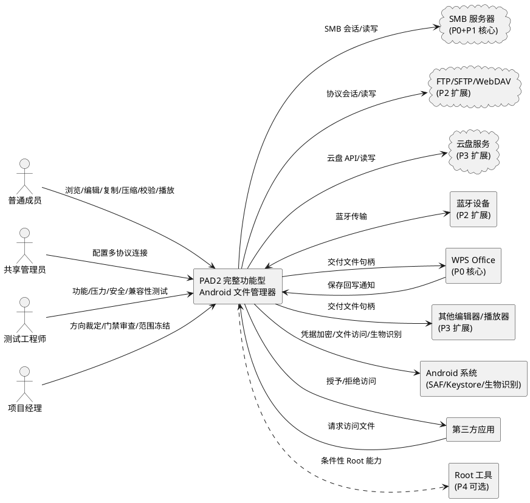
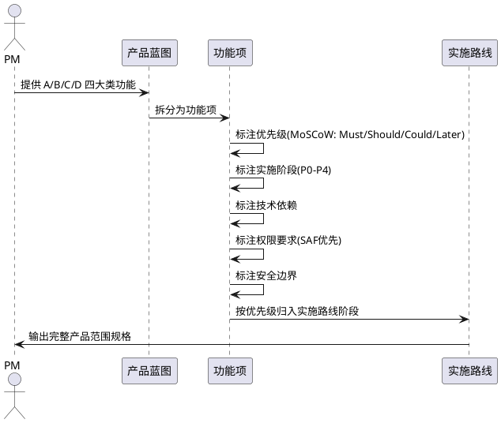
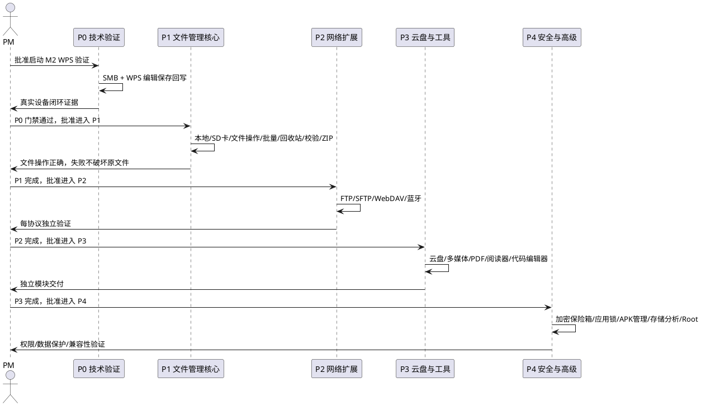
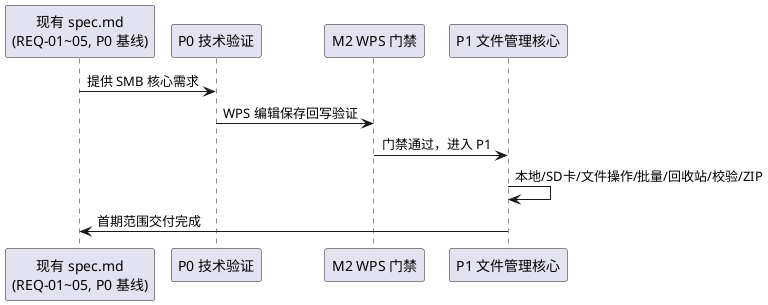
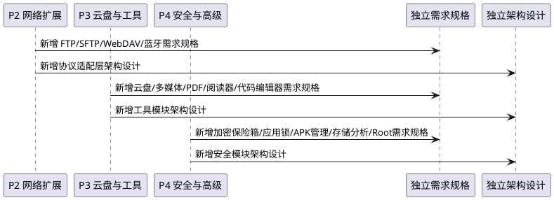
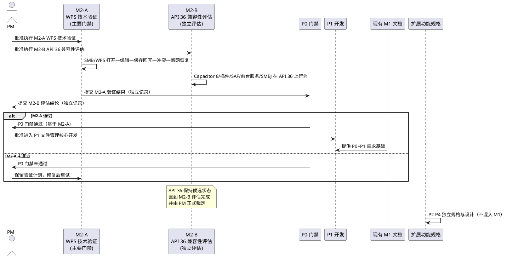

# PAD2-PRODUCT-SCOPE-001 产品范围规格：完整功能型 Android 文件管理器

> 本文档为独立产品范围规格，基于 PM 产品方向裁定生成，将 PAD2 从"SMB 文件浏览器"重新定位为"完整功能型 Android 文件管理器"。文档定义完整功能蓝图（A/B/C/D 四大类）、五阶段实施路线（P0-P4）、产品架构原则、首期与扩展范围边界、每个功能的技术依赖/权限/安全边界、各阶段验收标准与兼容性证据要求，以及与现有 M1 文档基线的关系。所有业务规则采用 EARS 可测试格式（触发场景 → 预期行为）。

> **文档定位**：本规格为现有 `android_smb_explorer/spec.md`（REQ-01~05 SMB 核心）、`design.md`、`tasks.md` 的扩展框架，不替代现有文档。**现有 spec.md/design.md/tasks.md 是 SMB 核心和 P0 技术验证的需求基线**；P1 本地文件管理能力必须在独立的首期范围补充规格或任务分解后，才能纳入开发与验收。P2-P4 扩展功能须新增独立需求规格与架构设计。

> **现有项目状态上下文**：M0 只读技术审查已完成；M1 需求架构冻结 CONDITIONAL PASS（minSdkVersion = API 26 已冻结，targetSdkVersion = API 36 候选待评估，WPS 首批测试目标有条件批准荣耀 9X，7 项性能参数 M2 待验证初始基线）；M2 WPS 技术验证 PM 已批准尚未执行；技术栈 Capacitor 8 + React + TypeScript + SMBJ + Room/SQLite + Android Keystore；新仓库 https://github.com/wujupeng/andriodpad2，提交链 c6bd202 → dac77fe → e91fcd1 → d720262 → f0956ee → 41995e6 → 6d0fedc → f838bc5 → f98d4c3（当前最新提交 f98d4c3，main 分支；本轮最终修复修订待提交，SHA 由调用方回填）。

---

# 1. 组件定位

## 1.1 核心职责

本组件负责在面向企业 Android 平板上提供完整功能型文件管理能力，以 SMB 文件访问与 WPS 编辑回写为核心，逐步扩展本地文件管理、压缩解压、多网络协议、多媒体工具与系统安全能力，实现接近桌面文件管理器的本地化操作体验。

## 1.2 核心输入

1. **用户操作指令**：本地/SD 卡/网络存储的浏览、打开、编辑、复制、剪切、重命名、删除、批量操作、压缩解压、校验、多媒体播放、应用管理等操作请求。
2. **多协议连接配置**：SMB、FTP、SFTP、WebDAV、云盘等远程存储的服务器地址、凭据、协议参数配置。
3. **WPS Office 及外部编辑器回写信号**：编辑器保存完成后通过 Android 文件访问接口或文件变更监听触发的回写通知，含目标 URI、变更时间、内容指纹。
4. **网络与系统状态事件**：Wi-Fi 连接/断开、网络切换、连接超时、会话失效、存储挂载/卸载、权限变更等系统广播与连接层回调。
5. **定时/恢复触发信号**：应用启动时未完成传输任务的恢复触发、可恢复任务的重试退避定时触发、回收站清理定时触发。
6. **外部应用打开请求**：第三方应用通过 Android Intent / ContentProvider 向本组件请求访问文件的请求。
7. **安全与权限事件**：应用锁解锁/锁定、加密保险箱访问、审计日志查询、权限授予/撤销事件。

## 1.3 核心输出

1. **返回给用户的响应**：目录列表、文件属性、传输进度、操作结果（成功/失败/冲突）、校验结果、压缩解压结果、多媒体播放状态、错误码与可读提示。
2. **发送给远程存储服务器的请求**：SMB/FTP/SFTP/WebDAV 会话建立、目录枚举、文件读写/创建/删除/重命名、属性查询与设置。
3. **交给外部编辑器的文件句柄**：通过 Android 文件访问接口（URI / ContentProvider / 临时文件）向 WPS 等编辑器提供可编辑文件访问入口。
4. **推送给用户的通知**：传输完成/失败、回写成功/失败、冲突警告、网络等待、回收站清理、安全事件通知。
5. **结构化日志与审计输出**：脱敏后的操作日志、错误分类日志、传输审计日志、安全审计日志、故障诊断日志。
6. **本地文件系统变更**：本地文件/SD 卡文件的创建、修改、删除、压缩包解压产物、缓存副本、回收站暂存。

## 1.4 职责边界

本组件**不负责**以下事项：

1. **不负责**远程存储服务器的运维与容量规划：SMB/FTP/SFTP/WebDAV 服务器性能、协议配置、接入点容量、身份认证策略属于服务端承载能力范畴，须由运维方独立验证，本组件仅提供客户端侧承载能力。
2. **不负责** WPS Office 及其他外部编辑器的内部实现与版本分发：本组件仅通过 Android 标准文件访问机制与编辑器交互，不修改编辑器、不打包编辑器、不控制编辑器的另存为行为。
3. **不负责**将网络中断、保存失败或文件冲突隐藏为成功：所有失败必须如实呈现，禁止伪报成功。
4. **不负责**超出最低支持范围与已验证环境清单的兼容性保证：未实测的设备/版本/协议组合允许尝试运行但标注"未验证"，不宣称兼容。
5. **不负责**强制申请所有高权限以实现完整功能：Android 存储权限、SD 卡访问和应用可见性随系统版本及权限策略变化，须优先使用 Storage Access Framework（SAF），MANAGE_EXTERNAL_STORAGE 为最后手段。
6. **不负责**在设备未 Root 时保证系统级修改能力：Root 工具仅在设备已 Root 且具备相应授权时考虑，普通平板不能保证支持系统级修改。
7. **不负责**替代文件本身的加密：应用锁控制应用入口访问，不替代文件内容加密；加密保险箱提供文件级加密，但须与应用锁明确区分。
8. **不负责**自动替代已冻结的 M1 文档基线：本规格为扩展框架，不直接修改已冻结的 spec.md/design.md/tasks.md；扩展功能（P2-P4）须新增独立需求规格与架构设计。
9. **不负责**因功能范围过大而失控首期工程：完整功能清单作为产品蓝图，首期交付范围（P0+P1）须独立控制，不因扩展清单膨胀而延期。

---

# 2. 领域术语

**完整功能型文件管理器**
: 面向企业 Android 平板的多协议文件管理器，以 SMB 文件访问与 WPS 编辑回写为核心，逐步扩展本地文件管理、压缩解压、多网络协议、多媒体工具与系统安全能力的应用形态。
: 备注：PAD2 新定位，区别于原"SMB 文件浏览器"定位。

**产品蓝图**
: A/B/C/D 四大类所有功能的完整清单，作为产品长期演进目标，标注功能优先级（Must 必交付 / Should 应交付 / Could 可交付 / Later 后续考虑）。功能优先级与实施阶段（P0-P4）独立分类，不强制一一对应。
: 备注：产品蓝图不等于首期交付范围。功能优先级采用 MoSCoW 方法，阶段编号 P0-P4 表示实施时序。

**首期交付范围**
: P0 技术验证与 P1 文件管理核心的合集，为首个工程交付边界，须独立控制范围与进度。
: 备注：现有 spec.md/design.md/tasks.md 是 SMB 核心和 P0 技术验证的需求基线；P1 本地文件管理能力须在独立的首期范围补充规格或任务分解后纳入。

**后续扩展范围**
: P2 网络扩展、P3 云盘与工具、P4 安全与高级能力的合集，为产品蓝图超出首期的部分，须新增独立需求规格与架构设计。

**统一文件操作接口**
: 本地文件、SMB、FTP、SFTP、WebDAV、云盘采用的统一文件抽象接口，不同协议可声明不同能力，不能假定每个远程存储都支持相同的重命名、原子替换和回滚操作。
: 备注：产品架构原则 1。

**协议能力声明**
: 每个远程存储协议或实例向统一文件操作接口声明其支持的能力集合（如是否支持原子替换、随机读写、重命名、符号链接等），调用方依据能力声明决定操作策略。
: 备注：防止假定所有协议支持相同操作。

**统一传输任务引擎**
: 大文件传输使用的流式传输、进度记录、完整性校验和可验证恢复机制的统一引擎，不依靠把整个文件加载到内存中来完成传输。
: 备注：产品架构原则 2，适用于所有协议。

**工具模块化**
: 视频播放器、PDF 编辑器、云盘和 Root 工具独立管理依赖，避免某个组件失败影响文件管理主功能的设计原则。
: 备注：产品架构原则 3。

**安全默认开启**
: 密码加密存储、日志脱敏、敏感文件操作确认默认启用的安全策略；应用锁不能替代文件本身的加密。
: 备注：产品架构原则 4。

**兼容性按证据管理**
: 多品牌、多 Android 版本、多 WPS 版本不要求统一，但每个宣称支持的组合必须有对应验证记录的兼容性管理策略。
: 备注：产品架构原则 5，延续三层兼容性模型。

**Storage Access Framework（SAF）**
: Android 提供的标准文件访问框架，允许应用通过用户授权访问任意位置的文件，无需申请广泛文件访问权限。
: 备注：优先使用的文件访问方式。

**MANAGE_EXTERNAL_STORAGE**
: Android 11+ 的广泛文件访问权限，允许应用访问所有外部存储，须 Google Play 审查，为最后手段。
: 备注：须证明无 SAF 替代方案后才考虑申请。

**功能优先级**
: 每个功能标注的交付优先级，采用 MoSCoW 方法分为 Must（必交付，含技术验证门禁）、Should（应交付，首期文件管理核心）、Could（可交付，网络与协议扩展）、Later（后续考虑，云盘工具与高级能力）。功能优先级与实施阶段（P0-P4）独立分类：优先级表示业务重要程度，阶段表示实施时序，不强制一一对应。
: 备注：Must 功能通常在 P0/P1 阶段交付，Should 功能通常在 P1 阶段交付，Could 功能通常在 P2 阶段交付，Later 功能分布在 P3/P4 阶段。但允许例外，须在功能项中注明所在阶段。

**技术验证门禁**
: 在进入完整实现前，针对 WPS"打开—编辑—保存回写—断网恢复"关键路径单独设立的验证关卡，须在代表性设备、实际 WPS 版本与真实 SMB 服务器上通过后方可进入 P1 开发阶段。
: 备注：M2 阶段核心，P0 阶段门禁。

**三层兼容性模型**
: PAD2 采用的多设备兼容性管理模型，自底向上分为三层：通用架构兼容（不绑定特定品牌/WPS 版本，基于 Android 标准 API）、代表性环境验证（建立实测基线并逐步扩展测试组合）、兼容性证据管理（记录每个组合的实测结果，未实测标注"未验证"）。
: 备注：延续现有 M1 文档基线策略。

**已验证环境清单**
: 记录所有已通过实测的设备型号、系统版本、WPS 版本、协议版本、测试用例、结果和已知限制的活文档，随测试进展持续更新。没有实测证据的组合一律标记为"未验证"。

**回收站**
: 本地文件删除操作的暂存机制，删除的本地文件移入回收站而非立即物理删除，支持恢复与彻底清除，受存储容量与保留期限约束。回收站仅适用于本地删除，不自动适用于远程（SMB/FTP/SFTP/WebDAV/云盘）删除。
: 备注：远程删除须单独定义行为，见"远程删除"术语。

**本地删除**
: 对本地文件或 SD 卡文件执行删除操作时，将文件移入回收站暂存而非立即物理删除，用户可从回收站恢复或彻底清除。
: 备注：回收站内容存储于应用私有目录，受容量与保留期限约束。

**远程删除**
: 对远程存储（SMB/FTP/SFTP/WebDAV/云盘）文件执行删除操作时的行为。远程删除只有在实现并验证了可恢复的暂存机制时，才能显示"移入回收站"；否则必须明确警告"此操作不可恢复"并要求用户二次确认，且准确报告操作结果。不得承诺无法实现的恢复能力。
: 备注：远程删除的不可恢复性须在 UI 中明确提示，不得使用与本地删除相同的"移入回收站"措辞误导用户。

**文件加密**
: 对文件内容进行加密存储的能力，区别于应用锁（控制应用入口访问）与凭据加密（保护连接密码），提供文件级数据保护。

**完整性校验**
: 传输、回写或复制前后对文件内容计算 MD5 或 SHA-256 指纹并比对，确认目标文件内容与源文件内容逐字节一致的过程。MD5 仅作为非安全用途的快速校验选项；完整性验收以 SHA-256 为准。
: 备注：MD5 用于快速校验（如批量操作中的预检），SHA-256 用于安全校验和正式验收判据。

**断点续传**
: 传输任务中断后从已持久化的进度安全续传的机制。断点续传不能只依据文件大小或已传输字节数，必须验证任务身份、源文件版本（SHA-256 指纹）及目标临时文件状态。不能证明安全恢复时，必须从头传输，不得冒险续传可能导致数据损坏的进度。
: 备注：安全续传须验证三要素：任务身份匹配、源文件未变更、目标临时文件偏移与已传输部分一致。

**编辑会话**
: 从文件被交给编辑器打开开始，到回写校验完成或用户放弃编辑为止的一次完整编辑生命周期，含本地缓存副本、版本基线、变更检测与回写状态。

**静默覆盖**
: 在共享文件已被他人修改的情况下，仍用本地编辑结果直接写回，导致他人更新丢失且无任何提示的行为。
: 备注：本组件必须禁止静默覆盖。

---

# 3. 角色与边界

## 3.1 核心角色

- **普通成员**：在平板上使用本组件浏览、打开、编辑、复制、移动、删除、压缩、校验本地与远程文件的主要用户，不负责服务器配置。
- **共享管理员**：负责添加、编辑、删除、测试 SMB/FTP/SFTP/WebDAV 等远程存储连接配置，可能为普通成员兼任或独立角色。
- **运维方**：负责远程存储服务器、协议配置、无线网络与接入点、身份认证策略的运维人员，不直接使用本组件但须独立验证服务端承载能力。
- **测试工程师**：执行功能、压力、断网恢复、数据完整性、安全、兼容性测试的人员，按门禁量化标准与兼容性证据要求判定是否发布。
- **项目经理（PM）**：负责产品方向裁定、阶段门禁审查、范围冻结与扩展决策，驱动开发流程。
- **安全审计员**：负责审查权限清单、加密策略、审计日志、安全边界合规性的人员。

## 3.2 外部系统

- **Windows SMB 服务器**：P0+P1 核心上游被访问对象，提供 SMB 协议目录枚举与文件读写服务。
- **FTP/SFTP/WebDAV 服务器**：P2 扩展上游被访问对象，提供对应协议的文件访问服务。
- **云盘服务**：P3 扩展上游被访问对象，提供主流云盘（如 OneDrive、Google Drive、Dropbox 等）的文件访问服务。
- **蓝牙设备**：P2 扩展对端设备，通过蓝牙传输文件。
- **WPS Office**：P0 核心下游文件编辑应用，通过 Android 文件访问接口接收文件句柄，完成编辑后将保存结果回传本组件触发回写。
- **其他外部编辑器**：P3 扩展下游编辑应用（PDF 编辑器、代码编辑器、小说阅读器等），通过 Android 文件访问接口交互。
- **多媒体播放器**：P3 扩展下游播放应用（音视频播放器），或本组件内置播放能力。
- **Android 系统（SAF / ContentProvider / Keystore / 生物识别）**：提供 URI、ContentProvider、SAF、凭据加密、应用锁生物识别等系统能力。
- **第三方应用**：通过 Intent / ContentProvider 向本组件请求访问文件的外部应用。
- **Root 工具（条件性）**：P4 可选下游，仅在设备已 Root 且具备相应授权时启用。

## 3.3 交互上下文



---

# 4. DFX约束

## 4.1 性能

> **性能验收前提**：M2 阶段可先采集基线数据，再由 PM 冻结阈值。在阈值冻结之前，不应宣称性能门禁已通过。以下性能指标须在明确设备与网络条件、测试数据分布后测定。

1. **大文件流式传输基线**：以 1 GiB 文件作为初始验证样本，单文件传输须在不将文件整体载入内存的前提下完成读写与完整性校验。
   - 测试条件：代表性设备（荣耀 9X 等），Wi-Fi 局域网（带宽≥100Mbps），SMB 服务器与设备同一网段
   - 验收条件：[传输 1 GiB 文件] → [峰值内存不超过冻结上限且传输完成后 SHA-256 校验通过]
2. **批量文件基线**：以 10,000 个混合大小文件作为初始规模测试目标，批量操作须提供整体进度与单文件结果。
   - 测试条件：10,000 个文件含小文件（<1KB）30%、中文件（1KB-1MB）50%、大文件（>1MB）20%，分布在不同目录层级
   - 验收条件：[批量复制 10,000 个混合大小文件] → [全部完成且每个文件完整性校验通过，过程中峰值内存不超过冻结上限]
3. **目录浏览响应**：单目录枚举响应时间上限须在 M1 阶段冻结，超限时须分页或延迟加载。
   - 测试条件：代表性设备，目录含 500/1000/5000 个文件，Wi-Fi 局域网
   - 验收条件：[打开含目标文件数的目录] → [首屏在冻结响应时间上限内呈现，剩余分页加载]
4. **并发连接限制**：单实例并发连接数（SMB/FTP/SFTP/WebDAV 等）与并发传输任务数须设上限，避免耗尽客户端或服务器资源。
   - 验收条件：[并发请求超过上限] → [超出请求排队等待，不导致应用崩溃或服务器拒绝服务]
5. **统一传输任务引擎性能**：所有协议的大文件传输须使用统一传输任务引擎，采用流式传输、进度记录、完整性校验和可验证的恢复机制。
   - 验收条件：[任意协议传输大文件] → [使用统一传输任务引擎，不将整个文件加载到内存，支持进度记录与断点续传]
6. **压缩解压性能**：ZIP/RAR/7Z 压缩与解压须支持大压缩包流式处理，不将整个压缩包加载到内存。
   - 验收条件：[解压大压缩包] → [流式解压，内存占用不超限，解压产物完整性可校验]
7. **性能验收量化要求**：性能验收须明确以下要素，缺一不可：
   - **设备与网络条件**：代表性设备型号、Android 版本、Wi-Fi 带宽、网络延迟、SMB 服务器配置
   - **测试数据分布**：文件大小分布、目录层级、文件数量、文件类型混合比例
   - **峰值内存上限**：单实例峰值内存占用上限（MB），由 PM 在 M2 基线采集后冻结
   - **首屏响应时间**：目录浏览首屏呈现时间上限（ms），由 PM 在 M2 基线采集后冻结
   - **成功率分母**：核心操作成功率的统计口径（操作集合、样本量、时间窗口），分母须明确
   - **超时及重试统计方式**：超时阈值、重试次数、退避策略、总重试时长、不可重试错误分类
   - 验收条件：[性能验收执行] → [上述要素全部明确且测定值记录；阈值冻结前不宣称性能门禁通过]

## 4.2 可靠性

1. **系统可用性目标**：在目标无线网络质量下，核心操作（浏览、打开、回写）成功率须在 M1 阶段冻结下限。
   - 验收条件：[目标网络下执行核心操作] → [成功率不低于冻结下限]
2. **故障恢复时间**：短暂断网或会话失效后，可恢复任务须在网络恢复后自动续传或重新执行，恢复时间上限须在 M1 阶段冻结。
   - 验收条件：[网络恢复] → [可恢复任务在恢复时间上限内自动继续且数据完整]
3. **数据一致性**：传输与回写须保证目标文件内容与源内容逐字节一致，以 SHA-256 校验为判据。MD5 仅作为非安全用途的快速校验选项，不作为正式验收判据。
   - 验收条件：[任意传输或回写完成] → [SHA-256 校验通过方可标记成功；MD5 校验通过不等于验收通过]
4. **断点续传安全恢复**：断点续传不能只依据文件大小或已传输字节数，必须验证任务身份、源文件版本（SHA-256 指纹）及目标临时文件状态。不能证明安全恢复时，必须从头传输。
   - 验收条件：[传输中断后恢复] → [验证任务身份+源文件版本+目标临时文件状态均匹配后方可续传；任一不匹配则从头传输]
5. **回写安全替换**：回写应先写临时目标文件、验证内容（SHA-256），再按协议能力执行替换。不能保证原子替换时，须明确降级行为和恢复策略。
   - 验收条件：[回写操作] → [先写临时文件并验证内容，再按协议能力替换；不支持原子替换时明确降级策略且失败可恢复]
   - **回写安全替换失败恢复标准（问题 04 关闭）**：
     1. **临时文件命名与隔离**：临时文件使用确定性命名规则（如 `目标文件名 + 任务ID + 时间戳`），存放在与目标文件相同的目录或专用临时目录，避免多任务冲突
        - 验收条件：[并发回写同一目录] → [各任务临时文件命名唯一且互不干扰]
     2. **替换前的版本复核**：执行替换前再次检查目标文件版本（修改时间 + SHA-256），与编辑开始时记录的版本比较，不一致则中止替换并提示冲突
        - 验收条件：[替换前版本复核发现目标已变更] → [中止替换，提示用户冲突，不执行覆盖]
     3. **替换失败后的原文件保护**：替换失败时原文件必须保持不变，临时文件保留供故障诊断
        - 验收条件：[替换操作失败] → [原文件内容与替换前逐字节一致；临时文件保留可供诊断]
     4. **残留临时文件处理**：应用启动时扫描并清理超过一定时间的残留临时文件，清理操作记录审计日志
        - 验收条件：[应用启动且存在超期残留临时文件] → [自动清理并记录审计日志；未超期临时文件保留]
     5. **恢复操作的可审计结果**：每次替换操作（成功/失败/降级）必须记录审计日志，含操作时间、文件路径、版本信息、结果
        - 验收条件：[任意替换操作完成] → [审计日志含操作时间、文件路径、版本信息（mtime+SHA-256）、结果（成功/失败/降级）]
     6. **协议限制声明**：若某协议无法保证安全替换，必须明确限制该协议的回写能力，禁止将未完成的回写报告为成功
        - 验收条件：[某协议不支持安全替换] → [该协议回写能力被明确限制或禁用；未完成回写不得报告为成功]
6. **文件冲突判定**：文件冲突判定不能只依赖修改时间或内容指纹中的任意一个，必须同时比较修改时间与内容指纹（SHA-256），并明确比较规则与用户决策流程。
   - 验收条件：[回写前冲突检测] → [同时比较修改时间与 SHA-256 指纹；任一变化即判定为冲突，提示用户在"保存为副本 / 重新加载 / 经明确确认后覆盖 / 放弃"中选择]
   - **冲突决策选项约束（问题 03 关闭）**：
     - 默认提供的决策选项为"保存为副本""重新加载""经明确确认后覆盖""放弃"，均为可实现操作
     - "合并"选项仅在针对特定格式完成合并能力设计与验证后才允许显示；通用文件管理器不保证所有 Office 文件都能安全合并，尤其二进制文件不能仅凭文件指纹实现语义合并
     - 覆盖前必须再次确认目标文件版本（修改时间 + SHA-256），避免二次竞争造成数据丢失
     - 合并能力明确标注为未来扩展，首期不承诺语义合并
7. **禁止伪报成功**：网络不可用、回写失败、校验不通过时，必须显示等待或失败状态。
   - 验收条件：[传输/回写未成功] → [界面显示失败或等待，不显示成功]
8. **持久化任务队列**：传输任务进度须持久化，应用重启后可恢复未完成任务。
   - 验收条件：[应用在传输中途被杀] → [重启后任务队列恢复且可继续未完成任务]
9. **工具模块化隔离**：视频播放器、PDF 编辑器、云盘和 Root 工具须独立管理依赖，某个组件失败不影响文件管理主功能。
   - 验收条件：[某扩展工具组件崩溃或不可用] → [文件管理主功能（浏览/复制/移动/删除）仍可正常使用]
10. **本地回收站可靠性**：本地删除操作移入回收站须保证文件完整可恢复，回收站清理须明确不可恢复。
    - 验收条件：[本地删除文件后从回收站恢复] → [文件内容与删除前逐字节一致；彻底清除后不可恢复]
11. **远程删除行为**：远程删除必须明确区分是否可恢复。只有在实现并验证了可恢复的远程暂存机制时，才能显示"移入回收站"；否则必须明确警告"此操作不可恢复"并要求二次确认，且准确报告操作结果。
    - 验收条件：[远程删除且无可恢复暂存机制] → [显示"此操作不可恢复"警告并要求二次确认，删除后准确报告结果]
    - 验收条件：[远程删除且有已验证的可恢复暂存机制] → [可显示"移入回收站"且恢复后文件内容与删除前逐字节一致]
12. **禁止项：禁止对远程删除承诺无法实现的恢复能力**。
    - 验收条件：[远程删除无可恢复暂存机制但显示"移入回收站"] → [标记为规格违规]

## 4.3 安全性

1. **凭据加密存储**：所有远程存储（SMB/FTP/SFTP/WebDAV/云盘）的账号密码必须以 Android Keystore 保护的加密方式存储。
   - 验收条件：[检查本地存储与日志] → [密码不以明文出现于任何存储位置或日志条目]
2. **日志脱敏**：所有日志不得包含密码、完整凭据、文件敏感内容。
   - 验收条件：[抓取任意日志条目] → [不含密码明文与文件内容明文]
3. **最小权限**：本组件仅请求完成功能所需的最小 Android 权限，优先使用 SAF，MANAGE_EXTERNAL_STORAGE 为最后手段。
   - 验收条件：[审查权限清单] → [每项权限均有对应功能用途，SAF 优先，MANAGE_EXTERNAL_STORAGE 须证明无替代方案]
4. **关键操作审计**：连接建立、文件写入、删除、重命名、回写、加密/解密、权限变更须记录可追溯的审计日志。
   - 验收条件：[执行关键操作] → [审计日志含操作类型、目标、时间、结果，且脱敏]
5. **安全默认开启**：密码加密存储、日志脱敏、敏感文件操作确认须默认启用，不依赖用户主动开启。
   - 验收条件：[应用首次启动] → [加密存储、日志脱敏、敏感操作确认均已启用]
6. **应用锁与文件加密区分**：应用锁控制应用入口访问，不替代文件本身的加密；加密保险箱提供文件级加密。
   - 验收条件：[启用应用锁但未加密文件] → [文件内容仍可被其他应用或文件浏览器直接读取]
7. **Root 工具条件性启用**：Root 工具仅在设备已 Root 且具备相应授权时考虑启用，普通平板不保证支持系统级修改。
   - 验收条件：[设备未 Root] → [Root 工具不可用或灰显，不提示强制 Root]

## 4.4 可维护性

1. **结构化日志**：日志须含错误分类、操作上下文、时间戳，便于故障诊断。
   - 验收条件：[发生错误] → [日志含错误分类码、操作上下文与时间戳，可定位根因]
2. **错误分类**：错误须按输入校验失败、业务规则冲突、外部系统失败、并发竞争、超时重试分类。
   - 验收条件：[任意错误] → [可归入预定义错误类别且对应处理策略]
3. **故障诊断支持**：须提供可导出的诊断信息（不含敏感数据）用于支持人员定位问题。
   - 验收条件：[用户触发诊断导出] → [导出信息含操作日志、错误分类、环境信息且脱敏]
4. **兼容性按证据管理**：版本升级须提供兼容性测试方案，明确最低 Android 支持版本与各协议/编辑器已验证版本清单，按三层兼容性模型管理多设备兼容性。
   - 验收条件：[发布新版本] → [已通过代表性设备的兼容性测试，已验证环境清单更新，未测试组合标注"未验证"]
5. **扩展功能独立规格**：P2-P4 扩展功能须新增独立需求规格与架构设计，不混入首期文档。
   - 验收条件：[启动 P2-P4 某功能开发] → [该功能已有独立需求规格与架构设计文档]

## 4.5 兼容性

> **多设备兼容策略（延续 PAD2-M1-G4-FAST-DECISION-01）**：PAD2 不绑定单一平板型号、Android 版本或 WPS 版本。兼容性通过三层兼容性模型管理。须确定最低 Android API 级别（minSdkVersion = API 26 已冻结）以确保应用可安装运行，但支持多个系统版本。每个宣称支持的组合必须有对应验证记录。

### 4.5.1 三层兼容性模型（延续）

**第一层：通用架构兼容**
- 不将业务逻辑绑定到某个品牌或某个 WPS 版本
- 通过统一文件操作接口、协议适配层和独立的文件编辑交接层降低耦合
- 应用架构设计基于 Android 标准 API，而非厂商特定 API
- 验收条件：[审查架构] → [业务逻辑不绑定特定品牌/WPS 版本，基于 Android 标准 API 设计]

**第二层：代表性环境验证**
- 先用现有设备（如荣耀 9X）建立第一条实测基线，逐步扩展测试组合
- 验收条件：[新增设备/版本组合] → [先在代表性环境建立基线，再逐步扩展]

**第三层：兼容性证据管理**
- 记录每个组合的实测结果，未实测标注"未验证"，"未验证"不等于"不兼容"
- 验收条件：[宣称支持某组合] → [已验证环境清单中有对应实测记录]

### 4.5.2 权限与存储访问兼容性

1. **SAF 优先策略**：Android 存储访问须优先使用 Storage Access Framework，确有必要时再评估广泛文件访问权限。
   - 验收条件：[需要访问外部存储文件] → [优先使用 SAF，仅在证明无替代方案时才申请 MANAGE_EXTERNAL_STORAGE]
2. **权限按版本收敛**：Android 权限清单须按 targetSdkVersion 分级收敛，避免申请不必要或已不适用的权限。
   - 验收条件：[审查权限清单] → [权限按 targetSdkVersion 分级，无冗余或已废弃权限]
3. **不默认申请所有高权限**：不能为了实现完整功能就默认申请所有高权限。
   - 验收条件：[功能需要某高权限] → [先评估 SAF 或低权限替代方案，证明无替代后才申请]

---

# 5. 核心能力

## 5.1 完整功能蓝图与优先级分级

### 5.1.1 业务规则

1. **功能蓝图覆盖四大类**：产品蓝图必须包含 A 基础文件管理、B 网络与远程访问、C 多媒体与内置工具、D 系统与安全四大类所有功能。
   - 验收条件：[审查产品蓝图] → [A/B/C/D 四大类功能全部列出，无遗漏]
2. **每个功能标注优先级**：产品蓝图中每个功能必须标注功能优先级（Must 必交付 / Should 应交付 / Could 可交付 / Later 后续考虑），采用 MoSCoW 方法。
   - 验收条件：[审查任意功能项] → [该功能项有明确的 MoSCoW 优先级标注]
3. **优先级与实施阶段独立分类**：功能优先级（Must/Should/Could/Later）表示业务重要程度，实施阶段（P0-P4）表示实施时序，两者独立分类，不强制一一对应。每个功能项须注明所在实施阶段。
   - 验收条件：[某功能项] → [有 MoSCoW 优先级标注和 P0-P4 阶段标注，两者可不一致但须注明理由]
4. **每个功能标注技术依赖**：产品蓝图中每个功能必须标注技术依赖（所需 Android API、第三方库、协议支持）。
   - 验收条件：[审查任意功能项] → [该功能项有明确的技术依赖标注]
5. **每个功能标注权限要求**：产品蓝图中每个功能必须标注权限要求（所需 Android 权限及适用 API 范围，优先 SAF，MANAGE_EXTERNAL_STORAGE 为最后手段）。
   - 验收条件：[审查任意功能项] → [该功能项有明确的权限要求标注，SAF 优先]
6. **每个功能标注安全边界**：产品蓝图中每个功能必须标注安全边界（数据访问范围、加密要求、审计要求）。
   - 验收条件：[审查任意功能项] → [该功能项有明确的安全边界标注]
7. **禁止项：禁止功能项缺失技术依赖/权限/安全边界任一标注**。
   - 验收条件：[某功能项缺少技术依赖/权限/安全边界任一标注] → [该功能项视为未完成，不得纳入交付计划]

### 5.1.2 功能蓝图清单（A/B/C/D 四大类）

#### A. 基础文件管理（核心功能）

| 功能 | 优先级 | 阶段 | 技术依赖 | 权限要求 | 安全边界 |
|------|--------|------|---------|---------|---------|
| 本地存储浏览 | Should | P1 | Android SAF / MediaStore API | SAF 持久化授权（API 26+）；MANAGE_EXTERNAL_STORAGE 最后手段 | 读取用户授权目录，审计目录访问 |
| SD 卡浏览 | Should | P1 | Android SAF / StorageManager | SAF 持久化授权；SD 卡挂载检测 | 读取用户授权 SD 卡目录，审计访问 |
| 文件夹浏览 | Should | P1 | Android SAF / DocumentFile | SAF 授权 | 同上 |
| 多选 | Should | P1 | UI 层多选状态管理 | 无额外权限 | 无 |
| 复制 | Should | P1 | 统一文件操作接口 + 统一传输任务引擎 | SAF 写授权 | 审计复制操作，校验完整性 |
| 剪切 | Should | P1 | 统一文件操作接口 + 删除 | SAF 读写授权 | 审计剪切操作，源删除前校验目标完整 |
| 重命名 | Should | P1 | 统一文件操作接口（协议能力声明：重命名） | SAF 写授权 | 审计重命名操作 |
| 删除 | Should | P1 | 统一文件操作接口 + 回收站 | SAF 写授权 | 审计删除操作，本地删除移入回收站可恢复，远程删除须明确警告 |
| 批量操作 | Should | P1 | 统一传输任务引擎（子任务粒度） | SAF 读写授权 | 逐文件校验清单，部分失败可恢复 |
| 回收站 | Should | P1 | 本地持久化 + 容量/期限管理 | 应用私有目录 | 回收站内容加密存储可选，审计恢复/清除；仅适用于本地删除 |
| 隐藏文件 | Should | P1 | 文件名点前缀 / 属性标记 | SAF 读写授权 | 审计隐藏/显示操作 |
| 文件加密 | Could | P4 | Android Keystore + AES | Keystore 加密密钥 | 文件内容加密存储，密钥 Keystore 保护，审计加密/解密 |
| MD5/SHA-256 校验 | Should | P1 | 流式哈希计算 | 无额外权限 | 校验结果可导出，不泄露文件内容；SHA-256 为完整性验收判据 |
| ZIP 压缩/解压 | Should | P1 | Apache Commons Compress / zip4j | SAF 读写授权 | 审计压缩/解压，解压产物完整性校验 |
| RAR 压缩/解压 | Could | P2 | Apache Commons Compress / junrar | SAF 读写授权 | 同上；RAR 须验证库许可与维护状态 |
| 7Z 压缩/解压 | Could | P2 | Apache Commons Compress / SevenZipJ | SAF 读写授权 | 同上；7Z 须验证库许可与维护状态 |

#### B. 网络与远程访问（核心功能）

| 功能 | 优先级 | 阶段 | 技术依赖 | 权限要求 | 安全边界 |
|------|--------|------|---------|---------|---------|
| SMB 局域网共享 | Must | P0 | SMBJ | INTERNET, ACCESS_NETWORK_STATE, ACCESS_WIFI_STATE | 凭据 Keystore 加密，审计连接/读写，日志脱敏 |
| 多个服务器配置 | Must | P0 | Room/SQLite 持久化 + Keystore | 无额外权限 | 凭据加密存储，配置审计 |
| 文件上传下载 | Must | P0 | 统一传输任务引擎 + SMBJ | INTERNET | 完整性校验，审计传输 |
| 断点续传 | Must | P0 | 持久化任务队列 + 流式传输 | INTERNET | 偏移持久化，校验后标记成功 |
| 冲突保护 | Must | P0 | 版本基线（SHA-256 + mtime） | 无额外权限 | 禁止静默覆盖，冲突提示用户决策 |
| Wi-Fi 网络恢复 | Must | P0 | 网络状态监听 + 自动会话重建 | ACCESS_NETWORK_STATE, ACCESS_WIFI_STATE | 自动恢复审计 |
| FTP | Could | P2 | Apache Commons Net / FTPClient | INTERNET | 凭据加密，审计，FTP over TLS 优先；禁止未加密 FTP 作为默认连接 |
| SFTP | Could | P2 | JSch / sshj | INTERNET | 凭据加密，密钥指纹验证，审计 |
| WebDAV | Could | P2 | sardine / OkHttp | INTERNET | 凭据加密，HTTPS 优先，审计 |
| 蓝牙传输 | Could | P2 | Android Bluetooth API | BLUETOOTH, BLUETOOTH_CONNECT (API 31+) | 设备配对确认，审计传输 |
| 云盘连接 | Later | P3 | 各云盘 SDK / OAuth | INTERNET + 各 SDK 权限 | OAuth 令牌加密存储，审计访问；须逐个服务商定义 |

#### C. 多媒体与内置工具（扩展功能）

| 功能 | 优先级 | 阶段 | 技术依赖 | 权限要求 | 安全边界 |
|------|--------|------|---------|---------|---------|
| 音视频播放 | Later | P3 | ExoPlayer / MediaPlayer | 无额外权限（读取已授权文件） | 不泄露文件内容，播放审计可选 |
| 倍速和小窗 | Later | P3 | ExoPlayer 倍速 + Picture-in-Picture API | 无额外权限 | 无 |
| PDF 查看与编辑 | Later | P3 | PdfBox-Android / MuPDF | 无额外权限 | 编辑回写经统一文件操作接口，审计 |
| 小说阅读 | Later | P3 | 内置阅读器 / epublib | 无额外权限 | 无 |
| 代码编辑器 | Later | P3 | Monaco Editor / CodeMirror (WebView) | 无额外权限 | 编辑回写经统一文件操作接口 |
| 应用安装包管理 | Later | P3 | PackageInstaller API | REQUEST_INSTALL_PACKAGES | APK 来源确认，安装审计 |
| 存储占用分析 | Later | P3 | StorageStatsManager / SAF 遍历 | SAF 读授权 / USAGE_ACCESS | 不泄露文件内容，统计结果审计可选 |
| WPS 编辑回写（首期重点） | Must | P0 | Android SAF / ContentProvider + WPS | 无额外权限 | 版本基线冲突保护，回写校验，审计 |

#### D. 系统与安全（分级开放）

| 功能 | 优先级 | 阶段 | 技术依赖 | 权限要求 | 安全边界 |
|------|--------|------|---------|---------|---------|
| 应用锁 | Later | P4 | Android Keystore + 生物识别 (BiometricPrompt) | USE_BIOMETRIC | 入口访问控制，不替代文件加密 |
| 加密保险箱 | Later | P4 | Android Keystore + AES + 本地持久化 | Keystore 加密密钥 | 文件级加密，密钥 Keystore 保护，审计 |
| 权限管理 | Later | P4 | Android 权限 API + 运行时授权 | 按需 | 权限变更审计 |
| 基础安全事件日志 | Should | P1 | Room/SQLite + 日志脱敏 | 无额外权限 | 记录连接/写入/删除/回写事件并脱敏；首期功能必要伴随能力，对应 FD-17 |
| 高级审计能力 | Later | P4 | Room/SQLite + 防篡改 + 导出 + 合规报告 | 无额外权限 | 审计日志查询界面/导出/长期留存/防篡改增强/合规报告生成 |
| 存储分析 | Later | P4 | StorageStatsManager | USAGE_ACCESS | 同 C 类存储占用分析 |
| APK 安装 | Later | P4 | PackageInstaller | REQUEST_INSTALL_PACKAGES | 来源确认，安装审计 |
| APK 备份 | Later | P4 | 文件复制 + APK 提取 | SAF 写授权 | 备份审计 |
| Root 工具（条件性） | Later | P4 | Root 检测 + su 执行 | 设备已 Root + 用户授权 | 仅已 Root 设备，系统级修改审计，普通平板不保证 |

### 5.1.3 交互流程



### 5.1.4 异常场景

1. **功能项标注缺失**
   - 触发条件：某功能项缺少优先级、技术依赖、权限要求或安全边界任一标注
   - 系统行为：标记该功能项为未完成，不纳入交付计划
   - 用户感知：PM 收到功能项未完成提示，须补充标注后方可纳入计划
2. **优先级与实施路线不一致**
   - 触发条件：某功能优先级（MoSCoW）与实施阶段（P0-P4）映射不合理或缺少阶段标注
   - 系统行为：标记为规格不一致，须修正或注明例外理由
   - 用户感知：PM 收到不一致提示，须对齐优先级与阶段或注明例外

## 5.2 产品实施路线

### 5.2.1 业务规则

1. **五阶段实施路线**：产品实施路线必须包含 P0 技术验证、P1 文件管理核心、P2 网络扩展、P3 云盘与工具、P4 安全与高级能力五个阶段。
   - 验收条件：[审查实施路线] → [包含 P0-P4 五个阶段，每个阶段有明确交付范围与通过标准]
2. **P0 为技术验证门禁**：P0 阶段交付 SMB + WPS 编辑保存回写，通过标准为真实设备闭环成功，冲突及断网行为有证据。
   - 验收条件：[P0 阶段完成] → [真实设备 SMB+WPS 闭环成功，冲突保护与断网恢复有验证证据]
3. **P1 为文件管理核心**：P1 阶段交付本地/SD 卡、文件操作、批量操作、回收站、校验、ZIP，通过标准为文件操作正确，失败不破坏原文件。
   - 验收条件：[P1 阶段完成] → [本地/SD 卡文件操作正确，失败时原文件不被破坏，回收站与校验可用]
4. **P2 为网络扩展**：P2 阶段交付 FTP、SFTP、WebDAV、蓝牙传输，通过标准为每个协议独立验证认证、传输和错误恢复。
   - 验收条件：[P2 阶段完成] → [FTP/SFTP/WebDAV/蓝牙各自独立验证认证、传输、错误恢复]
5. **P3 为云盘与工具**：P3 阶段交付主流云盘、多媒体、PDF、阅读器、代码编辑器，通过标准为独立模块交付，不阻塞基础文件管理。
   - 验收条件：[P3 阶段完成] → [云盘与工具独立模块交付，基础文件管理不受其阻塞或影响]
6. **P4 为安全与高级能力**：P4 阶段交付加密保险箱、应用锁、APK 管理、存储分析、可选 Root 功能，通过标准为权限、数据保护及设备兼容性验证。
   - 验收条件：[P4 阶段完成] → [权限/数据保护/设备兼容性验证通过，Root 功能条件性启用]
7. **阶段顺序门禁**：P0 门禁通过后方可进入 P1，P1 完成后方可进入 P2，以此类推，不跳阶段。
   - 验收条件：[某阶段未通过门禁] → [不批准进入下一阶段]
8. **禁止项：禁止因扩展范围过大而失控首期工程**。
   - 验收条件：[首期范围（P0+P1）进度] → [独立控制，不因 P2-P4 扩展清单膨胀而延期]

### 5.2.2 交互流程



### 5.2.3 异常场景

1. **P0 门禁未通过**
   - 触发条件：M2 WPS 技术验证未通过（真实设备闭环失败或冲突/断网行为无证据）
   - 系统行为：不批准进入 P1，保留 M2 验证计划待修复后重试
   - 用户感知：PM 收到 P0 门禁未通过报告，须修复后重新验证
2. **阶段交付延期**
   - 触发条件：某阶段交付超出预期时间
   - 系统行为：PM 审查是否因扩展范围膨胀导致，若是则收缩范围
   - 用户感知：PM 收到延期报告与范围调整建议
3. **扩展功能阻塞基础功能**
   - 触发条件：P2-P4 某功能开发阻塞 P0+P1 基础文件管理
   - 系统行为：将阻塞功能降级或移至后续阶段，保证基础功能优先
   - 用户感知：PM 收到阻塞报告与降级决策

## 5.3 产品架构原则

### 5.3.1 业务规则

1. **统一文件操作接口**：本地文件、SMB、FTP、WebDAV、云盘必须采用统一的文件抽象接口，但不同协议可以声明不同能力。
   - 验收条件：[新增协议适配] → [实现统一文件操作接口，并声明该协议能力集合]
2. **禁止假定协议能力一致**：不能假定每个远程存储都支持相同的重命名、原子替换和回滚操作。
   - 验收条件：[调用某协议不支持的操作] → [依据能力声明返回不支持，而非假定支持导致失败]
3. **统一传输任务引擎**：大文件传输必须使用流式传输、进度记录、完整性校验和可验证的恢复机制，不能依靠把整个文件加载到内存中来完成传输。
   - 验收条件：[任意协议传输大文件] → [使用统一传输任务引擎，流式处理，不整体载入内存]
4. **工具模块化**：视频播放器、PDF 编辑器、云盘和 Root 工具必须独立管理依赖，避免某个组件失败影响文件管理主功能。
   - 验收条件：[某扩展工具组件失败] → [文件管理主功能不受影响]
5. **安全默认开启**：密码加密存储、日志脱敏、敏感文件操作确认必须默认启用；应用锁不能替代文件本身的加密。
   - 验收条件：[应用首次启动] → [安全策略默认开启；应用锁不替代文件加密]
6. **兼容性按证据管理**：多品牌、多 Android 版本、多 WPS 版本不要求统一，但每个宣称支持的组合必须有对应验证记录。
   - 验收条件：[宣称支持某组合] → [已验证环境清单中有对应实测记录]
7. **SAF 优先**：Android 存储访问必须优先使用 Storage Access Framework，确有必要时再评估广泛文件访问权限。
   - 验收条件：[需要访问外部存储] → [优先 SAF，MANAGE_EXTERNAL_STORAGE 为最后手段且须证明无替代]
8. **禁止项：禁止为完整功能默认申请所有高权限**。
   - 验收条件：[功能需要高权限] → [先评估 SAF 或低权限替代，证明无替代后才申请]

### 5.3.2 交互流程

```plantuml
@startuml
participant "统一文件操作接口" as UFOI
participant "协议适配层" as Adapter
participant "统一传输任务引擎" as Engine
participant "工具模块" as Tool

UFOI <- Adapter : 实现接口 + 声明能力
UFOI -> Engine : 委托传输
Engine -> Engine : 流式传输/进度/校验/恢复
Tool -> Tool : 独立依赖管理
Tool ..> UFOI : 条件性使用，失败不影响主功能

@enduml
```

### 5.3.3 异常场景

1. **协议能力声明缺失**
   - 触发条件：某协议适配未声明能力集合
   - 系统行为：该协议适配标记为未完成，不纳入统一文件操作接口
   - 用户感知：PM 收到协议适配未完成提示
2. **扩展工具影响主功能**
   - 触发条件：某扩展工具组件失败导致文件管理主功能不可用
   - 系统行为：标记为架构违规，须修复模块化隔离
   - 用户感知：PM 收到架构违规报告

### 5.3.4 协议能力矩阵与平台依赖风险

#### 5.3.4.1 协议能力矩阵

每个远程存储协议须声明其支持的能力集合，调用方依据能力声明决定操作策略：

| 协议 | 认证方式 | 传输加密 | 重命名 | 临时文件替换（原子替换） | 断点续传恢复 | 已验证状态 |
|------|---------|---------|--------|----------------------|------------|-----------|
| SMB 2/3 | NTLM/Kerberos | SMB3 支持加密 | 支持 | 支持（ rename API） | 支持（偏移读写） | P0 待 M2 验证 |
| FTP | 用户名/密码 | FTP over TLS（显式/隐式） | 支持（ RNFR/RNTO） | 不保证原子 | 支持（ REST 命令） | P2 未验证 |
| SFTP | 密码/密钥 | SSH 加密（全链路） | 支持 | 支持 | 支持 | P2 未验证 |
| WebDAV | Basic/Digest/OAuth | HTTPS | 支持（ MOVE） | 依赖服务器实现 | 依赖服务器 Range 支持 | P2 未验证 |
| 云盘 | OAuth 2.0 | HTTPS | 依赖 API | 依赖 API | 依赖 API | P3 未验证 |

> **禁止将未加密的 FTP 作为默认安全连接方式**。FTP 连接须默认使用 FTP over TLS（显式或隐式），用户手动选择明文 FTP 时须显示安全警告。

#### 5.3.4.2 RAR/7Z 依赖验证要求

RAR 和 7Z 压缩/解压功能在实现前必须验证以下事项，未验证不得纳入开发：

| 格式 | 依赖库 | 格式支持范围 | 许可证 | 维护状态 | 验证状态 |
|------|--------|------------|--------|---------|---------|
| RAR | junrar / Apache Commons Compress | RAR4 解压（RAR5 须确认） | Apache 2.0（ Commons Compress）；junrar 须确认 | 须确认最新提交与 issue 状态 | 未验证 |
| 7Z | SevenZipJ / Apache Commons Compress | 7z 解压/压缩 | Apache 2.0（ Commons Compress）；SevenZipJ 须确认 | 须确认最新提交与 issue 状态 | 未验证 |

- 验收条件：[启动 RAR/7Z 功能开发] → [依赖库的格式支持范围、许可证与维护状态已验证并记录]

#### 5.3.4.3 云盘逐个定义要求

"支持云盘"不视为统一能力，须逐个服务提供商定义独立规格：

| 服务提供商 | OAuth 授权方式 | 令牌撤销 | API 限制 | 独立规格状态 |
|-----------|--------------|---------|---------|------------|
| OneDrive | OAuth 2.0 | 支持刷新令牌撤销 | 速率限制须确认 | 未定义 |
| Google Drive | OAuth 2.0 | 支持令牌撤销 | 速率限制须确认 | 未定义 |
| Dropbox | OAuth 2.0 | 支持令牌撤销 | 速率限制须确认 | 未定义 |
| 其他 | 须逐个定义 | 须逐个定义 | 须逐个定义 | 未定义 |

- 验收条件：[启动某云盘功能开发] → [该云盘有独立需求规格，含 OAuth 授权、令牌撤销、API 限制定义]

#### 5.3.4.4 targetSdkVersion 待评估声明

> **targetSdkVersion = API 36 仍属于待评估参数**，不应因为本产品范围规格发布而自动冻结。须完成 Capacitor 8 及插件、文件访问（SAF/ContentProvider）、前台服务类型声明、SMBJ 在 API 36 上的兼容性评估后，由 PM 正式冻结。当前状态：候选值待兼容性评估（延续 android_smb_explorer/spec.md 的 M1 裁定）。
> - 验收条件：[本规格发布] → [targetSdkVersion 状态保持"候选值待兼容性评估"，不因本规格发布而冻结]

## 5.4 首期交付范围（P0+P1）

### 5.4.1 业务规则

1. **首期范围定义**：首期交付范围必须为 P0 技术验证与 P1 文件管理核心的合集。现有 spec.md/design.md/tasks.md 是 SMB 核心和 P0 技术验证的需求基线；P1 本地文件管理能力须在独立的首期范围补充规格或任务分解后纳入开发与验收。
   - 验收条件：[审查首期范围] → [包含 P0+P1 所有功能；P0 基于现有 spec.md REQ-01~05，P1 须有独立补充规格或任务分解]
2. **首期范围独立控制**：首期范围必须独立控制范围与进度，不因 P2-P4 扩展清单膨胀而延期。
   - 验收条件：[首期范围进度管理] → [独立于扩展范围，不受扩展清单影响]
3. **首期范围基于现有文档**：首期范围以现有 spec.md/design.md/tasks.md 为 P0 SMB 核心需求基础，P1 本地文件管理能力须新增独立补充规格或任务分解，不被扩展清单自动替代。
   - 验收条件：[首期范围需求来源] → [P0 基于现有 M1 文档基线，P1 有独立补充规格或任务分解，非扩展清单]
4. **M2 WPS 验证为 P0 门禁**：M2 WPS 技术验证是 P0 阶段的技术验证门禁，M2 通过后进入 P1 文件管理核心开发。
   - 验收条件：[M2 WPS 验证通过] → [批准进入 P1 开发；未通过则不批准]
5. **禁止项：禁止将 P2-P4 功能纳入首期范围**。
   - 验收条件：[首期范围审查] → [不含 P2-P4 扩展功能]

### 5.4.2 首期交付清单（唯一）

> 本清单为首期交付的唯一权威清单，明确每项功能的 ID、是否必交付、依赖、验收用例和失败处理。任何不在本清单中的功能不得默认纳入首期。

#### 5.4.2.1 必须交付（Must）

| ID | 功能 | 阶段 | 依赖 | 验收用例 | 失败处理 |
|----|------|------|------|---------|---------|
| FD-01 | SMB 连接配置管理（添加/编辑/删除/测试） | P0 | Keystore 加密存储 | 真实 SMB 服务器连接测试 | 显示错误码与可读提示，不持久化无效会话 |
| FD-02 | SMB 目录浏览与文件属性 | P0 | SMBJ | 打开共享根目录展示文件列表 | 超时分页/重试，不崩溃 |
| FD-03 | WPS 无感打开共享文件 | P0 | Android SAF/ContentProvider | 点击文件 WPS 打开编辑 | 如实显示打开失败及原因 |
| FD-04 | WPS 编辑保存可靠回写 | P0 | 版本基线 SHA-256 + mtime | 编辑保存后回写校验通过 | 回写失败不破坏原文件，显示失败 |
| FD-05 | 编辑冲突保护（禁止静默覆盖） | P0 | 版本基线对比 | 两台设备同时编辑同一文件 | 提示冲突，提供"保存为副本/重新加载/经明确确认后覆盖/放弃"选项；合并为未来扩展，首期不承诺语义合并 |
| FD-06 | 文件上传下载（本地↔SMB） | P0 | 统一传输任务引擎 | 复制文件到共享并校验 | 传输失败可重试，不标记成功 |
| FD-07 | 断点续传 | P0 | 持久化任务队列 | 传输中断后恢复续传 | 不能证明安全恢复时从头传输 |
| FD-08 | Wi-Fi 网络恢复 | P0 | 网络状态监听 | 断网恢复后自动续传 | 超限后提示失败 |
| FD-09 | 本地存储浏览 | P1 | Android SAF | 浏览本地目录 | 权限不足时提示授权 |
| FD-10 | 复制/移动（本地↔本地、本地↔SMB） | P1 | 统一文件操作接口 | 复制/移动文件并校验 | 失败不破坏原文件 |
| FD-11 | 重命名 | P1 | 统一文件操作接口（协议能力声明） | 重命名文件内容不变 | 协议不支持时降级提示 |
| FD-12 | 删除（本地移入回收站，远程明确警告） | P1 | 统一文件操作接口 + 回收站 | 删除后可恢复（本地）/ 不可恢复（远程） | 见 5.4.2.2 边界确认 |
| FD-13 | SHA-256 完整性校验 | P1 | 流式哈希计算 | 传输前后 SHA-256 一致 | 校验不通过不标记成功 |
| FD-14 | ZIP 压缩/解压 | P1 | Apache Commons Compress / zip4j | 解压产物完整性校验 | 解压失败不破坏原压缩包 |
| FD-15 | 批量操作（逐文件进度与校验） | P1 | 统一传输任务引擎 | 批量复制并逐文件校验 | 部分失败可恢复，见 5.4.2.2 边界确认 |
| FD-16 | 隐藏文件显示/隐藏切换 | P1 | 文件名点前缀 / 属性标记 | 切换隐藏文件可见性，隐藏文件正确显示/隐藏 | 切换失败不影响文件本身，审计隐藏/显示操作 |
| FD-17 | 基础安全事件日志（首期伴随能力） | P0+P1 | Room/SQLite + 日志脱敏 | 连接/写入/删除/回写/脱敏事件可追溯 | 日志写入失败不阻塞主操作，但须告警 |

> **FD-16 说明（问题 01 关闭）**：A 类功能蓝图中"隐藏文件"标注为 Should / P1，现明确纳入首期交付清单为 FD-16，消除首期清单与功能蓝图的优先关系模糊问题。本条目对应 A 类蓝图"隐藏文件"行，二者保持一致。
>
> **FD-17 说明（问题 02 关闭）**：首期 SMB、删除、回写等功能要求记录审计信息，基础安全事件日志为首期功能的必要伴随能力，必须在首期交付。FD-17 仅覆盖基础安全事件记录与脱敏，不包含审计日志查询界面、导出、长期留存、防篡改增强、合规报告等高级能力（归入 P4，见 D 类功能清单"高级审计能力"行）。

#### 5.4.2.2 必须确认的边界

| ID | 边界项 | 确认内容 | 验收用例 | 失败处理 |
|----|--------|---------|---------|---------|
| BE-01 | SD 卡授权 | SAF 持久化授权在目标设备上的行为；SD 卡挂载/卸载检测 | 在 SD 卡上浏览/复制/删除 | 授权失败提示用户授权；SD 卡卸载时提示 |
| BE-02 | 回收站适用范围 | 回收站仅适用于本地删除；远程删除须明确警告并要求确认，不得承诺可恢复 | 本地删除可恢复；远程删除显示不可恢复警告 | 远程删除误操作不可逆，须二次确认 |
| BE-03 | 批量部分失败 | 批量操作中部分文件失败的处理策略 | 批量复制 100 文件，10 个失败 | 失败文件可重试，成功文件不重复 |
| BE-04 | 跨存储复制 | 本地→SMB、SMB→本地、SMB→SMB 复制的完整性保证 | 跨存储复制并 SHA-256 校验 | 校验不通过不标记成功 |

#### 5.4.2.3 不得默认塞入首期

| ID | 功能 | 优先级 | 阶段 | 排除理由 |
|----|------|--------|------|---------|
| EX-01 | RAR 压缩/解压 | Could | P2 | 须先验证 junrar 库许可与维护状态 |
| EX-02 | 7Z 压缩/解压 | Could | P2 | 须先验证 SevenZipJ 库许可与维护状态 |
| EX-03 | 云盘连接 | Later | P3 | 须逐个服务商定义独立规格 |
| EX-04 | PDF 查看与编辑 | Later | P3 | 须独立模块规格与依赖验证 |
| EX-05 | Root 工具 | Later | P4 | 仅已 Root 设备，须独立规格 |
| EX-06 | FTP/SFTP/WebDAV | Could | P2 | 须独立协议规格与能力矩阵 |
| EX-07 | 应用锁/加密保险箱 | Later | P4 | 须独立安全规格 |
| EX-08 | 文件加密 | Could | P4 | 须独立安全规格 |

### 5.4.3 交互流程



### 5.4.4 异常场景

1. **首期范围被扩展清单污染**
   - 触发条件：首期范围纳入了 P2-P4 扩展功能
   - 系统行为：标记为范围违规，须将扩展功能移出首期
   - 用户感知：PM 收到范围违规报告
2. **M2 门禁未通过但进入 P1**
   - 触发条件：M2 WPS 验证未通过但已启动 P1 开发
   - 系统行为：标记为门禁违规，须暂停 P1 待 M2 通过
   - 用户感知：PM 收到门禁违规报告
3. **首期交付清单与功能蓝图不一致**
   - 触发条件：首期交付清单中的功能与功能蓝图标注不一致
   - 系统行为：标记为规格不一致，须对齐
   - 用户感知：PM 收到不一致提示

## 5.5 后续扩展范围（P2-P4）

### 5.5.1 业务规则

1. **扩展范围定义**：后续扩展范围必须为 P2 网络扩展、P3 云盘与工具、P4 安全与高级能力的合集。
   - 验收条件：[审查扩展范围] → [包含 P2+P3+P4 所有功能]
2. **扩展功能独立规格与阶段审批**：P2、P3、P4 每个扩展阶段分别需要独立需求规格、架构设计、任务分解及阶段审批，不能仅凭本产品范围蓝图直接启动。
   - 验收条件：[启动 P2/P3/P4 某阶段开发] → [该阶段已有独立需求规格、架构设计、任务分解且经 PM 阶段审批批准]
3. **扩展功能不替代首期文档**：扩展功能规格为现有文档的扩展，不替代已冻结的 spec.md/design.md/tasks.md。
   - 验收条件：[扩展功能规格生成] → [现有 M1 文档基线保持不变]
4. **扩展功能架构对齐原则**：扩展功能架构必须对齐产品架构原则（统一文件操作接口、统一传输任务引擎、工具模块化、安全默认开启、兼容性按证据管理）。
   - 验收条件：[扩展功能架构审查] → [对齐五项架构原则]
5. **禁止项：禁止扩展功能阻塞首期交付**。
   - 验收条件：[扩展功能开发] → [不阻塞 P0+P1 首期交付进度]

### 5.5.2 交互流程



### 5.5.3 异常场景

1. **扩展功能缺少独立规格**
   - 触发条件：某扩展功能开发启动但无独立需求规格与架构设计
   - 系统行为：不批准该功能开发，须先补充规格与设计
   - 用户感知：PM 收到规格缺失提示
2. **扩展功能阻塞首期**
   - 触发条件：扩展功能开发导致首期交付延期
   - 系统行为：暂停或降级扩展功能，优先首期交付
   - 用户感知：PM 收到阻塞报告与优先级调整

## 5.6 M2 WPS 验证与后续开发关系

### 5.6.1 业务规则

1. **M2 为 P0 技术验证门禁**：M2 WPS 技术验证是 P0 阶段的技术验证门禁，须在代表性设备、实际 WPS 版本与真实 SMB 服务器上通过。
   - 验收条件：[M2 验证执行] → [在代表性设备真实环境中验证 WPS 打开—编辑—保存回写—冲突—断网恢复]
2. **M2 通过后进入 P1**：M2 门禁通过后方可进入 P1 文件管理核心开发。
   - 验收条件：[M2 门禁通过] → [批准进入 P1 开发]
3. **M2 未通过不进入 P1**：M2 门禁未通过时不批准进入 P1，保留 M2 验证计划待修复后重试。
   - 验收条件：[M2 门禁未通过] → [不批准进入 P1，保留验证计划]
4. **现有 M1 文档基线不被扩展清单自动替代**：现有 M1 文档基线作为 P0 SMB 核心的需求基础，P1 本地文件管理能力须有独立补充规格或任务分解，扩展清单不自动替代。
   - 验收条件：[扩展清单生成] → [现有 M1 文档基线保持不变，作为 P0 需求基础；P1 有独立补充规格或任务分解]
5. **扩展功能需独立规格与设计**：扩展功能（P2-P4）需要单独的需求规格和架构设计，不混入现有文档。
   - 验收条件：[P2-P4 功能开发] → [有独立需求规格与架构设计文档]
6. **M2 验证范围限定与子任务划分（问题 05 关闭）**：M2 包含两个独立子任务，分别记录证据和结论，不得以静态审查代替真实测试：
   - **M2-A：WPS 技术验证（主要门禁）**：SMB/WPS 打开/编辑/保存/回写/冲突/断网恢复，在代表性设备、实际 WPS 版本与真实 SMB 服务器上执行。M2-A 为 P0 主要门禁，M2-A 通过后方可进入 P1。
     - 验收条件：[M2-A 执行] → [在真实环境中验证 WPS 打开—编辑—保存回写—冲突—断网恢复，有实测证据]
   - **M2-B：API 36 兼容性评估（独立评估）**：Capacitor 8/插件/SAF/前台服务/SMBJ 在 API 36 上的行为评估。M2-B 为独立评估子任务，与 M2-A 分开记录。
     - 验收条件：[M2-B 执行] → [Capacitor 8 及插件、SAF、前台服务类型声明、SMBJ 在 API 36 上的行为有实测或混合评估证据（静态评估可作为补充但不单独构成完成充分条件），独立记录]
   - **M2-A 与 M2-B 关系**：两个子任务独立执行与记录；M2-A 为主要门禁，M2-B 为独立评估；不得以 M2-B 的静态审查代替 M2-A 的真实测试，也不得擅自扩大 M2-A 的既定验证范围。
     - 验收条件：[M2 执行] → [M2-A 与 M2-B 分别执行、分别记录证据与结论；M2-A 范围限定于 WPS 关键路径，不包含 P2-P4 功能验证]
   - **API 36 候选状态保持**：API 36 仍保持候选状态，直到 M2-B 评估完成并由 PM 正式裁定，不因 M2 执行而自动冻结。
     - 验收条件：[M2-B 评估完成前] → [targetSdkVersion = API 36 保持"候选值待兼容性评估"状态，不自动冻结]

### 5.6.2 交互流程



### 5.6.3 异常场景

1. **M2-A 验证范围越界**
   - 触发条件：M2-A 验证纳入了 P2-P4 功能验证或 API 36 兼容性评估内容
   - 系统行为：将越界内容移出 M2-A，M2-A 范围限定于 WPS 关键路径
   - 用户感知：PM 收到范围越界提示
2. **M2-B 以静态审查代替真实测试**
   - 触发条件：M2-B API 36 兼容性评估仅以静态审查完成，未在真实或模拟 API 36 环境上执行测试
   - 系统行为：标记 M2-B 评估不充分，要求补充实测证据
   - 用户感知：PM 收到 M2-B 评估不充分提示
3. **M2-A 与 M2-B 证据混淆**
   - 触发条件：M2-A 与 M2-B 的证据和结论未分开记录，或以 M2-B 结论代替 M2-A 门禁判定
   - 系统行为：标记为评估违规，要求分开记录并重新判定
   - 用户感知：PM 收到评估违规报告
4. **API 36 未经 M2-B 评估即冻结**
   - 触发条件：targetSdkVersion = API 36 在 M2-B 评估完成前被冻结
   - 系统行为：标记为冻结违规，恢复 API 36 候选状态
   - 用户感知：PM 收到冻结违规报告
5. **M1 文档基线被扩展清单替代**
   - 触发条件：扩展清单生成后现有 M1 文档被修改或替代
   - 系统行为：标记为基线违规，恢复 M1 文档原状
   - 用户感知：PM 收到基线违规报告

## 5.7 与现有文档关系

### 5.7.1 业务规则

1. **spec.md 对应 P0 SMB 核心**：现有 spec.md 覆盖 REQ-01~05（SMB 核心），是 P0 技术验证的需求基线。P1 本地文件管理能力须新增独立补充规格或任务分解。扩展功能（P2-P4）需要新增需求。
   - 验收条件：[审查现有 spec.md] → [覆盖 REQ-01~05，作为 P0 基线；P1 须有独立补充规格，不含 P2-P4]
2. **design.md 对应 SMB 核心架构**：现有 design.md 覆盖 SMB 核心架构。扩展功能需要新增架构设计（统一文件操作接口、协议适配层等）。
   - 验收条件：[审查现有 design.md] → [覆盖 SMB 核心架构，扩展功能须新增架构设计]
3. **tasks.md 对应 SMB 核心实现**：现有 tasks.md 覆盖 SMB 核心实现。扩展功能需要新增任务组。
   - 验收条件：[审查现有 tasks.md] → [覆盖 SMB 核心实现，扩展功能须新增任务组]
4. **本规格为独立扩展框架**：PAD2-PRODUCT-SCOPE-001 为独立文档，定义完整产品范围和实施路线，作为现有文档的扩展框架，不替代现有文档。
   - 验收条件：[本规格定位审查] → [为独立扩展框架，不替代现有 spec.md/design.md/tasks.md]
5. **不直接修改已冻结文档**：本规格不直接修改已冻结的 spec.md/design.md/tasks.md。
   - 验收条件：[本规格生成后] → [现有 M1 文档基线内容不变]
6. **禁止项：禁止本规格替代现有文档作为首期需求基础**。
   - 验收条件：[首期需求来源] → [为现有 spec.md，非本规格]

### 5.7.2 交互流程

```plantuml
@startuml
participant "PAD2-PRODUCT-SCOPE-001\n(本规格)" as Scope
participant "现有 spec.md\n(REQ-01~05, P0 基线)" as Spec
participant "现有 design.md\n(SMB 核心架构)" as Design
participant "现有 tasks.md\n(SMB 核心实现)" as Tasks
participant "P1 补充规格\n(本地文件管理)" as P1Spec
participant "扩展功能规格\n(P2-P4)" as ExtSpec

Scope -> Scope : 定义完整产品范围与实施路线
Scope ..> Spec : 扩展框架，不替代
Scope ..> Design : 扩展框架，不替代
Scope ..> Tasks : 扩展框架，不替代
Spec -> Spec : 保持 P0 SMB 核心需求基础不变
P1Spec -> P1Spec : P1 本地文件管理独立补充规格
ExtSpec -> ExtSpec : P2-P4 新增独立规格与设计

@enduml
```

### 5.7.3 异常场景

1. **本规格替代现有文档**
   - 触发条件：本规格生成后现有 spec.md/design.md/tasks.md 被修改或废弃
   - 系统行为：标记为基线违规，恢复现有文档
   - 用户感知：PM 收到基线违规报告
2. **扩展功能混入现有文档**
   - 触发条件：P2-P4 扩展功能需求或架构被写入现有 spec.md/design.md/tasks.md
   - 系统行为：将扩展内容移出，现有文档保持 P0+P1 范围
   - 用户感知：PM 收到范围污染提示

---

# 6. 数据约束

## 6.1 功能项

1. **功能名称**：功能的业务名称，须使用业务语言（如"本地存储浏览""SMB 局域网共享"），不使用技术语言。
2. **优先级**：功能项的交付优先级，采用 MoSCoW 方法，取值范围为 {Must, Should, Could, Later}，表示业务重要程度，与实施阶段独立分类。
3. **实施阶段**：功能项所在的实施阶段，取值范围为 {P0, P1, P2, P3, P4}，表示实施时序，与优先级独立分类，不强制一一对应。
4. **技术依赖**：功能项所需的技术依赖，须包含所需 Android API、第三方库、协议支持，不可为空。
5. **权限要求**：功能项所需的 Android 权限及适用 API 范围，须标注 SAF 优先策略，MANAGE_EXTERNAL_STORAGE 为最后手段，不可为空。
6. **安全边界**：功能项的安全边界，须包含数据访问范围、加密要求、审计要求，不可为空。
7. **功能类别**：功能项所属的四大类别，取值范围为 {A 基础文件管理, B 网络与远程访问, C 多媒体与内置工具, D 系统与安全}。

## 6.2 实施路线阶段

1. **阶段编号**：实施路线阶段编号，取值范围为 {P0, P1, P2, P3, P4}，须唯一。
2. **阶段名称**：阶段的业务名称（如"技术验证""文件管理核心"），须使用业务语言。
3. **交付范围**：阶段交付的功能集合，须为产品蓝图中标注该阶段的功能子集，不强制与 MoSCoW 优先级一一对应。
4. **通过标准**：阶段的验收通过标准，须可量化、可验证，不可为空。
5. **阶段顺序**：阶段的执行顺序，须满足 P0 < P1 < P2 < P3 < P4，不跳阶段。

## 6.3 兼容性证据

> 每个已验证组合须记录完整证据链，未验证组合不得宣称兼容。

1. **设备型号**：已验证的设备型号，须为实际测试设备，不可为空。
2. **系统版本**：已验证的 Android 系统版本，须为实际设备系统版本，不可为空。
3. **WPS 版本**：已验证的 WPS 版本，须为实际安装版本，不可为空。
4. **协议版本**：已验证的远程存储协议版本（如 SMB2/3、FTP over TLS、SFTP、WebDAV 等），可为空（本地功能无协议）。
5. **测试用例**：已执行的测试用例，须可追溯，不可为空。
6. **测试结果**：测试结果，取值范围为 {通过, 失败, 部分通过, 未验证}，不可为空。
7. **已知限制**：已验证组合的已知限制，可为空。
8. **验证日期**：测试执行日期，须为有效日期，不可为空。
9. **禁止项：未验证组合不得宣称兼容**。
   - 验收条件：[检查兼容性宣称] → [每个宣称兼容的组合有完整证据记录（含上述全部字段），未验证组合标注"未验证"且不宣称兼容]

## 6.4 产品架构原则

1. **原则编号**：架构原则编号，取值范围为 {1, 2, 3, 4, 5}，须唯一。
2. **原则名称**：架构原则名称（如"统一文件操作接口""统一传输任务引擎""工具模块化""安全默认开启""兼容性按证据管理"），不可为空。
3. **原则描述**：架构原则的完整描述，须可验证，不可为空。
4. **适用范围**：架构原则的适用范围，须明确适用于首期或扩展或全部，不可为空。

## 6.5 M2 WPS 验证记录

> **M2 子任务划分（问题 05 关闭）**：M2 包含 M2-A（WPS 技术验证，主要门禁）和 M2-B（API 36 兼容性评估，独立评估）两个独立子任务，分别记录证据与结论。

### 6.5.1 M2-A：WPS 技术验证记录

1. **验证设备**：M2-A 验证使用的代表性设备，须为实际设备，不可为空。
2. **WPS 版本**：M2-A 验证使用的 WPS 版本，须为实际安装版本，不可为空。
3. **SMB 服务器**：M2-A 验证使用的真实 SMB 服务器，须为实际可达服务器，不可为空。
4. **验证路径**：M2-A 验证的关键路径，须为"SMB/WPS 打开—编辑—保存回写—冲突—断网恢复"，不可为空。
5. **验证结果**：M2-A 验证结果，取值范围为 {通过, 未通过, 待执行}，不可为空。
6. **门禁状态**：P0 门禁状态（基于 M2-A），取值范围为 {通过, 未通过, 待验证}，须与 M2-A 验证结果对应。

### 6.5.2 M2-B：API 36 兼容性评估记录

1. **评估环境**：M2-B 评估使用的环境（API 36 模拟器或真机），须为实际环境，不可为空。
2. **评估范围**：Capacitor 8 及插件、SAF、前台服务类型声明、SMBJ 在 API 36 上的行为，不可为空。
3. **评估方法**：取值范围为 {实测, 静态评估, 混合}。**静态评估仅为补充方法，不构成 M2-B 完成的充分条件**；M2-B 完成门槛必须包含 API 36 真实设备或模拟器上的必要运行验证。
4. **评估结论**：取值范围为 {兼容, 不兼容, 部分兼容, 待评估}，不可为空。对于无法实测的具体项目，须记录限制、风险和待验证项，不得直接标记为兼容。
5. **PM 裁定状态**：targetSdkVersion = API 36 的 PM 裁定状态，取值范围为 {冻结为 API 36, 调整为其他值, 保持候选}，须由 PM 根据证据正式裁定，API 36 仍保持候选状态直至正式裁定，不自动冻结。
6. **M2-B 完成门槛约束**：M2-B 完成须同时满足以下条件：
   - 包含 API 36 真实设备或模拟器上的必要运行验证（实测或混合方法中的实测部分）
   - 静态评估可作为补充证据，但不能单独判定兼容
   - 对于无法实测的具体项目，记录限制、风险和待验证项，不得直接标记为兼容
   - 最终由 PM 根据证据裁定 targetSdkVersion，API 36 仍保持候选状态，直至正式裁定
   - 验收条件：[M2-B 标记为完成] → [包含 API 36 真实设备或模拟器上的必要运行验证；仅静态评估不构成完成；无法实测项已记录限制/风险/待验证项且未标记为兼容]

---

# 7. PM Gate Review 第二轮修订记录

> **修订任务**：PAD2-PRODUCT-SCOPE-001-REVIEW-FIX-02
> **修订日期**：2026-10-15
> **修订依据**：PM Gate Review 发现的 6 项剩余问题
> **修订前提交**：f838bc5（main 分支）
> **M1 状态**：CONDITIONAL PASS
> **M2 状态**：PM 已批准，尚未执行
> **首批代表性设备**：荣耀 9X
> **仓库 URL**：https://github.com/wujupeng/andriodpad2（已统一拼写：andriodpad2）

## 7.1 6 项问题逐项关闭证据

### 7.1.1 问题 01 关闭证据：首期清单与功能蓝图一致性

| 项目 | 修订前 | 修订后 | 关闭状态 |
|------|--------|--------|---------|
| A 类蓝图"隐藏文件" | Should / P1 | Should / P1（保持不变） | — |
| 首期交付清单 | FD-01～FD-15，未列入隐藏文件 | 增加 FD-16 隐藏文件显示/隐藏切换 | ✅ 已关闭 |
| 一致性 | 蓝图 P1 但清单未列入，优先关系模糊 | 蓝图与清单均为 P1，FD-16 明确对应 | ✅ 一致 |

**关闭结论**：隐藏文件已明确纳入首期交付清单为 FD-16，消除首期清单与功能蓝图的优先关系模糊问题。A 类蓝图"隐藏文件"行与 FD-16 保持一致。

### 7.1.2 问题 02 关闭证据：审计日志阶段归属

| 项目 | 修订前 | 修订后 | 关闭状态 |
|------|--------|--------|---------|
| D 类"审计日志" | 单一条目 Later / P4 | 拆分为两条目 | ✅ 已关闭 |
| 基础安全事件日志 | 无独立条目 | Should / P1，对应 FD-17 | ✅ 首期伴随能力 |
| 高级审计能力 | 包含在"审计日志"中 | Later / P4，独立条目 | ✅ P4 阶段 |
| 首期审计要求实现 | 缺乏明确交付项 | FD-17 覆盖连接/写入/删除/回写/脱敏 | ✅ 有交付项 |

**首期基础审计覆盖范围**：连接事件、写入操作、删除操作、回写结果、日志脱敏。
**P4 高级审计覆盖范围**：审计日志查询界面、导出功能、长期留存策略、防篡改增强、合规报告生成。

**关闭结论**：审计日志已拆分为"基础安全事件日志（Should/P1，FD-17）"和"高级审计能力（Later/P4）"，首期审计要求有明确实现交付项。

### 7.1.3 问题 03 关闭证据：编辑冲突处理决策选项

| 项目 | 修订前 | 修订后 | 关闭状态 |
|------|--------|--------|---------|
| FD-05 冲突选项 | 合并/覆盖/放弃 | 保存为副本/重新加载/经明确确认后覆盖/放弃 | ✅ 已关闭 |
| 4.2 第 6 条冲突判定 | 提示合并/覆盖/放弃 | 提示保存为副本/重新加载/经明确确认后覆盖/放弃 | ✅ 已关闭 |
| 合并能力承诺 | 无条件列为选项 | 标注为未来扩展，首期不承诺语义合并 | ✅ 已澄清 |
| 覆盖前版本复核 | 未明确 | 必须再次确认目标文件版本（mtime+SHA-256） | ✅ 已增加 |

**关闭结论**：默认提供可实现的决策选项，合并能力标注为未来扩展，覆盖前增加版本复核，消除无条件承诺"合并"的问题。

### 7.1.4 问题 04 关闭证据：回写安全替换失败恢复标准

| 标准编号 | 标准名称 | 修订前 | 修订后 | 关闭状态 |
|---------|---------|--------|--------|---------|
| 1 | 临时文件命名与隔离 | 未明确 | 确定性命名（目标文件名+任务ID+时间戳），同目录或专用临时目录 | ✅ |
| 2 | 替换前的版本复核 | 未明确 | 替换前再次检查 mtime+SHA-256，不一致则中止 | ✅ |
| 3 | 替换失败后的原文件保护 | 未明确 | 原文件保持不变，临时文件保留供诊断 | ✅ |
| 4 | 残留临时文件处理 | 未明确 | 启动时扫描清理超期残留，记录审计日志 | ✅ |
| 5 | 恢复操作的可审计结果 | 未明确 | 每次替换记录审计日志（时间/路径/版本/结果） | ✅ |
| 6 | 协议限制声明 | 未明确 | 不支持安全替换的协议须明确限制回写能力 | ✅ |

**关闭结论**：回写安全替换的失败恢复标准已明确为 6 项可执行、可验收的具体标准，每项均附带验收条件。

### 7.1.5 问题 05 关闭证据：M2 与 API 36 评估任务边界

| 子任务 | 名称 | 范围 | 性质 | 关闭状态 |
|--------|------|------|------|---------|
| M2-A | WPS 技术验证 | SMB/WPS 打开/编辑/保存/回写/冲突/断网恢复 | 主要门禁 | ✅ 已定义 |
| M2-B | API 36 兼容性评估 | Capacitor 8/插件/SAF/前台服务/SMBJ 在 API 36 上行为 | 独立评估 | ✅ 已定义 |

**M2-A 与 M2-B 关系约束**：
- 两个子任务独立执行、分别记录证据与结论
- 不得以 M2-B 静态审查代替 M2-A 真实测试
- 不得擅自扩大 M2-A 既定验证范围
- API 36 保持候选状态直到 M2-B 评估完成并由 PM 正式裁定

**关闭结论**：M2 已明确划分为 M2-A（主要门禁）和 M2-B（独立评估）两个子任务，5.6.1/5.6.2/5.6.3 及 6.5 均已更新。

### 7.1.6 问题 06 关闭证据：文档元数据与编号清理

| 项目 | 修订前 | 修订后 | 关闭状态 |
|------|--------|--------|---------|
| 仓库名称 | andrionpad2（拼写错误） | andriodpad2 | ✅ 已统一 |
| 仓库 URL | https://github.com/wujupeng/andrionpad2 | https://github.com/wujupeng/andriodpad2 | ✅ 已统一 |
| 提交链 | 截止 41995e6 | 截止 f98d4c3（c6bd202→...→f838bc5→f98d4c3） | ✅ 已更新 |
| 4.2 可靠性编号 | 1-6, 10-12, 7-9（混乱） | 1-12（顺序一致） | ✅ 已修正 |

**关闭结论**：仓库名称/URL 已统一为 andriodpad2，4.2 可靠性条款编号已修正为 1-12 顺序排列，提交链已更新至 f98d4c3（完整链：c6bd202→dac77fe→e91fcd1→d720262→f0956ee→41995e6→6d0fedc→f838bc5→f98d4c3）。

## 7.2 首期交付清单与 A/B/C/D 功能蓝图一致性对照

### 7.2.1 首期清单（FD-01～FD-17）与蓝图对照

| 首期清单 ID | 功能 | 对应蓝图类别 | 蓝图优先级 | 蓝图阶段 | 清单阶段 | 一致性 |
|------------|------|------------|-----------|---------|---------|--------|
| FD-01 | SMB 连接配置管理 | B | Must | P0 | P0 | ✅ |
| FD-02 | SMB 目录浏览与文件属性 | B | Must | P0 | P0 | ✅ |
| FD-03 | WPS 无感打开共享文件 | C | Must | P0 | P0 | ✅ |
| FD-04 | WPS 编辑保存可靠回写 | C | Must | P0 | P0 | ✅ |
| FD-05 | 编辑冲突保护 | B | Must | P0 | P0 | ✅ |
| FD-06 | 文件上传下载 | B | Must | P0 | P0 | ✅ |
| FD-07 | 断点续传 | B | Must | P0 | P0 | ✅ |
| FD-08 | Wi-Fi 网络恢复 | B | Must | P0 | P0 | ✅ |
| FD-09 | 本地存储浏览 | A | Should | P1 | P1 | ✅ |
| FD-10 | 复制/移动 | A | Should | P1 | P1 | ✅ |
| FD-11 | 重命名 | A | Should | P1 | P1 | ✅ |
| FD-12 | 删除（本地回收站/远程警告） | A | Should | P1 | P1 | ✅ |
| FD-13 | SHA-256 完整性校验 | A | Should | P1 | P1 | ✅ |
| FD-14 | ZIP 压缩/解压 | A | Should | P1 | P1 | ✅ |
| FD-15 | 批量操作 | A | Should | P1 | P1 | ✅ |
| FD-16 | 隐藏文件显示/隐藏切换 | A | Should | P1 | P1 | ✅ |
| FD-17 | 基础安全事件日志 | D | Should | P1 | P0+P1 | ✅ |

### 7.2.2 蓝图中标注首期阶段但未在清单中的功能检查

| 蓝图功能 | 蓝图优先级 | 蓝图阶段 | 是否在首期清单 | 处理 |
|---------|-----------|---------|--------------|------|
| SD 卡浏览 | Should | P1 | 否（归入 FD-09 本地存储浏览边界 BE-01） | ✅ 作为边界确认项 |
| 文件夹浏览 | Should | P1 | 否（归入 FD-09 本地存储浏览） | ✅ 归入本地存储浏览 |
| 多选 | Should | P1 | 否（归入 FD-15 批量操作前置） | ✅ 归入批量操作 |
| 回收站 | Should | P1 | 否（归入 FD-12 删除伴随） | ✅ 归入删除操作 |
| MD5/SHA-256 校验 | Should | P1 | FD-13（SHA-256）；MD5 为快速校验选项 | ✅ SHA-256 在清单 |

**一致性结论**：首期交付清单 FD-01～FD-17 与 A/B/C/D 功能蓝图中标注 P0/P1 阶段的功能完全对应，无遗漏、无冲突。SD 卡浏览、文件夹浏览、多选、回收站等作为主功能的伴随能力或边界确认项处理，不单独编号但已在清单或边界确认中覆盖。

## 7.3 首期基础审计与 P4 高级审计边界

| 维度 | 首期基础安全事件日志（FD-17, Should/P1） | P4 高级审计能力（Later/P4） |
|------|--------------------------------------|---------------------------|
| **阶段** | P0+P1（首期伴随能力） | P4 |
| **功能范围** | 连接事件、写入操作、删除操作、回写结果、日志脱敏 | 审计日志查询界面、导出功能、长期留存策略、防篡改增强、合规报告生成 |
| **实现方式** | Room/SQLite + 日志脱敏，事件发生时自动记录 | 独立审计模块，含查询/导出/留存/防篡改/合规报告 |
| **用户交互** | 无独立界面，日志为后台伴随能力 | 有独立查询界面与导出功能 |
| **依赖关系** | 首期功能（SMB/删除/回写）的必要伴随 | 独立模块，不阻塞首期 |
| **验收标准** | 关键操作发生时审计日志含操作类型/目标/时间/结果且脱敏 | 查询/导出/留存/防篡改/合规报告各自独立验收 |

**边界结论**：首期基础审计为首期功能（SMB 连接、文件写入、删除操作、回写结果）的必要伴随能力，必须在首期交付（FD-17）。P4 高级审计能力为独立模块，含查询界面、导出、长期留存、防篡改增强、合规报告生成，归入 P4 阶段。二者边界清晰，不重叠。

## 7.4 M2 与 API 36 评估任务边界

| 维度 | M2-A：WPS 技术验证 | M2-B：API 36 兼容性评估 |
|------|-------------------|----------------------|
| **性质** | 主要门禁 | 独立评估 |
| **范围** | SMB/WPS 打开/编辑/保存/回写/冲突/断网恢复 | Capacitor 8/插件/SAF/前台服务/SMBJ 在 API 36 上行为 |
| **环境** | 代表性设备（荣耀 9X）+ 实际 WPS + 真实 SMB 服务器 | API 36 模拟器或真机 |
| **方法** | 真实测试（不得以静态审查代替） | 实测或混合（静态评估仅为补充，不构成完成充分条件） |
| **门禁作用** | M2-A 通过 → P0 门禁通过 → 批准进入 P1 | M2-B 评估完成 → PM 正式裁定 targetSdkVersion |
| **证据记录** | 独立记录 M2-A 证据与结论 | 独立记录 M2-B 证据与结论 |
| **API 36 影响** | 不直接冻结 API 36 | 评估完成后由 PM 裁定，不自动冻结 |

**任务边界结论**：M2-A 与 M2-B 为两个独立子任务，分别执行、分别记录、分别判定。M2-A 为 P0 主要门禁，M2-B 为 API 36 兼容性独立评估。不得以 M2-B 静态审查代替 M2-A 真实测试，也不得擅自扩大 M2-A 既定验证范围。API 36 保持候选状态直到 M2-B 评估完成并由 PM 正式裁定。

## 7.5 PM 对 8 项未解决问题的处理裁定

> **重要区分**：产品范围规格可以有条件通过，但不代表 M2 通过，也不代表首期开发已获授权。

| 编号 | 未解决问题 | PM 裁定 | 裁定依据 |
|------|-----------|---------|---------|
| 1 | P1 本地文件管理补充规格 | 必须在 P1 开发前完成；P0/M2 验证可以先按现有授权范围执行 | P1 补充规格为 P1 开发前置条件，不阻塞 P0/M2 |
| 2 | targetSdkVersion API 36 | 候选值，评估后单独裁定，不自动冻结 | 须 M2-B 评估完成后由 PM 正式裁定 |
| 3 | 性能阈值 | M2 采集基线；阈值由 PM 冻结前，不判定性能门禁通过 | 阈值冻结前性能门禁状态为待定 |
| 4 | RAR/7Z 库验证 | 保留，P2 启动前完成 | RAR/7Z 为 P2 功能，P2 启动前完成验证 |
| 5 | 云盘服务商规格 | 保留，每个服务商独立定义，P3 启动前完成 | 云盘为 P3 功能，逐个服务商独立规格 |
| 6 | SMB 协议能力 | M2 以实测证据更新，不能以规格声明替代验证 | 协议能力须实测验证，规格声明不替代 |
| 7 | M2 WPS 技术验证 | 尚未执行，当前仍是前置门禁 | M2-A 为 P0 主要门禁，未通过不进入 P1 |
| 8 | 目标并发用户数 | 由业务方确认，客户端并发连接/任务上限另行定义 | 并发用户数为业务方职责，客户端上限独立定义 |

## 7.6 修订后的未解决问题清单

> 以下问题在本次修订后仍保持开放状态，须按 PM 裁定在相应阶段前解决。

| 编号 | 未解决问题 | 当前状态 | 解决时限 | 解决方式 |
|------|-----------|---------|---------|---------|
| 1 | P1 本地文件管理补充规格 | 待制定 | P1 开发前 | 新增独立首期范围补充规格或任务分解 |
| 2 | targetSdkVersion API 36 | 候选值待评估 | M2-B 评估完成后由 PM 裁定 | M2-B 兼容性评估 → PM 正式裁定 |
| 3 | 性能阈值 | 待 M2 采集基线 | PM 冻结阈值前 | M2 基线采集 → PM 冻结阈值 → 性能门禁判定 |
| 4 | RAR/7Z 库验证 | 待验证 | P2 启动前 | 验证 junrar/SevenZipJ 库许可与维护状态 |
| 5 | 云盘服务商规格 | 待定义 | P3 启动前 | 逐个服务商定义独立规格（OAuth/令牌/API 限制） |
| 6 | SMB 协议能力 | 待 M2 实测 | M2-A 执行时 | M2-A 以实测证据更新协议能力矩阵 |
| 7 | M2 WPS 技术验证 | 尚未执行 | P0 门禁 | 执行 M2-A 真实环境验证 |
| 8 | 目标并发用户数 | 待业务方确认 | 性能阈值冻结前 | 业务方确认并发用户数 → 客户端上限定义 |

## 7.7 修订变更摘要

| 变更位置 | 变更内容 | 对应问题 |
|---------|---------|---------|
| 文档头部上下文 | 仓库 URL 统一为 andriodpad2，提交链更新至 f98d4c3（完整链：c6bd202→...→f838bc5→f98d4c3） | 问题 06 |
| 4.2 可靠性第 5 条 | 增加回写安全替换失败恢复 6 项具体标准 | 问题 04 |
| 4.2 可靠性第 6 条 | 冲突决策选项改为可实现选项，合并标注为未来扩展 | 问题 03 |
| 4.2 可靠性编号 | 条款编号从 1-6,10-12,7-9 修正为 1-12 顺序排列 | 问题 06 |
| 5.1.2 D 类功能清单 | "审计日志"拆分为"基础安全事件日志"和"高级审计能力" | 问题 02 |
| 5.4.2.1 首期交付清单 | 增加 FD-16 隐藏文件、FD-17 基础安全事件日志 | 问题 01, 02 |
| 5.4.2.1 FD-05 | 冲突选项改为"保存为副本/重新加载/经明确确认后覆盖/放弃" | 问题 03 |
| 5.6.1 业务规则第 6 条 | M2 拆分为 M2-A（主要门禁）和 M2-B（独立评估） | 问题 05 |
| 5.6.2 交互流程 | 时序图更新为 M2-A/M2-B 双子任务流程 | 问题 05 |
| 5.6.3 异常场景 | 增加 M2-A/M2-B 相关 4 项异常场景 | 问题 05 |
| 6.5 M2 验证记录 | 拆分为 6.5.1 M2-A 和 6.5.2 M2-B 记录 | 问题 05 |
| 新增第 7 章 | PM Gate Review 第二轮修订记录与交付证据 | 全部 |
---

# 8. PM 最终 Gate Review 修订记录

> **修订任务**：PAD2-PRODUCT-SCOPE-001-REVIEW-FINAL-FIX-01
> **修订日期**：2026-10-15
> **修订依据**：PM 最终 Gate Review 发现的 3 项冻结前必须修正的问题
> **修订前提交**：f98d4c3（main 分支）
> **修订后提交**：待提交（由调用方提交后回填 SHA）
> **M1 状态**：CONDITIONAL PASS
> **M2 状态**：PM 已批准，尚未执行（M2-A WPS 验证 + M2-B API 36 评估）
> **仓库 URL**：https://github.com/wujupeng/andriodpad2
> **完整提交链**：c6bd202 → dac77fe → e91fcd1 → d720262 → f0956ee → 41995e6 → 6d0fedc → f838bc5 → f98d4c3 →（本轮修订待提交）

## 8.1 3 项问题逐项修复证据

### 8.1.1 FIX-01 修复证据：更新文档中的提交链与版本上下文

| 项目 | 修订前 | 修订后 | 关闭状态 |
|------|--------|--------|---------|
| 文档头部提交链 | 截止 f838bc5（c6bd202→...→f838bc5） | 截止 f98d4c3（c6bd202→...→f838bc5→f98d4c3），标注本轮修订待提交 | ✅ 已修正 |
| 第 7.1.6 节提交链关闭证据 | "截止 f838bc5（c6bd202→...→f838bc5）" | "截止 f98d4c3（c6bd202→...→f838bc5→f98d4c3）" | ✅ 已修正 |
| 第 7.1.6 节关闭结论 | "提交链已更新至 f838bc5" | "提交链已更新至 f98d4c3（完整链：c6bd202→dac77fe→e91fcd1→d720262→f0956ee→41995e6→6d0fedc→f838bc5→f98d4c3）" | ✅ 已修正 |
| 第 7.7 节变更摘要 | "提交链更新至 f838bc5" | "提交链更新至 f98d4c3（完整链：c6bd202→...→f838bc5→f98d4c3）" | ✅ 已修正 |
| SHA 格式一致性 | 混合使用，部分指向 f838bc5 作为最终版本 | 统一短 SHA 格式，全部指向 f98d4c3 为当前最新提交 | ✅ 已统一 |

**关闭结论**：文档头部、第 7.1.6 节、第 7.7 节的提交链引用已全部更新为 f98d4c3，完整链 c6bd202→dac77fe→e91fcd1→d720262→f0956ee→41995e6→6d0fedc→f838bc5→f98d4c3 一致引用，不再将 f838bc5 误写为最终版本。本轮修订产生的新提交 SHA 待调用方提交后回填。

### 8.1.2 FIX-02 修复证据：修复第 6.1 节重复编号

| 项目 | 修订前 | 修订后 | 关闭状态 |
|------|--------|--------|---------|
| 6.1 功能项编号 | 1, 2, 3, **3**, 4, 5, 6（两个第 3 项：实施阶段/技术依赖） | 1, 2, 3, 4, 5, 6, 7（连续唯一） | ✅ 已修正 |
| 6.1 第 3 项 | 实施阶段 | 实施阶段（保持不变） | — |
| 6.1 第 4 项 | 技术依赖（原误编为第 3 项） | 技术依赖（修正为第 4 项） | ✅ 已修正 |
| 6.1 第 5 项 | 权限要求（原第 4 项） | 权限要求（修正为第 5 项） | ✅ 已修正 |
| 6.1 第 6 项 | 安全边界（原第 5 项） | 安全边界（修正为第 6 项） | ✅ 已修正 |
| 6.1 第 7 项 | 功能类别（原第 6 项） | 功能类别（修正为第 7 项） | ✅ 已修正 |
| 6.2 实施路线阶段 | 1-5 | 1-5（无重复，无需修改） | ✅ 已确认 |
| 6.3 兼容性证据 | 1-9 | 1-9（无重复，无需修改） | ✅ 已确认 |
| 6.4 产品架构原则 | 1-4 | 1-4（无重复，无需修改） | ✅ 已确认 |
| 6.5.1 M2-A 记录 | 1-6 | 1-6（无重复，无需修改） | ✅ 已确认 |
| 6.5.2 M2-B 记录 | 1-5 | 1-6（新增第 6 项完成门槛约束，编号连续唯一） | ✅ 已确认 |

**关闭结论**：第 6.1 节重复编号已修正为 1-7 连续唯一。第 6 章其他所有小节（6.2/6.3/6.4/6.5.1/6.5.2）编号均已确认连续唯一，全文档编号无重复。

### 8.1.3 FIX-03 修复证据：统一 M2-B 的评估方法定义

| 项目 | 修订前 | 修订后 | 关闭状态 |
|------|--------|--------|---------|
| 6.5.2 第 3 条评估方法 | "取值范围为 {实测, 静态评估, 混合}，不得仅为静态审查" | "取值范围为 {实测, 静态评估, 混合}。**静态评估仅为补充方法，不构成 M2-B 完成的充分条件**；M2-B 完成门槛必须包含 API 36 真实设备或模拟器上的必要运行验证" | ✅ 已统一 |
| 6.5.2 第 4 条评估结论 | "取值范围为 {兼容, 不兼容, 部分兼容, 待评估}，不可为空" | 增加"对于无法实测的具体项目，须记录限制、风险和待验证项，不得直接标记为兼容" | ✅ 已统一 |
| 6.5.2 第 5 条 PM 裁定状态 | "须由 PM 正式裁定，不自动冻结" | "须由 PM 根据证据正式裁定，API 36 仍保持候选状态直至正式裁定，不自动冻结" | ✅ 已统一 |
| 6.5.2 新增第 6 条 | 无 | "M2-B 完成门槛约束"：含 4 项子条件 + 验收条件，明确静态评估不单独充分 | ✅ 已新增 |
| 5.6.1 M2-B 验收条件 | "有实测或静态评估证据，独立记录" | "有实测或混合评估证据（静态评估可作为补充但不单独构成完成充分条件），独立记录" | ✅ 已同步 |
| 7.4 M2-B 方法描述 | "实测或混合（不得仅为静态审查）" | "实测或混合（静态评估仅为补充，不构成完成充分条件）" | ✅ 已同步 |
| 5.6.3 异常场景第 2 条 | "M2-B 以静态审查代替真实测试"触发条件已正确 | 保持不变（已与 FIX-03 定义一致） | ✅ 已确认 |

**统一后的 M2-B 评估方法定义**：
1. 评估方法可以是实测、静态评估或混合
2. M2-B 完成门槛必须包含 API 36 真实设备或模拟器上的必要运行验证
3. 静态评估可作为补充证据，但不能单独判定兼容
4. 对于无法实测的具体项目，记录限制、风险和待验证项，不得直接标记为兼容
5. 最终由 PM 根据证据裁定 targetSdkVersion，API 36 仍保持候选状态，直至正式裁定
6. 第 6.5.2 节已明确标注：静态评估仅为补充方法，不构成 M2-B 完成的充分条件

**关闭结论**：第 5.6 节与第 6.5.2 节的 M2-B 评估方法定义已完全统一。静态评估明确为补充方法，不构成 M2-B 完成的充分条件。第 7.4 节方法描述已同步。5.6.3 异常场景"M2-B 以静态审查代替真实测试"与统一定义一致，无需修改。

## 8.2 范围冲突确认

| 检查项 | 检查结果 | 状态 |
|--------|---------|------|
| 是否修改了 android_smb_explorer/spec.md | 未修改 | ✅ |
| 是否修改了 android_smb_explorer/design.md | 未修改 | ✅ |
| 是否修改了 android_smb_explorer/tasks.md | 未修改 | ✅ |
| 是否进行应用代码开发 | 未进行 | ✅ |
| 是否构建或发布 APK | 未进行 | ✅ |
| 是否启动 P1、P2、P3 或 P4 | 未启动 | ✅ |
| 是否将 M2-A 或 M2-B 标记为已完成 | 未标记（M2 状态保持"PM 已批准，尚未执行"） | ✅ |
| 是否引入新的功能范围 | 未引入（仅修正文档元数据、编号和评估方法定义） | ✅ |
| 是否改变首期交付清单（FD-01～FD-17） | 未改变 | ✅ |
| 是否改变产品蓝图（A/B/C/D 四大类） | 未改变 | ✅ |
| 是否改变实施路线（P0-P4） | 未改变 | ✅ |

**范围冲突结论**：本次修订仅涉及文档元数据（提交链）、编号修正（6.1 节）和评估方法定义统一（M2-B），未引入任何新的功能范围、未改变首期交付清单、未改变产品蓝图和实施路线、未修改已冻结的 M1 文档基线、未启动任何阶段开发、未将 M2 标记为已完成。未引入新的范围冲突。

## 8.3 最终提交 SHA 占位

| 项目 | 值 |
|------|-----|
| 修订前提交 | f98d4c3（main 分支） |
| 修订后提交 | **待提交**（由调用方提交后回填） |
| 提交链 | c6bd202 → dac77fe → e91fcd1 → d720262 → f0956ee → 41995e6 → 6d0fedc → f838bc5 → f98d4c3 →（待回填） |

> **说明**：本次修订将产生新提交，修订完成后由调用方执行 git 提交并获取新 SHA，随后回填至本节及文档头部提交链。在回填前，文档中标注为"待提交"。

## 8.4 修订变更摘要

| 变更位置 | 变更内容 | 对应问题 |
|---------|---------|---------|
| 文档头部上下文 | 提交链更新至 f98d4c3（完整链含 f838bc5→f98d4c3），标注本轮修订待提交 | FIX-01 |
| 7.1.6 提交链表格行 | "截止 f838bc5"更新为"截止 f98d4c3（c6bd202→...→f838bc5→f98d4c3）" | FIX-01 |
| 7.1.6 关闭结论 | 提交链引用更新至 f98d4c3，附完整链 | FIX-01 |
| 7.7 变更摘要第 1 行 | 提交链引用更新至 f98d4c3，附完整链 | FIX-01 |
| 6.1 功能项编号 | 重复编号 1,2,3,3,4,5,6 修正为 1,2,3,4,5,6,7 | FIX-02 |
| 6.5.2 第 3 条评估方法 | 明确静态评估仅为补充方法，不构成 M2-B 完成充分条件 | FIX-03 |
| 6.5.2 第 4 条评估结论 | 增加无法实测项须记录限制/风险/待验证项，不得直接标记兼容 | FIX-03 |
| 6.5.2 第 5 条 PM 裁定状态 | 明确 API 36 保持候选状态直至 PM 正式裁定 | FIX-03 |
| 6.5.2 新增第 6 条 | 新增 M2-B 完成门槛约束（4 项子条件 + 验收条件） | FIX-03 |
| 5.6.1 M2-B 验收条件 | 明确静态评估可作为补充但不单独构成完成充分条件 | FIX-03 |
| 7.4 M2-B 方法描述 | "不得仅为静态审查"更新为"静态评估仅为补充，不构成完成充分条件" | FIX-03 |
| 新增第 8 章 | PM 最终 Gate Review 修订记录与 3 项修复证据 | 全部 |