# PAD2 完整功能型 Android 文件管理器 技术设计文档（产品范围扩展框架）

> 本文档基于 `pad2_product_scope/spec.md` 产品范围规格生成，将完整功能型 Android 文件管理器的产品蓝图（A/B/C/D 四大类）、五阶段实施路线（P0-P4）、五项产品架构原则、首期交付清单（FD-01~FD-17）转化为可落地的增量架构设计。
>
> **文档定位**：本文档为现有 `android_smb_explorer/design.md`（SMB 核心架构，P0 基线）的**扩展框架技术设计**，不替代现有文档。现有 `android_smb_explorer/spec.md`/`design.md`/`tasks.md` 是 SMB 核心和 P0 技术验证的需求与架构基线，保持不变。本文档重点设计完整功能型文件管理器相对 SMB 核心的增量架构：统一文件操作接口、协议能力声明机制、统一传输任务引擎扩展、工具模块化、各阶段实现路径与兼容性验证方案。P2-P4 扩展功能的具体架构须在各阶段独立架构设计文档中细化。
>
> **存量基线来源**：旧仓库 `wujupeng/andriodpad`（React + TypeScript + Capacitor 8 + Android Java 插件 + SMBJ）的 M0 审查输出 + `android_smb_explorer/design.md` 已定义的 SMB 核心分层架构、编辑会话状态机、传输任务状态机与 WPS 回写流程。
>
> **M1 冻结参数上下文**：minSdkVersion = API 26（已冻结）；targetSdkVersion = API 36（候选值待 M2-B 兼容性评估）；客户端并发会话上限 = 5、并发任务上限 = 3、分块大小 = 8MB、重试上限 = 5 次（均为 M2 待验证初始基线）。
>
> **M2 子任务上下文**：M2-A（WPS 技术验证，主要门禁）+ M2-B（API 36 兼容性评估，独立评估），分别执行与记录。

---

# 一、需求与存量功能关系分析

## 1.1 需求功能与存量功能对比

存量功能基线包含两个层次：（1）旧仓库 `wujupeng/andriodpad` 经 M0 只读技术审查证实的可复用资产；（2）`android_smb_explorer/design.md` 已定义的 SMB 核心增量架构设计（分层架构、编辑会话状态机、传输任务状态机、WPS 回写流程、安全写入事务、Keystore 凭据加密、持久化任务队列等）。本节基于这两层基线，对产品范围规格的完整功能型文件管理器需求（A/B/C/D 四大类、FD-01~FD-17 首期清单、P0-P4 五阶段）进行逐项匹配。

### 1.1.1 已实现功能

> **证据要求**：以下能力均经 PAD2-M0 只读技术审查证实或 `android_smb_explorer/design.md` 已定义架构，附实际代码位置或设计文档引用。仅已验证能力可作为可复用资产并据此计算匹配度。

| 需求功能 | 存量功能 | 代码位置 / 证据来源 | 验证状态 | 匹配度 |
|---------|---------|---------|---------|--------|
| FD-01 SMB 连接配置管理（P0） | SMBJ 会话建立、TCP 445 探测、NTLM/SPNEGO 认证、多组连接配置 | 旧仓库 SMBJ 封装层（Java）；`android_smb_explorer/design.md` 1.2.2/1.2.3 | 已验证（连接认证）；配置管理架构已设计 | 75% |
| FD-02 SMB 目录浏览与文件属性（P0） | SMBJ 目录枚举能力（未验证闭环） | 旧仓库 SMBJ 封装层；`android_smb_explorer/design.md` 1.1.1b 标注未验证 | 架构已设计，闭环未验证 | 25% |
| Android 应用基础架构 | React + TypeScript + Capacitor 8 + Java 原生插件 | 旧仓库 `package.json`、`android/`、`src/` | 已验证 | 100% |
| 本地文件选择与 SAF 遍历 | Android 文件选择器（Intent + SAF）、SAF 文件夹遍历与 URI 授权 | 旧仓库 Android 原生插件；`android_smb_explorer/design.md` 1.2.4 | 已验证 | 100% |
| 分层架构骨架 | 表现层/业务编排层/核心能力层/基础设施层四层架构 | `android_smb_explorer/design.md` 2.1.2 | 架构已设计 | 100% |
| 编辑会话状态机 | 已打开→编辑中→已保存待回写→回写中→回写成功/失败/冲突/已放弃 | `android_smb_explorer/design.md` 2.1.3.1 | 架构已设计，M2-A 待验证 | 75% |
| 传输任务状态机 | 排队→进行中→暂停→已完成/失败/已取消，持久化驱动 | `android_smb_explorer/design.md` 2.1.3.2 | 架构已设计 | 75% |
| WPS 保存回写流程分支 | 版本基线冲突检测→流式回写→SHA-256 校验→原子替换 | `android_smb_explorer/design.md` 2.1.3.3 | 架构已设计，M2-A 待验证 | 50% |
| Keystore 凭据加密架构 | AES 加密、密钥管理、明文禁止 | `android_smb_explorer/design.md` 模块 D1 | 架构已设计 | 75% |
| 持久化任务队列架构 | Room/SQLite 持久化、状态机驱动、断点续传 | `android_smb_explorer/design.md` 模块 C1 | 架构已设计 | 75% |
| 流式读写引擎架构 | 分块读写、不整体载入内存、进度上报 | `android_smb_explorer/design.md` 模块 C2 | 架构已设计 | 75% |
| 完整性校验引擎架构 | 流式 SHA-256 计算与比对 | `android_smb_explorer/design.md` 模块 C4 | 架构已设计 | 75% |
| 网络状态监听与自动恢复架构 | 网络广播、会话重建、可恢复任务自动续传 | `android_smb_explorer/design.md` 模块 C5 | 架构已设计 | 75% |
| 重试退避框架架构 | 指数退避、重试上限、重复操作防护 | `android_smb_explorer/design.md` 模块 C6 | 架构已设计 | 75% |
| 三层兼容性模型 | 通用架构兼容/代表性环境验证/兼容性证据管理 | `android_smb_explorer/design.md` 2.1.0 | 策略已定义 | 100% |
| 远程编译环境 | 192.168.2.3 编译服务器、Gradle 编译、APK 产物回传 | `android_smb_explorer/design.md` 模块 F1；`tasks.md` 1.3 | 环境已确认 | 75% |

**匹配度判定依据**：
- **100%**：存量实现或架构设计完全满足需求，可直接复用。
- **75%**：架构已设计或核心逻辑满足，但需 M2-A 实测验证闭环或需适配新交互模型。
- **50%**：基础能力或架构存在但关键约束未满足（如 WPS 回写闭环未验证），需较大改造或门禁验证。
- **25%**：架构已设计但闭环未验证，须重新实现并验证。

> **匹配度范围说明**：表格中的匹配度仅表示该具体技术组件或架构设计的可用程度，不代表对应需求项（如 FD-01）整项需求已经满足。例如"SMBJ 连接认证匹配度 75%"仅表示会话建立与认证调用链可用且架构已设计，不代表 FD-01（含配置管理、连接测试、凭据加密等）整体已满足。

### 1.1.2 需要扩展的功能

需要扩展的功能是指需求与存量代码或架构部分匹配，需在现有基础上改造或扩展的部分。

| 需求功能 | 存量功能 | 差异说明 | 扩展方向 |
|---------|---------|---------|---------|
| FD-01 凭据安全存储（Keystore 加密） | 旧仓库明文存储；`android_smb_explorer/design.md` 已设计 Keystore 架构 | 架构已设计但未实现；须从明文存储升级为 Keystore 加密 | 实现 Keystore 加密层，重构凭据读写路径，迁移存量凭据；禁止明文落盘 |
| FD-01 目录浏览响应与分页 | 旧仓库一次性枚举；架构已设计分页策略 | 架构已设计但未实现分页/延迟加载 | 实现分页枚举游标与首屏优先策略 |
| FD-02 SMB 目录枚举闭环 | SMBJ 枚举能力存在但闭环未验证 | 架构已设计但 M0 审查标注未验证 | M2-A/M3 阶段实现并验证完整枚举闭环 |
| FD-03/FD-04 WPS 打开与回写闭环 | 编辑会话状态机与回写流程已设计 | 架构已设计但 WPS 打开/编辑/保存/回写闭环未验证（项目成败点） | M2-A 门禁验证 ContentProvider/URI 交付与回写校验链路 |
| FD-05 编辑冲突保护 | 版本基线冲突检测已设计 | 架构已设计但未实现；冲突决策选项须为"保存为副本/重新加载/经明确确认后覆盖/放弃" | 实现冲突检测与用户决策交互层，覆盖前增加版本复核 |
| FD-06 文件上传下载（本地↔SMB） | 旧仓库一次性 byte[] 上传；流式读写引擎已设计 | 存量为一次性 byte[]，不满足流式处理与完整性校验；仅上传方向已验证 | 实现流式传输引擎，新增下载方向，集成完整性校验 |
| FD-07 断点续传 | 持久化任务队列与断点续传架构已设计 | 架构已设计但未实现；须验证任务身份+源文件版本+目标临时文件状态三要素 | 实现安全续传验证机制，不能证明安全恢复时从头传输 |
| FD-08 Wi-Fi 网络恢复 | 网络状态监听与自动恢复架构已设计 | 架构已设计但未实现 | 实现网络广播接收→会话重建→任务续传 |
| FD-17 基础安全事件日志 | 审计日志架构已设计（模块 D3） | 架构已设计但未实现；FD-17 仅覆盖基础安全事件记录与脱敏 | 实现 Room/SQLite 审计记录 + 日志脱敏，事件发生时自动记录 |
| 交互模型重构 | 旧仓库以"选择本地文件→上传"为中心 | 不宜沿用；新需求以"浏览共享→直接打开→编辑→回写"为中心 | 重构主交互流为资源管理器模型，上传/下载降为文件操作子能力 |
| 分层架构扩展为多协议 | `android_smb_explorer/design.md` 四层架构仅覆盖 SMB | 产品范围要求支持本地/SD卡/SMB/FTP/SFTP/WebDAV/云盘多协议 | 扩展核心能力层与基础设施层，引入统一文件操作接口与协议适配层 |
| 传输引擎扩展为统一引擎 | `android_smb_explorer/design.md` 传输队列引擎仅针对 SMB | 产品范围要求统一传输任务引擎适用于所有协议 | 将传输队列引擎抽象为协议无关的统一引擎，通过统一文件操作接口委托具体协议 |

### 1.1.3 需要新增的功能或接口

需要新增的功能是指需求在存量代码和架构中完全没有对应实现的部分，按业务模块和实施阶段分组。

**模块 G：统一文件操作接口与协议能力声明（产品架构原则 1，P0-P3 渐进）**

> 这是完整功能型文件管理器相对 SMB 核心的最关键增量架构。SMB 核心设计直接调用 SMBJ，未抽象统一接口；产品范围要求本地/SMB/FTP/SFTP/WebDAV/云盘采用统一文件抽象接口，不同协议声明不同能力。

- **G1 统一文件操作接口（UnifiedFileOperations）**：定义所有文件系统（本地/SMB/FTP/SFTP/WebDAV/云盘）共同遵循的文件操作抽象接口。输入：文件路径、操作参数；输出：操作结果、文件属性。核心逻辑：定义 list/read/write/delete/rename/copy/move/stat 等统一方法签名。依赖：无（纯接口定义）。阶段：P0 定义接口 + SMB 适配；P1 本地适配；P2 FTP/SFTP/WebDAV 适配；P3 云盘适配。
- **G2 协议能力声明（ProtocolCapability）**：每个协议适配器向统一接口声明其支持的能力集合。输入：协议类型/实例；输出：能力集合（是否支持原子替换、随机读写、重命名、符号链接、断点续传恢复等）。核心逻辑：能力枚举 + 运行时查询。依赖：G1。阶段：P0 SMB 能力声明；P2 FTP/SFTP/WebDAV 能力声明；P3 云盘能力声明。
- **G3 协议适配层（Protocol Adapters）**：各协议具体实现统一文件操作接口。输入：统一操作请求；输出：协议具体操作结果。核心逻辑：将统一接口方法映射为协议具体 API 调用。依赖：G1、G2。阶段：P0 SmbAdapter；P1 LocalAdapter（SAF）；P2 FtpAdapter/SftpAdapter/WebDavAdapter；P3 CloudAdapter。
- **G4 能力降级策略（CapabilityDegradation）**：调用方依据能力声明决定操作策略，不支持的能力降级处理。输入：目标能力 + 协议能力声明；输出：执行策略或降级提示。核心逻辑：能力检查 → 策略选择 → 降级提示。依赖：G2。阶段：P0。

**模块 H：统一传输任务引擎扩展（产品架构原则 2，P0-P3 渐进）**

> SMB 核心设计已包含传输队列引擎架构，产品范围要求将其扩展为协议无关的统一引擎。

- **H1 协议无关传输引擎（UnifiedTransferEngine）**：将传输队列引擎抽象为不依赖具体协议的统一引擎。输入：传输任务（源/目标为统一文件路径）；输出：传输结果 + 进度。核心逻辑：通过统一文件操作接口委托具体协议执行流式读写。依赖：G1、G3。阶段：P0 基于 SMB 实现，P1 扩展本地，P2 扩展网络协议。
- **H2 跨存储传输编排（CrossStorageTransfer）**：本地↔SMB、SMB↔SMB、本地↔本地、本地↔FTP 等跨存储传输编排。输入：源存储类型 + 目标存储类型；输出：传输结果。核心逻辑：源读取流→目标写入流→校验。依赖：H1。阶段：P0 本地↔SMB；P1 本地↔本地；P2 跨网络协议。
- **H3 批量传输子任务编排（BatchTransferOrchestration）**：批量操作拆分为子任务粒度，逐文件进度与校验。输入：批量操作请求；输出：逐文件结果 + 整体进度。核心逻辑：子任务拆分→并行/串行调度→逐文件校验清单→部分失败恢复。依赖：H1。阶段：P1（FD-15）。
- **H4 压缩解压传输集成（ArchiveTransferIntegration）**：ZIP/RAR/7Z 压缩解压通过统一传输引擎流式处理。输入：压缩包路径；输出：解压产物。核心逻辑：流式解压→统一文件操作接口写入→完整性校验。依赖：H1、G1。阶段：P1 ZIP；P2 RAR/7Z。

**模块 I：本地文件管理（P1，FD-09~FD-16）**

- **I1 本地存储浏览（LocalExplorer）**：通过 SAF 浏览本地存储与 SD 卡。输入：SAF 授权 URI；输出：目录列表。核心逻辑：DocumentFile 遍历 + SAF 持久化授权。依赖：G3（LocalAdapter）。阶段：P1（FD-09）。
- **I2 本地文件操作（LocalFileOperations）**：本地复制/移动/重命名/删除通过统一文件操作接口。输入：操作请求；输出：操作结果。核心逻辑：委托 LocalAdapter 执行。依赖：G1、G3。阶段：P1（FD-10/FD-11）。
- **I3 回收站（RecycleBin）**：本地删除移入回收站暂存，支持恢复与彻底清除。输入：删除请求；输出：回收站记录。核心逻辑：文件移入应用私有目录→记录元数据→容量/期限管理→恢复/清除。依赖：本地持久化。阶段：P1（FD-12）。
- **I4 远程删除行为（RemoteDeleteBehavior）**：远程删除明确区分是否可恢复。输入：远程删除请求；输出：删除结果或不可恢复警告。核心逻辑：检查是否有可恢复暂存机制→有则移入回收站→无则显示"此操作不可恢复"警告并要求二次确认。依赖：G1。阶段：P1（FD-12）。
- **I5 完整性校验用户接口（ChecksumUi）**：MD5/SHA-256 校验用户交互。输入：文件选择；输出：校验结果。核心逻辑：流式哈希计算→结果展示。依赖：完整性校验引擎。阶段：P1（FD-13）。
- **I6 ZIP 压缩解压（ZipArchive）**：ZIP 压缩与解压。输入：压缩/解压请求；输出：产物。核心逻辑：Apache Commons Compress / zip4j 流式处理→解压产物完整性校验。依赖：H4。阶段：P1（FD-14）。
- **I7 隐藏文件管理（HiddenFileManagement）**：隐藏文件显示/隐藏切换。输入：切换请求；输出：显示状态。核心逻辑：文件名点前缀/属性标记→过滤/展示。依赖：G1。阶段：P1（FD-16）。
- **I8 多选与批量操作交互（MultiSelectBatch）**：UI 层多选状态管理与批量操作触发。输入：多选文件集合 + 操作类型；输出：批量任务。核心逻辑：多选状态→批量任务编排。依赖：H3。阶段：P1（FD-15）。

**模块 J：网络协议扩展（P2）**

- **J1 FTP 适配器（FtpAdapter）**：实现统一文件操作接口，FTP over TLS 优先。输入：FTP 连接配置；输出：文件操作。核心逻辑：Apache Commons Net FTPClient 封装。依赖：G1、G2、G3。阶段：P2。
- **J2 SFTP 适配器（SftpAdapter）**：实现统一文件操作接口，SSH 加密全链路。输入：SFTP 连接配置；输出：文件操作。核心逻辑：JSch / sshj 封装。依赖：G1、G2、G3。阶段：P2。
- **J3 WebDAV 适配器（WebDavAdapter）**：实现统一文件操作接口，HTTPS 优先。输入：WebDAV 连接配置；输出：文件操作。核心逻辑：sardine / OkHttp 封装。依赖：G1、G2、G3。阶段：P2。
- **J4 蓝牙传输（BluetoothTransfer）**：蓝牙文件传输。输入：设备配对 + 文件；输出：传输结果。核心逻辑：Android Bluetooth API。依赖：H1。阶段：P2。
- **J5 RAR/7Z 压缩解压（RarSevenZipArchive）**：RAR/7Z 压缩解压。输入：压缩/解压请求；输出：产物。核心逻辑：junrar / SevenZipJ 流式处理。依赖：H4。阶段：P2（须先验证库许可与维护状态）。

**模块 K：云盘与工具（P3，工具模块化）**

- **K1 云盘适配器框架（CloudAdapterFramework）**：云盘统一适配框架，逐个服务商定义独立规格。输入：云盘 OAuth 配置；输出：文件操作。核心逻辑：OAuth 2.0 授权→令牌加密存储→API 调用。依赖：G1、G2、G3。阶段：P3（须逐个服务商独立规格）。
- **K2 多媒体播放器（MediaPlayer）**：音视频播放、倍速、小窗。输入：媒体文件；输出：播放状态。核心逻辑：ExoPlayer。依赖：独立依赖管理。阶段：P3。
- **K3 PDF 查看与编辑（PdfEditor）**：PDF 查看与编辑回写。输入：PDF 文件；输出：编辑结果。核心逻辑：PdfBox-Android / MuPDF + 统一文件操作接口回写。依赖：G1。阶段：P3。
- **K4 阅读器与代码编辑器（ReaderCodeEditor）**：小说阅读与代码编辑。输入：文件；输出：编辑结果。核心逻辑：epublib / Monaco Editor (WebView) + 统一文件操作接口回写。依赖：G1。阶段：P3。
- **K5 APK 安装包管理（ApkManager）**：APK 安装、备份、提取。输入：APK 文件；输出：安装/备份结果。核心逻辑：PackageInstaller API。依赖：独立依赖管理。阶段：P3。
- **K6 存储占用分析（StorageAnalyzer）**：存储占用统计与分析。输入：存储路径；输出：占用统计。核心逻辑：StorageStatsManager / SAF 遍历。依赖：G1。阶段：P3。

**模块 L：安全与高级能力（P4）**

- **L1 应用锁（AppLock）**：应用入口访问控制，生物识别解锁。输入：解锁请求；输出：解锁结果。核心逻辑：Android Keystore + BiometricPrompt。依赖：独立模块。阶段：P4。
- **L2 加密保险箱（EncryptedVault）**：文件级加密存储。输入：文件 + 加密请求；输出：加密文件。核心逻辑：Android Keystore + AES + 本地持久化。依赖：独立模块。阶段：P4。
- **L3 高级审计能力（AdvancedAudit）**：审计日志查询界面、导出、长期留存、防篡改、合规报告。输入：查询/导出请求；输出：审计报告。核心逻辑：独立审计模块。依赖：FD-17 基础审计。阶段：P4。
- **L4 Root 工具（RootTools）**：条件性 Root 能力。输入：Root 操作请求；输出：操作结果。核心逻辑：Root 检测 + su 执行。依赖：设备已 Root。阶段：P4（条件性启用）。

**模块 M：部署与编译扩展**

- **M1 多协议编译依赖管理**：各协议适配器独立管理依赖，避免依赖冲突。输入：协议模块选择；输出：编译配置。核心逻辑：Gradle 模块化依赖。依赖：远程编译服务器。阶段：P2-P4。
- **M2 工具模块化编译隔离**：视频播放器、PDF 编辑器、云盘等工具独立编译模块。输入：工具模块选择；输出：编译配置。核心逻辑：Gradle feature module。依赖：远程编译服务器。阶段：P3-P4。

## 1.2 存量功能详细分析（仅已验证能力与已设计架构）

> **范围说明**：本节对 1.1.1 中 M0 审查已验证的能力和 `android_smb_explorer/design.md` 已定义的架构进行深入解读，识别其接口契约、业务规则、扩展点与约束，为增量设计提供落地基础。

### 1.2.1 Android 应用基础架构（匹配度 100%，已验证）

- **接口契约**：Capacitor 8 插件桥接 TS↔Java，React + TypeScript 前端，Java 原生 Android 插件。
- **业务规则**：前端通过 Capacitor 插件调用原生层能力，原生层通过 SMBJ 等 Java 库访问 SMB 服务器与 Android 系统服务。
- **扩展点**：可在原生层新增 Java 插件模块（如 FTP/SFTP/WebDAV 适配器），前端层新增 React 组件（如多协议文件管理器 UI）。
- **约束**：Capacitor 8 为特定版本，升级须评估兼容性（M2-B 评估范围）；Java 原生插件须在 Android 原生层使用；targetSdkVersion = API 36 候选值待兼容性评估。
- **证据来源**：M0 审查证实旧仓库 `package.json` 含 Capacitor 8 依赖，`android/` 工程含 Java 插件，`src/` 含 React/TS 前端。

### 1.2.2 SMB 核心分层架构（匹配度 100%，已设计）

- **接口契约**：四层架构——表现层（UI）、业务编排层（Domain Orchestration）、核心能力层（Core Capabilities）、基础设施层（Infrastructure）。层间依赖规则：上层依赖下层，禁止反向依赖。
- **业务规则**：表现层负责用户交互，业务编排层协调核心能力，核心能力层实现具体业务逻辑，基础设施层封装外部依赖（SMBJ、Keystore、Room/SQLite、SAF 等）。
- **扩展点**：核心能力层可新增协议适配器（FTP/SFTP/WebDAV/云盘），基础设施层可新增协议库封装；表现层可新增文件管理器 UI 组件。
- **约束**：当前架构仅覆盖 SMB 协议，须扩展为多协议统一架构；层间依赖须通过 lint 规则校验；核心能力层模块须支持独立测试。
- **证据来源**：`android_smb_explorer/design.md` 2.1.2 已定义完整四层架构与模块职责。

### 1.2.3 编辑会话状态机（匹配度 75%，已设计）

- **接口契约**：状态集合 = {已打开, 编辑中, 已保存待回写, 回写中, 回写成功, 回写失败, 冲突, 已放弃}；输入：用户操作与 WPS 保存事件；输出：状态迁移与回写结果。
- **业务规则**：建立会话时计算版本基线（SHA-256 + mtime）并缓存副本；WPS 保存后检测本地变更；回写前检测共享当前版本是否等于基线；回写采用临时文件→校验→原子替换；冲突时禁止静默覆盖，提示用户决策。
- **扩展点**：状态机可扩展支持其他编辑器（PDF 编辑器、代码编辑器等，P3 阶段）；冲突决策选项可扩展（合并能力为未来扩展，首期不承诺语义合并）。
- **约束**：单会话串行，不支持并发编辑同一文件；WPS 打开/编辑/保存/回写闭环须 M2-A 门禁验证；冲突决策选项须为"保存为副本/重新加载/经明确确认后覆盖/放弃"；覆盖前必须再次确认目标文件版本（mtime + SHA-256）。
- **证据来源**：`android_smb_explorer/design.md` 2.1.3.1 已定义完整状态机。

### 1.2.4 传输任务状态机与持久化队列（匹配度 75%，已设计）

- **接口契约**：状态集合 = {排队, 进行中, 暂停, 已完成, 失败, 已取消}；输入：传输任务；输出：状态迁移与进度。持久化：Room/SQLite 存储任务记录与进度。
- **业务规则**：持久化驱动——每次状态迁移与进度更新均持久化；断点续传从已传输字节偏移续传；重复操作防护——入队前检查相同源→目标任务；退避重试——指数退避，上限 5 次，仅对可重试故障使用。
- **扩展点**：传输引擎可扩展为协议无关统一引擎（模块 H1）；批量操作可扩展为子任务粒度（模块 H3）。
- **约束**：当前架构仅针对 SMB 传输，须扩展为统一传输任务引擎；断点续传须验证任务身份+源文件版本+目标临时文件状态三要素，不能证明安全恢复时从头传输；并发任务上限 = 3（M2 待验证）；分块大小 = 8MB（M2 待验证）。
- **证据来源**：`android_smb_explorer/design.md` 2.1.3.2 已定义完整状态机。

### 1.2.5 WPS 保存回写流程与安全写入事务（匹配度 50%，已设计）

- **接口契约**：输入：WPS 保存完成通知 + 编辑会话；输出：回写结果（成功/失败/冲突）。安全写入事务：临时文件→SHA-256 校验→版本复核→原子替换→失败回滚。
- **业务规则**：WPS 保存后检测本地副本变更（指纹比对）→识别最终结果文件（过滤临时文件/另存为）→查询共享当前版本→版本基线冲突检测→流式回写（临时文件→校验→原子替换）→回写后 SHA-256 校验→显示结果。
- **扩展点**：WPS 文件交付方式可扩展（ContentProvider+URI 首选，临时文件+Intent 回退）；回写流程可扩展支持其他编辑器（P3 阶段）。
- **约束**：WPS 保存回写是项目成败点，M2-A 为前置门禁；续传优先针对独立临时文件，不直接覆盖正式目标；回写安全替换失败恢复须满足 6 项标准（临时文件命名与隔离、替换前版本复核、替换失败原文件保护、残留临时文件处理、恢复操作可审计、协议限制声明）；不支持安全替换的协议须明确限制回写能力。
- **证据来源**：`android_smb_explorer/design.md` 2.1.3.3 已定义完整流程分支；`pad2_product_scope/spec.md` 4.2 第 5 条已定义回写安全替换失败恢复 6 项标准。

### 1.2.6 三层兼容性模型（匹配度 100%，策略已定义）

- **接口契约**：三层模型——通用架构兼容（基于 Android 标准 API）、代表性环境验证（荣耀 9X 首条基线）、兼容性证据管理（已验证环境清单活文档）。
- **业务规则**：不绑定单一品牌/Android 版本/WPS 版本；每个宣称支持的组合必须有对应验证记录；未实测组合标注"未验证"，"未验证"不等于"不兼容"。
- **扩展点**：随测试进展持续扩展已验证环境清单；M2-A/M2-B 分别验证 WPS 兼容性与 API 36 兼容性。
- **约束**：minSdkVersion = API 26（已冻结）；targetSdkVersion = API 36（候选值待 M2-B 评估）；M2-A 须在真实设备真实环境中验证，不得以静态审查代替；M2-B 须包含 API 36 真实设备或模拟器上的必要运行验证，静态评估仅为补充。
- **证据来源**：`android_smb_explorer/design.md` 2.1.0 已定义完整三层模型与参数冻结策略。

### 1.2.7 远程编译环境（匹配度 75%，环境已确认）

- **接口契约**：输入：源码（通过 SMB 共享同步到远程服务器）；输出：APK 产物（回传并部署）。编译服务器：192.168.2.3，用户名 debian，密码 9090，编译目录 /home/debian/android。
- **业务规则**：源码通过 SMB 共享挂载到远程服务器→Gradle 编译→APK 产物回传→adb install 部署。新仓库：https://github.com/wujupeng/andriodpad2。
- **扩展点**：可扩展支持多编译环境（本地 Android Studio 替代）；可扩展多模块编译（P2-P4 协议模块与工具模块独立编译）。
- **约束**：远程编译服务器为代表性环境配置，不绑定唯一编译环境；编译环境不绑定单一服务器，按三层兼容性模型管理；PowerShell 脚本进行部署和运维操作（用户偏好）。
- **证据来源**：`android_smb_explorer/design.md` 模块 F1；`tasks.md` 1.3 已定义远程编译流程。

---
# 二、增量设计方案

## 2.1 实现模型

### 2.1.1 上下文视图

本组件部署于企业 Android 平板（不限定品牌，以三层兼容性模型管理多设备兼容性），上游访问多协议远程存储（SMB/FTP/SFTP/WebDAV/云盘）与本地/SD 卡存储，下游交付文件给 WPS Office 及其他编辑器/播放器，并通过 Android 系统服务（SAF/ContentProvider/Keystore/生物识别）完成文件访问、凭据加密与应用锁。编译产物（APK）通过代表性编译环境（远程编译服务器）生成，不绑定唯一编译环境。

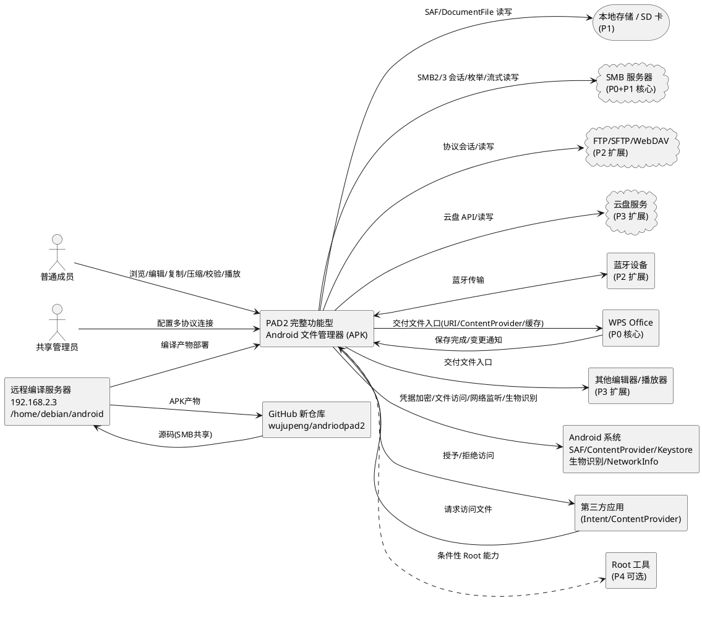

**通信协议与调用频率**：

| 通信链路 | 协议/机制 | 频率 | 约束 |
|---------|----------|------|------|
| App ↔ 本地存储 | SAF/DocumentFile | 高频（目录浏览、文件操作） | SAF 持久化授权，按 Android 版本适配 |
| App ↔ SMB | SMB2/3，TCP 445 | 高频（目录枚举、文件读写） | 会话池化，并发会话上限 5（M2 待验证） |
| App ↔ FTP/SFTP/WebDAV | 各协议标准 | 中频（P2 扩展后） | 各协议独立连接池，凭据加密 |
| App ↔ 云盘 | HTTPS/OAuth | 中频（P3 扩展后） | OAuth 令牌加密存储，逐个服务商定义 |
| App ↔ 蓝牙 | Android Bluetooth API | 低频（P2 扩展后） | 设备配对确认 |
| App ↔ WPS | Android Intent/URI/ContentProvider | 中频（用户触发编辑） | 文件变更监听，M2-A 门禁验证 |
| App ↔ 其他编辑器 | Android Intent/URI | 低频（P3 扩展后） | 通过统一文件操作接口回写 |
| App ↔ AndroidSys | Android 系统 API | 高频（凭据读写、文件访问、网络广播） | Keystore 依赖设备锁屏 |
| App ↔ ThirdParty | Android Intent/ContentProvider | 低频（外部请求） | 权限校验 |
| Repo ↔ BuildServer | SMB 文件共享 + Gradle 构建 | 低频（编译时） | PowerShell 脚本自动化 |

### 2.1.2 服务/组件总体架构

本组件在 `android_smb_explorer/design.md` 已定义的 SMB 核心四层架构基础上，扩展为完整功能型文件管理器的多协议统一架构。核心扩展点为：核心能力层引入统一文件操作接口与协议适配层，传输队列引擎抽象为协议无关统一引擎，基础设施层新增多协议库封装与工具模块。

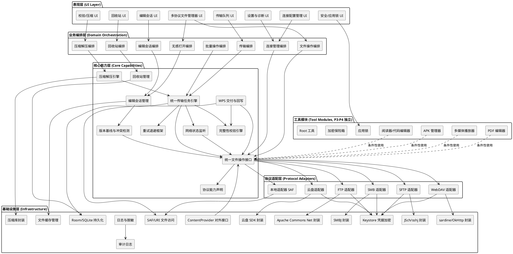

**模块职责说明**：

| 层 | 模块 | 职责 | 并发/资源约束 | 阶段 |
|---|------|------|--------------|------|
| 表现层 | 多协议文件管理器 UI | 本地/SMB/FTP/WebDAV/云盘统一目录浏览、搜索、排序、文件操作交互 | UI 线程，分页加载 | P0-P3 渐进 |
| 表现层 | 连接配置管理 UI | 多协议连接配置增删改查、连接测试交互 | UI 线程 | P0-P3 渐进 |
| 表现层 | 传输队列 UI | 传输进度、暂停/取消/重试交互 | UI 线程 | P0 |
| 表现层 | 编辑会话 UI | 编辑状态、冲突提示、回写结果展示 | UI 线程 | P0 |
| 表现层 | 回收站 UI | 回收站浏览、恢复、彻底清除 | UI 线程 | P1 |
| 表现层 | 校验/压缩 UI | MD5/SHA-256 校验、ZIP/RAR/7Z 压缩解压交互 | UI 线程 | P1-P2 |
| 表现层 | 安全/应用锁 UI | 应用锁解锁、加密保险箱访问 | UI 线程 | P4 |
| 业务编排层 | 文件操作编排 | 协调复制/移动/重命名/删除入队与执行 | — | P0-P1 |
| 业务编排层 | 连接管理编排 | 协调多协议配置管理、凭据加密、连接测试 | — | P0-P3 渐进 |
| 业务编排层 | 编辑会话编排 | 协调打开→交付→保存检测→回写全流程 | 单会话串行 | P0 |
| 业务编排层 | 传输编排 | 协调任务入队、进度上报、结果核对 | — | P0 |
| 业务编排层 | 无感打开编排 | 协调文件类型识别、应用选择、缓存、交付 | — | P0 |
| 业务编排层 | 批量操作编排 | 协调批量任务子任务拆分、逐文件校验 | — | P1 |
| 业务编排层 | 压缩解压编排 | 协调压缩/解压任务、产物校验 | — | P1-P2 |
| 业务编排层 | 回收站编排 | 协调本地删除入回收站、恢复、清除 | — | P1 |
| 核心能力层 | 统一文件操作接口 | 定义所有文件系统共同遵循的文件操作抽象接口 | — | P0 定义 + 渐进实现 |
| 核心能力层 | 协议能力声明 | 各协议向统一接口声明支持的能力集合 | — | P0-P3 渐进 |
| 核心能力层 | 统一传输任务引擎 | 协议无关流式传输、进度记录、完整性校验、可验证恢复 | 并发任务上限 3（M2 待验证） | P0 定义 + 渐进实现 |
| 核心能力层 | 编辑会话管理 | 会话生命周期状态机、缓存副本管理 | 单会话串行 | P0 |
| 核心能力层 | WPS 交付与回写 | 文件入口交付、变更检测、回写、另存为识别 | 单会话串行 | P0 |
| 核心能力层 | 版本基线与冲突检测 | SHA-256 基线、共享当前版本查询、冲突判定 | — | P0 |
| 核心能力层 | 完整性校验引擎 | 流式 SHA-256/MD5 计算与比对 | 流式，内存受限 | P0 |
| 核心能力层 | 网络状态监听 | 网络广播、会话失效检测、自动恢复触发 | 后台服务 | P0 |
| 核心能力层 | 重试退避框架 | 指数退避、重试上限 5、重复操作防护 | — | P0 |
| 核心能力层 | 回收站管理 | 本地删除暂存、恢复、彻底清除、容量/期限管理 | — | P1 |
| 核心能力层 | 压缩解压引擎 | ZIP/RAR/7Z 流式压缩解压、产物校验 | 流式，内存受限 | P1-P2 |
| 协议适配层 | SMB 适配器 | SMBJ 实现统一文件操作接口，声明 SMB 能力 | 并发会话上限 5（M2 待验证） | P0 |
| 协议适配层 | 本地适配器 SAF | SAF/DocumentFile 实现统一文件操作接口 | SAF 持久化授权 | P1 |
| 协议适配层 | FTP 适配器 | Apache Commons Net 实现统一文件操作接口，FTP over TLS 优先 | — | P2 |
| 协议适配层 | SFTP 适配器 | JSch/sshj 实现统一文件操作接口，SSH 加密全链路 | — | P2 |
| 协议适配层 | WebDAV 适配器 | sardine/OkHttp 实现统一文件操作接口，HTTPS 优先 | — | P2 |
| 协议适配层 | 云盘适配器 | 各云盘 SDK 实现统一文件操作接口，OAuth 2.0 | — | P3 |
| 基础设施层 | SMBJ 封装 | SMBJ API 封装、协议版本适配 | 线程安全封装 | P0 |
| 基础设施层 | Keystore 凭据加密 | AES 加密、密钥管理、明文禁止 | 设备锁屏依赖 | P0 |
| 基础设施层 | Room/SQLite 持久化 | 任务/会话/配置/回收站/审计持久化 | 单实例 | P0 |
| 基础设施层 | 文件缓存管理 | 本地缓存副本、空间检查、清理 | 空间上限 | P0 |
| 基础设施层 | 日志与脱敏 | 结构化日志、脱敏规则、错误分类 | — | P0 |
| 基础设施层 | 审计日志 | 关键操作审计记录（FD-17 基础审计） | — | P0+P1 |
| 基础设施层 | ContentProvider 对外接口 | 第三方应用访问授权与文件交付 | 权限校验 | P0 |
| 基础设施层 | SAF/URI 文件访问 | Android 文件访问机制封装 | Android 版本适配 | P0 |
| 基础设施层 | 压缩库封装 | Apache Commons Compress/zip4j/junrar/SevenZipJ 封装 | — | P1-P2 |
| 工具模块 | 多媒体播放器 | 音视频播放、倍速、小窗（独立依赖） | 独立模块 | P3 |
| 工具模块 | PDF 编辑器 | PDF 查看与编辑回写（独立依赖） | 独立模块 | P3 |
| 工具模块 | 阅读器/代码编辑器 | 小说阅读、代码编辑（独立依赖） | 独立模块 | P3 |
| 工具模块 | APK 管理器 | APK 安装、备份、提取（独立依赖） | 独立模块 | P3 |
| 工具模块 | 应用锁 | 入口访问控制、生物识别（独立模块） | 独立模块 | P4 |
| 工具模块 | 加密保险箱 | 文件级加密存储（独立模块） | 独立模块 | P4 |
| 工具模块 | Root 工具 | 条件性 Root 能力（独立模块） | 仅已 Root 设备 | P4 |

**关键架构决策与理由**：

| 决策 | 选择 | 理由 |
|------|------|------|
| 文件操作抽象方式 | 统一文件操作接口 + 协议能力声明 | 防止假定所有协议支持相同操作；调用方依据能力声明决定操作策略，不支持的能力降级处理而非假定支持导致失败 |
| 传输引擎抽象方式 | 协议无关统一传输任务引擎 | 所有协议共享流式传输、进度记录、完整性校验、可验证恢复机制，避免每协议重复实现；通过统一文件操作接口委托具体协议 |
| 协议适配层位置 | 核心能力层与基础设施层之间 | 适配层实现统一接口并封装协议库，核心能力层不直接依赖具体协议库，便于新增协议 |
| 工具模块隔离方式 | 独立 Gradle feature module | 视频播放器、PDF 编辑器、云盘等独立管理依赖，某个组件失败不影响文件管理主功能（产品架构原则 3） |
| WPS 文件交付方式 | ContentProvider+URI 首选，临时文件+Intent 回退 | ContentProvider+URI 为 Android 标准机制，优先使用；回退方案保证兼容性 |
| 凭据加密方式 | Android Keystore + AES | 系统级密钥保护，不在日志/界面/存储明文出现!现（产品架构原则 4） |
| 持久化方式 | Room/SQLite | 支持任务/会话/配置/回收站/审计统一持久化，应用重启后恢复未完成任务 |
| 安全写入策略 | 临时文件→SHA-256 校验→版本复核→原子替换→失败回滚 | 续传优先针对独立临时文件，不直接覆盖正式目标；失败时原文件不被破坏 |

**配置项及取值策略**（延续 M1 冻结参数，按产品范围扩展）：

| 配置项 | 取值策略 | 冻结阶段 |
|--------|---------|---------|
| minSdkVersion | API 26 / Android 8.0（已冻结） | **已冻结**（PM 批准） |
| targetSdkVersion | 候选值 API 36，待 M2-B 兼容性评估后冻结 | **候选值待兼容性评估** |
| 并发会话上限（所有协议） | 初始值 5，M2 验证内存、连接池和服务端限制 | **初始值待 M2 验证** |
| 并发任务上限 | 初始值 3，验证后可调整 | **初始值待 M2 验证** |
| 流式分块大小 | 初始值 8MB，验证大文件、内存占用、失败重试与断点续传 | **初始值待 M2 验证** |
| 重试退避上限 | 指数退避，上限 5 次，仅对可重试故障使用 | **初始值待 M2 验证** |
| 核心操作成功率目标 | 初始值 ≥99.5%（浏览/打开/回写） | **初始值待 M2 验证** |
| 故障恢复时间目标 | 初始值 ≤30s（网络恢复后自动续传） | **初始值待 M2 验证** |
| 传输超时阈值 | 初始值 300s（单次传输/分块操作超时） | **初始值待 M2 验证** |
| 大文件基线 | 1 GiB（建议值，待实测确定） | M2/M4 实测确定 |
| 批量文件基线 | 10,000 个混合大小文件（建议值，待实测确定） | M2/M4 实测确定 |
| 目录枚举响应上限 | 建议首屏 2s，分页加载（待实测确定） | M2/M4 实测确定 |
| 目标并发用户数 | 须与客户端并发会话上限（5）、并发任务上限（3）严格区分 | **待业务确认**（M2/M4 决策依赖） |
| SAF 优先策略 | 优先 SAF，MANAGE_EXTERNAL_STORAGE 为最后手段 | 策略已定 |
| 安全默认开启 | 密码加密存储、日志脱敏、敏感操作确认默认启用 | 策略已定 |

### 2.1.3 实现设计文档

本节对完整功能型文件管理器的核心逻辑进行设计说明，涵盖统一文件操作接口设计、协议能力声明机制、统一传输任务引擎设计、编辑会话状态机（延续 SMB 核心）、WPS 集成方案、安全写入事务设计与工具模块化隔离设计。

#### 2.1.3.1 统一文件操作接口与协议能力声明机制（产品架构原则 1 核心）

统一文件操作接口是完整功能型文件管理器相对 SMB 核心的最关键增量架构。所有文件系统（本地/SMB/FTP/SFTP/WebDAV/云盘）须实现统一接口，并声明各自支持的能力集合。调用方依据能力声明决定操作策略，不支持的能力降级处理而非假定支持导致失败。

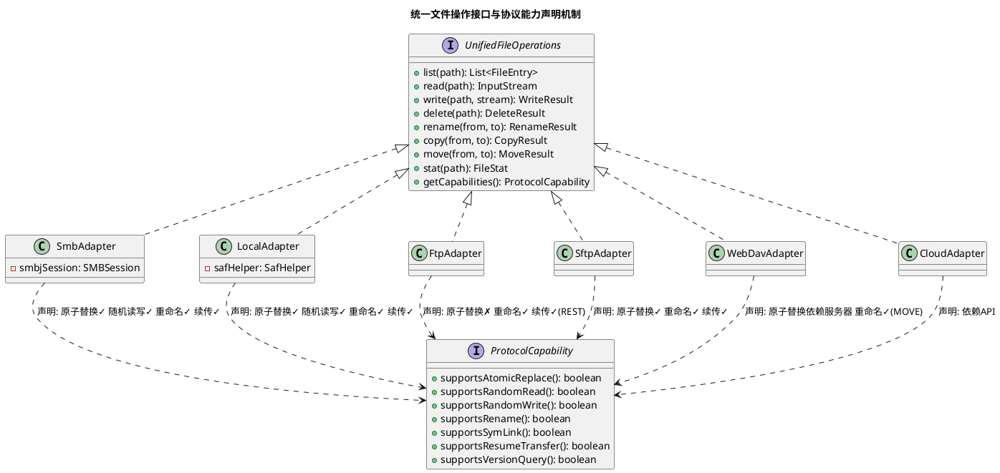

**协议能力矩阵**（来自 `pad2_product_scope/spec.md` 5.3.4.1）：

| 协议 | 认证方式 | 传输加密 | 重命名 | 临时文件替换（原子替换） | 断点续传恢复 | 已验证状态 |
|------|---------|---------|--------|----------------------|------------|-----------|
| SMB 2/3 | NTLM/Kerberos | SMB3 支持加密 | 支持 | 支持（rename API） | 支持（偏移读写） | P0 待 M2-A 验证 |
| 本地 SAF | 用户授权 | N/A | 支持 | 支持 | 支持 | P1 待验证 |
| FTP | 用户名/密码 | FTP over TLS | 支持（RNFR/RNTO） | 不保证原子 | 支持（REST 命令） | P2 未验证 |
| SFTP | 密码/密钥 | SSH 加密（全链路） | 支持 | 支持 | 支持 | P2 未验证 |
| WebDAV | Basic/Digest/OAuth | HTTPS | 支持（MOVE） | 依赖服务器实现 | 依赖服务器 Range 支持 | P2 未验证 |
| 云盘 | OAuth 2.0 | HTTPS | 依赖 API | 依赖 API | 依赖 API | P3 未验证 |

**能力降级策略**：

| 场景 | 能力检查 | 降级处理 |
|------|---------|---------|
| 回写（需要原子替换） | supportsAtomicReplace() = false | 降级为"写临时文件→校验→删除原文件→重命名临时文件"，失败时保留临时文件供诊断 |
| 断点续传（需要随机读写） | supportsResumeTransfer() = false | 不支持续传，中断后从头传输 |
| 重命名 | supportsRename() = false | 降级为"复制到新名称→删除原文件" |
| 版本查询（冲突检测） | supportsVersionQuery() = false | 无法进行版本基线冲突检测，提示用户风险 |

#### 2.1.3.2 统一传输任务引擎设计（产品架构原则 2 核心）

统一传输任务引擎将 SMB 核心的传输队列引擎抽象为协议无关的统一引擎，所有协议的大文件传输共享流式传输、进度记录、完整性校验与可验证恢复机制。引擎通过统一文件操作接口委托具体协议执行流式读写，不直接依赖任何协议库。

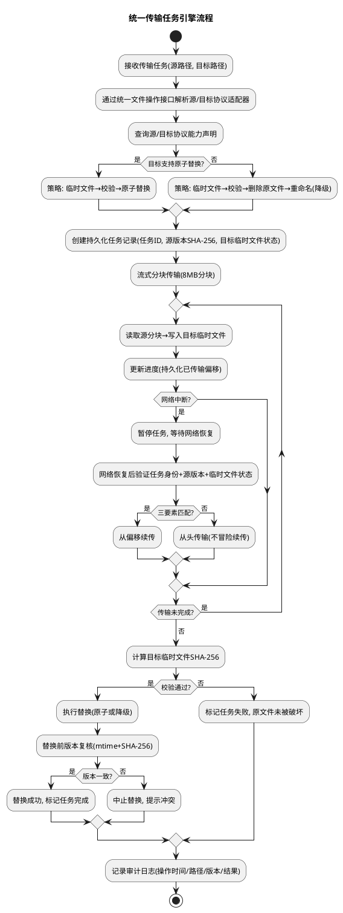

**安全续传三要素验证**（来自 `pad2_product_scope/spec.md` 4.2 第 4 条）：

| 验证要素 | 说明 | 不匹配时处理 |
|---------|------|------------|
| 任务身份匹配 | 持久化任务 ID 与当前任务一致 | 从头传输 |
| 源文件未变更 | 源文件当前 SHA-256 与任务记录的源版本一致 | 从头传输 |
| 目标临时文件状态 | 目标临时文件偏移与已传输部分一致 | 从头传输 |

#### 2.1.3.3 编辑会话状态机（延续 SMB 核心，扩展多编辑器支持）

编辑会话状态机延续 `android_smb_explorer/design.md` 2.1.3.1 的设计，扩展支持多编辑器（WPS/PDF 编辑器/代码编辑器等）。状态集合与触发条件保持不变，核心扩展点为文件交付方式与回写目标通过统一文件操作接口执行。

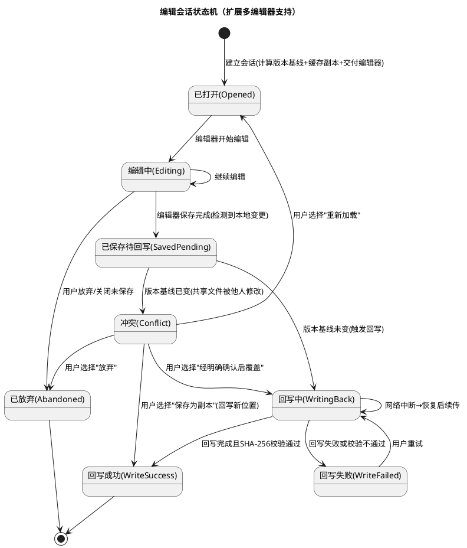

**冲突决策选项**（来自 `pad2_product_scope/spec.md` 4.2 第 6 条）：

| 决策选项 | 说明 | 实现状态 |
|---------|------|---------|
| 保存为副本 | 回写到新文件位置（如 `文件名_冲突副本_时间戳.ext`） | 首期可实现 |
| 重新加载 | 放弃本地编辑，重新打开共享当前版本 | 首期可实现 |
| 经明确确认后覆盖 | 再次确认目标文件版本（mtime+SHA-256）后覆盖原文件 | 首期可实现（须版本复核） |
| 放弃 | 放弃编辑，不回写 | 首期可实现 |
| 合并 | 语义合并本地与远程变更 | **未来扩展**，首期不承诺语义合并 |

#### 2.1.3.4 WPS 集成方案（ContentProvider/URI + 临时文件回退 + 回写校验链路）

WPS 集成是项目成败点（FD-03/FD-04），M2-A 为前置门禁。交付方式首选 ContentProvider+URI，回退临时文件+Intent。

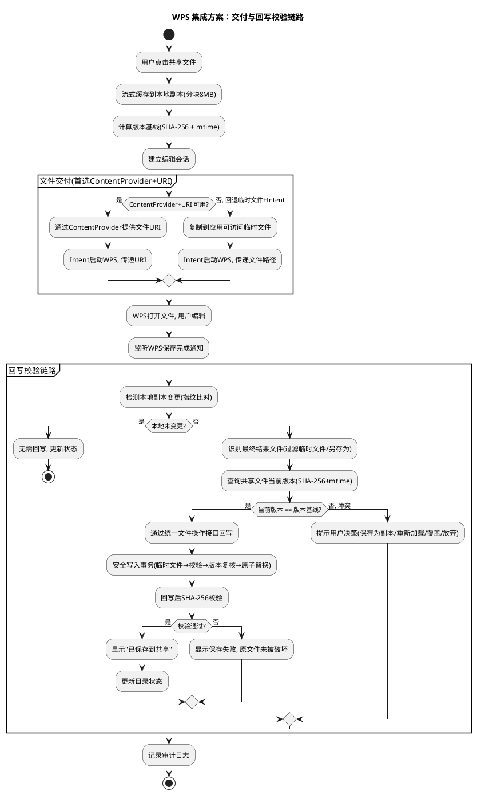

**WPS 文件交付方式对比**：

| 交付方式 | 机制 | 优势 | 劣势 | 优先级 |
|---------|------|------|------|--------|
| ContentProvider + URI | Android 标准 ContentProvider 提供文件 URI | 标准机制，权限可控，无需复制临时文件 | 须实现 ContentProvider，M2-A 验证 WPS 兼容性 | 首选 |
| 临时文件 + Intent | 复制到应用可访问临时文件，Intent 传递路径 | 实现简单，兼容性好 | 须管理临时文件生命周期，额外存储占用 | 回退 |

**安全写入事务设计**（来自 `pad2_product_scope/spec.md` 4.2 第 5 条回写安全替换失败恢复 6 项标准）：

| 步骤 | 操作 | 失败恢复标准 |
|------|------|------------|
| 1. 临时文件命名与隔离 | 确定性命名（目标文件名+任务ID+时间戳），同目录或专用临时目录 | 并发回写同一目录时各任务临时文件命名唯一且互不干扰 |
| 2. 流式写入临时文件 | 分块写入，进度持久化 | 写入失败时临时文件保留供诊断，原文件不受影响 |
| 3. SHA-256 校验 | 计算临时文件 SHA-256 并与源比对 | 校验不通过则中止，原文件保持不变 |
| 4. 替换前版本复核 | 再次检查目标文件 mtime+SHA-256，与编辑开始时基线比较 | 不一致则中止替换并提示冲突 |
| 5. 原子替换（或降级） | 支持原子替换则原子 rename；不支持则删除原文件→重命名临时文件 | 替换失败时原文件保持不变，临时文件保留供诊断 |
| 6. 审计记录 | 记录操作时间/路径/版本/结果 | 每次替换操作（成功/失败/降级）均记录审计日志 |
| 7. 残留临时文件处理 | 应用启动时扫描清理超期残留临时文件 | 清理操作记录审计日志，未超期临时文件保留 |

#### 2.1.3.5 工具模块化隔离设计（产品架构原则 3）

工具模块（视频播放器、PDF 编辑器、云盘、Root 工具等）须独立管理依赖，某个组件失败不影响文件管理主功能。

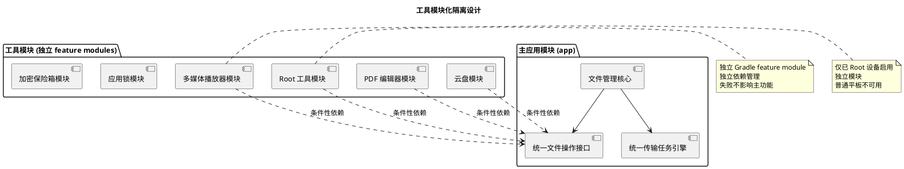

**模块化隔离策略**：

| 模块类型 | 隔离方式 | 失败影响 | 阶段 |
|---------|---------|---------|------|
| 文件管理核心 | 主应用模块 | — | P0-P1 |
| 多媒体播放器 | 独立 feature module | 播放不可用，文件管理正常 | P3 |
| PDF 编辑器 | 独立 feature module | PDF 编辑不可用，文件管理正常 | P3 |
| 云盘适配器 | 独立 feature module | 云盘不可用，本地/SMB 正常 | P3 |
| Root 工具 | 独立 feature module + 条件性启用 | Root 工具不可用，文件管理正常 | P4 |
| 应用锁 | 独立 feature module | 应用锁不可用，文件管理可降级为无锁 | P4 |
| 加密保险箱 | 独立 feature module | 保险箱不可用，文件管理正常 | P4 |

---
## 2.2 接口设计

### 2.2.1 总体设计

接口设计是连接上下游的契约，须严谨、稳定。本节定义完整功能型文件管理器的核心接口体系，所有接口采用 TypeScript（前端层）与 Java（Android 原生层）双语言定义，通过 Capacitor 8 插件桥接。

**接口分类**：

| 接口分类 | 接口数量 | 稳定性等级 | 所在层 | 阶段 |
|---------|---------|-----------|--------|------|
| 统一文件操作接口 | 1 核心 + 6 协议适配 | 稳定 | 核心能力层 + 协议适配层 | P0-P3 渐进 |
| 协议能力声明接口 | 1 | 稳定 | 核心能力层 | P0-P3 渐进 |
| 统一传输任务引擎接口 | 1 | 稳定 | 核心能力层 | P0 |
| 编辑会话管理接口 | 1 | 稳定 | 核心能力层 | P0 |
| WPS 交付与回写接口 | 1 | 实验（M2-A 验证后稳定） | 核心能力层 | P0 |
| 安全与审计接口 | 3 | 稳定 | 基础设施层 | P0+P1 |
| 回收站接口 | 1 | 稳定 | 核心能力层 | P1 |
| 压缩解压接口 | 1 | 稳定 | 核心能力层 | P1-P2 |
| 工具模块接口 | 6 | 实验（各模块独立验证后稳定） | 工具模块 | P3-P4 |

**接口继承体系**：

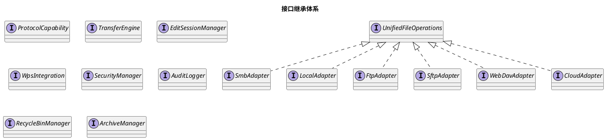

**接口变更策略**：
- 统一文件操作接口与协议能力声明接口为稳定接口，变更须评估对所有协议适配器的影响。
- WPS 交付与回写接口在 M2-A 验证前为实验接口，验证后稳定。
- 工具模块接口在各模块独立验证前为实验接口，验证后稳定。
- 接口版本管理：采用语义化版本号，主版本变更须提供迁移指南。

### 2.2.2 接口清单

#### 2.2.2.1 统一文件操作接口（UnifiedFileOperations）

**接口签名**（TypeScript 前端层定义，Java 原生层实现）：

```typescript
interface UnifiedFileOperations {
  list(path: string, options?: ListOptions): Promise<FileEntry[]>;
  readFile(path: string, options?: ReadOptions): Promise<InputStream>;
  writeFile(path: string, stream: InputStream, options?: WriteOptions): Promise<WriteResult>;
  deleteFile(path: string, options?: DeleteOptions): Promise<DeleteResult>;
  renameFile(from: string, to: string): Promise<RenameResult>;
  copyFile(from: string, to: string, options?: TransferOptions): Promise<CopyResult>;
  moveFile(from: string, to: string, options?: TransferOptions): Promise<MoveResult>;
  statFile(path: string): Promise<FileStat>;
  getCapabilities(): ProtocolCapability;
}
```

**业务说明**：定义所有文件系统（本地/SMB/FTP/SFTP/WebDAV/云盘）共同遵循的文件操作抽象接口。每个协议适配器实现此接口，并通过 getCapabilities() 声明其支持的能力集合。

**前置条件**：协议适配器已初始化并建立连接（远程协议）或已获得 SAF 授权（本地）。

**后置条件**：操作完成后文件系统状态按操作语义变更，操作结果通过 Promise 返回。

**异常映射**：

| 异常类型 | 错误码 | 处理策略 |
|---------|--------|---------|
| 输入校验失败 | INVALID_PATH / INVALID_PARAM | 返回错误，不执行操作 |
| 权限不足 | PERMISSION_DENIED | 提示用户授权 |
| 网络不可达 | NETWORK_UNREACHABLE | 触发重试退避 |
| 协议不支持 | CAPABILITY_NOT_SUPPORTED | 依据能力声明降级处理 |
| 文件不存在 | NOT_FOUND | 返回错误，不执行操作 |
| 冲突 | VERSION_CONFLICT | 触发冲突决策流程 |

**调用示例**：

```typescript
// 通过统一文件操作接口复制文件（协议无关）
const sourceAdapter = fileOperationFactory.getAdapter('smb://server/share/file.docx');
const targetAdapter = fileOperationFactory.getAdapter('local:///storage/file.docx');
const result = await transferEngine.transfer(sourceAdapter, targetAdapter, {
  verifyChecksum: true,
  algorithm: 'sha256'
});
```

#### 2.2.2.2 协议能力声明接口（ProtocolCapability）

**接口签名**：

```typescript
interface ProtocolCapability {
  supportsAtomicReplace(): boolean;
  supportsRandomRead(): boolean;
  supportsRandomWrite(): boolean;
  supportsRename(): boolean;
  supportsSymLink(): boolean;
  supportsResumeTransfer(): boolean;
  supportsVersionQuery(): boolean;
  getProtocolName(): string;
  getProtocolVersion(): string;
}
```

**业务说明**：每个协议适配器向统一文件操作接口声明其支持的能力集合。调用方依据能力声明决定操作策略，不支持的能力降级处理。

**前置条件**：协议适配器已初始化。

**后置条件**：返回协议能力集合，能力集合在连接生命周期内稳定（除非服务器配置变更）。

**调用示例**：

```typescript
const capability = smbAdapter.getCapabilities();
if (!capability.supportsAtomicReplace()) {
  // 降级为"写临时文件→校验→删除原文件→重命名"
  await degradedReplace(tempFile, targetFile);
}
```

#### 2.2.2.3 统一传输任务引擎接口（TransferEngine）

**接口签名**：

```typescript
interface TransferEngine {
  submitTask(task: TransferTask): Promise<TaskId>;
  pauseTask(taskId: TaskId): Promise<void>;
  resumeTask(taskId: TaskId): Promise<void>;
  cancelTask(taskId: TaskId): Promise<void>;
  retryTask(taskId: TaskId): Promise<void>;
  getTaskProgress(taskId: TaskId): Promise<TaskProgress>;
  getTaskStatus(taskId: TaskId): Promise<TaskStatus>;
  listTasks(filter?: TaskFilter): Promise<TransferTask[]>;
  onProgressUpdate(callback: (progress: TaskProgress) => void): void;
}

interface TransferTask {
  taskId: TaskId;
  source: UnifiedFileOperations;
  target: UnifiedFileOperations;
  sourcePath: string;
  targetPath: string;
  verifyChecksum: boolean;
  algorithm: 'md5' | 'sha256';
  priority: TaskPriority;
}
```

**业务说明**：协议无关的统一传输任务引擎，所有协议的大文件传输共享流式传输、进度记录、完整性校验与可验证恢复机制。引擎通过统一文件操作接口委托具体协议执行流式读写。

**前置条件**：源和目标协议适配器已初始化；任务队列已持久化。

**后置条件**：任务提交后持久化到 Room/SQLite，状态迁移均持久化，应用重启后可恢复。

**异常映射**：

| 异常类型 | 错误码 | 处理策略 |
|---------|--------|---------|
| 网络中断 | NETWORK_INTERRUPTED | 暂停任务，等待网络恢复后验证三要素续传 |
| 校验不通过 | CHECKSUM_MISMATCH | 标记任务失败，原文件未被破坏 |
| 空间不足 | STORAGE_FULL | 标记任务失败，提示用户清理空间 |
| 超时 | TRANSFER_TIMEOUT | 触发重试退避，超限标记失败 |
| 冲突 | VERSION_CONFLICT | 触发冲突决策流程 |

#### 2.2.2.4 编辑会话管理接口（EditSessionManager）

**接口签名**：

```typescript
interface EditSessionManager {
  createSession(filePath: string, editor: EditorType): Promise<EditSession>;
  getSession(sessionId: SessionId): Promise<EditSession>;
  detectSave(sessionId: SessionId): Promise<SaveEvent>;
  writeBack(sessionId: SessionId, conflictResolution?: ConflictResolution): Promise<WriteBackResult>;
  abandonSession(sessionId: SessionId): Promise<void>;
  checkConflict(sessionId: SessionId): Promise<ConflictResult>;
}

interface EditSession {
  sessionId: SessionId;
  filePath: string;
  baselineSha256: string;
  baselineMtime: number;
  localCachePath: string;
  status: EditSessionStatus;
  editor: EditorType;
}

type ConflictResolution = 'saveAsCopy' | 'reload' | 'overwriteWithConfirm' | 'abandon';
```

**业务说明**：管理编辑会话生命周期，从文件交给编辑器打开到回写校验完成或用户放弃。含本地缓存副本、版本基线、变更检测与回写状态。

**前置条件**：文件已缓存到本地副本；版本基线已计算（SHA-256 + mtime）。

**后置条件**：会话状态按状态机迁移，回写完成后更新目录状态。

#### 2.2.2.5 WPS 交付与回写接口（WpsIntegration）

**接口签名**：

```typescript
interface WpsIntegration {
  deliverFile(session: EditSession): Promise<DeliveryResult>;
  detectWpsSave(session: EditSession): Promise<SaveEvent>;
  writeBack(session: EditSession, resolution?: ConflictResolution): Promise<WriteBackResult>;
  identifyResultFile(saveEvent: SaveEvent): Promise<string>;
}

interface DeliveryResult {
  method: 'contentProvider' | 'tempFile';
  uri?: string;
  tempFilePath?: string;
  success: boolean;
}
```

**业务说明**：WPS 文件交付与回写集成。交付方式首选 ContentProvider+URI，回退临时文件+Intent。回写采用安全写入事务（临时文件→SHA-256 校验→版本复核→原子替换→失败回滚）。

**前置条件**：编辑会话已建立；WPS Office 已安装。

**后置条件**：文件交付给 WPS 可编辑；回写完成后共享文件内容更新且校验通过。

**稳定性等级**：实验（M2-A 验证后稳定）。

#### 2.2.2.6 安全与审计接口（SecurityManager / AuditLogger / CredentialManager）

**接口签名**：

```typescript
interface CredentialManager {
  saveCredential(protocol: string, credential: Credential): Promise<void>;
  getCredential(protocol: string, id: string): Promise<Credential>;
  deleteCredential(protocol: string, id: string): Promise<void>;
  testConnection(protocol: string, credential: Credential): Promise<ConnectionTestResult>;
}

interface AuditLogger {
  logEvent(event: AuditEvent): Promise<void>;
  queryEvents(filter: Audit6 AuditFilter): Promise<AuditEvent[]>;
  exportEvents(filter: AuditFilter): Promise<ExportResult>;
}

interface AuditEvent {
  type: AuditEventType;
  target: string;
  timestamp: number;
  result: 'success' | 'failure' | 'degraded';
  details?: string;
}
```

**业务说明**：凭据管理通过 Android Keystore 加密存储所有协议的账号密码；审计日志记录关键操作（连接建立、文件写入、删除、重命名、回写、加密/解密、权限变更）并脱敏。

**前置条件**：Keystore 已初始化；审计日志表已创建。

**后置条件**：凭据以加密方式存储，不以明文出现于任何存储位置或日志条目；审计日志含操作类型、目标、时间、结果且脱敏。

#### 2.2.2.7 回收站接口（RecycleBinManager）

**接口签名**：

```typescript
interface RecycleBinManager {
  moveToRecycleBin(filePath: string): Promise<RecycleBinEntry>;
  restoreFromRecycleBin(entryId: string): Promise<RestoreResult>;
  purgeFromRecycleBin(entryId: string): Promise<void>;
  listRecycleBinEntries(): Promise<RecycleBinEntry[]>;
  clearExpiredEntries(): Promise<void>;
}
```

**业务说明**：本地删除操作移入回收站暂存，支持恢复与彻底清除。回收站仅适用于本地删除，不自动适用于远程删除。远程删除须明确区分是否可恢复（见 2.1.3.4 远程删除行为）。

**前置条件**：回收站存储空间充足；删除的文件在应用私有目录可写。

**后置条件**：本地删除文件移入回收站，可恢复且内容与删除前逐字节一致；彻底清除后不可恢复。

#### 2.2.2.8 压缩解压接口（ArchiveManager）

**接口签名**：

```typescript
interface ArchiveManager {
  compress(files: string[], archivePath: string, format: 'zip' | 'rar' | '7z', options?: CompressOptions): Promise<CompressResult>;
  extract(archivePath: string, targetDir: string, options?: ExtractOptions): Promise<ExtractResult>;
  listEntries(archivePath: string): Promise<ArchiveEntry[]>;
}
```

**业务说明**：ZIP/RAR/7Z 压缩与解压，通过统一传输任务引擎流式处理，不将整个压缩包加载到内存。解压产物完整性校验。

**前置条件**：压缩库已加载；目标目录可写。

**后置条件**：压缩/解压产物完整性可校验，内存占用不超限。

**阶段**：P1 ZIP；P2 RAR/7Z（须先验证库许可与维护状态）。

---
## 2.3 数据模型

### 2.3.1 设计目标

数据模型设计须与领域概念对齐，避免数据库思维。核心领域对象须与 `pad2_product_scope/spec.md` 中的术语一致。

**需要支持的业务场景**：
1. 多协议连接配置管理与凭据加密存储（SMB/FTP/SFTP/WebDAV/云盘）
2. 传输任务持久化与断点续传（应用重启后恢复未完成任务）
3. 编辑会话生命周期管理（版本基线、缓存副本、回写状态）
4. 回收站暂存与恢复（本地删除文件可恢复）
5. 审计日志记录与查询（关键操作可追溯）
6. 兼容性证据管理（已验证环境清单活文档）

**性能、容量、扩展性目标**：
- 传输任务记录须支持快速查询与状态更新（Room/SQLite 索引优化）
- 审计日志须支持长期留存与高效查询（按时间/类型/目标索引）
- 回收站须受存储容量与保留期限约束（自动清理超期记录）

**与存量数据的兼容策略**：
- 旧仓库凭据明文存储须迁移为 Keystore 加密存储（迁移工具须验证完整性）
- 旧仓库无持久化任务队列，首期新建，无兼容负担

### 2.3.2 模型实现

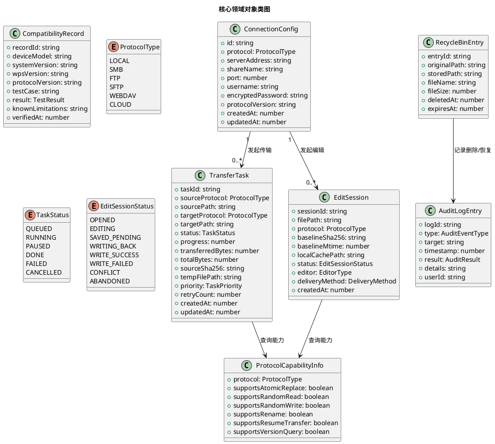

**对象之间的关系**：
- ConnectionConfig（1）→ TransferTask（0..*）：一个连接配置可发起多个传输任务
- ConnectionConfig（1）→ EditSession（0..*）：一个连接配置可发起多个编辑会话
- TransferTask → ProtocolCapabilityInfo：传输任务查询源/目标协议能力决定策略
- EditSession → ProtocolCapabilityInfo：编辑会话查询协议能力决定回写策略
- RecycleBinEntry → AuditLogEntry：回收站操作记录审计日志

**对象创建和销毁策略**：
- ConnectionConfig：用户创建/编辑/删除，删除时检查是否有活跃任务/会话
- TransferTask：传输引擎创建，完成后保留供查询，失败后供重试，定期清理已完成任务
- EditSession：编辑会话管理器创建，回写完成或放弃后销毁，缓存副本清理
- RecycleBinEntry：本地删除时创建，恢复或彻底清除或超期时销毁
- AuditLogEntry：关键操作时自动创建，按留存策略定期清理（FD-17 基础审计不主动清理，P4 高级审计提供留存策略）

**持久化策略**（不包含表结构）：
- ConnectionConfig：Room/SQLite 持久化，密码字段 Keystore 加密存储
- TransferTask：Room/SQLite 持久化，状态迁移与进度更新均持久化
- EditSession：Room/SQLite 持久化会话元数据，本地缓存副本存储于应用私有目录
- RecycleBinEntry：Room/SQLite 持久化元数据，文件存储于应用私有目录
- AuditLogEntry：Room/SQLite 持久化，按时间/类型/目标索引
- CompatibilityRecord：Room/SQLite 或文档持久化，活文档持续更新

---

## 2.4 安全方案

### 2.4.1 Keystore 凭据加密

**设计目标**：所有远程存储（SMB/FTP/SFTP/WebDAV/云盘）的账号密码必须以 Android Keystore 保护的加密方式存储，不在日志、界面明文、共享偏好明文中出现。

**实现方案**：

| 方面 | 方案 | 约束 |
|------|------|------|
| 密钥管理 | Android Keystore 生成 AES-256 密钥，密钥由设备锁屏保护 | 设备须设置锁屏；Keystore API 23+ 支持完善 |
| 加密算法 | AES-GCM（认证加密，防篡改） | — |
| 存储方式 | 密文存储于 Room/SQLite，密钥存于 Keystore | 密钥不离开 Keystore |
| 凭据读写 | 写入前加密，读取时解密，解密后明文仅在内存中短暂存在 | 明文不落盘 |
| 迁移策略 | 旧仓库明文凭据迁移为加密存储，迁移后验证完整性 | 迁移工具须验证 |
| 令牌管理（云盘） | OAuth 2.0 令牌同样加密存储，刷新令牌安全保管 | P3 阶段 |

**验收条件**：[检查本地存储与日志] → [密码不以明文出现于任何存储位置或日志条目]

### 2.4.2 日志脱敏

**设计目标**：所有日志不得包含密码、完整凭据、文件敏感内容。

**脱敏规则**：

| 敏感类型 | 脱敏规则 | 示例 |
|---------|---------|------|
| 密码 | 完全替换为 `***` | `password=secret` → `password=***` |
| 凭据（账号+密码） | 账号保留，密码替换 | `user=admin, pass=secret` → `user=admin, pass=***` |
| 文件路径 | 保留路径结构，文件名按需脱敏 | `/share/机密文件.docx` → `/share/***`（可选） |
| 文件内容 | 不记录文件内容明文 | — |
| OAuth 令牌 | 替换为 `***` | `token=abc123` → `token=***` |
| 网络地址 | 保留（非敏感） | `192.168.1.1` 保留 |

**实现方式**：日志输出前经过脱敏过滤器，脱敏规则可配置。结构化日志含错误分类、操作上下文、时间戳。

### 2.4.3 安全写入事务

**设计目标**：回写与传输采用安全写入事务，失败时原文件不被破坏。

**事务流程**（来自 2.1.3.4 安全写入事务设计）：

```
临时文件命名与隔离 → 流式写入临时文件 → SHA-256 校验 → 替换前版本复核 → 原子替换（或降级） → 审计记录 → 残留临时文件处理
```

**失败恢复标准**（来自 `pad2_product_scope/spec.md` 4.2 第 5 条回写安全替换失败恢复 6 项标准）：

| 标准 | 说明 | 验收条件 |
|------|------|---------|
| 临时文件命名与隔离 | 确定性命名（目标文件名+任务ID+时间戳），同目录或专用临时目录 | 并发回写同一目录时各任务临时文件命名唯一且互不干扰 |
| 替换前版本复核 | 再次检查目标文件 mtime+SHA-256，与基线比较 | 不一致则中止替换并提示冲突 |
| 替换失败原文件保护 | 替换失败时原文件保持不变，临时文件保留供诊断 | 原文件内容与替换前逐字节一致 |
| 残留临时文件处理 | 应用启动时扫描清理超期残留临时文件 | 清理操作记录审计日志，未超期临时文件保留 |
| 恢复操作可审计 | 每次替换操作记录审计日志 | 含操作时间/路径/版本信息/结果 |
| 协议限制声明 | 不支持安全替换的协议须明确限制回写能力 | 未完成回写不得报告为成功 |

### 2.4.4 安全默认开启

**设计目标**：密码加密存储、日志脱敏、敏感文件操作确认须默认启用，不依赖用户主动开启。

**默认启用项**：

| 安全策略 | 默认状态 | 用户可配置 | 说明 |
|---------|---------|-----------|------|
| 密码加密存储 | 启用 | 否 | Keystore 加密，不可关闭 |
| 日志脱敏 | 启用 | 否 | 脱敏规则不可关闭 |
| 敏感操作确认 | 启用 | 是 | 远程删除、覆盖确认等可配置确认级别 |
| 应用锁 | 禁用 | 是 | P4 阶段，用户主动启用 |
| 文件加密 | 禁用 | 是 | P4 阶段，用户主动启用 |

**应用锁与文件加密区分**（来自 `pad2_product_scope/spec.md` 4.3 第 6 条）：
- 应用锁控制应用入口访问，不替代文件本身的加密
- 加密保险箱提供文件级加密
- 启用应用锁但未加密文件时，文件内容仍可被其他应用或文件浏览器直接读取

### 2.4.5 权限最小化与 SAF 优先

**设计目标**：仅请求完成功能所需的最小 Android 权限，优先使用 SAF，MANAGE_EXTERNAL_STORAGE 为最后手段。

**权限收敛策略**（延续 `tasks.md` 1.2 权限收敛策略）：

| targetSdkVersion 范围 | 权限清单 | 说明 |
|----------------------|---------|------|
| < 29（Android 7.x-8.x，传统存储） | INTERNET, ACCESS_NETWORK_STATE, ACCESS_WIFI_STATE, READ_EXTERNAL_STORAGE, WRITE_EXTERNAL_STORAGE, FOREGROUND_SERVICE | 传统存储权限 |
| ≥ 29（Android 9+，SAF/分区存储） | INTERNET, ACCESS_NETWORK_STATE, ACCESS_WIFI_STATE, FOREGROUND_SERVICE | 本地缓存通过应用私有目录或 SAF，不申请 READ/WRITE_EXTERNAL_STORAGE |
| ≥ 30（Android 11+） | 同上，MANAGE_EXTERNAL_STORAGE 为最后手段 | 须证明无替代方案后才申请，须 Google Play 审查 |

**MANAGE_EXTERNAL_STORAGE 策略**：
- 不应作为默认方案，为最后手段
- 申请前须证明应用私有缓存（getExternalFilesDir()）与 SAF 持久化授权无法满足需求
- 如果产品设计只需要应用私有缓存与用户主动授权的 SAF 目录，应优先验证能否不申请该权限

---

## 2.5 可靠性方案

### 2.5.1 任务持久化与断点续传

**设计目标**：传输任务进度须持久化，应用重启后可恢复未完成任务。断点续传须验证三要素，不能证明安全恢复时从头传输。

**持久化策略**：

| 持久化对象 | 存储方式 | 时机 | 恢复策略 |
|-----------|---------|------|---------|
| 传输任务记录 | Room/SQLite | 任务创建/状态迁移/进度更新 | 应用启动时扫描未完成任务，验证三要素后恢复 |
| 编辑会话元数据 | Room/SQLite | 会话创建/状态迁移 | 应用启动时扫描未完成会话，提示用户 |
| 传输进度（已传输偏移） | Room/SQLite | 每分块传输后 | 续传时从偏移恢复 |
| 源文件版本（SHA-256） | Room/SQLite | 任务创建时 | 续传前验证源文件未变更 |
| 目标临时文件状态 | 文件系统 | 流式写入时 | 续传前验证临时文件偏移与已传输部分一致 |

**断点续传安全恢复三要素验证**（来自 `pad2_product_scope/spec.md` 4.2 第 4 条）：

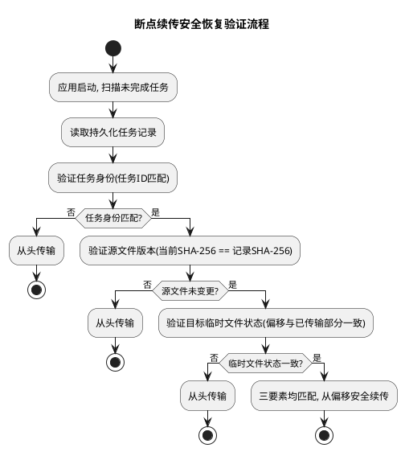

**验收条件**：[传输中断后恢复] → [验证任务身份+源文件版本+目标临时文件状态均匹配后方可续传；任一不匹配则从头传输]

### 2.5.2 断网恢复

**设计目标**：短暂断网或会话失效后，可恢复任务须在网络恢复后自动续传或重新执行，恢复时间上限 ≤30s（M2 待验证）。

**断网恢复流程**：

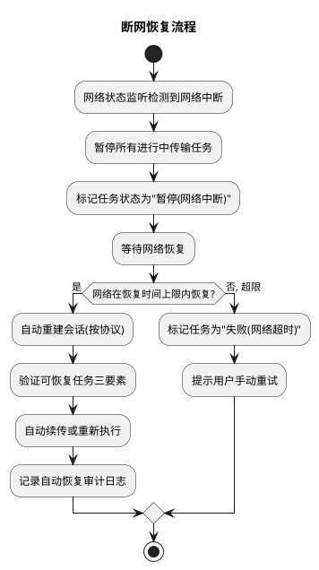

**网络状态监听机制**：
- 注册 Android ConnectivityManager 网络回调
- 监听 Wi-Fi 连接/断开、网络切换、连接超时
- 会话失效检测：SMB/FTP/SFTP/WebDAV 连接层回调
- 自动会话重建：按协议能力重建连接，复用凭据（Keystore 解密）

### 2.5.3 冲突保护

**设计目标**：禁止静默覆盖。回写前检测共享文件版本基线是否已变，冲突时提示用户决策。

**冲突检测机制**（来自 `pad2_product_scope/spec.md` 4.2 第 6 条）：

| 检测维度 | 说明 | 判定 |
|---------|------|------|
| 修改时间（mtime） | 查询共享文件当前 mtime，与编辑开始时基线比较 | 任一变化即判定为冲突 |
| 内容指纹（SHA-256） | 查询共享文件当前 SHA-256，与编辑开始时基线比较 | 任一变化即判定为冲突 |

> **重要**：冲突判定不能只依赖修改时间或内容指纹中的任意一个，必须同时比较两者。

**冲突决策流程**：

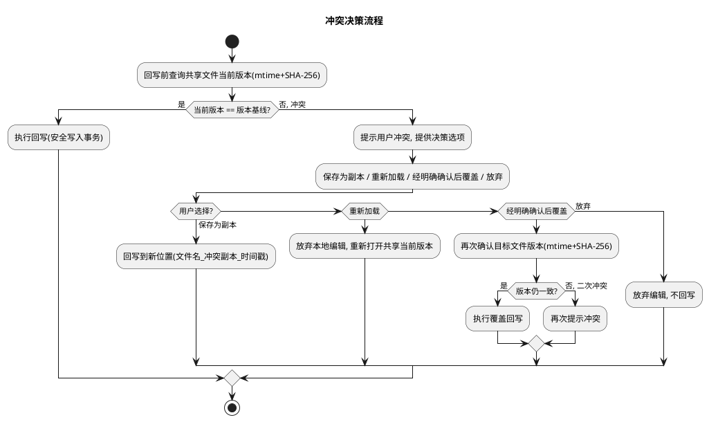

**合并能力说明**：合并选项仅在针对特定格式完成合并能力设计与验证后才允许显示；通用文件管理器不保证所有 Office 文件都能安全合并，尤其二进制文件不能仅凭文件指纹实现语义合并。合并能力明确标注为未来扩展，首期不承诺语义合并。

### 2.5.4 远程删除行为

**设计目标**：远程删除必须明确区分是否可恢复。不得承诺无法实现的恢复能力。

**远程删除行为设计**（来自 `pad2_product_scope/spec.md` 4.2 第 11-12 条）：

| 场景 | 行为 | UI 提示 |
|------|------|---------|
| 远程删除 + 无可恢复暂存机制 | 显示"此操作不可恢复"警告，要求二次确认 | "此操作不可恢复，确认删除？" |
| 远程删除 + 有已验证的可恢复暂存机制 | 可显示"移入回收站"，恢复后文件内容与删除前逐字节一致 | "移入回收站" |
| 本地删除 | 移入回收站，可恢复 | "移入回收站" |

> **禁止项**：远程删除无可恢复暂存机制但显示"移入回收站" → 标记为规格违规。不得使用与本地删除相同的"移入回收站"措辞误导用户。

### 2.5.5 工具模块化隔离可靠性

**设计目标**：视频播放器、PDF 编辑器、云盘和 Root 工具须独立管理依赖，某个组件失败不影响文件管理主功能。

**隔离可靠性保证**：

| 隔离层面 | 实现方式 | 失败影响 |
|---------|---------|---------|
| 编译隔离 | 独立 Gradle feature module，独立依赖 | 工具模块编译失败不影响主应用编译 |
| 运行时隔离 | 工具模块通过条件性依赖使用统一文件操作接口 | 工具模块运行时崩溃不传播到主功能 |
| 权限隔离 | 工具模块按需申请权限，不影响主功能权限 | 工具模块权限被拒不影响主功能 |
| 数据隔离 | 工具模块独立数据存储，不共享主功能数据表 | 工具模块数据损坏不影响主功能数据 |

**验收条件**：[某扩展工具组件崩溃或不可用] → [文件管理主功能（浏览/复制/移动/删除）仍可正常使用]

---
## 2.6 各阶段实现路径（P0→P1→P2→P3→P4）

### 2.6.1 阶段实现路径总览

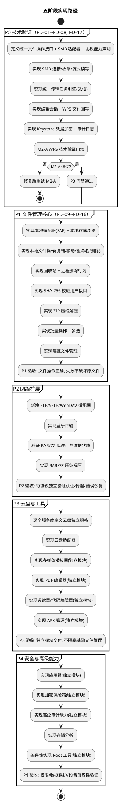

### 2.6.2 P0 技术验证（FD-01~FD-08, FD-17）

**交付范围**：SMB + WPS 编辑保存回写，统一文件操作接口与统一传输任务引擎的 SMB 首期实现。

| 交付项 | 依赖 | 实现内容 | 验收标准 |
|--------|------|---------|---------|
| FD-01 SMB 连接配置管理 | Keystore 加密存储 | 多组 SMB 配置增删改查、连接测试、凭据加密 | 真实 SMB 服务器连接测试通过 |
| FD-02 SMB 目录浏览 | SMBJ | SMB 目录枚举、文件属性展示、分页加载 | 打开共享根目录展示文件列表 |
| FD-03 WPS 无感打开 | Android SAF/ContentProvider | 文件类型识别、WPS 启动、文件交付 | 点击文件 WPS 打开编辑 |
| FD-04 WPS 编辑保存回写 | 版本基线 SHA-256+mtime | 编辑会话管理、WPS 保存检测、安全写入事务、回写校验 | 编辑保存后回写校验通过 |
| FD-05 编辑冲突保护 | 版本基线对比 | 冲突检测、冲突决策交互 | 两台设备同时编辑，提示冲突 |
| FD-06 文件上传下载 | 统一传输任务引擎 | 流式传输、进度上报、完整性校验 | 复制文件到共享并校验 |
| FD-07 断点续传 | 持久化任务队列 | 三要素验证、安全续传 | 传输中断后恢复续传 |
| FD-08 Wi-Fi 网络恢复 | 网络状态监听 | 网络广播、会话重建、自动续传 | 断网恢复后自动续传 |
| FD-17 基础安全事件日志 | Room/SQLite + 日志脱敏 | 连接/写入/删除/回写事件审计记录 | 关键操作可追溯且脱敏 |

**P0 门禁**：M2-A WPS 技术验证通过（真实设备闭环成功，冲突及断网行为有证据）。

**P0 架构产出**：
- 统一文件操作接口定义（UnifiedFileOperations + ProtocolCapability）
- SMB 适配器实现（SmbAdapter）
- 统一传输任务引擎首期实现（基于 SMB）
- 编辑会话状态机实现
- WPS 交付与回写实现（ContentProvider+URI 首选，临时文件回退）
- Keystore 凭据加密实现
- 持久化任务队列实现（Room/SQLite）
- 审计日志实现（FD-17 基础审计）

### 2.6.3 P1 文件管理核心（FD-09~FD-16）

**前置条件**：P0 门禁通过（M2-A WPS 技术验证通过）。

**交付范围**：本地/SD 卡文件管理、文件操作、批量操作、回收站、校验、ZIP、隐藏文件。

| 交付项 | 依赖 | 实现内容 | 验收标准 |
|--------|------|---------|---------|
| FD-09 本地存储浏览 | Android SAF | 本地适配器(SAF)、目录浏览、SD 卡 | 浏览本地目录，权限不足提示授权 |
| FD-10 复制/移动 | 统一文件操作接口 | 本地↔本地、本地↔SMB 跨存储复制/移动 | 复制/移动文件并校验，失败不破坏原文件 |
| FD-11 重命名 | 协议能力声明 | 通过统一接口重命名，不支持时降级 | 重命名文件内容不变 |
| FD-12 删除 | 统一文件操作接口 + 回收站 | 本地移入回收站、远程明确警告 | 本地可恢复/远程不可恢复警告 |
| FD-13 SHA-256 校验 | 流式哈希计算 | 校验用户接口、MD5 快速校验选项 | 传输前后 SHA-256 一致 |
| FD-14 ZIP 压缩/解压 | Apache Commons Compress/zip4j | 流式压缩解压、产物校验 | 解压产物完整性校验 |
| FD-15 批量操作 | 统一传输任务引擎 | 子任务粒度、逐文件进度与校验 | 批量复制并逐文件校验，部分失败可恢复 |
| FD-16 隐藏文件 | 文件名点前缀/属性标记 | 隐藏文件显示/隐藏切换 | 切换隐藏文件可见性 |

**P1 验收标准**：本地/SD 卡文件操作正确，失败时原文件不被破坏，回收站与校验可用。

**P1 架构产出**：
- 本地适配器实现（LocalAdapter，SAF/DocumentFile）
- 回收站管理实现
- 远程删除行为实现
- 压缩解压引擎首期实现（ZIP）
- 批量操作编排实现
- 隐藏文件管理实现

### 2.6.4 P2 网络扩展

**前置条件**：P1 完成。须新增独立需求规格与架构设计。

**交付范围**：FTP、SFTP、WebDAV、蓝牙传输、RAR/7Z 压缩解压。

| 交付项 | 依赖 | 实现内容 | 验收标准 |
|--------|------|---------|---------|
| FTP 适配器 | Apache Commons Net | FTP over TLS 优先、统一接口实现 | 独立验证认证/传输/错误恢复 |
| SFTP 适配器 | JSch/sshj | SSH 加密全链路、统一接口实现 | 独立验证认证/传输/错误恢复 |
| WebDAV 适配器 | sardine/OkHttp | HTTPS 优先、统一接口实现 | 独立验证认证/传输/错误恢复 |
| 蓝牙传输 | Android Bluetooth API | 设备配对、文件传输 | 独立验证传输 |
| RAR/7Z 压缩解压 | junrar/SevenZipJ | 须先验证库许可与维护状态 | 解压产物完整性校验 |

**P2 验收标准**：FTP/SFTP/WebDAV/蓝牙各自独立验证认证、传输、错误恢复。

**P2 架构产出**：
- FtpAdapter/SftpAdapter/WebDavAdapter 实现
- 蓝牙传输实现
- RAR/7Z 压缩解压实现（须先验证库许可与维护状态）
- 多协议编译依赖管理

### 2.6.5 P3 云盘与工具

**前置条件**：P2 完成。须新增独立需求规格与架构设计。云盘须逐个服务商定义独立规格。

**交付范围**：主流云盘、多媒体、PDF、阅读器、代码编辑器、APK 管理、存储分析。

| 交付项 | 依赖 | 实现内容 | 验收标准 |
|--------|------|---------|---------|
| 云盘适配器 | 各云盘 SDK/OAuth | 逐个服务商独立规格、OAuth 令牌加密 | 独立模块交付 |
| 多媒体播放器 | ExoPlayer | 音视频播放、倍速、小窗（独立模块） | 独立模块交付 |
| PDF 编辑器 | PdfBox-Android/MuPDF | PDF 查看与编辑回写（独立模块） | 独立模块交付 |
| 阅读器/代码编辑器 | epublib/Monaco Editor | 小说阅读、代码编辑（独立模块） | 独立模块交付 |
| APK 管理 | PackageInstaller | APK 安装、备份、提取（独立模块） | 独立模块交付 |
| 存储分析 | StorageStatsManager | 存储占用统计（独立模块） | 独立模块交付 |

**P3 验收标准**：云盘与工具独立模块交付，不阻塞基础文件管理。

**P3 架构产出**：
- CloudAdapterFramework 实现（逐个服务商）
- 工具模块独立 feature module 实现
- 工具模块化编译隔离

### 2.6.6 P4 安全与高级能力

**前置条件**：P3 完成。须新增独立需求规格与架构设计。

**交付范围**：加密保险箱、应用锁、APK 管理（高级）、存储分析（高级）、可选 Root。

| 交付项 | 依赖 | 实现内容 | 验收标准 |
|--------|------|---------|---------|
| 应用锁 | Keystore + BiometricPrompt | 入口访问控制、生物识别（独立模块） | 不替代文件加密 |
| 加密保险箱 | Keystore + AES | 文件级加密存储（独立模块） | 密钥 Keystore 保护 |
| 高级审计能力 | Room/SQLite + 防篡改 | 查询界面/导出/留存/防篡改/合规报告（独立模块） | 独立验收 |
| Root 工具（条件性） | Root 检测 + su | 仅已 Root 设备启用（独立模块） | 普通平板不保证 |

**P4 验收标准**：权限、数据保护及设备兼容性验证通过，Root 功能条件性启用。

### 2.6.7 阶段顺序门禁

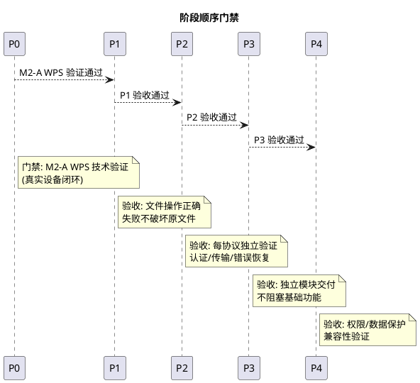

**门禁规则**：
- P0 门禁通过后方可进入 P1，P1 完成后方可进入 P2，以此类推，不跳阶段
- 禁止因扩展范围过大而失控首期工程：首期范围（P0+P1）独立控制，不因 P2-P4 扩展清单膨胀而延期
- P2-P4 每个扩展阶段须新增独立需求规格、架构设计、任务分解及阶段审批

---

## 2.7 部署与编译方案

### 2.7.1 远程编译服务器方案

**编译服务器配置**：

| 配置项 | 值 | 说明 |
|--------|-----|------|
| 服务器地址 | 192.168.2.3 | 远程编译服务器 |
| 用户名 | debian | SSH 登录用户 |
| 密码 | 9090 | SSH 登录密码 |
| 编译目录 | /home/debian/android | Gradle 编译工作目录 |
| 源码同步方式 | SMB 共享挂载 | \\192.168.2.3\home\debian 可从本地 Windows 挂载 |
| 产物回传方式 | SMB 共享回传 | APK 产物通过 SMB 共享回传本地 |
| 部署方式 | adb install | 通过 adb 安装到代表性设备 |
| 自动化脚本 | PowerShell | 用户偏好 PowerShell 脚本进行部署和运维 |

**编译流程**：

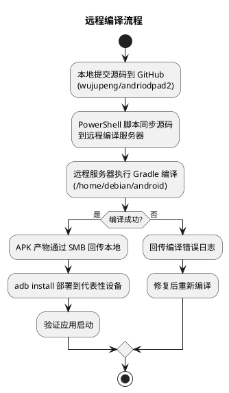

**多模块编译策略**（P2-P4）：

| 模块类型 | 编译策略 | 说明 |
|---------|---------|------|
| 主应用模块 | 始终编译 | 文件管理核心 |
| 协议适配器模块 | 按需编译 | P2-P4 新增协议模块独立编译 |
| 工具模块 | 按需编译 | P3-P4 工具模块独立 feature module |
| 依赖管理 | Gradle 模块化依赖 | 各协议适配器独立管理依赖，避免冲突 |

**代表性环境配置说明**：远程编译服务器为经环境确认的**代表性环境配置**，不是所有开发环境的默认前提，不作为唯一环境假设。其他开发环境可使用本地 Android Studio 或其他编译方式替代。按三层兼容性模型管理：编译环境不绑定单一服务器。

### 2.7.2 新仓库管理

| 配置项 | 值 |
|--------|-----|
| 仓库 URL | https://github.com/wujupeng/andriodpad2 |
| 主分支 | main |
| 开发分支 | develop |
| 阶段分支 | pad2-m1 ~ pad2-m4 |
| 旧仓库 | wujupeng/andriodpad（只读技术资产参考） |
| 当前最新提交 | 50fc6b6（main 分支） |
| 完整提交链 | c6bd202 → dac77fe → e91fcd1 → d720262 → f0956ee → 41995e6 → 6d0fedc → f838bc5 → f98d4c3 → 50fc6b6 |

**版本管理策略**：
- 旧仓库 `wujupeng/andriodpad` 标记为只读技术资产参考，不预设代码复用
- 新仓库 `wujupeng/andriodpad2` 进行版本管理与发布
- `.gitignore` 排除 `node_modules/`、`android/app/build/`、`android/.gradle/`、本地凭据文件等

---

## 2.8 兼容性验证方案

### 2.8.1 三层兼容性模型（延续）

**三层兼容性模型**（延续 `android_smb_explorer/design.md` 2.1.0 与 `pad2_product_scope/spec.md` 4.5.1）：

| 层次 | 名称 | 内容 | 产物 |
|------|------|------|------|
| 第一层 | 通用架构兼容 | 不将业务逻辑绑定到某个品牌或某个 WPS 版本；通过统一文件操作接口、协议适配层和独立的文件编辑交接层降低耦合；应用架构设计基于 Android 标准 API，而非厂商特定 API | 分层架构设计（见 2.1.2） |
| 第二层 | 代表性环境验证 | 先用现有设备（荣耀 9X）建立第一条实测基线；再逐步增加不同 Android 版本、设备厂商及 WPS 版本的测试组合；每增加一个组合，记录完整测试结果 | M2 验证报告 + 已验证环境清单初始版 |
| 第三层 | 兼容性证据管理 | 每个组合记录：设备型号、系统版本、WPS 版本、协议版本、测试用例、结果和已知限制；没有实测证据的组合一律标记为"未验证"；维护"已验证环境清单"作为活文档，随测试进展持续更新；"未验证"不等于"不兼容"，允许尝试运行但不得宣称兼容 | 已验证环境清单（活文档，持续更新） |

**已验证环境清单字段**（来自 `pad2_product_scope/spec.md` 6.3）：

| 字段 | 说明 | 约束 |
|------|------|------|
| 设备型号 | 已验证的设备型号 | 须为实际测试设备，不可为空 |
| 系统版本 | 已验证的 Android 系统版本 | 须为实际设备系统版本，不可为空 |
| WPS 版本 | 已验证的 WPS 版本 | 须为实际安装版本，不可为空 |
| 协议版本 | 已验证的远程存储协议版本 | 可为空（本地功能无协议） |
| 测试用例 | 已执行的测试用例 | 须可追溯，不可为空 |
| 测试结果 | 测试结果 | 取值 {通过, 失败, 部分通过, 未验证}，不可为空 |
| 已知限制 | 已验证组合的已知限制 | 可为空 |
| 验证日期 | 测试执行日期 | 须为有效日期，不可为空 |

### 2.8.2 M2-A WPS 技术验证（主要门禁）

**验证范围**：SMB/WPS 打开/编辑/保存/回写/冲突/断网恢复，在代表性设备、实际 WPS 版本与真实 SMB 服务器上执行。

**验证环境**：

| 配置项 | 值 | 说明 |
|--------|-----|------|
| 代表性设备 | 荣耀 9X | 首条实测基线 |
| WPS 版本 | 当前安装版本 + 最新稳定版 | 有条件批准，具体版本号 M2 实测记录 |
| SMB 服务器 | 真实可达 SMB 服务器 | 须为实际服务器 |
| 网络条件 | Wi-Fi 局域网 | 带宽≥100Mbps，SMB 服务器与设备同一网段 |

**验证用例**：

| 用例编号 | 验证路径 | 验收标准 |
|---------|---------|---------|
| V1 | SMB 连接建立与认证 | 连接成功，凭据加密存储 |
| V2 | WPS 打开共享文件 | 文件成功打开，可编辑 |
| V3 | WPS 编辑保存回写 | 保存后回写校验通过，显示"已保存到共享" |
| V4 | 编辑冲突保护 | 两台设备同时编辑，提示冲突，提供决策选项 |
| V5 | 断网恢复 | 断网后恢复，可恢复任务自动续传 |
| V6 | 大文件传输 | 1 GiB 文件传输，内存不超限，SHA-256 校验通过 |
| V7 | 持久化任务恢复 | 应用被杀后重启，任务队列恢复 |

**门禁作用**：M2-A 通过 → P0 门禁通过 → 批准进入 P1。M2-A 未通过 → 不批准进入 P1，保留验证计划待修复后重试。

**验证约束**：
- 须在真实环境中验证，不得以静态审查代替真实测试
- M2-A 范围限定于 WPS 关键路径，不包含 P2-P4 功能验证
- 不得以 M2-B 的静态审查代替 M2-A 的真实测试

### 2.8.3 M2-B API 36 兼容性评估（独立评估）

**评估范围**：Capacitor 8/插件/SAF/前台服务/SMBJ 在 API 36 上的行为。

**评估环境**：

| 配置项 | 值 | 说明 |
|--------|-----|------|
| 评估环境 | API 36 模拟器或真机 | 须为实际环境 |
| 评估范围 | Capacitor 8 及插件、SAF、前台服务类型声明、SMBJ | API 36 上的行为 |
| 评估方法 | 实测或混合 | 静态评估仅为补充，不构成完成充分条件 |

**评估项目**：

| 评估项 | 说明 | 评估方法 |
|--------|------|---------|
| Capacitor 8 兼容性 | Capacitor 8 在 API 36 上的行为 | 实测或混合 |
| 插件兼容性 | Android 原生插件在 API 36 上的行为 | 实测或混合 |
| SAF 行为 | SAF 持久化授权在 API 36 上的有效性 | 实测 |
| 前台服务类型 | 前台服务类型声明在 API 36 上的行为（Android 14+ 须声明 foregroundServiceType） | 实测 |
| SMBJ 兼容性 | SMBJ 在 API 36 上的行为 | 实测或混合 |
| 文件访问行为 | ContentProvider/URI 在 API 36 上的行为 | 实测 |
| 后台传输限制 | 后台传输任务在 API 36 上的限制 | 实测 |

**M2-B 完成门槛约束**（来自 `pad2_product_scope/spec.md` 6.5.2 第 6 条）：
1. 须包含 API 36 真实设备或模拟器上的必要运行验证（实测或混合方法中的实测部分）
2. 静态评估可作为补充证据，但不能单独判定兼容
3. 对于无法实测的具体项目，须记录限制、风险和待验证项，不得直接标记为兼容
4. 最终由 PM 根据证据裁定 targetSdkVersion，API 36 仍保持候选状态，直至正式裁定

**门禁作用**：M2-B 评估完成 → PM 正式裁定 targetSdkVersion。M2-B 不直接冻结 API 36，评估完成后由 PM 裁定。

### 2.8.4 M2-A 与 M2-B 关系

| 维度 | M2-A：WPS 技术验证 | M2-B：API 36 兼容性评估 |
|------|-------------------|----------------------|
| 性质 | 主要门禁 | 独立评估 |
| 范围 | SMB/WPS 打开/编辑/保存/回写/冲突/断网恢复 | Capacitor 8/插件/SAF/前台服务/SMBJ 在 API 36 上行为 |
| 环境 | 代表性设备（荣耀 9X）+ 实际 WPS + 真实 SMB 服务器 | API 36 模拟器或真机 |
| 方法 | 真实测试（不得以静态审查代替） | 实测或混合（静态评估仅为补充，不构成完成充分条件） |
| 门禁作用 | M2-A 通过 → P0 门禁通过 → 批准进入 P1 | M2-B 评估完成 → PM 正式裁定 targetSdkVersion |
| 证据记录 | 独立记录 M2-A 证据与结论 | 独立记录 M2-B 证据与结论 |
| API 36 影响 | 不直接冻结 API 36 | 评估完成后由 PM 裁定，不自动冻结 |

**关系约束**：
- 两个子任务独立执行、分别记录证据与结论
- 不得以 M2-B 静态审查代替 M2-A 真实测试
- 不得擅自扩大 M2-A 既定验证范围
- API 36 保持候选状态直到 M2-B 评估完成并由 PM 正式裁定

### 2.8.5 协议能力验证要求

**SMB 协议能力验证**（M2-A 执行时以实测证据更新）：

| 能力 | 验证方法 | 当前状态 |
|------|---------|---------|
| 原子替换（rename API） | 实测 SMB rename 操作 | 待 M2-A 验证 |
| 随机读写 | 实测 SMB 随机读写操作 | 待 M2-A 验证 |
| 重命名 | 实测 SMB rename 操作 | 待 M2-A 验证 |
| 断点续传恢复 | 实测 SMB 偏移读写 | 待 M2-A 验证 |
| 版本查询 | 实测 SMB 属性查询（mtime） | 待 M2-A 验证 |

> **重要**：SMB 协议能力须以实测证据更新，不能以规格声明替代验证。

**其他协议能力验证**（各阶段启动时）：

| 协议 | 验证阶段 | 验证要求 |
|------|---------|---------|
| 本地 SAF | P1 | SAF 持久化授权、DocumentFile 操作 |
| FTP | P2 | FTP over TLS、RNFR/RNTO、REST 命令 |
| SFTP | P2 | SSH 加密、重命名、断点续传 |
| WebDAV | P2 | HTTPS、MOVE、Range 支持 |
| 云盘 | P3 | OAuth 2.0、API 限制（逐个服务商） |

### 2.8.6 RAR/7Z 依赖验证要求

RAR 和 7Z 压缩/解压功能在实现前必须验证以下事项，未验证不得纳入开发（来自 `pad2_product_scope/spec.md` 5.3.4.2）：

| 格式 | 依赖库 | 格式支持范围 | 许可证 | 维护状态 | 验证状态 | 验证阶段 |
|------|--------|------------|--------|---------|---------|---------|
| RAR | junrar / Apache Commons Compress | RAR4 解压（RAR5 须确认） | Apache 2.0（Commons Compress）；junrar 须确认 | 须确认最新提交与 issue 状态 | 未验证 | P2 启动前 |
| 7Z | SevenZipJ / Apache Commons Compress | 7z 解压/压缩 | Apache 2.0（Commons Compress）；SevenZipJ 须确认 | 须确认最新提交与 issue 状态 | 未验证 | P2 启动前 |

### 2.8.7 云盘逐个定义要求

"支持云盘"不视为统一能力，须逐个服务提供商定义独立规格（来自 `pad2_product_scope/spec.md` 5.3.4.3）：

| 服务提供商 | OAuth 授权方式 | 令牌撤销 | API 限制 | 独立规格状态 | 定义阶段 |
|-----------|--------------|---------|---------|------------|---------|
| OneDrive | OAuth 2.0 | 支持刷新令牌撤销 | 速率限制须确认 | 未定义 | P3 启动前 |
| Google Drive | OAuth 2.0 | 支持令牌撤销 | 速率限制须确认 | 未定义 | P3 启动前 |
| Dropbox | OAuth 2.0 | 支持令牌撤销 | 速率限制须确认 | 未定义 | P3 启动前 |
| 其他 | 须逐个定义 | 须逐个定义 | 须逐个定义 | 未定义 | P3 启动前 |

---

## 2.9 与现有文档关系

### 2.9.1 文档定位

| 文档 | 定位 | 修改状态 |
|------|------|---------|
| `android_smb_explorer/spec.md` | P0 SMB 核心需求基线（REQ-01~05） | **不修改**（已冻结基线） |
| `android_smb_explorer/design.md` | SMB 核心架构基线 | **不修改**（已冻结基线） |
| `android_smb_explorer/tasks.md` | SMB 核心实现任务基线 | **不修改**（已冻结基线） |
| `pad2_product_scope/spec.md` | 完整功能型文件管理器产品范围规格 | 本文档的输入 |
| `pad2_product_scope/design.md`（本文档） | 完整功能型文件管理器技术设计（扩展框架） | **新生成** |

### 2.9.2 架构继承关系

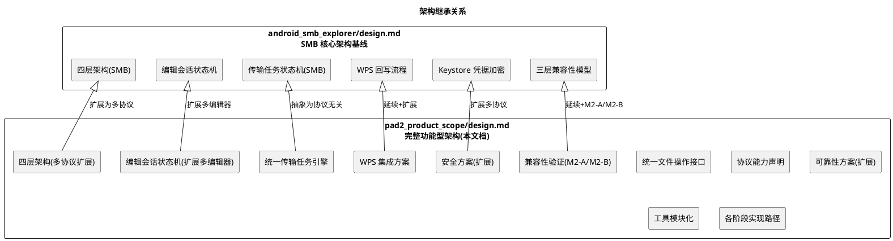

**继承说明**：
- 本文档延续 `android_smb_explorer/design.md` 的四层架构、编辑会话状态机、传输任务状态机、WPS 回写流程、Keystore 凭据加密、三层兼容性模型
- 本文档的增量架构为：统一文件操作接口、协议能力声明、统一传输任务引擎（协议无关）、工具模块化、各阶段实现路径、M2-A/M2-B 兼容性验证
- P2-P4 扩展功能的具体架构须在各阶段独立架构设计文档中细化

---