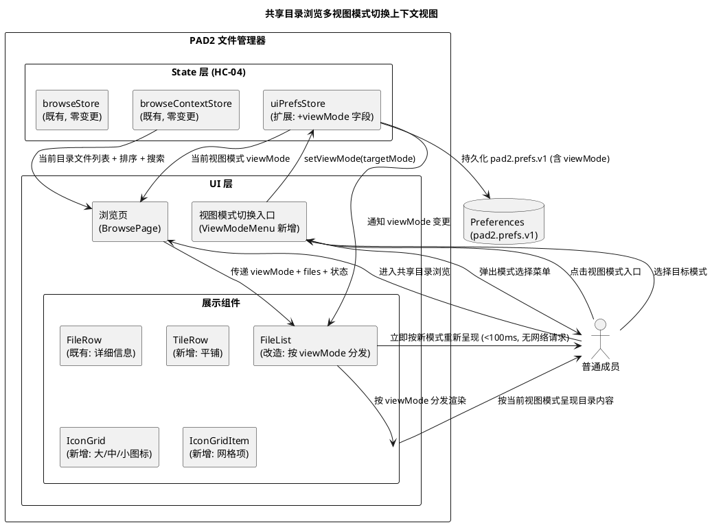
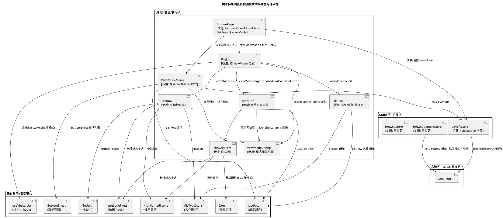
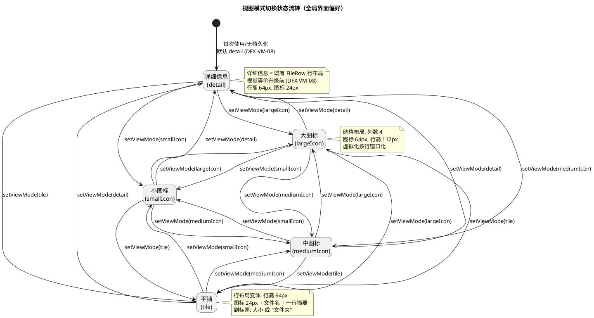
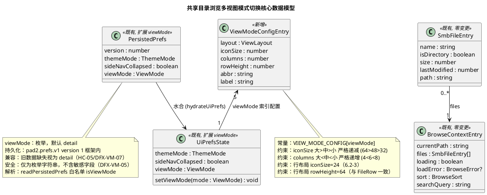
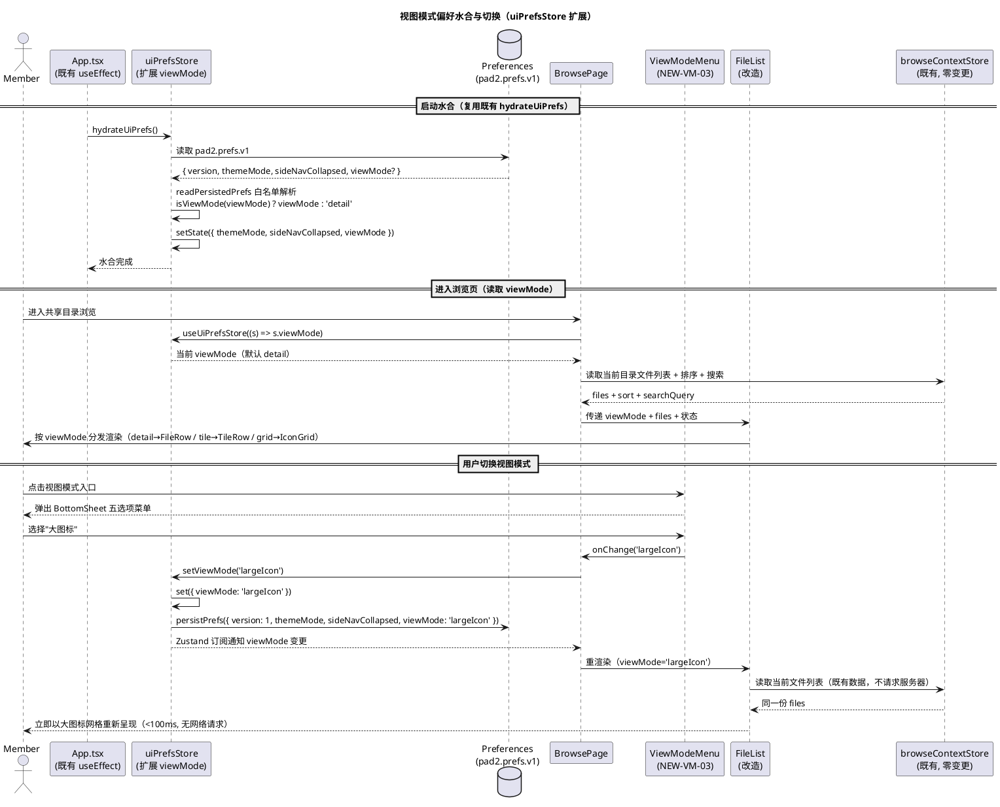
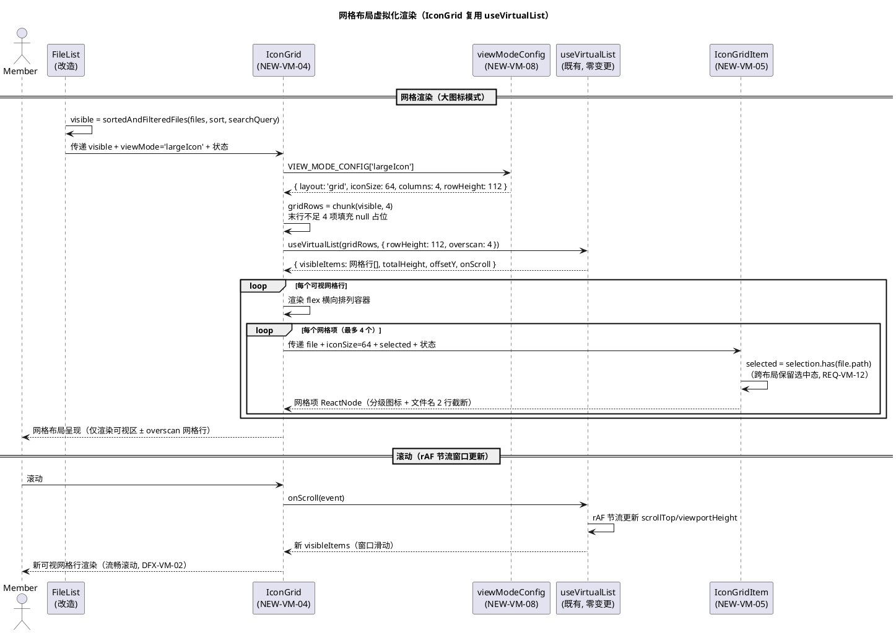
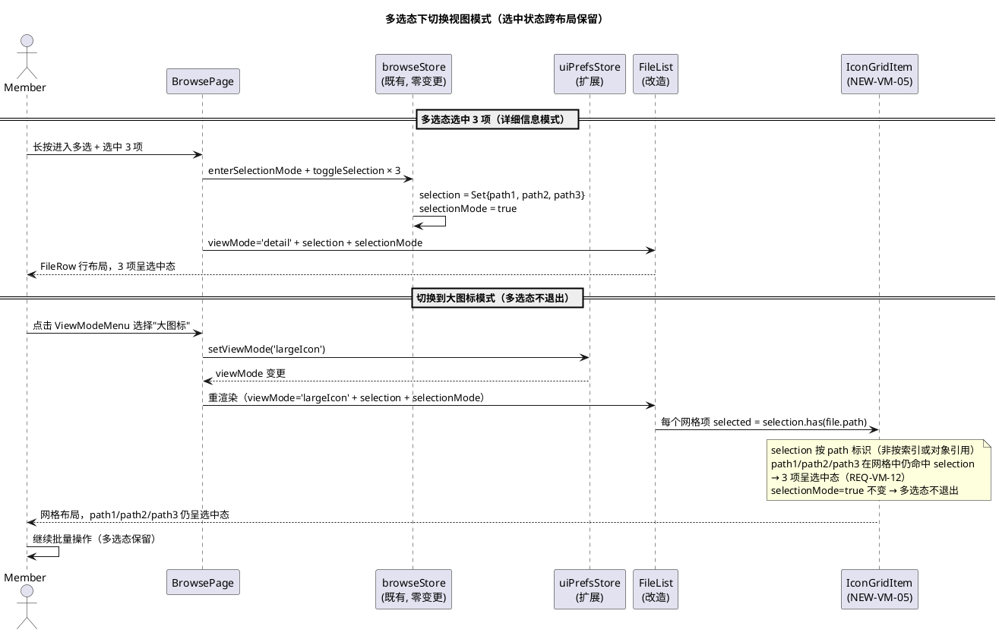

# 技术设计：共享目录浏览多视图模式切换

> **文档编号**：PAD2-DESIGN-BVM-001
> **Feature Name**：browse_view_modes
> **上游规格**：`docs/specs/browse_view_modes/spec.md`（PAD2-SPEC-BVM-001）
> **基线版本**：PAD2 v1.5（code 6），包名 com.pad2.filemanager，已落地 conn_persist_recent_ui（PAD2-DESIGN-CPRU-001）与 multi_conn_writeback（PAD2-DESIGN-MCWB-001）
> **文档定位**：本文档为规格驱动开发（SDD）第二阶段产物，描述"怎么做"（HOW）。基于 spec.md 的 EARS 需求与既有代码证据链，给出共享目录浏览页多视图模式切换（大图标 / 中图标 / 小图标 / 平铺 / 详细信息）的增量架构方案、接口契约、数据模型、状态机、数据流、变更范围、风险缓解与测试策略。
> **硬约束（来自项目记忆，贯穿全文）**：
> - HC-01 零新增 npm 依赖
> - HC-02 冻结区零变更：`src/adapter/smb/SmbPlugin.ts` / `src/core/**` / `android/**` 原生层不得变更（SmbPlugin 为唯一 SMB 调用入口）
> - HC-03 `src/main.tsx` 改动限 3 行内，超限逻辑抽独立模块
> - HC-04 store 分级：store 为 SmbPlugin 唯一调用入口，UI 层不得直接 import SmbPlugin
> - HC-05 既有持久化兼容：不破坏 `pad2.profiles.v1` / `pad2.prefs.v1` 等既存数据
> - HC-06 只读模式兼容

---

# 一、需求与存量功能关系分析

## 1.0 问题根因分析（代码级定位）

### 1.0.1 根因：BrowsePage 展示链硬编码单一行布局，无视图模式状态与切换入口

| 根因编号 | 代码位置 | 根因事实 | 违反需求 |
|---------|---------|---------|---------|
| RC-VM-01 | `src/ui/pages/BrowsePage/index.tsx:228-239` | toolbar 操作区仅含 `SearchField` + `SortMenu` + 多选入口（icon-multiselect），无视图模式切换按钮 | REQ-VM-01/13 |
| RC-VM-02 | `src/ui/pages/BrowsePage/index.tsx:256-269` | listArea 内仅渲染 `<FileList .../>`，无视图模式分支，无第二套展示组件 | REQ-VM-01/06/07/08 |
| RC-VM-03 | `src/ui/pages/BrowsePage/FileList/index.tsx:31,52-107` | `FileList` 固定 `ROW_HEIGHT = 64` 虚拟化行列表，仅渲染 `FileRow`，无网格布局分支 | REQ-VM-06 |
| RC-VM-04 | `src/ui/pages/BrowsePage/FileRow/index.tsx:82-99` | `FileRow` 为 `ListRow` + 24px 图标 + 文件名 + 副标题（"大小 · 修改时间"或"文件夹"）的单一行布局，无图标尺寸分级 | REQ-VM-06/07/08 |
| RC-VM-05 | `src/state/uiPrefsStore.ts:12-19,55-60` | 界面偏好 `pad2.prefs.v1` 含 `themeMode` / `sideNavCollapsed`，无 `viewMode` 字段，可在 version 1 框架内兼容扩展（与既有字段同模式） | REQ-VM-03/04 |
| RC-VM-06 | `src/state/browseContextStore.ts:24-31` | `BrowseContextEntry` 含 `sort` / `searchQuery` 字段，无 `viewMode` 字段，浏览上下文不承载视图模式 | REQ-VM-05 |

**根因链**：RC-VM-01（toolbar 无切换入口）+ RC-VM-02（listArea 无视图分支）→ 无切换能力；RC-VM-03/04（FileList/FileRow 硬编码行布局）→ 无网格布局；RC-VM-05/06（store 无 viewMode 字段）→ 无状态承载与持久化。修复需新增 viewMode 状态字段（uiPrefsStore 扩展）+ 切换入口（ViewModeMenu）+ 网格展示组件（IconGrid）+ 行布局变体（TileRow）+ FileList 按 viewMode 分发。视图模式为纯 UI 呈现层变更，不触及冻结区（HC-02）。

### 1.0.2 既有预留（可复用资产）

| 资产编号 | 代码位置 | 资产事实 | 复用方向 |
|---------|---------|---------|---------|
| AS-VM-01 | `src/ui/pages/BrowsePage/SortMenu/index.tsx:44-87` | `SortMenu` 已实现 BottomSheet + ListRow 选择菜单模式（入口图标 + 缩写徽章 + BottomSheet 选项列表 + 选中态勾选），可复用此模式构建 ViewModeMenu | ViewModeMenu 复用 SortMenu 模式 |
| AS-VM-02 | `src/ui/icons/fileTypeIcons.ts:71-84` / `src/ui/icons/Icon.tsx:8-15` | `fileIcon(extension)` 已实现扩展名 → 图标名映射，`Icon` 组件支持 `size` 参数，可按视图模式分级传参 | 图标尺寸分级复用 |
| AS-VM-03 | `src/ui/hooks/useVirtualList.ts:38-122` | `useVirtualList` 已实现固定行高窗口化虚拟列表（`computeVisibleRange` 纯函数 + scroll/rAF 节流 + `scrollToTop`），可复用于网格虚拟化（每行 N 列，rowHeight=网格行高） | 网格虚拟化复用 useVirtualList |
| AS-VM-04 | `src/state/uiPrefsStore.ts:30-53` | `readPersistedPrefs` + `persistPrefs` 已实现版本化持久化 + 安全降级（JSON 损坏/版本不匹配回默认），可在 `PersistedPrefs` 内新增 viewMode 字段同模式扩展 | viewMode 持久化复用 |
| AS-VM-05 | `src/ui/components/ListRow/index.tsx:11-32` | `ListRow` 三段布局（图标区 + title/subtitle + trailing）+ 选中态 + 多选态，可复用于 TileRow（平铺行布局变体） | TileRow 复用 ListRow |
| AS-VM-06 | `src/state/browseStore.ts:140-164` | `sortedAndFilteredFiles` 派生选择器已实现排序+搜索过滤，视图模式与之正交，FileList 内部已 useMemo 消费 | 视图模式与排序/搜索正交复用 |
| AS-VM-07 | `src/state/browseStore.ts:118-136` | `selection` / `selectionMode` 按 path 标识，`enterSelectionMode` / `toggleSelection` / `exitSelectionMode` 已实现，跨布局按 path 保留选中态 | 多选态跨布局兼容复用 |
| AS-VM-08 | `src/ui/pages/BrowsePage/FileList/index.tsx:60-83` | `FileList` 已有 loading→SkeletonList / 空目录→EmptyState / 搜索无结果→EmptyState 分支，视图模式变更不改变这些分支 | 空态/加载态复用 |
| AS-VM-09 | `src/ui/components/BottomSheet/index.tsx` | `BottomSheet` 底部弹出菜单容器，ViewModeMenu 复用 | ViewModeMenu 复用 BottomSheet |
| AS-VM-10 | `src/utils/fileUtils.ts:7-47` | `formatFileSize` / `formatTimestamp` 已实现，TileRow / IconGridItem 副标题复用 | 副标题格式化复用 |
| AS-VM-11 | `src/ui/pages/BrowsePage/FileRow/index.tsx:30-58` | `HighlightedName` 搜索高亮组件已实现（大小写不敏感分段 + mark 语义），TileRow / IconGridItem 复用 | 搜索高亮复用 |
| AS-VM-12 | `src/ui/hooks/useLongPress.ts` | `useLongPress` 长按 hook 已实现，IconGridItem / TileRow 复用进入多选交互 | 长按交互复用 |

## 1.1 需求功能与存量功能对比

### 1.1.1 已实现功能

| 需求功能 | 存量功能 | 代码位置 | 匹配度 |
|---------|---------|---------|--------|
| REQ-VM-09 视图模式不影响文件数据与排序 | `sortedAndFilteredFiles` 派生选择器，视图模式与之正交 | `browseStore.ts:140-164` / `BrowsePage/index.tsx:157-160` | 100%（排序/搜索既有逻辑不变，视图模式仅改变呈现布局） |
| REQ-VM-10 视图模式与搜索过滤正交 | `searchQuery` 过滤在 `sortedAndFilteredFiles` 内，视图模式不改变 searchQuery | `browseStore.ts:145-148` / `browseContextStore.ts:121-123` | 100%（搜索既有逻辑不变） |
| REQ-VM-11 空目录与加载态不受视图模式影响 | FileList loading→SkeletonList / 空目录→EmptyState / 搜索无结果→EmptyState 分支 | `FileList/index.tsx:60-83` | 100%（空态/加载态既有分支不变，视图模式仅在 visible.length>0 时影响渲染） |
| REQ-VM-12 多选态与视图模式兼容 | `selection` / `selectionMode` 按 path 标识，跨布局保留选中态 | `browseStore.ts:118-136` | 100%（selection 按 path 标识，网格/行布局均按 file.path 判定 selected） |
| DFX-VM-01 视图模式切换即时生效 | 视图模式为纯 UI 重渲染，不触发 SMB 请求 | `BrowsePage/index.tsx:157-160`（visibleFiles useMemo） | 100%（纯前端派生，无网络请求） |
| DFX-VM-04 视图模式与连接状态无关 | 视图模式消费已加载 files，不依赖连接态 | `BrowsePage/index.tsx:66`（files = ctxEntry?.files ?? []） | 100%（视图模式仅消费 files 快照） |
| DFX-VM-05 视图模式不涉及敏感数据 | viewMode 仅为枚举字符串 | — | 100%（枚举值不含敏感字段） |

### 1.1.2 需要扩展的功能

| 需求功能 | 存量功能 | 差异说明 | 扩展方向 |
|---------|---------|---------|---------|
| REQ-VM-03 视图模式偏好持久化 | `uiPrefsStore` pad2.prefs.v1 已持久化 themeMode/sideNavCollapsed，无 viewMode 字段（RC-VM-05） | 输入：无 viewMode → 期望：viewMode 枚举持久化；输出：缺失字段视为默认 → 期望：默认 detail（DFX-VM-07） | `uiPrefsStore` `PersistedPrefs` 新增 viewMode 字段，`readPersistedPrefs` 白名单解析，`setViewMode` 持久化；version 1 框架内兼容扩展（HC-05） |
| REQ-VM-13 视图模式入口持久可见当前模式 | `SortMenu` 入口已有缩写徽章持久可见模式（AS-VM-01），但无视图模式入口（RC-VM-01） | 输入：无视图模式入口 → 期望：入口+当前模式标识；输出：toolbar 无切换入口 → 期望：紧邻 SortMenu 的 ViewModeMenu | `BrowsePage` toolbar 新增 `ViewModeMenu`（复用 SortMenu 模式，入口图标+缩写徽章） |
| DFX-VM-07 既有界面偏好数据兼容 | `readPersistedPrefs` 已有版本校验+字段降级（AS-VM-04），无 viewMode 字段 | 输入：旧数据无 viewMode → 期望：视为默认 detail；输出：字段缺失降级 → 期望：默认 detail 不破坏既有偏好 | `readPersistedPrefs` 解析 viewMode 白名单（viewMode ∈ 枚举才落位，否则默认 detail），PREFS_VERSION 保持 1 不升 |
| REQ-VM-02 切换即时生效不请求服务器 | `visibleFiles` useMemo 派生已实现纯前端重渲染，但 FileList 无 viewMode 分发 | 输入：无 viewMode 分发 → 期望：按 viewMode 重渲染；输出：仅 FileRow 行布局 → 期望：网格/行布局按模式切换 | `FileList` 新增 viewMode prop，按 viewMode 分发渲染组件，复用既有 useMemo 派生 |

### 1.1.3 需要新增的功能或接口

**模块 A：视图模式状态与持久化（REQ-VM-03/04/05）**

| 新增编号 | 功能点 | 输入 | 输出 | 核心逻辑 | 依赖 |
|---------|--------|------|------|---------|------|
| NEW-VM-01 | viewMode 字段持久化扩展 | — | void | `uiPrefsStore` `PersistedPrefs` 新增 viewMode 字段，`readPersistedPrefs` 白名单解析，`setViewMode` 持久化 | uiPrefsStore 扩展 |
| NEW-VM-02 | viewMode 状态读取 | — | ViewMode | `uiPrefsStore.viewMode` 字段，默认 detail | uiPrefsStore |

**模块 B：视图模式切换入口（REQ-VM-01/13）**

| 新增编号 | 功能点 | 输入 | 输出 | 核心逻辑 | 依赖 |
|---------|--------|------|------|---------|------|
| NEW-VM-03 | ViewModeMenu 切换入口组件 | viewMode + onChange | ReactNode | 复用 SortMenu 模式（入口图标+缩写徽章+BottomSheet 选项列表），五个选项（大/中/小图标/平铺/详细信息） | BottomSheet, ListRow, Icon |

**模块 C：多模式呈现组件（REQ-VM-06/07/08）**

| 新增编号 | 功能点 | 输入 | 输出 | 核心逻辑 | 依赖 |
|---------|--------|------|------|---------|------|
| NEW-VM-04 | IconGrid 网格布局容器 | files + viewMode + 虚拟化参数 | ReactNode | 复用 `useVirtualList` 按行窗口化（每行 N 列，rowHeight=网格行高），渲染 IconGridItem | useVirtualList, IconGridItem |
| NEW-VM-05 | IconGridItem 网格项 | file + iconSize + selected + selectionMode | ReactNode | 网格项：分级图标 + 文件名（多行截断）+ 选中态，复用 `useLongPress` 长按进入多选 | Icon, useLongPress |
| NEW-VM-06 | TileRow 平铺行布局变体 | file + searchQuery + selected + selectionMode | ReactNode | 复用 `ListRow`，副标题为单行摘要（文件=大小，目录="文件夹"），行高 64px | ListRow, fileIcon, formatFileSize |
| NEW-VM-07 | FileList 按 viewMode 分发 | files + viewMode + ... | ReactNode | `FileList` 内部按 viewMode 选择虚拟化参数与渲染组件：detail→FileRow / tile→TileRow / largeIcon/mediumIcon/smallIcon→IconGrid | FileRow, TileRow, IconGrid |

**模块 D：图标尺寸分级常量（REQ-VM-06，6.2）**

| 新增编号 | 功能点 | 输入 | 输出 | 核心逻辑 | 依赖 |
|---------|--------|------|------|---------|------|
| NEW-VM-08 | 视图模式配置常量 | — | ViewModeConfig | 定义五种模式的图标尺寸/网格列数/行高/布局类型常量，满足大>中>小严格递减、列数大<中<小严格递增 | — |

## 1.2 存量功能详细分析

### 1.2.1 uiPrefsStore（界面偏好持久化，AS-VM-04）

**接口契约**：
- `readPersistedPrefs(): Promise<PersistedPrefs | null>` — 无参；副作用：从 Preferences `pad2.prefs.v1` 读取 + 校验；异常：JSON 损坏/版本不匹配返回 null（安全丢弃，由调用方以默认值重建）
- `persistPrefs(prefs: PersistedPrefs): Promise<void>` — 入参 PersistedPrefs；副作用：写入 Preferences；异常：写入失败静默降级（内存态生效）
- `hydrateUiPrefs(): Promise<void>` — 无参；副作用：启动水合，恢复持久化偏好
- `setThemeMode(mode) / setSideNavCollapsed(collapsed)` — 既有字段 setter

**业务规则**：
- 版本化持久化：`PREFS_VERSION = 1`，版本不匹配安全丢弃（不升级迁移，避免破坏用户配置）
- 字段降级：themeMode 非法降级 `system`，sideNavCollapsed 非布尔降级 `false`
- 持久化失败静默降级：内存态仍生效，下次变更重试写入

**扩展点**：
- `PersistedPrefs` 可新增 `viewMode` 字段（与 themeMode/sideNavCollapsed 同模式，version 1 框架内兼容扩展）
- `readPersistedPrefs` 可扩展 viewMode 白名单解析（viewMode ∈ 枚举才落位，否则默认 detail）
- `UiPrefsState` 可新增 `viewMode` 字段 + `setViewMode` setter

**约束**：
- HC-05 既有持久化兼容：PREFS_VERSION 保持 1 不升，旧数据缺失 viewMode 视为 detail
- DFX-VM-07：旧数据缺失字段视为默认，不破坏既有 themeMode/sideNavCollapsed

### 1.2.2 SortMenu（排序菜单，AS-VM-01）

**接口契约**：
- `SortMenu({ sort, onChange })` — 入参 sort: BrowseSort + onChange 回调；出参 ReactNode；副作用：无（纯展示组件，状态由父组件承载）

**业务规则**：
- 入口持久可见：icon-sort + 当前排序字段缩写徽章 + 升降序指示
- BottomSheet 选项列表：四字段（名称/大小/修改时间/类型）ListRow，选中态勾选
- 选择即生效：`applyField` 调用 onChange 后关闭 BottomSheet

**扩展点**：
- SortMenu 模式可复用构建 ViewModeMenu（字段集替换为五种视图模式，去掉升降序切换）

**约束**：
- 纯展示组件，状态由父组件承载（单向数据流）

### 1.2.3 FileList（虚拟化列表容器，AS-VM-08）

**接口契约**：
- `FileList({ files, loading, sort, searchQuery, selection, selectionMode, onOpen, onEnterDirectory, onRowActivate, onClearSearch })` — 入参文件列表 + 状态 + 回调；出参 ReactNode

**业务规则**：
- 派生：`visible = sortedAndFilteredFiles(files, sort, searchQuery)`（useMemo）
- 虚拟化：`useVirtualList(visible, { rowHeight: 64, overscan: 8 })`
- 状态分支：loading→SkeletonList / 空目录→EmptyState / 搜索无结果→EmptyState+清空搜索 / 正常→虚拟化 FileRow 列表
- 排序/搜索变更后 `scrollToTop`

**扩展点**：
- FileList 可按 viewMode 分发到不同渲染组件（FileRow / TileRow / IconGrid）
- 虚拟化参数（rowHeight）可按 viewMode 调整（网格行高 vs 行布局行高）

**约束**：
- 虚拟化要求固定行高（D-05），网格布局需按行窗口化（每行 N 列，rowHeight=网格行高）
- 空态/加载态分支不因 viewMode 变更（REQ-VM-11）

### 1.2.4 FileRow（文件行，AS-VM-05）

**接口契约**：
- `FileRow({ file, searchQuery, selected, selectionMode, onOpen, onEnterDirectory, onRowActivate })` — 入参文件条目 + 状态 + 回调；出参 ReactNode

**业务规则**：
- ListRow 包装：24px 图标 + 文件名（HighlightedName 搜索高亮）+ 副标题（"大小 · 修改时间"或"文件夹"）
- 交互：目录点击 `enterDirectory` / 文件点击 `onOpen` / 长按 `onRowActivate`（useLongPress）
- 虚拟化固定行高 64px（rowFixed 样式）

**扩展点**：
- FileRow 为详细信息模式渲染组件（零变更，DFX-VM-08 向后兼容）
- TileRow 可复用 ListRow + fileIcon + formatFileSize，仅副标题内容不同

**约束**：
- 行高固定 64px（虚拟化前提）

### 1.2.5 useVirtualList（虚拟化 hook，AS-VM-03）

**接口契约**：
- `useVirtualList(items, { rowHeight, overscan })` — 入参 items + 行高 + overscan；出参 `{ visibleItems, totalHeight, offsetY, onScroll, scrollToTop }`
- `computeVisibleRange({ scrollTop, viewportHeight, rowHeight, total, overscan })` — 纯函数，窗口计算

**业务规则**：
- 固定行高窗口化：可视区 ± overscan（默认 8）
- scroll 事件 + rAF 节流更新
- totalHeight 撑高容器 + offsetY 首项偏移（消费方 absolute 定位 + translateY）
- `scrollToTop` 排序/搜索变更后归零

**扩展点**：
- useVirtualList 可复用于网格虚拟化：将网格视为"每行 N 列"的虚拟化行列表，items 为网格行数组（每行 N 个 file），rowHeight=网格行高

**约束**：
- 固定行高前提（D-05），网格行高须按 viewMode 常量定义

### 1.2.6 browseStore（多选状态，AS-VM-07）

**接口契约**：
- `selection: Set<string>` — 选中路径集合
- `selectionMode: boolean` — 多选模式标志
- `enterSelectionMode(initialPath) / toggleSelection(path) / exitSelectionMode()` — 多选操作

**业务规则**：
- selection 按 path 标识（非按索引或对象引用）
- `exitSelectionMode` 保留列表与滚动位置（仅清选集，不动 files/currentPath）

**扩展点**：
- selection 按 path 标识可跨布局保留选中态（网格/行布局均按 file.path 判定 selected）

**约束**：
- selection 按 path 标识，跨视图模式切换保留（REQ-VM-12）

### 1.2.7 browseContextStore（浏览上下文分区，RC-VM-06）

**接口契约**：
- `contexts: ReadonlyMap<string, BrowseContextEntry>` — per-profile 浏览上下文
- `setActiveProfile(profileId) / enterDirectory(profileId, path) / setSort / setSearchQuery` — 既有接口

**业务规则**：
- 上下文按 profileId 分区，每 profile 独立 currentPath/files/sort/searchQuery
- 上下文不持久化（会话内存）

**扩展点**：
- 视图模式为全局界面偏好（REQ-VM-05），不存入 browseContextStore（避免 per-profile 分区），由 uiPrefsStore 承载

**约束**：
- browseContextStore 零变更（视图模式与之正交，REQ-VM-09/10，6.3-1/2/4）

---# 二、增量设计方案

## 2.1 实现模型

### 2.1.1 上下文视图



**通信协议与频率**：
- UI → State：Zustand 订阅（高频，随渲染）
- State → Preferences：Capacitor Preferences 读写（低频，视图模式变更时）
- UI → UI：props 传递 viewMode（高频，FileList 分发渲染）
- 无 SmbPlugin 调用（视图模式为纯 UI 呈现层变更，不触及冻结区，REQ-VM-02/14）

### 2.1.2 服务/组件总体架构



**模块划分与职责**：
- **uiPrefsStore（扩展）**：`PersistedPrefs` 新增 viewMode 字段，`readPersistedPrefs` 白名单解析，`setViewMode` 持久化；version 1 框架内兼容扩展（HC-05）
- **ViewModeMenu（NEW-VM-03）**：视图模式切换入口，复用 SortMenu 模式（入口图标+缩写徽章+BottomSheet 选项列表）
- **FileList（改造）**：按 viewMode 分发到 FileRow / TileRow / IconGrid，虚拟化参数按模式调整
- **IconGrid（NEW-VM-04）**：网格布局容器，复用 useVirtualList 按行窗口化（每行 N 列）
- **IconGridItem（NEW-VM-05）**：网格项，分级图标 + 文件名 + 选中态
- **TileRow（NEW-VM-06）**：平铺行布局变体，复用 ListRow，副标题为单行摘要
- **viewModeConfig（NEW-VM-08）**：五种模式的图标尺寸/网格列数/行高/布局类型常量

**配置项与取值策略**：
- 视图模式枚举：`largeIcon | mediumIcon | smallIcon | tile | detail`（默认 detail，DFX-VM-08）
- 图标尺寸分级：大图标 64px > 中图标 48px > 小图标 32px（严格递减，6.2-1）
- 网格列数分级：大图标 4 列 < 中图标 6 列 < 小图标 8 列（严格递增，6.2-2）
- 网格行高：大图标 112px / 中图标 96px / 小图标 80px（图标 + 文件名多行 + 间距）
- 行布局行高：平铺 64px / 详细信息 64px（与既有 FileRow 一致，复用虚拟化行高）
- 行布局图标尺寸：平铺 24px / 详细信息 24px（既有 FileRow 尺寸，6.2-3）

### 2.1.3 实现设计文档（关键决策与状态机）

#### 决策 D-VM-01：viewMode 持久化位置（uiPrefsStore 扩展 vs 独立 store）

**冲突事实**：REQ-VM-03 要求 viewMode 持久化跨会话保留，REQ-VM-05 要求全局界面偏好（跨共享统一）。可选方案：A）扩展 uiPrefsStore（`pad2.prefs.v1`）新增 viewMode 字段；B）新增独立 viewModePrefsStore（`pad2.viewmode.prefs.v1`）。

**决策**：采用**方案A（扩展 uiPrefsStore）**：
- `PersistedPrefs` 新增 `viewMode: ViewMode` 字段，与既有 themeMode/sideNavCollapsed 同模式
- `readPersistedPrefs` 白名单解析：`isViewMode(parsed.viewMode) ? parsed.viewMode : 'detail'`（非法值降级 detail，异常场景2）
- `PREFS_VERSION` 保持 1 不升（HC-05，version 1 框架内兼容扩展，旧数据缺失 viewMode 视为 detail）
- `UiPrefsState` 新增 `viewMode: ViewMode` + `setViewMode(mode)` setter
- `setViewMode` 调用 `set` + `persistPrefs`（与 `setThemeMode` / `setSideNavCollapsed` 同模式）

**选择理由**：spec.md 6.1-4 明确"viewMode 在既有界面偏好键的 version 框架内向后兼容扩展，不升级版本号"；uiPrefsStore 已有版本化持久化 + 安全降级 + 启动水合基础设施（AS-VM-04），扩展成本最低；viewMode 为全局界面偏好（REQ-VM-05），与 themeMode/sideNavCollapsed 同层级，语义一致；独立 store 会引入冗余持久化键与水合编排，违反最小变更原则。

#### 决策 D-VM-02：网格布局虚拟化策略（复用 useVirtualList vs 新建 hook）

**冲突事实**：DFX-VM-02 要求大量条目虚拟化，避免一次性渲染数千 DOM 节点。既有 `useVirtualList` 为固定行高窗口化（按行虚拟化），网格布局需按二维虚拟化。

**决策**：采用**复用 useVirtualList 按行窗口化**策略：
- 将网格视为"每行 N 列"的虚拟化行列表：items 为网格行数组（每行 N 个 file），rowHeight=网格行高
- `IconGrid` 内部将 `visibleFiles` 按列数 N 分块为网格行数组：`rows = chunk(visibleFiles, columns)`
- 复用 `useVirtualList(rows, { rowHeight: gridRowHeight, overscan: 4 })`，`visibleItems` 为网格行
- 每个网格行渲染 N 个 `IconGridItem`（flex 横向排列）
- 网格行高/列数按 viewMode 常量定义（NEW-VM-08）：大图标 112px/4列、中图标 96px/6列、小图标 80px/8列

**选择理由**：复用既有 `useVirtualList` 零新增依赖（HC-01）；按行窗口化是网格虚拟化的经典简化方案（固定列数前提下二维虚拟化等价于一维行虚拟化）；overscan 调整为 4 行（网格行高较大，缓冲区可适当减小）；新建 hook 引入冗余实现与测试负担。

#### 决策 D-VM-03：FileList 按 viewMode 分发策略

**决策**：FileList 内部按 viewMode 分发到不同渲染组件与虚拟化参数：
- `viewMode === 'detail'`：既有 FileRow，rowHeight=64，零变更（DFX-VM-08 向后兼容）
- `viewMode === 'tile'`：新增 TileRow，rowHeight=64（与 FileRow 一致，复用虚拟化行高）
- `viewMode ∈ {largeIcon, mediumIcon, smallIcon}`：新增 IconGrid，rowHeight=网格行高（按模式常量），items=网格行数组
- 空态/加载态分支不因 viewMode 变更（REQ-VM-11）：loading→SkeletonList / 空目录→EmptyState / 搜索无结果→EmptyState 分支保持既有逻辑
- `FileListProps` 新增 `viewMode?: ViewMode` 可选字段（默认 detail，向后兼容），由 BrowsePage 从 uiPrefsStore 读取传入

**选择理由**：FileList 为展示组件入口，按 viewMode 分发职责清晰；空态/加载态分支保持既有逻辑满足 REQ-VM-11；detail 模式零变更满足 DFX-VM-08 向后兼容；viewMode 可选字段保证既有调用方零变更。

#### 决策 D-VM-04：图标尺寸与网格列数分级常量

**决策**：新增 `viewModeConfig` 常量（NEW-VM-08）定义五种模式的配置：

| viewMode | 布局类型 | 图标尺寸 | 网格列数 | 行高 |
|----------|---------|---------|---------|------|
| largeIcon | grid | 64px | 4 | 112px |
| mediumIcon | grid | 48px | 6 | 96px |
| smallIcon | grid | 32px | 8 | 80px |
| tile | row | 24px | — | 64px |
| detail | row | 24px | — | 64px |

**约束验证**：
- 图标尺寸递减：64 > 48 > 32（6.2-1 满足）
- 网格列数递增：4 < 6 < 8（6.2-2 满足）
- 行布局图标 24px（6.2-3 满足，与既有 FileRow 一致）

**选择理由**：移动端宽屏（~360dp）下 4 列大图标（64px+间距）视觉舒适；8 列小图标（32px+间距）信息密度高；常量集中定义便于调整与测试，避免魔数散落。

#### 决策 D-VM-05：ViewModeMenu 入口位置与模式

**决策**：ViewModeMenu 紧邻 SortMenu 放置（toolbarActions 内），复用 SortMenu 模式：
- 入口：icon-eye（既有图标，视图/查看语义）+ 当前模式缩写徽章（大/中/小/平/详）
- BottomSheet：五个 ListRow 选项（大图标/中图标/小图标/平铺/详细信息），选中态勾选
- 选择即生效：调用 onChange 后关闭 BottomSheet
- 去掉 SortMenu 的升降序切换（视图模式无升降序概念）

**选择理由**：复用 SortMenu 模式（AS-VM-01）零新增 UI 模式；紧邻 SortMenu 视觉协调（同为 BottomSheet 选择菜单）；入口缩写徽章持久可见当前模式（REQ-VM-13）；icon-eye 既有图标语义契合"查看方式"。

#### 决策 D-VM-06：TileRow 平铺模式行布局变体

**决策**：TileRow 复用 ListRow（AS-VM-05），与 FileRow 差异仅在副标题内容：
- FileRow 副标题：`${formatFileSize(size)} · ${formatTimestamp(lastModified)}`（文件）/ "文件夹"（目录）
- TileRow 副标题：`${formatFileSize(size)}`（文件）/ "文件夹"（目录）—— 仅一行摘要，不含修改时间
- 行高保持 64px（与 FileRow 一致，复用既有虚拟化行高，简化实现）
- 图标 24px（与 FileRow 一致，6.2-3 行布局适配尺寸）
- 交互与 FileRow 一致：目录点击 `enterDirectory` / 文件点击 `onOpen` / 长按 `onRowActivate`（复用 useLongPress）
- 搜索高亮复用 HighlightedName（AS-VM-11）

**选择理由**：平铺模式为行布局变体（spec.md 术语"平铺模式"），与详细信息差异仅在副标题信息密度；复用 ListRow + fileIcon + formatFileSize 零新增核心逻辑；行高 64px 复用既有虚拟化行高避免双行高复杂度；spec.md REQ-VM-07 明确"文件显示大小、目录显示'文件夹'标识"。

#### 决策 D-VM-07：IconGridItem 网格项交互与选中态

**决策**：IconGridItem 复用既有交互模式（与 FileRow 一致）：
- 单击：目录 → `onEnterDirectory(file.path)`；文件 → `onOpen(file)`（多选态点击由选中分支处理）
- 长按：`onRowActivate(file.path)`（进入多选并选中首项，复用 useLongPress）
- 选中态：`selected={selection.has(file.path)}`（按 path 标识，跨布局保留，REQ-VM-12）
- 多选态：selectionMode 时图标区换复选框（与 ListRow 多选态一致）
- 布局：垂直排列（图标居中 + 文件名多行截断），文件名最多 2 行 ellipsis
- 图标尺寸按 viewMode 分级传参（`size = ViewModeConfig[viewMode].iconSize`）

**选择理由**：交互与 FileRow 一致保证用户体验一致性；按 path 标识选中态跨布局保留满足 REQ-VM-12；复用 useLongPress 零新增依赖；文件名 2 行截断适配网格窄列宽度。

#### 状态机：视图模式切换流转



**迁移约束**：视图模式切换为纯前端重渲染，不触发 SMB 请求（REQ-VM-02），不改变 files/sort/searchQuery/selection（REQ-VM-09/10/12），切换后 < 100ms 完成新布局呈现（DFX-VM-01，纯内存 Zustand set + React 重渲染）。

---
## 2.2 接口设计

### 2.2.1 总体设计

**接口分类**：
1. **界面偏好扩展接口**（uiPrefsStore）— 扩展（新增 viewMode 字段 + setViewMode），稳定性：稳定
2. **视图模式配置常量**（viewModeConfig）— 新增，稳定性：稳定
3. **视图模式切换入口接口**（ViewModeMenu）— 新增，稳定性：实验→稳定
4. **展示组件分发接口**（FileList 扩展）— 扩展（新增 viewMode prop），稳定性：稳定
5. **网格布局接口**（IconGrid / IconGridItem）— 新增，稳定性：实验→稳定
6. **平铺行布局接口**（TileRow）— 新增，稳定性：实验→稳定
7. **既有兼容接口**（browseContextStore / browseStore / FileRow / useVirtualList）— 保留，稳定性：稳定

**接口变更策略**：
- 既有 `uiPrefsStore` `hydrateUiPrefs` 签名零变更，仅 `PersistedPrefs` / `UiPrefsState` 新增 viewMode 字段
- 既有 `FileList` `FileListProps` 新增 `viewMode` 可选字段（向后兼容，默认 detail）
- 既有 `FileRow` 签名零变更（detail 模式渲染组件）
- 既有 `browseContextStore` / `browseStore` 签名零变更（视图模式与之正交）
- 既有 `useVirtualList` 签名零变更（IconGrid 复用）
- 既有 `main.tsx` 零变更（视图模式水合复用既有 `hydrateUiPrefs`，无需启动链改动）

### 2.2.2 接口清单

#### 界面偏好扩展（NEW-VM-01/02）

```typescript
// src/state/uiPrefsStore.ts（扩展）
/** 视图模式枚举（五种，默认 detail） */
export type ViewMode = 'largeIcon' | 'mediumIcon' | 'smallIcon' | 'tile' | 'detail';

/** 持久化结构扩展（version 1 框架内兼容） */
interface PersistedPrefs {
  version: number;  // 保持 1 不升（HC-05）
  themeMode: ThemeMode;
  sideNavCollapsed: boolean;
  /** ★ 新增：浏览页视图模式偏好（默认 detail，DFX-VM-08） */
  viewMode: ViewMode;
}

/** Store 状态扩展 */
export interface UiPrefsState {
  themeMode: ThemeMode;
  sideNavCollapsed: boolean;
  /** ★ 新增：当前视图模式 */
  viewMode: ViewMode;
  setThemeMode(mode: ThemeMode): void;
  setSideNavCollapsed(collapsed: boolean): void;
  /** ★ 新增：设置视图模式并持久化 */
  setViewMode(mode: ViewMode): void;
}

/** 白名单解析（viewMode ∈ 枚举才落位，否则默认 detail） */
function isViewMode(value: unknown): value is ViewMode {
  return (
    value === 'largeIcon' ||
    value === 'mediumIcon' ||
    value === 'smallIcon' ||
    value === 'tile' ||
    value === 'detail'
  );
}
```

| 项 | 说明 |
|----|------|
| 业务说明 | `uiPrefsStore` 新增 viewMode 字段，全局界面偏好持久化（跨共享统一，REQ-VM-05） |
| 前置条件 | 无 |
| 后置条件 | viewMode 持久化到 `pad2.prefs.v1`；默认 detail（DFX-VM-08） |
| 兼容性 | `PREFS_VERSION` 保持 1 不升，version 1 框架内向后兼容扩展（HC-05/DFX-VM-07） |
| 非法值降级 | viewMode 不在枚举内降级为 detail（异常场景2），不崩溃 |
| 安全性 | viewMode 仅为枚举字符串，不含敏感字段（DFX-VM-05） |
| 调用示例 | `useUiPrefsStore.getState().setViewMode('largeIcon')` |

#### 视图模式配置常量（NEW-VM-08）

```typescript
// src/ui/pages/BrowsePage/viewModeConfig.ts（新增）
import type { ViewMode } from '../../../state/uiPrefsStore';

/** 布局类型 */
export type ViewLayout = 'grid' | 'row';

/** 视图模式配置 */
export interface ViewModeConfigEntry {
  layout: ViewLayout;
  iconSize: number;
  /** 网格列数（仅 grid 模式有效，row 模式为 0） */
  columns: number;
  /** 虚拟化行高（grid=网格行高，row=行布局行高） */
  rowHeight: number;
  /** 入口缩写徽章 */
  abbr: string;
  /** BottomSheet 选项标签 */
  label: string;
}

/** 五种视图模式配置常量 */
export const VIEW_MODE_CONFIG: Readonly<Record<ViewMode, ViewModeConfigEntry>> = {
  largeIcon: { layout: 'grid', iconSize: 64, columns: 4, rowHeight: 112, abbr: '大', label: '大图标' },
  mediumIcon: { layout: 'grid', iconSize: 48, columns: 6, rowHeight: 96, abbr: '中', label: '中图标' },
  smallIcon: { layout: 'grid', iconSize: 32, columns: 8, rowHeight: 80, abbr: '小', label: '小图标' },
  tile: { layout: 'row', iconSize: 24, columns: 0, rowHeight: 64, abbr: '平', label: '平铺' },
  detail: { layout: 'row', iconSize: 24, columns: 0, rowHeight: 64, abbr: '详', label: '详细信息' },
};

/** 视图模式选项列表（ViewModeMenu BottomSheet 渲染） */
export const VIEW_MODE_OPTIONS: ReadonlyArray<{ mode: ViewMode; label: string; abbr: string }> = [
  { mode: 'largeIcon', label: '大图标', abbr: '大' },
  { mode: 'mediumIcon', label: '中图标', abbr: '中' },
  { mode: 'smallIcon', label: '小图标', abbr: '小' },
  { mode: 'tile', label: '平铺', abbr: '平' },
  { mode: 'detail', label: '详细信息', abbr: '详' },
];
```

| 项 | 说明 |
|----|------|
| 业务说明 | 五种视图模式的图标尺寸/网格列数/行高/布局类型配置常量 |
| 约束验证 | 图标尺寸 64>48>32 严格递减（6.2-1）；列数 4<6<8 严格递增（6.2-2）；行布局图标 24px（6.2-3） |
| 稳定性 | 常量集中定义便于调整与测试 |
| 调用示例 | `const cfg = VIEW_MODE_CONFIG[viewMode]; // { layout: 'grid', iconSize: 64, columns: 4, ... }` |

#### 视图模式切换入口 ViewModeMenu（NEW-VM-03）

```typescript
// src/ui/pages/BrowsePage/ViewModeMenu/index.tsx（新增）
import type { ViewMode } from '../../../../state/uiPrefsStore';

export interface ViewModeMenuProps {
  viewMode: ViewMode;
  onChange(mode: ViewMode): void;
}

/** 视图模式切换入口（复用 SortMenu 模式：入口图标+缩写徽章+BottomSheet 选项列表） */
export function ViewModeMenu({ viewMode, onChange }: ViewModeMenuProps): JSX.Element;
```

| 项 | 说明 |
|----|------|
| 业务说明 | toolbar 视图模式切换入口，弹出 BottomSheet 五选项菜单 |
| 前置条件 | 无 |
| 后置条件 | 选择目标模式后调用 onChange，菜单关闭 |
| 入口标识 | icon-eye + 当前模式缩写徽章（持久可见，REQ-VM-13） |
| 选项 | 五个 ListRow：大图标/中图标/小图标/平铺/详细信息，选中态勾选（icon-check-circle） |
| 选择即生效 | 调用 onChange 后关闭 BottomSheet，无确认步骤 |
| 调用示例 | `<ViewModeMenu viewMode={viewMode} onChange={setViewMode} />` |

#### FileList 扩展（NEW-VM-07）

```typescript
// src/ui/pages/BrowsePage/FileList/index.tsx（扩展）
import type { ViewMode } from '../../../../state/uiPrefsStore';

export interface FileListProps {
  files: SmbFileEntry[];
  loading: boolean;
  sort: { field: 'name' | 'size' | 'lastModified' | 'type'; ascending: boolean };
  searchQuery: string;
  selection: Set<string>;
  selectionMode: boolean;
  /** ★ 新增：视图模式（默认 detail，向后兼容） */
  viewMode?: ViewMode;
  onOpen(entry: SmbFileEntry): void;
  onEnterDirectory(path: string): void;
  onRowActivate(path: string): void;
  onClearSearch(): void;
}
```

| 项 | 说明 |
|----|------|
| 业务说明 | FileList 按 viewMode 分发到 FileRow / TileRow / IconGrid |
| 前置条件 | 无 |
| 后置条件 | 按 viewMode 渲染对应展示组件，空态/加载态分支不变（REQ-VM-11） |
| 分发逻辑 | detail→FileRow / tile→TileRow / largeIcon/mediumIcon/smallIcon→IconGrid |
| 虚拟化 | rowHeight 按 `VIEW_MODE_CONFIG[viewMode].rowHeight`，网格按行窗口化 |
| 向后兼容 | viewMode 默认 detail，未传时等价既有 FileRow 行布局（DFX-VM-08） |
| 调用示例 | `<FileList files={files} viewMode={viewMode} ... />` |

#### IconGrid 网格布局容器（NEW-VM-04）

```typescript
// src/ui/pages/BrowsePage/IconGrid/index.tsx（新增）
import type { SmbFileEntry } from '../../../../adapter/smb/SmbPlugin';
import type { ViewMode } from '../../../../state/uiPrefsStore';

export interface IconGridProps {
  files: SmbFileEntry[];
  viewMode: 'largeIcon' | 'mediumIcon' | 'smallIcon';
  searchQuery: string;
  selection: Set<string>;
  selectionMode: boolean;
  onOpen(entry: SmbFileEntry): void;
  onEnterDirectory(path: string): void;
  onRowActivate(path: string): void;
}

/** 网格布局容器：复用 useVirtualList 按行窗口化（每行 N 列） */
export function IconGrid(props: IconGridProps): JSX.Element;
```

| 项 | 说明 |
|----|------|
| 业务说明 | 网格布局容器，按 viewMode 配置的列数 N 分块为网格行，复用 `useVirtualList` 虚拟化 |
| 前置条件 | files 已排序+搜索过滤（由 FileList 传入 visible） |
| 后置条件 | 渲染网格布局，仅渲染可视区 ± overscan 网格行（DFX-VM-02） |
| 虚拟化 | `useVirtualList(gridRows, { rowHeight: config.rowHeight, overscan: 4 })`，`gridRows = chunk(files, columns)` |
| 列数 | 按 `VIEW_MODE_CONFIG[viewMode].columns`（大 4 / 中 6 / 小 8） |
| 分块 | 末行不足 N 项时填充 null 占位（flex 等宽对齐） |
| 调用示例 | `<IconGrid files={visible} viewMode="largeIcon" selection={selection} ... />` |

#### IconGridItem 网格项（NEW-VM-05）

```typescript
// src/ui/pages/BrowsePage/IconGrid/IconGridItem/index.tsx（新增）
import type { SmbFileEntry } from '../../../../../adapter/smb/SmbPlugin';

export interface IconGridItemProps {
  file: SmbFileEntry;
  iconSize: number;
  searchQuery: string;
  selected: boolean;
  selectionMode: boolean;
  onOpen(entry: SmbFileEntry): void;
  onEnterDirectory(path: string): void;
  onRowActivate(path: string): void;
}

/** 网格项：分级图标 + 文件名（多行截断）+ 选中态，复用 useLongPress */
export function IconGridItem(props: IconGridItemProps): JSX.Element;
```

| 项 | 说明 |
|----|------|
| 业务说明 | 网格项，垂直排列（图标居中 + 文件名多行截断） |
| 图标尺寸 | 按 `iconSize` 传参（大 64 / 中 48 / 小 32，6.2-1） |
| 文件名 | 最多 2 行 ellipsis，搜索高亮复用 HighlightedName（AS-VM-11） |
| 选中态 | `selected` 按 `file.path` 标识（跨布局保留，REQ-VM-12） |
| 多选态 | selectionMode 时图标区换复选框（与 ListRow 多选态一致） |
| 交互 | 单击：目录→`onEnterDirectory` / 文件→`onOpen`；长按→`onRowActivate`（复用 useLongPress） |
| 调用示例 | `<IconGridItem file={file} iconSize={64} selected={selection.has(file.path)} ... />` |

#### TileRow 平铺行布局变体（NEW-VM-06）

```typescript
// src/ui/pages/BrowsePage/TileRow/index.tsx（新增）
import type { SmbFileEntry } from '../../../../adapter/smb/SmbPlugin';

export interface TileRowProps {
  file: SmbFileEntry;
  searchQuery: string;
  selected: boolean;
  selectionMode: boolean;
  onOpen(entry: SmbFileEntry): void;
  onEnterDirectory(path: string): void;
  onRowActivate(path: string): void;
}

/** 平铺行布局变体：ListRow + 24px 图标 + 文件名 + 一行摘要（文件=大小，目录="文件夹"） */
export function TileRow(props: TileRowProps): JSX.Element;
```

| 项 | 说明 |
|----|------|
| 业务说明 | 平铺模式行布局变体，副标题为单行摘要（不含修改时间，REQ-VM-07） |
| 副标题 | 文件：`formatFileSize(size)`；目录："文件夹" |
| 行高 | 64px（与 FileRow 一致，复用虚拟化行高） |
| 图标 | 24px（与 FileRow 一致，6.2-3 行布局适配尺寸） |
| 搜索高亮 | 复用 HighlightedName（AS-VM-11） |
| 交互 | 与 FileRow 一致（复用 useLongPress） |
| 调用示例 | `<TileRow file={file} searchQuery={q} selected={selection.has(file.path)} ... />` |

## 2.3 数据模型

### 2.3.1 设计目标

1. 支持五种视图模式切换与多模式呈现（REQ-VM-01/06/07/08）
2. 视图模式偏好持久化跨会话保留（REQ-VM-03）
3. 视图模式为全局界面偏好，跨共享统一（REQ-VM-05）
4. 默认视图模式 detail 等价当前展示，向后兼容（REQ-VM-04/DFX-VM-08）
5. 既有界面偏好数据兼容（HC-05/DFX-VM-07，`pad2.prefs.v1` version 1 框架内扩展）
6. 视图模式与排序/搜索/多选/文件数据正交（REQ-VM-09/10/12，6.3）
7. 视图模式不携带敏感数据（DFX-VM-05）
8. 图标尺寸与网格列数分级约束（6.2，大>中>小递减、列数大<中<小递增）

### 2.3.2 模型实现



**对象创建与销毁策略**：
- `PersistedPrefs.viewMode`：`hydrateUiPrefs` 时从 Preferences 加载，`setViewMode` 时持久化；不独立创建销毁
- `UiPrefsState.viewMode`：启动水合恢复，`setViewMode` 更新；默认 detail
- `ViewModeConfigEntry`：常量静态定义（`VIEW_MODE_CONFIG`），不创建销毁
- `SmbFileEntry` / `BrowseContextEntry`：既有策略不变（不持久化，会话内存）

**持久化策略**：
- `uiPrefsStore`（`pad2.prefs.v1`）：扩展 viewMode 字段，`PREFS_VERSION` 保持 1（HC-05）
- `browseContextStore` / `browseStore`：零变更（视图模式与之正交，不持久化 viewMode 到浏览上下文，REQ-VM-05 全局偏好）

---
## 2.4 变更范围（冻结区与变更区明确划分）

### 2.4.1 冻结区（HC-02，零变更）

| 文件 | 冻结事实 | 变更 |
|------|---------|------|
| `src/adapter/smb/SmbPlugin.ts` | SMB 唯一调用入口，单会话接口 | **零变更** |
| `src/core/**` | 传输引擎核心 | **零变更** |
| `android/**` | 原生层 | **零变更** |

### 2.4.2 新增文件

| 文件 | 职责 | 行数估算 |
|------|------|---------|
| `src/ui/pages/BrowsePage/viewModeConfig.ts` | 五种视图模式配置常量（图标尺寸/列数/行高/布局类型，NEW-VM-08） | ~40 |
| `src/ui/pages/BrowsePage/ViewModeMenu/index.tsx` | 视图模式切换入口组件（复用 SortMenu 模式，NEW-VM-03） | ~80 |
| `src/ui/pages/BrowsePage/ViewModeMenu/style.module.css` | ViewModeMenu 样式（复用 SortMenu 样式模式） | ~40 |
| `src/ui/pages/BrowsePage/IconGrid/index.tsx` | 网格布局容器（复用 useVirtualList 按行窗口化，NEW-VM-04） | ~90 |
| `src/ui/pages/BrowsePage/IconGrid/style.module.css` | IconGrid 网格布局样式 | ~50 |
| `src/ui/pages/BrowsePage/IconGrid/IconGridItem/index.tsx` | 网格项组件（分级图标+文件名+选中态，NEW-VM-05） | ~80 |
| `src/ui/pages/BrowsePage/IconGrid/IconGridItem/style.module.css` | IconGridItem 网格项样式 | ~40 |
| `src/ui/pages/BrowsePage/TileRow/index.tsx` | 平铺行布局变体（复用 ListRow，副标题单行摘要，NEW-VM-06） | ~70 |
| `src/ui/pages/BrowsePage/TileRow/style.module.css` | TileRow 样式（复用 FileRow 样式模式） | ~15 |

### 2.4.3 变更文件

| 文件 | 变更内容 | 行数变更 |
|------|---------|---------|
| `src/state/uiPrefsStore.ts` | `PersistedPrefs` / `UiPrefsState` 新增 viewMode 字段；`readPersistedPrefs` 白名单解析 viewMode；`isViewMode` 类型守卫；`setViewMode` setter；`hydrateUiPrefs` 恢复 viewMode；既有 `setThemeMode` / `setSideNavCollapsed` 的 `persistPrefs` 调用补充 viewMode 字段 | +20 |
| `src/ui/pages/BrowsePage/index.tsx` | 从 `useUiPrefsStore` 读取 viewMode；toolbar 新增 `<ViewModeMenu>`；`<FileList>` 传入 viewMode prop；新增 `setViewMode` 回调 | +12 |
| `src/ui/pages/BrowsePage/FileList/index.tsx` | `FileListProps` 新增 `viewMode?: ViewMode`；按 viewMode 分发渲染组件（detail→FileRow / tile→TileRow / grid→IconGrid）；虚拟化 rowHeight 按 `VIEW_MODE_CONFIG[viewMode].rowHeight` | +35 |

### 2.4.4 保留兼容文件（零变更）

| 文件 | 保留原因 |
|------|---------|
| `src/main.tsx` | 视图模式水合复用既有 `hydrateUiPrefs`（App.tsx useEffect 已调用），无需启动链改动（HC-03 零变更） |
| `src/App.tsx` | `hydrateUiPrefs` 已在 useEffect 调用，扩展后自动恢复 viewMode，零变更 |
| `src/state/browseContextStore.ts` | 视图模式为全局偏好（REQ-VM-05），不存入 per-profile 上下文，零变更 |
| `src/state/browseStore.ts` | selection/selectionMode 按 path 标识跨布局保留，sortedAndFilteredFiles 与视图模式正交，零变更 |
| `src/ui/pages/BrowsePage/FileRow/index.tsx` | detail 模式渲染组件，DFX-VM-08 向后兼容，零变更 |
| `src/ui/hooks/useVirtualList.ts` | IconGrid 复用按行窗口化，签名零变更 |
| `src/ui/components/ListRow/index.tsx` | TileRow / ViewModeMenu 复用，零变更 |
| `src/ui/components/BottomSheet/index.tsx` | ViewModeMenu 复用，零变更 |
| `src/ui/icons/fileTypeIcons.ts` | fileIcon 扩展名映射不变，仅 size 参数按模式分级，零变更 |
| `src/ui/icons/Icon.tsx` | size 参数既有支持，零变更 |
| `src/utils/fileUtils.ts` | formatFileSize / formatTimestamp 直接复用，零变更 |
| `src/ui/hooks/useLongPress.ts` | IconGridItem / TileRow 复用长按交互，零变更 |

## 2.5 数据流设计

### 2.5.1 视图模式偏好水合与切换时序



### 2.5.2 网格布局虚拟化渲染时序



### 2.5.3 多选态下切换视图模式时序



## 2.6 风险与缓解

### 2.6.1 兼容性风险

| 风险编号 | 风险 | 影响 | 概率 | 缓解 |
|---------|------|------|------|------|
| R-01 | `uiPrefsStore` 新增 viewMode 字段，旧数据升级后兼容 | 数据丢失/字段误判 | 低 | D-VM-01：version 1 框架内可选字段扩展，`readPersistedPrefs` 白名单 `isViewMode` 解析，旧数据缺失视为 detail（HC-05/DFX-VM-07）；`PREFS_VERSION` 保持 1 不升 |
| R-02 | 既有 `setThemeMode` / `setSideNavCollapsed` 持久化遗漏 viewMode 字段 | viewMode 持久化丢失 | 中 | `persistPrefs` 调用统一补充 viewMode 字段（从 `get()` 读取当前值），三个 setter 持久化结构一致 |
| R-03 | FileList viewMode 可选字段默认值与 uiPrefsStore 默认值不一致 | 首次呈现模式不符 | 低 | 两者默认值均为 detail（DFX-VM-08），BrowsePage 始终从 uiPrefsStore 读取 viewMode 传入 FileList，不依赖 FileList 默认值 |

### 2.6.2 性能风险

| 风险编号 | 风险 | 影响 | 概率 | 缓解 |
|---------|------|------|------|------|
| R-04 | 大量条目下图标网格渲染数千 DOM 节点导致卡顿 | 滚动卡顿/内存溢出 | 中 | D-VM-02：IconGrid 复用 `useVirtualList` 按行窗口化（每行 N 列，overscan=4），仅渲染可视区 ± 4 网格行（DFX-VM-02） |
| R-05 | 视图模式切换触发全量重渲染导致短暂卡顿 | 切换闪烁 | 低 | 视图模式切换为纯前端 Zustand set + React 重渲染（DFX-VM-01 < 100ms）；files/sort/searchQuery 不变，React memo 复用既有派生数据 |
| R-06 | 网格分块 chunk 操作每次渲染重复计算 | 渲染延迟 | 低 | IconGrid 内部 `useMemo` 缓存 gridRows（依赖 files + columns），仅在 files 或 viewMode 变更时重算 |

### 2.6.3 安全风险

| 风险编号 | 风险 | 影响 | 概率 | 缓解 |
|---------|------|------|------|------|
| R-07 | viewMode 持久化泄露敏感信息 | 凭据暴露 | 低 | D-VM-01：viewMode 仅为枚举字符串（largeIcon/mediumIcon/smallIcon/tile/detail），不含密码/密文/路径（DFX-VM-05）；持久化不新增敏感字段 |

### 2.6.4 可靠性风险

| 风险编号 | 风险 | 影响 | 概率 | 缓解 |
|---------|------|------|------|------|
| R-08 | viewMode 持久化失败（Preferences 写入异常） | 重启后视图模式丢失 | 低 | 既有 `persistPrefs` 静默降级（内存态生效，下次变更重试写入，DFX-VM-03）；本次会话视图模式切换生效，重启后可能回默认 detail |
| R-09 | viewMode 字段值非法（数据篡改/版本不匹配） | 视图模式异常 | 低 | D-VM-01：`readPersistedPrefs` 白名单 `isViewMode` 解析，非法值降级为 detail（异常场景2），不崩溃 |
| R-10 | 网格列数与移动端宽度不匹配导致破版 | 视觉异常 | 低 | D-VM-04：列数常量按移动端宽屏（~360dp）测算（大 4 列 64px+间距、小 8 列 32px+间距）；CSS flex 等宽自适应，窄屏自动收缩 |
| R-11 | 多选态切换视图模式后选中项丢失 | 用户操作丢失 | 低 | selection 按 path 标识（非按索引），网格/行布局均按 `file.path` 判定 selected，跨布局保留（REQ-VM-12，AS-VM-07） |

## 2.7 测试策略

### 2.7.1 单元测试（Node.js ES Module，.mjs，JSON 输出）

| 测试编号 | 测试目标 | 覆盖需求 | 验证脚本 | 输出 |
|---------|---------|---------|---------|------|
| T-VM-01 | viewMode 字段持久化与兼容解析 | REQ-VM-03/DFX-VM-07 | `verify-vm-01.mjs` | `vm01-result.json` |
| T-VM-02 | viewMode 默认值（detail，等价当前展示） | REQ-VM-04/DFX-VM-08 | `verify-vm-02.mjs` | `vm02-result.json` |
| T-VM-03 | viewMode 非法值降级为 detail | DFX-VM-03/异常场景2 | `verify-vm-03.mjs` | `vm03-result.json` |
| T-VM-04 | viewMode 为全局偏好（跨共享统一） | REQ-VM-05 | `verify-vm-04.mjs` | `vm04-result.json` |
| T-VM-05 | ViewModeMenu 五选项菜单 | REQ-VM-01/13 | `verify-vm-05.mjs` | `vm05-result.json` |
| T-VM-06 | 图标尺寸递减（大>中>小） | REQ-VM-06/6.2-1 | `verify-vm-06.mjs` | `vm06-result.json` |
| T-VM-07 | 网格列数递增（大<中<小） | REQ-VM-06/6.2-2 | `verify-vm-07.mjs` | `vm07-result.json` |
| T-VM-08 | FileList 按 viewMode 分发渲染组件 | REQ-VM-06/07/08 | `verify-vm-08.mjs` | `vm08-result.json` |
| T-VM-09 | 视图模式切换不触发 SMB 请求 | REQ-VM-02/14 | `verify-vm-09.mjs` | `vm09-result.json` |
| T-VM-10 | 视图模式不影响排序与搜索结果 | REQ-VM-09/10 | `verify-vm-10.mjs` | `vm10-result.json` |
| T-VM-11 | 空目录/加载态不受视图模式影响 | REQ-VM-11 | `verify-vm-11.mjs` | `vm11-result.json` |
| T-VM-12 | 多选态切换视图模式保留选中状态 | REQ-VM-12 | `verify-vm-12.mjs` | `vm12-result.json` |
| T-VM-13 | 网格虚拟化仅渲染可视区 | DFX-VM-02 | `verify-vm-13.mjs` | `vm13-result.json` |
| T-VM-14 | viewMode 不携带敏感数据 | DFX-VM-05 | `verify-vm-14.mjs` | `vm14-result.json` |

**测试注入点**：
- `uiPrefsStore` 既有 Preferences 读写可经 mock Preferences 注入（与既有测试同模式）
- `viewModeConfig` 常量直接断言（纯静态常量）
- `FileList` / `IconGrid` / `TileRow` / `ViewModeMenu` 组件可经 React Testing Library 渲染断言
- `useVirtualList` 既有 `computeVisibleRange` 纯函数可直接断言窗口计算

### 2.7.2 集成测试（真机/模拟器）

| 测试编号 | 测试场景 | 覆盖需求 | 通过条件 |
|---------|---------|---------|---------|
| IT-VM-01 | 进入共享浏览页，toolbar 存在视图模式入口 | REQ-VM-01 | ViewModeMenu 入口可见，点击弹出五选项菜单 |
| IT-VM-02 | 选择"大图标"模式 | REQ-VM-06 | 目录以网格布局呈现，每项大尺寸图标+文件名，列数 4 |
| IT-VM-03 | 选择"中图标"/"小图标"模式 | REQ-VM-06 | 网格布局，图标尺寸递减，列数递增（6/8） |
| IT-VM-04 | 选择"平铺"模式 | REQ-VM-07 | 行布局，每行图标+文件名+一行摘要（大小或"文件夹"） |
| IT-VM-05 | 选择"详细信息"模式 | REQ-VM-08/DFX-VM-08 | 行布局，每行图标+文件名+大小+修改时间，视觉等价升级前 |
| IT-VM-06 | 切换视图模式后彻底重启应用 | REQ-VM-03 | 视图模式自动恢复为重启前选择 |
| IT-VM-07 | 首次使用（无持久化 viewMode） | REQ-VM-04/DFX-VM-08 | 默认"详细信息"模式，视觉等价当前行布局 |
| IT-VM-08 | 在共享 A 设置"大图标"后切换到共享 B | REQ-VM-05 | 共享 B 视图模式同样为"大图标"（全局偏好） |
| IT-VM-09 | 切换视图模式时网络监控 | REQ-VM-02/14 | 无 listDirectory/connect 网络请求发出 |
| IT-VM-10 | 按名称升序排列后切换到"大图标" | REQ-VM-09 | 网格中条目顺序仍为名称升序，内容不变 |
| IT-VM-11 | 输入搜索"doc"过滤后切换到"小图标" | REQ-VM-10 | 网格仅呈现名称含"doc"的条目，搜索关键词保留 |
| IT-VM-12 | 目录为空时切换视图模式 | REQ-VM-11 | 仍呈现 EmptyState"目录为空"引导 |
| IT-VM-13 | 目录加载中时切换视图模式 | REQ-VM-11 | 仍呈现 Skeleton 加载骨架 |
| IT-VM-14 | 多选态选中 3 项后切换到"大图标" | REQ-VM-12 | 网格中该 3 项仍呈选中态，多选态不退出 |
| IT-VM-15 | 目录含 1000+ 文件，切换到大图标模式 | DFX-VM-02 | 页面滚动流畅，不出现明显卡顿或内存溢出 |
| IT-VM-16 | 当前模式为"中图标"时入口标识 | REQ-VM-13 | toolbar ViewModeMenu 入口显示"中"缩写徽章 |
| IT-VM-17 | 连接态为 network_lost 且目录已有缓存内容 | DFX-VM-04 | 用户仍可切换视图模式查看缓存内容 |
| IT-VM-18 | Preferences 损坏后重启 | DFX-VM-03 | 视图模式回默认详细信息，浏览页正常呈现 |

### 2.7.3 回归测试

| 测试编号 | 回归目标 | 验证 |
|---------|---------|------|
| RT-01 | 既有界面偏好兼容（HC-05/DFX-VM-07） | 升级后既有 themeMode/sideNavCollapsed 偏好保留，viewMode 视为默认 detail |
| RT-02 | 既有 `setThemeMode` / `setSideNavCollapsed` 持久化不破坏 viewMode | 切换主题/折叠侧边栏后 viewMode 保留 |
| RT-03 | 既有 `browseContextStore` 调用方不受影响 | BrowsePage 消费 files/sort/searchQuery 正常，视图模式正交 |
| RT-04 | 既有 `browseStore` selection/selectionMode 行为不变 | 多选/选中/退出多选正常，跨视图模式保留选中态 |
| RT-05 | 既有 `FileRow` detail 模式视觉等价 | detail 模式呈现与升级前 FileRow 行布局视觉一致（DFX-VM-08） |
| RT-06 | 既有 `useVirtualList` 行为不变 | FileList detail/tile 模式虚拟化行列表正常，IconGrid 网格虚拟化正常 |
| RT-07 | 既有 `SortMenu` / `SearchField` 行为不变 | 排序/搜索与视图模式正交，切换视图模式不影响排序/搜索结果 |
| RT-08 | 既有 `main.tsx` / `App.tsx` 启动链不变 | main.tsx 零变更，App.tsx `hydrateUiPrefs` 自动恢复 viewMode |
| RT-09 | 既有空态/加载态/错误态呈现不变 | EmptyState/SkeletonList/StatusBanner 分支不因视图模式变更 |

---

> 本技术设计文档基于 spec.md（PAD2-SPEC-BVM-001）的 EARS 需求与既有代码证据链，给出共享目录浏览页多视图模式切换（大图标/中图标/小图标/平铺/详细信息）的增量架构方案：`uiPrefsStore` 扩展 viewMode 字段（version 1 框架内兼容扩展，HC-05）+ `ViewModeMenu` 切换入口（复用 SortMenu 模式）+ `FileList` 按 viewMode 分发（detail→FileRow 零变更 / tile→TileRow 新增 / grid→IconGrid 新增）+ `IconGrid` 网格布局（复用 `useVirtualList` 按行窗口化虚拟化）+ `viewModeConfig` 尺寸列数分级常量（大>中>小递减、列数大<中<小递增）。所有设计遵守 HC-01~06 硬约束：零新增 npm 依赖、冻结区零变更、main.tsx 零变更（复用既有 `hydrateUiPrefs`）、store 分级、既有界面偏好兼容、只读模式兼容。视图模式为纯 UI 呈现层变更，与排序/搜索/多选/文件数据正交，切换即时生效不触发服务器请求。下一步由 spec-task-agent 基于本设计生成 tasks.md 任务分解。