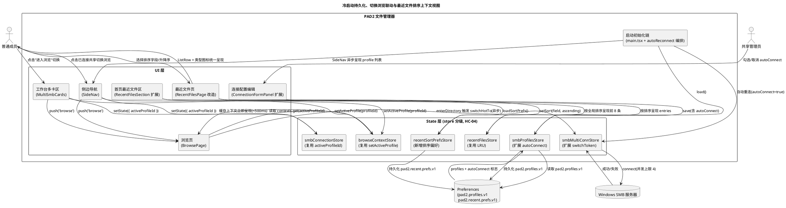
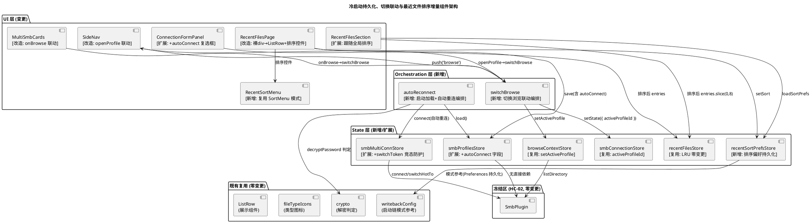
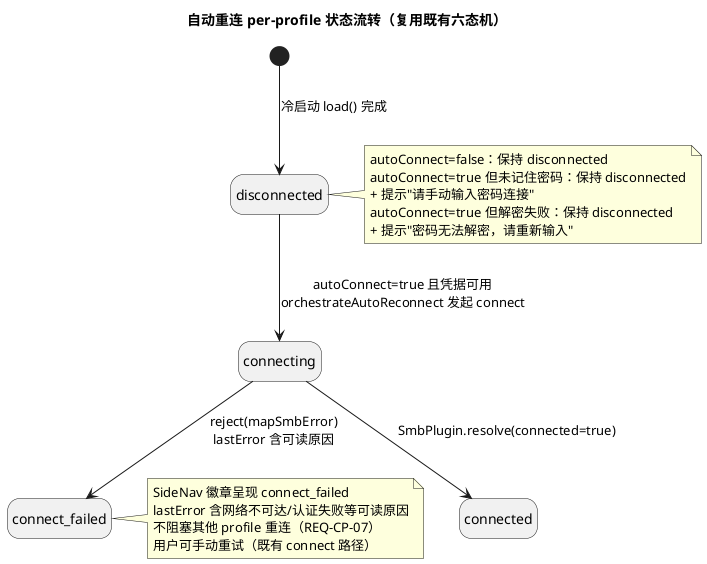
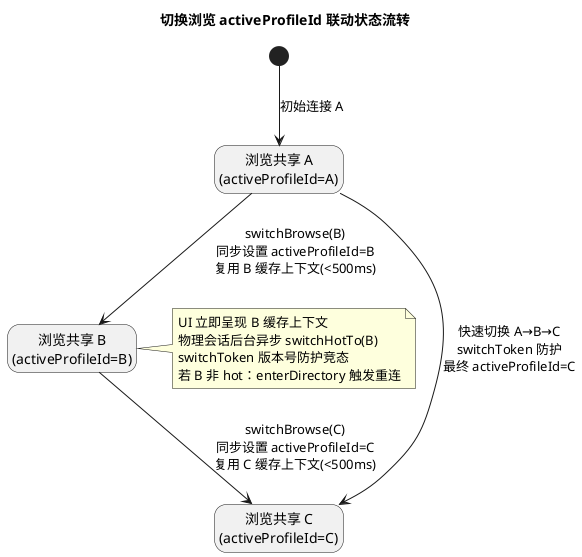
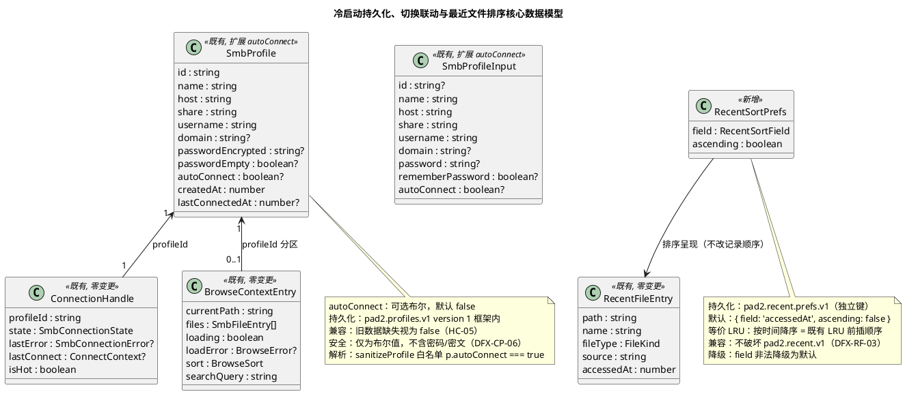
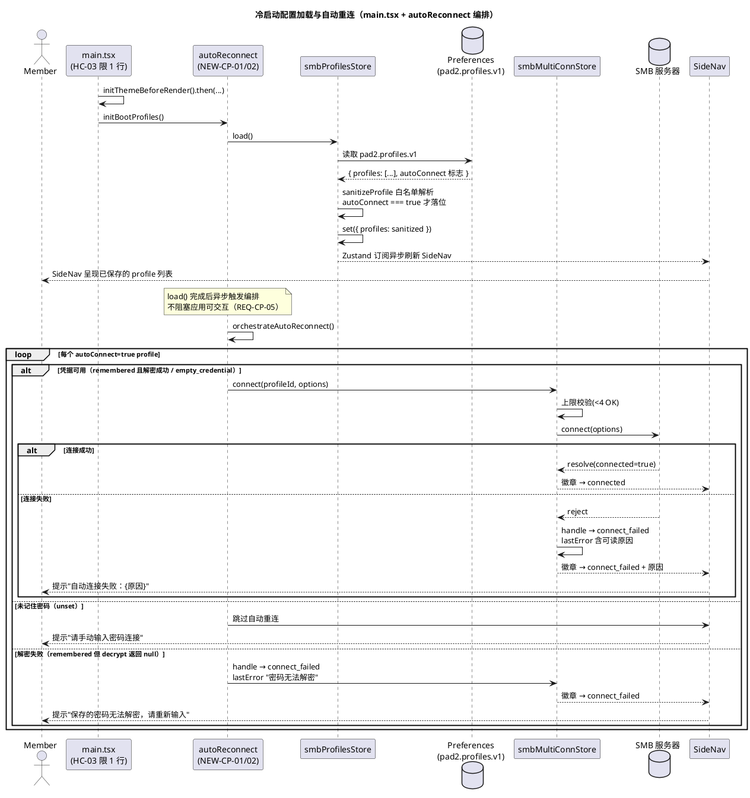
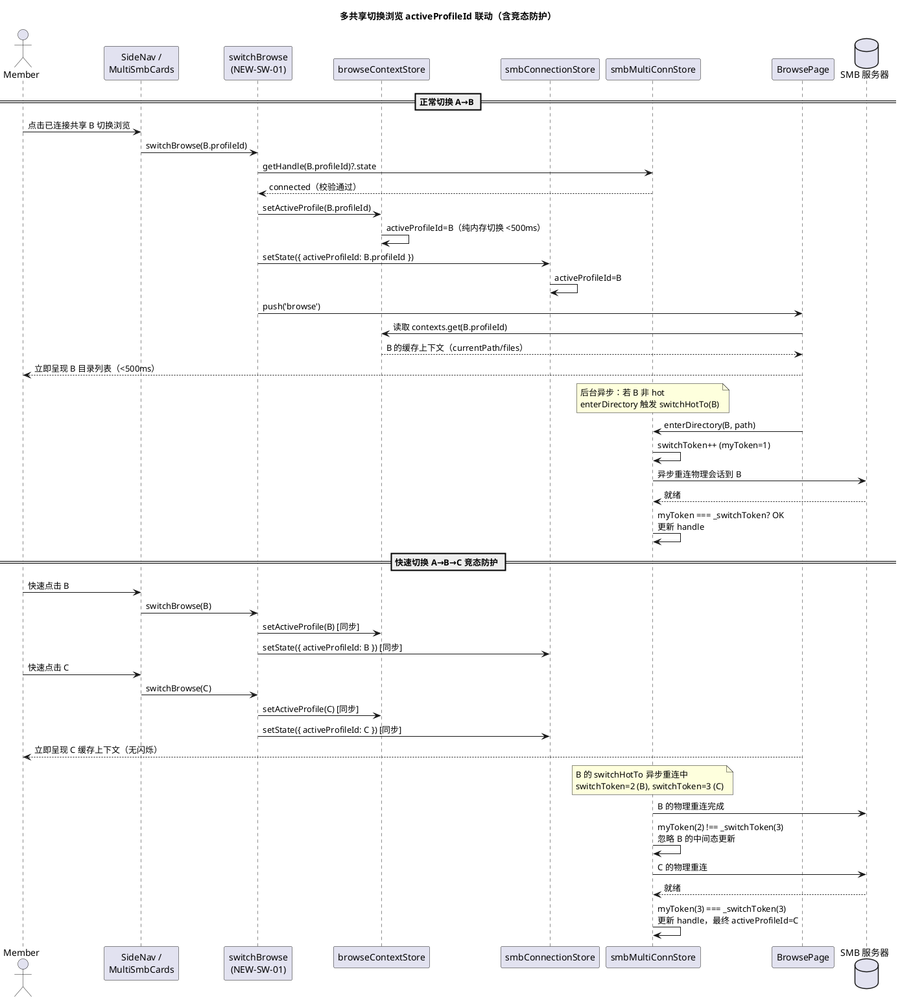
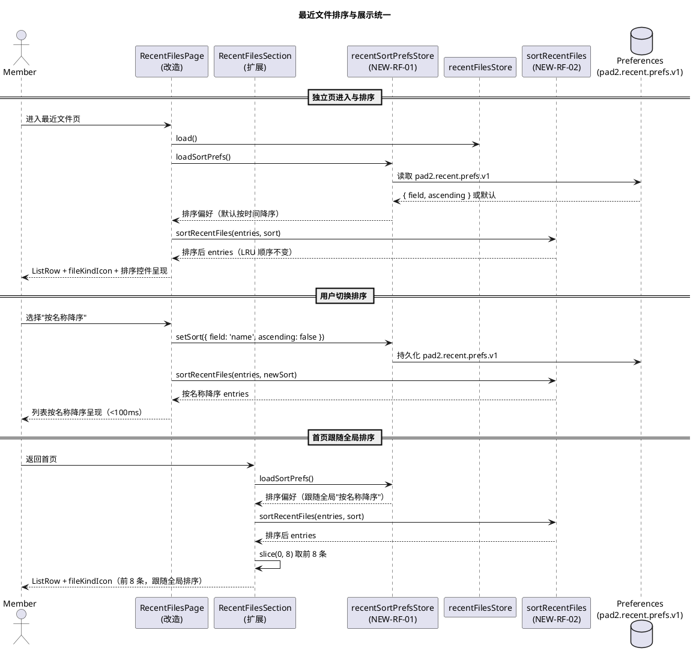

# 技术设计：冷启动配置持久化、共享切换浏览联动与最近文件排序展示优化

> **文档编号**：PAD2-DESIGN-CPRU-001
> **Feature Name**：conn_persist_recent_ui
> **上游规格**：`docs/specs/conn_persist_recent_ui/spec.md`（PAD2-SPEC-CPRU-001）
> **基线版本**：PAD2 v1.5（code 6），包名 com.pad2.filemanager，已落地 multi_conn_writeback（PAD2-DESIGN-MCWB-001）
> **文档定位**：本文档为规格驱动开发（SDD）第二阶段产物，描述"怎么做"（HOW）。基于 spec.md 的 EARS 需求与既有代码证据链，给出三项生产缺陷（冷启动配置丢失 / 多共享切换浏览显示错误 / 最近文件排序展示不佳）的增量架构方案、接口契约、数据模型、状态机、数据流、变更范围、风险缓解与测试策略。
> **硬约束（来自项目记忆，贯穿全文）**：
> - HC-01 零新增 npm 依赖
> - HC-02 冻结区零变更：`src/adapter/smb/SmbPlugin.ts` / `src/core/**` / `android/**` 原生层不得变更（SmbPlugin 为唯一 SMB 调用入口）
> - HC-03 `src/main.tsx` 改动限 3 行内，超限逻辑抽独立模块
> - HC-04 store 分级：store 为 SmbPlugin 唯一调用入口，UI 层不得直接 import SmbPlugin
> - HC-05 既有 profile 持久化兼容：不破坏 `smbProfilesStore` 既存数据（`pad2.profiles.v1`）
> - HC-06 只读模式兼容：写回启用后须兼容 `enabled=false` 与路径越界场景

---

# 一、需求与存量功能关系分析

## 1.0 问题根因分析（代码级定位）

### 1.0.1 问题1根因：启动链未加载 profiles + 无自动重连

| 根因编号 | 代码位置 | 根因事实 | 违反需求 |
|---------|---------|---------|---------|
| RC-CP-01 | `src/main.tsx:10-17` | 启动初始化链仅调用 `initThemeBeforeRender` / `loadWritebackConfig` / `initAutoUpdateCheck`，未调用 `useSmbProfilesStore.getState().load()` | REQ-CP-01/02 |
| RC-CP-02 | `src/App.tsx:8-21` | App 挂载 useEffect 仅调用 `hydrateUiPrefs` / `setupBackButtonNavigation`，未触发 profiles 加载 | REQ-CP-01 |
| RC-CP-03 | `src/ui/pages/ConnectionPage/ProfilesListPanel/index.tsx:90-92` | 全项目仅此处 `useEffect(() => { void useSmbProfilesStore.getState().load(); }, [])` 在用户进入连接页时触发 load()，冷启动未进入连接页则 profiles 保持空 | REQ-CP-01 |
| RC-CP-04 | `src/state/smbProfilesStore.ts:171,173-207` | `profiles` 初始值为 `[]`（:171），`load()` 从 Preferences 读取并 set({ profiles: sanitized })，冷启动未调用 load() 则内存保持空数组 | REQ-CP-01 |
| RC-CP-05 | `src/state/smbProfilesStore.ts:26-45` | `SmbProfile` 接口无 `autoConnect` 字段，连接为纯手动操作，无自动重连逻辑 | REQ-CP-03/04 |
| RC-CP-06 | `src/ui/layouts/AppShell/SideNav/index.tsx:99-126` | SideNav "SMB 连接"区 `profiles.map(...)` 渲染，profiles 为空时渲染空列表（用户以为配置丢失） | REQ-CP-01 |

**根因链**：RC-CP-01/02（启动链缺 load()）→ RC-CP-03（仅连接页触发）→ RC-CP-04（内存保持空）→ RC-CP-06（SideNav 渲染空列表）；RC-CP-05（无 autoConnect 字段 + 无自动重连编排）独立根因。修复需在启动链接入 load() + 新增 autoConnect 字段 + 新增自动重连编排模块。

### 1.0.2 问题2根因：切换入口未联动 activeProfileId

| 根因编号 | 代码位置 | 根因事实 | 违反需求 |
|---------|---------|---------|---------|
| RC-SW-01 | `src/ui/layouts/AppShell/SideNav/index.tsx:57-64` | `openProfile` 点击已连接 profile 仅 `push('browse')`，未设置 `browseContextStore.activeProfileId` 与 `smbConnectionStore.activeProfileId` | REQ-SW-01 |
| RC-SW-02 | `src/ui/pages/HomePage/StorageOverviewRow/MultiSmbCards.tsx:110` | `onBrowse` 回调仅 `() => push('browse')`，未联动 activeProfileId | REQ-SW-02 |
| RC-SW-03 | `src/ui/pages/BrowsePage/index.tsx:60,64` | BrowsePage 读 `activeProfileId = useSmbConnectionStore((s) => s.activeProfileId)`，`ctxEntry = activeProfileId ? browseContexts.get(activeProfileId) : undefined`，activeProfileId 未切换则仍读旧共享上下文 | REQ-SW-01/02 |
| RC-SW-04 | `src/state/smbMultiConnStore.ts:150-169` | `switchHotTo(profileId)` 异步重连物理会话，无取消/版本号机制，快速切换 A→B→C 可能残留 B 中间态 | REQ-SW-04/DFX-SW-02 |
| RC-SW-05 | `src/state/browseContextStore.ts:82-109` | `enterDirectory` 已在非 hot 时调用 `switchHotTo`，逻辑层按 profileId 分区正确，缺陷在切换入口未联动 activeProfileId | REQ-SW-03 |

**根因链**：RC-SW-01/02（切换入口仅导航不联动）→ RC-SW-03（BrowsePage 读旧 activeProfileId 上下文）；RC-SW-04（switchHotTo 无竞态防护）独立根因。逻辑层 browseContextStore 分区已正确（RC-SW-05），仅需修复切换入口联动 + 加竞态防护。

### 1.0.3 问题3根因：最近文件无排序选项 + 展示不统一

| 根因编号 | 代码位置 | 根因事实 | 违反需求 |
|---------|---------|---------|---------|
| RC-RF-01 | `src/state/recentFilesStore.ts:56-64` | `record()` 仅 LRU 前插（新条目置顶，按 path 去重，截断至 20），无排序选项字段与排序逻辑 | REQ-RF-01 |
| RC-RF-02 | `src/ui/pages/RecentFilesPage/index.tsx:24-31` | 独立最近文件页用裸 `div` + 内联 `style`（padding/borderBottom/fontWeight），无 ListRow，无 fileKindIcon 类型图标 | REQ-RF-04 |
| RC-RF-03 | `src/ui/pages/HomePage/RecentFilesSection/index.tsx:50-63` | 首页最近文件区用 `ListRow` + `fileKindIcon` 类型图标 + 来源/时间副标题，视觉规范（与独立页不一致） | REQ-RF-04 |
| RC-RF-04 | `src/state/recentFilesStore.ts:12-18` | `RecentFileEntry` 含 path/name/fileType/source/accessedAt 五字段，已具备按时间/名称/类型/来源排序的数据基础，但无排序偏好持久化 | REQ-RF-01/02 |
| RC-RF-05 | `src/ui/pages/BrowsePage/SortMenu/index.tsx:15-24` | BrowsePage 已有 SortMenu 四字段（name/size/lastModified/type）× 升降序 BottomSheet 组件，可复用模式（字段集不同） | REQ-RF-05 |

**根因链**：RC-RF-01（store 无排序选项）+ RC-RF-04（无排序偏好持久化）→ 无排序能力；RC-RF-02（独立页裸 div）vs RC-RF-03（首页 ListRow）→ 展示不统一。修复需新增排序偏好 store + 统一独立页为 ListRow + 复用 SortMenu 模式。

### 1.0.4 既有预留（可复用资产）

| 资产编号 | 代码位置 | 资产事实 | 复用方向 |
|---------|---------|---------|---------|
| AS-CP-01 | `src/state/smbProfilesStore.ts:173-207` | `load()` 已实现安全降级（JSON 损坏回空列表、版本不匹配回空、fail-secure 清洗非法密文），可直接在启动链调用 | 启动链接入 load()，零变更 |
| AS-CP-02 | `src/state/smbProfilesStore.ts:120-153` | `sanitizeProfile()` 白名单解析模式，可选字段缺失视为 unset（passwordEmpty 同模式），可扩展解析 autoConnect | autoConnect 字段兼容扩展 |
| AS-CP-03 | `src/state/smbMultiConnStore.ts:83-128` | `connect()` 已实现并发上限校验（MAX_CONCURRENT=4）、防重入、同 profile 幂等、事实驱动连接，自动重连可直接复用 | 自动重连编排复用 connect() |
| AS-CP-04 | `src/utils/crypto.ts:80-99` | `decryptPassword()` 已实现 AES-GCM 解密，失败返回 null，可判定凭据可解密 | 自动重连凭据可用性判定 |
| AS-CP-05 | `src/state/smbProfilesStore.ts:113-117` | `getPasswordSemantics()` 已实现三态语义（remembered/empty_credential/unset），可判定是否记住密码 | 自动重连前置条件判定 |
| AS-CP-06 | `src/state/writebackConfig.ts:39-57` | `loadWritebackConfig()` 已实现 Preferences 读取 + 内存缓存 + 默认值降级模式，可参考实现排序偏好 store | 排序偏好 store 模式参考 |
| AS-SW-01 | `src/state/browseContextStore.ts:70-80` | `setActiveProfile()` 已实现纯内存指针切换不触发 SmbPlugin.connect（REQ-MC-03 逻辑层），切换 < 500ms | 切换入口联动复用 |
| AS-SW-02 | `src/state/smbMultiConnStore.ts:150-169` | `switchHotTo()` 已实现物理会话热切换异步重连，失败不改变逻辑 connected 态 | 物理会话热切换复用 |
| AS-SW-03 | `src/ui/pages/BrowsePage/index.tsx:99-103` | BrowsePage 已有 useEffect 同步 activeProfile 到 browseContextStore（`setActiveProfile(activeProfileId)`），但依赖 smbConnectionStore.activeProfileId 被动同步 | 联动入口设置 smbConnectionStore.activeProfileId 即可触发 |
| AS-RF-01 | `src/state/recentFilesStore.ts:12-18` | `RecentFileEntry` 五字段已具备排序数据基础（accessedAt/name/fileType/source） | 排序逻辑直接消费 |
| AS-RF-02 | `src/ui/pages/HomePage/RecentFilesSection/index.tsx:50-63` | 首页 ListRow + fileKindIcon + 来源/时间副标题为展示标准 | 独立页统一为此标准 |
| AS-RF-03 | `src/ui/pages/BrowsePage/SortMenu/index.tsx` | SortMenu BottomSheet 四字段×升降序组件，字段集可参数化 | 排序控件复用模式 |
| AS-RF-04 | `src/ui/icons/fileTypeIcons.ts:77-79` | `fileKindIcon()` 已实现 FileKind → IconName 映射 | 独立页类型图标复用 |

## 1.1 需求功能与存量功能对比

### 1.1.1 已实现功能

| 需求功能 | 存量功能 | 代码位置 | 匹配度 |
|---------|---------|---------|--------|
| REQ-CP-01 profiles 持久化读取 | `smbProfilesStore.load()` 从 Preferences 读取 + 安全降级 | `smbProfilesStore.ts:173-207` | 100%（load 已实现，仅启动链未调用） |
| REQ-CP-06 自动重连并发上限保护 | `smbMultiConnStore.connect()` 已校验 MAX_CONCURRENT=4 | `smbMultiConnStore.ts:91-100` | 100%（connect 上限校验已实现） |
| REQ-CP-04 凭据可用性判定 | `getPasswordSemantics()` 三态 + `decryptPassword()` 解密 | `smbProfilesStore.ts:113-117` / `crypto.ts:80-99?` | 100%（判定逻辑已实现） |
| REQ-SW-03 切换浏览复用缓存不重连（逻辑层） | `browseContextStore.setActiveProfile()` 纯内存切换不触发 connect | `browseContextStore.ts:70-80` | 100%（逻辑层已正确） |
| REQ-SW-05 切换到未连接共享走连接页 | `SideNav.openProfile` 已判定 handleState 非 connected 时 push('connection') | `SideNav/index.tsx:58-63` | 100%（SideNav 已实现，MultiSmbCards 仅对 connected 渲染按钮隐含满足） |
| DFX-SW-01 切换响应 < 500ms | `setActiveProfile()` 纯内存指针切换 | `browseContextStore.ts:70-80` | 100%（内存操作 < 500ms） |
| REQ-RF-07 空列表保持空态引导 | `RecentFilesPage` 已用 EmptyState | `RecentFilesPage/index.tsx:12-20` | 100%（空态已实现） |
| DFX-RF-01 排序响应 < 100ms | 纯内存排序（无网络/IO） | `recentFilesStore.ts`（待新增排序逻辑） | 100%（纯内存排序天然 < 100ms） |

### 1.1.2 需要扩展的功能

| 需求功能 | 存量功能 | 差异说明 | 扩展方向 |
|---------|---------|---------|---------|
| REQ-CP-01 冷启动自动加载 profile 配置 | `load()` 已实现但仅连接页触发（RC-CP-03） | 输入：用户进入连接页 → 期望：冷启动即触发；输出：连接页才加载 → 期望：启动链加载 | 启动链（main.tsx/App.tsx）接入 `smbProfilesStore.load()`，HC-03 约束下抽独立模块 |
| REQ-CP-03 autoConnect per-profile 可选标志 | `SmbProfile` 接口无 autoConnect 字段（RC-CP-05） | 输入：无 autoConnect → 期望：可选布尔字段；输出：无自动重连 → 期望：per-profile 标志驱动 | `SmbProfile` 新增 `autoConnect?: boolean`，`sanitizeProfile` 白名单解析，`save` 写入；HC-05 version 1 框架内扩展 |
| REQ-SW-01 SideNav 切换浏览联动 activeProfileId | `openProfile` 仅 push('browse')（RC-SW-01） | 输入：仅导航 → 期望：导航前同步设置 activeProfileId；输出：BrowsePage 读旧上下文 → 期望：读目标上下文 | `openProfile` 在 push 前调用 `browseContextStore.setActiveProfile` + `smbConnectionStore.setState({ activeProfileId })` |
| REQ-SW-02 工作台多卡区切换浏览联动 | `onBrowse` 仅 push('browse')（RC-SW-02） | 同 REQ-SW-01 | `MultiSmbCards.onBrowse` 联动 activeProfileId（需传入 profileId） |
| REQ-SW-04 物理会话热切换竞态安全 | `switchHotTo` 无取消机制（RC-SW-04） | 输入：无版本号 → 期望：快速切换以最后一次为目标；输出：可能残留 B 中间态 → 期望：最终 C | `switchHotTo` 引入切换令牌（switchToken）版本号防护，过期切换忽略 |
| REQ-RF-04 独立页与首页展示方式统一 | 独立页裸 div + 内联 style（RC-RF-02） | 输入：裸 div → 期望：ListRow + fileKindIcon；输出：视觉不一致 → 期望：视觉统一 | `RecentFilesPage` 改用 ListRow + fileKindIcon + 来源/时间副标题（参考 RecentFilesSection） |
| REQ-RF-06 首页排序跟随全局偏好 | 首页无排序控件，按 LRU 顺序呈现 | 输入：LRU 顺序 → 期望：按全局排序偏好；输出：仅 LRU → 期望：跟随排序偏好 | `RecentFilesSection` 消费排序偏好 store 按排序呈现前 8 条 |

### 1.1.3 需要新增的功能或接口

**模块 A：冷启动配置加载与自动重连编排（REQ-CP）**

| 新增编号 | 功能点 | 输入 | 输出 | 核心逻辑 | 依赖 |
|---------|--------|------|------|---------|------|
| NEW-CP-01 | 启动链 profiles 加载编排 | — | Promise<void> | 调用 `smbProfilesStore.load()` 加载配置，加载完成后触发自动重连编排 | smbProfilesStore |
| NEW-CP-02 | 自动重连编排模块 | profiles[] | void | 遍历 autoConnect=true profile，判定凭据可用性，并发上限内调用 `smbMultiConnStore.connect()`，失败如实告知 | smbProfilesStore, crypto, smbMultiConnStore |
| NEW-CP-03 | autoConnect 字段持久化 | SmbProfileInput + autoConnect | SmbProfile | `save()` 写入 autoConnect 字段，`sanitizeProfile()` 白名单解析 | smbProfilesStore 扩展 |
| NEW-CP-04 | autoConnect 表单控件 | — | boolean | 连接配置编辑页新增"启动时自动连接"复选框（依赖记住密码） | ConnectionFormPanel 扩展 |

**模块 B：切换浏览 activeProfileId 联动（REQ-SW）**

| 新增编号 | 功能点 | 输入 | 输出 | 核心逻辑 | 依赖 |
|---------|--------|------|------|---------|------|
| NEW-SW-01 | 切换浏览联动编排函数 | profileId | void | 同步设置 `browseContextStore.activeProfileId` + `smbConnectionStore.activeProfileId`，再导航到 browse | browseContextStore, smbConnectionStore |
| NEW-SW-02 | switchHotTo 竞态防护 | profileId + switchToken | void | 引入单调递增 switchToken，执行前比对当前 token，过期切换忽略 | smbMultiConnStore 扩展 |

**模块 C：最近文件排序与展示统一（REQ-RF）**

| 新增编号 | 功能点 | 输入 | 输出 | 核心逻辑 | 依赖 |
|---------|--------|------|------|---------|------|
| NEW-RF-01 | 排序偏好 store | — | RecentSortPrefs | 持久化到 `pad2.recent.prefs.v1`，默认 `{ field: 'accessedAt', ascending: false }`，非法值降级 | Preferences |
| NEW-RF-02 | 最近文件排序函数 | entries[] + sort | entries[] | 按字段（accessedAt/name/fileType/source）× 升降序排序，不改 LRU 记录顺序 | recentFilesStore |
| NEW-RF-03 | 独立页排序控件 | — | RecentSort | 复用 SortMenu 模式，字段集为 accessedAt/name/fileType/source | SortMenu 模式 |
| NEW-RF-04 | 独立页 ListRow 统一展示 | entries[] | ReactNode | 改用 ListRow + fileKindIcon + 来源/时间副标题（参考 RecentFilesSection） | ListRow, fileKindIcon |

## 1.2 存量功能详细分析

### 1.2.1 smbProfilesStore（profile 持久化，AS-CP-01/02）

**接口契约**：
- `load(): Promise<void>` — 无参；副作用：从 Preferences `pad2.profiles.v1` 读取 + sanitize + set({ profiles })；异常：JSON 损坏/版本不匹配安全降级为空列表（不崩溃）
- `save(input: SmbProfileInput): Promise<void>` — 入参 SmbProfileInput；副作用：身份查重 + 加密密码 + persist；异常：持久化失败静默降级（内存态生效）
- `remove(id: string): Promise<void>` — 入参 profileId；副作用：过滤移除 + persist
- `getPasswordSemantics(profile): SmbPasswordSemantics` — 纯函数，判定密码三态（remembered/empty_credential/unset）

**业务规则**：
- 版本化持久化：`STORAGE_VERSION = 1`，版本不匹配安全丢弃（不升级迁移，避免破坏用户配置）
- 白名单解析：`sanitizeProfile()` 严格类型校验，可选字段缺失视为 unset（passwordEmpty 同模式，可扩展 autoConnect）
- fail-secure：密文格式非法静默清除并回写，要求重新输入
- 身份查重：`isSameProfileIdentity()` host+share+username+domain 四元组判定（name 不参与）

**扩展点**：
- `SmbProfile` 接口为可选字段扩展预留（passwordEmpty 已示范 version 1 框架内兼容扩展模式）
- `sanitizeProfile()` 白名单解析可扩展 autoConnect 字段（`p.autoConnect === true` 严格判定，与 passwordEmpty 同风格）
- `SmbProfileInput` 可扩展 `autoConnect?: boolean` 字段

**约束**：
- 接口签名冻结于 S1-09（R-07），本设计仅新增可选字段不破坏既有签名
- HC-05 既有 profile 持久化兼容：STORAGE_VERSION 保持 1 不升，旧数据缺失 autoConnect 视为 false
- 持久化错误信息永不输出密码（仅 id/name 类标识）

### 1.2.2 smbMultiConnStore（多连接管理，AS-CP-03）

**接口契约**：
- `connect(profileId, options): Promise<void>` — 入参 profileId + SmbConnectOptions；副作用：上限校验 + 创建 handle + SmbPlugin.connect + 状态迁移；异常：经 `mapSmbError` 分类入 handle.lastError
- `switchHotTo(profileId): Promise<void>` — 入参 profileId；副作用：setHot + SmbPlugin.connect 异步重连；异常：失败不改变逻辑 connected 态，仅记 lastError
- `disconnect(profileId): Promise<void>` — 入参 profileId；副作用：若 hot 则 SmbPlugin.disconnect + 移除 handle
- `getHandle(profileId): ConnectionHandle | undefined` — 纯查询

**业务规则**：
- 并发上限：`handles.size >= MAX_CONCURRENT(4)` 时拒绝，handle 入 connect_failed 态
- 防重入：已 connecting 忽略；同 profile 幂等：已 connected 返回
- 事实驱动：connected 仅凭插件 resolve 事实可达（禁乐观更新）
- 物理单会话：connect 新共享不 disconnect 旧共享（逻辑多连接 + 物理热切换，D-MC-01 决策）

**扩展点**：
- `switchHotTo` 可引入 switchToken 版本号防护竞态（NEW-SW-02）
- `connect` 可被自动重连编排模块直接调用（NEW-CP-02）

**约束**：
- HC-02 冻结区：SmbPlugin 单会话接口不变，物理热切换异步重连
- handle.lastConnect 仅内存凭据，不持久化不入日志（DFX-MC-04）

### 1.2.3 browseContextStore（浏览上下文分区，AS-SW-01）

**接口契约**：
- `setActiveProfile(profileId): void` — 入参 profileId；副作用：纯内存指针切换 activeProfileId，不触发 SmbPlugin.connect；若无上下文则创建空条目
- `enterDirectory(profileId, path): Promise<void>` — 入参 profileId + path；副作用：若非 hot 先 switchHotTo + SmbPlugin.listDirectory + 更新上下文
- `setSort(profileId, sort): void` — 入参 profileId + BrowseSort；副作用：更新该 profile 上下文排序
- `getContext(profileId): BrowseContextEntry | undefined` — 纯查询

**业务规则**：
- setActiveProfile 纯内存切换 < 500ms（DFX-MC-02，REQ-MC-03 逻辑层）
- enterDirectory 在非 hot 时先 switchHotTo 物理重连（REQ-MC-03 降级披露）
- 上下文按 profileId 分区，每 profile 独立 currentPath/files/sort/searchQuery

**扩展点**：
- setActiveProfile 可被切换入口联动编排函数直接调用（NEW-SW-01）

**约束**：
- 上下文不持久化（会话内存），连接断开时 clearContext 清除
- HC-04 store 分级：browseContextStore 为 SmbPlugin 调用入口（enterDirectory 内调 listDirectory）

### 1.2.4 recentFilesStore（最近文件 LRU，AS-RF-01）

**接口契约**：
- `record(entry: Omit<RecentFileEntry, 'accessedAt'>): void` — 入参不含 accessedAt；副作用：LRU 前插 + 去重 + 截断至 20 + persist
- `load(): Promise<void>` — 无参；副作用：从 Preferences `pad2.recent.v1` 读取 + 校验 + set({ entries })

**业务规则**：
- LRU 前插：新条目置顶，按 path 去重，截断至 MAX_ENTRIES(20)
- 版本化持久化：`RECENT_VERSION = 1`，损坏安全丢弃重建空列表
- 记录时机：openInWps 成功后

**扩展点**：
- `RecentFileEntry` 五字段已具备排序数据基础，排序逻辑可在 UI 层派生（不改 store 记录顺序，REQ-RF-08）
- 排序偏好独立持久化到 `pad2.recent.prefs.v1`（NEW-RF-01），不破坏既有 `pad2.recent.v1`

**约束**：
- 接口签名冻结于 S1-09（R-07），record/load 签名不变
- NON-RF-02：不改变 LRU 记录策略，排序仅影响呈现顺序

### 1.2.5 启动初始化链（main.tsx / App.tsx，RC-CP-01/02）

**接口契约**：
- `main.tsx:10-17`：`initThemeBeforeRender().then(() => { loadWritebackConfig(); initAutoUpdateCheck(); ReactDOM.render(...) })`
- `App.tsx:8-21`：useEffect 调用 `hydrateUiPrefs()` + `setupBackButtonNavigation()`

**业务规则**：
- 主题 render 前预读（initThemeBeforeRender）阻塞首屏（主题闪烁防护）
- 其余初始化（writebackConfig/autoUpdate/uiPrefs/backButton）异步不阻塞渲染
- 首屏渲染不等待 profiles 加载（REQ-CP-02）

**扩展点**：
- main.tsx 可在 `.then()` 链内新增 `smbProfilesStore.load()` 调用（HC-03 限 3 行内）
- 超限逻辑（自动重连编排）抽独立模块 `src/orchestration/boot/autoReconnect.ts`（HC-03）

**约束**：
- HC-03：main.tsx 改动限 3 行内，超限逻辑抽独立模块
- REQ-CP-02：配置加载不阻塞首屏渲染（load() 异步，加载完成后异步刷新 SideNav）

---
# 二、增量设计方案

## 2.1 实现模型

### 2.1.1 上下文视图



**通信协议与频率**：
- UI → State：Zustand 订阅（高频，随渲染）
- Boot → State：启动时一次性调用（低频，仅冷启动）
- State → Preferences：Capacitor Preferences 读写（低频，配置变更/启动）
- State → SmbPlugin：Capacitor 桥调用（低频，用户操作/自动重连驱动）
- SmbPlugin → SMB：SMB 协议（中频，自动重连/切换浏览）

### 2.1.2 服务/组件总体架构



**模块划分与职责**：
- **autoReconnect 编排模块（NEW-CP-01/02）**：启动链 profiles 加载 + 自动重连编排，HC-03 约束下从 main.tsx 抽出的独立模块
- **switchBrowse 编排模块（NEW-SW-01）**：切换浏览联动编排，同步设置双 store activeProfileId 再导航
- **smbProfilesStore（扩展）**：SmbProfile 新增 autoConnect 可选字段，sanitizeProfile 白名单解析，save 写入
- **smbMultiConnStore（扩展）**：switchHotTo 引入 switchToken 竞态防护
- **recentSortPrefsStore（NEW-RF-01）**：排序偏好持久化到 `pad2.recent.prefs.v1`，默认时间降序
- **RecentFilesPage（改造）**：裸 div → ListRow + fileKindIcon + 排序控件
- **RecentFilesSection（扩展）**：消费全局排序偏好呈现前 8 条

**配置项与取值策略**：
- `MAX_CONCURRENT = 4`（既有常量，自动重连复用，REQ-CP-06）
- 排序偏好默认 `{ field: 'accessedAt', ascending: false }`（按时间降序，等价 LRU，REQ-RF-03）
- autoConnect 默认 false（HC-05 兼容，旧数据缺失视为 false）

### 2.1.3 实现设计文档（关键决策与状态机）

#### 决策 D-CP-01：启动链 profiles 加载策略（HC-03 约束决策）

**冲突事实**：REQ-CP-01 要求冷启动自动加载 profiles，但 main.tsx HC-03 限制改动 3 行内。直接在 main.tsx 内联 load() + 自动重连编排逻辑将超 3 行。

**决策**：采用**"main.tsx 接入 1 行调用 + 独立编排模块"**策略：
- main.tsx 在 `.then()` 链内新增 1 行 `void initBootProfiles()`（HC-03 限 3 行内，实际 1 行）
- 新增 `src/orchestration/boot/autoReconnect.ts` 模块导出 `initBootProfiles()`，内部：① 调用 `smbProfilesStore.load()` ② load 完成后异步触发 `orchestrateAutoReconnect()`
- `orchestrateAutoReconnect()` 遍历 autoConnect=true profile，判定凭据可用性，并发上限内调用 `smbMultiConnStore.connect()`，失败如实告知（经 handle.lastError + SideNav 徽章呈现）
- load() 异步不阻塞首屏渲染（REQ-CP-02），加载完成后 Zustand 订阅自动刷新 SideNav

**选择理由**：HC-03 硬约束下，编排逻辑抽独立模块既满足行数限制又保持 main.tsx 整洁；load() 异步不阻塞渲染满足 REQ-CP-02；自动重连编排复用既有 connect() 满足 REQ-CP-06 并发上限。

#### 决策 D-CP-02：autoConnect 字段兼容扩展策略（HC-05 决策）

**决策**：`SmbProfile` 新增 `autoConnect?: boolean` 可选字段，在 `pad2.profiles.v1` version 1 框架内向后兼容扩展（与既有 passwordEmpty 同模式）：
- `sanitizeProfile()` 白名单解析：`if (p.autoConnect === true) profile.autoConnect = true`（严格 === true 才落位，非布尔/篡改值静默丢弃）
- 旧数据缺失 autoConnect 视为 false（DFX-CP-08 兼容，不升级版本号）
- `SmbProfileInput` 新增 `autoConnect?: boolean`，`save()` 写入该字段
- autoConnect 仅为布尔值，不携带密码/密文（DFX-CP-06）

**选择理由**：与既有 passwordEmpty 扩展模式完全一致，STORAGE_VERSION 保持 1 不升（升版本=安全丢弃用户配置，违反 R08）；严格 === true 白名单解析防篡改误判。

#### 决策 D-CP-03：自动重连编排策略

**决策**：`orchestrateAutoReconnect()` 编排逻辑：
1. 读取 `smbProfilesStore.profiles`，筛选 `autoConnect === true` 的 profile 列表
2. 对每个 profile 判定凭据可用性：
   - `getPasswordSemantics(profile) === 'remembered'`：调用 `decryptPassword(passwordEncrypted)`，解密成功则凭据可用，解密失败则跳过 + handle 入 connect_failed + lastError"密码无法解密"
   - `getPasswordSemantics(profile) === 'empty_credential'`：凭据可用（空密码直接连接）
   - `getPasswordSemantics(profile) === 'unset'`：跳过 + 提示"请手动输入密码连接"（DFX-CP-05）
3. 凭据可用的 profile 在并发上限内（MAX_CONCURRENT=4）调用 `smbMultiConnStore.connect(profileId, options)`，超出上限排队或拒绝并提示
4. connect 失败经 `mapSmbError` 分类入 handle.lastError，SideNav 徽章呈现 connect_failed + 可读原因（REQ-CP-07）
5. 整个编排异步执行不阻塞应用可交互（REQ-CP-05）

**前置条件**：`smbProfilesStore.load()` 已完成（profiles 已加载到内存）。

**选择理由**：复用既有 connect() 上限校验 + 凭据三态判定 + 错误分类，零新增核心逻辑；编排模块仅负责遍历调度与凭据可用性前置判定。

#### 决策 D-SW-01：切换入口联动策略

**决策**：新增 `switchBrowse(profileId)` 编排函数（NEW-SW-01），SideNav.openProfile 与 MultiSmbCards.onBrowse 统一调用：
1. 校验目标 profile 已连接（`smbMultiConnStore.getHandle(profileId)?.state === 'connected'`），未连接走连接页（REQ-SW-05）
2. 同步设置 `browseContextStore.setActiveProfile(profileId)`（复用 AS-SW-01，纯内存切换 < 500ms）
3. 同步设置 `smbConnectionStore.setState({ activeProfileId: profileId })`（触发 BrowsePage useEffect 同步上下文，AS-SW-03）
4. 导航 `push('browse')`
5. 物理会话热切换由 BrowsePage enterDirectory 触发 switchHotTo（既有逻辑，后台异步不阻塞 UI 呈现缓存）

**选择理由**：双 store activeProfileId 同步设置保证一致性（REQ 6.3-1）；复用既有 setActiveProfile + BrowsePage useEffect 同步链；物理热切换后台异步满足 REQ-SW-03。

#### 决策 D-SW-02：switchHotTo 竞态防护策略

**决策**：`smbMultiConnStore.switchHotTo` 引入 `switchToken` 单调递增版本号防护（NEW-SW-02）：
- store 新增模块级 `let _switchToken = 0`
- `switchHotTo(profileId)` 执行前 `const myToken = ++_switchToken`，异步重连完成后比对 `if (myToken !== _switchToken) return`（过期切换忽略，不更新 handle）
- 快速切换 A→B→C：A 的 switchHotTo token=1，B 的 token=2，C 的 token=3；A/B 异步重连完成后比对 token 已为 3，忽略中间态更新；最终 activeProfileId=C，物理会话切换到 C（DFX-SW-02）
- setActiveProfile 同步切换 activeProfileId 立即生效（UI 立即呈现 C 缓存上下文），物理重连竞态由 switchToken 防护

**选择理由**：switchToken 单调递增版本号是竞态防护经典模式，轻量无依赖；UI 层立即呈现最终目标缓存上下文（无闪烁），物理重连后台异步以最后一次为目标。

#### 决策 D-RF-01：排序偏好独立持久化策略

**决策**：新增 `recentSortPrefsStore`（NEW-RF-01），独立持久化到 `pad2.recent.prefs.v1`：
- 持久化键 `pad2.recent.prefs.v1`（与既有 `pad2.recent.v1` 独立，不冲突，DFX-RF-03）
- 结构 `{ field: RecentSortField, ascending: boolean }`，field 取值 `accessedAt | name | fileType | source`
- 默认 `{ field: 'accessedAt', ascending: false }`（按时间降序，等价 LRU，REQ-RF-03）
- 非法值降级：field 不在枚举内降级为默认（异常场景3），不崩溃
- 内存缓存 + load/setSort 模式参考 `writebackConfig.ts`（AS-CP-06）

**选择理由**：独立键不破坏既有最近文件数据（DFX-RF-03）；默认时间降序等价 LRU 保持向后兼容；模式参考既有 writebackConfig 降低实现风险。

#### 决策 D-RF-02：展示统一策略

**决策**：`RecentFilesPage` 改用 ListRow + fileKindIcon + 来源/时间副标题（参考 RecentFilesSection 标准，AS-RF-02/AS-RF-04）：
- 每条 `ListRow`：icon=`<Icon name={fileKindIcon(entry.fileType)} size={32} />`，title=entry.name，subtitle=`${entry.source} · ${formatTimestamp(entry.accessedAt)}`，trailing=`<Icon name="icon-chevron-right" />`
- 消除裸 div + 内联 style（RC-RF-02），与首页视觉统一（REQ-RF-04）
- 独立页新增排序控件 `RecentSortMenu`（复用 SortMenu BottomSheet 模式，字段集为 accessedAt/name/fileType/source，NEW-RF-03）
- 首页 RecentFilesSection 消费 `recentSortPrefsStore` 按全局排序呈现前 8 条（REQ-RF-06），首页不单独提供排序控件

**选择理由**：复用既有 ListRow + fileKindIcon 组件零新增 UI 组件；复用 SortMenu 模式仅改字段集；展示标准与首页完全一致消除视觉差异。

#### 状态机：自动重连 per-profile 状态流转



**迁移约束**：自动重连复用既有 smbMultiConnStore.connect() 状态机，每 handle 独立迁移，一句柄失败不触发其他句柄迁移（REQ-CP-07）。

#### 状态机：切换浏览 activeProfileId 联动流转



## 2.2 接口设计

### 2.2.1 总体设计

**接口分类**：
1. **启动编排接口**（autoReconnect 模块）— 新增，稳定性：实验→稳定
2. **切换浏览编排接口**（switchBrowse 函数）— 新增，稳定性：实验→稳定
3. **profile 持久化扩展接口**（smbProfilesStore）— 扩展（新增 autoConnect 字段），稳定性：稳定
4. **多连接管理扩展接口**（smbMultiConnStore）— 扩展（switchHotTo 竞态防护），稳定性：稳定
5. **排序偏好接口**（recentSortPrefsStore）— 新增，稳定性：实验→稳定
6. **既有兼容接口**（browseContextStore/smbConnectionStore/recentFilesStore）— 保留，稳定性：稳定

**接口变更策略**：
- 既有 `smbProfilesStore` save/load 签名零变更（R-07 冻结），仅 SmbProfile/SmbProfileInput 新增可选字段
- 既有 `smbMultiConnStore.switchHotTo` 签名零变更，仅内部新增 switchToken 防护逻辑
- 既有 `browseContextStore.setActiveProfile` / `smbConnectionStore` 签名零变更，切换入口编排函数调用既有接口
- 既有 `recentFilesStore` record/load 签名零变更，排序逻辑在 UI 层派生

### 2.2.2 接口清单

#### 启动编排 autoReconnect 模块（NEW-CP-01/02）

```typescript
// src/orchestration/boot/autoReconnect.ts（新增）
/**
 * 启动链 profiles 加载 + 自动重连编排入口。
 * main.tsx 调用此函数（HC-03 限 1 行）。
 * 内部：① smbProfilesStore.load() ② load 完成后异步 orchestrateAutoReconnect()
 */
export function initBootProfiles(): void;

/**
 * 自动重连编排（内部函数，由 initBootProfiles 调用）。
 * 遍历 autoConnect=true profile，判定凭据可用性，并发上限内 connect。
 */
async function orchestrateAutoReconnect(): Promise<void>;
```

| 项 | 说明 |
|----|------|
| 业务说明 | 冷启动加载 profiles + 自动重连编排，main.tsx 唯一调用入口 |
| 前置条件 | 应用启动初始化链执行到 main.tsx `.then()` 回调 |
| 后置条件 | profiles 加载到内存；autoConnect=true 且凭据可用的 profile 异步发起 connect |
| 异常映射 | load 失败安全降级空列表（既有逻辑）；connect 失败经 mapSmbError 入 handle.lastError |
| 并发上限 | 复用 smbMultiConnStore MAX_CONCURRENT=4（REQ-CP-06） |
| 不阻塞 | load/connect 异步执行，应用立即可交互（REQ-CP-05） |

#### 切换浏览编排 switchBrowse（NEW-SW-01）

```typescript
// src/orchestration/browse/switchBrowse.ts（新增）
/**
 * 切换浏览联动编排：同步设置双 store activeProfileId 再导航。
 * SideNav.openProfile 与 MultiSmbCards.onBrowse 统一调用。
 */
export function switchBrowse(profileId: string): void;
```

| 项 | 说明 |
|----|------|
| 业务说明 | 切换浏览到目标 profile，联动 activeProfileId + 导航到 BrowsePage |
| 前置条件 | 目标 profile 须在 smbMultiConnStore 为 connected 态 |
| 后置条件 | browseContextStore.activeProfileId=profileId；smbConnectionStore.activeProfileId=profileId；导航到 browse |
| 未连接处理 | 目标 profile 未 connected 时导航到 connection 页（REQ-SW-05） |
| 响应时间 | 同步设置 < 500ms（DFX-SW-01，纯内存操作） |
| 物理热切换 | 由 BrowsePage enterDirectory 触发 switchHotTo（后台异步，不阻塞 UI） |

#### profile 持久化扩展（NEW-CP-03）

```typescript
// src/state/smbProfilesStore.ts（扩展）
export interface SmbProfile {
  id: string;
  name: string;
  host: string;
  share: string;
  username: string;
  domain?: string;
  passwordEncrypted?: string;
  passwordEmpty?: boolean;
  /** ★ 新增：冷启动自动重连标志（默认 false，HC-05 兼容） */
  autoConnect?: boolean;
  createdAt: number;
  lastConnectedAt?: number;
}

export interface SmbProfileInput {
  id?: string;
  name: string;
  host: string;
  share: string;
  username: string;
  domain?: string;
  password?: string;
  rememberPassword?: boolean;
  /** ★ 新增：冷启动自动重连标志 */
  autoConnect?: boolean;
}
// save() 写入 autoConnect；sanitizeProfile() 白名单解析（p.autoConnect === true）
```

| 项 | 说明 |
|----|------|
| 业务说明 | SmbProfile 新增 autoConnect 可选字段，per-profile 自动重连标志 |
| 前置条件 | 无 |
| 后置条件 | autoConnect 持久化到 pad2.profiles.v1；旧数据缺失视为 false（DFX-CP-08） |
| 兼容性 | STORAGE_VERSION 保持 1 不升，version 1 框架内向后兼容扩展（HC-05） |
| 安全性 | autoConnect 仅为布尔值，不含密码/密文（DFX-CP-06） |

#### 多连接管理扩展（NEW-SW-02）

```typescript
// src/state/smbMultiConnStore.ts（扩展）
// switchHotTo 签名零变更，仅内部新增 switchToken 竞态防护：
//   let _switchToken = 0;  // 模块级单调递增版本号
//   switchHotTo: async (profileId) => {
//     const myToken = ++_switchToken;
//     ... 既有逻辑 ...
//     // 异步重连完成后比对：
//     if (myToken !== _switchToken) return;  // 过期切换忽略
//   }
export interface SmbMultiConnStoreState {
  // 既有签名零变更
  switchHotTo(profileId: string): Promise<void>;
  // ...
}
```

| 项 | 说明 |
|----|------|
| 业务说明 | switchHotTo 引入 switchToken 版本号防护快速切换竞态 |
| 前置条件 | profileId 须在 handles 中为 connected 态 |
| 后置条件 | 最终物理会话切换到最后一次目标 profile（DFX-SW-02） |
| 竞态防护 | 过期切换（myToken !== _switchToken）忽略，不残留中间态 |

#### 排序偏好 recentSortPrefsStore（NEW-RF-01）

```typescript
// src/state/recentSortPrefsStore.ts（新增）
export type RecentSortField = 'accessedAt' | 'name' | 'fileType' | 'source';

export interface RecentSortPrefs {
  field: RecentSortField;
  ascending: boolean;
}

export interface RecentSortPrefsState {
  sort: RecentSortPrefs;
  loadSortPrefs(): Promise<void>;
  setSort(sort: RecentSortPrefs): void;
}

// 持久化键：'pad2.recent.prefs.v1'
// 默认：{ field: 'accessedAt', ascending: false }（按时间降序，等价 LRU，REQ-RF-03）
// 非法值降级：field 不在枚举内降级为默认
```

| 项 | 说明 |
|----|------|
| 业务说明 | 最近文件排序偏好持久化，跨会话保留用户偏好 |
| 前置条件 | 无 |
| 后置条件 | sort 持久化到 pad2.recent.prefs.v1；默认时间降序（REQ-RF-03） |
| 兼容性 | 独立键不破坏既有 pad2.recent.v1（DFX-RF-03） |
| 非法值降级 | field 不在枚举内降级为默认（异常场景3），不崩溃 |

#### 最近文件排序函数（NEW-RF-02）

```typescript
// src/utils/recentFileSort.ts（新增）
import type { RecentFileEntry } from '../state/recentFilesStore';
import type { RecentSortPrefs } from '../state/recentSortPrefsStore';

/**
 * 按排序偏好对最近文件列表排序（不改原数组，不改 LRU 记录顺序）。
 * 纯函数，无副作用。
 */
export function sortRecentFiles(
  entries: readonly RecentFileEntry[],
  sort: RecentSortPrefs,
): RecentFileEntry[];
```

| 项 | 说明 |
|----|------|
| 业务说明 | 按字段（accessedAt/name/fileType/source）× 升降序排序最近文件 |
| 前置条件 | entries 为 recentFilesStore.entries 快照 |
| 后置条件 | 返回新数组按排序呈现，原 entries LRU 顺序不变（REQ-RF-08） |
| 响应时间 | 纯内存排序 < 100ms（DFX-RF-01） |
| 稳定性 | 同字段同值保持原 LRU 顺序（稳定排序） |

## 2.3 数据模型

### 2.3.1 设计目标

1. 支持冷启动自动加载 profile 配置 + per-profile autoConnect 自动重连（REQ-CP-01/03/04）
2. 支持多共享切换浏览 activeProfileId 联动 + 竞态安全（REQ-SW-01/02/04）
3. 支持最近文件多排序选项持久化 + 展示统一（REQ-RF-01/02/04）
4. 既有 profile 持久化兼容（HC-05，`pad2.profiles.v1` version 1 框架内扩展）
5. 既有最近文件数据兼容（DFX-RF-03，`pad2.recent.v1` 不变，新增独立键 `pad2.recent.prefs.v1`）
6. autoConnect 不携带敏感字段（DFX-CP-06）

### 2.3.2 模型实现



**对象创建与销毁策略**：
- `SmbProfile.autoConnect`：save() 时写入，load() 时白名单解析；不独立创建销毁
- `RecentSortPrefs`：应用启动时从 Preferences 加载（RecentFilesPage/RecentFilesSection 消费时触发 loadSortPrefs），默认时间降序；setSort 时持久化
- `ConnectionHandle` / `BrowseContextEntry`：既有策略不变（不持久化，会话内存）

**持久化策略**：
- `smbProfilesStore`（`pad2.profiles.v1`）：扩展 autoConnect 字段，STORAGE_VERSION 保持 1（HC-05）
- `recentSortPrefsStore`（`pad2.recent.prefs.v1`）：新增独立持久化键，默认 `{ field: 'accessedAt', ascending: false }`
- `recentFilesStore`（`pad2.recent.v1`）：零变更（DFX-RF-03）
- `ConnectionHandle` / `BrowseContextEntry`：不持久化（会话内存）

## 2.4 变更范围（冻结区与变更区明确划分）

### 2.4.1 冻结区（HC-02，零变更）

| 文件 | 冻结事实 | 变更 |
|------|---------|------|
| `src/adapter/smb/SmbPlugin.ts` | SMB 唯一调用入口，单会话接口 | **零变更** |
| `src/core/**` | 传输引擎核心 | **零变更** |
| `android/**` | 原生层 | **零变更** |

### 2.4.2 新增文件

| 文件 | 职责 | 行数估算 |
|------|------|---------|
| `src/orchestration/boot/autoReconnect.ts` | 启动链 profiles 加载 + 自动重连编排（NEW-CP-01/02） | ~100 |
| `src/orchestration/browse/switchBrowse.ts` | 切换浏览联动编排（NEW-SW-01） | ~40 |
| `src/state/recentSortPrefsStore.ts` | 排序偏好持久化 store（NEW-RF-01） | ~80 |
| `src/utils/recentFileSort.ts` | 最近文件排序纯函数（NEW-RF-02） | ~50 |
| `src/ui/pages/RecentFilesPage/RecentSortMenu/index.tsx` | 独立页排序控件（NEW-RF-03，复用 SortMenu 模式） | ~70 |

### 2.4.3 变更文件

| 文件 | 变更内容 | 行数变更 |
|------|---------|---------|
| `src/main.tsx` | `.then()` 链新增 1 行 `void initBootProfiles()`（HC-03 限 3 行内） | +1 |
| `src/state/smbProfilesStore.ts` | SmbProfile/SmbProfileInput 新增 autoConnect 字段；sanitizeProfile 白名单解析；save 写入 | +12 |
| `src/state/smbMultiConnStore.ts` | switchHotTo 内部新增 switchToken 竞态防护（模块级变量 + 比对） | +6 |
| `src/ui/layouts/AppShell/SideNav/index.tsx` | openProfile 调用 switchBrowse(profileId) 替代直接 push('browse') | +3 |
| `src/ui/pages/HomePage/StorageOverviewRow/MultiSmbCards.tsx` | onBrowse 调用 switchBrowse(h.profileId) 替代直接 push('browse') | +3 |
| `src/ui/pages/RecentFilesPage/index.tsx` | 裸 div → ListRow + fileKindIcon + 来源/时间副标题；新增 RecentSortMenu 排序控件；消费 recentSortPrefsStore | +40 |
| `src/ui/pages/HomePage/RecentFilesSection/index.tsx` | 消费 recentSortPrefsStore 按全局排序呈现前 8 条（sortRecentFiles） | +8 |
| `src/ui/pages/ConnectionPage/ConnectionFormPanel/index.tsx` | 新增"启动时自动连接"复选框（依赖记住密码）；save 传入 autoConnect | +20 |

### 2.4.4 保留兼容文件（零变更）

| 文件 | 保留原因 |
|------|---------|
| `src/state/smbConnectionStore.ts` | 既有单连接 store，activeProfileId 字段被 switchBrowse 复用（R-07 冻结） |
| `src/state/browseContextStore.ts` | setActiveProfile 已正确实现纯内存切换，switchBrowse 复用（AS-SW-01） |
| `src/state/recentFilesStore.ts` | LRU 记录策略不变，排序在 UI 层派生（NON-RF-02） |
| `src/state/connectionHandle.ts` | per-handle 六态状态机不变，自动重连复用 |
| `src/utils/crypto.ts` | decryptPassword/getPasswordSemantics 直接复用（AS-CP-04/05） |
| `src/ui/components/ListRow/index.tsx` | 展示组件直接复用（AS-RF-02） |
| `src/ui/icons/fileTypeIcons.ts` | fileKindIcon 直接复用（AS-RF-04） |
| `src/ui/pages/BrowsePage/index.tsx` | useEffect 同步 activeProfile 逻辑不变（AS-SW-03） |

## 2.5 数据流设计

### 2.5.1 冷启动配置加载与自动重连时序



### 2.5.2 多共享切换浏览联动时序



### 2.5.3 最近文件排序与展示统一时序



## 2.6 风险与缓解

### 2.6.1 兼容性风险

| 风险编号 | 风险 | 影响 | 概率 | 缓解 |
|---------|------|------|------|------|
| R-01 | SmbProfile 新增 autoConnect 字段，旧数据升级后兼容 | 数据丢失/字段误判 | 低 | D-CP-02：version 1 框架内可选字段扩展，sanitizeProfile 严格 === true 白名单解析，旧数据缺失视为 false（HC-05/DFX-CP-08） |
| R-02 | 排序偏好持久化键 `pad2.recent.prefs.v1` 与既有键冲突 | 数据覆盖 | 低 | 独立键命名（.prefs. 后缀），与 `pad2.recent.v1` / `pad2.profiles.v1` / `pad2.writeback.v1` 不冲突（DFX-RF-03） |
| R-03 | switchHotTo switchToken 防护改变既有行为 | 切换异常 | 低 | switchToken 仅忽略过期异步重连的 handle 更新，同步 activeProfileId 切换不变；既有单切换场景 token 一致不触发忽略 |

### 2.6.2 性能风险

| 风险编号 | 风险 | 影响 | 概率 | 缓解 |
|---------|------|------|------|------|
| R-04 | 自动重连并发发起多个 SMB connect 导致启动期网络压力 | 启动延迟 | 中 | 复用 MAX_CONCURRENT=4 上限（REQ-CP-06）；connect 异步不阻塞应用可交互（REQ-CP-05） |
| R-05 | 冷启动 load() + 自动重连编排增加启动期 CPU/IO 负载 | 启动变慢 | 低 | load() 异步不阻塞首屏（REQ-CP-02）；自动重连在 load 完成后异步触发；既有 load() 已优化（Preferences 单次读取） |
| R-06 | 快速切换浏览触发多次 switchHotTo 物理重连 | 重连风暴 | 中 | switchToken 防护过期重连忽略（D-SW-02）；UI 立即呈现缓存上下文不等待物理重连 |

### 2.6.3 安全风险

| 风险编号 | 风险 | 影响 | 概率 | 缓解 |
|---------|------|------|------|------|
| R-07 | autoConnect 标志泄露凭据信息 | 凭据暴露 | 低 | D-CP-02：autoConnect 仅为布尔值，不含密码/密文（DFX-CP-06）；持久化不新增敏感字段 |
| R-08 | 自动重连凭据解密在启动期暴露明文密码 | 凭据暴露窗口 | 低 | decryptPassword 既有 AES-GCM 解密，明文仅传给 connect options 内存持有，不持久化不入日志（与既有连接路径一致） |

### 2.6.4 可靠性风险

| 风险编号 | 风险 | 影响 | 概率 | 缓解 |
|---------|------|------|------|------|
| R-09 | 自动重连失败静默无反馈 | 用户无感知 | 低 | REQ-CP-07：失败经 handle.lastError + SideNav 徽章呈现 connect_failed + 可读原因；未记住密码提示"请手动输入密码连接" |
| R-10 | 排序偏好持久化失败 | 重启后排序丢失 | 低 | 降级为默认排序（按时间降序），不崩溃；本次会话排序生效（异常场景1） |
| R-11 | 排序字段值非法（数据篡改） | 排序异常 | 低 | D-RF-01：field 不在枚举内降级为默认（异常场景3），不崩溃 |

## 2.7 测试策略

### 2.7.1 单元测试（Node.js ES Module，.mjs，JSON 输出）

| 测试编号 | 测试目标 | 覆盖需求 | 验证脚本 | 输出 |
|---------|---------|---------|---------|------|
| T-CP-01 | 启动链 load() 调用后 profiles 加载到内存 | REQ-CP-01 | `verify-cp-01.mjs` | `cp01-result.json` |
| T-CP-02 | load() 不阻塞首屏渲染（异步） | REQ-CP-02 | `verify-cp-02.mjs` | `cp02-result.json` |
| T-CP-03 | autoConnect 字段持久化与兼容解析 | REQ-CP-03/DFX-CP-08 | `verify-cp-03.mjs` | `cp03-result.json` |
| T-CP-04 | 自动重连仅对凭据可用 profile 生效 | REQ-CP-04/DFX-CP-05 | `verify-cp-04.mjs` | `cp04-result.json` |
| T-CP-05 | 自动重连不阻塞应用可交互 | REQ-CP-05 | `verify-cp-05.mjs` | `cp05-result.json` |
| T-CP-06 | 自动重连并发上限保护 | REQ-CP-06 | `verify-cp-06.mjs` | `cp06-result.json` |
| T-CP-07 | 自动重连失败如实告知 | REQ-CP-07 | `verify-cp-07.mjs` | `cp07-result.json` |
| T-SW-01 | SideNav 切换浏览联动 activeProfileId | REQ-SW-01 | `verify-sw-01.mjs` | `sw01-result.json` |
| T-SW-02 | MultiSmbCards 切换浏览联动 activeProfileId | REQ-SW-02 | `verify-sw-02.mjs` | `sw02-result.json` |
| T-SW-03 | 切换浏览复用缓存不重连（逻辑层） | REQ-SW-03 | `verify-sw-03.mjs` | `sw03-result.json` |
| T-SW-04 | switchHotTo 竞态防护（A→B→C 以 C 为最终） | REQ-SW-04/DFX-SW-02 | `verify-sw-04.mjs` | `sw04-result.json` |
| T-SW-05 | 切换到未连接共享走连接页 | REQ-SW-05 | `verify-sw-05.mjs` | `sw05-result.json` |
| T-RF-01 | 最近文件多排序选项 | REQ-RF-01 | `verify-rf-01.mjs` | `rf01-result.json` |
| T-RF-02 | 排序选项持久化 | REQ-RF-02/DFX-RF-02 | `verify-rf-02.mjs` | `rf02-result.json` |
| T-RF-03 | 排序默认值（时间降序=LRU） | REQ-RF-03 | `verify-rf-03.mjs` | `rf03-result.json` |
| T-RF-04 | 独立页与首页展示方式统一（ListRow） | REQ-RF-04 | `verify-rf-04.mjs` | `rf04-result.json` |
| T-RF-06 | 首页排序跟随全局偏好 | REQ-RF-06 | `verify-rf-06.mjs` | `rf06-result.json` |
| T-RF-08 | 排序不改 LRU 记录顺序 | REQ-RF-08 | `verify-rf-08.mjs` | `rf08-result.json` |

**测试注入点**：
- `smbMultiConnStore.__setSmbPluginDepsForTest`（既有）注入 mock connect/disconnect/isConnected
- `smbProfilesStore` 既有 Preferences 读写可经 mock Preferences 注入
- `recentSortPrefsStore` 新增 `__setSortPrefsForTest` 注入 mock 排序偏好
- `autoReconnect` 模块新增 `__setDepsForTest` 注入 mock profilesStore/multiConnStore/crypto

### 2.7.2 集成测试（真机/模拟器）

| 测试编号 | 测试场景 | 覆盖需求 | 通过条件 |
|---------|---------|---------|---------|
| IT-CP-01 | 冷启动有 2 个 autoConnect profile（凭据可用） | REQ-CP-01/04 | SideNav 呈现 profile 列表，2 个异步重连成功 |
| IT-CP-02 | 冷启动有 autoConnect profile 但未记住密码 | DFX-CP-05 | 跳过自动重连 + 提示"请手动输入密码连接" |
| IT-CP-03 | 冷启动有 5 个 autoConnect profile | REQ-CP-06 | 4 个并行重连，第 5 个排队/拒绝 + 提示 |
| IT-CP-04 | 冷启动 autoConnect profile 网络不可达 | REQ-CP-07 | 徽章呈现 connect_failed + "网络不可达"，不阻塞应用 |
| IT-SW-01 | 共享 A、B 均 connected，SideNav 点击 B | REQ-SW-01 | activeProfileId=B，BrowsePage 呈现 B 上下文 |
| IT-SW-02 | 共享 A、B 均 connected，MultiSmbCards 点击 B | REQ-SW-02 | activeProfileId=B，BrowsePage 呈现 B 上下文 |
| IT-SW-03 | 快速切换 A→B→C | DFX-SW-02 | 最终 activeProfileId=C，不闪烁残留 B |
| IT-SW-04 | 点击未连接 profile | REQ-SW-05 | 导航到连接页，不进入浏览页 |
| IT-RF-01 | 独立页选择"按名称降序"后重启 | REQ-RF-02 | 排序选项保留为"按名称降序" |
| IT-RF-02 | 独立页与首页视觉对比 | REQ-RF-04 | 均用 ListRow + 类型图标，无裸 div 视觉差异 |
| IT-RF-03 | 独立页设置排序后返回首页 | REQ-RF-06 | 首页最近文件区跟随全局排序呈现前 8 条 |

### 2.7.3 回归测试

| 测试编号 | 回归目标 | 验证 |
|---------|---------|------|
| RT-01 | 既有 profile 持久化兼容（HC-05） | 升级后既有 profile 列表保留，autoConnect 视为 false |
| RT-02 | 既有最近文件数据兼容（DFX-RF-03） | 升级后既有最近文件条目保留，排序默认"按时间降序"（LRU 等价） |
| RT-03 | 既有 smbConnectionStore 调用方不受影响 | BrowsePage 消费 activeProfileId 正常 |
| RT-04 | 既有 smbMultiConnStore.connect 路径不变 | 手动连接/断开/重连正常，switchToken 不影响单切换 |
| RT-05 | 既有 recentFilesStore.record LRU 顺序不变 | 记录新文件后 LRU 前插，排序仅影响呈现 |
| RT-06 | main.tsx HC-03 行数约束 | main.tsx 改动 ≤ 3 行（实际 +1 行） |

---

> 本技术设计文档基于 spec.md（PAD2-SPEC-CPRU-001）的 EARS 需求与既有代码证据链，给出冷启动配置持久化与自动重连（main.tsx 接入 load() + autoReconnect 编排模块 + autoConnect 字段兼容扩展）、多共享切换浏览 activeProfileId 联动（switchBrowse 编排函数 + switchToken 竞态防护）、最近文件排序与展示统一（recentSortPrefsStore 独立持久化 + ListRow 统一展示 + 排序控件）的增量架构方案。所有设计遵守 HC-01~06 硬约束：零新增 npm 依赖、冻结区零变更、main.tsx 改动限 1 行、store 分级、既有 profile 持久化兼容、只读模式兼容。下一步由 spec-task-agent 基于本设计生成 tasks.md 任务分解。