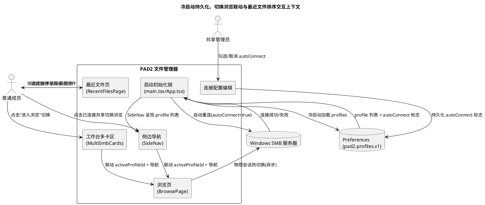
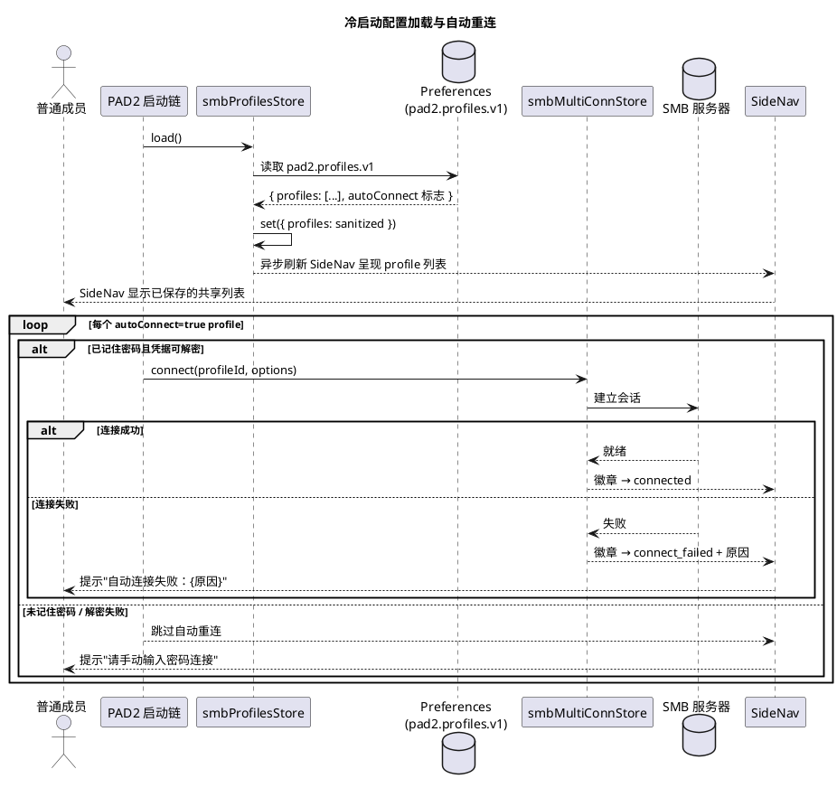
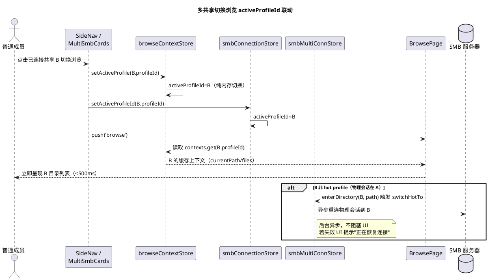
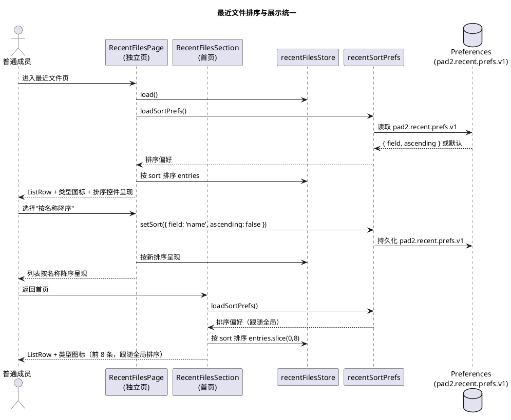

# 需求规格：冷启动配置持久化、共享切换浏览联动与最近文件排序展示优化

> **文档编号**：PAD2-SPEC-CPRU-001
> **Feature Name**：conn_persist_recent_ui
> **需求来源**：用户报告三项生产缺陷（冷启动后 SMB 共享配置丢失 / 多共享切换浏览显示错误内容 / 最近文件排序与展示方式不佳）
> **基线版本**：PAD2 v1.5（code 6），包名 com.pad2.filemanager，已落地 multi_conn_writeback（PAD2-SPEC-MCWB-001）
> **文档定位**：本文档为规格驱动开发（SDD）第一阶段产物，描述"做什么"（WHAT），不含"怎么做"（HOW）。所有业务规则采用 EARS 格式（WHEN/IF/WHILE … THEN …）与可测试验收条件（触发场景 → 预期行为）描述。
> **EARS 格式说明**：
> - **WHEN** [触发事件] **THE SYSTEM SHALL** [响应] — 事件驱动
> - **IF** [前置条件] **THEN THE SYSTEM SHALL** [响应] — 条件驱动
> - **WHILE** [持续状态] **THE SYSTEM SHALL** [响应] — 状态驱动
> - **WHERE** [特征约束] **THE SYSTEM SHALL** [响应] — 可选特征驱动

---

# 0. 问题背景与当前状态

## 0.1 问题1：冷启动后 SMB 共享配置丢失

**现象**：彻底关闭 PAD2 后重新打开，之前连接好的 SMB 共享文件夹没有了，需要重新连接。侧边导航（SideNav）的"SMB 连接"区渲染空列表。

**当前架构事实（代码证据）**：

| 证据编号 | 代码位置 | 事实 |
|---------|---------|------|
| EV-CP-01 | `src/main.tsx:10-17` | 启动初始化仅调用 `initThemeBeforeRender` / `loadWritebackConfig` / `initAutoUpdateCheck`，未调用 `useSmbProfilesStore.getState().load()` |
| EV-CP-02 | `src/App.tsx:8-21` | App 挂载 useEffect 仅调用 `hydrateUiPrefs` / `setupBackButtonNavigation`，未触发 profiles 加载 |
| EV-CP-03 | `src/ui/pages/ConnectionPage/ProfilesListPanel/index.tsx:90-92` | 全项目仅此处 `useEffect(() => { void useSmbProfilesStore.getState().load(); }, [])` 在用户进入连接页时触发 load() |
| EV-CP-04 | `src/state/smbProfilesStore.ts:170-207` | `load()` 从 Preferences `pad2.profiles.v1` 读取并 set({ profiles: sanitized })，冷启动后内存 `profiles: []`（初始值 `:171`） |
| EV-CP-05 | `src/ui/layouts/AppShell/SideNav/index.tsx:99-126` | SideNav "SMB 连接"区 `profiles.map(...)` 渲染，profiles 为空时渲染空列表 |
| EV-CP-06 | `src/state/smbProfilesStore.ts:26-45` | `SmbProfile` 接口无 `autoConnect` 字段，连接为纯手动操作，无自动重连逻辑 |

**根因结论**：应用启动初始化链未调用 `smbProfilesStore.load()`，冷启动后内存 profiles 保持初始空数组，SideNav 渲染空列表；且无 autoConnect/autoReconnect 逻辑，已连接状态不跨会话恢复。

**期望**：冷启动后已保存的 SMB 共享配置自动加载到内存并呈现在 SideNav；用户可选启用 per-profile 自动重连，启动时自动恢复连接（凭据可用前提下），失败如实告知不阻塞应用。

## 0.2 问题2：多共享切换浏览显示错误内容

**现象**：连接多个 SMB 共享时，进入第一个共享后进入第二个共享，显示的还是第一个共享的内容。

**当前架构事实（代码证据）**：

| 证据编号 | 代码位置 | 事实 |
|---------|---------|------|
| EV-SW-01 | `src/ui/layouts/AppShell/SideNav/index.tsx:57-64` | `openProfile` 点击已连接 profile 仅 `push('browse')`，未设置 `activeProfileId` |
| EV-SW-02 | `src/ui/pages/HomePage/StorageOverviewRow/MultiSmbCards.tsx:110` | `onBrowse` 回调仅 `() => push('browse')`，未联动 activeProfileId |
| EV-SW-03 | `src/ui/pages/BrowsePage/index.tsx:60,64` | BrowsePage 读 `activeProfileId = useSmbConnectionStore((s) => s.activeProfileId)`，`ctxEntry = activeProfileId ? browseContexts.get(activeProfileId) : undefined`，activeProfileId 未切换则仍读第一个共享上下文 |
| EV-SW-04 | `src/adapter/smb/SmbPlugin.ts:118` | `SmbPlugin.listDirectory({ path })` 不接受 profileId，依赖物理热会话（冻结区 HC-02） |
| EV-SW-05 | `src/state/smbMultiConnStore.ts:150-169` | `switchHotTo(profileId)` 异步重连物理会话，若失败 listDirectory 可能命中旧共享物理会话 |
| EV-SW-06 | `src/state/browseContextStore.ts:82-109` | `enterDirectory` 已在非 hot 时调用 `switchHotTo`，逻辑层按 profileId 分区正确，缺陷在切换入口未联动 activeProfileId |

**根因结论**：逻辑层 `browseContextStore` 已按 profileId 分区（设计正确），缺陷在切换入口（SideNav.openProfile / MultiSmbCards.onBrowse）仅导航未设置 activeProfileId，导致 BrowsePage 仍读旧 activeProfileId 的上下文；叠加物理单会话 + switchHotTo 异步重连竞态，可能命中旧共享物理会话。

**期望**：从共享 A 切换到已连接的共享 B 浏览时，BrowsePage 立即呈现 B 的浏览上下文（复用缓存），物理会话后台异步切换到 B，切换期间不显示 A 的内容。

## 0.3 问题3：最近文件排序与展示方式优化

**现象**：左侧"最近文件"排序方式单一（仅 LRU 前插），且首页 RecentFilesSection 与独立页 RecentFilesPage 展示方式不一致（前者用 ListRow + 类型图标，后者用裸 div + 内联 style 无图标）。

**当前架构事实（代码证据）**：

| 证据编号 | 代码位置 | 事实 |
|---------|---------|------|
| EV-RF-01 | `src/state/recentFilesStore.ts:56-64` | `record()` 仅 LRU 前插（新条目置顶，去重按 path），无排序选项 |
| EV-RF-02 | `src/ui/pages/HomePage/RecentFilesSection/index.tsx:50-63` | 首页最近文件区用 `ListRow` + `fileKindIcon` 类型图标 + 来源/时间副标题，视觉规范 |
| EV-RF-03 | `src/ui/pages/RecentFilesPage/index.tsx:24-31` | 独立最近文件页用裸 `div` + 内联 `style`（padding/borderBottom/fontWeight），无类型图标，无 ListRow，视觉与首页不一致 |
| EV-RF-04 | `src/ui/pages/BrowsePage/SortMenu` | BrowsePage 已有 SortMenu 四字段（name/size/lastModified/type）× 升降序，最近文件无对等排序能力 |
| EV-RF-05 | `src/state/recentFilesStore.ts:12-18` | `RecentFileEntry` 含 path/name/fileType/source/accessedAt 五字段，已具备按时间/名称/类型/来源排序的数据基础 |

**根因结论**：最近文件 store 仅 LRU 前插无排序选项，且独立页与首页展示组件不统一（裸 div vs ListRow），缺乏类型图标与排序控件。

**期望**：最近文件支持多排序选项（按时间/名称/类型/来源 × 升降序），首页与独立页展示方式统一（ListRow + 类型图标 + 来源/时间），独立页增加排序控件。

---

# 1. 组件定位

## 1.1 核心职责

本组件负责在应用冷启动时自动加载已持久化的 SMB 共享配置并可选自动重连，在多共享间切换浏览时正确联动活跃连接标识与物理会话，并统一最近文件的排序选项与展示方式，实现配置跨会话持久可见、切换浏览内容正确、最近文件排序可调且视觉一致。

## 1.2 核心输入

1. **应用启动信号**：应用冷启动 / 进程重启时的初始化触发，来源为 main.tsx / App.tsx 启动链。
2. **用户切换浏览指令**：在 SideNav 或工作台多卡区点击已连接共享切换浏览，来源为 SideNav.openProfile / MultiSmbCards.onBrowse。
3. **用户最近文件排序指令**：在最近文件页选择排序字段与升降序，来源为 RecentFilesPage 排序控件。
4. **用户 autoConnect 配置指令**：在连接配置编辑页勾选/取消"启动时自动连接"，来源为连接配置表单。
5. **profile 持久化数据**：Preferences `pad2.profiles.v1` 中已保存的 SMB 共享配置，来源为 smbProfilesStore.load()。

## 1.3 核心输出

1. **返回给用户的响应**：SideNav 呈现已加载的 profile 列表、BrowsePage 呈现切换后共享的浏览上下文、最近文件按选定排序呈现、自动重连成功/失败明确提示。
2. **发送给 Windows SMB 服务器的请求**：自动重连时的 SMB 会话建立、切换浏览时的物理会话热切换重连。
3. **推送给用户的通知**：自动重连失败明确告知（含原因）、自动重连跳过提示（未记住密码的 profile）。
4. **持久化输出**：per-profile autoConnect 标志写入 Preferences `pad2.profiles.v1`（版本兼容扩展）。

## 1.4 职责边界

本组件**不负责**以下事项：

1. **不负责** SMB 协议层多物理会话的底层实现：物理单会话热切换由既有 smbMultiConnStore.switchHotTo 承载（HC-02 冻结区），本组件仅定义切换入口联动 activeProfileId 的业务行为。
2. **不负责** 凭据的加密存储与解密：凭据安全由既有 smbProfilesStore（AES-GCM）承载，本组件仅消费解密结果决定是否自动重连。
3. **不负责** 强制所有 profile 自动重连：autoConnect 为 per-profile 用户可选标志，默认 false 保持兼容，不强制全局自动重连。
4. **不负责** 最近文件的内容读取或预览：仅负责排序选项与展示方式统一，文件打开仍由既有 editSessionStore 承载。
5. **不负责** 修改既有 browseContextStore 的 per-profile 分区逻辑：逻辑层分区已正确，本组件仅修复切换入口未联动 activeProfileId 的缺陷。

---

# 2. 领域术语

**冷启动配置加载**
: 应用进程启动后，从 Preferences 读取已持久化的 SMB 共享配置到内存 store 的过程，使 SideNav 等 UI 在用户进入连接页前即可呈现已保存的 profile 列表。

**自动重连（autoConnect）**
: 应用冷启动加载 profile 配置后，对标记了 autoConnect=true 的 profile 自动发起 SMB 连接建立的行为。仅对"记住密码"且凭据可解密的 profile 生效；未记住密码或解密失败的 profile 跳过并提示。

**活跃连接标识联动（activeProfileId 联动）**
: 用户从 SideNav 或工作台多卡区点击已连接共享切换浏览时，同步设置 browseContextStore.activeProfileId 与 smbConnectionStore.activeProfileId 为目标 profileId 的行为，确保 BrowsePage 读取正确的 per-profile 浏览上下文。

**物理会话热切换**
: 将 SmbPlugin 单物理会话从当前 hot profile 切换到目标 profile 的过程，由 smbMultiConnStore.switchHotTo 承载，异步重连不阻塞 UI 呈现缓存上下文。

**最近文件排序选项**
: 最近文件列表的排序维度，含按访问时间（accessedAt）、文件名称（name）、文件类型（fileType）、来源共享（source）四个字段，每字段支持升序/降序。

**展示方式统一**
: 首页 RecentFilesSection 与独立页 RecentFilesPage 采用相同的展示组件（ListRow + 类型图标 + 来源/时间副标题），消除裸 div + 内联 style 的视觉不一致。

**LRU 前插**
: 最近文件记录时将新条目置顶、按 path 去重、截断至上限的既有策略。本组件保留 LRU 作为记录行为，排序选项仅影响呈现顺序不影响记录顺序。

---

# 3. 角色与边界

## 3.1 核心角色

1. **普通成员**：冷启动后查看 SideNav 已加载的 profile 列表、在多共享间切换浏览、查看与排序最近文件的终端用户。
2. **共享管理员**：编辑 SMB 共享配置时勾选/取消"启动时自动连接"标志的用户（可与普通成员为同一人）。

## 3.2 外部系统

1. **Preferences 持久化层**：提供 `pad2.profiles.v1` 的读写，承载 profile 配置与 autoConnect 标志持久化。
2. **Windows SMB 服务器**：自动重连与切换浏览时建立/切换 SMB 会话的上游系统。
3. **smbMultiConnStore（既有）**：承载多连接管理与物理会话热切换，本组件消费其 connect/switchHotTo 接口。

## 3.3 交互上下文

---

# 4. DFX 约束

## 4.1 性能

1. **DFX-CP-01 冷启动配置加载不阻塞渲染**：冷启动时 `smbProfilesStore.load()` 须在应用首屏渲染前或并行触发，不得因配置加载延迟阻塞 UI 首次绘制，加载完成后异步刷新 SideNav。
   - 验收条件：[冷启动应用] → [首屏不等待 profiles 加载完成即渲染，profiles 加载完成后 SideNav 异步呈现 profile 列表]
2. **DFX-CP-02 自动重连不阻塞启动**：自动重连须在配置加载完成后异步触发，不得阻塞应用进入可交互状态；多个 autoConnect profile 并行重连受 MAX_CONCURRENT（4）上限保护。
   - 验收条件：[冷启动有 3 个 autoConnect profile] → [应用立即可交互，3 个 profile 异步重连，活跃连接数不超上限 4]
3. **DFX-SW-01 切换浏览联动响应时间**：点击已连接共享切换浏览时，activeProfileId 联动 + BrowsePage 上下文切换须在 500ms 内完成（不含物理会话重连网络耗时）。
   - 验收条件：[用户从共享 A 切换到已连接的共享 B] → [activeProfileId 联动 + 缓存上下文呈现 < 500ms]
4. **DFX-RF-01 最近文件排序响应时间**：最近文件排序切换须在 100ms 内完成呈现（纯内存排序，无网络/IO）。
   - 验收条件：[用户切换排序选项] → [列表按新排序呈现 < 100ms]

## 4.2 可靠性

1. **DFX-CP-03 配置加载失败不崩溃**：Preferences 读取失败或 JSON 损坏时，须安全降级为空列表，不阻塞应用启动，不崩溃。
   - 验收条件：[Preferences 损坏/读取异常] → [profiles 回空列表，应用正常启动，SideNav 渲染空列表]
2. **DFX-CP-04 自动重连失败不阻塞其他 profile**：单个 profile 自动重连失败不得影响其他 profile 的自动重连或应用可用性。
   - 验收条件：[profile A 自动重连失败] → [profile B 继续重连，应用可交互，A 呈现 connect_failed 态]
3. **DFX-SW-02 物理会话切换竞态安全**：切换浏览触发 switchHotTo 异步重连期间，若用户快速切换到第三个共享，须以最后一次切换为目标，不产生中间态脏数据。
   - 验收条件：[快速切换 A→B→C] → [最终 activeProfileId=C，物理会话切换到 C，不残留 B 的中间态]

## 4.3 安全性

1. **DFX-CP-05 未记住密码不自动重连**：未勾选"记住密码"的 profile 不得自动重连（无凭据无法建立会话），须跳过并提示用户手动连接。
   - 验收条件：[profile 未记住密码 且 autoConnect=true] → [跳过自动重连，提示"请手动输入密码连接"]
2. **DFX-CP-06 autoConnect 标志不泄露凭据**：autoConnect 标志仅为布尔值，不携带密码/密文，持久化不新增敏感字段。
   - 验收条件：[检查 pad2.profiles.v1 持久化数据] → [autoConnect 为布尔字段，不含密码/密文]

## 4.4 可维护性

1. **DFX-CP-07 自动重连可观测**：每个 autoConnect profile 的重连过程须暴露状态（connecting/connected/connect_failed）与原因，供诊断。
   - 验收条件：[查询 autoConnect profile 状态] → [独立返回 state/lastError，可在 SideNav 徽章观测]
2. **DFX-RF-02 排序选项持久化可观测**：最近文件排序选项须持久化到 Preferences，跨会话保留用户偏好。
   - 验收条件：[用户设置排序为"按名称降序"后重启应用] → [最近文件页排序选项保留为"按名称降序"]

## 4.5 兼容性

1. **DFX-CP-08 既有 profile 持久化兼容**：新增 autoConnect 字段须在 `pad2.profiles.v1` version 1 框架内向后兼容扩展，旧数据缺失字段视为 autoConnect=false（不升级版本号，不安全丢弃用户配置）。
   - 验收条件：[既有无 autoConnect 字段的 profile 数据加载] → [autoConnect 视为 false，profile 列表完整保留]
2. **DFX-RF-03 既有最近文件数据兼容**：排序选项持久化新增键 `pad2.recent.prefs.v1`，不破坏既有 `pad2.recent.v1` 最近文件数据。
   - 验收条件：[升级后启动应用] → [既有最近文件条目保留，排序选项默认"按时间降序"（LRU 等价）]

---

# 5. 核心能力

## 5.1 冷启动配置持久化与自动重连（REQ-CP）

### 5.1.1 业务规则

1. **REQ-CP-01 冷启动自动加载 profile 配置**：WHEN 应用冷启动完成初始化链 THEN THE SYSTEM SHALL 自动调用 `smbProfilesStore.load()` 从 Preferences 读取已持久化的 profile 配置到内存，使 SideNav 在用户进入连接页前即可呈现已保存的 profile 列表。
   - 验收条件：[冷启动应用，不进入连接页] → [SideNav "SMB 连接"区呈现已保存的 profile 列表，非空列表]
   - 验收条件：[冷启动应用，无持久化 profile] → [SideNav "SMB 连接"区渲染空列表 + "添加连接"入口，不崩溃]

2. **REQ-CP-02 配置加载不阻塞首屏渲染**：WHEN 应用冷启动 THEN THE SYSTEM SHALL 首屏渲染不等待 profiles 加载完成，加载完成后异步刷新 SideNav 呈现 profile 列表。
   - 验收条件：[冷启动应用] → [首屏立即渲染（不等待 profiles 加载），profiles 加载完成后 SideNav 异步刷新呈现列表]

3. **REQ-CP-03 autoConnect per-profile 可选标志**：IF 用户在连接配置编辑页勾选"启动时自动连接" THEN THE SYSTEM SHALL 将该 profile 的 autoConnect 标志持久化为 true；未勾选或既有 profile 视为 false。
   - 验收条件：[编辑 profile 勾选"启动时自动连接"并保存] → [profile.autoConnect=true 持久化到 pad2.profiles.v1]
   - 验收条件：[既有无 autoConnect 字段的 profile] → [autoConnect 视为 false（DFX-CP-08 兼容）]

4. **REQ-CP-04 自动重连仅对凭据可用 profile 生效**：WHEN 冷启动配置加载完成 AND profile.autoConnect=true AND profile 已记住密码且凭据可解密 THEN THE SYSTEM SHALL 自动发起该 profile 的 SMB 连接建立。
   - 验收条件：[autoConnect=true 且记住密码且解密成功] → [自动发起 connect，profile 进入 connecting→connected]
   - 验收条件：[autoConnect=true 但未记住密码] → [跳过自动重连，提示"请手动输入密码连接"，不发起 connect]
   - 验收条件：[autoConnect=true 但密文解密失败] → [跳过自动重连，提示"保存的密码无法解密，请重新输入"，profile 呈现 connect_failed]

5. **REQ-CP-05 自动重连不阻塞应用启动**：WHEN 自动重连触发 THEN THE SYSTEM SHALL 异步执行，应用立即可交互，不等待自动重连完成才进入可交互状态。
   - 验收条件：[冷启动有 autoConnect profile] → [应用立即可交互，autoConnect profile 异步重连，SideNav 徽章呈现 connecting 态]

6. **REQ-CP-06 自动重连并发上限保护**：WHEN 多个 autoConnect profile 并行重连 AND 活跃连接数达上限 THEN THE SYSTEM SHALL 超出上限的 profile 排队或拒绝，不突破 MAX_CONCURRENT（4）上限。
   - 验收条件：[5 个 autoConnect profile 且上限 4] → [4 个并行重连，第 5 个排队或拒绝并提示，活跃连接数不超 4]

7. **REQ-CP-07 自动重连失败如实告知**：IF 自动重连失败（网络不可达/认证失败/凭据解密失败） THEN THE SYSTEM SHALL 将该 profile 置于 connect_failed 态并呈现可读原因，不静默跳过，不阻塞其他 profile 重连。
   - 验收条件：[autoConnect profile A 重连失败] → [A 呈现 connect_failed + 可读原因，B 继续重连不受影响]
   - 验收条件：[autoConnect profile 重连失败] → [不出现静默跳过无反馈，SideNav 徽章呈现失败态]

8. **REQ-CP-08 禁止项**：禁止冷启动后 SideNav 因 profiles 未加载而渲染空列表（用户以为配置丢失）；禁止未记住密码的 profile 自动重连（无凭据必失败）；禁止自动重连失败时静默无反馈；禁止 autoConnect 标志携带密码/密文等敏感字段。
   - 验收条件：[冷启动后查看 SideNav] → [不出现因 profiles 未加载的空列表（加载完成后）]
   - 验收条件：[未记住密码的 autoConnect profile] → [不发起 connect，提示手动连接]
   - 验收条件：[检查 autoConnect 持久化字段] → [仅为布尔值，不含敏感字段]

### 5.1.2 交互流程

### 5.1.3 异常场景

1. **Preferences 读取失败**
   - 触发条件：Preferences.get 抛异常或返回非法 JSON。
   - 系统行为：smbProfilesStore.load() 安全降级为空列表（既有 fail-secure 逻辑），不崩溃。
   - 用户感知：SideNav 渲染空列表 + "添加连接"入口，应用正常可用。

2. **自动重连凭据解密失败**
   - 触发条件：profile.autoConnect=true 但 passwordEncrypted 解密失败（密文篡改/密钥不可用）。
   - 系统行为：跳过自动重连，profile 呈现 connect_failed 态，lastError 含"密码无法解密"。
   - 用户感知：SideNav 徽章呈现失败态，提示"保存的密码无法解密，请重新输入"。

3. **自动重连网络不可达**
   - 触发条件：autoConnect profile 重连时 SMB 服务器网络不可达。
   - 系统行为：profile 进入 connect_failed 态，lastError 含网络原因，不阻塞其他 profile。
   - 用户感知：SideNav 徽章呈现失败态，提示"自动连接失败：网络不可达"，可手动重试。

4. **自动重连并发上限超出**
   - 触发条件：autoConnect profile 数超过 MAX_CONCURRENT（4）。
   - 系统行为：前 4 个并行重连，超出部分排队或拒绝并提示。
   - 用户感知：超出上限的 profile 提示"已达并发连接上限，请手动连接"。

5. **autoConnect 标志持久化失败**
   - 触发条件：保存 profile 时 Preferences.set 失败。
   - 系统行为：内存态生效，持久化失败静默降级（既有 smbProfilesStore 模式）。
   - 用户感知：本次会话 autoConnect 生效，重启后可能丢失标志，不崩溃。

---

## 5.2 多共享切换浏览 activeProfileId 联动（REQ-SW）

### 5.2.1 业务规则

1. **REQ-SW-01 SideNav 切换浏览联动 activeProfileId**：WHEN 用户在 SideNav 点击已连接的共享 B 切换浏览 THEN THE SYSTEM SHALL 在导航到 BrowsePage 前同步设置 browseContextStore.activeProfileId 与 smbConnectionStore.activeProfileId 为 B 的 profileId，使 BrowsePage 读取 B 的 per-profile 浏览上下文。
   - 验收条件：[共享 A、B 均 connected，用户在 SideNav 点击 B] → [activeProfileId=B，BrowsePage 呈现 B 的浏览上下文，不显示 A 的内容]
   - 验收条件：[用户在 SideNav 点击已连接 A（当前浏览 A）] → [activeProfileId=A 不变，BrowsePage 保持 A 上下文]

2. **REQ-SW-02 工作台多卡区切换浏览联动 activeProfileId**：WHEN 用户在工作台 MultiSmbCards 点击共享 B 的"进入浏览" THEN THE SYSTEM SHALL 在导航前同步设置 activeProfileId 为 B 的 profileId。
   - 验收条件：[共享 A、B 均 connected，用户在 MultiSmbCards 点击 B 的"进入浏览"] → [activeProfileId=B，BrowsePage 呈现 B 的浏览上下文]

3. **REQ-SW-03 切换浏览复用缓存上下文不重连（逻辑层）**：WHEN 用户切换到已连接的共享 B 浏览 THEN THE SYSTEM SHALL 复用 B 既有浏览上下文（currentPath/files）立即呈现，不触发 SmbPlugin.connect（逻辑层），物理会话热切换后台异步进行。
   - 验收条件：[切换到 B] → [立即呈现 B 缓存上下文（<500ms），不触发逻辑层 connect]
   - 验收条件：[B 非 hot profile] → [后台异步 switchHotTo(B) 重连物理会话，不阻塞 UI 呈现缓存]

4. **REQ-SW-04 物理会话热切换竞态安全**：WHILE 用户快速切换浏览（A→B→C）THEN THE SYSTEM SHALL 以最后一次切换为目标设置 activeProfileId 与物理热会话，不残留中间态脏数据。
   - 验收条件：[快速切换 A→B→C] → [最终 activeProfileId=C，物理会话切换到 C，BrowsePage 呈现 C 上下文]
   - 验收条件：[快速切换 A→B→C] → [不出现 BrowsePage 闪烁呈现 B 内容后跳 C 的中间态]

5. **REQ-SW-05 切换到未连接共享走连接页**：IF 用户在 SideNav 点击未连接（disconnected/connect_failed）的 profile THEN THE SYSTEM SHALL 导航到连接页而非浏览页。
   - 验收条件：[profile 状态为 disconnected，用户点击] → [导航到连接页，不导航到浏览页]

6. **REQ-SW-06 禁止项**：禁止切换浏览时仅导航不联动 activeProfileId（导致显示旧共享内容）；禁止物理会话切换竞态产生中间态脏数据；禁止切换到未连接共享时进入浏览页（无有效上下文）。
   - 验收条件：[切换浏览] → [必联动 activeProfileId，不出现仅导航不联动]
   - 验收条件：[切换到未连接 profile] → [不进入浏览页，走连接页]

### 5.2.2 交互流程

### 5.2.3 异常场景

1. **物理会话热切换重连失败**
   - 触发条件：切换到 B 时 switchHotTo(B) 异步重连失败（网络中断/认证失效）。
   - 系统行为：逻辑层 activeProfileId=B 不变，BrowsePage 呈现 B 缓存上下文；B 的 handle.lastError 标记 network_lost；listDirectory 若需要实际网络请求则提示失败。
   - 用户感知：BrowsePage 呈现 B 的缓存内容（若有），若需加载新目录则提示"正在恢复连接"或"网络中断，请重试"。

2. **快速切换竞态**
   - 触发条件：用户快速切换 A→B→C，B 的 switchHotTo 未完成即切换到 C。
   - 系统行为：取消/忽略 B 的中间态，以 C 为最终目标，activeProfileId=C，物理会话切换到 C。
   - 用户感知：BrowsePage 最终呈现 C 上下文，不闪烁残留 B 内容。

3. **切换到已断开共享**
   - 触发条件：用户点击的 profile 状态为 disconnected/connect_failed。
   - 系统行为：导航到连接页而非浏览页。
   - 用户感知：进入连接页可重新连接，不进入无有效上下文的浏览页。

---

## 5.3 最近文件排序与展示统一（REQ-RF）

### 5.3.1 业务规则

1. **REQ-RF-01 最近文件多排序选项**：WHEN 用户在最近文件页选择排序字段（时间/名称/类型/来源）与升降序 THEN THE SYSTEM SHALL 按所选排序维度对最近文件列表重新排序呈现，不改变 LRU 记录顺序。
   - 验收条件：[选择"按名称升序"] → [列表按 name 字典序升序呈现]
   - 验收条件：[选择"按时间降序"] → [列表按 accessedAt 降序呈现（等价 LRU 前插顺序）]
   - 验收条件：[选择"按类型升序"] → [列表按 fileType 升序呈现，同类型内保持原 LRU 顺序]
   - 验收条件：[选择"按来源升序"] → [列表按 source 升序呈现，同来源内保持原 LRU 顺序]

2. **REQ-RF-02 排序选项持久化**：IF 用户设置排序选项 THEN THE SYSTEM SHALL 将排序偏好持久化到 Preferences，跨会话保留。
   - 验收条件：[设置"按名称降序"后重启应用] → [最近文件页排序选项保留为"按名称降序"]

3. **REQ-RF-03 排序默认值**：IF 用户未设置排序偏好 THEN THE SYSTEM SHALL 默认按访问时间降序（等价既有 LRU 前插顺序），保持向后兼容。
   - 验收条件：[首次使用/无持久化排序偏好] → [默认"按时间降序"，与既有 LRU 呈现一致]

4. **REQ-RF-04 独立页与首页展示方式统一**：WHEN 渲染最近文件列表 THEN THE SYSTEM SHALL 首页 RecentFilesSection 与独立页 RecentFilesPage 采用统一的展示组件（ListRow + 类型图标 + 来源/时间副标题），消除裸 div + 内联 style 的视觉不一致。
   - 验收条件：[查看首页最近文件区] → [每条用 ListRow + fileKindIcon 类型图标 + 来源/时间副标题]
   - 验收条件：[查看独立最近文件页] → [每条用 ListRow + fileKindIcon 类型图标 + 来源/时间副标题，与首页视觉一致]
   - 验收条件：[对比首页与独立页] → [不出现裸 div + 内联 style 与 ListRow 的视觉差异]

5. **REQ-RF-05 独立页排序控件**：WHEN 用户在独立最近文件页 THEN THE SYSTEM SHALL 提供排序控件（排序字段选择 + 升降序切换），支持 REQ-RF-01 的多排序选项。
   - 验收条件：[进入独立最近文件页] → [页面提供排序字段选择（时间/名称/类型/来源）+ 升降序切换控件]

6. **REQ-RF-06 首页最近文件区排序跟随全局偏好**：WHEN 首页 RecentFilesSection 渲染最近文件 THEN THE SYSTEM SHALL 按全局排序偏好（REQ-RF-02 持久化）呈现，首页不单独提供排序控件（排序在独立页设置）。
   - 验收条件：[独立页设置"按名称降序"后返回首页] → [首页最近文件区按"按名称降序"呈现前 8 条]

7. **REQ-RF-07 空列表保持空态引导**：IF 最近文件列表为空 THEN THE SYSTEM SHALL 呈现空态引导（既有 EmptyState），不因排序选项变更改变空态行为。
   - 验收条件：[最近文件为空] → [呈现 EmptyState"还没有访问过文件"引导，不呈现排序控件或空排序列表]

8. **REQ-RF-08 禁止项**：禁止独立页用裸 div + 内联 style 渲染（须统一 ListRow）；禁止排序选项改变 LRU 记录顺序（排序仅影响呈现）；禁止首页与独立页展示方式不一致。
   - 验收条件：[检查独立页渲染] → [不出现裸 div + 内联 style，必用 ListRow]
   - 验收条件：[记录新文件后切换排序] → [LRU 记录顺序不变（新文件仍置顶于 LRU），仅呈现顺序按排序变化]

### 5.3.2 交互流程

### 5.3.3 异常场景

1. **排序偏好持久化失败**
   - 触发条件：Preferences.set 失败或读取损坏。
   - 系统行为：降级为默认排序（按时间降序，等价 LRU），不崩溃。
   - 用户感知：本次会话排序生效，重启后回默认，不崩溃。

2. **最近文件数据损坏**
   - 触发条件：pad2.recent.v1 JSON 损坏或字段缺失。
   - 系统行为：既有 recentFilesStore.load() 安全丢弃重建空列表（既有逻辑），排序控件呈现但列表为空。
   - 用户感知：空态引导，不崩溃。

3. **排序字段值非法**
   - 触发条件：持久化的排序字段值不在 name/size/lastModified/type 枚举内（数据篡改）。
   - 系统行为：降级为默认排序（按时间降序），不崩溃。
   - 用户感知：列表按默认排序呈现，不报错。

---

# 6. 数据约束

## 6.1 SmbProfile 扩展（autoConnect 字段）

1. **autoConnect**：可选布尔字段，默认 false（缺失视为 false，DFX-CP-08 兼容）。true 表示冷启动时自动重连该 profile。
2. **autoConnect 与凭据关系**：autoConnect=true 的 profile 须已记住密码（passwordEncrypted 存在且可解密），否则自动重连跳过（DFX-CP-05）。
3. **autoConnect 不携带敏感字段**：autoConnect 仅为布尔值，不含密码/密文/凭据（DFX-CP-06）。
4. **持久化兼容**：autoConnect 在 `pad2.profiles.v1` version 1 框架内向后兼容扩展，不升级版本号，旧数据缺失字段视为 false（DFX-CP-08）。

## 6.2 最近文件排序偏好

1. **排序字段（field）**：必填，取值为 `accessedAt`（时间）/ `name`（名称）/ `fileType`（类型）/ `source`（来源）之一。
2. **升降序（ascending）**：必填，布尔值，true 为升序，false 为降序。
3. **默认值**：未持久化时默认 `{ field: 'accessedAt', ascending: false }`（按时间降序，等价 LRU，REQ-RF-03）。
4. **持久化键**：`pad2.recent.prefs.v1`，与既有 `pad2.recent.v1`（最近文件数据）独立，不冲突（DFX-RF-03）。
5. **非法值降级**：持久化的 field 值不在枚举内时降级为默认，不崩溃（异常场景3）。

## 6.3 activeProfileId 联动约束

1. **联动一致性**：切换浏览时 `browseContextStore.activeProfileId` 与 `smbConnectionStore.activeProfileId` 须同步设置为同一 profileId，不出现两者不一致。
2. **联动目标有效性**：联动的 profileId 须对应已连接（connected）的 profile，未连接 profile 不联动（走连接页，REQ-SW-05）。
3. **竞态最终一致性**：快速切换时以最后一次为目标，不残留中间态（DFX-SW-02）。

---

# 7. 非目标（明确不做什么）

1. **NON-CP-01**：不负责强制所有 profile 自动重连——autoConnect 为 per-profile 用户可选标志，默认 false，不强制全局自动重连（避免网络环境差时全部失败 + 凭据问题）。
2. **NON-CP-02**：不负责后台保活/心跳维持自动重连的永久在线——自动重连仅在冷启动时触发一次，连接因网络/服务器原因断开后不自动重连（由既有六态状态机 + 用户手动重连处理）。
3. **NON-CP-03**：不负责凭据的加密存储与解密——凭据安全由既有 smbProfilesStore（AES-GCM）承载，本组件仅消费解密结果决定是否自动重连。
4. **NON-SW-01**：不负责修改 SmbPlugin 冻结区接口（HC-02）——物理单会话热切换由既有 smbMultiConnStore.switchHotTo 承载，本组件仅修复切换入口未联动 activeProfileId 的缺陷。
5. **NON-SW-02**：不负责修改 browseContextStore 的 per-profile 分区逻辑——逻辑层分区已正确，本组件仅修复切换入口（SideNav.openProfile / MultiSmbCards.onBrowse）未联动 activeProfileId 的缺陷。
6. **NON-RF-01**：不负责最近文件的内容读取、预览或缩略图——仅负责排序选项与展示方式统一，文件打开仍由既有 editSessionStore 承载。
7. **NON-RF-02**：不负责改变 LRU 记录策略——record() 仍按 LRU 前插去重截断，排序选项仅影响呈现顺序不影响记录顺序（REQ-RF-08）。
8. **NON-RF-03**：不负责最近文件的批量管理（多选/删除/清理）——仅负责排序与展示统一，批量管理属未来功能。

---

# 8. 需求追溯与覆盖矩阵

| 需求编号 | 对应问题 | 核心期望 | 关键 EARS 模式 |
|---------|---------|---------|---------------|
| REQ-CP-01 | 问题1 | 冷启动自动加载 profile 配置 | WHEN…THEN |
| REQ-CP-02 | 问题1 | 配置加载不阻塞首屏 | WHEN…THEN |
| REQ-CP-03 | 问题1 | autoConnect per-profile 可选标志 | IF…THEN |
| REQ-CP-04 | 问题1 | 自动重连仅对凭据可用 profile 生效 | WHEN…AND…THEN |
| REQ-CP-05 | 问题1 | 自动重连不阻塞应用启动 | WHEN…THEN |
| REQ-CP-06 | 问题1 | 自动重连并发上限保护 | WHEN…AND…THEN |
| REQ-CP-07 | 问题1 | 自动重连失败如实告知 | IF…THEN |
| REQ-SW-01 | 问题2 | SideNav 切换浏览联动 activeProfileId | WHEN…THEN |
| REQ-SW-02 | 问题2 | 工作台多卡区切换浏览联动 | WHEN…THEN |
| REQ-SW-03 | 问题2 | 切换浏览复用缓存不重连（逻辑层） | WHEN…THEN |
| REQ-SW-04 | 问题2 | 物理会话热切换竞态安全 | WHILE…THEN |
| REQ-SW-05 | 问题2 | 切换到未连接共享走连接页 | IF…THEN |
| REQ-RF-01 | 问题3 | 最近文件多排序选项 | WHEN…THEN |
| REQ-RF-02 | 问题3 | 排序选项持久化 | IF…THEN |
| REQ-RF-03 | 问题3 | 排序默认值（时间降序=LRU） | IF…THEN |
| REQ-RF-04 | 问题3 | 独立页与首页展示方式统一 | WHEN…THEN |
| REQ-RF-05 | 问题3 | 独立页排序控件 | WHEN…THEN |
| REQ-RF-06 | 问题3 | 首页排序跟随全局偏好 | WHEN…THEN |
| REQ-RF-07 | 问题3 | 空列表保持空态引导 | IF…THEN |

---

> 本需求规格文档覆盖问题1（冷启动配置持久化与自动重连）、问题2（多共享切换浏览 activeProfileId 联动）、问题3（最近文件排序与展示统一）三项生产缺陷的全部业务规则、验收条件、DFX 约束与非目标。所有业务规则均采用 EARS 格式（WHEN/IF/WHILE … THEN …）与可测试验收条件（触发场景 → 预期行为）描述。autoConnect 设计决策采用 per-profile 用户可选（默认 false）策略，仅对凭据可用 profile 生效，失败如实告知不阻塞启动。物理单会话约束（HC-02）下，切换浏览联动 activeProfileId + 复用缓存上下文 + 后台异步 switchHotTo 热切换。最近文件排序支持四字段×升降序，展示统一为 ListRow + 类型图标。下一步须由 spec-design-agent 基于本规格生成 design.md 技术设计文档。