# 安卓平板项目2：Windows SMB 共享资源管理器 技术设计文档

> 本文档基于 `spec.md` 需求规格与 PAD2-M0 只读技术审查结论生成，将五项核心需求（REQ-01 ~ REQ-05）、WPS 保存关键技术裁定、大规模使用架构保障、风险缓解措施及阶段验收门禁转化为可落地的增量架构设计。存量功能基线来自旧仓库 `wujupeng/andriodpad`（React + TypeScript + Capacitor 8 + Android Java 插件 + SMBJ）的 M0 审查输出。

---

# 一、需求与存量功能关系分析

## 1.1 需求功能与存量功能对比

存量功能基线为旧仓库 `wujupeng/andriodpad`，其技术栈为 React + TypeScript + Capacitor 8 + Android Java 原生插件 + SMBJ。M0 只读技术审查已对该仓库进行差距分析，本节基于审查结论对新需求（REQ-01 ~ REQ-05 及关键技术裁定）与存量代码进行逐项匹配。

### 1.1.1 已验证功能（M0 审查证实）

> **证据要求**：以下能力均经 PAD2-M0 只读技术审查证实，附实际代码位置与调用链证据。仅已验证能力可作为可复用资产并据此计算匹配度。

| 需求功能 | 存量功能 | 代码位置 / 证据来源 | 验证状态 | 匹配度 |
|---------|---------|---------|---------|--------|
| Android 应用基础架构 | React + TypeScript + Capacitor 8 + Java 原生插件 | 旧仓库 `package.json`（Capacitor 8 依赖）、`android/` 工程（Java 插件）、`src/`（React/TS 前端） | 已验证 | 100% |
| REQ-01 SMB 会话建立与认证 | SMBJ 客户端会话建立、TCP 445 探测、NTLM/SPNEGO 认证 | 旧仓库 SMBJ 封装层（Java），M0 审查证实存在 SMBJ 依赖与会话建立调用链 | 已验证 | 100% |
| REQ-01 多组连接配置 | 前端保存多组服务器配置（地址/共享名/账号/密码） | 旧仓库连接配置 UI + 状态管理（React/TS），M0 审查证实多组配置持久化逻辑 | 已验证 | 75% |
| 本地文件选择 | Android 文件选择器（Intent + SAF） | 旧仓库 Android 原生插件，M0 审查证实文件选择 Intent 调用 | 已验证 | 100% |
| 本地文件夹遍历（SAF） | Android SAF 文件夹遍历与 URI 授权 | 旧仓库 Android 原生插件，M0 审查证实 SAF 遍历调用链 | 已验证 | 100% |
| 上传到 SMB | SMBJ 上传方法及文件夹同步流程 | 旧仓库传输模块（Java + TS），M0 审查证实 SMBJ 文件写入方法与上传编排流程 | 已验证 | 50% |

**匹配度判定依据**：
- **100%**：存量实现完全满足需求验收条件，可直接复用。
- **75%**：核心逻辑满足，但交互模型、数据流或约束条件需适配（如交互从"选择上传"改为"直接打开"）。
- **50%**：基础能力存在但关键约束未满足（如缺少流式处理、完整性校验、冲突保护），需较大改造。

> **P1-6 匹配度范围说明**：表格中的"匹配度 100%"应限定为**具体组件或能力的匹配程度**，不能被理解为对应需求项（如 REQ-01）整项需求已经满足。匹配度仅表示该具体技术组件的可用程度，不代表对应需求项整体已满足。例如"SMBJ 连接认证匹配度 100%"仅表示会话建立与认证调用链可用，不代表 REQ-01（含目录浏览、搜索、排序、收藏等）整体已满足。

> **注意**：上传到 SMB 虽已验证，但仅为一次性 byte[] 写入，不满足流式处理、完整性校验与安全写入要求，匹配度 50%。且仅证实"上传"方向，"下载"方向未证实。

### 1.1.1b 未验证能力（M0 审查未证实）

> **重要**：以下能力在 M0 只读技术审查中**未证实**已形成可用的 SMB 文件操作闭环。不得直接作为可复用资产，不得据此计算匹配度。须在后续阶段重新验证或重新实现。

| 需求功能 | 旧仓库声称能力 | 验证状态 | 处置策略 |
|---------|---------|---------|---------|
| REQ-01 SMB 共享目录原生浏览 | 目录枚举与文件属性展示 | **未验证** | 不作为可复用资产；须在 M2/M3 阶段重新实现并验证 |
| REQ-01 目录搜索 | 按名称搜索 | **未验证** | 不作为可复用资产；须重新实现 |
| REQ-01 目录排序 | 基本排序 | **未验证** | 不作为可复用资产；须重新实现 |
| REQ-01 文件收藏 | 收藏列表与快速访问 | **未验证** | 不作为可复用资产；须重新实现 |
| REQ-02 WPS 打开文件 | 通过 Android 文件访问接口交付 WPS | **未验证** | 须在 M2 门禁中验证 |
| REQ-03 WPS 编辑与保存回写 | 保存检测与回写共享 | **未验证** | 须在 M2 门禁中验证（项目成败点） |
| REQ-04 共享→本地下载 | 从共享下载文件到本地 | **未验证** | 不作为可复用资产；须重新实现 |
| REQ-04 共享间复制/移动 | 共享目录之间复制/移动 | **未验证** | 不作为可复用资产；须重新实现 |
| REQ-04 SMB 重命名 | SMB 文件重命名 | **未验证** | 不作为可复用资产；须重新实现 |
| REQ-04 SMB 删除 | SMB 文件删除 | **未验证** | 不作为可复用资产；须重新实现 |
| REQ-04 传输进度显示 | 传输进度条与状态显示 | **未验证** | 不作为可复用资产；须重新实现 |
| REQ-05 断网恢复 | 网络中断自动恢复 | **未验证** | 不作为可复用资产；须重新实现 |
| REQ-05 可靠续传 | 断点续传 | **未验证** | 不作为可复用资产；须重新实现 |

**处置原则**：
1. 未验证能力**不得**出现在 1.2 节存量功能详细分析中，不计算匹配度。
2. 未验证能力须在 M2 技术验证门禁或 M3 实现阶段重新实现并验证。
3. 若后续审查发现某项未验证能力实际已具备证据，可补充证据后移入已验证功能表。

### 1.1.2 需要扩展的功能

需要扩展的功能是指需求与存量代码部分匹配，需在现有基础上改造的部分。

| 需求功能 | 存量功能 | 差异说明 | 扩展方向 |
|---------|---------|---------|---------|
| REQ-01 凭据安全存储（Keystore 加密） | 旧仓库凭据以明文/简单编码存储于 SharedPreferences | 存量为明文存储，不满足 RISK-04 与安全性 DFX 约束；需升级为 Android Keystore 加密 | 新增 Keystore 加密层，重构凭据读写路径，迁移存量凭据；禁止明文落盘 |
| REQ-01 目录浏览响应与分页 | 旧仓库一次性枚举全部条目 | 大目录（万级文件）一次性枚举存在响应超时与内存压力；spec 要求 M1 冻结响应上限并分页 | 改为分页/延迟加载枚举，增加分页游标与首屏优先策略 |
| REQ-01 搜索范围与性能 | 旧仓库仅当前目录名称搜索 | 需支持当前共享范围内搜索，且需考虑深层目录搜索性能 | 扩展为共享范围搜索，引入异步搜索与结果分页 |
| REQ-04 传输任务状态管理 | 旧仓库任务状态为内存态，无持久化 | 不满足 RISK-05 与可靠性 DFX（应用被杀后任务丢失）；spec 要求持久化任务队列与断点续传 | 新增任务持久化层（Room/SQLite），重构任务状态机为持久化驱动 |
| REQ-04 覆盖写入安全策略 | 旧仓库直接覆盖写入目标文件 | 不满足 RISK-02；写入中途失败会破坏原文件；spec 要求安全写入（临时文件+原子替换或带校验覆盖） | 重构写入路径为"写临时文件→校验→原子替换"，失败时原文件不被破坏 |
| REQ-04 同名冲突处理 | 旧仓库覆盖写入无冲突提示 | 不满足 spec 禁止静默覆盖要求；需提示覆盖/跳过/重命名 | 新增冲突检测与用户决策交互层 |
| REQ-04 批量操作与部分失败恢复 | 旧仓库批量操作无逐文件结果记录与断点恢复 | 不满足大量小文件恢复策略；需逐文件校验清单与恢复 | 扩展批量任务为子任务粒度，记录已校验文件清单 |
| REQ-05 网络中断自动处理 | 旧仓库网络中断需用户手动重连 | 不满足 REQ-05 自动处理短暂断网/Wi-Fi切换/会话失效 | 新增网络状态监听 + 自动会话重建 + 可恢复任务自动续传 |
| REQ-05 重试退避策略 | 旧仓库无系统化退避重试 | 不满足连接超时与会话失效的退避重试要求 | 新增指数退避重试框架，配置上限与策略 |
| 交互模型重构 | 旧仓库以"选择本地文件→上传"为中心 | 不宜沿用；新需求以"浏览共享→直接打开→编辑→回写"为中心 | 重构主交互流为资源管理器模型，上传/下载降为文件操作子能力 |

### 1.1.3 需要新增的功能或接口

需要新增的功能是指需求在存量代码中完全没有对应实现的部分，按业务模块分组。

**模块 A：WPS 编辑与可靠回写（REQ-03，关键技术门禁）**
- **A1 编辑会话管理**：建立/跟踪/销毁编辑会话，管理本地缓存副本、版本基线、回写状态。输入：共享文件路径；输出：编辑会话句柄。核心逻辑：会话生命周期状态机（已打开→编辑中→已保存待回写→回写中→回写成功/失败/冲突/已放弃）。依赖：文件缓存模块、SMB 读写模块。
- **A2 文件版本基线**：编辑会话开始时计算共享文件 SHA-256 与修改时间作为基线。输入：共享文件路径；输出：版本基线（SHA-256 + mtime）。核心逻辑：流式 SHA-256 计算 + SMB 属性查询。依赖：SMB 读取模块。
- **A3 WPS 文件交付**：通过 Android 标准文件访问接口（URI/ContentProvider/临时文件）向 WPS 提供可编辑文件入口。输入：本地缓存副本；输出：WPS 可访问的文件入口。核心逻辑：选择并验证最优交付方式。依赖：Android SAF/ContentProvider。
- **A4 WPS 保存变更检测**：检测 WPS 保存完成与本地副本变更。输入：编辑会话；输出：变更事件（含目标 URI、变更时间、内容指纹）。核心逻辑：文件监听 + ContentProvider 回调 + 指纹比对。依赖：编辑会话管理。
- **A5 可靠回写引擎**：将本地变更写回共享原位置并校验。输入：编辑会话 + 本地变更；输出：回写结果（成功/失败/冲突）。核心逻辑：版本基线冲突检测→流式回写→SHA-256 校验→状态更新。依赖：SMB 写入模块、版本基线。
- **A6 WPS 另存为/临时文件识别**：识别 WPS 另存为新文件与临时文件，正确判定最终结果文件。输入：WPS 保存事件；输出：最终结果文件判定。核心逻辑：文件名/路径模式匹配 + 临时文件过滤。依赖：编辑会话管理。
- **A7 编辑冲突防护**：回写前检测共享文件版本基线是否已变，防止静默覆盖。输入：编辑会话；输出：冲突检测结果。核心逻辑：查询共享当前版本→与基线比对→冲突时提示用户决策。依赖：版本基线、SMB 属性查询。

**模块 B：无感打开（REQ-02）**
- **B1 直接打开调度**：用户点击共享文件后自动选择合适应用（优先 WPS）打开。输入：共享文件路径；输出：打开结果。核心逻辑：文件类型→应用选择→缓存→交付→建立编辑会话。依赖：编辑会话管理、WPS 文件交付、文件缓存。
- **B2 大文件流式缓存**：大文件打开时采用流式/分块缓存，避免整体载入内存。输入：共享文件；输出：本地缓存副本。核心逻辑：分块读取→流式写入本地→内存受限。依赖：SMB 读取模块。
- **B3 状态及时更新**：编辑保存返回资源管理器后更新文件状态与修改时间。输入：编辑会话回写结果；输出：目录列表状态刷新。依赖：目录浏览模块。

**模块 C：可靠传输队列（REQ-04 + REQ-05）**
- **C1 持久化传输队列**：传输任务持久化存储，应用重启后恢复。输入：传输任务；输出：持久化任务记录。核心逻辑：Room/SQLite 持久化 + 状态机驱动。依赖：数据持久化层。
- **C2 流式传输引擎**：大文件流式/分块传输，不整体载入内存。输入：源/目标位置；输出：传输结果 + 进度。核心逻辑：分块读写 + 进度上报 + 断点偏移。依赖：SMB 读写模块。
- **C3 断点续传**：传输中断后从已传输字节偏移安全续传。输入：持久化任务 + 偏移；输出：续传结果。核心逻辑：读取偏移→定位读写位置→续传→校验。依赖：持久化传输队列。
- **C4 完整性校验引擎**：传输/回写前后 SHA-256 校验。输入：源/目标文件；输出：校验结果。核心逻辑：流式 SHA-256 计算 + 比对。依赖：流式读写。
- **C5 网络状态监听与自动恢复**：监听网络状态，自动重建会话与续传可恢复任务。输入：网络状态事件；输出：恢复动作。核心逻辑：广播接收→会话重建→任务续传。依赖：SMB 连接模块、传输队列。
- **C6 重试退避框架**：失败任务按指数退避策略自动重试，超限标记失败。输入：失败任务；输出：重试调度。依赖：传输队列。

**模块 D：安全与审计**
- **D1 Keystore 凭据加密**：SMB 账号密码以 Android Keystore 加密存储。输入：明文凭据；输出：加密密文。核心逻辑：Keystore 生成密钥→AES 加密→密文存储。依赖：Android Keystore。
- **D2 日志脱敏**：所有日志输出前脱敏（密码、凭据、文件敏感内容）。输入：原始日志；输出：脱敏日志。核心逻辑：脱敏规则匹配 + 替换。
- **D3 审计日志**：关键操作（连接/写入/删除/重命名/回写）记录可追溯审计日志。输入：操作事件；输出：审计记录。依赖：日志脱敏。
- **D4 诊断信息导出**：用户触发导出脱敏诊断信息。输入：导出请求；输出：诊断包（操作日志+错误分类+环境信息）。依赖：审计日志。

**模块 E：对外接口（第三方应用访问）**
- **E1 ContentProvider 共享文件访问**：向第三方应用提供共享文件访问接口。输入：第三方请求；输出：文件访问句柄/拒绝。核心逻辑：权限校验→URI 授权→文件访问。依赖：SMB 读写模块。
- **E2 Intent 接口**：响应第三方应用打开共享文件的 Intent。依赖：ContentProvider。

**模块 F：部署与编译**
- **F1 远程编译流程**：通过远程编译服务器（192.168.2.3）编译 Android APK。输入：源码；输出：APK 产物。核心逻辑：SMB 挂载远程路径→Gradle 编译→产物回传。依赖：远程编译服务器。
- **F2 新仓库管理**：基于新仓库 `wujupeng/andriodpad2` 进行版本管理与发布。依赖：Git/GitHub。

## 1.2 存量功能详细分析（仅已验证能力）

> **范围说明**：本节仅对 1.1.1 中 M0 审查已验证的能力进行深入解读，识别其接口契约、业务规则、扩展点与约束，为增量设计提供落地基础。1.1.1b 中未验证能力不在本节分析范围内，须在后续阶段重新实现。

### 1.2.1 Android 应用基础架构（匹配度 100%，已验证）

- **接口契约**：Capacitor 8 插件桥接 TS↔Java，React + TypeScript 前端，Java 原生 Android 插件。
- **业务规则**：前端通过 Capacitor 插件调用原生层能力，原生层通过 SMBJ 等 Java 库访问 SMB 服务器与 Android 系统服务。
- **扩展点**：可在原生层新增 Java 插件模块，前端层新增 React 组件。
- **约束**：Capacitor 8 为特定版本，升级须评估兼容性；Java 原生插件须在 Android 原生层使用。
- **证据来源**：M0 审查证实旧仓库 `package.json` 含 Capacitor 8 依赖，`android/` 工程含 Java 插件，`src/` 含 React/TS 前端。

### 1.2.2 SMBJ 连接认证（匹配度 100%，已验证）

- **接口契约**：输入服务器地址、共享名、账号、密码、端口、协议版本；输出 SMB 会话句柄；异常包括认证失败、网络不可达、协议不支持。
- **业务规则**：基于 SMBJ 建立 SMB 会话，支持 NTLM/SPNEGO 认证，含 TCP 445 探测。
- **扩展点**：SMBJ 支持自定义认证器与传输配置，可扩展加密与超时策略。
- **约束**：SMBJ 为 Java 库，须在 Android 原生层（Capacitor 插件）中使用；会话非线程安全，并发访问须加锁或会话池化；协议版本须在 M1 冻结范围内。
- **证据来源**：M0 审查证实旧仓库 SMBJ 封装层存在会话建立调用链与 TCP 445 探测逻辑。
- **已验证能力范围（P1-6 收紧）**：
  - **已验证**：SMBJ 会话建立及认证相关调用链（含 TCP 445 探测、NTLM/SPNEGO 认证）。
  - **已验证**：上传写入方法和上传编排路径（见 1.2.5 节）。
  - **未验证**：SMB 文件读取、共享目录枚举以及读取到 WPS 的完整调用闭环。不能因会话建立已验证而自动推断读取路径也已验证。

### 1.2.3 多组连接配置管理（匹配度 75%，已验证）

- **接口契约**：输入连接配置项；输出配置列表与持久化结果；异常包括配置校验失败。
- **业务规则**：支持多组配置保存，每条配置含服务器地址、共享名、账号、密码；前端可切换不同配置。
- **扩展点**：配置存储层可替换（当前为 SharedPreferences，需替换为 Keystore 加密）。
- **约束**：当前凭据明文存储，**必须重构**为 Keystore 加密（RISK-04）；配置 UI 须适配新交互模型（资源管理器入口而非上传入口）；增删改查与连接测试的完整闭环须在 M3 阶段重新验证。
- **证据来源**：M0 审查证实旧仓库前端存在多组服务器配置保存逻辑与状态管理。

### 1.2.4 本地文件选择与 SAF 遍历（匹配度 100%，已验证）

- **接口契约**：通过 Android Intent + SAF 选择文件与遍历文件夹；输入 URI/Intent；输出文件句柄或文件夹 URI 列表。
- **业务规则**：已积累 SAF 权限申请、URI 授权、ContentProvider 文件访问与文件夹遍历经验。
- **扩展点**：可扩展为向 WPS 交付文件入口（REQ-03 的 WPS 文件交付，须 M2 门禁验证）。
- **约束**：SAF 权限为持久化授权，须妥善管理；不同 Android 版本 SAF 行为有差异，须在最低支持版本以上按三层兼容性模型逐版本验证，不绑定单一版本。
- **证据来源**：M0 审查证实旧仓库 Android 原生插件存在文件选择 Intent 调用与 SAF 文件夹遍历调用链。

### 1.2.5 上传到 SMB（匹配度 50%，已验证）

- **接口契约**：输入本地文件路径、目标共享路径；输出上传结果；异常包括网络中断、空间不足、权限不足。
- **业务规则**：当前实现为**一次性 byte[] 读取→写入**，含文件夹同步流程，但无流式处理、无完整性校验、无冲突保护、无持久化任务状态。
- **约束**：
  - **RISK-01**：一次性 byte[] 将文件整体载入内存，大文件（1 GiB）会 OOM，**必须重构**为流式/分块。
  - **RISK-02**：直接覆盖写入，中途失败破坏原文件，**必须重构**为安全写入策略。
  - **RISK-05**：任务状态为内存态，应用被杀后丢失，**必须新增**持久化任务队列。
  - 交互模型以"选择本地文件→上传"为中心，**不宜沿用**，须重构为资源管理器直接操作模型。
  - **仅上传方向已验证**，下载方向（共享→本地）未验证，须重新实现。
- **证据来源**：M0 审查证实旧仓库传输模块存在 SMBJ 文件写入方法与上传编排流程。

> **未验证能力说明**：SMB 目录枚举、搜索、排序、收藏、重命名、删除、共享→本地下载、共享间复制/移动、传输进度显示、断网恢复、可靠续传、WPS 打开/编辑/保存回写等能力在 M0 审查中未证实（见 1.1.1b），不在本节分析范围内，须在 M2 门禁或 M3 实现阶段重新实现并验证。

---

# 二、增量设计方案

## 2.1 实现模型

### 2.1.0 多设备兼容性策略与三层兼容性模型（PAD2-M1-G4-FAST-DECISION-01）

> **PM 策略裁定**：PAD2 不绑定单一平板型号、Android 版本或 WPS 版本。项目目标是开发能够适配多种企业平板的 SMB 文件管理器。不限定唯一版本不等于不设最低支持范围：须确定最低 Android API 级别（minSdkVersion）以确保应用可安装运行，但支持多个系统版本。兼容性通过三层兼容性模型管理。

**三层兼容性模型**：

| 层次 | 名称 | 内容 | 产物 |
|------|------|------|------|
| 第一层 | 通用架构兼容 | 不将业务逻辑绑定到某个品牌或某个 WPS 版本；通过 Android 文件访问接口、SMB 适配层和独立的文件编辑交接层降低耦合；应用架构设计基于 Android 标准 API，而非厂商特定 API | 分层架构设计（见 2.1.2） |
| 第二层 | 代表性环境验证 | 先用现有设备（如荣耀 9X）建立第一条实测基线；再逐步增加不同 Android 版本、设备厂商及 WPS 版本的测试组合；每增加一个组合，记录完整测试结果 | M2 验证报告 + 已验证环境清单初始版 |
| 第三层 | 兼容性证据管理 | 每个组合记录：设备型号、系统版本、WPS 版本、测试用例、结果和已知限制；没有实测证据的组合一律标记为"未验证"；维护"已验证环境清单"作为活文档，随测试进展持续更新；"未验证"不等于"不兼容"，允许尝试运行但不得宣称兼容 | 已验证环境清单（活文档，持续更新） |

**兼容性策略对照表**：

| 项目 | 新策略 | 门禁要求 |
|------|--------|---------|
| 平板品牌 | 不限定荣耀、华为或其他品牌 | 记录实际测试设备 |
| Android 版本 | 不绑定单一版本 | 明确最低支持版本，验证兼容范围 |
| WPS 版本 | 不绑定单一版本 | 维护已验证版本清单 |
| 企业安装 | 优先支持内部 APK 安装 | 验证安装、升级及权限行为 |
| SMB 访问 | 统一应用层接口 | 验证真实服务器上的读写和异常恢复 |
| 文件编辑保存 | 统一文件生命周期管理 | 实测 WPS 打开、编辑、保存、回写 |
| 未测试的设备或版本 | 允许尝试运行 | 标记"未验证"，不得宣称兼容 |

**M1-G4 参数冻结策略调整（PAD2-M1-G4-FINAL-CLOSURE-01 修订）**：
- **M1 必须冻结（PM 决策）**：minSdkVersion（候选值 API 26 已形成，附技术依据，待 PM 最终确认）、targetSdkVersion（建议 API 33-34）、目标并发用户数（PM 根据业务场景确定）
- **M1 冻结为策略规则（已定）**：平板品牌不限定、Android 版本范围（多版本兼容）、WPS 版本范围（已验证版本清单管理）、三层兼容性模型
- **留待后续实测确定（M2/M4 产物）**：目录枚举响应上限（建议首屏 2s）、大文件基线（建议 1 GiB）、批量文件基线（建议 10,000 个）、WPS 已验证版本清单、已验证环境清单
- **建议值待 PM 确认**：核心操作成功率目标（建议 ≥99.5%）、恢复时间目标（建议 ≤30s）、传输超时阈值（建议 300s）、并发会话上限（建议 5）、并发任务上限（建议 3）、分块大小（建议 8MB）、重试上限（建议 5 次）
- **M1-G4 满足条件（修订后）**：
  - minSdkVersion 候选值已形成（API 26，附技术依据，待 PM 确认）✅
  - 首批代表性测试目标已确定（荣耀 9X + 当前 WPS 版本 + 最新稳定版，待 PM 确认）✅
  - 参数冻结范围分类清晰，每类参数状态明确 ✅
  - 建议值附技术依据和理由（待 PM 逐项确认）✅
  - PM 确认后即可冻结 M1

### 2.1.1 上下文视图

本组件部署于安卓平板（不限定品牌，以三层兼容性模型管理多设备兼容性），上游访问 Windows SMB 服务器，下游交付文件给 WPS Office，并通过 Android 系统服务（SAF/ContentProvider/Keystore）完成文件访问与凭据加密。编译产物（APK）通过代表性编译环境（远程编译服务器）生成，不绑定唯一编译环境。

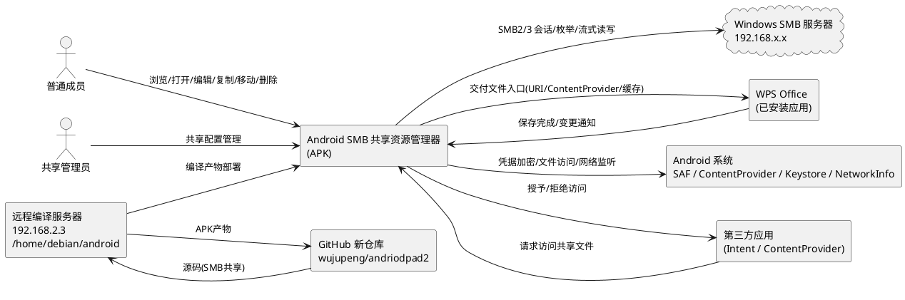

**通信协议与调用频率**：
- App ↔ SMB：SMB2/3 协议，TCP 445；高频（目录枚举、文件读写），须会话池化与并发限制。
- App ↔ WPS：Android Intent/URI/ContentProvider；中频（用户触发编辑），须文件变更监听。
- App ↔ AndroidSys：Android 系统 API；高频（凭据读写、文件访问、网络广播）。
- App ↔ ThirdParty：Android Intent/ContentProvider；低频（外部请求）。
- Repo ↔ BuildServer：SMB 文件共享 + Gradle 构建；低频（编译时）。

### 2.1.2 服务/组件总体架构

本组件采用分层架构，自上而下分为表现层、业务编排层、核心能力层、基础设施层。各层职责清晰、相互解耦，可独立测试与演进（满足 spec 5.7.1 客户端分层设计要求）。

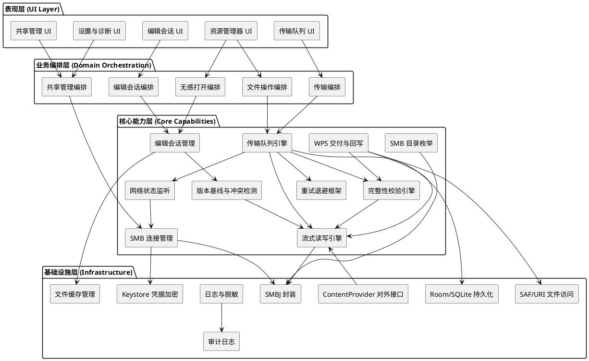

**模块职责说明**：

| 层 | 模块 | 职责 | 并发/资源约束 |
|---|------|------|--------------|
| 表现层 | 共享管理 UI | 共享配置增删改查、连接测试交互 | UI 线程 |
| 表现层 | 资源管理器 UI | 目录浏览、搜索、排序、文件操作交互 | UI 线程，分页加载 |
| 表现层 | 传输队列 UI | 传输进度、暂停/取消/重试交互 | UI 线程 |
| 表现层 | 编辑会话 UI | 编辑状态、冲突提示、回写结果展示 | UI 线程 |
| 业务编排层 | 共享管理编排 | 协调配置管理、凭据加密、连接测试 | — |
| 业务编排层 | 文件操作编排 | 协调复制/移动/重命名/删除入队与执行 | — |
| 业务编排层 | 编辑会话编排 | 协调打开→交付→保存检测→回写全流程 | 单会话串行 |
| 业务编排层 | 传输编排 | 协调任务入队、进度上报、结果核对 | — |
| 业务编排层 | 无感打开编排 | 协调文件类型识别、应用选择、缓存、交付 | — |
| 核心能力层 | SMB 连接管理 | 会话建立/池化/重建/失效检测 | 并发会话上限（M1 冻结） |
| 核心能力层 | 流式读写引擎 | 分块读写，不整体载入内存 | 单任务内存上限 |
| 核心能力层 | 传输队列引擎 | 持久化任务队列、状态机、进度、断点续传 | 并发任务上限（M1 冻结） |
| 核心能力层 | 完整性校验引擎 | 流式 SHA-256 计算与比对 | 流式，内存受限 |
| 核心能力层 | 编辑会话管理 | 会话生命周期状态机、缓存副本管理 | 单会话串行 |
| 核心能力层 | WPS 交付与回写 | 文件入口交付、变更检测、回写、另存为识别 | 单会话串行 |
| 核心能力层 | 版本基线与冲突检测 | SHA-256 基线、共享当前版本查询、冲突判定 | — |
| 核心能力层 | 网络状态监听 | 网络广播、会话失效检测、自动恢复触发 | 后台服务 |
| 核心能力层 | 重试退避框架 | 指数退避、重试上限、重复操作防护 | — |
| 基础设施层 | SMBJ 封装 | SMBJ API 封装、协议版本适配 | 线程安全封装 |
| 基础设施层 | Keystore 凭据加密 | AES 加密、密钥管理、明文禁止 | 设备锁屏依赖 |
| 基础设施层 | Room/SQLite 持久化 | 任务/会话/配置持久化 | 单实例 |
| 基础设施层 | 文件缓存管理 | 本地缓存副本、空间检查、清理 | 空间上限 |
| 基础设施层 | 日志与脱敏 | 结构化日志、脱敏规则、错误分类 | — |
| 基础设施层 | 审计日志 | 关键操作审计记录 | — |
| 基础设施层 | ContentProvider 对外接口 | 第三方应用访问授权与文件交付 | 权限校验 |
| 基础设施层 | SAF/URI 文件访问 | Android 文件访问机制封装 | Android 版本适配 |

**配置项及取值策略**（M1 阶段冻结，按 PAD2-M1-G4-FAST-DECISION-01 多设备兼容策略调整）：

| 配置项 | 取值策略 | 冻结阶段 |
|--------|---------|---------|
| 平板品牌范围 | 不限定（不限定荣耀、华为或其他品牌），以实测证据管理，记录实际测试设备 | 三层兼容性模型管理（策略已定） |
| 最低 Android 支持版本（minSdkVersion） | 候选值 API 26 / Android 8.0（附技术依据，待 PM 最终确认），支持多版本，不绑定单一版本 | M1 候选值已形成（待 PM 确认） |
| Android 目标版本（targetSdkVersion） | 建议 API 33-34，待 PM 决策 | M1 待 PM 决策 |
| 支持 SMB 协议版本 | M1 冻结（建议 SMB2/3，不支持 SMB1） | M1 |
| 支持 WPS 版本范围 | M1 冻结测试目标范围（首批：荣耀 9X + 当前 WPS 版本 + 最新稳定版）；M2 通过后写入已验证版本清单，未测试版本标注"未验证"，已验证环境清单持续更新 | M1 首批测试目标已确定（待 PM 确认）/ M2 写入已验证版本清单 |
| 并发 SMB 会话上限 | 建议值 5（待 PM 确认），技术依据：平衡多共享切换与客户端/服务端资源 | M1 建议值待 PM 确认 |
| 并发传输任务上限 | 建议值 3（待 PM 确认），技术依据：平衡吞吐与内存/网络资源 | M1 建议值待 PM 确认 |
| 单文件内存上限 | 流式分块，不整体载入（分块建议 8MB，待 PM 确认），技术依据：平衡内存占用与传输效率 | M1 建议值待 PM 确认 |
| 目录枚举响应上限 | 建议首屏 2s，分页加载（待实测确定） | M2/M4 实测确定 |
| 重试退避上限 | 建议指数退避，上限 5 次（待 PM 确认），技术依据：覆盖短暂网络抖动，总等待 31s | M1 建议值待 PM 确认 |
| 目标并发用户数 | PM 根据业务场景确定（M1 冻结） | M1 待 PM 决策 |
| 大文件基线 | 1 GiB（建议值，待实测确定） | M2/M4 实测确定 |
| 批量文件基线 | 10,000 个（建议值，待实测确定） | M2/M4 实测确定 |
| 核心操作成功率目标 | 建议 ≥99.5%（待 PM 确认），技术依据：企业场景每 200 次操作允许 1 次失败 | M1 建议值待 PM 确认 |
| 故障恢复时间目标 | 建议 ≤30s（待 PM 确认），技术依据：平衡用户等待体验与网络恢复实际时间 | M1 建议值待 PM 确认 |
| 传输超时阈值 | 建议 300s（待 PM 确认），技术依据：大文件单次分块操作超时，避免过早判定失败 | M1 建议值待 PM 确认 |

**M1 待冻结参数表（P1-1 补充，按 PAD2-M1-G4-FAST-DECISION-01 调整）**：

> **参数状态分类说明**：以下参数须在 M1 阶段冻结或确定策略，按决策来源分类标注状态。建议值可作为评审输入，但**不能在未经 PM 确认时自动变成正式基线**。每个参数明确标注当前状态。按 M1-G4 参数冻结策略调整：须确定最低支持范围、以策略规则替代单一值冻结、保留为 M2 实测产物、建议值待 PM 确认。

| 参数 | 分类 | 建议值 / 说明 | 当前状态 | 测量方法 / 测试环境 |
|------|------|-------------|---------|-------------------|
| 目标并发用户数 | M1 必须冻结（PM 决策） | — | **待 PM 决策** | PM 根据业务场景确定 |
| 平板品牌范围 | M1 冻结为策略规则（已定） | 不限定（不限定荣耀、华为或其他品牌），以实测证据管理，记录实际测试设备 | **策略已定（三层兼容性模型管理）** | 记录实际测试设备，纳入已验证环境清单 |
| 最低 Android 支持版本（minSdkVersion） | M1 必须冻结（PM 决策） | 候选值 API 26 / Android 8.0（附技术依据），支持多版本 | **候选值已形成（待 PM 确认）** | 技术依据：Capacitor 8 要求 API 22+；SAF 持久化授权 API 26+ 行为更稳定；Keystore API 23+ 支持完善；企业平板 2018 年后大多 Android 8.0+ |
| Android 目标版本（targetSdkVersion） | M1 必须冻结（PM 决策） | 建议 API 33-34 | **待 PM 决策** | PM 根据 Google Play 要求与设备确定 |
| Android 版本范围（兼容性管理） | M1 冻结为策略规则（已定） | 不绑定单一版本，按三层兼容性模型管理，在最低支持版本以上逐步扩展验证 | **策略已定（三层兼容性模型管理）** | 逐版本验证权限行为、文件访问行为与后台传输行为 |
| WPS 兼容版本范围（测试目标） | M1 必须冻结（PM 决策） | 首批代表性测试组合：荣耀 9X + 当前 WPS 版本 + 最新稳定版 | **首批测试目标已确定（待 PM 确认）** | PM 确认首批组合，后续通过三层兼容性模型扩展 |
| WPS 已验证版本清单 | 留待后续实测确定（M2/M4 产物） | M2 逐设备/逐版本实测后，将通过验证的版本写入已验证版本清单，未测试组合标注"未验证"，已验证环境清单持续更新 | **待 M2 验证后写入** | 在代表性设备上对每个计划测试版本验证打开/编辑/保存/回写/冲突/断网恢复 |
| 目录枚举响应上限 | 留待后续实测确定（M2/M4 产物） | 建议首屏 2s，分页加载 | **待实测确定** | 在真实 SMB 服务器上测试不同目录规模的首屏响应时间 |
| 大文件基线 | 留待后续实测确定（M2/M4 产物） | 1 GiB | **待实测确定** | 传输 1 GiB 文件验证内存与完整性 |
| 批量文件基线 | 留待后续实测确定（M2/M4 产物） | 10,000 个混合大小文件 | **待实测确定** | 批量传输 10,000 个文件验证恢复策略 |
| 核心操作成功率目标 | 建议值待 PM 确认 | 建议 ≥ 99.5%（浏览/打开/回写） | **建议值待 PM 确认** | 技术依据：企业场景每 200 次操作允许 1 次失败，平衡可用性与网络波动 |
| 故障恢复时间目标 | 建议值待 PM 确认 | 建议 ≤ 30s（网络恢复后自动续传） | **建议值待 PM 确认** | 技术依据：30s 平衡用户等待体验与网络恢复实际时间（Wi-Fi 切换 5-15s，断网恢复 10-20s） |
| 传输超时阈值 | 建议值待 PM 确认 | 建议 300s 单次分块操作超时，指数退避重试 | **建议值待 PM 确认** | 技术依据：大文件单次分块操作超时，避免过早判定失败，防止无限等待 |
| 并发 SMB 会话上限 | 建议值待 PM 确认 | 建议 5 | **建议值待 PM 确认** | 技术依据：平衡多共享切换（用户通常 2-3 个共享）与客户端/服务端资源（每会话占 TCP 连接与内存） |
| 并发传输任务上限 | 建议值待 PM 确认 | 建议 3 | **建议值待 PM 确认** | 技术依据：平衡吞吐与内存/网络资源（每任务占分块缓冲与带宽），避免耗尽移动设备资源 |
| 流式分块大小 | 建议值待 PM 确认 | 建议 8MB | **建议值待 PM 确认** | 技术依据：8MB 分块在 1GiB 文件下内存占用可控，减少 SMB WRITE 调用次数，平衡内存峰值与传输效率 |
| 重试退避上限 | 建议值待 PM 确认 | 建议指数退避，上限 5 次 | **建议值待 PM 确认** | 技术依据：5 次覆盖短暂网络抖动（指数退避 1s+2s+4s+8s+16s=31s），超过 5 次判定持续故障 |

**冻结流程（按 PAD2-M1-G4-FINAL-CLOSURE-01 修订）**：
1. **M1 必须冻结（PM 决策）**类参数（minSdkVersion、targetSdkVersion、目标并发用户数）→ minSdkVersion 候选值已形成（API 26，附技术依据）→ PM 逐项确认 → 状态更新为"已冻结" → 写入 spec.md
2. **M1 冻结为策略规则（已定）**类参数（平板品牌、Android 版本范围、WPS 版本范围、三层兼容性模型）→ 三层兼容性模型已写入文档 → 状态更新为"策略已定"
3. **留待后续实测确定（M2/M4 产物）**类参数（目录枚举响应上限、大文件基线、批量文件基线、WPS 已验证版本清单、已验证环境清单）→ M2/M4 实测后写入 → 状态更新为"已冻结"或"待 M2 验证后写入"
4. **建议值待 PM 确认**类参数（核心操作成功率目标、恢复时间目标、传输超时阈值、并发会话上限、并发任务上限、分块大小、重试上限）→ 建议值附技术依据已形成 → PM 逐项确认 → 状态更新为"已冻结"
5. **M1-G4 满足条件（修订后）**：minSdkVersion 候选值已形成（附技术依据，待 PM 确认）✅ + 首批代表性测试目标已确定（待 PM 确认）✅ + 参数冻结范围四类分类清晰 ✅ + 建议值附技术依据和理由（待 PM 逐项确认）✅ → PM 确认后即可冻结 M1

### 2.1.3 实现设计文档

本节对核心逻辑进行设计说明，涵盖状态机设计、流程分支设计、扩展点设计与事务设计。

#### 2.1.3.1 编辑会话状态机（REQ-03 核心路径）

编辑会话是 WPS"打开—编辑—保存回写"的关键生命周期，其状态流转直接决定回写可靠性与冲突防护行为。

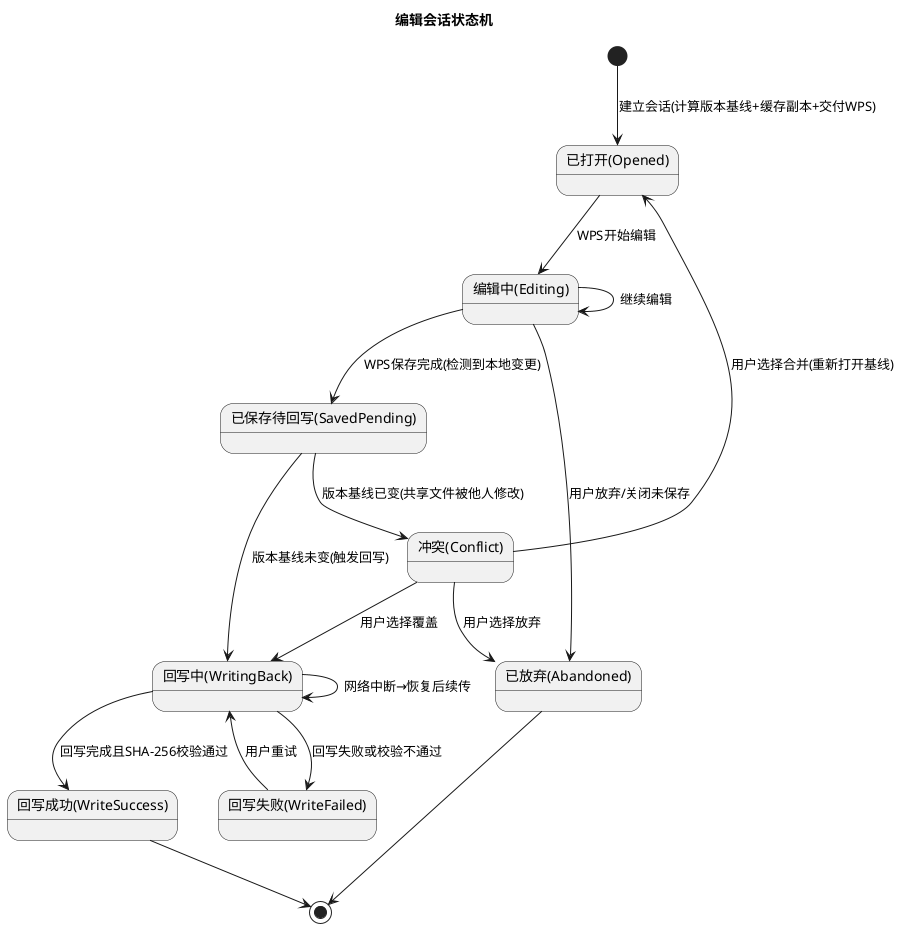

**状态触发条件与处理策略**：

| 状态迁移 | 触发条件 | 处理策略 |
|---------|---------|---------|
| → 已打开 | 用户点击共享文件 | 流式缓存→计算版本基线(SHA-256+mtime)→交付WPS→建立会话 |
| 已打开→编辑中 | WPS 开始编辑 | 启动文件变更监听 |
| 编辑中→已保存待回写 | WPS 保存完成且检测到本地变更 | 暂停变更监听，准备回写 |
| 已保存待回写→回写中 | 共享当前版本 == 版本基线 | 流式回写→SHA-256 校验 |
| 已保存待回写→冲突 | 共享当前版本 ≠ 版本基线 | **禁止静默覆盖**，提示用户选择合并/覆盖/放弃 |
| 回写中→回写成功 | 回写完成且校验通过 | 显示"已保存到共享"，更新目录状态 |
| 回写中→回写失败 | 回写失败或校验不通过 | **不显示成功**，保留本地副本供重试，原文件未被破坏 |
| 回写中→回写中 | 网络中断后恢复 | 从断点续传，不从头开始 |

#### 2.1.3.2 传输任务状态机（REQ-04 + REQ-05）

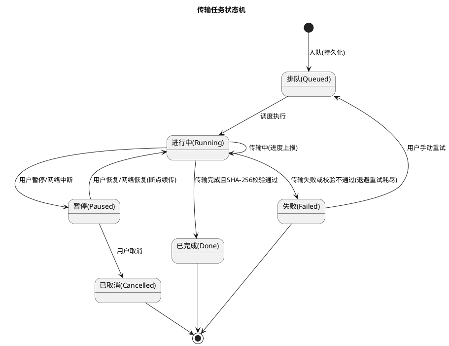

**关键策略**：
- **持久化驱动**：每次状态迁移与进度更新均持久化，应用被杀后重启可恢复队列。
- **断点续传**：暂停/失败恢复时从"已传输字节偏移"续传，不从头开始。
- **重复操作防护**：入队前检查是否有相同源→目标任务正在进行，避免重复。
- **退避重试**：失败后按指数退避自动重试，超限标记 Failed 供用户手动重试。

#### 2.1.3.3 WPS 保存回写流程分支（关键技术门禁核心）

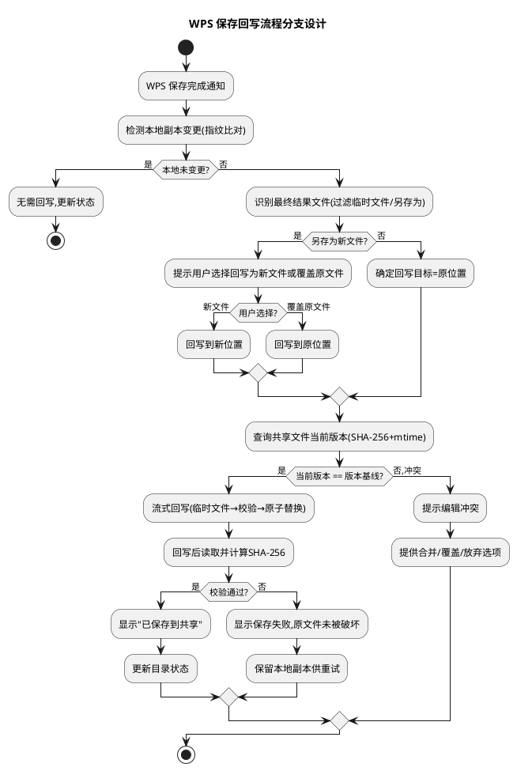

#### 2.1.3.4 安全写入事务设计（RISK-02 缓解）

覆盖写入中途失败会破坏原文件。本设计采用"临时文件→校验→原子替换"事务策略，保证失败时原文件完好。

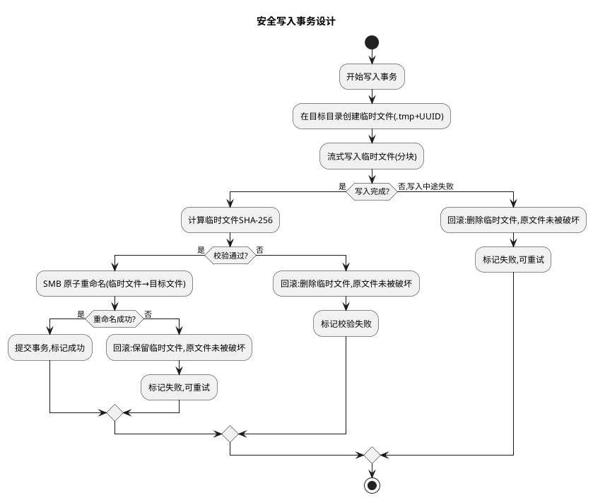

**事务保证（P1-5 问题 B 修订）**：
- **原子性（须实测验证）**：通过 SMB 原子重命名实现"全有或全无"，要么完全成功要么原文件不变。**但"原子重命名替换"不能作为普遍保证**：临时文件重命名、替换已有目标、目标文件被占用时的行为，必须根据实际 SMB 服务器、SMBJ API 调用及共享模式验证，不能仅凭协议支持重命名就保证事务原子性。
- **一致性**：临时文件完整写入且校验通过后才替换，目标文件始终处于一致状态。
- **可恢复**：失败时临时文件可保留供重试，原文件不被破坏。
- **最终校验与提交**：只有完成最终校验（SHA-256 通过）并通过经验证的提交流程（如原子重命名）后，才允许将任务标记为成功。

#### 2.1.3.4b SMB 安全写入与断点续传协议级前置条件（P1-2 补充）

> **重要**：以下设计目标（安全写入事务、断点续传）是合理的架构设计，但其**协议级可行性须在真实 SMB 环境验证后才能视为成立**。PAD2-M2 门禁阶段（第 3.9 节）须在真实 SMB 服务器上逐项验证。

**1. SMB 临时文件写入→重命名→替换操作序列及前置条件**

| 步骤 | SMB 操作 | 前置条件 | 失败回滚策略 |
|------|---------|---------|-------------|
| 1. 创建临时文件 | `SMB_CREATE` 创建 `.tmp+UUID` 文件 | 目标目录有写权限；目录剩余空间充足 | 创建失败→中止事务，原文件不受影响 |
| 2. 流式写入临时文件 | `SMB_WRITE` 分块写入 | 临时文件创建成功；SMB 会话有效 | 写入失败→删除临时文件，原文件不受影响 |
| 3. 校验临时文件 | 读取临时文件计算 SHA-256 | 写入完成 | 校验失败→删除临时文件，标记校验失败 |
| 4. 原子重命名替换 | `SMB_RENAME` 临时文件→目标文件名 | 目标目录支持原子重命名（**须实测验证，不能仅凭协议支持推断**）；目标文件未被占用（oplock/lease 未被持有，**客户端不一定能可靠查询**） | 重命名失败→保留临时文件供重试，原文件不受影响；服务器不支持时回退为带校验覆盖或人工处理 |
| 5. 提交事务 | 标记成功 | 重命名成功 | — |

**2. 服务器端文件占用（oplock/lease）行为对原子替换的影响**

- **oplock/lease 机制**：Windows SMB 服务器通过 oplock（机会锁）或 lease（租约）机制允许客户端缓存文件数据。当其他客户端持有目标文件的 oplock/lease 时，重命名操作可能被阻塞或失败。
- **影响场景**：
  - WPS 正在编辑目标文件时，可能持有 oplock/lease，导致回写重命名失败。
  - 其他客户端正在读取目标文件时，可能影响重命名行为。
- **应对策略（P1-5 问题 C 修订）**：
  - 回写前尝试检测目标文件是否被占用（尝试获取 oplock 或查询文件句柄状态），但**不预设一定能提前查询并准确识别所有打开文件的客户端**。
  - 文件被占用时提示用户"文件被占用，请重试或另存"，不静默失败。
  - 考虑请求 `FILE_SHARE_DELETE` 共享模式以允许重命名被占用的文件（须验证 SMB 服务器支持）。
  - **oplock/lease 行为须实测**：不能预设应用一定能提前查询并准确识别所有打开文件的客户端。查询失败或无法确定占用状态时，按文件可能被占用处理（提示用户而非静默操作）。
- **验证要求**：须在真实 SMB 服务器上验证不同 oplock/lease 场景下重命名行为，包括 WPS 编辑中回写、多客户端并发、客户端无法查询占用状态等场景。

**3. 断点续传的 SMB 协议级可行性**

- **SMB 随机写入**：断点续传要求从已传输字节偏移继续写入已存在的文件。SMB2/3 协议支持 `SMB_WRITE` 操作指定偏移量，允许随机写入已存在文件。
- **前置条件（P1-5 修订）**：
  - 续传目标为任务专属临时文件（非正式目标文件），临时文件已存在且大小 ≥ 已传输偏移。
  - SMB 会话有效且对临时文件所在目录有写权限。
  - 临时文件未被以独占模式打开（无排他 oplock/lease）。
  - **持久化信息要求**：须持久化任务标识、临时文件标识、源文件版本信息（源文件 SHA-256 + mtime）、已确认偏移及必要的完整性校验信息（如已传输部分的校验和），用于恢复时验证临时文件与任务的对应关系。
- **续传流程（P1-5 问题 A 修订）**：
  1. **续传优先针对独立的临时文件**，而不是直接在正式目标文件上续传。续传目标为任务专属临时文件（如 `.transfer-tmp-<taskId>-<UUID>`），而非正式目标文件。
  2. 恢复时验证临时文件与任务的对应关系：校验临时文件标识、任务标识、源文件版本信息是否匹配持久化记录。
  3. 若临时文件大小 ≥ 持久化偏移且对应关系验证通过，从偏移处继续 `SMB_WRITE` 写入临时文件。
  4. 若无法证明续传安全（临时文件与任务不匹配、临时文件不存在、偏移无效等），从头重传或转入人工处理，不直接在正式目标文件上续传。
  5. 续传完成后计算临时文件完整 SHA-256 校验，校验通过后通过经验证的提交流程将临时文件替换为正式目标文件。
  6. **仅凭文件大小无法证明续传安全**：文件大小仅证明文件有相应长度，不证明已有内容属于当前传输任务，也不证明前缀内容完整。必须通过任务标识、临时文件标识与完整性校验信息综合判定。
- **验证要求**：须在真实 SMB 服务器上验证从指定偏移写入已存在文件的可行性，包括大文件断点续传、网络中断后恢复续传等场景。

**4. 每步操作的失败回滚策略汇总**

| 失败场景 | 回滚动作 | 原文件状态 | 可重试性 |
|---------|---------|-----------|---------|
| 临时文件创建失败 | 中止事务 | 不受影响 | 可重试（检查空间/权限后） |
| 流式写入中途失败 | 删除临时文件 | 不受影响 | 可重试（从头开始） |
| 校验失败 | 删除临时文件 | 不受影响 | 可重试（从头开始） |
| 原子重命名失败（文件占用） | 保留临时文件 | 不受影响 | 可重试（等待占用释放后） |
| 原子重命名失败（其他原因） | 保留临时文件 | 不受影响 | 可重试 |
| 断点续传偏移无效或临时文件与任务不匹配 | 从头重传临时文件（不在正式目标文件上续传） | 正式目标文件不受影响 | 可重试 |
| 服务器不支持预期替换行为 | 记录不支持原因，回退为带校验覆盖写入或转入人工处理 | 临时文件保留供处理 | 须根据实测结果选择替代方案 |
| 回滚失败（临时文件删除失败/重命名后状态不一致） | 记录回滚失败，标记任务异常，转入人工处理 | 须人工确认原文件状态 | 须人工介入 |
| 网络中断 | 暂停事务，持久化进度 | 不受影响 | 网络恢复后可续传 |

> **验证标注**：以上所有设计目标（安全写入事务的原子性、oplock/lease 影响处理、断点续传的协议级可行性、失败回滚策略）**须在 PAD2-M2 门禁阶段（第 3.9 节）用真实 SMB 环境验证后才能视为成立**。未经验证前，这些设计目标仅为架构设计假设，不作为已确认的技术基线。

#### 2.1.3.4c SMB 安全写入与断点续传设计修订要求（P1-5 补充）

> **重要**：以下为 PM 第二轮评审发现的设计修订要求，用于收紧安全写入与断点续传流程的数据完整性保证。**这些是设计修订要求，不代表已经证明 SMB 协议或具体服务器无法实现该方案**。具体可行性与边界须在 PAD2-M2 门禁阶段（第 3.9 节）真实环境验证后确定。

**修订要求清单**：

1. **续传优先针对独立的临时文件**：续传目标应为任务专属临时文件（如 `.transfer-tmp-<taskId>-<UUID>`），而不是直接覆盖正式目标文件。仅凭正式目标文件大小不小于已持久化偏移，不能证明已有内容属于当前传输任务，也不能证明前缀内容完整。

2. **持久化任务上下文信息**：须持久化以下信息用于恢复时验证续传安全：
   - 任务标识（taskId）
   - 临时文件标识（临时文件名/路径）
   - 源文件版本信息（源文件 SHA-256 + mtime）
   - 已确认偏移（已传输并校验的字节偏移）
   - 必要的完整性校验信息（如已传输部分的校验和或分块校验清单）

3. **恢复时验证对应关系**：恢复续传时须验证临时文件与任务的对应关系（任务标识、临时文件标识、源文件版本信息是否匹配持久化记录）。**无法证明续传安全时，从头重传或转入人工处理**，不强行续传。

4. **最终校验与提交后方可标记成功**：只有完成最终校验（完整文件 SHA-256 通过）并通过经验证的提交流程（如原子重命名，须实测验证）后，才允许将任务标记为成功。不得在校验未通过或提交未确认时标记成功。

5. **处理边界明确**：须明确以下场景的处理边界：
   - 服务器不支持预期替换行为（如不支持原子重命名）时的处理方式。
   - 目标文件被占用（oplock/lease 被持有）时的处理方式。
   - 回滚失败（如临时文件删除失败、重命名失败后原文件状态不一致）时的处理方式。
   - 客户端无法可靠查询其他客户端占用状态时的处理方式（按可能被占用处理，提示用户）。

6. **修订性质标注**：以上修订要求是设计层面的收紧，目的是提高数据完整性保证。**不代表已经证明 SMB 协议或具体服务器无法实现该方案**。具体实现可行性须在 M2 门禁阶段真实环境验证后确定，验证结果可能支持、部分支持或否定某些设计假设，届时根据验证结果调整实现方案。

#### 2.1.3.5 网络恢复与自动续传流程（REQ-05）

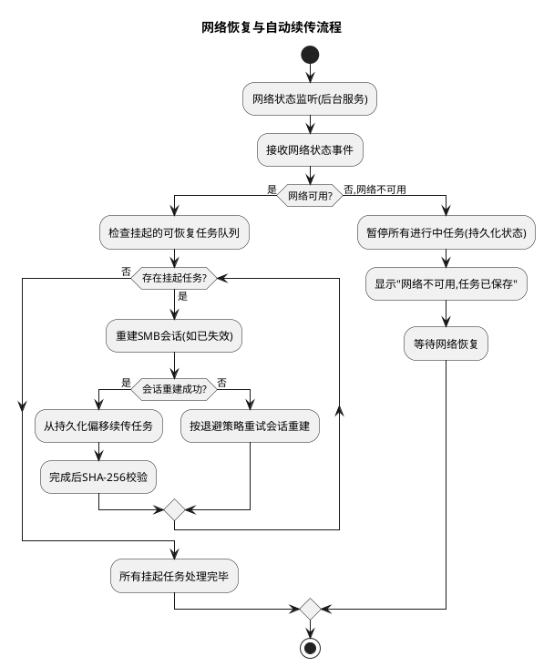

#### 2.1.3.6 扩展点设计

| 扩展点 | 扩展接口 | 默认实现 | 扩展场景 |
|--------|---------|---------|---------|
| SMB 协议版本适配 | SmbTransportAdapter | SMBJ 适配器（SMB2/3） | 未来支持其他协议版本 |
| 文件类型→打开应用选择 | FileAppResolver | 默认优先 WPS，回退系统选择 | 支持更多文件类型或应用 |
| WPS 文件交付方式 | WpsDeliveryStrategy | 优先 ContentProvider/URI，回退临时文件 | 适配不同 WPS 版本 |
| 传输加密策略 | TransportEncryptionPolicy | SMB 协议层加密（M1 评估） | 未来支持应用层加密 |
| 冲突解决策略 | ConflictResolver | 提示用户选择（合并/覆盖/放弃） | 未来支持自动合并 |
| 日志脱敏规则 | LogSanitizer | 密码/凭据/文件内容脱敏 | 扩展脱敏规则 |
| 重试退避策略 | RetryBackoffPolicy | 指数退避，上限 5 次 | 调整退避参数 |
## 2.2 接口设计

### 2.2.1 总体设计

本组件接口分为三大类：内部模块间接口（Java/Kotlin 层）、对外 Android 接口（ContentProvider/Intent）、以及 Capacitor 插件桥接接口（TS↔Java，如沿用 Capacitor 架构）。

**接口分类依据**：
- **内部接口**：核心能力层与基础设施层之间的契约，面向模块解耦与可测试性。
- **对外 Android 接口**：面向第三方应用与 WPS 的标准 Android 接口，面向互操作性。
- **桥接接口**：表现层（React/TS）与原生层（Java/Kotlin）之间的桥接，面向跨层调用。

**接口变更兼容策略**：
- 对外 ContentProvider/Intent 接口采用版本化 URI（如 `content://com.smbexplorer.v1/...`），变更时提供新版本 URI 并保留旧版本迁移说明。
- 内部接口采用接口抽象（Java Interface），变更通过新增方法而非修改现有方法实现兼容。
- 桥接接口采用 Capacitor 插件方法签名版本化，新增参数使用可选默认值。

| 接口分类 | 接口名称 | 稳定性等级 | 说明 |
|---------|---------|-----------|------|
| 内部接口 | SmbConnectionManager | 稳定 | SMB 会话管理 |
| 内部接口 | SmbDirectoryEnumerator | 稳定 | 目录枚举（分页） |
| 内部接口 | StreamTransferEngine | 稳定 | 流式传输 |
| 内部接口 | TransferQueueManager | 稳定 | 持久化传输队列 |
| 内部接口 | IntegrityChecker | 稳定 | SHA-256 完整性校验 |
| 内部接口 | EditSessionManager | 稳定 | 编辑会话生命周期 |
| 内部接口 | WpsDeliveryHandler | 实验 | WPS 文件交付（M2 验证后稳定） |
| 内部接口 | WriteBackEngine | 稳定 | 可靠回写 |
| 内部接口 | ConflictDetector | 稳定 | 版本基线冲突检测 |
| 内部接口 | NetworkRecoveryService | 稳定 | 网络恢复与续传 |
| 内部接口 | CredentialVault | 稳定 | Keystore 凭据加密 |
| 对外接口 | SmbFileContentProvider | 稳定 | 第三方应用文件访问 |
| 对外接口 | SmbFileOpenIntent | 稳定 | Intent 打开共享文件 |
| 桥接接口 | SmbExplorerPlugin | 稳定 | Capacitor 插件桥接 |

### 2.2.2 接口清单

#### SmbConnectionManager（SMB 连接管理）

**接口签名**：
```
interface SmbConnectionManager {
    // 建立会话（凭据从 CredentialVault 读取，不传入明文）
    fun connect(configId: String): SmbSession
    // 测试连接（不持久化会话）
    fun testConnection(config: SmbConnectionConfig): ConnectionTestResult
    // 断开会话
    fun disconnect(sessionId: String): Unit
    // 重建失效会话（REQ-05 自动恢复）
    fun reconnect(sessionId: String): SmbSession
    // 获取活跃会话
    fun getActiveSession(configId: String): SmbSession?
}
```

**业务说明**：管理 SMB 会话的建立、测试、断开与重建，支持会话池化与失效自动重建。
**前置条件**：凭据已通过 CredentialVault 加密存储；配置已持久化。
**后置条件**：成功时返回可用会话句柄；失败时抛出分类异常，不持久化无效会话。
**异常映射**：网络不可达→`NetworkUnreachableException`；认证失败→`AuthFailedException`；协议不支持→`ProtocolUnsupportedException`；超时→`ConnectionTimeoutException`。

#### SmbDirectoryEnumerator（目录枚举，分页）

**接口签名**：
```
interface SmbDirectoryEnumerator {
    // 分页枚举（首屏优先）
    fun enumerate(session: SmbSession, path: String, pageSize: Int, cursor: PageCursor?): DirectoryPage
    // 搜索（共享范围内）
    fun search(session: SmbSession, basePath: String, keyword: String, pageSize: Int, cursor: PageCursor?): SearchPage
    // 排序
    fun sort(entries: List<DirEntry>, sortBy: SortBy, order: SortOrder): List<DirEntry>
}
```

**业务说明**：分页枚举目录条目，支持搜索与排序，避免一次性枚举大目录。
**前置条件**：会话有效。
**后置条件**：返回分页结果与下一页游标；首屏在响应上限内返回。
**异常映射**：枚举超时→`EnumerateTimeoutException`；权限不足→`PermissionDeniedException`。

#### StreamTransferEngine（流式传输引擎）

**接口签名**：
```
interface StreamTransferEngine {
    // 流式复制（分块读写，进度回调）
    fun copy(source: FileLocation, target: FileLocation, options: TransferOptions, progress: ProgressCallback): TransferResult
    // 流式移动
    fun move(source: FileLocation, target: FileLocation, options: TransferOptions, progress: ProgressCallback): TransferResult
    // 断点续传（从偏移继续）
    fun resume(taskId: String, offset: Long, progress: ProgressCallback): TransferResult
}
```

**业务说明**：流式/分块传输，不整体载入内存，支持断点续传与进度回调。
**前置条件**：源可读、目标可写、本地空间充足。
**后置条件**：传输完成后触发完整性校验；失败时原文件不被破坏（安全写入事务）。
**异常映射**：空间不足→`InsufficientSpaceException`；网络中断→`NetworkInterruptedException`（可恢复）；校验失败→`ChecksumMismatchException`。

#### TransferQueueManager（持久化传输队列）

**接口签名**：
```
interface TransferQueueManager {
    // 入队（持久化）
    fun enqueue(task: TransferTask): String  // 返回 taskId
    // 暂停
    fun pause(taskId: String): Unit
    // 恢复
    fun resume(taskId: String): Unit
    // 取消
    fun cancel(taskId: String): Unit
    // 重试
    fun retry(taskId: String): Unit
    // 获取队列状态
    fun getQueueStatus(): QueueStatus
    // 应用重启后恢复未完成任务
    fun restorePendingTasks(): Unit
}
```

**业务说明**：持久化传输队列管理，支持暂停/恢复/取消/重试与应用重启恢复。
**前置条件**：任务已持久化。
**后置条件**：状态迁移持久化；应用被杀后重启可恢复队列。
**异常映射**：任务不存在→`TaskNotFoundException`；重复操作→`DuplicateOperationException`（防护）。

#### IntegrityChecker（完整性校验）

**接口签名**：
```
interface IntegrityChecker {
    // 流式计算 SHA-256
    fun computeSha256(location: FileLocation): String
    // 校验源与目标一致
    fun verify(source: FileLocation, target: FileLocation): Boolean
}
```

**业务说明**：流式 SHA-256 计算与比对，确认文件内容逐字节一致。
**前置条件**：文件可读。
**后置条件**：返回指纹或比对结果。

#### EditSessionManager（编辑会话管理）

**接口签名**：
```
interface EditSessionManager {
    // 建立编辑会话（缓存+版本基线+交付WPS）
    fun openSession(sharedPath: String, session: SmbSession): EditSession
    // 获取会话状态
    fun getSessionState(sessionId: String): EditSessionState
    // 检测本地变更
    fun detectChange(sessionId: String): ChangeDetectionResult
    // 放弃会话
    fun abandon(sessionId: String): Unit
    // 获取所有活跃会话
    fun getActiveSessions(): List<EditSession>
}
```

**业务说明**：管理编辑会话生命周期，含缓存副本、版本基线、变更检测。
**前置条件**：共享文件可读、本地缓存空间充足。
**后置条件**：会话状态按状态机迁移并持久化。

#### WpsDeliveryHandler（WPS 文件交付，M2 验证后稳定）

**接口签名**：
```
interface WpsDeliveryHandler {
    // 交付文件给 WPS（选择最优方式）
    fun deliver(localCopy: LocalFile, fileType: FileType): WpsDeliveryResult
    // 识别 WPS 保存的最终结果文件（过滤临时文件/另存为）
    fun resolveResultFile(saveEvent: WpsSaveEvent): ResultFileResolution
}
```

**业务说明**：通过 Android 标准文件访问接口向 WPS 交付文件，并识别 WPS 保存的最终结果文件。
**前置条件**：WPS 已安装；本地副本可读。
**后置条件**：WPS 可编辑保存；保存事件可被检测。
**异常映射**：WPS 未安装→`WpsNotInstalledException`；交付方式不可用→`DeliveryUnavailableException`。
**注意**：此接口在 PAD2-M2 技术验证门禁通过后方可标记为稳定。

#### WriteBackEngine（可靠回写引擎）

**接口签名**：
```
interface WriteBackEngine {
    // 可靠回写（版本基线检测→流式回写→校验）
    fun writeBack(sessionId: String): WriteBackResult
}
```

**业务说明**：将本地变更可靠回写到共享原位置，含冲突检测、安全写入、完整性校验。
**前置条件**：编辑会话处于"已保存待回写"状态。
**后置条件**：回写成功且校验通过→显示"已保存到共享"；失败→原文件未被破坏，保留本地副本。
**异常映射**：冲突→`EditConflictException`（提示用户决策）；回写失败→`WriteBackFailedException`；校验失败→`ChecksumMismatchException`。

#### ConflictDetector（冲突检测）

**接口签名**：
```
interface ConflictDetector {
    // 检测共享文件版本是否已变（与基线比对）
    fun detect(session: SmbSession, sharedPath: String, baseline: VersionBaseline): ConflictDetectionResult
}
```

**业务说明**：回写前检测共享文件当前版本是否与编辑会话开始时的基线一致，防止静默覆盖。
**前置条件**：版本基线已记录。
**后置条件**：返回冲突/无冲突判定。

#### NetworkRecoveryService（网络恢复与续传）

**接口签名**：
```
interface NetworkRecoveryService {
    // 启动网络监听（后台服务）
    fun startMonitoring(): Unit
    // 停止监听
    fun stopMonitoring(): Unit
    // 注册可恢复任务
    fun registerRecoverable(taskId: String): Unit
}
```

**业务说明**：监听网络状态，自动重建会话与续传可恢复任务。
**前置条件**：后台服务已启动。
**后置条件**：网络恢复后自动续传挂起任务。

#### CredentialVault（Keystore 凭据加密）

**接口签名**：
```
interface CredentialVault {
    // 加密存储凭据
    fun store(configId: String, credential: SmbCredential): Unit
    // 读取凭据（解密）
    fun retrieve(configId: String): SmbCredential
    // 删除凭据
    fun remove(configId: String): Unit
    // 检查 Keystore 可用性
    fun isAvailable(): Boolean
}
```

**业务说明**：以 Android Keystore 保护的 AES 加密方式存储 SMB 凭据，禁止明文。
**前置条件**：Android Keystore 可用（设备已设置锁屏）。
**后置条件**：凭据以加密密文存储，任何位置无明文。
**异常映射**：Keystore 不可用→`KeystoreUnavailableException`（提示启用设备锁屏）。

#### SmbFileContentProvider（对外 ContentProvider）

**接口签名**：Android 标准 ContentProvider，URI 格式 `content://com.smbexplorer.v1/shared/<configId>/<path>`。

**业务说明**：向第三方应用提供共享文件访问，支持 `openFile`、`query`、`cursor` 等标准操作。
**前置条件**：第三方应用已获 URI 授权（`grantUriPermission`）。
**后置条件**：授权后可访问；未授权拒绝。
**异常映射**：未授权→`SecurityException`；文件不存在→`FileNotFoundException`。

## 2.3 数据模型

### 2.3.1 设计目标

数据模型须支持以下业务场景与目标：

1. **业务场景**：多共享配置管理、目录浏览与搜索、文件操作与传输、编辑会话与回写、凭据安全存储、审计与诊断。
2. **性能目标**：传输任务持久化读写低延迟（< 50ms）；目录枚举分页首屏快速响应；大文件流式处理内存受限。
3. **容量目标**：支持 10,000 个文件批量任务记录；支持多共享多会话并发。
4. **扩展性目标**：数据模型可独立演进；支持未来新增任务类型与文件访问方式。
5. **兼容策略**：存量凭据须从明文迁移为 Keystore 加密；任务持久化采用 Room/SQLite，支持 schema 版本迁移。

### 2.3.2 模型实现

核心领域对象类图如下，对象关系遵循领域术语定义（spec 第 2 章），关注对象生命周期与状态流转。

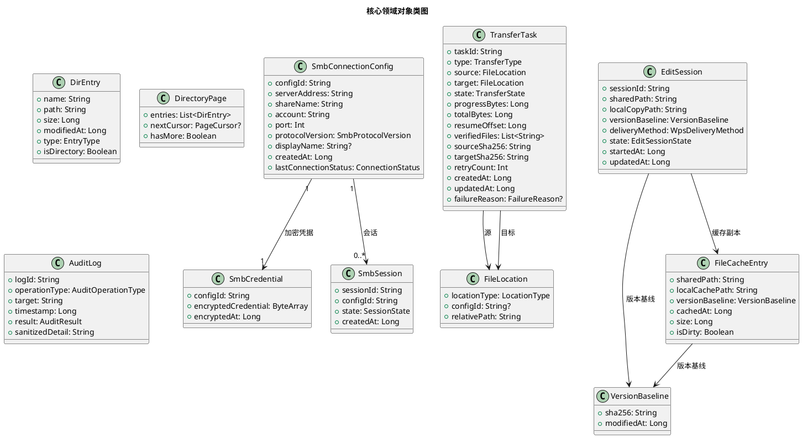

**对象关系说明**：
- `SmbConnectionConfig` ↔ `SmbCredential`：一对一，凭据独立加密存储，配置不持有明文。
- `SmbConnectionConfig` ↔ `SmbSession`：一对多，一个配置可建立多个会话（池化）。
- `TransferTask` → `FileLocation`：关联源与目标位置，`FileLocation` 统一抽象本地路径与共享路径。
- `EditSession` → `VersionBaseline`：持有编辑开始时的版本基线，用于冲突检测。
- `EditSession` → `FileCacheEntry`：关联本地缓存副本。

**对象生命周期与创建/销毁策略**：
- `SmbConnectionConfig`：由管理员创建，持久化存储，删除时级联清理凭据与会话。
- `SmbSession`：按需创建（连接时），池化管理，超时或失效时销毁。
- `TransferTask`：入队时创建并持久化，完成/取消后保留记录（审计），定期清理历史。
- `EditSession`：打开文件时创建，回写成功或放弃后销毁，缓存副本按空间策略清理。
- `FileCacheEntry`：随编辑会话创建，会话结束后按 LRU + 空间上限清理。

**持久化策略**（不包含表结构）：
- `SmbConnectionConfig`：Room/SQLite 持久化（不含凭据明文）。
- `SmbCredential`：Keystore 加密密文存储于独立安全存储区。
- `TransferTask`：Room/SQLite 持久化，支持状态机驱动与断点续传。
- `EditSession`：Room/SQLite 持久化（活跃会话），完成后归档。
- `FileCacheEntry`：本地文件系统 + 元数据 Room/SQLite。
- `AuditLog`：Room/SQLite 持久化，定期轮转与导出。
---

## 2.4 WPS 集成方案（REQ-02 + REQ-03 关键技术门禁）

WPS 集成是本项目成败点（RISK-03），须在 PAD2-M2 阶段作为独立技术验证门禁通过后方可进入开发。

### 2.4.1 文件交付方式选型

本组件须通过 Android 标准文件访问机制向 WPS 交付文件。候选方式及选型理由：

| 交付方式 | 原理 | 优势 | 风险 | 选型决策 |
|---------|------|------|------|---------|
| ContentProvider + URI | 本组件实现 ContentProvider，向 WPS 授予 URI 权限，WPS 通过 URI 读写 | 可控性强，可拦截读写操作，支持回写检测 | 须 WPS 支持 ContentProvider URI 读写 | **首选**（M2 验证） |
| 临时文件 + Intent | 将共享文件缓存为本地临时文件，通过 Intent ACTION_VIEW/EDIT 交给 WPS | 兼容性最好，几乎所有 WPS 版本支持 | 回写须靠文件变更监听，另存为识别复杂 | **回退方案** |
| SAF DocumentFile | 通过 SAF 获取文件 URI 交给 WPS | Android 标准 | SAF 权限模型复杂，WPS 支持度不确定 | 备选（M2 验证） |

**选型决策**：优先 ContentProvider + URI 方式（可控回写），M2 验证不通过则回退临时文件 + Intent 方式。最终方式在 M2 门禁通过后冻结。WPS 兼容性以"已验证版本清单"管理，不绑定单一 WPS 版本：M1 冻结测试目标范围（代表性设备清单 + 计划测试 WPS 版本清单），M2 逐设备/逐版本验证后将通过验证的组合写入已验证版本清单，未测试组合标注"未验证"，已验证环境清单持续更新。

### 2.4.2 WPS 保存行为识别策略

WPS 保存行为存在三种可能，须逐一识别：

| 保存行为 | 识别特征 | 处理策略 |
|---------|---------|---------|
| 直接写入原文件 | 原文件 mtime 更新，内容指纹变化 | 触发回写到共享原位置 |
| 另存为新文件 | 出现新文件名，原文件未变 | 提示用户选择回写为新文件或覆盖原文件 |
| 生成临时文件 | 出现 `~$` 前缀或 `.tmp` 后缀临时文件，原文件最终更新 | 过滤临时文件，识别最终结果文件后触发回写 |

**识别实现**：通过文件变更监听（`FileObserver`）+ ContentProvider 回调 + 文件名/路径模式匹配综合判定。

### 2.4.3 回写校验链路

回写校验是"禁止伪报成功"的核心保障：

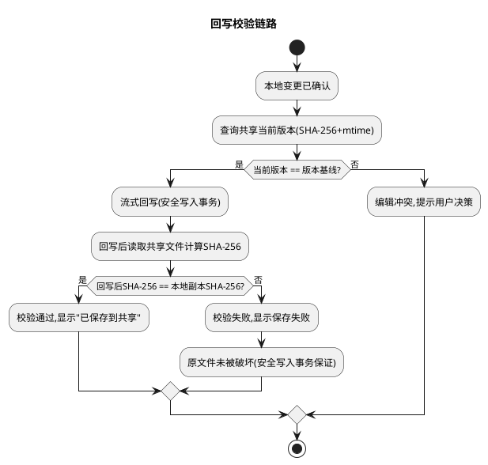

### 2.4.4 M2 技术验证门禁清单

PAD2-M2 须在代表性设备、实际 WPS 版本、真实 SMB 服务器上验证以下全部项，逐设备/逐版本记录兼容性证据：

| 验证项 | 验证内容 | 通过标准 |
|--------|---------|---------|
| V1 WPS 可打开 | 通过选定接口交付文件，WPS 可正常打开编辑 | WPS 成功打开且可编辑 |
| V2 WPS 可保存 | WPS 保存操作可被本组件检测 | 本组件检测到保存事件 |
| V3 保存行为识别 | 正确识别直接写入/另存为/临时文件 | 最终结果文件判定正确 |
| V4 回写成功 | 保存后回写共享且 SHA-256 校验通过 | 共享文件内容确实发生预期变化 |
| V5 回写失败不破坏 | 回写失败时原文件未被破坏 | 原文件内容与基线一致 |
| V6 并发冲突 | 两台设备同时编辑不静默覆盖 | 提示冲突，不丢失任一方更新 |
| V7 断网恢复 | 编辑期间断网后恢复，回写可完成 | 网络恢复后回写成功且校验通过 |

**门禁底线**：不能仅凭 WPS 成功启动就判定通过，必须验证共享文件内容确实发生预期变化且失败时原文件不被静默破坏。全部 V1-V7 通过方可进入 PAD2-M3 开发。

## 2.5 安全方案

### 2.5.1 凭据安全存储（RISK-04 缓解）

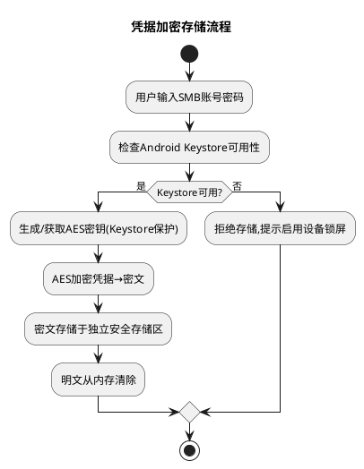

**安全保证**：
- 密钥由 Android Keystore 生成与管理，密钥不出 Keystore。
- 存储区仅存密文，任何位置无明文密码。
- 读取时临时解密到内存，使用后立即清除。
- 日志脱敏确保密码不出现在任何日志条目。

### 2.5.2 日志脱敏与审计

- **脱敏规则**：密码、完整凭据、文件敏感内容在日志输出前替换为 `***`。
- **结构化日志**：含错误分类码、操作上下文、时间戳，便于故障诊断。
- **审计日志**：连接建立、文件写入、删除、重命名、回写记录审计日志（操作类型、目标、时间、结果，脱敏）。
- **诊断导出**：用户可导出脱敏诊断包（操作日志 + 错误分类 + 环境信息），不含敏感数据。

### 2.5.3 最小权限（P1-3 收敛、P1-7 核验，PAD2-M1-G4-FAST-DECISION-01 多设备兼容）

> **权限收敛策略**：根据 Android API 级别确定最小权限集，避免不必要或已不适用的权限。须根据 M1 确定的 `minSdkVersion`（最低支持版本）与 `targetSdkVersion` 最终确定权限清单。**权限行为按实际设备系统版本决定，不绑定单一版本**：不同设备系统版本上的权限授予行为与文件访问行为须按三层兼容性模型在代表性设备上逐版本验证，未实测版本标注"未验证"。

**P1-7 三个 Android 版本概念区分（须明确区分，不能互相代替）**：

| 概念 | 定义 | 对权限/文件访问的影响 |
|------|------|---------------------|
| `minSdkVersion` | 应用最低支持的 Android 版本（须确定，支持多版本） | 决定应用可使用的 API 下限；低于此版本的设备无法安装 |
| `targetSdkVersion` | 应用声明面向的目标 API 级别 | 决定系统对应用应用的兼容行为限制（如分区存储、后台限制等）；系统按此级别应用行为约束 |
| 实际设备系统版本 | 用户设备上实际运行的 Android 版本 | 决定设备上实际的权限授予行为与文件访问行为；须在实际设备版本上验证，按三层兼容性模型管理 |

> **重要**：`<29`、`>=29`、`>=30` 的 targetSdkVersion 划分**不能直接代替 Android 版本兼容性测试**。须在实际设备系统版本上验证权限行为、文件访问行为与后台传输行为。须在最低支持版本以上按三层兼容性模型逐版本验证，不绑定单一版本。

**按 targetSdkVersion 分类的最小权限集**：

| 权限 | 用途 | targetSdkVersion < 29 | targetSdkVersion >= 29 | targetSdkVersion >= 30 |
|------|------|----------------------|----------------------|----------------------|
| `INTERNET` | SMB 网络通信 | 必需 | 必需 | 必需 |
| `ACCESS_NETWORK_STATE` | 网络状态监听 | 必需 | 必需 | 必需 |
| `ACCESS_WIFI_STATE` | Wi-Fi 切换检测 | 必需 | 必需 | 必需 |
| `FOREGROUND_SERVICE` | 传输队列后台服务 | 必需 | 必需 | 必需 |
| `READ_EXTERNAL_STORAGE` | 读取本地文件 | 必需 | **不需要**（使用 SAF/私有目录） | **不需要** |
| `WRITE_EXTERNAL_STORAGE` | 写入本地缓存 | 必需 | **不需要**（使用 `getExternalFilesDir()`） | **不需要** |
| `MANAGE_EXTERNAL_STORAGE` | 全文件访问 | 不需要 | 不需要 | **最后手段，须证明无替代方案后才考虑申请**（须 Google Play 审查） |

**权限适用说明**：
- **targetSdkVersion < 29（传统存储）**：须申请 `READ/WRITE_EXTERNAL_STORAGE` 进行本地缓存文件读写。
- **targetSdkVersion >= 29（SAF/分区存储）**：本地缓存读写通过应用私有目录（`getExternalFilesDir()`）或 SAF，**不申请** `READ/WRITE_EXTERNAL_STORAGE`。
- **targetSdkVersion >= 30（Android 11+）**：同上。
- 所有版本均须：`FOREGROUND_SERVICE`（传输队列后台服务）、网络权限（SMB 通信）。
- 无额外冗余权限，每项权限均有对应功能用途。

**P1-7 MANAGE_EXTERNAL_STORAGE 策略（最后手段）**：
- **不应作为默认方案**。`MANAGE_EXTERNAL_STORAGE` 为最后手段，须先证明无替代方案后才考虑申请。
- 如果产品设计只需要应用私有缓存与用户主动授权的 SAF 目录，应**优先验证能否不申请该权限**。
- 须在文档中明确标注：`MANAGE_EXTERNAL_STORAGE` 为最后手段，申请前须证明应用私有缓存（`getExternalFilesDir()`）与 SAF 持久化授权无法满足需求。
- 申请该权限须通过 Google Play 审查，且仅限文件管理类应用。

**P1-7 须在实际设备上验证的 API 行为**：

| 验证项 | 验证内容 | 验证时机 |
|--------|---------|---------|
| 前台服务类型（foreground service type） | 传输队列后台服务的前台服务类型声明与行为（Android 14+ 须声明 `foregroundServiceType`） | 最低支持版本以上按三层兼容性模型逐版本验证 |
| 后台传输限制 | 后台传输任务在不同 Android 版本下的限制（如 Android 12+ 后台传输限制） | 最低支持版本以上按三层兼容性模型逐版本验证 |
| SAF 持久化授权（persistable URI permission） | SAF 授权的持久化行为（`takePersistableUriPermission`）在不同版本下的有效性 | 最低支持版本以上按三层兼容性模型逐版本验证 |
| 缓存目录行为 | `getExternalFilesDir()`、`getCacheDir()` 等缓存目录在不同版本下的行为与清理策略 | 最低支持版本以上按三层兼容性模型逐版本验证 |

### 2.5.4 SMB 协议安全评估

M1 阶段须评估并冻结 SMB 协议版本与传输加密要求：
- **协议版本**：建议 SMB2/3，不支持存在已知安全漏洞的 SMB1。
- **传输加密**：评估 SMB3 加密支持（SMB 3.1.1 支持端到端加密），优先启用。
- **认证**：NTLMv2 或 Kerberos，禁用 NTLMv1。

## 2.6 可靠性方案

### 2.6.1 大文件内存压力缓解（RISK-01）

- **流式/分块读写**：所有文件读写采用分块流式处理（建议分块 64KB-1MB），禁止一次性 `byte[]` 读取整体文件。
- **内存上限**：单任务内存占用不超过单实例上限，1 GiB 文件传输内存占用与分块大小相关而非文件大小。
- **SHA-256 流式计算**：完整性校验采用流式 SHA-256，不将文件整体载入内存。

### 2.6.2 覆盖写入安全（RISK-02）

- **安全写入事务**：采用"临时文件→校验→原子替换"策略（见 2.1.3.4），失败时原文件不被破坏。
- **冲突保护**：写入前检测同名文件，提示覆盖/跳过/重命名，禁止静默覆盖。

### 2.6.3 持久化任务队列与断点续传（RISK-05）

- **持久化驱动**：传输任务状态与进度持久化至 Room/SQLite，每次状态迁移与进度更新均落盘。
- **应用重启恢复**：应用启动时检查并恢复未完成任务队列。
- **断点续传**：从"已传输字节偏移"续传，已校验文件不重复传输。
- **网络恢复自动续传**：网络恢复后自动重建会话并续传挂起任务。

### 2.6.4 禁止伪报成功

- 所有传输/回写须 SHA-256 校验通过方可标记成功。
- 网络不可用、回写失败、校验不通过时显示等待或失败，不显示成功。
- 回写校验未通过时不显示"已保存到共享"。

## 2.7 部署与编译方案

### 2.7.1 远程编译服务器使用方案（代表性环境配置，PAD2-M1-G4-FAST-DECISION-01）

> **代表性环境配置说明（P1-3、PAD2-M1-G4-FAST-DECISION-01）**：远程编译服务器（192.168.2.3, debian/***REDACTED***, /home/debian/android）为经环境确认的**代表性环境配置**，不是所有开发环境的默认前提，不作为唯一环境假设。其他开发环境可使用本地 Android Studio 或其他编译方式替代。此配置仅作为当前团队的代表性编译环境参考，按三层兼容性模型管理：编译环境不绑定单一服务器，允许使用其他等效编译环境。

本项目使用远程编译服务器进行 Android APK 编译，避免本地环境配置。

| 项目 | 配置 |
|------|------|
| 服务器地址 | 192.168.2.3 |
| SMB 共享路径 | `\\192.168.2.3\home\debian`（对应 Linux 路径 `/home/debian`） |
| 编译工作目录 | `/home/debian/android` |
| 用户名 | debian |
| 密码 | ***REDACTED*** |
| 用途 | 远程编译 Android APK |

**编译流程**：

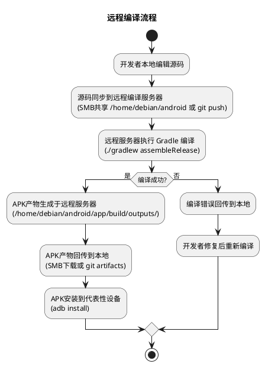

**编译环境要求**：
- 远程服务器须预装 JDK、Android SDK、Gradle。
- 编译工作目录 `/home/debian/android` 须有读写权限。
- SMB 共享须可从开发者本地 Windows 机器访问（`\\192.168.2.3\home\debian`）。

### 2.7.2 新仓库管理方案

| 项目 | 配置 |
|------|------|
| 新仓库地址 | https://github.com/wujupeng/andriodpad2 |
| 说明 | 安卓平板项目2（Android Shared File Explorer）新仓库 |
| 与旧仓库关系 | 旧仓库 `wujupeng/andriodpad` 仅作技术资产参考，新仓库独立演进 |

**版本管理策略**：
- 主分支 `main`：稳定发布版本。
- 开发分支 `develop`：集成开发。
- 阶段分支 `pad2-m1`、`pad2-m2`、`pad2-m3`、`pad2-m4`：对应五阶段规划。
- 复用旧仓库代码须经 M0 技术审查裁定，不预设复用也不预设重写。

### 2.7.3 技术栈选型

| 层 | 技术选型 | 选型理由 |
|---|---------|---------|
| 原生层（Android） | Java/Kotlin + SMBJ | SMBJ 为 Java SMB 客户端库，须在原生层使用；Kotlin 可选用于新模块 |
| 桥接层 | Capacitor 8 插件 | 复用旧仓库 Capacitor 架构经验，TS↔Java 桥接成熟 |
| 表现层 | React + TypeScript | 复用旧仓库前端架构经验，组件化开发 |
| 持久化 | Room/SQLite | Android 官方推荐，支持 schema 迁移与响应式查询 |
| 凭据加密 | Android Keystore + AES | 系统级密钥保护，符合安全 DFX 约束 |
| 文件访问 | SAF/ContentProvider | Android 标准文件访问机制，WPS 互操作基础 |
| 传输协议 | SMBJ（SMB2/3） | 复用旧仓库 SMBJ 经验，M1 冻结协议版本 |

**选型决策理由**：
- 保留 Capacitor + React + TypeScript 架构以复用旧仓库前端与桥接经验，降低迁移成本。
- 原生层保留 Java 以复用 SMBJ 封装与 Android 插件经验，新模块可选用 Kotlin。
- 持久化从 SharedPreferences 升级为 Room/SQLite 以支持任务持久化与断点续传。
- 凭据从明文升级为 Keystore 加密以满足安全 DFX 约束。

## 2.8 各阶段实现路径

### 2.8.1 阶段门禁与实现路径总览

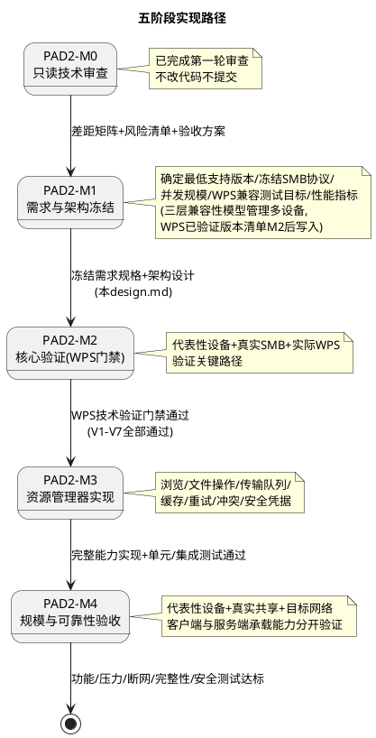

### 2.8.2 各阶段实现内容

| 阶段 | 实现内容 | 产出 | 门禁标准 |
|------|---------|------|---------|
| PAD2-M0 | 只读技术审查旧仓库 | 差距矩阵、风险清单、改造建议、验收方案 | 基线未被修改（已完成） |
| PAD2-M1 | 冻结需求规格与架构设计 | 正式 spec.md + design.md（本文档） | 含全部冻结项：最低 Android 支持版本候选值已形成（API 26，附技术依据，待 PM 确认）、SMB 协议、并发规模、文件大小上限、权限模型、WPS 兼容测试目标范围（首批代表性测试组合已确定，非测试结论）、性能指标；三层兼容性模型已写入文档；平板品牌不限定，以实测证据管理；参数冻结范围四类分类清晰（M1 必须冻结/策略规则已定/留待实测确定/建议值待 PM 确认），建议值附技术依据 |
| PAD2-M2 | WPS 关键路径技术验证 | 技术验证报告（V1-V7）+ WPS 已验证版本清单 + 已验证环境清单 | 真实环境验证通过：WPS 打开/编辑/保存回写/冲突/断网恢复，共享文件内容确实变化且失败时原文件不被破坏；逐设备/逐版本记录兼容性证据，通过组合写入已验证版本清单，未测试组合标注"未验证"，已验证环境清单持续更新 |
| PAD2-M3 | 完整资源管理器实现 | 可测试 APK | 共享目录浏览、文件操作、传输队列、缓存、重试、冲突处理、安全凭据管理全部实现且单元/集成测试通过 |
| PAD2-M4 | 规模与可靠性验收 | 验收报告 + 发布 APK | 功能/压力/断网恢复/数据完整性/安全测试全部达标；客户端与服务端承载能力分开出具报告 |

### 2.8.3 M2 阶段验证优先级

M2 须优先验证关键路径，不急于扩展所有功能：

1. **真实 SMB 浏览**：验证目录枚举与文件属性展示。
2. **打开文件**：验证共享文件直接打开（ContentProvider/临时文件交付 WPS）。
3. **WPS 编辑保存回写**：验证保存后回写共享且 SHA-256 校验通过（V1-V5）。
4. **文件冲突**：验证两人同时编辑不静默覆盖（V6）。
5. **断网恢复**：验证编辑期间断网后恢复回写可完成（V7）。

### 2.8.4 M3 阶段实现优先级

M3 在 M2 门禁通过后按以下优先级实现完整能力：

1. **共享目录浏览**：分页枚举、搜索、排序、属性、收藏。
2. **文件操作**：复制/移动/重命名/删除（入传输队列）。
3. **传输队列**：持久化、流式传输、进度、暂停/取消/重试、断点续传。
4. **缓存管理**：编辑会话缓存、空间检查、LRU 清理。
5. **冲突处理**：版本基线检测、冲突提示、用户决策。
6. **安全凭据管理**：Keystore 加密、凭据迁移、日志脱敏、审计。
7. **网络恢复**：网络监听、会话重建、自动续传、退避重试。

### 2.8.5 M4 阶段验收量化指标

| 指标 | 量化标准 |
|------|---------|
| 大文件基线 | 1 GiB 文件传输，内存不超限，SHA-256 校验通过 |
| 批量文件基线 | 10,000 个混合大小文件，全部完成且逐个校验通过 |
| 文件完整性 | 所有传输/回写 SHA-256 校验通过 |
| 网络恢复 | Wi-Fi 切换、短暂断网、SMB 会话失效、应用重启均可恢复 |
| 编辑保存 | WPS 保存后内容确实回写目标共享文件 |
| 冲突保护 | 两台设备同时编辑不静默丢失更新 |
| 多用户规模 | PM 明确目标并发用户数下成功率达标 |
| 客户端/服务端承载 | 分开验证，分别出具报告 |
| 多设备兼容性矩阵 | 覆盖已验证环境清单中所有组合，未测试组合标注"未验证"不得宣称兼容，已验证环境清单持续更新 |

---

> 本技术设计文档已覆盖需求与存量功能关系分析、增量设计方案（实现模型、接口设计、数据模型）、多设备兼容性策略与三层兼容性模型（PAD2-M1-G4-FAST-DECISION-01）、WPS 集成方案、安全方案、可靠性方案、部署与编译方案（含远程编译服务器 192.168.2.3 作为代表性环境）及各阶段实现路径。下一步须由 spec-task-agent 基于本设计文档生成 tasks.md 任务分解。