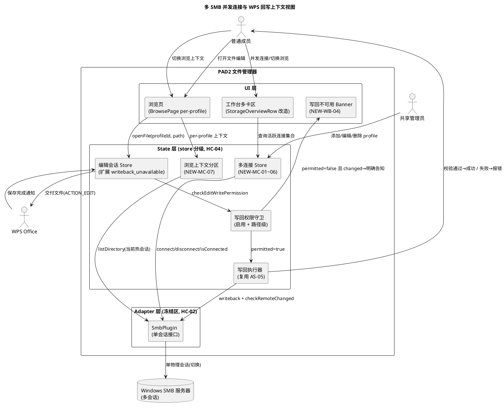
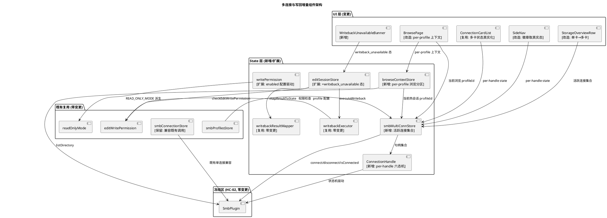
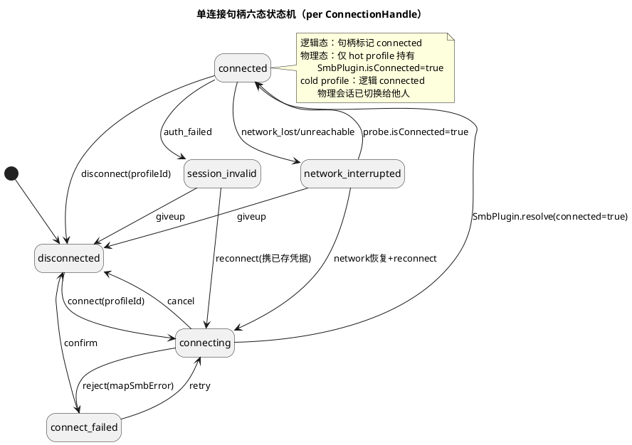
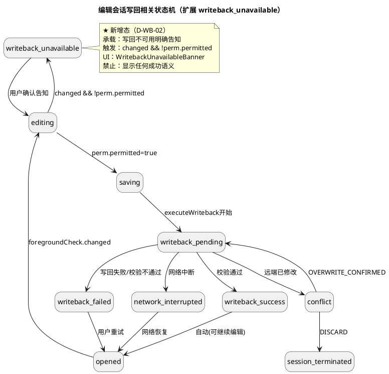
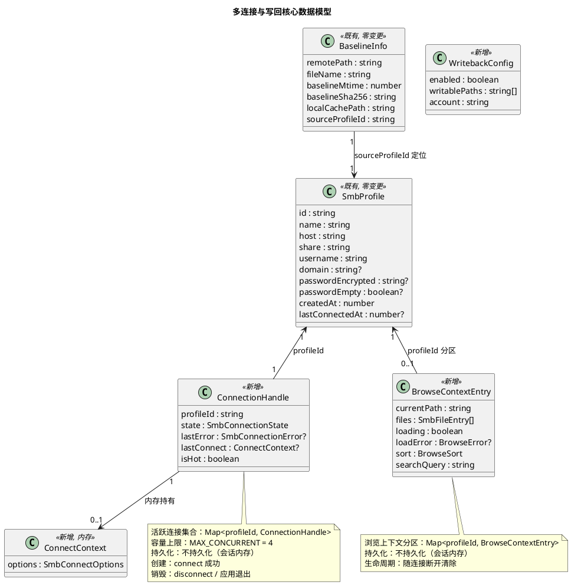
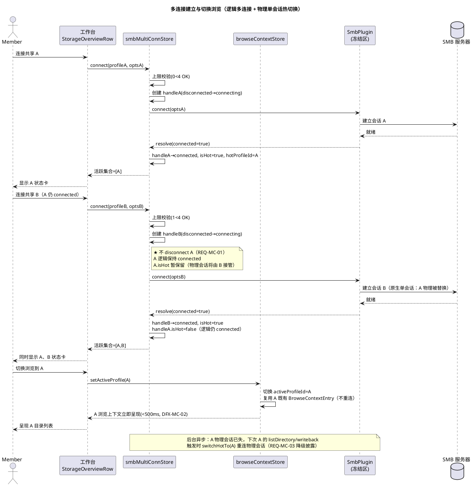
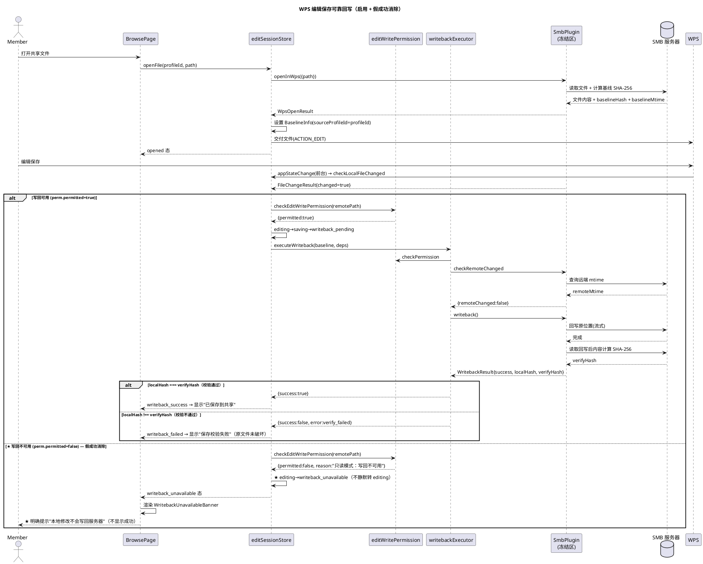

# 技术设计：多 SMB 并发连接与 WPS 编辑可靠回写

> **文档编号**：PAD2-DESIGN-MCWB-001
> **Feature Name**：multi_conn_writeback
> **上游规格**：`docs/specs/multi_conn_writeback/spec.md`（PAD2-SPEC-MCWB-001）
> **基线版本**：PAD2 v1.5（code 6），包名 com.pad2.filemanager
> **文档定位**：本文档为规格驱动开发（SDD）第二阶段产物，描述"怎么做"（HOW）。基于 spec.md 的 EARS 需求与既有代码证据，给出增量架构方案、接口契约、数据模型、状态机、数据流、变更范围、风险缓解与测试策略。
> **硬约束（来自项目记忆，贯穿全文）**：
> - HC-01 零新增 npm 依赖
> - HC-02 冻结区零变更：`src/adapter/smb/SmbPlugin.ts` / `src/core/**` / `android/**` 原生层不得变更（SmbPlugin 为唯一 SMB 调用入口）
> - HC-03 `src/main.tsx` 改动限 3 行内，超限逻辑抽独立模块
> - HC-04 store 分级：store 为 SmbPlugin 唯一调用入口，UI 层不得直接 import SmbPlugin
> - HC-05 既有 profile 持久化兼容：不破坏 `smbProfilesStore` 既存数据（`pad2.profiles.v1`）
> - HC-06 只读模式兼容：写回启用后须兼容 `enabled=false` 与路径越界场景

---

# 一、需求与存量功能关系分析

## 1.0 问题根因分析（代码级定位）

### 1.0.1 问题1根因：单活动连接模型

| 根因编号 | 代码位置 | 根因事实 | 违反需求 |
|---------|---------|---------|---------|
| RC-MC-01 | `src/state/smbConnectionStore.ts:46-55` | `SmbConnectionStoreState` 仅持有 `activeProfileId: string \| null` 单个活跃连接标识，无连接句柄集合 | REQ-MC-01/02/05 |
| RC-MC-02 | `src/state/smbConnectionStore.ts:97-105` | `connect()` 在 `current === 'connected'` 时执行 `await SmbPlugin.disconnect()` 断开旧连接，再连接新 profile（注释明写"单活动连接模型，activeProfileId 唯一"） | REQ-MC-01/08 |
| RC-MC-03 | `src/adapter/smb/SmbPlugin.ts:115-118` | `SmbPluginInterface.connect(options)` / `disconnect()` / `isConnected()` / `listDirectory({path})` 均无 `sessionId` 参数，原生层为单会话模型 | REQ-MC-01/03 |
| RC-MC-04 | `src/ui/pages/HomePage/StorageOverviewRow/index.tsx:97,126-147` | 工作台 `StorageOverviewRow` 仅渲染单个 SMB 状态卡（`activeProfile = profiles.find(p.id === activeProfileId)`），无多卡并发呈现 | REQ-MC-02 |
| RC-MC-05 | `src/state/browseStore.ts:36-52,66-137` | `browseStore` 持有单一 `currentPath/files` 浏览上下文，无按 profileId 分区的能力 | REQ-MC-03 |

**根因链**：RC-MC-03（原生单会话接口）→ RC-MC-01（TS 层单 activeProfileId 状态）→ RC-MC-02（connect 隐式断开旧）→ RC-MC-04（工作台单卡）→ RC-MC-05（单浏览上下文）。其中 RC-MC-03 位于冻结区（HC-02），是架构冲突的根源。

### 1.0.2 问题2根因：写回全局关闭 + 假成功静默

| 根因编号 | 代码位置 | 根因事实 | 违反需求 |
|---------|---------|---------|---------|
| RC-WB-01 | `src/state/writePermission.ts:25` | `WRITE_ENABLED_SCOPE.enabled = false as boolean`，写回功能全局关闭 | REQ-WB-01 |
| RC-WB-02 | `src/state/writePermission.ts:143-144` | `isWriteEnabledForPath()` 在 `enabled=false` 时直接 `return false` | REQ-WB-01 |
| RC-WB-03 | `src/state/editWritePermission.ts:43-48` | `checkEditWritePermission()` 在只读模式返回 `{ permitted: false, reason: '只读模式：写回不可用' }` | REQ-WB-04 |
| RC-WB-04 | `src/state/editSessionStore.ts:221-247` | `applyForegroundCheckResult()` 检测到 `result.changed` 但 `perm.permitted=false` 时，**仅 `transition(set, get, 'editing')`，不触发写回也不向用户报错** | REQ-WB-04/08 |
| RC-WB-05 | `src/state/operationStore.ts:131-132` | `OPERATION_CAPABILITIES.writeback = WRITE_ENABLED_SCOPE.enabled && WRITE_PERMISSION_MATRIX.writeback = false && true = false` | REQ-WB-01 |
| RC-WB-06 | `src/state/editSessionStore.ts:63-77` | `EditSessionState` 十四态中无"写回不可用明确告知"专用态，假成功落入 `editing` 态无反馈通道 | REQ-WB-04 |

**根因链**：RC-WB-01（enabled=false）→ RC-WB-02/03（权限守卫全拒绝）→ RC-WB-04（检测到变更但权限拒绝时静默转 editing）→ RC-WB-06（无不可用告知态）→ 假成功。`writebackExecutor.ts` 全链路（权限→冲突→写回→SHA-256 校验→重试→分类）已完整实现，但因 RC-WB-01 永不进入执行路径。

### 1.0.3 既有预留（可复用资产）

| 资产编号 | 代码位置 | 资产事实 | 复用方向 |
|---------|---------|---------|---------|
| AS-01 | `src/state/editSessionStore.ts:79-86` | `BaselineInfo` 已含 `sourceProfileId: string` 字段，为多连接回写预留 | 多连接回写定位会话 |
| AS-02 | `src/ui/pages/ConnectionPage/ProfilesListPanel/index.tsx:294-304` | `ProfilesListPanel` 已按 `profiles` 数组渲染多张 `ConnectionCard`，仅状态判定为单 active | 扩展为多卡并发状态 |
| AS-03 | `src/ui/layouts/AppShell/SideNav/index.tsx:97-123` | `SideNav` 已渲染 profiles 列表项 + 状态徽章点，仅徽章对非 active 恒为 idle | 扩展徽章取真实态 |
| AS-04 | `src/state/smbProfilesStore.ts:170-286` | `smbProfilesStore` 已支持多 profile 持久化（增删改查 + AES-GCM 加密） | 直接复用，零变更 |
| AS-05 | `src/state/writebackExecutor.ts:107-231` | 写回执行器全链路已实现（权限/冲突/SHA-256/重试/分类），纯函数可测试 | 启用后直接复用 |
| AS-06 | `src/state/smbConnectionStore.ts:58-65` | 六态状态机 `TRANSITIONS` 迁移表已完整 | 抽取为 per-handle 状态机 |

## 1.1 需求功能与存量功能对比

### 1.1.1 已实现功能

| 需求功能 | 存量功能 | 代码位置 | 匹配度 |
|---------|---------|---------|--------|
| REQ-MC-06 同 profile 幂等连接 | `connect()` 已连接同一 profile 时幂等返回 | `smbConnectionStore.ts:95` | 100% |
| REQ-MC-05 六态状态机 | `TRANSITIONS` 六态迁移表 + `transitionTo` 受控迁移 | `smbConnectionStore.ts:58-65,72-81` | 75%（状态机完整，但仅单实例） |
| 多 profile 持久化（DFX-MC-06） | `smbProfilesStore` 增删改查 + AES-GCM 加密 + 版本化持久化 | `smbProfilesStore.ts:170-286` | 100% |
| REQ-WB-02 回写校验通过方显示成功 | `executeWriteback` 校验 `localHash === verifyHash` 方标记 success | `writebackExecutor.ts:162-185` | 100%（逻辑已实现，仅未启用） |
| REQ-WB-03 回写失败明确报错 | `mapWritebackExecutorResultToState` 按 category 映射失败态 | `writebackResultMapper.ts:47-68` | 100%（逻辑已实现，仅未启用） |
| REQ-WB-05 编辑冲突防护 | `executeWriteback` 回写前 `checkRemoteChanged` 检测冲突 | `writebackExecutor.ts:134-141` | 100%（逻辑已实现，仅未启用） |
| REQ-WB-06 回写网络中断恢复 | `executeWriteback` 网络错误指数退避重试（上限3） | `writebackExecutor.ts:158-224` | 100%（逻辑已实现，仅未启用） |
| REQ-WB-07 回写重试与错误分类 | `executeWriteback` 七类错误分类 + `isNetworkError` 判定 | `writebackExecutor.ts:50-83,195-203` | 100%（逻辑已实现，仅未启用） |
| DFX-WB-02 回写数据完整性（SHA-256） | `executeWriteback` 校验 `localHash !== verifyHash` 标记 verify_failed | `writebackExecutor.ts:163-176` | 100% |
| DFX-WB-06 回写审计日志 | `editSessionStore.timeline` 记录每次状态迁移 | `editSessionStore.ts:152-162` | 75%（timeline 已存，脱敏审计待补） |

### 1.1.2 需要扩展的功能

| 需求功能 | 存量功能 | 差异说明 | 扩展方向 |
|---------|---------|---------|---------|
| REQ-MC-02 工作台并发呈现多共享 | `StorageOverviewRow` 渲染单 SMB 卡 | 输入：单 activeProfile → 期望：活跃连接集合；输出：单卡 → 期望：多卡网格 | 改造 `StorageOverviewRow` 为按活跃连接集合渲染多卡，本地/SD 卡保留 |
| REQ-MC-04 单连接断开隔离 | `disconnect()` 仅断开单活动连接 | 输入：无 profileId 参数 → 期望：按 profileId 断开指定连接 | `disconnect(profileId)` 按句柄断开，不影响其他 |
| REQ-MC-07 并发上限保护 | 无上限校验 | 输入：无上限判定 → 期望：活跃数 ≥ 上限时拒绝 | 新增 `MAX_CONCURRENT_CONNECTIONS` 常量 + connect 前校验 |
| REQ-WB-01 写回功能启用 | `enabled=false` | 输入：硬编码 false → 期望：可配置启用 | `enabled` 改为配置驱动（见 2.1.3 决策 D-WB-01） |
| REQ-WB-04 写回不可用明确告知 | `applyForegroundCheckResult` 静默转 `editing` | 输入：`changed && !permitted` → 期望：明确告知用户 | 新增 `writeback_unavailable` 态 + UI Banner（见 2.1.3 决策 D-WB-02） |
| DFX-WB-07 只读模式兼容 | `isWriteEnabledForPath` 三条件 AND | 输入：enabled=true 时路径越界 → 期望：仍拒绝 | 既有逻辑已满足，仅需启用后验证不绕过 |
| DFX-MC-05 连接状态可观测 | `smbConnectionStore` 单实例 state | 输入：单 state → 期望：每连接独立 state/lastError | per-handle 状态机暴露独立可观测字段 |

### 1.1.3 需要新增的功能或接口

**模块 A：多连接管理（REQ-MC）**

| 新增编号 | 功能点 | 输入 | 输出 | 核心逻辑 | 依赖 |
|---------|--------|------|------|---------|------|
| NEW-MC-01 | 活跃连接集合 store | profileId + connectOptions | 连接句柄集合 | 维护 `Map<profileId, ConnectionHandle>`，每 handle 独立六态 | smbProfilesStore |
| NEW-MC-02 | 连接句柄（ConnectionHandle） | profileId | { profileId, state, lastError, lastConnect } | 单连接状态机实例 + 凭据内存持有 | TRANSITIONS |
| NEW-MC-03 | 多连接 connect | profileId + options | void（按句柄迁移状态） | 上限校验 → 幂等判定 → 建立句柄 → 状态迁移 | SmbPlugin.connect |
| NEW-MC-04 | 多连接 disconnect | profileId | void | 按句柄断开 + 从集合移除，不影响其他 | SmbPlugin.disconnect |
| NEW-MC-05 | 多连接 reconnect/probe | profileId | void | 按句柄重连/探测 | SmbPlugin |
| NEW-MC-06 | 活跃连接选择器 | — | ConnectionHandle[] | 派生 connected/connecting 态句柄数组 | NEW-MC-01 |
| NEW-MC-07 | 浏览上下文按 profileId 分区 | profileId + path | files | browseStore 按 profileId 维护独立 currentPath/files | NEW-MC-01 |
| NEW-MC-08 | 工作台多卡渲染 | — | ReactNode[] | 按活跃连接集合渲染多张 SMB 状态卡 | NEW-MC-06 |

**模块 B：写回启用与假成功消除（REQ-WB）**

| 新增编号 | 功能点 | 输入 | 输出 | 核心逻辑 | 依赖 |
|---------|--------|------|------|---------|------|
| NEW-WB-01 | 写回启用配置 | — | boolean | `enabled` 改为配置驱动（见 D-WB-01） | writePermission |
| NEW-WB-02 | `writeback_unavailable` 态 | — | EditSessionState | 新增编辑会话态承载"写回不可用明确告知" | editSessionStore |
| NEW-WB-03 | 假成功消除分支 | FileChangeResult | void | `changed && !permitted` 时转 `writeback_unavailable` + 触发 UI 告知 | NEW-WB-02 |
| NEW-WB-04 | 写回不可用 UI Banner | — | ReactNode | 消费 `writeback_unavailable` 态呈现"本地修改不会写回服务器" | NEW-WB-02 |

## 1.2 存量功能详细分析

### 1.2.1 smbConnectionStore（单活动连接状态机）

**接口契约**：
- `connect(profileId, options): Promise<void>` — 入参 profileId + SmbConnectOptions；出参 void；副作用：SmbPlugin.connect + 状态迁移；异常：经 `mapSmbError` 分类入 `lastError`
- `disconnect(): Promise<void>` — 无参；副作用：SmbPlugin.disconnect + 清状态；无异常抛出（catch 吞错）
- `reconnect(): Promise<void>` — 无参；依赖 `lastConnect` 内存上下文重试
- `probe(): Promise<void>` — 无参；副作用：SmbPlugin.isConnected 探测 + 自动回迁
- `applyOperationError(error): void` — 入参 unknown；副作用：按分类迁移 connected → session_invalid/network_interrupted

**业务规则**：
- 防重入：`current === 'connecting'` 时忽略（`smbConnectionStore.ts:91`）
- 同 profile 幂等：`current === 'connected' && activeProfileId === profileId` 时返回（`:95`）
- 切换连接：`current === 'connected'` 时先 `SmbPlugin.disconnect()` 再 connect 新 profile（`:97-105`）——**此为 RC-MC-02 根因**
- 事实驱动：`connected` 仅由插件 resolve 事实可达（`:111-112`，禁乐观更新）
- 非法迁移拒绝：`transitionTo` 校验 `TRANSITIONS[from].includes(to)`，开发模式 `console.error`（`:74-78`）

**扩展点**：
- `TRANSITIONS` 迁移表为纯数据，可抽取为 per-handle 复用（AS-06）
- `transitionTo` 受控迁移逻辑可泛化为句柄级迁移函数

**约束**：
- `lastConnect` 为模块级 `let` 变量（`:68`），单实例语义——多连接需改为 per-handle 持有
- 状态真实呈现原则：connected 仅凭插件 resolve 事实可达，多连接须保持
- 接口签名冻结（R-07）——但本设计为新增并发能力，需新增多连接 store（不动既有签名，新增并存）

### 1.2.2 editSessionStore.applyForegroundCheckResult（假成功根因点）

**接口契约**：
- `applyForegroundCheckResult(result: FileChangeResult): void` — 入参 FileChangeResult；出参 void；副作用：状态迁移 + 异步触发 executeWriteback

**业务规则**（`editSessionStore.ts:208-249`）：
1. `result.saveAsDiscovered` → 权限校验 → `saveas_detected` 态
2. `result.changed && perm.permitted` → `saving` → `writeback_pending` → `executeWriteback` → 映射结果态
3. **`result.changed && !perm.permitted` → `transition(set, get, 'editing')`（`:245-247`）——此为 RC-WB-04 假成功根因：检测到本地变更但权限拒绝时，静默转 editing 态，无写回、无告知**

**扩展点**：
- 分支3为本设计改造点（NEW-WB-03）：转 `writeback_unavailable` 态 + 触发 UI 告知

**约束**：
- `getPermCheck` 经 `_permCheckOverride` 支持测试注入（`:47-61`）
- 写回执行经 `executeWriteback` 纯函数，依赖注入 `getSmbMethods()`（`:30-38`）

### 1.2.3 writePermission / editWritePermission / readOnlyMode（三层只读防御）

**接口契约**：
- `isWriteEnabledForPath(filePath): boolean` — 三条件 AND：`enabled && isWithinWritable && accountHasWritePermission`（`writePermission.ts:143-150`）
- `checkEditWritePermission(remotePath, candidatePath?): { permitted, reason }` — baseline 存在 + isWriteEnabledForPath + candidatePath 校验（`editWritePermission.ts:35-50`）
- `READ_ONLY_MODE = !WRITE_ENABLED_SCOPE.enabled`（`readOnlyMode.ts:13`）

**业务规则**：
- 默认拒绝：任一条件失败 → false
- 路径规范化：`normalizeAndValidatePath` 防目录穿越（`writePermission.ts:85-104`）
- 账户权限：`accountHasWritePermission()` 当前硬编码 `return false`（`:129-131`）

**约束**：
- `WRITE_ENABLED_SCOPE` 与 `WRITE_PERMISSION_MATRIX` 为 `as const` 冻结对象——启用需改 `enabled` 值
- DFX-WB-07 要求：启用后路径越界仍拒绝——既有三条件 AND 已满足，仅需启用后回归验证

### 1.2.4 SmbPlugin 接口（冻结区，HC-02）

**接口契约**（`SmbPlugin.ts:114-150`）：
- `connect(options: SmbConnectOptions): Promise<SmbConnectResult>` — 无 sessionId
- `disconnect(): Promise<void>` — 无 sessionId
- `isConnected(): Promise<{ connected: boolean }>` — 无 sessionId
- `listDirectory({ path }): Promise<SmbListResult>` — 无 sessionId
- `writeback(): Promise<WritebackResult>` — 无 sessionId
- `checkRemoteChanged(): Promise<RemoteChangeResult>` — 无 sessionId
- `openInWps({ path }): Promise<WpsOpenResult>` — 无 sessionId

**约束（冻结区核心冲突）**：
- 所有 SMB 操作方法均无 `sessionId` 参数，原生层为单会话模型
- HC-02 禁止变更此文件 → 多物理会话并发在约束内无法实现
- 此约束与 REQ-MC-01/03 存在架构冲突，决策见 2.1.3（D-MC-01）

---

# 二、增量设计方案

## 2.1 实现模型

### 2.1.1 上下文视图



**通信协议与频率**：
- UI → State：Zustand 订阅（高频，随渲染）
- State → SmbPlugin：Capacitor 桥调用（低频，用户操作驱动）
- SmbPlugin → SMB：SMB 协议（中频，目录枚举/读写）
- WPS → Edit：`@capacitor/app` appStateChange 事件（低频，前后台切换）

### 2.1.2 服务/组件总体架构



**模块划分与职责**：
- **smbMultiConnStore（NEW-MC-01）**：活跃连接集合 `Map<profileId, ConnectionHandle>`，并发上限校验，唯一多连接入口
- **ConnectionHandle（NEW-MC-02）**：单连接状态机实例，独立持有六态 + lastError + lastConnect 凭据
- **browseContextStore（NEW-MC-07）**：浏览上下文按 profileId 分区，每 profile 独立 currentPath/files/sort/search
- **editSessionStore（扩展）**：新增 `writeback_unavailable` 态，改造 `applyForegroundCheckResult` 分支3
- **writePermission（扩展）**：`enabled` 改为配置驱动（D-WB-01）
- **smbConnectionStore（保留）**：既有单连接 store 保留，供 M2VerificationPage 等既有调用兼容；新代码走 smbMultiConnStore

**配置项与取值策略**：
- `MAX_CONCURRENT_CONNECTIONS = 4`（DFX-MC-01 下限，常量导出）
- `WRITE_ENABLED_SCOPE.enabled`：由配置驱动（D-WB-01），默认 false 保持兼容

### 2.1.3 实现设计文档（关键决策与状态机）

#### 决策 D-MC-01：多连接物理会话策略（冻结区冲突决策）

**冲突事实**：REQ-MC-01 要求"连接 B 时 A 不断开"，REQ-MC-03 要求"切换浏览不触发 connect"。但 SmbPlugin 接口无 sessionId（RC-MC-03），原生层单会话，HC-02 禁止变更。

**决策**：采用**"逻辑多连接 + 物理单会话热切换 + 浏览上下文缓存"**策略：
- TS 层维护多个 ConnectionHandle 逻辑态（connected/connecting 等），满足 REQ-MC-02/04/05/06/07（呈现、隔离、幂等、上限、独立断开）
- 任一时刻仅一个 profile 持有"物理热会话"（hot profile），其余逻辑 connected 但物理为冷（cold）
- 切换浏览到 cold profile 时：复用其缓存的浏览上下文（currentPath/files）立即呈现，**后台异步重连物理会话**（SmbPlugin.connect）——此为"逻辑不重连 + 物理重连"折中
- **降级披露**：REQ-MC-03"不触发 connect 调用"在 HC-02 约束下**无法完整满足**（物理会话需切换重连）；逻辑层满足"复用既有浏览上下文切换 < 500ms"（DFX-MC-02），物理重连在后台异步进行不阻塞 UI
- **完整满足路径**：解冻 SmbPlugin.ts 扩展 sessionId 参数 + 原生层多会话池（标注为 OUT_OF_SCOPE，由原生开发承接，见 §2.4 变更范围）

**选择理由**：在 HC-02 硬约束内最大化满足 REQ-MC，工作台并发呈现与单连接隔离完整满足，仅物理会话切换需异步重连（UI 无感）。完整多物理会话需解冻，已在风险章节披露供 PM 决策。

#### 决策 D-WB-01：写回启用策略

**决策**：`WRITE_ENABLED_SCOPE.enabled` 改为**配置驱动**，新增 `src/state/writebackConfig.ts` 模块导出 `isWritebackGloballyEnabled()`，从 Capacitor Preferences `pad2.writeback.v1` 读取启用标志（默认 false 保持兼容）。`writePermission.ts` 的 `enabled` 改为 `isWritebackGloballyEnabled()` 调用结果。

**前置条件**：启用前须服务器侧 `pad2_app` 账户 + `/mnt/share/writable/` 目录 + Samba write list 就绪（运维前置）。`accountHasWritePermission()` 改为运行时真实检查（或保留 false 由配置+路径矩阵守卫）。

**选择理由**：配置驱动避免硬编码改值的风险，支持运行时启停；默认 false 保持 HC-06 只读兼容。

#### 决策 D-WB-02：假成功消除策略

**决策**：`EditSessionState` 新增 `writeback_unavailable` 态（位于 `editing` 与 `writeback_failed` 之间语义）。`applyForegroundCheckResult` 分支3 改造：
- `result.changed && !perm.permitted` → `transition(set, get, 'writeback_unavailable', perm.reason)` + 设置 `lastError`
- UI 层消费 `writeback_unavailable` 态呈现 `WritebackUnavailableBanner`："本地修改不会写回服务器（原因：{perm.reason}）"
- 不显示任何成功语义；用户可关闭 Banner，会话回到 `editing` 态等待后续操作

**选择理由**：新增专用态承载不可用告知，不污染既有 `writeback_failed`（失败）语义，满足 REQ-WB-04/08 + DFX-WB-04/05。

#### 状态机：多连接 per-handle 六态机（NEW-MC-02）



**迁移约束**：每句柄独立迁移，一句柄迁移不触发其他句柄迁移（REQ-MC-05）。非法迁移开发模式 `console.error` 不抛出。

#### 状态机：编辑会话写回扩展（NEW-WB-02/03）



## 2.2 接口设计

### 2.2.1 总体设计

**接口分类**：
1. **多连接管理接口**（smbMultiConnStore）— 新增，稳定性：实验→稳定
2. **浏览上下文分区接口**（browseContextStore）— 新增，稳定性：实验→稳定
3. **编辑会话扩展接口**（editSessionStore）— 扩展（新增态），稳定性：稳定
4. **写回配置接口**（writebackConfig）— 新增，稳定性：实验→稳定
5. **既有兼容接口**（smbConnectionStore/smbProfilesStore）— 保留，稳定性：稳定

**接口变更策略**：
- 既有 `smbConnectionStore` 签名零变更（R-07 冻结），新代码走 `smbMultiConnStore`
- `editSessionStore` 仅新增 `writeback_unavailable` 态枚举值，既有 action 签名不变
- `writePermission.WRITE_ENABLED_SCOPE.enabled` 由 `as const` 改为配置驱动 getter（破坏性变更，但 `as const` 本非运行时冻结，调用方 `!WRITE_ENABLED_SCOPE.enabled` 改为 `!isWritebackGloballyEnabled()`）

### 2.2.2 接口清单

#### 多连接管理 smbMultiConnStore（NEW-MC-01~06）

```typescript
// src/state/smbMultiConnStore.ts（新增）
export interface ConnectionHandle {
  profileId: string;
  state: SmbConnectionState;        // 六态，复用 smbConnectionStore 类型
  lastError: SmbConnectionError | null;
  lastConnect: { options: SmbConnectOptions } | null;  // 内存凭据，不持久化
  isHot: boolean;                   // 是否持有物理热会话
}

export interface SmbMultiConnState {
  handles: ReadonlyMap<string, ConnectionHandle>;  // profileId → handle
  hotProfileId: string | null;      // 当前物理热会话 profileId
  readonly MAX_CONCURRENT: number;  // 4（DFX-MC-01）

  connect(profileId: string, options: SmbConnectOptions): Promise<void>;
  disconnect(profileId: string): Promise<void>;
  reconnect(profileId: string): Promise<void>;
  probe(profileId: string): Promise<void>;
  applyOperationError(profileId: string, error: unknown): void;
  switchHotTo(profileId: string): Promise<void>;  // 物理会话切换
  activeHandles(): ConnectionHandle[];             // connected/connecting 句柄
  getHandle(profileId: string): ConnectionHandle | undefined;
}
```

| 项 | 说明 |
|----|------|
| 业务说明 | 多 SMB 并发连接管理，活跃连接集合 + per-handle 状态机 |
| 前置条件 | profileId 须存在于 smbProfilesStore |
| 后置条件 | connect 成功后 handle.state=connected 且入集合；hot 切换异步 |
| 异常映射 | 经 `mapSmbError` 分类入 handle.lastError，不抛出 |
| 并发上限 | `handles.size >= MAX_CONCURRENT` 时拒绝，提示"已达并发连接上限 4" |

#### 浏览上下文分区 browseContextStore（NEW-MC-07）

```typescript
// src/state/browseContextStore.ts（新增）
export interface BrowseContextEntry {
  currentPath: string;
  files: SmbFileEntry[];
  loading: boolean;
  loadError: BrowseError | null;
  sort: BrowseSort;
  searchQuery: string;
}

export interface BrowseContextState {
  contexts: ReadonlyMap<string, BrowseContextEntry>;  // profileId → 上下文
  activeProfileId: string | null;                     // 当前浏览的 profileId
  setActiveProfile(profileId: string): void;          // 切换浏览（不重连，复用缓存）
  enterDirectory(profileId: string, path: string): Promise<void>;
  refresh(profileId: string): Promise<void>;
  setSort(profileId: string, sort: BrowseSort): void;
  setSearchQuery(profileId: string, query: string): void;
  getContext(profileId: string): BrowseContextEntry | undefined;
}
```

| 项 | 说明 |
|----|------|
| 业务说明 | 浏览上下文按 profileId 分区，切换浏览复用既有上下文（REQ-MC-03 逻辑层） |
| 前置条件 | profileId 须在 smbMultiConnStore 为 connected 态 |
| 后置条件 | setActiveProfile 不触发 SmbPlugin.connect（复用缓存）；首次进入触发 listDirectory |
| 切换响应 | setActiveProfile 同步切换 < 500ms（DFX-MC-02，仅内存指针切换） |

#### 编辑会话扩展（NEW-WB-02/03）

```typescript
// src/state/editSessionStore.ts（扩展）
export type EditSessionState =
  | 'idle' | 'opening' | 'open_failed' | 'opened' | 'editing'
  | 'saving' | 'writeback_pending' | 'writeback_success' | 'writeback_failed'
  | 'writeback_unavailable'   // ★ 新增
  | 'conflict' | 'saveas_detected' | 'network_interrupted'
  | 'session_invalid' | 'session_terminated';

// applyForegroundCheckResult 分支3 改造（伪代码，非实现）：
// if (result.changed && !perm.permitted) {
//   transition(set, get, 'writeback_unavailable', perm.reason);
//   set({ lastError: { category: 'permission_denied', userMessage: perm.reason } });
//   return;  // 不静默转 editing，不显示成功
// }
```

#### 写回配置 writebackConfig（NEW-WB-01）

```typescript
// src/state/writebackConfig.ts（新增）
export interface WritebackConfig {
  enabled: boolean;
  writablePaths: readonly string[];
  account: string;
}
export function isWritebackGloballyEnabled(): boolean;
export function loadWritebackConfig(): Promise<WritebackConfig>;
export function setWritebackEnabled(enabled: boolean): Promise<void>;
// 持久化：Preferences key 'pad2.writeback.v1'，默认 { enabled: false, ... }
```

## 2.3 数据模型

### 2.3.1 设计目标

1. 支持多 SMB 共享并发活跃连接（DFX-MC-01 上限 ≥4）
2. 每连接独立六态状态机 + 独立浏览上下文（DFX-MC-05 可观测）
3. 编辑会话基线携带 sourceProfileId 支持多连接回写定位（AS-01 复用）
4. 既有 profile 持久化兼容（HC-05，`pad2.profiles.v1` 不变）
5. 写回配置独立持久化（`pad2.writeback.v1`，默认 false 兼容 HC-06）

### 2.3.2 模型实现



**对象创建与销毁策略**：
- `ConnectionHandle`：connect 成功时创建入集合，disconnect/应用退出时移除；不持久化（凭据仅会话内存，与既有 `lastConnect` 语义一致）
- `BrowseContextEntry`：首次 enterDirectory 时创建，连接断开时清除；不持久化
- `WritebackConfig`：应用启动时从 Preferences 加载，默认 false

**持久化策略**：
- `smbProfilesStore`（`pad2.profiles.v1`）：零变更（HC-05）
- `writebackConfig`（`pad2.writeback.v1`）：新增持久化键，默认 `{ enabled: false, writablePaths: ['/mnt/share/writable/'], account: 'pad2_app' }`
- `ConnectionHandle` / `BrowseContextEntry`：不持久化（会话内存）

## 2.4 变更范围（冻结区与变更区明确划分）

### 2.4.1 冻结区（HC-02，零变更）

| 文件 | 冻结事实 | 变更 |
|------|---------|------|
| `src/adapter/smb/SmbPlugin.ts` | SMB 唯一调用入口，单会话接口 | **零变更** |
| `src/core/**` | 传输引擎核心 | **零变更** |
| `android/**` | 原生层 | **零变更** |

### 2.4.2 新增文件

| 文件 | 职责 | 行数估算 |
|------|------|---------|
| `src/state/smbMultiConnStore.ts` | 多连接集合 store（NEW-MC-01~06） | ~220 |
| `src/state/browseContextStore.ts` | 浏览上下文分区 store（NEW-MC-07） | ~180 |
| `src/state/writebackConfig.ts` | 写回配置驱动（NEW-WB-01） | ~80 |
| `src/ui/pages/HomePage/StorageOverviewRow/MultiSmbCards.tsx` | 多 SMB 卡渲染（NEW-MC-08） | ~120 |
| `src/ui/components/WritebackUnavailableBanner/index.tsx` | 写回不可用告知（NEW-WB-04） | ~60 |

### 2.4.3 变更文件

| 文件 | 变更内容 | 行数变更 |
|------|---------|---------|
| `src/state/editSessionStore.ts` | 新增 `writeback_unavailable` 态枚举 + 改造 `applyForegroundCheckResult` 分支3（:245-247） | +15 |
| `src/state/writePermission.ts` | `enabled` 改为 `isWritebackGloballyEnabled()` 调用；`accountHasWritePermission` 改为配置驱动 | +12 |
| `src/state/readOnlyMode.ts` | `READ_ONLY_MODE` 改为 `!isWritebackGloballyEnabled()` | +2 |
| `src/ui/pages/HomePage/StorageOverviewRow/index.tsx` | 单 SMB 卡 → 引入 MultiSmbCards 渲染活跃连接集合 | +20 |
| `src/ui/pages/ConnectionPage/ProfilesListPanel/index.tsx` | ConnectionCard 状态取 smbMultiConnStore per-handle 真实态（:298-299） | +10 |
| `src/ui/layouts/AppShell/SideNav/index.tsx` | 徽章取 smbMultiConnStore per-handle 真实态（:99-104） | +8 |
| `src/ui/pages/BrowsePage/index.tsx` | 消费 browseContextStore per-profile 上下文（:49-67） | +25 |
| `src/ui/pages/BrowsePage/index.tsx` | 消费 `writeback_unavailable` 态渲染 Banner | +10 |

### 2.4.4 保留兼容文件（零变更）

| 文件 | 保留原因 |
|------|---------|
| `src/state/smbConnectionStore.ts` | 既有单连接 store 供 M2VerificationPage 等兼容调用（R-07 冻结） |
| `src/state/smbProfilesStore.ts` | 多 profile 持久化已支持（AS-04），HC-05 兼容 |
| `src/state/writebackExecutor.ts` | 全链路已实现（AS-05），启用后直接复用 |
| `src/state/writebackResultMapper.ts` | 结果映射已实现，直接复用 |
| `src/state/editWritePermission.ts` | 路径级守卫已实现，DFX-WB-07 满足 |
| `src/main.tsx` | 入口零变更（HC-03），新 store 按需懒加载 |

## 2.5 数据流设计

### 2.5.1 多连接建立与切换浏览时序



### 2.5.2 WPS 编辑可靠回写时序（含假成功消除）



## 2.6 风险与缓解

### 2.6.1 架构冲突风险（最高优先级）

| 风险编号 | 风险 | 影响 | 概率 | 缓解 |
|---------|------|------|------|------|
| R-01 | HC-02 冻结区 vs REQ-MC-01/03 冲突：SmbPlugin 单会话接口无法支持真多物理会话并发 | REQ-MC-03"切换浏览不触发 connect"在物理层无法满足 | 确定 | D-MC-01 折中：逻辑多连接 + 物理热切换 + 上下文缓存，UI 层无感（<500ms）；完整满足需解冻 SmbPlugin 扩展 sessionId（标注 OUT_OF_SCOPE 由原生开发承接） |
| R-02 | 物理会话切换重连期间，cold profile 的 listDirectory/writeback 可能失败（原生会话已被他人占用） | cold profile 操作报 network_lost | 中 | switchHotTo 异步重连 + 重试；UI 提示"正在恢复连接"；失败入 network_interrupted 态 |

### 2.6.2 兼容性风险

| 风险编号 | 风险 | 影响 | 概率 | 缓解 |
|---------|------|------|------|------|
| R-03 | `WRITE_ENABLED_SCOPE.enabled` 由 `as const` 改为配置驱动，破坏既有 `!WRITE_ENABLED_SCOPE.enabled` 引用 | 编译错误 | 确定 | 全量替换为 `!isWritebackGloballyEnabled()`；默认 false 保持 HC-06 |
| R-04 | 既有 `smbConnectionStore` 调用方（M2VerificationPage 等）与新 `smbMultiConnStore` 状态不同步 | 双源漂移 | 中 | 保留 smbConnectionStore 既有签名不变；新代码走 smbMultiConnStore；M2 验证页保持既有单连接路径（技术验证入口，非生产） |
| R-05 | 既有 `pad2.profiles.v1` 持久化数据升级后兼容 | 数据丢失 | 低 | smbProfilesStore 零变更（HC-05），版本号不变；新增 `pad2.writeback.v1` 独立键不冲突 |

### 2.6.3 性能风险

| 风险编号 | 风险 | 影响 | 概率 | 缓解 |
|---------|------|------|------|------|
| R-06 | 物理会话频繁切换（用户在多共享间快速切换浏览）导致重连风暴 | 操作延迟 | 中 | switchHotTo 防抖（300ms）；浏览上下文缓存优先，仅在实际需要 listDirectory/writeback 时重连 |
| R-07 | 多连接句柄内存占用（凭据 + 状态） | 内存增长 | 低 | 句柄不持久化，断开即释放；MAX_CONCURRENT=4 上限保护 |

### 2.6.4 安全风险

| 风险编号 | 风险 | 影响 | 概率 | 缓解 |
|---------|------|------|------|------|
| R-08 | 多连接凭据内存泄露 | 凭据暴露 | 低 | per-handle `lastConnect` 仅内存，不持久化、不入日志（与既有 `lastConnect` 语义一致，DFX-MC-04） |
| R-09 | 写回启用后路径越界绕过（DFX-WB-07） | 越界写入 | 低 | 既有三条件 AND 守卫不变，启用后回归验证 |

## 2.7 测试策略

### 2.7.1 单元测试（Node.js ES Module，.mjs，JSON 输出，PREFERENCE_10）

| 测试编号 | 测试目标 | 覆盖需求 | 验证脚本 | 输出 |
|---------|---------|---------|---------|------|
| T-MC-01 | 多连接 connect 不隐式断开（逻辑态） | REQ-MC-01 | `verify-mc-01.mjs` | `mc01-result.json` |
| T-MC-02 | 活跃连接集合上限拒绝 | REQ-MC-07 | `verify-mc-07.mjs` | `mc07-result.json` |
| T-MC-03 | 同 profile 幂等连接 | REQ-MC-06 | `verify-mc-06.mjs` | `mc06-result.json` |
| T-MC-04 | 单连接断开隔离（其他句柄不变） | REQ-MC-04 | `verify-mc-04.mjs` | `mc04-result.json` |
| T-MC-05 | per-handle 状态机独立迁移 | REQ-MC-05 | `verify-mc-05.mjs` | `mc05-result.json` |
| T-MC-06 | 浏览上下文按 profileId 分区复用 | REQ-MC-03 | `verify-mc-03.mjs` | `mc03-result.json` |
| T-WB-01 | 写回启用后触发 executeWriteback | REQ-WB-01 | `verify-wb-01.mjs` | `wb01-result.json` |
| T-WB-02 | 校验通过方显示成功 | REQ-WB-02 | `verify-wb-02.mjs` | `wb02-result.json` |
| T-WB-03 | 写回不可用明确告知（假成功消除） | REQ-WB-04 | `verify-wb-04.mjs` | `wb04-result.json` |
| T-WB-04 | 路径越界仍拒绝（DFX-WB-07） | DFX-WB-07 | `verify-wb-dfx07.mjs` | `wbdfx07-result.json` |
| T-WB-05 | editSessionStore writeback_unavailable 态迁移 | NEW-WB-02 | `verify-wb-state.mjs` | `wbstate-result.json` |

**测试注入点**：
- `editSessionStore.__setSmbMethodDepsForTest`（既有，`:43-45`）注入 mock writeback/checkRemoteChanged
- `editSessionStore.__setPermissionCheckForTest`（既有，`:52-56`）注入 mock 权限判定
- `smbMultiConnStore` 新增 `__setSmbPluginDepsForTest` 注入 mock connect/disconnect/isConnected

### 2.7.2 集成测试（真机/模拟器）

| 测试编号 | 测试场景 | 覆盖需求 | 通过条件 |
|---------|---------|---------|---------|
| IT-MC-01 | 同时连接 4 个不同 SMB 共享 | DFX-MC-01/REQ-MC-02 | 4 个均 connected 且工作台显示 4 卡 |
| IT-MC-02 | 共享 A 连接失败时 B 保持 connected | DFX-MC-03/REQ-MC-01 | A 入 connect_failed，B 保持 connected |
| IT-MC-03 | 已连接 4 个后连接第 5 个 | REQ-MC-07 | 拒绝第 5 个 + 提示"已达并发连接上限 4" |
| IT-MC-04 | 在 A、B 间切换浏览 | DFX-MC-02/REQ-MC-03 | 切换 < 500ms，复用既有上下文 |
| IT-WB-01 | WPS 编辑保存后回写成功 | REQ-WB-01/02 | 服务器文件更新 + SHA-256 校验通过 + 显示"已保存到共享" |
| IT-WB-02 | 写回不可用时 WPS 保存 | REQ-WB-04 | 显示"本地修改不会写回服务器"，不显示成功 |
| IT-WB-03 | 回写过程中网络中断 | REQ-WB-06 | 显示"网络中断，正在等待恢复"，原文件未破坏 |
| IT-WB-04 | 回写前远端已修改 | REQ-WB-05 | 提示冲突，提供覆盖/另存/放弃 |

### 2.7.3 回归测试

| 测试编号 | 回归目标 | 验证 |
|---------|---------|------|
| RT-01 | 既有 profile 持久化兼容（HC-05） | 升级后既有 profile 列表保留可连接 |
| RT-02 | 只读模式兼容（HC-06） | enabled=false 时编辑保存仍提示"不会写回"，不破坏 |
| RT-03 | 既有 smbConnectionStore 调用方不受影响 | M2VerificationPage 连接/断开正常 |
| RT-04 | 既有写回执行器全链路不变 | writebackExecutor/writebackResultMapper 零变更，单元测试全通过 |

---

> 本技术设计文档基于 spec.md（PAD2-SPEC-MCWB-001）的 EARS 需求与既有代码证据链，给出多 SMB 并发连接（逻辑多连接 + 物理单会话热切换）与 WPS 编辑可靠回写（启用 + 假成功消除）的增量架构方案。冻结区冲突（R-01）已明确披露并提供解冻路径，由 PM 决策。下一步由 spec-task-agent 基于本设计生成 tasks.md 任务分解。