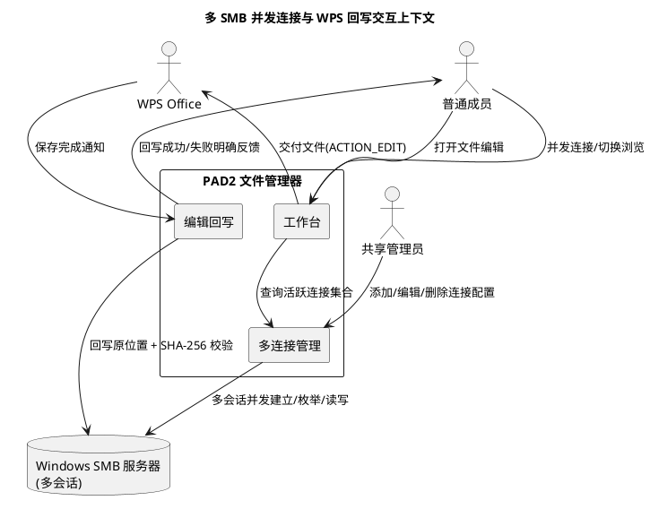
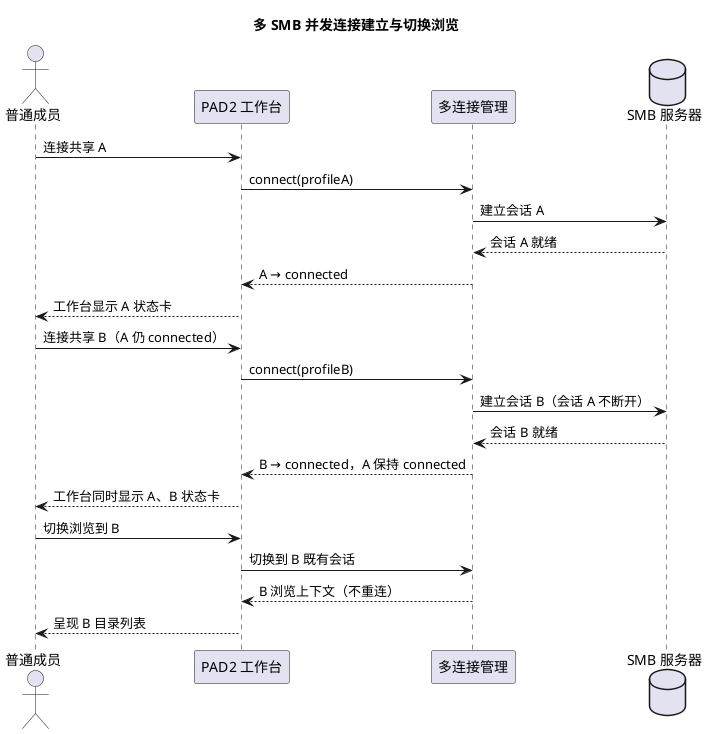
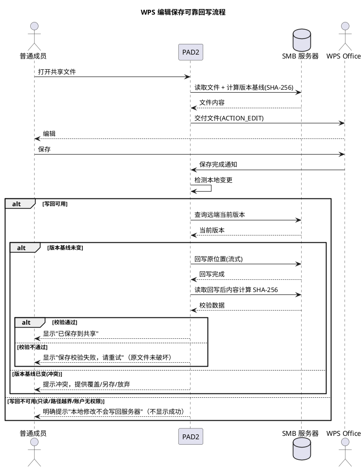

# 需求规格：多 SMB 并发连接与 WPS 编辑可靠回写

> **文档编号**：PAD2-SPEC-MCWB-001
> **Feature Name**：multi_conn_writeback
> **需求来源**：用户报告两项生产缺陷（多 SMB 连接不支持 / 表格保存后数据消失）
> **基线版本**：PAD2 v1.5（code 6），包名 com.pad2.filemanager
> **文档定位**：本文档为规格驱动开发（SDD）第一阶段产物，描述"做什么"（WHAT），不含"怎么做"（HOW）。所有业务规则采用 EARS 格式（WHEN/IF/WHILE … THEN …）与可测试验收条件（触发场景 → 预期行为）描述。
> **EARS 格式说明**：
> - **WHEN** [触发事件] **THE SYSTEM SHALL** [响应] — 事件驱动
> - **IF** [前置条件] **THEN THE SYSTEM SHALL** [响应] — 条件驱动
> - **WHILE** [持续状态] **THE SYSTEM SHALL** [响应] — 状态驱动
> - **WHERE** [特征约束] **THE SYSTEM SHALL** [响应] — 可选特征驱动

---

# 0. 问题背景与当前状态

## 0.1 问题1：多 SMB 连接不支持

**现象**：在工作台添加新的共享文件夹（SMB 连接）后，之前已连接的共享文件夹不再显示在工作台界面。无法实现多个已连接的共享文件夹同时在线。

**当前架构事实（代码证据）**：

| 证据编号 | 代码位置 | 事实 |
|---------|---------|------|
| EV-MC-01 | `src/state/smbConnectionStore.ts:46-55` | `SmbConnectionStoreState` 仅持有单个 `activeProfileId: string \| null`，为单活动连接模型 |
| EV-MC-02 | `src/state/smbConnectionStore.ts:89-117` | `connect()` 在 `current === 'connected'` 时先 `await SmbPlugin.disconnect()` 断开旧连接，再连接新 profile（注释明写"单活动连接模型，activeProfileId 唯一"） |
| EV-MC-03 | `src/state/smbConnectionStore.ts:95` | 已连接同一 profile 时幂等返回；连接不同 profile 时隐式断开旧连接 |
| EV-MC-04 | `src/state/smbProfilesStore.ts` | 支持多 profile 持久化（profiles 数组增删改查），但工作台仅消费 `smbConnectionStore.activeProfileId`（单个） |
| EV-MC-05 | `src/ui/pages/HomePage/index.tsx` | 工作台首页由 StorageOverviewRow + QuickActionsRow + RecentFilesSection 组成，无多共享并发显示与切换逻辑 |
| EV-MC-06 | `docs/specs/spec.md:297-298` | 现有产品总规格 REQ-01 规则2"多共享入口"仅要求"切换浏览"，未要求"同时在线"——规格与期望存在 gap |

**根因结论**：连接状态机为单活动连接模型，连接新 profile 时隐式断开旧连接；profile 持久化层虽支持多配置，但运行时仅维持单个活跃会话，工作台无多共享并发呈现。

**期望**：多个 SMB 共享可同时连接，工作台同时显示多个已连接共享，用户可在多个共享间切换浏览且互不影响。

## 0.2 问题2：表格保存后数据消失

**现象**：在 `192.168.2.3\smb\` 目录下用 WPS 打开表格文件，录入数据后保存，保存操作看似成功（无报错），但重新打开文件后数据消失。

**当前架构事实（代码证据）**：

| 证据编号 | 代码位置 | 事实 |
|---------|---------|------|
| EV-WB-01 | `src/state/writePermission.ts:23-25` | `WRITE_ENABLED_SCOPE.enabled: false as boolean` — 写回功能全局关闭 |
| EV-WB-02 | `src/state/writePermission.ts:143-144` | `isWriteEnabledForPath()` 在 `enabled=false` 时直接 `return false` |
| EV-WB-03 | `src/state/readOnlyMode.ts:13` | `READ_ONLY_MODE = !WRITE_ENABLED_SCOPE.enabled = true` — 等价 AU-005 只读模式 |
| EV-WB-04 | `src/state/editWritePermission.ts:43-48` | `checkEditWritePermission()` 返回 `{ permitted: false, reason: '只读模式：写回不可用' }` |
| EV-WB-05 | `src/state/editSessionStore.ts:221-247` | `applyForegroundCheckResult()` 检测到 `result.changed`（WPS 已保存到缓存）但 `perm.permitted=false` 时，**仅 `transition(set, get, 'editing')`，不触发写回也不向用户报错** — 假成功根因 |
| EV-WB-06 | `src/state/operationStore.ts:131` | `writeback: WRITE_ENABLED_SCOPE.enabled && WRITE_PERMISSION_MATRIX.writeback = false && true = false` |
| EV-WB-07 | `docs/specs/spec.md:410-414,422-423` | 现有产品总规格 REQ-03 已要求"回写校验通过方显示成功""禁止伪报成功"，但当前实现因 enabled=false 偏离规格 |

**根因结论**：写回功能全局开关 `enabled=false`，编辑会话检测到 WPS 本地保存后因权限守卫拒绝而不触发回写，且未向用户明确告知"本地修改未写回服务器"，形成假成功。

**期望**：WPS 编辑保存后数据可靠回写到 SMB 服务器，回写失败时明确告知用户，不出现假成功。

---

# 1. 组件定位

## 1.1 核心职责

本组件负责在安卓平板上并发管理多个 SMB 共享连接并在工作台同时呈现，同时保障 WPS 编辑保存后修改可靠回写 SMB 服务器且回写结果如实反馈，实现多共享并行操作与编辑保存的数据可靠性。

## 1.2 核心输入

1. **用户连接操作指令**：对多个 SMB 共享配置发起连接、断开、重连，来源为工作台与连接页的用户操作。
2. **用户浏览切换指令**：在多个已连接共享间切换浏览上下文，来源为工作台共享卡片点击。
3. **WPS 保存完成信号**：WPS 通过 ACTION_EDIT 保存缓存副本后触发的文件变更通知，含目标 URI、变更时间、内容指纹，来源为 WpsSaveDetector（三层 FileObserver + 三因子判定）。
4. **网络状态事件**：Wi-Fi 连接/断开、SMB 会话失效，来源为系统广播与连接层回调。
5. **应用前后台切换信号**：应用 resume/前台返回时触发前台检测，来源为 `@capacitor/app` appStateChange。

## 1.3 核心输出

1. **返回给用户的响应**：工作台多共享并发状态卡、各共享独立连接状态、目录列表、回写成功/失败明确提示。
2. **发送给 Windows SMB 服务器的请求**：多个并发 SMB 会话建立、目录枚举、文件读取/写入、属性查询。
3. **推送给用户的通知**：回写成功、回写失败（含原因）、写回不可用明确告知、冲突警告、网络等待状态。
4. **结构化日志输出**：脱敏后的多连接操作日志、回写审计日志、错误分类日志。

## 1.4 职责边界

本组件**不负责**以下事项：

1. **不负责** Windows SMB 服务器的运维与 smb.conf 配置：服务器侧 `read only` / `write list` / 账户权限配置属于服务端承载能力范畴，须由运维方独立验证，本组件仅消费服务器提供的读写能力并如实反馈结果。
2. **不负责** WPS Office 的内部实现与另存为行为：本组件仅通过 Android 标准文件访问机制与 WPS 交互，不修改、不打包、不控制 WPS。
3. **不负责** 将网络中断、保存失败、回写失败或写回不可用隐藏为成功：所有失败与不可用状态必须如实呈现，禁止伪报成功。
4. **不负责** 超出并发连接上限时的无限扩容：并发连接数受 DFX 资源上限约束，超限须明确拒绝并提示。
5. **不负责** SMB 协议层多会话的底层实现细节：本规格定义并发连接的业务行为，不规定插件层会话池的实现方式。

---

# 2. 领域术语

**并发活跃连接**
: 多个 SMB 共享连接同时处于 connected 态，各自独立维持会话与六态状态机，互不隐式断开。

**单活动连接模型**
: 运行时仅维持一个活跃 SMB 会话，连接新共享时隐式断开旧共享的架构模式。本规格将其升级为并发活跃连接模型。

**活跃连接集合**
: 当前所有处于 connected/connecting 态的 SMB 连接构成的集合，工作台据此并发呈现多个共享状态卡。

**连接句柄**
: 一个已建立的 SMB 会话的逻辑标识，绑定特定 profile，独立维护状态机与浏览上下文。

**可靠回写**
: WPS 保存后本组件检测到文件变更，将修改内容写回 SMB 共享原位置，并在回写完成后通过 SHA-256 校验确认共享文件确实发生预期变化，仅在校验通过后才显示"已保存到共享"。

**假成功**
: WPS 保存到本地缓存后，本组件未将修改回写 SMB 服务器，却未向用户明确告知"本地修改未写回服务器"，致使用户误以为保存已生效的行为。本规格必须消除假成功。

**写回不可用告知**
: 当写回功能因全局开关关闭、路径越界或账户无权限而不可用时，在用户完成本地编辑保存后明确提示"本地修改不会写回服务器"的反馈机制。

**编辑会话**
: 从文件被交给 WPS 打开开始，到回写校验完成或用户放弃编辑为止的一次完整编辑生命周期，含本地缓存副本、版本基线、变更检测与回写状态。

**文件版本基线**
: 编辑会话开始时记录的共享文件内容指纹（SHA-256）与修改时间，用于回写前判断共享文件是否已被他人修改，防止静默覆盖。

**静默覆盖**
: 在共享文件已被他人修改的情况下仍用本地编辑结果直接写回，导致他人更新丢失且无任何提示的行为。本规格必须禁止。

---

# 3. 角色与边界

## 3.1 核心角色

1. **普通成员**：在工作台并发浏览多个已连接 SMB 共享、打开文件编辑保存的终端用户。
2. **共享管理员**：添加/编辑/删除/测试 SMB 共享连接配置的用户（可与普通成员为同一人）。

## 3.2 外部系统

1. **Windows SMB 服务器**：上游被访问对象，提供多个并发 SMB 会话的建立、目录枚举、文件读写能力。
2. **WPS Office**：下游文件编辑应用，通过 Android ACTION_EDIT 接收文件句柄，保存后触发回写检测。
3. **Android 系统**：提供前后台切换广播（`@capacitor/app`）、文件访问接口、网络状态广播。

## 3.3 交互上下文

---

# 4. DFX 约束

## 4.1 性能

1. **DFX-MC-01 并发连接数上限**：系统须支持至少 4 个 SMB 共享同时处于 connected 态，并发连接数上限不低于 4。
   - 验收条件：[同时连接 4 个不同 SMB 共享] → [4 个共享均达 connected 态且工作台同时显示 4 个状态卡]
2. **DFX-MC-02 切换浏览响应时间**：在已连接共享间切换浏览上下文时，切换响应时间不超过 500ms（不含目录枚举网络耗时）。
   - 验收条件：[用户在两个已连接共享间切换] → [浏览上下文切换在 500ms 内完成]
3. **DFX-WB-01 回写响应时间**：单文件回写（含 SHA-256 校验）在目标网络质量下响应时间不超过 10s（文件大小 ≤ 10MB）。
   - 验收条件：[回写 ≤10MB 文件] → [回写 + 校验在 10s 内完成]

## 4.2 可靠性

1. **DFX-MC-03 单连接故障隔离**：单个 SMB 连接的断开、失败或会话失效不得影响其他已连接共享的活跃状态。
   - 验收条件：[共享 A 连接失败或断开] → [共享 B、C 保持 connected 态且可继续操作]
2. **DFX-WB-02 回写数据完整性**：回写完成后须以 SHA-256 校验确认目标文件内容与本地副本逐字节一致，校验通过方可标记成功。
   - 验收条件：[任意回写完成] → [SHA-256 校验通过方可标记成功，否则标记失败]
3. **DFX-WB-03 原文件不被破坏**：回写失败、校验不通过或网络中断时，SMB 服务器上的原文件不得被破坏。
   - 验收条件：[回写失败/校验不通过/网络中断] → [原文件内容未被破坏，本地副本保留供重试]

## 4.3 安全性

1. **DFX-WB-04 禁止伪报成功**：回写未执行、回写失败或校验不通过时，禁止显示"已保存到共享"或任何成功语义提示。
   - 验收条件：[回写未成功] → [界面显示失败或不可用提示，不显示成功]
2. **DFX-WB-05 写回不可用明确告知**：当写回功能因任何原因不可用时，用户完成本地编辑保存后须收到明确的"本地修改未写回服务器"提示，不得静默。
   - 验收条件：[写回不可用 且 用户已本地保存] → [用户收到"本地修改不会写回服务器"明确提示]
3. **DFX-MC-04 凭据安全**：多连接并发场景下，各连接凭据仍须加密存储，不在日志或界面明文泄露。
   - 验收条件：[检查任意日志或界面] → [任意连接的密码不以明文出现]

## 4.4 可维护性

1. **DFX-MC-05 连接状态可观测**：每个并发连接须独立暴露其六态状态、活跃 profileId 与最近错误，供监控与诊断。
   - 验收条件：[查询活跃连接集合] → [每个连接独立返回 state/activeProfileId/lastError]
2. **DFX-WB-06 回写审计日志**：每次回写执行须记录可追溯的审计日志（脱敏），含结果、重试次数、错误分类。
   - 验收条件：[执行一次回写] → [审计日志记录结果/重试次数/错误分类，不含敏感字段]

## 4.5 兼容性

1. **DFX-MC-06 既有 profile 兼容**：升级到并发连接模型后，已持久化的 SMB profile 配置须保留可用，不要求用户重新配置。
   - 验收条件：[升级后启动应用] → [既有 profile 列表保留且可逐个连接]
2. **DFX-WB-07 只读模式兼容**：写回功能启用后，对于路径越界或账户无权限的场景仍须保持只读拦截，不得因全局开关开启而绕过路径级权限守卫。
   - 验收条件：[enabled=true 但路径越界] → [该路径写回仍被拒绝并明确告知]

---

# 5. 核心能力

## 5.1 多 SMB 并发连接管理（REQ-MC）

### 5.1.1 业务规则

1. **REQ-MC-01 并发连接建立不隐式断开**：WHEN 用户对共享 B 发起连接 WHILE 共享 A 已处于 connected 态 THEN THE SYSTEM SHALL 保持共享 A 的连接不断开，并将共享 B 独立建立为新的活跃连接。
   - 验收条件：[共享 A 已连接，用户连接共享 B] → [共享 A 保持 connected 态，共享 B 独立进入 connected 态，二者同时活跃]
   - 验收条件：[共享 A 已连接，用户连接共享 B 失败] → [共享 A 保持 connected 态不受影响]

2. **REQ-MC-02 工作台并发呈现多共享**：WHEN 多个共享处于 connected 态 THEN THE SYSTEM SHALL 在工作台同时显示所有已连接共享的状态卡，每卡独立呈现连接状态与共享标识。
   - 验收条件：[3 个共享均 connected] → [工作台同时显示 3 个共享状态卡，各卡状态独立]
   - 验收条件：[共享 A 断开] → [工作台移除共享 A 状态卡，共享 B、C 状态卡保留]

3. **REQ-MC-03 跨共享切换浏览不重连**：WHEN 用户从共享 A 切换到已连接的共享 B 浏览 THEN THE SYSTEM SHALL 复用共享 B 既有会话切换浏览上下文，不得重新建立连接。
   - 验收条件：[共享 A、B 均 connected，用户切换到 B] → [直接呈现 B 的浏览上下文，不触发 connect 调用]

4. **REQ-MC-04 单连接断开隔离**：WHEN 用户断开共享 A WHILE 共享 B、C 已连接 THEN THE SYSTEM SHALL 仅断开共享 A，共享 B、C 保持 connected 态且可继续操作。
   - 验收条件：[共享 A、B、C 均 connected，用户断开 A] → [A 转 disconnected，B、C 保持 connected 且可浏览/编辑]

5. **REQ-MC-05 连接状态独立维护**：每个并发连接须独立维护六态状态机（disconnected/connecting/connected/connect_failed/network_interrupted/session_invalid），一连接的状态迁移不得影响其他连接。
   - 验收条件：[共享 A 触发 network_interrupted] → [共享 B 的 state 保持 connected 不变]

6. **REQ-MC-06 同 profile 幂等连接**：IF 用户对已处于 connected 态的同一 profile 再次发起连接 THEN THE SYSTEM SHALL 幂等返回，不重复建立会话。
   - 验收条件：[共享 A 已 connected，用户再次连接 A] → [无新会话建立，A 保持 connected 态]

7. **REQ-MC-07 并发上限保护**：WHEN 活跃连接数已达上限且用户发起新连接 THEN THE SYSTEM SHALL 拒绝新连接并明确提示"已达并发连接上限 N"，不得隐式断开既有连接腾位。
   - 验收条件：[已连接 4 个共享（上限 4），用户连接第 5 个] → [拒绝第 5 个并提示"已达并发连接上限 4"，既有 4 个保持 connected]

8. **REQ-MC-08 禁止项**：禁止连接新共享时隐式断开已连接的其他共享；禁止工作台仅显示单个活跃连接而隐藏其他已连接共享。
   - 验收条件：[连接新共享] → [不发生对其他已连接共享的 disconnect 调用]
   - 验收条件：[多个共享已连接] → [工作台不出现仅显示单个共享而其余消失的情况]

### 5.1.2 交互流程

### 5.1.3 异常场景

1. **单连接失败不影响其他**
   - 触发条件：共享 B 连接失败（认证失败/网络不可达），共享 A 已 connected。
   - 系统行为：共享 B 进入 connect_failed 态并呈现错误，共享 A 保持 connected 态不受影响。
   - 用户感知：工作台显示 B 的连接失败提示，A 状态卡保持"已连接"。

2. **并发上限超出**
   - 触发条件：活跃连接数已达上限，用户发起新连接。
   - 系统行为：拒绝新连接，不隐式断开既有连接。
   - 用户感知：显示"已达并发连接上限 N，请先断开某个共享"。

3. **单连接会话失效**
   - 触发条件：共享 A 的 SMB 会话因认证失效触发 session_invalid。
   - 系统行为：仅共享 A 进入 session_invalid 态，共享 B、C 保持 connected。
   - 用户感知：A 状态卡提示"会话失效，请重连"，B、C 状态卡不受影响。

4. **单连接网络中断**
   - 触发条件：共享 A 操作触发 network_interrupted。
   - 系统行为：仅共享 A 进入 network_interrupted 态，其他连接保持原态。
   - 用户感知：A 状态卡提示"网络中断"，其他共享可继续操作。

---

## 5.2 WPS 编辑可靠回写（REQ-WB）

### 5.2.1 业务规则

1. **REQ-WB-01 写回功能启用**：WHEN WPS 保存文件触发本地变更检测 THEN THE SYSTEM SHALL 将修改回写 SMB 服务器原位置，不得因写回功能未启用而静默跳过回写。
   - 验收条件：[WPS 保存文件，PAD2 检测到本地变更] → [触发回写 SMB 服务器原位置]
   - 验收条件：[回写执行] → [SMB 服务器原文件内容被更新为本地副本内容]

2. **REQ-WB-02 回写校验通过方显示成功**：IF 回写完成后 SHA-256 校验通过（localHash === verifyHash） THEN THE SYSTEM SHALL 显示"已保存到共享"成功提示。
   - 验收条件：[回写后 SHA-256 校验通过] → [显示"已保存到共享"]
   - 验收条件：[回写后 SHA-256 校验不通过] → [显示保存失败，不显示"已保存到共享"]

3. **REQ-WB-03 回写失败明确报错**：IF 回写执行失败（权限拒绝/写入失败/网络错误重试耗尽） THEN THE SYSTEM SHALL 显示保存失败及可读原因，禁止显示任何成功语义提示。
   - 验收条件：[回写因权限拒绝失败] → [显示"保存失败：写回权限不足"，不显示成功]
   - 验收条件：[回写因网络错误重试耗尽失败] → [显示"保存失败：网络异常，请重试"，不显示成功]
   - 验收条件：[回写因 SHA-256 校验不通过失败] → [显示"保存校验失败，请重试"，不显示成功]

4. **REQ-WB-04 写回不可用明确告知（消除假成功）**：WHEN 写回功能因全局开关关闭、路径越界或账户无权限而不可用 AND 用户已完成本地编辑保存 THEN THE SYSTEM SHALL 向用户明确提示"本地修改不会写回服务器"，不得静默转入 editing 态而无反馈。
   - 验收条件：[写回不可用 且 WPS 已本地保存] → [用户收到"本地修改不会写回服务器"明确提示]
   - 验收条件：[写回不可用 且 WPS 已本地保存] → [不出现无任何提示的静默状态，不显示"已保存到共享"]

5. **REQ-WB-05 编辑冲突防护**：IF 回写前检测到共享文件版本基线已变（远端 mtime > 基线 mtime） THEN THE SYSTEM SHALL 提示冲突并提供覆盖/另存/放弃选项，禁止静默覆盖他人更新。
   - 验收条件：[回写前发现远端文件已修改] → [提示"文件已被他人修改，请选择处理方式"，不自动覆盖]

6. **REQ-WB-06 回写网络中断恢复**：WHILE 回写过程中网络中断 THEN THE SYSTEM SHALL 暂停回写并提示"网络中断，正在等待恢复"，网络恢复后可续传或重新执行，原文件不被破坏。
   - 验收条件：[回写过程中网络断开] → [显示"网络中断，正在等待恢复"，不显示成功，原文件未被破坏]
   - 验收条件：[网络恢复] → [可重试回写，重试成功后校验通过方显示成功]

7. **REQ-WB-07 回写重试与错误分类**：WHEN 回写遇到网络类错误 THEN THE SYSTEM SHALL 按指数退避重试（上限 3 次），重试前重新检测冲突；非网络类错误（权限/校验/冲突）不重试，立即报告。
   - 验收条件：[回写遇网络错误] → [按指数退避重试，最多 3 次，重试前重检冲突]
   - 验收条件：[回写遇权限拒绝] → [不重试，立即报告"写回权限不足"]

8. **REQ-WB-08 禁止项**：禁止在回写未校验通过时显示"已保存到共享"；禁止静默覆盖他人更新；禁止回写失败时破坏原文件；禁止写回不可用时无提示静默处理（假成功）。
   - 验收条件：[回写未校验通过] → [不显示"已保存到共享"且原文件未被破坏]
   - 验收条件：[写回不可用] → [不出现无提示静默，必有明确告知]

### 5.2.2 交互流程

### 5.2.3 异常场景

1. **写回权限不足**
   - 触发条件：SMB 服务器账户对目标路径无写权限（smb.conf read only 或账户不在 write list）。
   - 系统行为：权限守卫拒绝，不调用 SMB 写入，返回 permission_denied 分类。
   - 用户感知：显示"保存失败：写回权限不足"，不显示成功，原文件未变更。

2. **写回功能全局未启用（假成功消除）**
   - 触发条件：写回全局开关关闭（enabled=false）或路径不在可写范围，用户已本地保存。
   - 系统行为：不触发回写，但须明确告知用户本地修改未写回服务器。
   - 用户感知：显示"本地修改不会写回服务器"明确提示，不出现无提示静默，不显示"已保存到共享"。

3. **回写校验不通过**
   - 触发条件：回写后 SHA-256 校验与本地副本不一致。
   - 系统行为：标记保存失败，不显示"已保存到共享"，保留本地副本供重试，原文件未被破坏。
   - 用户感知：显示"保存校验失败，请重试"。

4. **回写过程中网络中断**
   - 触发条件：回写过程中网络断开。
   - 系统行为：暂停回写，按指数退避重试，网络恢复后续传或重新执行，原文件未被破坏。
   - 用户感知：显示"网络中断，正在等待恢复"，不显示成功。

5. **编辑冲突（他人已修改）**
   - 触发条件：回写前发现共享文件版本基线已变（远端 mtime > 基线 mtime）。
   - 系统行为：提示冲突，提供覆盖/另存/放弃选项，不自动覆盖。
   - 用户感知：显示"文件已被他人修改，请选择处理方式"。

6. **目标文件被占用**
   - 触发条件：共享文件被其他客户端占用写入。
   - 系统行为：提示占用，提供重试或另存选项，不破坏原文件。
   - 用户感知：显示"文件被占用，请重试或另存"。

---

# 6. 数据约束

## 6.1 活跃连接集合

1. **连接句柄标识**：每个活跃连接须有唯一标识，绑定对应 profileId，不得重复。
2. **连接状态**：每个活跃连接独立持有六态状态机值（disconnected/connecting/connected/connect_failed/network_interrupted/session_invalid），取值互斥。
3. **活跃 profileId**：每个活跃连接绑定一个已持久化的 profileId，不同活跃连接的 profileId 互不相同。
4. **最近错误**：每个活跃连接独立持有 lastError，一连接的错误不得污染其他连接。
5. **集合容量**：活跃连接集合容量受 DFX-MC-01 约束，上限不低于 4。

## 6.2 编辑会话基线

1. **远端路径（remotePath）**：必填，非空字符串，指向 SMB 共享上的文件路径。
2. **基线修改时间（baselineMtime）**：必填，Unix 毫秒时间戳，编辑会话开始时记录的远端文件修改时间。
3. **基线内容指纹（baselineSha256）**：必填，64 位十六进制字符串，编辑会话开始时记录的远端文件 SHA-256。
4. **本地缓存路径（localCachePath）**：必填，指向本地缓存副本路径。
5. **来源连接标识（sourceProfileId）**：必填，标识该编辑会话所属的活跃连接，用于多连接场景下回写时定位正确的 SMB 会话。

## 6.3 回写结果

1. **回写成功标志（writebackSuccess）**：必填，布尔值，仅当 SMB 写入且 SHA-256 校验通过时为 true。
2. **本地哈希（localHash）**：必填，回写前本地副本的 SHA-256。
3. **校验哈希（verifyHash）**：必填，回写后远端文件读取计算的 SHA-256。
4. **校验一致性**：writebackSuccess 为 true 时，localHash 必须等于 verifyHash。
5. **回写前远端修改时间（remoteMtimeBefore）**：必填，回写前远端文件 mtime，用于冲突判定。
6. **回写后远端修改时间（remoteMtimeAfter）**：必填，回写后远端文件 mtime。

## 6.4 回写错误分类

1. **错误类别（category）**：必填，取值为 permission_denied / conflict / network_error / write_failed / verify_failed / no_baseline / unknown 之一。
2. **可重试标志（retryable）**：必填，布尔值，仅 network_error 类别为 true（且未达重试上限），其余为 false。
3. **错误消息（message）**：必填，用户可读文案，不含敏感字段（密码/凭据/服务器路径细节）。

---

# 7. 非目标（明确不做什么）

1. **NON-MC-01**：不负责实现 SMB 协议层多会话池的底层机制（如 SMBJ session 复用、连接复用策略），本规格仅定义并发连接的业务行为与验收条件，底层实现由设计阶段（design.md）决定。
2. **NON-MC-02**：不负责后台保活所有连接的永久在线——连接因网络/服务器原因断开时按既有六态状态机处理，不引入额外的心跳保活机制（除非 DFX 明确要求）。
3. **NON-MC-03**：不负责跨共享的统一文件系统视图（如将多个共享挂载为单一虚拟根目录），多共享以独立状态卡 + 独立浏览上下文呈现。
4. **NON-WB-01**：不负责修改 WPS Office 的保存行为或另存为行为，仅消费 WPS 保存结果并执行回写。
5. **NON-WB-02**：不负责 SMB 服务器侧的 smb.conf / 账户权限配置，服务器侧读写能力由运维方保障，本组件仅如实反馈回写结果。
6. **NON-WB-03**：不负责离线编辑的自动合并与版本控制（如 Git 式三路合并），冲突场景仅提供覆盖/另存/放弃的人工决策选项。
7. **NON-WB-04**：不负责将写回功能从"路径级权限矩阵"模型退化为"全局可写"模型——启用写回后仍须保持路径边界与账户权限的细粒度守卫（DFX-WB-07）。

---

# 8. 需求追溯与覆盖矩阵

| 需求编号 | 对应问题 | 核心期望 | 关键 EARS 模式 |
|---------|---------|---------|---------------|
| REQ-MC-01 | 问题1 | 连接新共享不隐式断开旧共享 | WHEN…WHILE…THEN |
| REQ-MC-02 | 问题1 | 工作台同时显示多个已连接共享 | WHEN…THEN |
| REQ-MC-03 | 问题1 | 切换浏览不重连 | WHEN…THEN |
| REQ-MC-04 | 问题1 | 单连接断开隔离 | WHEN…WHILE…THEN |
| REQ-MC-05 | 问题1 | 连接状态独立维护 | — |
| REQ-MC-06 | 问题1 | 同 profile 幂等连接 | IF…THEN |
| REQ-MC-07 | 问题1 | 并发上限保护 | WHEN…THEN |
| REQ-WB-01 | 问题2 | 写回功能启用，不静默跳过 | WHEN…THEN |
| REQ-WB-02 | 问题2 | 校验通过方显示成功 | IF…THEN |
| REQ-WB-03 | 问题2 | 回写失败明确报错 | IF…THEN |
| REQ-WB-04 | 问题2 | 写回不可用明确告知（消除假成功） | WHEN…AND…THEN |
| REQ-WB-05 | 问题2 | 编辑冲突防护 | IF…THEN |
| REQ-WB-06 | 问题2 | 网络中断恢复 | WHILE…THEN |
| REQ-WB-07 | 问题2 | 重试与错误分类 | WHEN…THEN |

---

> 本需求规格文档覆盖问题1（多 SMB 并发连接）与问题2（WPS 编辑可靠回写）两项生产缺陷的全部业务规则、验收条件、DFX 约束与非目标。所有业务规则均采用 EARS 格式（WHEN/IF/WHILE … THEN …）与可测试验收条件（触发场景 → 预期行为）描述。下一步须由 spec-design-agent 基于本规格生成 design.md 技术设计文档。