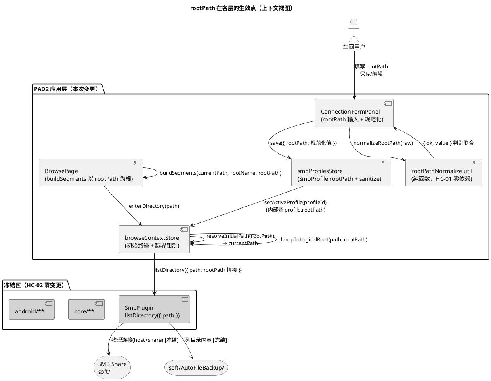
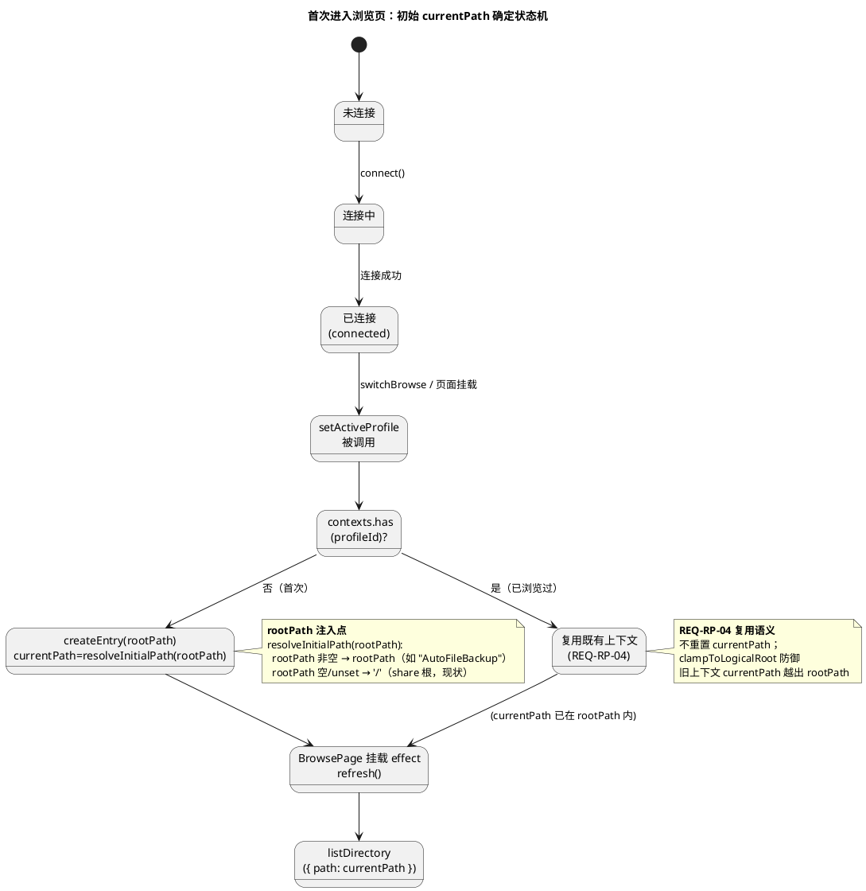
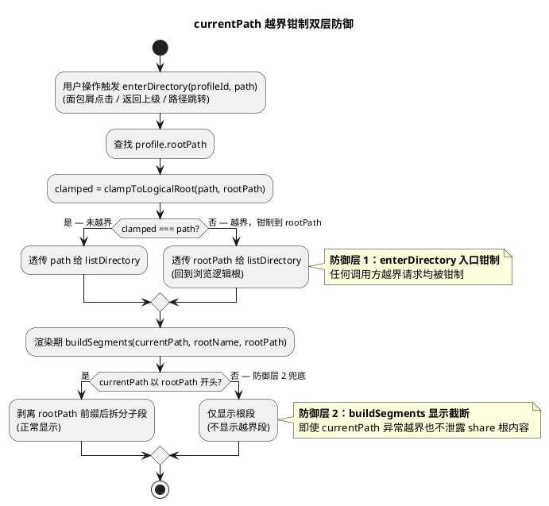
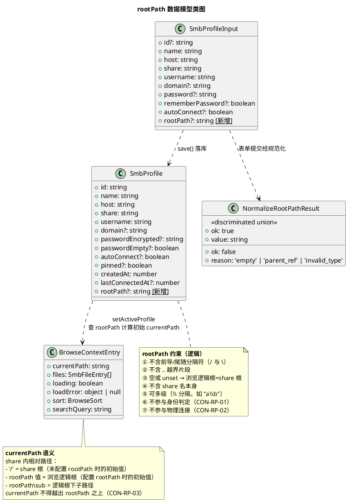

# SMB 连接根路径（rootPath）实现方案

> 文档版本：v1.0
> 生成日期：2026-11-02
> 特性编号：ROOT-PATH
> 追溯规格：`docs/specs/root_path/spec.md` v1.0
> 追溯基线代码：`src/state/smbProfilesStore.ts`、`src/state/browseContextStore.ts`、`src/ui/pages/BrowsePage/index.tsx`、`src/ui/pages/ConnectionPage/ConnectionFormPanel/index.tsx`、`src/orchestration/browse/switchBrowse.ts`、`src/adapter/smb/SmbPlugin.ts`（冻结）

---

# 一、需求与存量功能关系分析

## 1.1 需求功能与存量功能对比

### 1.1.1 已实现功能

| 需求功能 | 存量功能 | 代码位置 | 匹配度 |
|---------|---------|---------|--------|
| 连接配置身份判定（host+share+username+domain 四元组，rootPath 不参与） | `isSameProfileIdentity` 四元组归一化比对 | `src/state/smbProfilesStore.ts:102-113` | 100% |
| 持久化版本框架（STORAGE_VERSION=1，可选字段向后兼容） | `STORAGE_VERSION=1` + `sanitizeProfile` 白名单清洗 + 旧数据缺失字段=unset 回退 | `src/state/smbProfilesStore.ts:24,132-167,199-203` | 100% |
| 上下文复用语义（切换回已浏览 profile 不重置 currentPath） | `setActiveProfile` 仅在 `!contexts.has(profileId)` 时创建空条目 | `src/state/browseContextStore.ts:70-80` | 100% |
| 目录加载失败如实呈现（fail-visible，不静默回退） | `enterDirectory` catch → `mapSmbError` → `loadError`；BrowsePage `StatusBanner` 重试入口 | `src/state/browseContextStore.ts:103-108`、`src/ui/pages/BrowsePage/index.tsx:252-261` | 100% |
| 浏览层透传 path 给 SmbPlugin（应用层拼接，原生层零变更） | `enterDirectory` 直接 `SmbPlugin.listDirectory({ path })` | `src/state/browseContextStore.ts:101` | 100% |
| 面包屑根段点击回到根 | `Breadcrumb` 根段 `onNavigate(segments[0].path)` | `src/ui/components/Breadcrumb/index.tsx:34-43` | 75% |

> 75% 项说明：面包屑根段点击机制已实现，但根段 `path` 当前硬编码为 `''`（share 根），未承载"浏览逻辑根"语义，需扩展为以 rootPath 为根段 path 并剥离 currentPath 前缀。

### 1.1.2 需要扩展的功能

| 需求功能 | 存量功能 | 差异说明 | 扩展方向 |
|---------|---------|---------|---------|
| SmbProfile 持久化 rootPath 字段 | `SmbProfile` 接口 + `sanitizeProfile` 白名单清洗 | 接口无 rootPath 字段；sanitize 无 rootPath 解析分支 | 接口新增可选 `rootPath?: string`；sanitize 增加字符串+规范化+无 `..` 白名单分支（与 domain 同风格：非空字符串才落位） |
| SmbProfileInput 透传 rootPath | `SmbProfileInput` 接口 + `save` 写入 entry | 接口无 rootPath；save 构造 entry 无 rootPath 赋值 | 接口新增可选 `rootPath?: string`；save 内 `if (input.rootPath) entry.rootPath = input.rootPath`（已由 UI 层规范化） |
| 初始浏览路径以 rootPath 为根 | `createEntry()` 硬编码 `currentPath: '/'` | createEntry 不感知 profile.rootPath，始终以 share 根为初始 | createEntry 增加 rootPath 参数；setActiveProfile 查找 profile 后传入 rootPath 计算初始 currentPath |
| 面包屑以 rootPath 为根段并禁止越界 | `buildSegments(currentPath, rootName)` 根段 path=`''`，按 `\\` 全量拆分 currentPath | 不感知 rootPath；根段恒为 share 根；不剥离 rootPath 前缀；无越界钳制 | buildSegments 增加 rootPath 参数；根段 path=rootPath；剥离 currentPath 的 rootPath 前缀后拆分子段；currentPath 越出 rootPath 时仅显示根段（防御） |
| 连接表单 rootPath 输入项 | `ConnectionFormValues` 六字段 + `FormField` 渲染 + `validateForm` | 无 rootPath 字段、无输入项、无校验、无回填、save 未透传 | 表单值增加 rootPath；增加 FormField 输入项（选填）；validateForm 增加 `..` 越界拒绝；initialProfile 预填回填；handleSaveAndConnect 透传规范化后 rootPath |
| 编辑既有配置回填 rootPath | `useState` 初始化 `initialProfile` 预填 | 预填对象无 rootPath 字段 | 预填增加 `rootPath: initialProfile.rootPath ?? ''` |
| 路径输入规范化 | 表单无 rootPath 规范化逻辑 | 无 trim、无去首尾分隔符、无 `..` 拒绝、无空串→unset | 新增 `normalizeRootPath` 纯函数：trim → 去首尾 `/` 与 `\` → 含 `..` 拒绝 → 空串→undefined |

### 1.1.3 需要新增的功能或接口

**模块：路径规范化工具（`src/utils/rootPathNormalize.ts` 新建）**

| 功能点 | 输入 | 输出 | 核心逻辑 | 依赖 |
|--------|------|------|----------|------|
| `normalizeRootPath(raw)` | `unknown`（用户输入或持久化值） | `{ ok: true, value: string }` 或 `{ ok: false, reason: 'empty' \| 'parent_ref' \| 'invalid_type' }` | trim → 类型校验（仅 string）→ 去首尾 `/` 与 `\` → split 分段 → 含 `..` 段拒绝 → 空串→empty → 以 `\\` 重组 | 无（纯函数，HC-01 零依赖） |

> 设计决策 D-RP-N01：规范化结果用判别联合（discriminated union）而非抛异常，使 sanitize（静默丢弃）与表单校验（提示用户）两个消费方能按场景选择处理策略，类型安全且无控制流跳变。

**模块：浏览逻辑根解析（`src/state/browseContextStore.ts` 内新增纯函数）**

| 功能点 | 输入 | 输出 | 核心逻辑 | 依赖 |
|--------|------|------|----------|------|
| `resolveInitialPath(rootPath)` | `string \| undefined` | `string`（share 内相对路径） | rootPath 非空 → 返回 rootPath；否则返回 `'/'`（share 根，与现状一致） | 无 |

**模块：越界钳制（`src/state/browseContextStore.ts` 内新增纯函数）**

| 功能点 | 输入 | 输出 | 核心逻辑 | 依赖 |
|--------|------|------|----------|------|
| `clampToLogicalRoot(path, rootPath)` | `path: string`, `rootPath?: string` | `string`（钳制后路径） | 无 rootPath → 原样返回；有 rootPath 且 path 越出 rootPath 之上（不以 rootPath 开头）→ 返回 rootPath；否则原样返回 | 无 |

## 1.2 存量功能详细分析

### 1.2.1 sanitizeProfile 白名单清洗范式

- **接口契约**：`(raw: unknown) => SmbProfile | null`；入参任意（持久层 JSON 反序列化值）；出参为合法 profile 或 null（整体丢弃）；无异常抛出。
- **业务规则**：
  - 必填字段（id/name/host/share/username/createdAt）类型校验失败 → 返回 null（整体丢弃，不部分保留）。
  - 可选字符串字段（domain）：`typeof === 'string' && 非空` 才落位，否则静默丢弃该字段。
  - 可选布尔字段（passwordEmpty/autoConnect/pinned）：严格 `=== true` 才落位，否则丢弃（防 truthy 误判）。
  - 密文字段（passwordEncrypted）：字符串且格式合法（三段式）才落位，格式非法静默清除。
- **扩展点**：新增可选字段按上述范式分支追加，不影响既有字段解析。
- **约束**：纯函数、无副作用、不抛异常；fail-secure（非法值静默丢弃而非崩溃）。
- **rootPath 落位规则**（新增）：`typeof p.rootPath === 'string' && p.rootPath` → 经 `normalizeRootPath` 规范化 → `ok && value` 非空才落位；含 `..` 或类型非法 → 静默丢弃（REQ-RP-14、REQ-RP-18）。

### 1.2.2 setActiveProfile 上下文创建语义

- **接口契约**：`(profileId: string) => void`；同步纯内存操作；不触发 SmbPlugin.connect。
- **业务规则**：`if (!contexts.has(profileId))` 创建空条目（createEntry，currentPath=`'/'`）；否则仅切换 activeProfileId。
- **关键约束**：仅在"无上下文"时创建——天然满足 REQ-RP-04（切换复用上下文不重置）。
- **rootPath 注入点**：createEntry 需感知 profile.rootPath 以计算初始 currentPath。setActiveProfile 当前仅接收 profileId，需通过 `useSmbProfilesStore.getState().profiles.find(p => p.id === profileId)` 查找 profile 获取 rootPath（store 间只读查询，无循环依赖风险）。

### 1.2.3 buildSegments 面包屑段解析

- **接口契约**：`(currentPath: string, rootName: string) => BreadcrumbSegment[]`；纯函数。
- **业务规则**：根段 `{ name: rootName, path: '' }`；currentPath 非空时按 `\\` split、filter(Boolean)、累加 acc 生成子段。
- **关键约束**：根段 path 恒为 `''`（对应 share 根点击）；currentPath 用 `\\` 分隔（原生 Windows 风格，与 SmbFileEntry.path 一致）；`'/'` 为 share 根特殊标记（createEntry 初始值，split('\\') 后 filter(Boolean) 为空，仅显示根段）。
- **rootPath 扩展点**：根段 path 需改为 `rootPath || ''`；currentPath 需剥离 rootPath 前缀后再拆分子段，避免根段名与首段名重复显示。

### 1.2.4 enterDirectory 路径透传

- **接口契约**：`(profileId: string, path: string) => Promise<void>`；path 为 share 内相对路径，直接透传 `SmbPlugin.listDirectory({ path })`。
- **业务规则**：确保上下文存在 → 非热会话先 switchHotTo → 置 loading + currentPath=path → listDirectory → 成功置 files / 失败置 loadError。
- **关键约束**：path 语义为 share 内相对路径，rootPath 拼接在此层完成（应用层），SmbPlugin 零变更（HC-02）。
- **越界钳制注入点**：enterDirectory 入口增加 `clampToLogicalRoot(path, profile.rootPath)` 钳制，防御任何调用方传入越界路径。

### 1.2.5 ConnectionFormPanel 表单校验与保存

- **接口契约**：`ConnectionFormValues` 六字段（name/host/share/username/password/domain）；`validateForm` 必填+格式校验返回 `FormErrors`；`handleSaveAndConnect` 经 `profilesStore.save` 落库。
- **业务规则**：name/host/share/username 必填；host 格式（IPv4/主机名）；密码非必填（guest 场景）；initialProfile 预填编辑模式。
- **rootPath 扩展点**：表单值增加 rootPath；validateForm 增加 `..` 越界拒绝；预填回填；save 透传 `normalizeRootPath(form.rootPath)` 结果。

### 1.2.6 isSameProfileIdentity 身份判定

- **接口契约**：`(a, b) => boolean`；host+share+username+domain 四元组归一化比对（host/share 大小写不敏感、domain 空串/undefined 等同）。
- **关键约束**：name 不参与判重；rootPath 不参与判重（CON-RP-01）——既有实现天然满足，零变更。
---

# 二、增量设计方案

## 2.1 实现模型

### 2.1.1 上下文视图



**通信协议与调用频率**：
- Form → Norm：用户提交时同步调用（低频）。
- ProfileStore → BrowseStore：setActiveProfile 同步内存查询（切换配置时，低频）。
- BrowseStore → Plugin：enterDirectory 异步调用（用户导航/刷新时，中频）。
- BrowsePage → BrowseStore：渲染期同步读取 contexts（高频，但纯内存快照）。

**关键边界**：rootPath 仅在 PAD2 应用层（Form/ProfileStore/BrowseStore/BrowsePage）生效；SmbPlugin/core/android 冻结区零变更，rootPath 拼接为 share 内相对路径后透传给既有 `listDirectory({ path })`。

### 2.1.2 服务/组件总体架构

```plantuml
@startuml
title rootPath 增量组件架构

package "utils（新增）" {
  component "rootPathNormalize" as Norm {
    method "normalizeRootPath(raw): NormalizeResult"
  }
}

package "state（扩展）" {
  component "smbProfilesStore" as ProfileStore {
    method "SmbProfile.rootPath?: string"
    method "SmbProfileInput.rootPath?: string"
    method "sanitizeProfile: +rootPath 白名单分支"
    method "save: +rootPath 落位"
  }
  component "browseContextStore" as BrowseStore {
    method "createEntry(rootPath?): +初始路径"
    method "setActiveProfile: +查 profile.rootPath"
    method "enterDirectory: +clampToLogicalRoot"
    method "resolveInitialPath(rootPath)"
    method "clampToLogicalRoot(path, rootPath)"
  }
}

package "ui（扩展）" {
  component "ConnectionFormPanel" as Form {
    method "ConnectionFormValues.rootPath"
    method "validateForm: +.. 拒绝"
    method "预填: +rootPath 回填"
    method "save: +normalizeRootPath 透传"
  }
  component "BrowsePage" as BrowsePage {
    method "buildSegments(currentPath, rootName, rootPath)"
  }
}

package "冻结区" {
  component "SmbPlugin" as Plugin #LightGray
  component "Breadcrumb" as Crumb
}

Norm ..> ProfileStore : <use>
Norm ..> Form : <use>
ProfileStore <-- BrowseStore : 查 profile.rootPath（只读）
BrowseStore --> Plugin : listDirectory [冻结透传]
BrowsePage --> Crumb : segments（根段 path=rootPath）
BrowsePage --> BrowseStore : enterDirectory/refresh

@enduml
```

**模块职责与依赖关系**：
- `rootPathNormalize`（新增）：纯函数模块，无外部依赖（HC-01），被 sanitize 与 Form 共消费（单一规范化真相源）。
- `smbProfilesStore`（扩展）：SmbProfile/SmbProfileInput 增字段；sanitize 增白名单分支；save 增落位。不依赖 BrowseStore。
- `browseContextStore`（扩展）：createEntry/setActiveProfile/enterDirectory 增 rootPath 感知；只读查询 ProfileStore 获取 rootPath（无循环依赖：ProfileStore 不反向依赖 BrowseStore）。
- `ConnectionFormPanel`（扩展）：表单值/校验/预填/透传增 rootPath；依赖 Norm。
- `BrowsePage`（扩展）：buildSegments 增 rootPath 参数；依赖 BrowseStore。
- `Breadcrumb`（不变）：segments 数据契约不变，仅根段 path 值由调用方决定。

**配置项及取值策略**：无新增运行时配置项；rootPath 为 per-profile 持久化字段，取值由用户表单输入经规范化落库。

### 2.1.3 实现设计文档

#### 2.1.3.1 初始浏览路径确定（状态机）



#### 2.1.3.2 路径规范化与越界校验（活动图）

```plantuml
@startuml
title rootPath 输入规范化与持久化清洗活动图

start

:接收 raw 值\n(表单输入 / 持久层加载);

if (typeof raw === 'string'?) then (是)
  :trim 去首尾空白;
  :去前导/尾随 '/' 与 '\\';
  if (规范化后为空串?) then (是)
    :结果 = { ok: false, reason: 'empty' };
  else (否)
    :split('\\') 与 split('/') 合并分段;
    if (任一段 === '..'?) then (是)
      :结果 = { ok: false, reason: 'parent_ref' };
    else (否)
      :以 '\\' 重组（统一分隔符）;
      :结果 = { ok: true, value: 重组值 };
    endif
  endif
else (否)
  :结果 = { ok: false, reason: 'invalid_type' };
endif

if (调用方是 sanitize?) then (是 — 持久层加载)
  if (结果.ok?) then (是)
    :profile.rootPath = 结果.value;
  else (否)
    :静默丢弃 rootPath 字段\n(REQ-RP-14/18，不拒整个 profile);
  endif
else (否 — 表单提交)
  if (结果.ok?) then (是)
    :input.rootPath = 结果.value\n→ save 落库;
  else (否，reason === 'parent_ref')
    :fieldErrors.rootPath =\n'根路径不得越出共享范围'\n(REQ-RP-11，拒保存);
  else (否，reason === 'empty' / 'invalid_type')
    :input.rootPath = undefined\n→ unset（浏览同现状）;
  endif
endif

stop

@enduml
```

#### 2.1.3.3 越界钳制双层防御（活动图）



## 2.2 接口设计

### 2.2.1 总体设计

| 接口 | 分类 | 签名变更 | 稳定性 | 变更策略 |
|------|------|----------|--------|----------|
| `normalizeRootPath` | 纯函数（新增） | 新增 | 稳定 | 本次新增，后续冻结 |
| `SmbProfile.rootPath` | 数据字段（扩展） | 新增可选字段 | 稳定 | 向后兼容（旧数据缺失=unset） |
| `SmbProfileInput.rootPath` | 数据字段（扩展） | 新增可选字段 | 稳定 | 向后兼容 |
| `sanitizeProfile` | 内部函数（扩展） | 增 rootPath 分支 | 内部 | 不影响外部契约 |
| `createEntry` | 内部函数（扩展） | 增 rootPath 参数 | 内部 | 不影响外部契约 |
| `setActiveProfile` | store 方法（签名不变） | 签名不变（内部查 profile） | 稳定 | 行为扩展，签名冻结 |
| `enterDirectory` | store 方法（签名不变） | 签名不变（内部钳制） | 稳定 | 行为扩展，签名冻结 |
| `buildSegments` | 纯函数（扩展） | 增第三参数 rootPath | 稳定 | 第三参数可选，未传时回退现状 |
| `ConnectionFormValues.rootPath` | 表单值（扩展） | 新增字段 | 稳定 | 向后兼容 |
| `validateForm` | 内部函数（扩展） | 增 rootPath 校验分支 | 内部 | 不影响外部契约 |

**接口变更策略总原则**：所有外部可见接口（store 方法、SmbProfile 字段）均为向后兼容扩展（新增可选字段/可选参数/签名不变），既有调用方零变更即可编译运行。

### 2.2.2 接口清单

#### normalizeRootPath

```typescript
type NormalizeRootPathResult =
  | { ok: true; value: string }
  | { ok: false; reason: 'empty' | 'parent_ref' | 'invalid_type' };

function normalizeRootPath(raw: unknown): NormalizeRootPathResult;
```

- **业务说明**：对 rootPath 原始输入进行规范化与校验，返回判别联合结果。被 sanitizeProfile（持久层加载，静默丢弃）与 ConnectionFormPanel（表单提交，提示用户）共消费。
- **前置条件**：无（接受任意类型入参，类型校验在内）。
- **后置条件**：`ok: true` 时 `value` 为不含首尾分隔符、不含 `..`、以 `\\` 分隔的非空字符串；`ok: false` 时 `reason` 标明失败类别。
- **异常映射**：不抛异常（纯函数）；所有失败经返回值传递。
- **调用示例**：
  - `normalizeRootPath(' /AutoFileBackup/ ')` → `{ ok: true, value: 'AutoFileBackup' }`
  - `normalizeRootPath('AutoFileBackup/2026')` → `{ ok: true, value: 'AutoFileBackup\\2026' }`（统一 `\\` 分隔）
  - `normalizeRootPath('../other')` → `{ ok: false, reason: 'parent_ref' }`
  - `normalizeRootPath('  ')` / `normalizeRootPath('/')` / `normalizeRootPath('\\')` → `{ ok: false, reason: 'empty' }`
  - `normalizeRootPath(123)` / `normalizeRootPath(null)` → `{ ok: false, reason: 'invalid_type' }`

#### resolveInitialPath

```typescript
function resolveInitialPath(rootPath: string | undefined): string;
```

- **业务说明**：根据 profile.rootPath 计算浏览上下文初始 currentPath。
- **前置条件**：rootPath 已规范化（不含首尾分隔符、不含 `..`）或为 undefined。
- **后置条件**：rootPath 非空 → 返回 rootPath；rootPath 空/undefined → 返回 `'/'`（share 根，与现状一致）。
- **调用示例**：`resolveInitialPath('AutoFileBackup')` → `'AutoFileBackup'`；`resolveInitialPath(undefined)` → `'/'`。

#### clampToLogicalRoot

```typescript
function clampToLogicalRoot(path: string, rootPath: string | undefined): string;
```

- **业务说明**：将请求路径钳制到浏览逻辑根之内，防止越界。
- **前置条件**：path 为 share 内相对路径；rootPath 已规范化或 undefined。
- **后置条件**：rootPath 空/undefined → 返回 path（无约束）；rootPath 非空且 path 不以 `rootPath + '\\'` 或 `rootPath` 开头 → 返回 rootPath（钳制到逻辑根）；否则返回 path。
- **调用示例**：
  - `clampToLogicalRoot('AutoFileBackup\\sub', 'AutoFileBackup')` → `'AutoFileBackup\\sub'`
  - `clampToLogicalRoot('OtherDir', 'AutoFileBackup')` → `'AutoFileBackup'`（越界钳制）
  - `clampToLogicalRoot('/any', undefined)` → `'/any'`（无 rootPath 不钳制）

#### SmbProfile（扩展）

```typescript
interface SmbProfile {
  // ...既有字段不变...
  rootPath?: string; // 新增：share 内子目录相对路径（规范化后，\\ 分隔，无首尾分隔符，无 ..）
}
```

#### SmbProfileInput（扩展）

```typescript
interface SmbProfileInput {
  // ...既有字段不变...
  rootPath?: string; // 新增：表单提交的规范化后 rootPath（undefined=未配置）
}
```

#### buildSegments（扩展）

```typescript
function buildSegments(
  currentPath: string,
  rootName: string,
  rootPath?: string,
): BreadcrumbSegment[];
```

- **业务说明**：以 rootPath 为浏览逻辑根解析面包屑段。rootPath 未提供时回退现状逻辑（根段 path=`''`，全量拆分 currentPath）。
- **后置条件**：根段 `{ name: rootName, path: rootPath || '' }`；currentPath 在 rootPath 之内时剥离 rootPath 前缀后拆分子段；currentPath 越出 rootPath 时仅显示根段（防御）。
- **调用示例**：
  - `buildSegments('AutoFileBackup\\sub', 'AutoFileBackup', 'AutoFileBackup')` → `[{name:'AutoFileBackup', path:'AutoFileBackup'}, {name:'sub', path:'AutoFileBackup\\sub'}]`
  - `buildSegments('AutoFileBackup', 'AutoFileBackup', 'AutoFileBackup')` → `[{name:'AutoFileBackup', path:'AutoFileBackup'}]`（仅根段，REQ-RP-06）
  - `buildSegments('/', 'soft', undefined)` → `[{name:'soft', path:''}]`（现状，REQ-RP-07）

## 2.3 数据模型

### 2.3.1 设计目标

- **支持的业务场景**：per-profile 可选浏览逻辑根配置；连接后首次进入浏览页以 rootPath 为根；面包屑以 rootPath 为根段且不可越界；编辑回填；旧数据零迁移兼容。
- **性能目标**：rootPath 解析为纯内存字符串操作，不引入额外网络往返（配置 rootPath 后首次进入浏览页请求数与未配置时一致，仅一次 listDirectory）。
- **容量目标**：rootPath 为单字段，无额外存储结构开销。
- **扩展性目标**：rootPath 规范化为纯函数，可被未来多 share 根、虚拟根等特性复用。
- **兼容策略**：STORAGE_VERSION 保持 1 不升；rootPath 为可选字段，旧数据缺失=unset，回退现状行为（HC-05）。

### 2.3.2 模型实现



**对象创建与销毁策略**：
- `SmbProfile.rootPath`：由 `save` 经 `normalizeRootPath` 规范化后赋值；`undefined` 表示未配置（不序列化为 JSON 字段，旧数据兼容）。
- `BrowseContextEntry.currentPath`：由 `createEntry(rootPath)` 经 `resolveInitialPath` 初始化；`enterDirectory` 更新；`clearContext` 销毁整个 entry。
- `NormalizeRootPathResult`：纯值对象，无生命周期。

**持久化策略**：
- 序列化：`SmbProfile.rootPath` 为可选字段，`undefined` 不写入 JSON（与 domain/passwordEmpty 等可选字段同策略）；非空字符串写入。
- 反序列化：`sanitizeProfile` 经 `normalizeRootPath` 白名单校验，合法才落位，非法静默丢弃（不拒整个 profile）。
- 版本：`STORAGE_VERSION` 保持 1，不升版本、不做迁移（HC-05）。

---

## 2.4 路径规范化规则（详细）

### 2.4.1 规范化步骤（顺序敏感）

| 步骤 | 操作 | 输入示例 | 输出 |
|------|------|----------|------|
| S1 | 类型校验：`typeof raw === 'string'` | `123` / `null` | `invalid_type` 拒绝 |
| S2 | trim 去首尾空白 | `' /AutoFileBackup/ '` | `'/AutoFileBackup/'` |
| S3 | 去前导/尾随 `/` 与 `\`（循环去除） | `'/AutoFileBackup/'` | `'AutoFileBackup'` |
| S4 | 空串判定 | `''`（来自 `'   '` / `'/'` / `'\\'`） | `empty` 拒绝 |
| S5 | 分段：split(`/`) 与 split(`\\`) 合并（兼容两种分隔符输入） | `'AutoFileBackup/2026'` | `['AutoFileBackup', '2026']` |
| S6 | `..` 段检测：任一段 === `'..'` | `'../other'` | `parent_ref` 拒绝 |
| S7 | 重组：以 `\\` 统一分隔符 join | `['AutoFileBackup', '2026']` | `'AutoFileBackup\\2026'` |

### 2.4.2 分隔符统一策略

- **输入兼容**：用户输入 `/` 或 `\` 分隔均接受（S5 合并分段）。
- **内部统一**：规范化后内部统一用 `\\` 分隔（与 currentPath 子路径风格一致，BrowsePage buildSegments 按 `\\` split）。
- **理由**：currentPath 透传 SmbPlugin.listDirectory，既有 currentPath 子路径为 `\\` 风格（SmbFileEntry.path 原生 Windows 风格）；rootPath 作为 currentPath 初始值与面包屑根段 path，需与 currentPath 风格一致以避免 buildSegments 解析错位。

### 2.4.3 空串语义

- 规范化后空串 → `reason: 'empty'` → 视为未配置（rootPath unset）。
- 表单提交：`reason: 'empty'` → `input.rootPath = undefined` → save 不落位 → 浏览同现状（REQ-RP-01）。
- 持久层加载：`reason: 'empty'` → 静默丢弃字段 → 浏览同现状（REQ-RP-14）。

---

## 2.5 兼容性设计

### 2.5.1 既有持久化数据兼容

| 场景 | 既有数据 | 加载行为 | 验收追溯 |
|------|----------|----------|----------|
| 旧 profile 无 rootPath 字段 | `{id, name, host, ..., version:1}` | sanitizeProfile 不解析 rootPath → profile.rootPath=undefined → 浏览同现状 | REQ-RP-15、REQ-RP-17 |
| rootPath 为非法类型（数字/null） | `{..., rootPath: 123}` | normalizeRootPath → `invalid_type` → 静默丢弃 → rootPath=undefined | REQ-RP-14、REQ-RP-18 |
| rootPath 含 `..` 越界 | `{..., rootPath: '../x'}` | normalizeRootPath → `parent_ref` → 静默丢弃 → rootPath=undefined | REQ-RP-18 |
| rootPath 含首尾分隔符 | `{..., rootPath: '/Auto/'}` | normalizeRootPath → `ok, 'Auto'` → 落位规范化值 | REQ-RP-10 |
| 新 profile 含合法 rootPath | `{..., rootPath: 'AutoFileBackup', version:1}` | normalizeRootPath → `ok` → 落位 | REQ-RP-02 |

**版本号策略**：`STORAGE_VERSION` 保持 1（REQ-RP-16）。rootPath 作为 version 1 框架内的可选字段向后兼容扩展，不触发版本升级迁移路径（既有 load 的"版本不匹配→安全丢弃"逻辑不激活）。

### 2.5.2 既有行为兼容

| 既有行为 | rootPath 未配置时 | 验收追溯 |
|----------|-------------------|----------|
| 初始 currentPath | `resolveInitialPath(undefined)` → `'/'`（与 createEntry 现状一致） | REQ-RP-03、REQ-RP-17 |
| 面包屑根段 | `buildSegments(currentPath, rootName, undefined)` → 根段 path=`''`（现状） | REQ-RP-07 |
| 面包屑子段拆分 | 未传 rootPath → 全量拆分 currentPath（现状逻辑） | REQ-RP-07 |
| 越界钳制 | `clampToLogicalRoot(path, undefined)` → 返回 path（无约束，现状） | CON-RP-03 |
| 身份判定 | `isSameProfileIdentity` 不含 rootPath（既有，零变更） | CON-RP-01 |
| 物理连接 | connect 参数不含 rootPath（既有，零变更） | CON-RP-02 |

### 2.5.3 字段清洗兼容

`sanitizeProfile` 对 rootPath 的清洗遵循既有白名单范式（与 domain 同风格：非空字符串才落位），非法值静默丢弃该字段而不拒绝整个 profile（fail-secure，与 passwordEncrypted 格式非法同策略）。

---

## 2.6 测试策略

### 2.6.1 单元测试（Node.js ES Module，.mjs，JSON 结果输出）

| 测试模块 | 测试文件 | 覆盖要点 | 验收追溯 |
|----------|----------|----------|----------|
| normalizeRootPath | `verify-rp-normalize.mjs` | S1-S7 全步骤；六类输入（合法单级/合法多级/首尾分隔符/空白/`..`/非字符串）；判别联合返回值精确比对 | REQ-RP-10、REQ-RP-11、REQ-RP-12 |
| sanitizeProfile rootPath 分支 | `verify-rp-sanitize.mjs` | 旧数据无字段→unset；非法类型→丢弃；含 `..`→丢弃；合法→落位；其余字段不受影响 | REQ-RP-14、REQ-RP-15、REQ-RP-18 |
| resolveInitialPath | `verify-rp-initial-path.mjs` | rootPath 非空→返回 rootPath；undefined→`'/'`；空串→`'/'` | REQ-RP-03 |
| clampToLogicalRoot | `verify-rp-clamp.mjs` | 无 rootPath→原样；path 在 rootPath 内→原样；path 越出→钳制到 rootPath；边界（path===rootPath） | CON-RP-03、REQ-RP-06 |
| buildSegments rootPath 扩展 | `verify-rp-segments.mjs` | rootPath 未传→现状；currentPath===rootPath→仅根段；currentPath 在 rootPath 内→剥离前缀；currentPath 越出→仅根段；多级 rootPath | REQ-RP-05、REQ-RP-06、REQ-RP-07 |
| isSameProfileIdentity 回归 | `verify-rp-identity.mjs` | rootPath 不参与判定（仅 rootPath 不同的两 profile 视为同身份） | CON-RP-01 |

### 2.6.2 集成测试（store 行为）

| 测试场景 | 验证点 | 验收追溯 |
|----------|--------|----------|
| 配置 rootPath 首次进入浏览页 | setActiveProfile → createEntry(rootPath) → currentPath=rootPath → listDirectory({ path: rootPath }) | REQ-RP-02、REQ-RP-03 |
| 切换 profile 复用上下文 | 已有上下文的 profile 切回 → currentPath 不重置 | REQ-RP-04 |
| rootPath 子目录不存在 | listDirectory 失败 → loadError 呈现，不回退 share 根 | REQ-RP-13 |
| 越界路径请求钳制 | enterDirectory 越界 path → 钳制到 rootPath → listDirectory({ path: rootPath }) | CON-RP-03、REQ-RP-06 |
| 保存含 rootPath profile | save → 持久化 JSON 含 rootPath，version=1 | REQ-RP-16 |
| 编辑既有 profile 回填 | initialProfile.rootPath → 表单输入框值 | REQ-RP-09 |

### 2.6.3 兼容性回归测试

| 场景 | 基线行为 | rootPath 未配置时行为 | 等价判定 |
|------|----------|----------------------|----------|
| 旧 profile 加载 | 加载成功，字段完整 | 加载成功，rootPath=undefined，其余字段完整 | 逐字段等价 |
| 首次进入浏览页 | currentPath='/'，列 share 根 | currentPath='/'，列 share 根 | 等价 |
| 面包屑显示 | 根段 path='' + 子段全量拆分 | 根段 path='' + 子段全量拆分 | 等价 |
| 切换复用上下文 | currentPath 不重置 | currentPath 不重置 | 等价 |

### 2.6.4 DFX 验证

| 维度 | 验证方法 | 验收追溯 |
|------|----------|----------|
| 性能 | 配置 rootPath 后首次进入浏览页的 listDirectory 调用次数=1（与未配置一致） | DFX 性能约束 |
| 可靠性 | rootPath 子目录不存在时 loadError 非空且不显示 share 根内容 | REQ-RP-13 |
| 可维护性 | sanitize rootPath 分支与 passwordEmpty/autoConnect 同风格（白名单、严格校验） | DFX 可维护性约束 |
| 兼容性 | 旧 profile 全量回归与基线逐一致 | REQ-RP-17 |

---

## 2.7 冻结区与硬约束遵守

| 约束 | 遵守措施 | 验证 |
|------|----------|------|
| HC-01 零新增 npm 依赖 | rootPathNormalize 为纯函数模块，仅用 TypeScript 内置字符串操作；无 import 新包 | 代码审查 + `package.json` diff 为空 |
| HC-02 冻结区零变更 | SmbPlugin/core/android 零修改；rootPath 在 browseContextStore 应用层拼接为 share 内相对路径后透传 `listDirectory({ path })` | `git diff` 冻结区路径为空 |
| HC-05 既有持久化兼容 | STORAGE_VERSION 保持 1；rootPath 可选字段，旧数据缺失=unset | `verify-rp-sanitize.mjs` 旧数据用例 |
| CON-RP-01 rootPath 不参与身份判定 | `isSameProfileIdentity` 零变更（既有四元组） | `verify-rp-identity.mjs` |
| CON-RP-02 rootPath 不参与物理连接 | connect 调用参数不含 rootPath（ConnectionFormPanel connectOptions 零变更） | 代码审查 |
| CON-RP-03 浏览逻辑根不可越界 | enterDirectory 入口 clampToLogicalRoot + buildSegments 显示截断双层防御 | `verify-rp-clamp.mjs` + `verify-rp-segments.mjs` |

---

## 2.8 实现变更清单（文件级）

| 文件 | 变更类型 | 变更内容概要 |
|------|----------|--------------|
| `src/utils/rootPathNormalize.ts` | 新增 | normalizeRootPath 纯函数 + NormalizeRootPathResult 类型 |
| `src/state/smbProfilesStore.ts` | 扩展 | SmbProfile 增 rootPath?；SmbProfileInput 增 rootPath?；sanitizeProfile 增 rootPath 白名单分支；save 增 rootPath 落位 |
| `src/state/browseContextStore.ts` | 扩展 | createEntry 增 rootPath 参数；setActiveProfile 查 profile.rootPath；enterDirectory 增 clampToLogicalRoot；新增 resolveInitialPath/clampToLogicalRoot 纯函数 |
| `src/ui/pages/BrowsePage/index.tsx` | 扩展 | buildSegments 增 rootPath 参数；rootName 计算同位置查找 profile.rootPath 传入 |
| `src/ui/pages/ConnectionPage/ConnectionFormPanel/index.tsx` | 扩展 | ConnectionFormValues 增 rootPath；EMPTY_FORM 增 rootPath；validateForm 增 `..` 拒绝；initialProfile 预填增 rootPath；handleSaveAndConnect 透传 normalizeRootPath 结果；增 FormField 输入项 |
| `src/adapter/smb/SmbPlugin.ts` | **不变（冻结）** | — |
| `src/core/**` | **不变（冻结）** | — |
| `android/**` | **不变（冻结）** | — |

---

## 2.9 风险与缓解

| 风险编号 | 风险 | 缓解措施 |
|----------|------|----------|
| R-RP-01 | currentPath 风格不一致（`'/'` share 根 vs `\\` 子路径）导致 buildSegments 解析错位 | rootPath 规范化统一用 `\\`；resolveInitialPath 对未配置 rootPath 返回 `'/'`（保留现状）；buildSegments 对 rootPath 非空与空两种分支分别处理，单元测试覆盖边界 |
| R-RP-02 | 旧上下文 currentPath 越出新 rootPath（编辑 profile 改了 rootPath 后切回） | clampToLogicalRoot 在 enterDirectory 入口钳制；buildSegments 显示截断兜底；REQ-RP-04 复用语义保留（不重置），但越界时钳制到新 rootPath |
| R-RP-03 | rootPath 指向子目录不存在时用户困惑 | REQ-RP-13 fail-visible：loadError 呈现 + 重试入口，不静默回退；错误文案明确（目录加载失败） |
| R-RP-04 | 多级 rootPath 分隔符混合（用户输入 `a/b\c`） | normalizeRootPath S5 合并 split(`/`) 与 split(`\\`)，统一重组为 `\\` 分隔 |

---

> 本文档为实现方案设计，不含详细代码实现。编码任务由下游 spec-task-agent 分解。