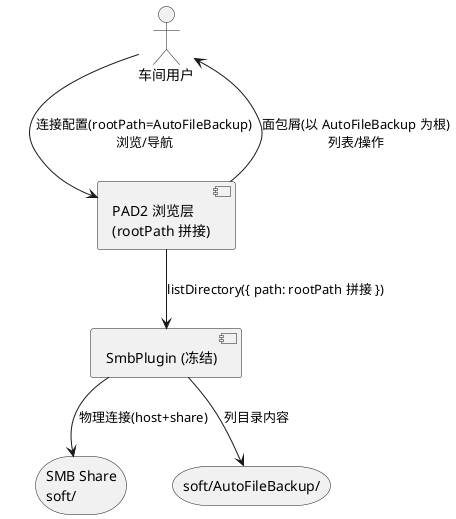

# SMB 连接根路径（rootPath）需求规格

> 文档版本：v1.0
> 生成日期：2026-11-02
> 特性编号：ROOT-PATH
> 追溯：基于 `src/state/smbProfilesStore.ts`、`src/state/browseContextStore.ts`、`src/ui/pages/BrowsePage/index.tsx`、`src/adapter/smb/SmbPlugin.ts` 现状分析

---

## 1. 需求背景与目标

### 1.1 背景

PAD2 是 Android SMB 文件管理器应用。当前 SMB 连接配置（SmbProfile）以 `host + share` 定位共享根目录，用户连接后看到的根目录是整个 share 根（`/`）。

车间场景下，用户连接到 `\\192.168.2.247\soft`，但实际工作内容集中在 `soft` 共享下的 `AutoFileBackup` 子目录。当前用户每次连接后需手动逐层进入该子目录，存在以下痛点：

1. **重复导航成本**：每次连接/切换配置均需手动钻取至工作子目录，操作冗余。
2. **误操作风险**：share 根下混杂其他子目录与文件，车间人员易误入非工作区或误操作非目标内容。
3. **心智模型不一致**：用户期望"连接即到位"，而非"连接到 share 根再自行定位"。

### 1.2 目标

为 SMB 连接配置增加可选的**根路径（rootPath）**字段。当配置了 rootPath 时：

- 连接后浏览的根目录为 share 内该 rootPath 子目录，而非 share 根。
- 用户在该子目录内浏览、导航、操作，如同该子目录就是共享根。
- 面包屑导航以该子目录为根段显示，不允许向上越界至 share 根。

**核心价值**：消除重复钻取操作，隔离工作区，对齐"连接即到位"心智模型。

### 1.3 范围与非目标

**范围内**：
- SmbProfile 数据模型新增可选 `rootPath` 字段及持久化兼容。
- 浏览初始路径以 rootPath 为根。
- 面包屑导航以 rootPath 为根显示与越界约束。
- 连接表单新增 rootPath 输入项。

**非目标（明确不做）**：
- **不**修改 SmbPlugin 原生层（HC-02 冻结区）：rootPath 仅在应用层拼接为 share 内相对路径后透传给既有 `listDirectory({ path })`，连接仍指向 share 根。
- **不**改变 SMB 物理连接目标：`connect` 仍以 `host + share` 建立会话，rootPath 是浏览层逻辑根，不是物理挂载点。
- **不**支持 rootPath 跨 share（如 `../` 越界至 share 之外）。
- **不**支持多级 rootPath 自动创建：rootPath 指向的子目录必须已存在于 share 中。
- **不**改变既有连接配置身份判定（host+share+username+domain 四元组，rootPath 不参与判重）。
- **不**涉及 design.md / tasks.md 生成（由下游 agent 负责）。

---

## 2. 领域术语

**rootPath（根路径）**
: SMB 连接配置中可选的字段，值为 share 内某一子目录的相对路径，作为该连接的浏览逻辑根。留空时浏览逻辑根回退为 share 根。

**浏览逻辑根（logical browse root）**
: 用户在浏览界面中能到达的最上层目录。未配置 rootPath 时为 share 根；配置 rootPath 时为该 rootPath 子目录。

**share 物理根（share physical root）**
: SMB 共享的物理顶层目录，由 `host + share` 确定，是 `listDirectory({ path: '/' })` 返回的目录。浏览逻辑根是 share 物理根的子集。

**面包屑根段（breadcrumb root segment）**
: 面包屑导航的首段，代表浏览逻辑根。点击该段回到浏览逻辑根，不能向上越界。

: 备注：现状面包屑根段显示名为 `profile.name`，根段 path 为空串（对应 share 根）。本特性将根段语义改为浏览逻辑根。

---

## 3. 业务规则（EARS 格式）

> 编号规则：REQ-RP-xx（RP = RootPath）。EARS 关键词保留英文：When / While / If / Then / The system shall / Where。

### 3.1 rootPath 字段语义

**REQ-RP-01**（字段可选性）
: **The system shall** 将 `rootPath` 作为 SmbProfile 的可选字段处理；未提供、为空字符串或为 `undefined` 时，该连接的浏览逻辑根为 share 物理根。
- 验收条件：rootPath 缺失/空串/undefined 的 profile 连接后 → 初始目录列表与现状（share 根）逐一致。

**REQ-RP-02**（字段语义）
: **Where** profile 配置了非空 `rootPath`，**the system shall** 以该值指向的 share 内子目录作为浏览逻辑根；rootPath 表示 share 内相对路径，不含 share 名本身。
- 验收条件：rootPath=`"AutoFileBackup"`、share=`"soft"` → 浏览根目录列出 `soft/AutoFileBackup` 的内容，而非 `soft` 根内容。

### 3.2 初始浏览路径

**REQ-RP-03**（初始路径确定）
: **When** 用户对一个已连接的 profile 首次进入浏览页（或该 profile 浏览上下文初次创建），**the system shall** 将初始浏览路径设置为浏览逻辑根对应的 share 内相对路径。
- 验收条件：rootPath=`"AutoFileBackup"` → 首次进入浏览页 → 列表呈现 `AutoFileBackup` 目录内容，currentPath 指向该子目录。
- 验收条件：rootPath 未配置 → 首次进入浏览页 → 列表呈现 share 根内容（与现状一致）。

**REQ-RP-04**（切换配置复用上下文）
: **While** 某 profile 已存在浏览上下文且 currentPath 已位于其浏览逻辑根之内，**the system shall** 切换回该 profile 时复用既有 currentPath，不重置为浏览逻辑根。
- 验收条件：profile A（rootPath=`"AutoFileBackup"`）浏览至 `AutoFileBackup\sub` → 切换到 profile B 再切回 A → currentPath 仍为 `AutoFileBackup\sub`，不回退到 `AutoFileBackup`。

### 3.3 面包屑导航

**REQ-RP-05**（根段显示）
: **Where** profile 配置了非空 `rootPath`，**the system shall** 面包屑根段代表该 rootPath 子目录；点击根段回到浏览逻辑根。
- 验收条件：rootPath=`"AutoFileBackup"`、当前位于 `AutoFileBackup\sub` → 面包屑显示 `[AutoFileBackup] > sub`（根段标签为 rootPath 末级目录名或 profile 名，由设计决定，但语义为浏览逻辑根）；点击根段 → 回到 `AutoFileBackup` 目录列表。

**REQ-RP-06**（向上越界禁止）
: **The system shall** 禁止用户从浏览逻辑根向上导航至 share 物理根或其外；面包屑根段不可点击越界，且不提供任何"返回 share 根"的入口。
- 验收条件：rootPath=`"AutoFileBackup"`、当前位于 `AutoFileBackup`（浏览逻辑根）→ 面包屑仅显示根段，无父级段；系统不发起对 share 根的 `listDirectory` 请求。
- 验收条件：任何 UI 路径（面包屑、返回上级、路径输入）均无法使 currentPath 越出浏览逻辑根之上。

**REQ-RP-07**（未配置 rootPath 时面包屑行为不变）
: **Where** profile 未配置 rootPath，**the system shall** 面包屑行为与现状完全一致（根段为 share 根，可逐级向上至 share 根）。
- 验收条件：rootPath 缺失 → 面包屑根段 path 为空串、可回到 share 根，与现状逐一致。

### 3.4 连接表单

**REQ-RP-08**（表单字段提供）
: **The system shall** 在连接配置表单中提供 rootPath 输入项；该项为可选，留空表示使用 share 根。
- 验收条件：连接表单存在 rootPath 输入框 → 留空保存 → profile.rootPath 为 unset → 浏览行为同现状。
- 验收条件：填入 `"AutoFileBackup"` 保存 → profile.rootPath=`"AutoFileBackup"` → 浏览根为该子目录。

**REQ-RP-09**（编辑既有配置回填）
: **When** 用户编辑既有 profile，**the system shall** 将既有 rootPath 值回填到表单输入项；既有 profile 无 rootPath 字段时回填为空。
- 验收条件：旧 profile（无 rootPath 字段）→ 编辑 → rootPath 输入框为空。
- 验收条件：profile.rootPath=`"AutoFileBackup"` → 编辑 → 输入框显示 `AutoFileBackup`。

### 3.5 路径规范化与校验

**REQ-RP-10**（输入规范化）
: **When** 用户提交 rootPath 值，**the system shall** 对其进行规范化：去除首尾空白；去除前导/尾随路径分隔符（`/` 与 `\`）；规范化后为空串则视为未配置。
- 验收条件：输入 `" /AutoFileBackup/ "` → 存储为 `"AutoFileBackup"`。
- 验收条件：输入 `"   "` 或 `"/"` 或 `"\\"` → 视为未配置（rootPath unset）。

**REQ-RP-11**（越界片段拒绝）
: **If** 规范化后的 rootPath 包含父级引用片段（`..`），**then the system shall** 拒绝该值并提示用户 rootPath 不得越出 share 范围。
- 验收条件：输入 `"../other"` → 保存被拒 → 用户收到明确错误提示，不落库。

**REQ-RP-12**（多级路径允许）
: **The system shall** 允许 rootPath 为多级子目录路径（如 `"AutoFileBackup/2026"`），以最末级目录作为浏览逻辑根。
- 验收条件：rootPath=`"AutoFileBackup/2026"` → 浏览根为 `soft/AutoFileBackup/2026`。

### 3.6 异常场景

**REQ-RP-13**（rootPath 子目录不存在）
: **If** 配置了 rootPath 但该子目录在 share 中不存在（或用户无访问权限），**then the system shall** 在首次浏览时如实呈现目录加载失败，不静默回退到 share 根。
- 触发条件：rootPath=`"NotExists"`，share 中无此目录。
- 系统行为：对 rootPath 对应路径发起 `listDirectory`，捕获失败，置 loadError。
- 用户感知：浏览页显示"目录加载失败"提示与重试入口；不显示 share 根内容冒充。

**REQ-RP-14**（持久化字段清洗）
: **When** 从持久层加载 profile 且 rootPath 字段类型非法（非字符串、含越界片段等），**the system shall** 静默丢弃该字段（视为未配置），不拒绝整个 profile 加载。
- 验收条件：持久化数据 rootPath=`123`（数字）→ 加载后 profile.rootPath 为 unset，其余字段正常。

---

## 4. 约束条件

### 4.1 硬约束（继承既有 HC）

| 编号 | 约束 | 适用说明 |
|------|------|----------|
| HC-01 | 零新增 npm 依赖 | rootPath 实现仅用既有工具链，不引入新依赖。 |
| HC-02 | 冻结区零变更（`src/adapter/smb/SmbPlugin.ts` / `src/core/**` / `android/**`） | rootPath 在应用层拼接为 share 内相对路径后透传给既有 `listDirectory({ path })`；SmbPlugin、原生层、connect 逻辑零变更。 |
| HC-05 | 既有持久化兼容（version 1 框架内扩展） | `STORAGE_VERSION` 保持 1 不升；rootPath 为可选字段，旧数据缺失=unset，回退现状行为。 |

### 4.2 设计约束

| 编号 | 约束 | 验收条件 |
|------|------|----------|
| CON-RP-01 | rootPath 不参与连接配置身份判定 | `isSameProfileIdentity` 仍为 host+share+username+domain 四元组；仅 rootPath 不同的两配置视为同一配置（upsert 更新而非新增）。 |
| CON-RP-02 | rootPath 不参与 SMB 物理连接 | `connect` 调用参数（host/share/username/password/domain）不变；rootPath 仅影响浏览层 listDirectory 的 path。 |
| CON-RP-03 | 浏览逻辑根为不可越界上界 | 任何用户操作（面包屑点击、返回上级、路径跳转）不得使 currentPath 指向浏览逻辑根之上的路径。 |

### 4.3 DFX 约束

| 维度 | 约束 | 验收条件 |
|------|------|----------|
| 性能 | rootPath 路径拼接为纯内存字符串操作，不引入额外网络往返 | 配置 rootPath 后首次进入浏览页的请求数与未配置时一致（仅一次 listDirectory）。 |
| 可靠性 | rootPath 子目录不存在时 fail-visible，不静默回退 | 见 REQ-RP-13。 |
| 可维护性 | rootPath 解析遵循既有 sanitize 白名单模式（严格类型校验才落位） | 见 REQ-RP-14，与 passwordEmpty/autoConnect/pinned 同风格。 |
| 兼容性 | 既有 profile 零迁移、零行为变更 | 见第 6 章。 |

---

## 5. 数据模型变更

> 本章描述领域对象的字段业务含义与约束（逻辑约束），不涉及存储类型/索引等实现细节。

### 5.1 SmbProfile（连接配置）

既有字段保持不变，新增可选字段 `rootPath`：

| 字段 | 类型 | 必填 | 业务含义与约束 |
|------|------|------|----------------|
| id | string | 是 | 既有，不变。 |
| name | string | 是 | 既有，不变。显示标签。 |
| host | string | 是 | 既有，不变。 |
| share | string | 是 | 既有，不变。物理共享名。 |
| username | string | 是 | 既有，不变。 |
| domain | string? | 否 | 既有，不变。 |
| passwordEncrypted | string? | 否 | 既有，不变。 |
| passwordEmpty | boolean? | 否 | 既有，不变。 |
| autoConnect | boolean? | 否 | 既有，不变。 |
| pinned | boolean? | 否 | 既有，不变。 |
| createdAt | number | 是 | 既有，不变。 |
| lastConnectedAt | number? | 否 | 既有，不变。 |
| **rootPath** | **string?** | **否** | **新增**。share 内子目录相对路径，作为浏览逻辑根。约束：① 不含前导/尾随分隔符；② 不含 `..` 越界片段；③ 为空或 unset 时浏览逻辑根=share 根；④ 不含 share 名本身；⑤ 可多级（如 `"a/b"`）。 |

**字段间业务关联**：
- `rootPath` 与 `share` 关联：rootPath 是 share 内的相对子路径，share 变更时 rootPath 语义可能失效（指向新 share 中同名子目录或不存在），不在保存时强制校验存在性（存在性在浏览时由 REQ-RP-13 处理）。
- `rootPath` 与连接身份无关联（CON-RP-01）：仅 rootPath 不同的两 profile 视为同一身份，保存走 upsert 更新。

### 5.2 SmbProfileInput（连接表单输入）

新增可选 `rootPath` 输入字段，经规范化（REQ-RP-10）与越界校验（REQ-RP-11）后落库。

| 字段 | 类型 | 必填 | 说明 |
|------|------|------|------|
| **rootPath** | **string?** | **否** | **新增**。用户表单输入的根路径原始值，保存前规范化。 |

---

## 6. 兼容性要求

### 6.1 既有持久化数据兼容

**REQ-RP-15**（旧数据零迁移）
: **When** 持久层存在 version 1 且无 rootPath 字段的既有 profile 数据，**the system shall** 在加载时将 rootPath 视为 unset，不要求数据迁移、不升版本号、不丢弃该 profile。
- 验收条件：既有 profile（无 rootPath 字段）→ 加载成功 → rootPath 为 unset → 浏览行为与本次特性交付前逐一致。

**REQ-RP-16**（版本号不变）
: **The system shall** 保持 `STORAGE_VERSION = 1`；rootPath 作为 version 1 框架内的可选字段向后兼容扩展。
- 验收条件：保存含 rootPath 的 profile → 持久化 JSON `version` 字段仍为 1。

### 6.2 既有行为兼容

**REQ-RP-17**（未配置 rootPath 时行为等价）
: **Where** profile 未配置 rootPath（unset/空串），**the system shall** 所有浏览、导航、面包屑行为与本次特性交付前完全等价。
- 验收条件：对一批未配置 rootPath 的既有 profile 回归测试 → 初始路径、面包屑段、向上导航、切换复用上下文等行为均与基线一致。

### 6.3 字段清洗兼容

**REQ-RP-18**（非法 rootPath 容错）
: **If** 持久化数据中 rootPath 为非法值（非字符串、含 `..`、类型篡改），**then the system shall** 静默丢弃 rootPath 字段并保留其余字段，加载该 profile 视为未配置 rootPath。
- 验收条件：rootPath=`null` / `123` / `"../x"` → 加载后 rootPath unset，profile 其余字段正常可用。

---

## 7. 验收条件汇总

| 编号 | 场景概要 | 关键验收要点 |
|------|----------|--------------|
| REQ-RP-01 | 字段可选性 | 缺失/空/undefined → 浏览同现状 |
| REQ-RP-02 | 字段语义 | rootPath 指向 share 内子目录，非 share 名 |
| REQ-RP-03 | 初始路径 | 首次进入浏览页 → 列出 rootPath 子目录内容 |
| REQ-RP-04 | 切换复用上下文 | 切回已浏览 profile → currentPath 不重置 |
| REQ-RP-05 | 面包屑根段 | 根段代表 rootPath，点击回到浏览逻辑根 |
| REQ-RP-06 | 向上越界禁止 | 无法导航至浏览逻辑根之上 |
| REQ-RP-07 | 未配置时面包屑不变 | rootPath 缺失 → 面包屑同现状 |
| REQ-RP-08 | 表单字段 | 可选输入，留空=share 根 |
| REQ-RP-09 | 编辑回填 | 既有值回填，无值回填空 |
| REQ-RP-10 | 输入规范化 | 去空白/去首尾分隔符，空串=未配置 |
| REQ-RP-11 | 越界片段拒绝 | 含 `..` → 拒绝并提示 |
| REQ-RP-12 | 多级路径允许 | `"a/b"` → 浏览根为最末级 |
| REQ-RP-13 | 子目录不存在 | fail-visible，不回退 share 根 |
| REQ-RP-14 | 持久化清洗 | 非法字段静默丢弃，不拒整个 profile |
| REQ-RP-15 | 旧数据零迁移 | 旧 profile 加载成功，rootPath unset |
| REQ-RP-16 | 版本号不变 | STORAGE_VERSION 仍为 1 |
| REQ-RP-17 | 未配置行为等价 | 全量回归与基线一致 |
| REQ-RP-18 | 非法值容错 | null/数字/越界串 → 丢弃字段，profile 可用 |

---

## 8. 交互上下文（参考）

> 说明：SmbPlugin 与 SMB 物理连接属冻结区，rootPath 仅在 PAD2 浏览层生效。连接仍以 `host+share` 建立，rootPath 是浏览层逻辑根。