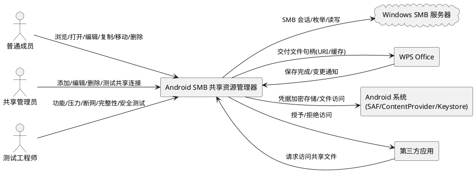
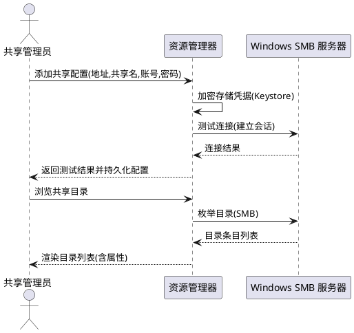
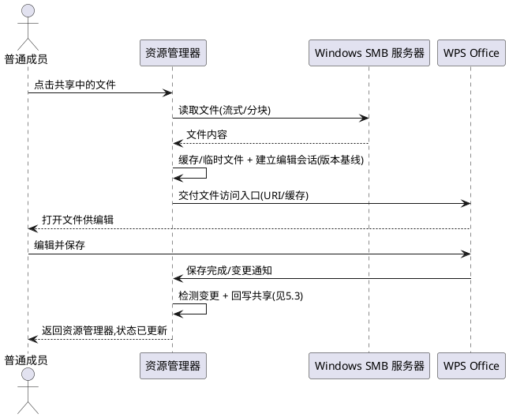
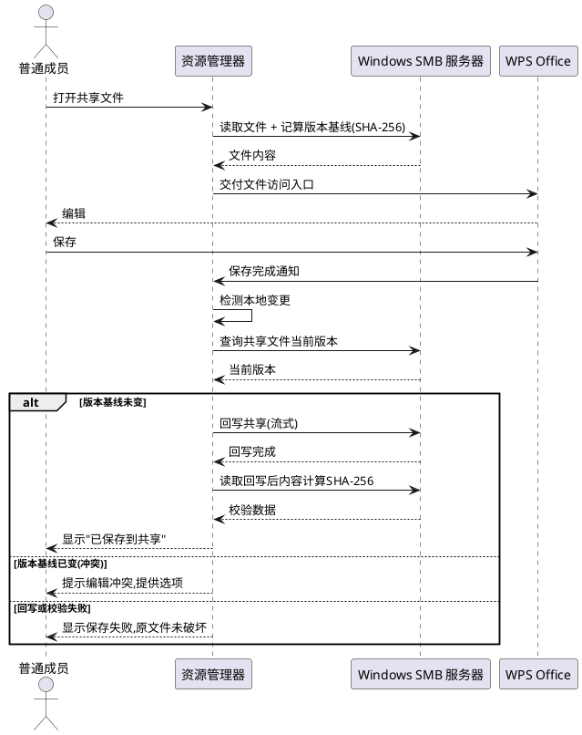
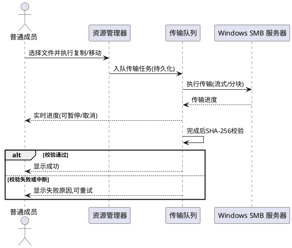
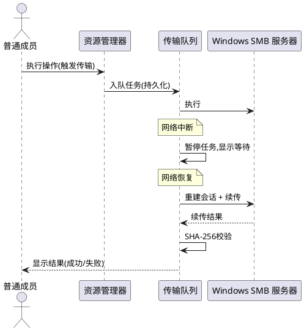
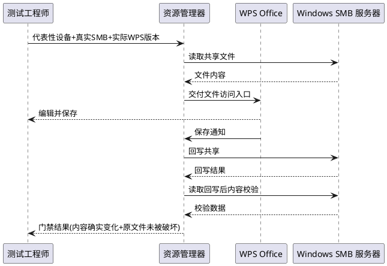

# 安卓平板项目2：Windows SMB 共享资源管理器（Android Shared File Explorer）需求规格

> 本文档基于 PM 立项评审与 PAD2-M0 只读技术审查报告生成，覆盖五项核心需求（REQ-01 ~ REQ-05）、WPS 保存关键技术裁定、大规模使用架构要求、风险缓解措施及各阶段验收门禁的量化标准。所有业务规则采用可测试的验收条件（触发场景 → 预期行为）描述。

---

# 1. 组件定位

## 1.1 核心职责

本组件负责在安卓平板上浏览、打开、编辑、保存、复制、移动、删除 Windows SMB 共享目录中的文件，实现接近 Windows 资源管理器的本地化操作体验，使大范围成员无需反复下载上传即可直接处理共享文件。

## 1.2 核心输入

1. **用户操作指令**：添加/编辑/删除/测试 SMB 共享连接、浏览目录、搜索排序、打开文件、复制/移动/重命名/删除、收藏文件、暂停/取消/重试传输。
2. **WPS Office 回写信号**：WPS 保存完成后通过 Android 文件访问接口或文件变更监听触发的回写通知，含目标 URI、变更时间、内容指纹。
3. **网络状态事件**：Wi-Fi 连接/断开、网络切换、连接超时、SMB 会话失效等系统广播与连接层回调。
4. **定时/恢复触发信号**：应用启动时未完成传输任务的恢复触发、可恢复任务的重试退避定时触发。
5. **外部应用打开请求**：第三方应用通过 Android Intent / ContentProvider 向本组件请求访问共享文件的请求。

## 1.3 核心输出

1. **返回给用户的响应**：目录列表、文件属性、传输进度、操作结果（成功/失败/冲突）、错误码与可读提示。
2. **发送给 Windows SMB 服务器的请求**：SMB 会话建立、目录枚举、文件读取/写入/创建/删除/重命名、文件属性查询与设置。
3. **交给 WPS Office 的文件句柄**：通过 Android 文件访问接口（URI / ContentProvider / 临时文件）向 WPS 提供可编辑文件访问入口。
4. **推送给用户的通知**：传输完成、传输失败、回写成功、回写失败、冲突警告、网络等待状态通知。
5. **结构化日志输出**：脱敏后的操作日志、错误分类日志、传输审计日志、故障诊断日志。

## 1.4 职责边界

本组件**不负责**以下事项：

1. **不负责** Windows SMB 服务器的运维与容量规划：服务器性能、Windows/SMB 协议配置、接入点容量、身份认证策略属于服务端承载能力范畴，须由运维方独立验证，本组件仅提供客户端侧承载能力。
2. **不负责** WPS Office 的内部实现与版本分发：本组件仅通过 Android 标准文件访问机制与 WPS 交互，不修改 WPS、不打包 WPS、不控制 WPS 的另存为行为。
3. **不负责** 将网络中断、保存失败或文件冲突隐藏为成功：所有失败必须如实呈现，禁止伪报成功。
4. **不负责** 超出最低支持范围与已验证环境清单的兼容性保证：未实测的设备/版本组合允许尝试运行但标注"未验证"，不宣称兼容。
5. **不负责** 旧仓库 `wujupeng/andriodpad` 的线上演进：旧仓库仅作为技术资产参考，是否复用代码须经 M0 技术审查裁定，不预设复用也不预设重写。

---

# 2. 领域术语

**SMB 共享连接**
: 一组指向 Windows SMB 服务器上某共享目录的访问配置，包含服务器地址、共享名、账号、密码及可选端口与协议版本，可被本组件用于建立会话并枚举/读写文件。
: 备注：对应 REQ-01，支持多组入口。

**无感打开**
: 用户在共享目录中点击文件后，本组件自动选择平板上合适的应用（优先 WPS Office）打开文件，用户无需手动寻找下载目录或手动上传，文件状态在返回资源管理器后及时更新。
: 备注：对应 REQ-02，"无感"指操作流程无感，不指对失败无感。

**可靠回写**
: WPS 保存后本组件检测到文件变更，将修改内容写回 Windows SMB 共享原位置，并在回写完成后通过内容校验确认共享文件确实发生预期变化，仅在校验通过后才显示"已保存到共享"。
: 备注：对应 REQ-03，是项目成败点。

**编辑会话**
: 从文件被交给 WPS 打开开始，到回写校验完成或用户放弃编辑为止的一次完整编辑生命周期，含本地缓存副本、版本基线、变更检测与回写状态。
: 备注：用于冲突检测与断网恢复。

**文件版本基线**
: 编辑会话开始时记录的共享文件内容指纹（SHA-256）与修改时间，用于在回写前判断共享文件是否已被他人修改，防止静默覆盖。

**静默覆盖**
: 在共享文件已被他人修改的情况下，仍用本地编辑结果直接写回，导致他人更新丢失且无任何提示的行为。
: 备注：本组件必须禁止静默覆盖。

**可恢复任务**
: 一类传输或回写任务，其中断后可从已持久化的进度（已传输字节偏移、已校验文件清单）安全续传或重新执行，而不必从头开始且不损坏数据。

**传输队列**
: 本组件内部维护的有序任务集合，承载复制、移动、回写等操作，支持进度上报、暂停、取消、重试退避、完整性校验与重复操作防护。
: 备注：对应 REQ-04 与 REQ-05。

**完整性校验**
: 传输或回写前后对文件内容计算 SHA-256 指纹并比对，确认目标文件内容与源文件内容逐字节一致的过程。

**凭据安全存储**
: SMB 账号密码以加密方式存储于 Android Keystore 保护的存储区，不在日志、界面明文、共享偏好明文中出现。

**技术验证门禁**
: 在进入完整实现前，针对 WPS"打开—编辑—保存回写—断网恢复"关键路径单独设立的验证关卡，须在代表性设备、实际 WPS 版本与真实 SMB 服务器上通过后方可进入开发阶段。
: 备注：对应关键技术裁定，PAD2-M2 阶段核心。

**三层兼容性模型**
: PAD2 采用的多设备兼容性管理模型，自底向上分为三层：通用架构兼容（不绑定特定品牌/WPS 版本，基于 Android 标准 API）、代表性环境验证（建立实测基线并逐步扩展测试组合）、兼容性证据管理（记录每个组合的实测结果，未实测标注"未验证"）。
: 备注：PAD2-M1-G4-FAST-DECISION-01 策略裁定核心。

**已验证环境清单**
: 记录所有已通过实测的设备型号、系统版本、WPS 版本、测试用例、结果和已知限制的活文档，随测试进展持续更新。没有实测证据的组合一律标记为"未验证"，"未验证"不等于"不兼容"，允许尝试运行但不得宣称兼容。
: 备注：三层兼容性模型第三层产物，M2 后开始填充。

**客户端承载能力 / 服务端承载能力**
: 客户端承载能力指单台平板及多台平板并发时本组件的吞吐与成功率；服务端承载能力指 Windows SMB 服务器、无线网络与认证体系在目标并发下的承载上限。两者须分开验证。

---

# 3. 角色与边界

## 3.1 核心角色

- **普通成员**：在平板上使用本组件浏览、打开、编辑、复制、移动、删除共享文件的主要用户，不负责服务器配置。
- **共享管理员**：负责添加、编辑、删除、测试 SMB 共享连接配置，可能为普通成员兼任或独立角色。
- **运维方**：负责 Windows SMB 服务器、Windows/SMB 协议配置、无线网络与接入点、身份认证策略的运维人员，不直接使用本组件但须独立验证服务端承载能力。
- **测试工程师**：执行功能、压力、断网恢复、数据完整性与安全测试的人员，按门禁量化标准判定是否发布。

## 3.2 外部系统

- **Windows SMB 服务器**：上游被访问对象，提供 SMB 协议目录枚举与文件读写服务，须支持目标 SMB 协议版本与并发会话。
- **WPS Office**：下游文件编辑应用，通过 Android 文件访问接口接收文件句柄，完成编辑后将保存结果回传本组件触发回写。
- **Android 系统（文件访问框架 / SAF / ContentProvider）**：提供 URI、ContentProvider、SAF 等文件访问机制，是本组件与 WPS 之间的文件传递通道，须在最低支持版本及以上可用，按三层兼容性模型管理多版本兼容性。
- **Android Keystore**：凭据加密存储依赖的系统安全组件。
- **第三方应用**：通过 Intent / ContentProvider 向本组件请求访问共享文件的外部应用。

## 3.3 交互上下文

---

# 4. DFX约束

## 4.1 性能

1. **大文件基线**：以 1 GiB 文件作为初始验证样本，单文件传输须在不将文件整体载入内存的前提下完成读写与完整性校验。
   - 验收条件：[传输 1 GiB 文件] → [内存占用不超过单实例上限且传输完成后 SHA-256 校验通过]
2. **批量文件基线**：以 10,000 个混合大小文件作为初始规模测试目标，批量操作须提供整体进度与单文件结果。
   - 验收条件：[批量复制 10,000 个混合大小文件] → [全部完成且每个文件完整性校验通过，过程中内存占用不超限]
3. **目录浏览响应**：单目录枚举响应时间上限须在 M1 阶段冻结，超限时须分页或延迟加载。
   - 验收条件：[打开含目标文件数的目录] → [首屏可在响应时间上限内呈现，剩余分页加载]
4. **并发连接限制**：单实例并发 SMB 连接数与并发传输任务数须设上限，避免耗尽客户端或服务器资源。
   - 验收条件：[并发请求超过上限] → [超出请求排队等待，不导致应用崩溃或服务器拒绝服务]
5. **并发概念区分与目标并发用户数**：须严格区分以下三个并发概念，不可互相代替：
   - **客户端并发会话上限（初始值 5，待 M2 验证）**：单台平板同时连接的 SMB 共享数，属客户端资源调度参数。
   - **客户端并发任务上限（初始值 3，待 M2 验证）**：单台平板同时执行的传输任务数，属客户端资源调度参数。
   - **系统目标并发用户数**：同时使用 PAD2 的用户总数，影响服务端容量规划，属系统级容量参数。
   - **目标并发用户数状态（PM Gate Review 裁定）**：待业务确认（M2/M4 决策依赖）。须明确预计同时使用人数、同时连接 SMB 共享的客户端数量、服务端容量及压力测试验收范围。如果业务尚未给出人数，列为 M2/M4 的明确决策依赖，但不得在 M1 文档中一边要求冻结一边仍留空。不可将客户端会话数（5）或任务数（3）等同于系统目标并发用户数。
   - 验收条件：[业务确认并发用户数] → [需求规格包含明确的系统目标并发用户数，且与客户端并发会话上限、客户端并发任务上限严格区分]

## 4.2 可靠性

1. **系统可用性目标**：在目标无线网络质量下，核心操作（浏览、打开、回写）成功率须在 M1 阶段冻结下限。
   - 验收条件：[目标网络下执行核心操作] → [成功率不低于冻结下限]
2. **故障恢复时间**：短暂断网或 SMB 会话失效后，可恢复任务须在网络恢复后自动续传或重新执行，恢复时间上限须在 M1 阶段冻结。
   - 验收条件：[网络恢复] → [可恢复任务在恢复时间上限内自动继续且数据完整]
3. **数据一致性**：传输与回写须保证目标文件内容与源内容逐字节一致，以 SHA-256 校验为判据。
   - 验收条件：[任意传输或回写完成] → [SHA-256 校验通过方可标记成功]
4. **禁止伪报成功**：网络不可用、回写失败、校验不通过时，必须显示等待或失败状态。
   - 验收条件：[传输/回写未成功] → [界面显示失败或等待，不显示成功]
5. **持久化任务队列**：传输任务进度须持久化，应用重启后可恢复未完成任务。
   - 验收条件：[应用在传输中途被杀] → [重启后任务队列恢复且可继续未完成任务]

## 4.3 安全性

1. **凭据加密存储**：SMB 账号密码必须以 Android Keystore 保护的加密方式存储。
   - 验收条件：[检查本地存储与日志] → [密码不以明文出现于任何存储位置或日志条目]
2. **日志脱敏**：所有日志不得包含密码、完整凭据、文件敏感内容。
   - 验收条件：[抓取任意日志条目] → [不含密码明文与文件内容明文]
3. **最小权限**：本组件仅请求完成功能所需的最小 Android 权限与 SMB 访问权限。
   - 验收条件：[审查权限清单] → [每项权限均有对应功能用途且无可裁剪冗余权限]
4. **关键操作审计**：连接建立、文件写入、删除、重命名、回写须记录可追溯的审计日志。
   - 验收条件：[执行关键操作] → [审计日志含操作类型、目标、时间、结果，且脱敏]
5. **证书或协议能力评估**：SMB 协议版本与传输加密能力须在 M1 阶段评估并冻结要求。
   - 验收条件：[M1 阶段冻结] → [需求规格包含 SMB 协议版本与加密要求]

## 4.4 可维护性

1. **结构化日志**：日志须含错误分类、操作上下文、时间戳，便于故障诊断。
   - 验收条件：[发生错误] → [日志含错误分类码、操作上下文与时间戳，可定位根因]
2. **错误分类**：错误须按输入校验失败、业务规则冲突、外部系统失败、并发竞争、超时重试分类。
   - 验收条件：[任意错误] → [可归入预定义错误类别且对应处理策略]
3. **故障诊断支持**：须提供可导出的诊断信息（不含敏感数据）用于支持人员定位问题。
   - 验收条件：[用户触发诊断导出] → [导出信息含操作日志、错误分类、环境信息且脱敏]
4. **版本升级与兼容性测试**：版本升级须提供兼容性测试方案，明确最低 Android 支持版本与 WPS 已验证版本清单，按三层兼容性模型管理多设备兼容性。
   - 验收条件：[发布新版本] → [已通过代表性设备的兼容性测试，已验证环境清单更新，未测试组合标注"未验证"]

## 4.5 兼容性

> **多设备兼容策略（PAD2-M1-G4-FAST-DECISION-01）**：PAD2 不绑定单一平板型号、Android 版本或 WPS 版本。项目目标是开发能够适配多种企业平板的 SMB 文件管理器。不限定唯一版本不等于不设最低支持范围：须确定最低 Android API 级别（minSdkVersion）以确保应用可安装运行，但支持多个系统版本，不必要求所有平板完全一致。兼容性通过三层兼容性模型管理（见 4.5.1）。

### 4.5.1 三层兼容性模型

兼容性管理采用三层模型，自底向上分别为通用架构兼容、代表性环境验证与兼容性证据管理：

**第一层：通用架构兼容**
- 不将业务逻辑绑定到某个品牌或某个 WPS 版本
- 通过 Android 文件访问接口、SMB 适配层和独立的文件编辑交接层降低耦合
- 应用架构设计基于 Android 标准 API，而非厂商特定 API
- 验收条件：[审查架构] → [业务逻辑不绑定特定品牌/WPS 版本，基于 Android 标准 API 设计]

**第二层：代表性环境验证**
- 先用现有设备（如荣耀 9X）建立第一条实测基线
- 再逐步增加不同 Android 版本、设备厂商及 WPS 版本的测试组合
- 每增加一个组合，记录完整测试结果
- 验收条件：[代表性环境验证] → [至少建立一条实测基线，并按计划扩展测试组合]

**第三层：兼容性证据管理**
- 每个组合记录：设备型号、系统版本、WPS 版本、测试用例、结果和已知限制
- 没有实测证据的组合一律标记为"未验证"
- 维护"已验证环境清单"作为活文档，随测试进展持续更新
- "未验证"不等于"不兼容"，允许尝试运行但不得宣称兼容
- 验收条件：[检查兼容性证据] → [每个组合有完整实测记录或标注"未验证"，已验证环境清单持续更新]

### 4.5.2 兼容性约束

1. **Android 最低支持版本**：须在 M1 阶段确定最低 Android API 级别（minSdkVersion），须有明确技术依据；支持多个系统版本，不绑定单一 Android 版本；超出最低支持范围不保证安装运行。
   - **已冻结值（PM Gate Review 批准）**：API 26 / Android 8.0 — **已冻结**
   - **技术依据**：
     - Capacitor 8 要求 Android API 22+（Android 5.1+），此为硬性下限
     - SAF 持久化授权（`takePersistableUriPermission`）从 API 21 开始支持，但 API 26（Android 8.0）后行为更稳定
     - Android Keystore 从 API 18 开始可用，API 23 后支持更完善的 KeyStore API（`KeyStore.getEntry` 等），API 26 进一步稳定
     - 分区存储（Scoped Storage）从 API 29 引入、API 30 强制，属 targetSdkVersion 行为，与 minSdkVersion 26 不冲突（可通过 targetSdkVersion >= 29 触发分区存储行为）
     - 前台服务类型声明从 API 29 开始需要，属 targetSdkVersion 行为，不影响 minSdkVersion 下限
     - SMBJ 库为 Java 库，要求 Android Java 兼容，API 21+ 即可满足
     - 企业平板实际情况：2018 年后生产的大多数企业平板运行 Android 8.0+（API 26+），选择 API 26 可覆盖主流企业平板
     - 综合结论：API 26 平衡了现代 API 能力（SAF 稳定性、Keystore 完善性）与企业平板兼容性覆盖率
   - 验收条件：[M1 阶段冻结] → [需求规格包含明确最低 Android API 级别（须有技术依据），并声明支持多版本范围]
1b. **Android 目标版本（targetSdkVersion）**：须在 M1 阶段确定 targetSdkVersion 候选值，经兼容性评估后冻结。
   - **候选值（PM Gate Review 退回修订）**：API 36（Android 16）— **候选值待兼容性评估后冻结**
   - **修订背景**：当前日期为 2026 年 10 月 15 日。从 2026 年 8 月 31 日起，Google Play 新应用和更新需要面向 Android 16（API 36）或更高版本。原候选值 API 33-34 不再适用。
   - **分发说明**：PAD2 通过企业内部 APK 分发，将 API 36 作为技术评估目标，确认 Capacitor、插件、文件访问、前台任务和 SMB 实现兼容后再冻结。如果未来需要上架 Google Play，API 33-34 不应作为发布目标（已低于 Google Play 最低要求）。
   - **与 minSdkVersion 关系**：minSdkVersion = 26 与 targetSdkVersion = 36 不矛盾；最低安装系统版本和目标行为版本是不同参数，前者决定可安装设备下限，后者决定系统对应用应用的兼容行为限制。
   - **API 36 适配风险**：
     - Capacitor 8 及其插件在 API 36 上的兼容性须验证（核心风险）
     - 分区存储（Scoped Storage）行为在 API 36 下可能进一步收紧，文件访问路径须验证
     - 前台服务类型声明与后台传输限制在 API 36 下可能更严格
     - SAF/ContentProvider 行为在 API 36 下须验证
     - SMBJ 库在 API 36 下的网络与线程行为须验证
   - **API 36 兼容性评估计划**：
     - 在荣耀 9X（实际系统版本）及 API 36 模拟器/设备上验证 Capacitor 8 插件桥接
     - 验证文件访问（SAF/ContentProvider/私有目录）在 targetSdkVersion=36 下的行为
     - 验证前台服务类型声明与后台传输在 targetSdkVersion=36 下的限制
     - 验证 SMBJ 会话建立与读写在 targetSdkVersion=36 下的网络行为
     - 评估通过后将状态更新为"已冻结"，未通过则记录差距并调整候选值
   - 验收条件：[兼容性评估完成] → [targetSdkVersion 候选值经实测验证后冻结，适配风险已评估并记录]
2. **平板品牌范围**：不限定平板品牌（不限定荣耀、华为或其他品牌），以实测证据管理兼容性，记录实际测试设备。
   - 验收条件：[检查兼容性策略] → [需求规格不限定单一品牌，以已验证环境清单管理品牌兼容性]
3. **WPS 兼容范围**：WPS 兼容性以"已验证版本清单"管理，不绑定单一 WPS 版本。验证分为两阶段，M1 冻结"测试目标"，M2 验证后写入"已验证版本清单"。
   - **M1 冻结测试目标范围**：须在 M1 阶段确定代表性设备清单（初始基线设备 + 待扩展组合）及计划测试的 WPS 版本清单，明确标注为"测试目标"，不是"测试结论"。
     - **首批代表性测试组合（M2 验证后写入兼容性基线，待 PM 确认）**：
       - 设备：荣耀 9X（已知现有设备，作为第一条代表性测试基线）
       - Android 版本：荣耀 9X 实际系统版本（荣耀 9X 通常运行 Android 9.0 / EMUI 9.1，即 API 28，以设备实际版本为准）
       - WPS 版本：当前平板上安装的 WPS 版本 + 最新稳定版（2 个版本作为初始测试目标，具体版本号在 M2 环境准备时确认）
     - **后续扩展策略**：通过三层兼容性模型逐步增加设备/版本组合，不要求全公司设备统一，每增加一个组合记录完整测试结果
     - 验收条件：[M1 阶段冻结] → [需求规格包含明确的 WPS 测试目标范围（代表性设备清单 + 计划测试 WPS 版本清单），标注为"测试目标"]
   - **M2 验证实际兼容性**：须在 M2 阶段逐设备/逐版本记录打开、编辑、保存、回写、冲突处理和断网恢复结果。
     - 验收条件：[M2 阶段验证] → [每个代表性设备与计划测试 WPS 版本组合均有打开/编辑/保存/回写/冲突/断网恢复的实测结果记录]
   - **M2 通过后写入已验证版本清单**：将实际通过验证的版本范围写入已验证版本清单；未测试版本标记为"未验证"，不得宣称兼容。
     - 验收条件：[M2 门禁通过] → [已验证版本清单含实际通过验证的 WPS 版本范围，未测试版本标注"未验证"，已验证环境清单持续更新]
   - **核心原则**：M1 可以冻结"测试目标"，不能提前冻结"测试结论"。尚未完成 M2 实测前，不得将任何 WPS 版本认定为已验证兼容。
4. **SMB 协议要求**：须在 M1 阶段冻结支持的 SMB 协议版本与最低要求。
   - 验收条件：[M1 阶段冻结] → [需求规格包含 SMB 协议版本要求]
5. **接口变更兼容策略**：本组件对外暴露的 ContentProvider / Intent 接口变更须有兼容策略。
   - 验收条件：[接口变更] → [按兼容策略保证存量第三方调用可用或提供迁移说明]
6. **企业安装**：优先支持内部 APK 安装，验证安装、升级及权限行为在不同设备系统版本上的表现。
   - 验收条件：[企业安装验证] → [安装、升级及权限行为在代表性设备上验证通过，未验证设备标注"未验证"]

---

# 5. 核心能力

## 5.1 Windows 共享管理（REQ-01）

### 5.1.1 业务规则

1. **共享连接配置管理**：共享管理员必须能够添加、编辑、删除、测试 SMB 共享连接配置，每条配置包含服务器地址、共享名、账号、密码及可选端口与协议版本。
   - 验收条件：[管理员添加一条有效共享配置并测试] → [测试返回连接成功且配置被持久化]
   - 验收条件：[管理员编辑已有配置] → [修改被保存且后续连接使用新配置]
   - 验收条件：[管理员删除配置] → [配置被移除且不再出现在共享入口列表]
2. **多共享入口**：必须支持同时配置多个共享连接入口，用户可在不同共享间切换浏览。
   - 验收条件：[配置多个共享] → [用户可在入口列表中切换且各共享状态独立]
3. **目录浏览**：必须支持在已连接共享中浏览目录结构，展示文件与子目录。
   - 验收条件：[用户打开共享根目录] → [展示其下文件与子目录列表，含名称、大小、修改时间等属性]
4. **搜索**：必须支持在当前共享范围内按名称搜索文件。
   - 验收条件：[用户输入搜索关键词] → [返回匹配文件列表及其所在路径]
5. **排序**：必须支持按名称、大小、修改时间对目录内容排序。
   - 验收条件：[用户选择排序方式] → [目录内容按所选方式排序呈现]
6. **文件属性**：必须支持查看文件属性，含大小、修改时间、类型等。
   - 验收条件：[用户查看某文件属性] → [展示该文件大小、修改时间、类型等属性]
7. **收藏**：必须支持收藏文件或目录，便于快速访问。
   - 验收条件：[用户收藏某文件] → [该文件出现在收藏列表且可从收藏列表快速打开]
8. **凭据安全存储**：共享连接的账号密码必须以加密方式存储，不在日志或界面中泄露密码。
   - 验收条件：[检查任意日志或界面] → [密码不以明文出现]
9. **禁止项**：禁止在日志、界面明文、共享偏好明文中存储或显示密码。
   - 验收条件：[抓取日志或检查界面] → [无密码明文]

### 5.1.2 交互流程

### 5.1.3 异常场景

1. **连接测试失败**
   - 触发条件：服务器地址不可达、端口未开放、账号密码错误、SMB 协议版本不匹配。
   - 系统行为：分类错误原因（网络不可达 / 认证失败 / 协议不支持），不持久化无效会话。
   - 用户感知：显示具体错误码与可读提示，不显示成功。
2. **凭据存储不可用**
   - 触发条件：Android Keystore 不可用或设备未设置锁屏。
   - 系统行为：拒绝明文存储，提示用户启用设备安全。
   - 用户感知：提示"无法安全存储凭据，请启用设备锁屏后重试"。
3. **目录枚举超时**
   - 触发条件：SMB 服务器响应慢或网络抖动。
   - 系统行为：按超时重试策略重试，超限后提示失败。
   - 用户感知：显示"目录加载超时，请重试"。

## 5.2 共享文件无感打开（REQ-02）

### 5.2.1 业务规则

1. **直接打开**：用户在共享目录中点击文件，本组件必须尽可能直接使用平板上合适的应用（优先 WPS Office）打开该文件。
   - 验收条件：[用户点击共享中的文档文件] → [WPS 或合适应用打开该文件，用户无需手动寻找下载目录]
2. **缓存与临时文件策略**：普通文件与大文件必须采用适当的缓存、下载和临时文件策略，避免整体载入内存。
   - 验收条件：[打开大文件] → [采用流式或分块缓存策略，内存占用不超限且文件可正常打开]
3. **状态及时更新**：返回资源管理器后，文件状态与修改时间必须及时更新。
   - 验收条件：[编辑保存后返回资源管理器] → [该文件修改时间与状态反映最新保存结果]
4. **免手动上传**：用户不必自行寻找下载目录或手动上传文件。
   - 验收条件：[完成打开-编辑-保存流程] → [全程无需用户手动定位下载目录或手动上传]
5. **禁止项**：禁止将打开失败隐藏为成功。
   - 验收条件：[目标应用无法打开文件] → [如实显示打开失败及原因]

### 5.2.2 交互流程

### 5.2.3 异常场景

1. **无合适应用打开**
   - 触发条件：平板上未安装可处理该文件类型的应用。
   - 系统行为：提示用户并建议安装合适应用。
   - 用户感知：显示"未找到可打开此文件的应用"。
2. **大文件缓存空间不足**
   - 触发条件：本地可用空间不足以缓存目标文件。
   - 系统行为：提示空间不足，不开始下载。
   - 用户感知：显示"本地空间不足，请清理后重试"。
3. **打开过程中网络中断**
   - 触发条件：文件尚未完整缓存时网络断开。
   - 系统行为：暂停下载，网络恢复后续传或提示重试。
   - 用户感知：显示"网络中断，正在等待恢复"或"请重试"。

## 5.3 WPS 编辑与可靠保存（REQ-03）

### 5.3.1 业务规则

1. **标准文件访问机制交付**：文档、表格等文件必须通过 Android 标准文件访问机制或经过验证的集成方式交给 WPS。
   - 验收条件：[打开文档/表格] → [通过已验证的 Android 文件访问接口交付 WPS 且 WPS 可正常编辑保存]
2. **保存后自动检测修改**：WPS 保存后本组件必须自动检测文件变更。
   - 验收条件：[WPS 保存文件] → [本组件检测到变更并触发回写流程]
3. **可靠回写共享**：检测到变更后必须将修改写回 Windows SMB 共享原位置。
   - 验收条件：[检测到变更] → [回写共享原位置且回写后 SHA-256 校验通过]
4. **回写成功方可显示已保存**：只有确认回写成功（校验通过）才能显示"已保存到共享"。
   - 验收条件：[回写校验通过] → [显示"已保存到共享"]
   - 验收条件：[回写校验未通过或失败] → [显示保存失败，不显示"已保存到共享"]
5. **处理 WPS 另存为与临时文件**：必须识别 WPS 另存为、临时文件、重命名等行为，正确判定最终结果文件。
   - 验收条件：[WPS 另存为新文件] → [本组件识别新文件并提示用户选择是否回写为新文件或覆盖原文件]
   - 验收条件：[WPS 生成临时文件] → [本组件识别最终结果文件而非临时文件]
6. **覆盖与文件占用处理**：必须处理覆盖写入、文件被占用等情况，避免数据丢失。
   - 验收条件：[目标文件被占用] → [提示占用并提供重试或另存选项，不静默破坏原文件]
7. **编辑冲突防护**：两人同时编辑同一文件时，必须防止静默覆盖。
   - 验收条件：[回写前发现共享文件版本基线已变] → [提示冲突并提供合并/覆盖/放弃选项，不静默覆盖他人更新]
8. **禁止项**：禁止在回写未校验通过时显示"已保存到共享"；禁止静默覆盖他人更新；禁止回写失败时破坏原文件。
   - 验收条件：[回写未校验通过] → [不显示"已保存到共享"且原文件未被破坏]

### 5.3.2 交互流程

### 5.3.3 异常场景

1. **WPS 另存为新文件**
   - 触发条件：用户在 WPS 中另存为不同文件名。
   - 系统行为：识别新文件，提示用户选择回写为新文件或覆盖原文件。
   - 用户感知：显示"检测到另存为，请选择处理方式"。
2. **WPS 生成临时文件**
   - 触发条件：WPS 保存时生成临时文件而非直接覆盖。
   - 系统行为：识别最终结果文件，忽略临时文件。
   - 用户感知：正常显示保存结果，无临时文件干扰。
3. **目标文件被占用**
   - 触发条件：共享文件被其他客户端占用写入。
   - 系统行为：提示占用，提供重试或另存选项，不破坏原文件。
   - 用户感知：显示"文件被占用，请重试或另存"。
4. **编辑冲突（他人已修改）**
   - 触发条件：回写前发现共享文件版本基线已变。
   - 系统行为：提示冲突，提供合并/覆盖/放弃选项。
   - 用户感知：显示"文件已被他人修改，请选择处理方式"，不静默覆盖。
5. **回写过程中网络中断**
   - 触发条件：回写过程中网络断开。
   - 系统行为：暂停回写，网络恢复后续传或重新执行，原文件未被破坏。
   - 用户感知：显示"网络中断，正在等待恢复"，不显示成功。
6. **回写校验不通过**
   - 触发条件：回写后 SHA-256 校验与本地不一致。
   - 系统行为：标记保存失败，不显示"已保存到共享"，保留本地副本供重试。
   - 用户感知：显示"保存校验失败，请重试"，原文件未被破坏。

## 5.4 平板与共享之间的文件操作（REQ-04）

### 5.4.1 业务规则

1. **本地与共享互操作**：必须支持平板本地 ↔ Windows 共享之间的复制、移动、重命名、删除。
   - 验收条件：[用户从本地复制文件到共享] → [文件出现在共享目标位置且完整性校验通过]
   - 验收条件：[用户从共享移动文件到本地] → [文件出现在本地且共享原位置文件已移除]
   - 验收条件：[用户重命名共享文件] → [文件名更新且内容不变]
   - 验收条件：[用户删除共享文件] → [文件从共享移除且操作可审计]
2. **共享间互操作**：必须支持共享目录之间的复制、移动及批量操作。
   - 验收条件：[用户在两个共享间复制文件] → [文件出现在目标共享且完整性校验通过]
   - 验收条件：[用户批量选择多个文件复制] → [全部文件复制完成且逐个校验通过]
3. **进度与控制**：必须提供传输进度、暂停/取消、失败原因、重试与结果核对。
   - 验收条件：[执行传输] → [实时显示进度，可暂停/取消，失败时显示原因并可重试]
4. **大文件完整性验证**：大文件传输必须有明确的完整性验证。
   - 验收条件：[传输大文件完成] → [SHA-256 校验通过方可标记成功]
5. **大量小文件恢复策略**：大量小文件传输必须有明确的完整性验证与恢复策略。
   - 验收条件：[批量传输大量小文件中断] → [可从断点恢复，已校验文件不重复传输，未完成文件继续]
6. **禁止项**：禁止在传输未校验通过时标记成功；禁止覆盖写入无冲突保护。
   - 验收条件：[传输未校验通过] → [不标记成功]
   - 验收条件：[目标已存在同名文件] → [提示冲突并提供覆盖/跳过/重命名选项，不静默覆盖]

### 5.4.2 交互流程

### 5.4.3 异常场景

1. **目标同名文件冲突**
   - 触发条件：目标位置已存在同名文件。
   - 系统行为：提示冲突，提供覆盖/跳过/重命名选项。
   - 用户感知：显示"目标已存在同名文件，请选择处理方式"。
2. **传输过程中网络中断**
   - 触发条件：传输过程中网络断开。
   - 系统行为：暂停传输，网络恢复后可恢复任务续传或重新执行。
   - 用户感知：显示"网络中断，正在等待恢复"。
3. **大文件内存压力**
   - 触发条件：尝试将大文件整体载入内存。
   - 系统行为：采用流式/分块传输，不整体载入内存。
   - 用户感知：传输正常进行，无内存不足崩溃。
4. **覆盖写入导致文件丢失**
   - 触发条件：直接覆盖写入目标文件且写入中途失败。
   - 系统行为：采用安全写入策略（先写临时文件再原子替换或带校验的覆盖），失败时原文件不被破坏。
   - 用户感知：失败时原文件完好，可重试。
5. **批量传输部分失败**
   - 触发条件：批量传输中部分文件失败。
   - 系统行为：逐文件记录结果，失败文件可重试，成功文件不重复。
   - 用户感知：显示部分成功与失败清单，可对失败项重试。

## 5.5 低干预网络与可靠传输（REQ-05）

### 5.5.1 业务规则

1. **自动处理短暂断网**：必须自动处理短暂断网，不要求用户手动重连。
   - 验收条件：[短暂断网后恢复] → [可恢复任务自动继续且数据完整]
2. **自动处理 Wi-Fi 切换**：必须自动处理 Wi-Fi 切换。
   - 验收条件：[Wi-Fi 切换到另一可用网络] → [会话重建且可恢复任务继续]
3. **自动处理连接超时**：必须自动处理连接超时。
   - 验收条件：[连接超时] → [按退避重试策略重试，超限后提示失败]
4. **自动处理 SMB 会话失效**：必须自动处理 SMB 会话失效。
   - 验收条件：[SMB 会话失效] → [自动重建会话且可恢复任务继续]
5. **安全续传**：网络恢复后必须允许安全续传或重新执行可恢复操作。
   - 验收条件：[网络恢复且有可恢复任务] → [安全续传且不损坏已传输数据]
6. **传输队列内部管理**：传输队列、重试退避、校验与重复操作防护必须由应用内部管理。
   - 验收条件：[任务失败] → [按退避策略自动重试，重复操作被防护不重复执行]
7. **网络不可用明确显示**：网络不可用时必须明确显示等待或失败状态，不伪报成功。
   - 验收条件：[网络不可用] → [显示等待或失败，不显示成功]
8. **禁止项**：禁止在网络不可用时伪报成功；禁止隐藏网络中断为正常。
   - 验收条件：[网络不可用且操作未完成] → [不显示成功]

### 5.5.2 交互流程

### 5.5.3 异常场景

1. **网络长时间不可用**
   - 触发条件：网络长时间无法恢复。
   - 系统行为：持续显示等待，任务保持持久化待恢复，超限后提示失败。
   - 用户感知：显示"网络不可用，任务已保存，恢复后将自动继续"。
2. **SMB 会话反复失效**
   - 触发条件：SMB 会话频繁失效。
   - 系统行为：按退避策略重连，超限后提示失败并建议检查服务器。
   - 用户感知：显示"连接不稳定，请检查服务器与网络"。
3. **重试退避耗尽**
   - 触发条件：重试次数达到退避上限仍失败。
   - 系统行为：标记任务失败，保留任务供用户手动重试。
   - 用户感知：显示"操作失败，可手动重试"。

## 5.6 WPS 保存技术验证门禁（关键技术裁定）

### 5.6.1 业务规则

1. **独立技术验证门禁**：WPS"打开—编辑—保存回写—断网恢复"必须作为独立技术验证门禁，在进入完整开发前通过。须在代表性设备（初始基线设备 + 待扩展组合）上逐设备/逐版本验证，不绑定单一设备/WPS 版本。
   - 验收条件：[PAD2-M2 阶段] → [WPS 关键路径在代表性设备、实际 WPS 版本、真实 SMB 服务器上验证通过，兼容性证据逐组合记录]
2. **验证 WPS 可正常编辑保存**：必须验证 WPS 能通过选定的 Android 文件访问接口正常编辑和保存。
   - 验收条件：[WPS 通过选定接口打开文件] → [可编辑且保存操作可被本组件检测]
3. **验证 WPS 保存行为**：必须验证 WPS 保存时是直接写入、另存为还是生成临时文件，并识别最终结果。
   - 验收条件：[WPS 保存] → [本组件正确识别最终结果文件（直接写入/另存为/临时文件）]
4. **验证并发编辑冲突**：必须验证两人同时编辑同一文件时不发生静默覆盖。
   - 验收条件：[两台设备同时编辑同一文件并保存] → [不静默丢失任一方更新，提示冲突]
5. **验证断网与回写失败**：必须验证编辑期间断网或回写失败时不发生数据丢失。
   - 验收条件：[编辑期间断网或回写失败] → [原文件不被静默破坏，可恢复或重试]
6. **验收底线**：不能仅凭 WPS 成功启动就判定通过，必须验证共享文件内容确实发生预期变化且失败时原文件不被静默破坏。
   - 验收条件：[WPS 启动成功但回写未校验] → [不判定门禁通过]
   - 验收条件：[共享文件内容发生预期变化且失败时原文件完好] → [方可判定门禁通过]
7. **禁止项**：禁止跳过技术验证门禁直接进入完整开发。
   - 验收条件：[未通过 WPS 技术验证门禁] → [不批准进入 PAD2-M3 开发阶段]

### 5.6.2 交互流程

### 5.6.3 异常场景

1. **WPS 无法通过选定接口保存**
   - 触发条件：选定的 Android 文件访问接口在代表性 WPS 版本上不可用或保存失败。
   - 系统行为：记录差距，调整接口选择或集成方式，重新验证。
   - 用户感知：门禁未通过，不进入开发阶段。
2. **回写后内容未变化**
   - 触发条件：WPS 报告保存成功但共享文件内容未变化。
   - 系统行为：判定门禁未通过，排查回写链路。
   - 用户感知：门禁未通过。
3. **并发编辑静默覆盖**
   - 触发条件：两台设备同时编辑导致一方更新丢失且无提示。
   - 系统行为：判定门禁未通过，必须实现冲突防护后重新验证。
   - 用户感知：门禁未通过。

## 5.7 大规模使用架构保障

### 5.7.1 业务规则

1. **客户端分层设计**：文件浏览、SMB 连接、传输队列、缓存、编辑回写必须分层设计。
   - 验收条件：[审查客户端架构] → [各层职责清晰且相互解耦，可独立测试与演进]
2. **并发访问处理**：必须处理多客户端同时读写、文件占用和版本冲突。
   - 验收条件：[多客户端同时读写同一共享] → [文件占用与版本冲突被正确处理，不静默丢失更新]
3. **资源控制**：必须限制并发连接与内存占用，避免大文件整体载入内存。
   - 验收条件：[并发与大文件场景] → [并发连接与内存占用不超限，无 OOM 崩溃]
4. **网络恢复机制**：必须实现连接重建、可恢复任务、退避重试、完整性核验。
   - 验收条件：[网络中断与恢复] → [连接重建且可恢复任务续传且完整性核验通过]
5. **安全机制**：必须实现凭据安全存储、最小权限、日志脱敏、证书或协议能力评估。
   - 验收条件：[安全审查] → [凭据加密存储、权限最小、日志脱敏、协议能力已评估]
6. **可维护性机制**：必须实现结构化日志、错误分类、故障诊断、版本升级与兼容性测试。
   - 验收条件：[可维护性审查] → [日志结构化、错误可分类、可导出诊断、兼容性可测试]
7. **规模验证定义**：必须以并发用户数、文件数量、文件大小、吞吐量和成功率定义负载测试。并发用户数须与客户端并发会话上限（5）、客户端并发任务上限（3）严格区分：并发用户数为系统级容量参数（待业务确认），后两者为客户端资源调度参数（初始值待 M2 验证）。
   - 验收条件：[PAD2-M4 阶段] → [负载测试含并发用户数、文件数量、文件大小、吞吐量、成功率指标，且并发用户数与客户端并发限制严格区分]
8. **客户端与服务端承载能力分开验证**：必须将客户端承载能力与服务端承载能力分开验证。
   - 验收条件：[规模验证] → [客户端承载能力与服务端承载能力分别出具报告，不混为一谈]
9. **禁止项**：禁止仅优化安卓端即宣称整体容量达标。
   - 验收条件：[仅客户端优化] → [不判定整体容量达标，须服务端承载能力独立验证]

### 5.7.2 异常场景

1. **服务端成为瓶颈**
   - 触发条件：客户端承载能力达标但服务器性能、SMB 配置、无线网络或认证策略成为瓶颈。
   - 系统行为：明确区分瓶颈来源，客户端报告与服务端报告分开出具。
   - 用户感知：显示瓶颈来源（客户端/服务端/网络），不混淆。

## 5.8 风险缓解措施

### 5.8.1 业务规则

1. **RISK-01 大文件内存压力缓解**：必须重构一次性 byte[] 上传路径，采用流式/分块处理，不将文件整体载入内存。
   - 验收条件：[传输 1 GiB 文件] → [内存占用不超限且不调用一次性 byte[] 读取]
2. **RISK-02 覆盖写入文件丢失缓解**：必须重构覆盖写入策略，采用安全写入（临时文件+原子替换或带校验覆盖）与冲突保护。
   - 验收条件：[覆盖写入中途失败] → [原文件不被破坏且可重试]
3. **RISK-03 WPS 编辑回写门禁**：必须通过 WPS 技术验证门禁后方可进入开发（见 5.6）。
   - 验收条件：[进入 PAD2-M3 前] → [WPS 技术验证门禁已通过]
4. **RISK-04 凭据保护升级**：必须将凭据存储从明文升级为 Android Keystore 加密存储。
   - 验收条件：[检查凭据存储] → [密码以加密方式存储，无明文]
5. **RISK-05 可靠任务恢复**：必须实现持久化任务队列与断点续传。
   - 验收条件：[传输中途应用被杀或断网] → [重启或恢复后任务队列恢复且可续传]
6. **复用裁定**：优先复用 SMBJ 连接认证、共享连接验证、多组连接配置、Android SAF 访问经验；需重构一次性 byte[] 上传、任务状态管理、覆盖写入、凭据存储；不宜沿用"选择本地文件→一键上传"交互模型。
   - 验收条件：[M0 技术审查输出] → [差距矩阵、风险清单、改造建议、验收方案明确复用/重构/不沿用项]

### 5.8.2 异常场景

1. **复用资产不可用**
   - 触发条件：原计划复用的旧仓库代码在新环境下不可用或不兼容。
   - 系统行为：经技术审查后改为重写，更新差距矩阵。
   - 用户感知：不影响用户，属内部技术裁定。

## 5.9 阶段验收门禁

### 5.9.1 业务规则

1. **PAD2-M0 只读技术审查门禁**：M0 须输出差距矩阵、风险清单、改造建议、验收方案，不改代码、不提交、不修改冻结基线。
   - 验收条件：[M0 完成] → [输出差距矩阵、风险清单、改造建议、验收方案且基线未被修改]
2. **PAD2-M0 不批准开发门禁**：M0 收尾后不直接批准进入开发，须先把 WPS 关键路径做成独立技术验证门禁。
   - 验收条件：[M0 收尾] → [不批准进入开发，须先通过 WPS 技术验证门禁]
3. **PAD2-M1 需求与架构冻结门禁**：M1 须冻结最低 Android 支持版本（minSdkVersion，须有明确技术依据）、SMB 协议要求、并发规模、文件大小上限、权限模型、WPS 兼容测试目标范围（非测试结论）及性能指标，形成正式需求规格与架构设计。平板品牌、Android 版本范围、WPS 版本范围不绑定单一值，通过三层兼容性模型（通用架构兼容 / 代表性环境验证 / 兼容性证据管理）管理。WPS 已验证版本清单须在 M2 门禁通过后写入，M1 不得提前认定 WPS 兼容性已验证。M1-G4 参数冻结策略调整为"通用兼容性要求 + 代表性设备验证 + 已验证环境清单"。
   - **参数冻结范围分类（PM Gate Review 最终裁定，PAD2-M1-G4-FINAL-CLOSURE-01 修订）**：
     - **已冻结（PM 批准）**：minSdkVersion = API 26（Android 8.0，附技术依据）
     - **候选值待兼容性评估（退回修订）**：targetSdkVersion = API 36（Android 16），须完成 Capacitor、插件、文件访问、前台任务和 SMB 实现兼容性评估后冻结
     - **待业务确认（M2/M4 决策依赖）**：目标并发用户数（须明确预计同时使用人数、服务端容量及压力测试验收范围；不可将客户端会话数 5 或任务数 3 等同于系统目标并发用户数）
     - **有条件批准（具体版本号 M2 实测记录）**：WPS 首批测试目标（荣耀 9X + 设备实际 Android 版本 + 当前安装 WPS 版本 + 最新稳定版）
     - **初始值待 M2 验证（须明确验收口径后冻结）**：核心操作成功率目标（初始值 ≥99.5%，须明确统计口径、操作集合、样本量和网络条件）、故障恢复时间目标（初始值 ≤30s，须明确计时起点、终点和可恢复故障类型）、传输超时阈值（初始值 300s，作为单次传输/分块操作超时，须与总任务超时、取消机制区分）、并发会话上限（初始值 5，客户端初始上限，M2 验证内存、连接池和服务端限制）、并发任务上限（初始值 3，初始调度限制，验证后可调整）、分块大小（初始值 8MB，验证大文件、内存占用、失败重试与断点续传）、重试上限（初始值 5 次，仅对可重试故障使用，须定义指数退避、总重试时长及不可重试错误）
     - **M1 冻结为策略规则（已定）**：平板品牌不限定、Android 版本范围（多版本兼容）、WPS 版本范围（已验证版本清单管理）、三层兼容性模型
     - **留待后续实测确定（M2/M4 产物）**：目录枚举响应上限（建议首屏 2s）、大文件基线（建议 1 GiB）、批量文件基线（建议 10,000 个）、WPS 已验证版本清单、已验证环境清单
   - **参数状态严格区分**：
     - **"初始参数待验证"**：M2 待验证初始基线参数（核心操作成功率、故障恢复时间、传输超时、并发会话上限、并发任务上限、分块大小、重试上限），标注为"初始值待 M2 验证"
     - **"已验证兼容"**：只有经过 M2 实测验证的参数才能标注为"已验证"
   - **M1-G4 满足条件（PM Gate Review 最终裁定）**：
     - minSdkVersion 已冻结（API 26，PM 批准）✅
     - targetSdkVersion 候选值已更新为 API 36，待兼容性评估 ✅
     - 目标并发用户数状态已明确为"待业务确认（M2/M4 决策依赖）" ✅
     - 首批代表性测试目标已确定（荣耀 9X + 当前 WPS 版本 + 最新稳定版，有条件批准）✅
     - 参数冻结范围分类清晰，每类参数状态明确，严格区分"初始参数待验证"与"已验证兼容" ✅
     - 初始值附技术依据和理由（待 M2 验证后冻结）✅
   - **M1 门禁最终状态：CONDITIONAL PASS** — 批准进入 M2，保留 M1 CLOSED 状态待 targetSdkVersion 兼容性评估、并发用户数业务确认和各项参数验收口径正式写入并核验。
   - 验收条件：[M1 完成] → [需求规格与架构设计含上述全部冻结项，其中 minSdkVersion 已冻结（API 26），targetSdkVersion 候选值待兼容性评估（API 36），目标并发用户数待业务确认，WPS 兼容范围标注为"测试目标"而非"已验证"，三层兼容性模型已写入文档，平板品牌不限定，参数冻结范围分类清晰，初始值附技术依据，严格区分"初始参数待验证"与"已验证兼容"]
4. **PAD2-M2 核心文件访问验证门禁**：M2 须优先验证真实 SMB 浏览、打开文件、WPS 编辑保存回写、文件冲突、断网恢复，先证明关键路径可行。M2 须对 M1 冻结的代表性设备清单与 WPS 测试目标范围内每个设备/版本组合逐设备/逐版本记录打开、编辑、保存、回写、冲突处理和断网恢复结果，通过后将实际验证通过的版本范围写入已验证版本清单，未测试组合标记为"未验证"，已验证环境清单持续更新。
   - **PM Gate Review 已批准 M2 开始进行 WPS 技术验证，范围限定如下**：
     1. 在荣耀 9X 上记录真实 Android 系统版本、WPS 包名及版本号
     2. 测试当前安装版本与最新稳定版，分别记录打开、编辑、保存、回写、冲突处理和断网恢复
     3. 把成功、失败、未执行的测试用例分开记录；未测试的组合保持"未验证"
     4. 验证 7 项初始参数（核心操作成功率、故障恢复时间、传输超时、并发会话上限、并发任务上限、分块大小、重试上限），形成实测数据，必要时提出调整
     5. M2 的结果不得自动扩大兼容承诺；新增平板型号和 WPS 版本须继续按兼容性证据管理
   - **WPS 门禁状态：未执行**（M2 已批准但尚未执行，不宣称 WPS 门禁通过）
   - 验收条件：[M2 完成] → [关键路径在真实环境验证通过且不急于扩展所有功能，已验证版本清单含实际通过验证的版本范围，未测试组合标注"未验证"，已验证环境清单已更新]
5. **PAD2-M3 资源管理器实现门禁**：M3 须建设完整共享目录浏览、文件操作、传输队列、缓存、重试、冲突处理、安全凭据管理。
   - 验收条件：[M3 完成] → [上述全部能力实现且单元/集成测试通过]
6. **PAD2-M4 规模与可靠性验收门禁**：M4 须在代表性设备、真实 Windows 共享、目标无线网络中开展功能、压力、断网恢复、数据完整性、安全测试及多设备兼容性矩阵测试，按门禁决定是否发布。多设备兼容性矩阵测试须覆盖已验证环境清单中所有组合，未测试组合标注"未验证"不得宣称兼容。
   - 验收条件：[M4 完成] → [功能/压力/断网恢复/数据完整性/安全测试全部达标，多设备兼容性矩阵测试覆盖已验证环境清单，方可发布]
7. **量化验收指标**：
   - 大文件基线：1 GiB 文件初始验证样本。
   - 批量文件：10,000 个混合大小文件初始规模测试目标。
   - 文件完整性：传输前后 SHA-256 内容校验。
   - 网络恢复：覆盖 Wi-Fi 切换、短暂断网、SMB 会话失效、应用重启。
   - 编辑保存：验证 WPS 保存后内容确实回写目标共享文件。
   - 冲突保护：模拟两台设备同时编辑同一文件，不得静默丢失更新。
    - 多用户规模：目标并发用户数待业务确认（M2/M4 决策依赖），须与客户端并发会话上限（5）、客户端并发任务上限（3）严格区分。
   - 验收条件：[执行验收] → [上述全部量化指标达标]
8. **禁止项**：禁止跳过任一阶段门禁直接进入下一阶段。
   - 验收条件：[前一阶段门禁未通过] → [不批准进入下一阶段]

### 5.9.2 异常场景

1. **阶段门禁未通过**
   - 触发条件：某阶段验收指标未达标。
   - 系统行为：不批准进入下一阶段，记录未达标项与整改计划。
   - 用户感知：项目阶段暂停，待整改后重新验收。
2. **量化指标无法达成**
   - 触发条件：如目标并发用户数下成功率不达标。
   - 系统行为：区分客户端与服务端瓶颈来源，分别整改。
   - 用户感知：明确瓶颈来源与整改方向。

---

# 6. 数据约束

## 6.1 SMB 共享连接配置

1. **服务器地址**：必填，格式为有效 IP 或主机名，不含协议前缀。
2. **共享名**：必填，非空字符串，对应 Windows SMB 共享名。
3. **账号**：必填，非空字符串。
4. **密码**：必填，以加密方式存储，不在任何明文位置出现。
5. **端口**：可选，默认 445，取值范围 1-65535。
6. **协议版本**：可选，须在 M1 阶段冻结支持的 SMB 协议版本范围内。
7. **显示名称**：可选，用于共享入口列表展示，便于用户识别。
8. **创建时间**：必填，记录配置创建时间戳。
9. **最后连接状态**：必填，取值为"未测试/成功/失败"，反映最近一次测试结果。

## 6.2 传输任务

1. **任务 ID**：必填，全局唯一标识。
2. **任务类型**：必填，取值为"复制/移动/重命名/删除/回写"之一。
3. **源位置**：必填，本地路径或共享路径，含共享连接标识与相对路径。
4. **目标位置**：必填（删除除外），本地路径或共享路径。
5. **状态**：必填，取值为"排队/进行中/暂停/已完成/失败/已取消"之一。
6. **进度**：必填，已传输字节数与总字节数，0 ≤ 已传输 ≤ 总字节。
7. **已传输字节偏移**：必填，用于断点续传，持久化。
8. **已校验文件清单**：必填（批量任务），记录已完成且校验通过的文件，用于恢复时不重复传输。
9. **源 SHA-256**：必填，传输前计算的源文件内容指纹。
10. **目标 SHA-256**：必填，传输后计算的目标文件内容指纹，须与源一致。
11. **重试次数**：必填，当前已重试次数，用于退避策略。
12. **创建时间 / 最后更新时间**：必填，时间戳。
13. **失败原因**：可选，失败时记录错误分类与详情（脱敏）。

## 6.3 文件缓存条目

1. **源共享路径**：必填，对应共享文件位置。
2. **本地缓存路径**：必填，本地缓存副本路径。
3. **版本基线 SHA-256**：必填，缓存建立时共享文件内容指纹。
4. **版本基线修改时间**：必填，缓存建立时共享文件修改时间。
5. **缓存时间**：必填，缓存建立时间戳。
6. **大小**：必填，缓存文件字节数。
7. **是否已变更**：必填，取值为"是/否"，反映本地副本是否被编辑修改。

## 6.4 编辑会话

1. **会话 ID**：必填，全局唯一标识。
2. **源共享路径**：必填，正在编辑的共享文件位置。
3. **本地副本路径**：必填，交给 WPS 的本地文件路径或 URI。
4. **版本基线 SHA-256**：必填，会话开始时共享文件内容指纹，用于冲突检测。
5. **版本基线修改时间**：必填，会话开始时共享文件修改时间。
6. **WPS 交付方式**：必填，取值为"URI/ContentProvider/临时文件"之一，记录实际采用的文件访问机制。
7. **会话状态**：必填，取值为"已打开/编辑中/已保存待回写/回写中/回写成功/回写失败/冲突/已放弃"之一。
8. **开始时间 / 最后更新时间**：必填，时间戳。

## 6.5 凭据记录

1. **关联共享配置 ID**：必填，指向对应 SMB 共享连接配置。
2. **加密凭据**：必填，以 Android Keystore 加密的账号密码密文。
3. **加密时间**：必填，时间戳。
4. **禁止明文**：任何位置不得存储明文密码。
   - 验收条件：[检查凭据记录] → [仅含加密密文，无明文]

---

> 本需求规格文档覆盖 REQ-01 至 REQ-05 五项核心需求、WPS 保存关键技术裁定（5.6）、大规模使用架构保障（5.7）、风险缓解措施（5.8）及阶段验收门禁（5.9）。所有业务规则均附带可测试的验收条件（触发场景 → 预期行为）。下一步须由 spec-design-agent 基于本规格生成 design.md 技术设计文档。
---

# 附录 A：PM Gate Review 决策记录（提交 f0956ee）

> 本附录记录 PM 最终 Gate Review 裁定，作为 M1 参数冻结的正式决策依据。裁定日期：2026 年 10 月 15 日。

## A.1 总体结论

有条件批准进入 M2 WPS 技术验证，但暂不批准将 M1 标记为完全冻结。

## A.2 11 项参数逐项裁定

| #  | 参数                 | PM 裁定 | 冻结值或处理方式                                                     |
| -- | ------------------ | ----- | -------------------------------------------------------------- |
| 1  | minSdkVersion      | 批准    | API 26（Android 8.0）作为最低支持版本 — **已冻结**                          |
| 2  | targetSdkVersion   | 退回修订  | 不冻结 33–34；以 API 36 为当前目标，先完成兼容性评估 — **待修订**                    |
| 3  | 目标并发用户数            | 待业务确认 | 明确实际使用场景、共享服务器承载能力及验收负载；不可将客户端会话数等同于用户数 — **待业务确认**             |
| 4  | WPS 首批测试目标         | 有条件批准 | 荣耀 9X + 设备实际 Android 版本 + 当前安装 WPS 版本 + 最新稳定版；具体版本号在 M2 建立实测记录 — **有条件批准** |
| 5  | 核心操作成功率 ≥99.5%     | 原则批准  | 明确统计口径、操作集合、样本量和网络条件后冻结 — **M2 待验证初始基线**                       |
| 6  | 故障恢复时间 ≤30s        | 原则批准  | 明确计时起点、终点和可恢复故障类型 — **M2 待验证初始基线**                             |
| 7  | 传输超时 300s          | 原则批准  | 作为单次传输/分块操作超时；须与总任务超时、取消机制区分 — **M2 待验证初始基线**                  |
| 8  | 并发会话上限 5           | 原则批准  | 作为客户端初始上限；M2 验证内存、连接池和服务端限制 — **M2 待验证初始基线**                   |
| 9  | 并发任务上限 3           | 原则批准  | 作为初始调度限制，验证后可调整 — **M2 待验证初始基线**                               |
| 10 | 分块大小 8MB           | 原则批准  | 作为初始参数；验证大文件、内存占用、失败重试与断点续传 — **M2 待验证初始基线**                   |
| 11 | 重试上限 5 次           | 原则批准  | 仅对可重试故障使用；须定义指数退避、总重试时长及不可重试错误 — **M2 待验证初始基线**                |

## A.3 参数最终状态

| 参数 | 最终状态 |
|------|---------|
| minSdkVersion = API 26 | **已冻结**（PM 批准） |
| targetSdkVersion = API 36 | **候选值待兼容性评估**（退回修订） |
| 目标并发用户数 | **待业务确认**（M2/M4 决策依赖） |
| WPS 首批测试目标 | **有条件批准**（具体版本号 M2 实测记录） |
| 核心操作成功率 ≥99.5% | **初始值待 M2 验证**（须明确统计口径） |
| 故障恢复时间 ≤30s | **初始值待 M2 验证**（须明确计时定义） |
| 传输超时 300s | **初始值待 M2 验证**（单次分块超时） |
| 并发会话上限 5 | **初始值待 M2 验证**（客户端初始上限） |
| 并发任务上限 3 | **初始值待 M2 验证**（初始调度限制） |
| 分块大小 8MB | **初始值待 M2 验证**（初始参数） |
| 重试上限 5 次 | **初始值待 M2 验证**（仅可重试故障） |

## A.4 两个关键修改点

### A.4.1 targetSdkVersion 不应继续冻结在 33–34

当前日期为 2026 年 10 月 15 日。从 2026 年 8 月 31 日起，Google Play 新应用和更新需要面向 Android 16（API 36）或更高版本。

- 将 targetSdkVersion 候选值从 API 33-34 改为 API 36
- PAD2 通过企业内部 APK 分发，将 API 36 作为技术评估目标，确认 Capacitor、插件、文件访问、前台任务和 SMB 实现兼容后再冻结
- 如果未来需要上架 Google Play，API 33-34 不应作为发布目标
- minSdkVersion = 26 与 targetSdkVersion = 36 不矛盾；最低安装系统版本和目标行为版本是不同参数
- 状态标注为"候选值 API 36（待兼容性评估后冻结）"

### A.4.2 并发用户数必须与客户端并发限制分开

会话上限 5、任务上限 3 是客户端资源调度参数，不等于系统目标并发用户数。

- **客户端并发会话上限（5）**：单个平板同时连接的 SMB 共享数
- **客户端并发任务上限（3）**：单个平板同时执行的传输任务数
- **系统目标并发用户数**：同时使用 PAD2 的用户总数，影响服务端容量规划
- 将"目标并发用户数"参数状态改为"待业务确认（M2/M4 决策依赖）"
- 需明确预计同时使用人数、同时连接 SMB 共享的客户端数量、服务端容量及压力测试验收范围
- 如果业务尚未给出人数，列为 M2/M4 的明确决策依赖，但不能在 M1 文档中一边要求冻结一边仍留空

## A.5 M2 准入条件（PM 已批准）

PM 批准 M2 开始进行 WPS 技术验证，范围限定如下：
1. 在荣耀 9X 上记录真实 Android 系统版本、WPS 包名及版本号
2. 测试当前安装版本与最新稳定版，分别记录打开、编辑、保存、回写、冲突处理和断网恢复
3. 把成功、失败、未执行的测试用例分开记录；未测试的组合保持"未验证"
4. 验证上述 7 项建议参数（#5-#11），形成实测数据，必要时提出调整
5. M2 的结果不得自动扩大兼容承诺；新增平板型号和 WPS 版本须继续按兼容性证据管理

## A.6 M1 门禁最终状态

| 门禁 | 状态 | 说明 |
|------|------|------|
| M1-G1 需求边界 | PASS | 已满足 |
| M1-G2 存量资产证据 | PASS | 已满足 |
| M1-G3 技术架构 | PASS | 已满足 |
| M1-G4 参数冻结 | CONDITIONAL PASS | minSdkVersion 已冻结；targetSdkVersion 待兼容性评估；并发用户数待业务确认；#5-#11 为 M2 待验证初始基线 |
| M1-G5 文档一致性 | PASS | 待办状态与验收条件一致 |
| M1-G6 M2 准入 | PASS | M2 已批准，准入条件明确 |

**M1 最终状态**：CONDITIONAL PASS — 批准进入 M2，保留 M1 CLOSED 状态待 targetSdkVersion 兼容性评估、并发用户数业务确认和各项参数验收口径正式写入并核验。

## A.7 参数状态分类严格区分

- **"初始参数待验证"**：M2 待验证初始基线参数（#5-#11），标注为"初始值待 M2 验证"
- **"已验证兼容"**：只有经过 M2 实测验证的参数才能标注为"已验证"