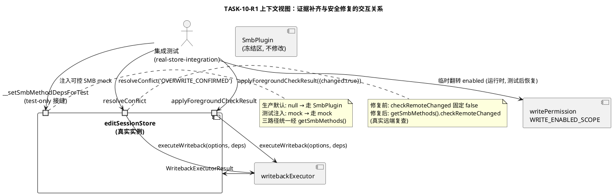
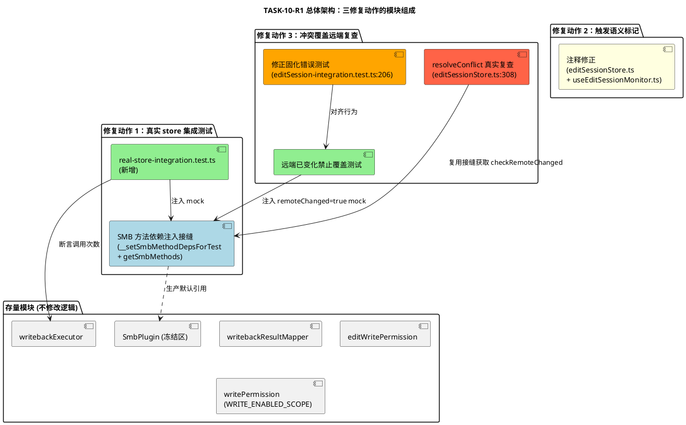
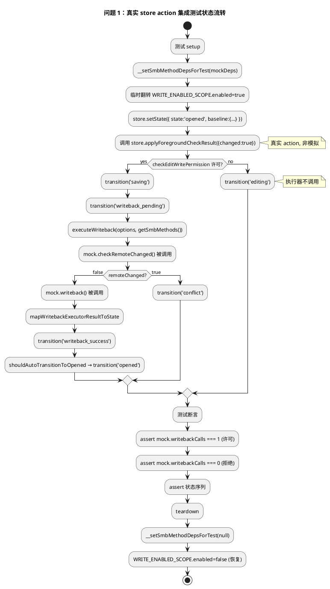
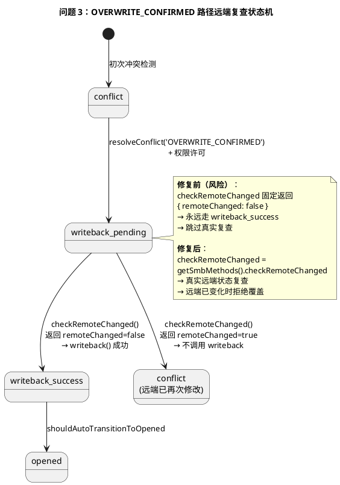
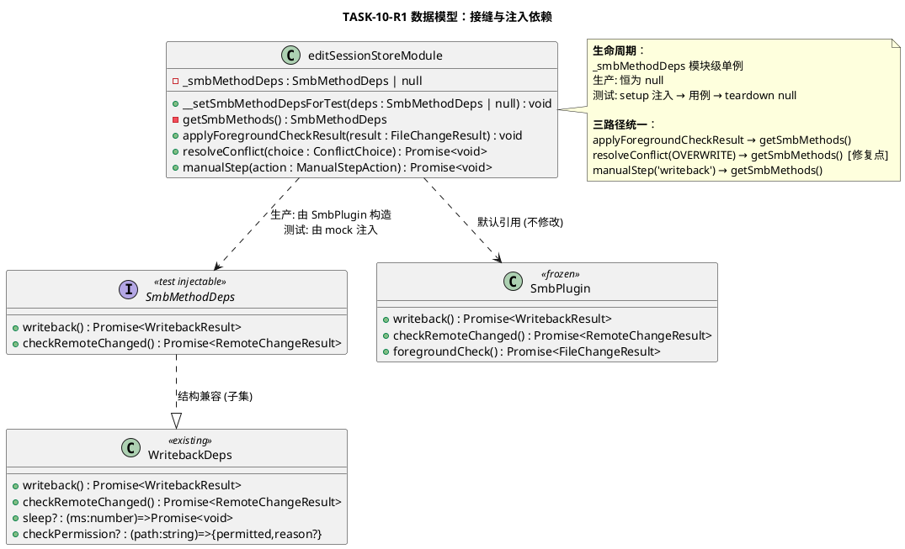
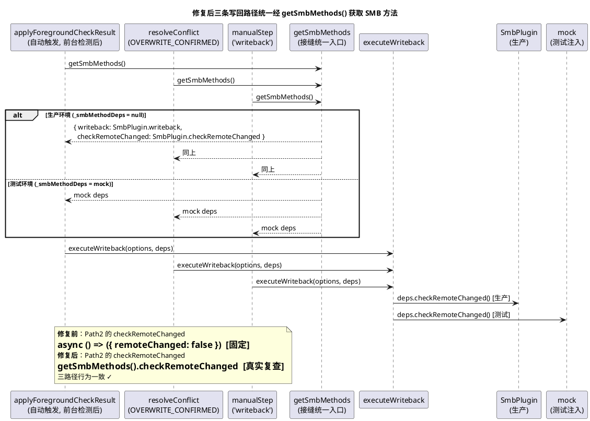
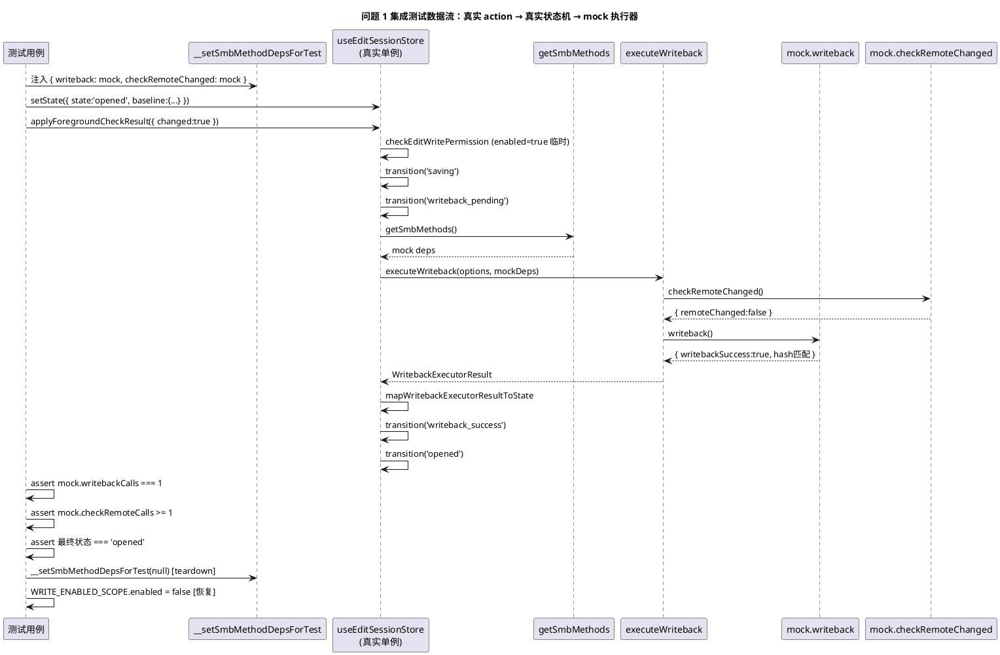
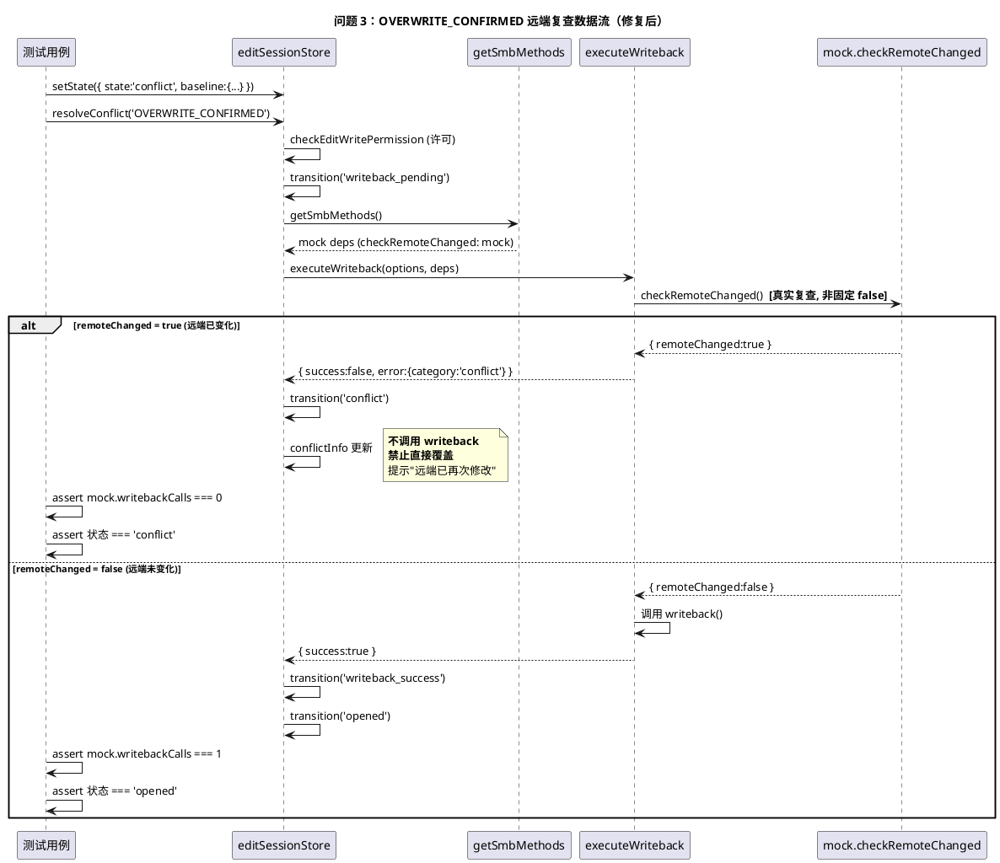

# TASK-10-R1 实现方案：写回链路证据补齐与冲突覆盖安全修复

**任务编号**：TASK-10-R1
**日期**：2026-10-29
**文档类型**：design.md（技术实现方案）
**基线提交**：`4493314b`（TASK-10 完成提交）
**与 TASK-10 关系**：不推翻 TASK-10 任何已通过验收的结论，仅对 PM 复核发现的三个证据缺口与一处安全风险做最小补齐。

---

# 一、需求与存量功能关系分析

## 1.1 需求功能与存量功能对比

### 1.1.1 已实现功能

下列功能在存量代码中已完整实现，TASK-10-R1 不修改其逻辑，仅补齐测试证据或精确化语义描述。

| 需求功能 | 存量功能 | 代码位置 | 匹配度 |
|---------|---------|---------|--------|
| 真实 `applyForegroundCheckResult` action 存在并实现状态机迁移 | `applyForegroundCheckResult`：opened/editing 态接收 `FileChangeResult`，权限许可时迁移 `opened→saving→writeback_pending` 并触发 `executeWriteback`，权限拒绝时迁移 `editing` | `src/state/editSessionStore.ts:165-206` | 100% |
| `executeWriteback` 支持依赖注入（writeback/checkRemoteChanged/sleep/checkPermission） | `executeWriteback(options, deps)` 纯函数编排，deps 全部可注入 | `src/state/writebackExecutor.ts:107-231` | 100% |
| 自动触发路径使用真实 `SmbPlugin.checkRemoteChanged()` | `applyForegroundCheckResult` 内 `checkRemoteChanged: () => SmbPlugin.checkRemoteChanged()` | `src/state/editSessionStore.ts:189` | 100% |
| `manualStep('writeback')` 路径使用真实 `SmbPlugin.checkRemoteChanged()` | manualStep 内 `checkRemoteChanged: () => SmbPlugin.checkRemoteChanged()` | `src/state/editSessionStore.ts:367` | 100% |
| 前台检测触发链路（appStateChange → foregroundCheck → applyForegroundCheckResult） | `useEditSessionMonitor` 中 `App.addListener('appStateChange')` → `SmbPlugin.foregroundCheck()` → `store.applyForegroundCheckResult(result)` | `src/ui/hooks/useEditSessionMonitor.ts:52-62` | 100% |
| `openFile` 内 appStateChange → checkLocalFileChanged → applyForegroundCheckResult | `openFile` 中监听 appStateChange，前台返回时 `SmbPlugin.checkLocalFileChanged()` → `applyForegroundCheckResult` | `src/state/editSessionStore.ts:147-158` | 100% |
| 状态机守卫拦截 saving/writeback_pending 态重复调用 | `applyForegroundCheckResult` 首行 `if (cur.state !== 'opened' && cur.state !== 'editing') return` | `src/state/editSessionStore.ts:167` | 100% |
| `WRITE_ENABLED_SCOPE.enabled = false`（安全初始状态） | `writePermission.ts` 中 `enabled: false as boolean` | `src/state/writePermission.ts:23-25` | 100% |
| 写回结果映射纯函数（success→writeback_success，conflict→conflict 等） | `mapWritebackExecutorResultToState` + `shouldAutoTransitionToOpened` | `src/state/writebackResultMapper.ts:33-69` | 100% |
| 权限拒绝时 executeWriteback 不调用任何 SMB 方法 | `executeWriteback` 第 124-131 行：perm 拒绝直接 return，不调用 deps | `src/state/writebackExecutor.ts:124-131` | 100% |

### 1.1.2 需要扩展的功能

| 需求功能 | 存量功能 | 差异说明 | 扩展方向 |
|---------|---------|---------|---------|
| 真实 store action 集成测试（直接调用 `applyForegroundCheckResult`） | 现有测试用 `simulateAutoTriggerFlow` 手动推进 `opened→saving→writeback_pending` 后直接调用 `executeWriteback`，未经过真实 store action | ① 输入差异：现有测试不调用真实 action，无法证明状态机真实迁移与执行器真实调用关系；② store 直接 `import SmbPlugin`（`editSessionStore.ts:11`），无依赖注入接缝，测试无法替换 SMB 方法 | 在 `editSessionStore.ts` 增加 test-only SMB 方法依赖注入接缝（`__setSmbMethodDepsForTest`），生产默认走 SmbPlugin；新增集成测试文件直接调用真实 action |
| 冲突覆盖路径远端状态复查（真实 `checkRemoteChanged`） | `resolveConflict('OVERWRITE_CONFIRMED')` 中 `checkRemoteChanged: async () => ({ remoteMtime: 0, baselineMtime: 0, remoteChanged: false })` 固定返回无冲突 | ① 业务逻辑差异：固定 `remoteChanged:false` 等价跳过冲突检查，与自动触发路径（第 189 行）和 manualStep 路径（第 367 行）行为不一致；② 安全风险：用户决策期间远端若被他人修改，覆盖将基于过期状态执行，违反数据安全红线 | 将第 308 行固定返回改为 `getSmbMethods().checkRemoteChanged`（即真实 `SmbPlugin.checkRemoteChanged()`），统一三条写回路径的冲突检测行为 |
| 触发语义精确标记 | 代码注释使用"WPS 保存时自动触发"等不精确表述，未明确"前台检测后"前提 | ① 语义差异：实际触发时机为应用回到前台时经 `foregroundCheck()` 拉取保存事件结果，非保存时即时触发；② 文档/注释与代码行为存在语义偏差 | 修正 `editSessionStore.ts`/`useEditSessionMonitor.ts` 相关注释为"前台检测后触发"，验收报告统一术语 |

### 1.1.3 需要新增的功能或接口

按业务模块分组：

**模块 A：真实 store action 集成测试（问题 1）**
- **A-1 SMB 方法依赖注入接缝**：`editSessionStore.ts` 新增 `__setSmbMethodDepsForTest(deps | null)` 与内部 `getSmbMethods()`。输入：`{ writeback, checkRemoteChanged } | null`；输出：void；核心逻辑：null 时走 SmbPlugin，非 null 时走注入 deps。依赖：无新依赖。
- **A-2 集成测试文件**：`test/editSession-real-store-integration.test.ts`。输入：可控 SMB mock + 可控 baseline；输出：断言状态迁移序列与执行器调用次数；核心逻辑：直接调用 `useEditSessionStore.getState().applyForegroundCheckResult({ changed: true })`，验证真实状态机迁移。依赖：`node:test`、`editSessionStore`、`writePermission`。

**模块 B：触发语义精确标记（问题 2）**
- **B-1 注释修正**：`editSessionStore.ts` 与 `useEditSessionMonitor.ts` 中涉及"自动触发"的注释统一标注"前台检测后触发（appStateChange + foregroundCheck）"。输入：无；输出：注释文本；核心逻辑：无逻辑变更，仅文档修正。依赖：无。

**模块 C：冲突覆盖路径远端状态复查（问题 3）**
- **C-1 resolveConflict 真实复查修复**：`editSessionStore.ts` 第 304-310 行 `checkRemoteChanged` 从固定返回改为 `getSmbMethods().checkRemoteChanged`。输入：无（复用接缝 A-1）；输出：真实远端复查结果；核心逻辑：与自动触发/manualStep 路径一致。依赖：接缝 A-1。
- **C-2 远端已变化禁止覆盖测试**：集成测试注入 `checkRemoteChanged` 返回 `remoteChanged=true`，调用 `resolveConflict('OVERWRITE_CONFIRMED')`，断言 `writeback` 调用 0 次、状态为 `conflict`。依赖：接缝 A-1、集成测试文件 A-2。
- **C-3 修正固化错误行为的存量测试**：`editSession-integration.test.ts:206-222` 现有测试"OVERWRITE_CONFIRMED 路径 → 跳过冲突检测 → 直接写回"固化了问题 3 的错误行为，须改为验证真实复查行为。

## 1.2 存量功能详细分析

### 1.2.1 `applyForegroundCheckResult`（editSessionStore.ts:165-206）

**接口契约**：
- 入参：`FileChangeResult`（含 `changed`、`saveAsDiscovered`、`saveAsFilePath` 等字段）
- 出参：void（异步副作用经状态迁移体现；写回在 fire-and-forget IIFE 中执行）
- 异常：IIFE 内 catch 调用 `applyError`，不向外抛
- 副作用：状态迁移、timeline 追加、可能触发 `executeWriteback`

**业务规则**：
1. 状态守卫：仅 `opened`/`editing` 态放行（第 167 行），其余态直接 return
2. saveAs 分支：`saveAsDiscovered=true` → 权限守卫 → `saveas_detected`
3. changed 分支：`changed=true` → `checkEditWritePermission` → permitted 时 `saving→writeback_pending→executeWriteback`；denied 时 `editing`
4. 权限判断绑定模块内 `checkEditWritePermission`（非注入），其内部依赖 `WRITE_ENABLED_SCOPE.enabled` 全局开关

**扩展点**：无显式扩展点。SMB 方法硬编码为 `() => SmbPlugin.writeback()` / `() => SmbPlugin.checkRemoteChanged()`（第 189 行），无注入接缝——这是问题 1 集成测试无法注入 mock 的根因。

**约束**：
- fire-and-forget IIFE（第 184 行 `void (async () => {...})()`）：调用方无法 await，测试须轮询/await 最终态
- 权限判断在 `executeWriteback` 调用前先行（第 179 行），与 executor 内 `checkPermission`（第 114 行）形成双层守卫

### 1.2.2 `resolveConflict('OVERWRITE_CONFIRMED')`（editSessionStore.ts:284-324）

**接口契约**：
- 入参：`ConflictChoice`（`OVERWRITE_CONFIRMED` 分支）
- 出参：`Promise<void>`
- 异常：try/catch 调用 `applyError`
- 副作用：状态迁移 `conflict→writeback_pending→(writeback_success|conflict|...)`

**业务规则**：
1. 清空 `conflictInfo`（第 285 行）
2. 权限守卫：`checkEditWritePermission` 拒绝 → `session_terminated`
3. baseline 存在性检查
4. `writeback_pending` → `executeWriteback`
5. **风险点**：第 308 行 `checkRemoteChanged: async () => ({ remoteMtime: 0, baselineMtime: 0, remoteChanged: false })` 固定返回无冲突，跳过真实远端复查

**扩展点**：与 `applyForegroundCheckResult` 相同——SMB 方法硬编码，且 `checkRemoteChanged` 为固定值（非 SmbPlugin 调用）。

**约束**：
- 与自动触发路径（第 189 行）、manualStep 路径（第 367 行）的 `checkRemoteChanged` 注入不一致——三路径冲突检测行为不统一，违反需求 5.3.1 规则 6
- `WRITE_ENABLED_SCOPE.enabled=false` 时权限守卫在第 293 行即拒绝，不进入第 304 行执行器调用

### 1.2.3 `useEditSessionMonitor`（useEditSessionMonitor.ts:39-83）

**接口契约**：
- 入参：`EditSessionMonitorOptions`（pollIntervalMs、onStateChange）
- 出参：`{ monitoring: boolean }`
- 副作用：注册 `appStateChange` 监听器 + setInterval 轮询

**业务规则**：
1. 仅 `opened`/`editing`（非只读）态激活监控（第 41 行）
2. appStateChange：`isActive=true` → `notifyAppStateChange` → `SmbPlugin.foregroundCheck()` → `applyForegroundCheckResult`（第 53-61 行）
3. 5s 轮询：`SmbPlugin.checkRemoteChanged()` → `applyRemoteCheckResult`（第 66-74 行，只读模式禁用）

**扩展点**：无。`SmbPlugin` 直接 import（第 11 行），符合 store 分级约束（hook 属 UI 层，但经 store action 中转写回；foregroundCheck/checkRemoteChanged 为检测调用，非写回）。

**约束**：
- `foregroundCheck` 失败时 `catch { /* 轮询失败不阻塞 */ }` 静默吞错（第 60 行）——不触发写回，用户无感知
- 应用在后台时 `appStateChange` 不触发（`isActive=false` 直接 return），证明"后台不触发"规则

### 1.2.4 现有测试 `simulateAutoTriggerFlow`（editSession-auto-trigger.test.ts:68-93）

**接口契约**：入参 `deps`+`options`；出参 `{ states, execSuccess }`。

**业务规则**：手动推进 `opened→saving→writeback_pending`，再调用 `executeWriteback`，再 `mapWritebackExecutorResultToState` 映射状态。

**约束（问题 1 根因）**：
- 不调用真实 `useEditSessionStore` 实例
- 不调用真实 `applyForegroundCheckResult` action
- 不经过真实状态机守卫（第 167 行）
- 无法证明 `executeWriteback` 由真实保存事件经真实 action 触发
- 仅证明 `executeWriteback` + `mapWritebackExecutorResultToState` 的编排逻辑，不证明 store action 与执行器的真实调用关系

---

# 二、增量设计方案

## 2.1 实现模型

### 2.1.1 上下文视图



**通信协议与调用频率**：
- 测试 → 接缝：每用例 1 次（setup 注入 + teardown 清除）
- 测试 → action：每用例 1-N 次（含守卫验证重复调用）
- action → executor：每次写回触发 1 次
- executor → mock：checkRemoteChanged 1+ 次，writeback 0-1 次

### 2.1.2 服务/组件总体架构



**模块划分与职责**：
- **接缝模块（Seam）**：editSessionStore 内新增，职责为提供可替换的 SMB 方法引用，统一三路径获取 writeback/checkRemoteChanged 的入口
- **集成测试模块（Test1/Test3）**：新增 `test/editSession-real-store-integration.test.ts`，职责为直接调用真实 store action，注入 mock，断言状态迁移与执行器调用关系
- **语义标记模块（Note）**：仅注释文本修正，无逻辑变更
- **修复模块（Fix3Code）**：resolveConflict 第 308 行改用 `getSmbMethods().checkRemoteChanged`

**配置项与取值策略**：
- `WRITE_ENABLED_SCOPE.enabled`：仓库默认值保持 `false`（约束 C-1）；集成测试在用例内临时翻转 `true` 测试许可路径，`afterEach` 恢复 `false`
- `_smbMethodDeps`（接缝内部状态）：生产 null，测试注入 mock，teardown 恢复 null

### 2.1.3 实现设计文档

#### 2.1.3.1 真实 store action 集成测试流程（问题 1）



#### 2.1.3.2 冲突覆盖远端复查状态机（问题 3）



#### 2.1.3.3 触发链路证明（问题 2）

```plantuml
@startuml
title 问题 2：保存事件 → store 完整调用链（证明无即时触发分支）

actor 用户
participant "WPS" as WPS
participant "FileObserver\n(Java 原生, 冻结区)" as FO
participant "WpsSaveDetector\n(Java, 冻结区)" as Detector
participant "PAD2 应用\n(Capacitor App)" as App
participant "useEditSessionMonitor" as Hook
participant "SmbPlugin\n(TS, 冻结区)" as Smb
participant "editSessionStore" as Store

用户 -> WPS : 编辑并保存文件
WPS -> FO : MODIFY/CLOSE_WRITE 事件
FO -> Detector : checkChange() 三因子判定
Detector --> Detector : 缓存 SAVE_SUCCESS 结果

note over App, Hook : **应用仍在后台**\nappStateChange 不触发\nforegroundCheck 不调用\n**不立即触发写回**

用户 -> App : 返回 PAD2 (isActive=true)
App -> Hook : appStateChange{isActive:true}
Hook -> Store : notifyAppStateChange(true)
Hook -> Smb : foregroundCheck()
Smb -> Detector : foregroundCheck() 拉取缓存结果
Detector --> Smb : FileChangeResult{changed:true}
Smb --> Hook : FileChangeResult
Hook -> Store : applyForegroundCheckResult({changed:true})
Store -> Store : opened→saving→writeback_pending
Store -> Store : executeWriteback\n**（前台检测后触发）**

note bottom of Store
  **结论**：不存在 "WPS 保存时即时触发" 分支。
  触发时机 = 应用回到前台 + foregroundCheck 检测到 changed。
  语义标记 = "前台检测后触发"。
end note

@enduml
```

## 2.2 接口设计

### 2.2.1 总体设计

| 接口分类 | 接口名 | 所在模块 | 稳定性等级 | 变更类型 |
|---------|--------|---------|-----------|---------|
| test-only 接缝 | `__setSmbMethodDepsForTest` | editSessionStore | 实验（仅测试） | 新增 |
| 内部获取函数 | `getSmbMethods` | editSessionStore（模块私有） | 稳定（内部） | 新增 |
| 真实 store action | `applyForegroundCheckResult` | editSessionStore | 稳定 | 不变（仅被测试调用） |
| 冲突解决 action | `resolveConflict` | editSessionStore | 稳定 | 修改（第 308 行 checkRemoteChanged 注入） |
| 集成测试入口 | `node:test` describe/test | real-store-integration.test | 实验（测试） | 新增 |

**接口变更策略**：
- `__setSmbMethodDepsForTest` 命名以 `__` 前缀标记 test-only，生产代码禁止调用
- `getSmbMethods` 为模块私有函数（不 export），仅 store 内部三路径调用
- `resolveConflict` 公开签名不变，仅内部 deps 注入源改变（行为变更：从固定无冲突改为真实复查）

### 2.2.2 接口清单

#### 2.2.2.1 `__setSmbMethodDepsForTest`（test-only SMB 方法依赖注入接缝）

**接口签名**：
```typescript
interface SmbMethodDeps {
  writeback: () => Promise<WritebackResult>;
  checkRemoteChanged: () => Promise<RemoteChangeResult>;
}

/** @internal 仅供测试注入 SMB 方法依赖，生产代码禁止调用 */
function __setSmbMethodDepsForTest(deps: SmbMethodDeps | null): void;
```

**业务说明**：注入可控的 SMB writeback/checkRemoteChanged 方法，供集成测试替换真实 SmbPlugin。传 null 恢复生产默认（走 SmbPlugin）。

**前置条件**：仅测试环境调用；调用前 store 应处于稳定态。

**后置条件**：后续 store 内部 `getSmbMethods()` 返回注入的 deps（非 null 时）或 SmbPlugin 方法（null 时）。

**异常映射**：无（纯赋值）。

**调用示例**：
```typescript
// 测试 setup
__setSmbMethodDepsForTest({
  writeback: async () => ({ writebackSuccess: true, localHash: 'h', verifyHash: 'h', remoteMtimeBefore: 1000, remoteMtimeAfter: 2000 }),
  checkRemoteChanged: async () => ({ remoteMtime: 1000, baselineMtime: 1000, remoteChanged: false }),
});
// ... 测试用例 ...
// teardown
__setSmbMethodDepsForTest(null);
```

#### 2.2.2.2 `getSmbMethods`（模块私有 SMB 方法获取函数）

**接口签名**：
```typescript
function getSmbMethods(): SmbMethodDeps;
```

**业务说明**：返回当前生效的 SMB 方法依赖。生产环境返回 `{ writeback: () => SmbPlugin.writeback(), checkRemoteChanged: () => SmbPlugin.checkRemoteChanged() }`；测试环境（接缝已注入）返回注入的 mock。

**前置条件**：无。

**后置条件**：返回值非 null。

**调用方**：`applyForegroundCheckResult`（第 189 行）、`resolveConflict('OVERWRITE_CONFIRMED')`（第 308 行，修复后）、`manualStep('writeback')`（第 367 行）三路径统一经此函数获取 SMB 方法。

#### 2.2.2.3 `resolveConflict`（修改后行为）

**接口签名**：不变（`async resolveConflict(choice: ConflictChoice): Promise<void>`）。

**业务说明（变更部分）**：`OVERWRITE_CONFIRMED` 分支中传给 `executeWriteback` 的 `checkRemoteChanged` 从固定 `async () => ({ remoteMtime: 0, baselineMtime: 0, remoteChanged: false })` 改为 `getSmbMethods().checkRemoteChanged`，即真实 `SmbPlugin.checkRemoteChanged()`（生产）或注入 mock（测试）。

**前置条件**：state 为 `conflict`，baseline 存在，权限许可。

**后置条件（变更部分）**：
- 远端未变化（`remoteChanged=false`）→ 调用 writeback → `writeback_success` → `opened`
- 远端已变化（`remoteChanged=true`）→ **不调用 writeback** → 状态为 `conflict`，提示"远端文件已再次修改，请重新确认"

**异常映射**：checkRemoteChanged 抛异常 → executeWriteback 内分类为 `network_error`（retryable）或 `unknown` → `network_interrupted`/`writeback_failed`。

## 2.3 数据模型

### 2.3.1 设计目标

1. **支持的业务场景**：真实 store action 集成测试（问题 1）、冲突覆盖远端复查（问题 3）、触发语义证明（问题 2）
2. **性能目标**：集成测试单次执行 < 2000ms；远端复查不引入同步阻塞（resolveConflict 保持 async）
3. **容量目标**：无新增长期存储
4. **兼容策略**：接缝默认 null，生产行为零变更；`WRITE_ENABLED_SCOPE.enabled` 仓库默认值保持 false

### 2.3.2 模型实现



**对象创建与销毁策略**：
- `_smbMethodDeps`：模块级变量，随模块加载初始化为 null，不显式销毁
- 测试 mock：由测试用例创建，teardown 后置 null 释放引用

**持久化策略**：无（接缝为内存态，不持久化）。
---

# 三、模块变更清单

| 序号 | 文件路径 | 变更类型 | 变更内容摘要 | 约束符合性 |
|------|---------|---------|-------------|-----------|
| M-1 | `src/state/editSessionStore.ts` | 修改（新增接缝 + 修复 + 注释） | ① 新增 `SmbMethodDeps` 接口、`_smbMethodDeps` 模块变量、`__setSmbMethodDepsForTest` 导出函数、`getSmbMethods` 私有函数；② 第 189 行（applyForegroundCheckResult）、第 367 行（manualStep）改用 `getSmbMethods()` 获取 writeback/checkRemoteChanged；③ **第 308 行（resolveConflict OVERWRITE_CONFIRMED）从固定 `remoteChanged:false` 改为 `getSmbMethods().checkRemoteChanged`**（问题 3 核心修复）；④ 相关注释统一为"前台检测后触发" | 非冻结区；store 分级不变；改动行数可控 |
| M-2 | `src/ui/hooks/useEditSessionMonitor.ts` | 修改（仅注释） | appStateChange 监听相关注释明确标注"前台检测后触发（appStateChange + foregroundCheck）"，消除"WPS 保存时自动触发"不精确表述 | 零逻辑变更；UI 层不直接 import 写回插件（经 store action 中转） |
| M-3 | `test/editSession-real-store-integration.test.ts` | 新增 | 真实 store action 集成测试：① 直接调用 `useEditSessionStore.getState().applyForegroundCheckResult`；② 注入可控 SMB mock 经 `__setSmbMethodDepsForTest`；③ 断言状态迁移序列与执行器调用次数；④ 覆盖许可/拒绝/守卫/冲突覆盖远端复查场景 | `node:test` 零新增依赖；不触碰真实 SmbPlugin |
| M-4 | `test/editSession-integration.test.ts` | 修改 | 第 206-222 行"OVERWRITE_CONFIRMED 路径 → 跳过冲突检测 → 直接写回"测试固化了问题 3 错误行为，须改为验证真实复查：remoteChanged=true 时不调用 writeback、remoteChanged=false 时调用 writeback | 对齐修复后行为；不新增依赖 |
| M-5 | `docs/task-10-r1-verification-report.md` | 新增（验收阶段产出） | TASK-10-R1 验收报告，统一使用"前台检测后触发"术语，记录三项修复证据 | 文档，非代码 |

**冻结区零变更核验**：

| 冻结区路径 | 变更状态 |
|-----------|---------|
| `src/adapter/smb/SmbPlugin.ts` | 零变更（仅被 store 默认引用，不修改） |
| `src/core/` | 零变更 |
| `android/app/src/main/java/com/pad2/filemanager/smb/` | 零变更 |
| `package.json` | 零新增 npm 依赖 |
| `src/main.tsx` | 零变更（本任务不涉及入口改动） |

---

# 四、数据流 / 调用链图

## 4.1 修复后三路径统一调用链



## 4.2 集成测试数据流（问题 1）



## 4.3 冲突覆盖远端复查数据流（问题 3）



---

# 五、与 TASK-10 的关系（不推翻，仅补齐）

## 5.1 保持有效（TASK-10 已通过验收的结论）

| TASK-10 结论 | 状态 | TASK-10-R1 影响 |
|-------------|------|----------------|
| GAP-1 修复（`changed → saving` 状态迁移） | 保持有效 | 不修改该逻辑；集成测试进一步证实真实 action 可达 saving |
| GAP-2 修复（saving 态自动触发 writeback） | 保持有效 | 不修改触发逻辑；集成测试补齐"真实 action 触发执行器"证据（问题 1） |
| GAP-3 修复（幂等控制 + writeback_success → opened 自动回迁） | 保持有效 | 不修改；集成测试覆盖守卫拦截 |
| 34 项自动触发测试 | 保持有效 | 新增测试为补充而非替代；`simulateAutoTriggerFlow` 保留 |
| 触发逻辑位于 `applyForegroundCheckResult` | 保持有效 | 仅精确化语义描述（问题 2），不改逻辑 |

## 5.2 本任务补齐（新增）

| 修复动作 | 补齐内容 | 对应问题 |
|---------|---------|---------|
| 动作 1 | 新增真实 store action 集成测试，证明 `executeWriteback` 由真实 `applyForegroundCheckResult` 触发 | 问题 1 |
| 动作 2 | 精确化触发语义为"前台检测后触发"，修正注释/文档不精确表述 | 问题 2 |
| 动作 3 | 修复 `resolveConflict('OVERWRITE_CONFIRMED')` 固定 `remoteChanged:false`，改为真实远端复查 | 问题 3 |

## 5.3 不涉及

- 不重开设计评审，不推翻 TASK-10 设计冻结
- 不修改 `WpsSaveDetector.java`（冻结区）
- 不执行真实服务器验收（须 FRZ-EX 授权）
- 不生成 tasks.md（由 spec-task-agent 处理）
- 不将 `WRITE_ENABLED_SCOPE.enabled` 仓库默认值改为 true

---

# 六、风险与缓解措施

| 风险编号 | 风险描述 | 等级 | 缓解措施 | 残余风险 |
|---------|---------|------|---------|---------|
| R-01 | test-only 接缝 `__setSmbMethodDepsForTest` 被生产代码误调用 | 中 | ① `__` 前缀命名约定标记 internal；② JSDoc 注释"生产代码禁止调用"；③ 代码审查检查生产代码无调用；④ 接缝默认 null，生产行为零变更 | 低（命名 + 审查双重防线） |
| R-02 | 集成测试临时翻转 `WRITE_ENABLED_SCOPE.enabled=true` 若 teardown 失败导致全局状态泄漏 | 中 | ① 每用例 `afterEach` 恢复 `false`；② 用例内 try/finally 保证恢复；③ 独立测试文件隔离；④ 仓库默认值仍为 false（约束 C-1） | 低（finally 兜底） |
| R-03 | fire-and-forget IIFE（`applyForegroundCheckResult` 第 184 行）使测试无法 await 最终态 | 中 | ① 测试采用轮询/微任务刷新等待最终态（`await new Promise(r => setTimeout(r, 0))` 多次）；② 或断言中间态 `writeback_pending` 后再轮询；③ 单次执行 < 2000ms 约束 | 低（mock 即时返回，无真实异步） |
| R-04 | 修复 `resolveConflict` 后，存量测试 `editSession-integration.test.ts:206-222` 固化的"跳过冲突检测"行为会失败 | 高 | ① M-4 同步修正该测试为验证真实复查行为；② 修复与测试修正同提交 | 低（同提交消除） |
| R-05 | 真实远端复查引入 TOCTOU 竞态（复查通过后 writeback 执行期间远端再变） | 低 | ① writeback 后 SHA-256 校验仍执行（executor 第 163 行）；② 此为固有竞态，依赖服务器端原子性；③ 不在本任务范围（需求 5.3.3 异常场景 3 已声明） | 固有（依赖服务器端） |
| R-06 | 接缝引入后三路径获取 SMB 方式的统一性若被后续修改破坏 | 低 | ① 三路径均经 `getSmbMethods()` 单一入口；② 集成测试覆盖三路径一致性（AC-3.5）；③ 代码审查 | 低 |
| R-07 | `node:test` 在 Node.js v24 环境外的兼容性 | 低 | ① 约束明确 Node.js v24 内置；② 零新增测试依赖；③ 现有测试已用 `node:test` 验证可行 | 低 |

---

# 七、验收标准映射（需求 → 设计决策 → 验收方法）

## 7.1 问题 1 验收映射

| 验收编号 | 需求验收条件 | 设计决策 | 验收方法 |
|---------|-------------|---------|---------|
| AC-1.1 | 集成测试直接调用真实 `store.applyForegroundCheckResult({changed:true})` | M-3 测试文件直接调用 `useEditSessionStore.getState().applyForegroundCheckResult` | 测试用例断言状态经真实状态机迁移至 `saving→writeback_pending` |
| AC-1.2 | 权限许可 + changed=true → executeWriteback 调用 1 次 | M-1 接缝 + M-3 测试临时翻转 enabled 注入 mock | 断言 `mock.writebackCalls === 1`、`mock.checkRemoteCalls >= 1`、最终 `writeback_success`/`opened` |
| AC-1.3 | 权限拒绝（enabled=false）+ changed=true → executeWriteback 调用 0 次 | M-3 测试默认 enabled=false 路径 | 断言 `mock.writebackCalls === 0`、状态为 `editing`、不经过 saving |
| AC-1.4 | saving/writeback_pending 态重复调用被守卫拦截 | M-3 测试在 saving 态再次调用 action | 断言状态不重复迁移、执行器不重复调用（守卫第 167 行） |
| AC-1.5 | 集成测试通过依赖注入提供 mock，不发起真实 SMB 请求 | M-1 接缝 `__setSmbMethodDepsForTest` 注入 mock | 测试不 import 真实 SmbPlugin 实现；mock 计数器验证 |

## 7.2 问题 2 验收映射

| 验收编号 | 需求验收条件 | 设计决策 | 验收方法 |
|---------|-------------|---------|---------|
| AC-2.1 | 审查 appStateChange 监听链路，触发点为前台返回时 foregroundCheck | M-2 注释精确标记；§4.1 调用链图证明 | 代码审查 `useEditSessionMonitor.ts:52-62` + `editSessionStore.ts:147-158` |
| AC-2.2 | 全代码库与文档搜索"自动触发"须标注"前台检测后" | M-1/M-2 注释修正 | grep 搜索"自动触发"，相关描述须含"前台检测后"或"appStateChange + foregroundCheck" |
| AC-2.3 | 应用在后台 + WPS 保存 → 不触发写回 | §2.1.3.3 链路图证明 appStateChange 仅 isActive=true 时触发 | 代码审查：`if (!isActive) return`（monitor:54 / store:148） |
| AC-2.4 | 应用回到前台 + changed=true + permitted → 触发写回 | 现有逻辑不变（100% 匹配） | 集成测试 AC-1.2 同时证实 |
| AC-2.5 | 链路图记录 FileObserver→WpsSaveDetector→SmbPlugin.foregroundCheck→appStateChange→applyForegroundCheckResult | §2.1.3.3 完整链路图 | 文档审查 |

## 7.3 问题 3 验收映射

| 验收编号 | 需求验收条件 | 设计决策 | 验收方法 |
|---------|-------------|---------|---------|
| AC-3.1 | resolveConflict 的 checkRemoteChanged 为真实 SmbPlugin.checkRemoteChanged | M-1 第 308 行改用 `getSmbMethods().checkRemoteChanged` | 代码审查 + grep 确认无固定 `remoteChanged:false` 残留 |
| AC-3.2 | OVERWRITE_CONFIRMED + remoteChanged=true → 不调用 writeback，状态 conflict | M-1 修复 + M-3 测试 | 断言 `mock.writebackCalls === 0`、状态 `conflict` |
| AC-3.3 | OVERWRITE_CONFIRMED + remoteChanged=false → 调用 writeback → writeback_success→opened | M-3 测试 | 断言 `mock.writebackCalls === 1`、状态 `opened` |
| AC-3.4 | 新增远端已变化禁止覆盖测试 | M-3 测试用例 | 测试 PASS |
| AC-3.5 | 三路径 checkRemoteChanged 一致性 | M-1 三路径统一经 `getSmbMethods()` | 代码审查三路径 + 集成测试覆盖 |

## 7.4 全局验收映射

| 验收编号 | 需求验收条件 | 设计决策 | 验收方法 |
|---------|-------------|---------|---------|
| AC-G.1 | `npx tsc --noEmit` 零错误 | 接缝类型严格（SmbMethodDeps 接口） | 执行 tsc |
| AC-G.2 | `check-design-tokens.mjs` 无硬编码色值 | 本任务不涉及 UI 样式 | 执行脚本 |
| AC-G.3 | `check-contrast.mjs` 12 组合 ≥ 4.5:1 | 本任务不涉及 UI 样式 | 执行脚本 |
| AC-G.4 | 全部测试全 PASS | M-3 新增 + M-4 修正 | `node --test` 全绿 |
| AC-G.5 | 冻结区零变更 | §三冻结区核验表 | `git diff --stat` 零输出 |
| AC-G.6 | WRITE_ENABLED_SCOPE.enabled 保持 false | 仓库默认值不变；测试临时翻转后恢复 | 代码审查 + grep 确认 `enabled: false` |
| AC-G.7 | src/main.tsx 改动 ≤ 3 行 | 本任务不涉及 main.tsx | `git diff` 零行 |
| AC-G.8 | package.json 零新增依赖 | M-3 用 node:test 内置 | `git diff package.json` 零输出 |

---

# 八、实现顺序建议

1. **M-1 接缝 + 修复**：在 `editSessionStore.ts` 新增 `SmbMethodDeps`/`__setSmbMethodDepsForTest`/`getSmbMethods`，三路径改用 `getSmbMethods()`，第 308 行修复为真实复查，注释精确化。
2. **M-2 注释**：`useEditSessionMonitor.ts` 注释精确化"前台检测后触发"。
3. **M-3 集成测试**：新增 `test/editSession-real-store-integration.test.ts`，覆盖问题 1（AC-1.1~1.5）与问题 3（AC-3.2~3.4）。
4. **M-4 修正存量测试**：`editSession-integration.test.ts:206-222` 改为验证真实复查行为。
5. **静态检查**：`npx tsc --noEmit` + `check-design-tokens.mjs` + `check-contrast.mjs` 全绿。
6. **全量测试**：`node --test` 全 PASS。
7. **M-5 验收报告**：产出 `docs/task-10-r1-verification-report.md`，统一"前台检测后触发"术语。

---

# 九、术语对照

| 术语 | 定义 | 来源 |
|------|------|------|
| 前台检测后触发 | 应用从后台回到前台时经 `foregroundCheck()` 拉取保存事件结果，检测到 changed=true 后触发写回 | spec.md §2 |
| 真实 store action 集成测试 | 直接调用 `useEditSessionStore` 真实 action，通过依赖注入提供可控 mock，验证真实状态机迁移 | spec.md §2 |
| 远端状态复查 | 执行覆盖前调用真实 `SmbPlugin.checkRemoteChanged()` 获取远端当前状态，非固定 `remoteChanged:false` | spec.md §2 |
| 固定无冲突结果 | `async () => ({ remoteMtime:0, baselineMtime:0, remoteChanged:false })`，问题 3 风险源 | spec.md §2 |
| SMB 方法依赖注入接缝 | `__setSmbMethodDepsForTest` + `getSmbMethods`，生产默认走 SmbPlugin，测试注入 mock | 本设计 §2.2.2 |