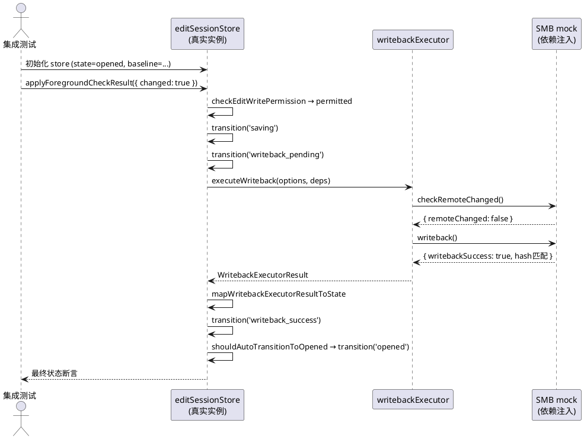
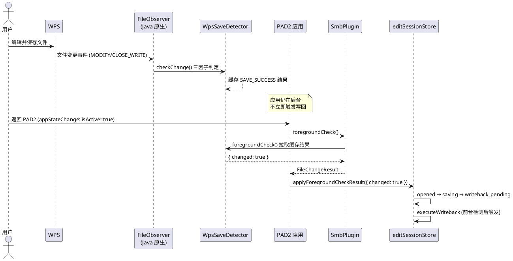
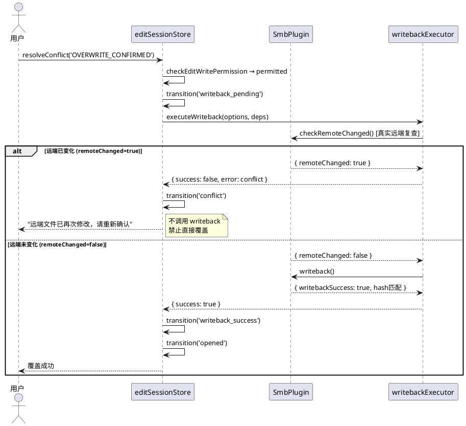

# TASK-10-R1 需求规格：写回链路证据补齐与冲突覆盖安全修复

**任务编号**：TASK-10-R1
**日期**：2026-10-29
**基线提交**：`4493314bcaa24506759de32c3434fca7c009a5af`（TASK-10 完成提交）
**PM 指令来源**：TASK-10 静态复核后三个补齐问题
**与 TASK-10 关系**：本任务不推翻 TASK-10 已通过验收的任何结论，仅对 PM 复核发现的三个证据缺口与安全风险做最小补齐。TASK-10 的 GAP-1/GAP-2/GAP-3 修复结论保持有效。

---

# **1. 组件定位**

## **1.1 核心职责**
本组件负责对 TASK-10 写回自动触发链路补齐三项证据与一处安全修复：真实 store 集成测试覆盖、触发语义精确标记、冲突覆盖路径远端状态复查。

## **1.2 核心输入**
1. PM 下达的三个修复指令（问题 1/2/3）
2. 真实 `editSessionStore.applyForegroundCheckResult` action 的调用（集成测试注入）
3. 可控的保存检测结果 `FileChangeResult`（测试注入）
4. 可控的 SMB 依赖 `WritebackDeps`（测试注入，含 writeback/checkRemoteChanged）
5. 用户在 conflict 态选择 `OVERWRITE_CONFIRMED` 的决策信号
6. 真实远端状态复查结果 `RemoteChangeResult`

## **1.3 核心输出**
1. 新增真实 store action 集成测试（断言执行器被调用一次或被权限拒绝）
2. 触发语义精确标记（代码注释与文档统一为"前台检测后触发"）
3. 冲突覆盖路径安全修复（基于真实远端状态复查）
4. 远端已变化时禁止直接覆盖的测试
5. TASK-10-R1 验收报告

## **1.4 职责边界**
本组件不负责以下事项：
- 不重新设计写回链路架构（TASK-10 已冻结设计）
- 不修改冻结区（`src/adapter/smb/SmbPlugin.ts`、`src/core/`、`android/.../smb/`）
- 不将 `WRITE_ENABLED_SCOPE.enabled` 改为 true
- 不执行真实服务器验收（须 FRZ-EX 授权）
- 不生成 design.md 或 tasks.md（由其他 agent 处理）
- 不重开设计评审，不推翻 TASK-10 任何已通过结论

---

# **2. 领域术语**

**前台检测后触发**
: 指写回自动触发的实际时机——应用从后台回到前台时，经 `SmbPlugin.foregroundCheck()` 拉取 FileObserver 收集的保存事件结果，检测到 `changed=true` 后触发写回。区别于"WPS 保存时立即触发"（当前架构不存在此路径）。

**真实 store action 集成测试**
: 指直接调用 `useEditSessionStore` 的真实 action（如 `applyForegroundCheckResult`），通过依赖注入提供可控的 SMB mock，验证状态机真实迁移与执行器真实调用关系的测试。区别于 `simulateAutoTriggerFlow` 这类手动推进状态的模拟流程。

**远端状态复查**
: 指在执行覆盖写回前，调用真实的 `SmbPlugin.checkRemoteChanged()` 获取当前远端文件修改时间与基线的差异，据此判断远端是否已变化。区别于使用固定的 `remoteChanged: false` 跳过冲突检查。

**OVERWRITE_CONFIRMED**
: 用户在 conflict 态显式选择覆盖远端的决策信号。选择后系统须基于真实远端状态复查决定是否执行覆盖，而非无条件跳过冲突检查。

**固定无冲突结果**
: 当前 `resolveConflict('OVERWRITE_CONFIRMED')` 中传入执行器的 `checkRemoteChanged: async () => ({ remoteMtime: 0, baselineMtime: 0, remoteChanged: false })`。该结果恒为"无冲突"，等价于跳过冲突检查，是问题 3 的风险源。

---

# **3. 角色与边界**

## **3.1 核心角色**
- **PM**：下达三个修复指令，静态复核验收证据，裁定是否通过。
- **开发**：执行三项修复动作，提交代码与测试证据。
- **独立复核人**：在 PM 初步裁定后执行独立复核，确认证据链完整。

## **3.2 外部系统**
- **editSessionStore**：被集成测试直接调用的真实 store，提供 `applyForegroundCheckResult`/`resolveConflict` 等 action。
- **writebackExecutor**：写回执行器，经依赖注入接收可控的 SMB mock，编排权限→冲突→写回→校验→重试。
- **SmbPlugin**：SMB 适配器（冻结区），集成测试通过依赖注入替换为 mock，不直接调用真实实现。
- **WpsSaveDetector（原生 Java）**：FileObserver 三层监听 + 三因子判定，收集保存事件；TS 层经 `foregroundCheck()` 拉取结果，不直接订阅。

## **3.3 交互上下文**

```plantuml
@startuml
actor PM
actor 开发
actor "独立复核人" as Reviewer

component "TASK-10-R1\n证据补齐与安全修复" as R1 {
  component "真实 store 集成测试" as T1
  component "触发语义标记" as T2
  component "冲突覆盖远端复查" as T3
}

store "editSessionStore" as Store
component "writebackExecutor" as Exec
component "SmbPlugin (mock)" as MockSmb

PM --> R1 : 下达三个修复指令
开发 --> R1 : 执行修复
Reviewer --> R1 : 独立复核

T1 --> Store : 调用真实 action
T1 --> Exec : 断言调用次数
T1 --> MockSmb : 注入可控依赖

T3 --> Store : resolveConflict(OVERWRITE_CONFIRMED)
T3 --> MockSmb : 真实 checkRemoteChanged 复查

@enduml
```

---

# **4. DFX约束**

## **4.1 性能**
1. 新增集成测试单次执行须在 2000ms 内完成（含 store action 异步等待）。
2. 远端状态复查不引入额外同步阻塞——`resolveConflict` 保持 async 签名，复查在 await 中进行。

## **4.2 可靠性**
1. 冲突覆盖路径须保证：远端已变化时绝不执行覆盖写回（数据安全红线）。
2. 集成测试须可重复执行，结果稳定（无 flaky test）。
3. 触发语义标记须与代码实际行为一致，不得存在文档与代码的语义偏差。

## **4.3 安全性**
1. `WRITE_ENABLED_SCOPE.enabled` 须保持 `false`（安全初始状态）。
2. 冲突覆盖路径须基于真实远端状态，禁止使用固定 `remoteChanged: false` 代替真实复查。
3. 集成测试须验证权限拒绝路径：`enabled=false` 时执行器不被调用，状态转为 `editing`。
4. 冻结区零变更：`src/adapter/smb/SmbPlugin.ts`、`src/core/`、`android/.../smb/` 须全部零变更。

## **4.4 可维护性**
1. 触发语义须在代码注释与验收报告中统一使用"前台检测后触发"，不得使用"WPS 保存时自动触发"。
2. 新增测试须有清晰的 describe/test 命名，可追溯至对应的修复动作（问题 1/2/3）。
3. 三项静态检查替代 lint：`npx tsc --noEmit` + `node scripts/check-design-tokens.mjs` + `node scripts/check-contrast.mjs` 须全绿。

## **4.5 兼容性**
1. `src/main.tsx` 改动限 3 行内（超限逻辑须抽独立模块）。
2. `package.json` 零新增 npm 依赖。
3. 单元测试使用 `node:test`（Node.js v24 内置），零新增测试依赖。
4. store 分级不变：UI 层不得直接 import SmbPlugin/UpdatePlugin，须经 store 中转。

---

# **5. 核心能力**

## **5.1 真实 store action 集成测试覆盖（问题 1）**

### **5.1.1 业务规则**

1. **真实 action 调用规则**：集成测试须直接调用真实的 `useEditSessionStore` 实例的 `applyForegroundCheckResult` action，不得使用 `simulateAutoTriggerFlow` 这类手动推进状态的模拟流程。
   a. 验收条件：[集成测试中存在直接调用 `store.applyForegroundCheckResult({ changed: true, ... })` 的用例] → [状态经真实状态机迁移至 `saving` → `writeback_pending`]

2. **执行器调用断言规则**：当权限许可且检测到 `changed=true` 时，集成测试须断言 `executeWriteback` 被调用恰好一次。
   a. 验收条件：[注入可控 SMB mock，调用 `applyForegroundCheckResult({ changed: true })`，权限许可] → [mock.writeback 调用次数 === 1，mock.checkRemoteChanged 调用次数 >= 1，最终状态为 `writeback_success` 或 `opened`]

3. **权限拒绝断言规则**：当权限拒绝（`enabled=false`）且检测到 `changed=true` 时，集成测试须断言 `executeWriteback` 未被调用，状态转为 `editing`。
   a. 验收条件：[调用 `applyForegroundCheckResult({ changed: true })`，`WRITE_ENABLED_SCOPE.enabled === false`] → [mock.writeback 调用次数 === 0，状态为 `editing`，不经过 `saving`/`writeback_pending`]

4. **依赖注入规则**：集成测试须通过依赖注入提供可控的保存检测与 SMB 依赖，不触碰真实 `SmbPlugin` 实现。
   a. 验收条件：[集成测试运行] → [不发起任何真实 SMB 网络请求，所有 SMB 方法由 mock 提供]

5. **状态机守卫验证规则**：集成测试须验证 `saving`/`writeback_pending` 态下重复调用 `applyForegroundCheckResult` 被状态机守卫拦截。
   a. 验收条件：[状态为 `saving` 或 `writeback_pending` 时再次调用 `applyForegroundCheckResult`] → [状态不重复迁移，执行器不重复调用]

6. **禁止项**：禁止用 `simulateAutoTriggerFlow` 替代真实 store action 测试作为问题 1 的唯一证据。
   a. 验收条件：[问题 1 验收] → [须存在至少一组直接调用真实 `applyForegroundCheckResult` 的集成测试用例]

### **5.1.2 交互流程**



### **5.1.3 异常场景**

1. **store 初始化失败**
   a. 触发条件：集成测试未正确设置 `baseline` 即调用 `applyForegroundCheckResult`
   b. 系统行为：`applyForegroundCheckResult` 中 `if (!baseline) return` 提前退出
   c. 用户感知：测试断言失败——状态未迁移，执行器未调用

2. **mock 注入不完整**
   a. 触发条件：依赖注入缺少 `writeback` 或 `checkRemoteChanged`
   b. 系统行为：`executeWriteback` 调用时抛 TypeError
   c. 用户感知：测试抛异常，错误经 `applyError` 回流

3. **异步竞态**
   a. 触发条件：fire-and-forget 异步 IIFE 未完成时测试即读取状态
   b. 系统行为：测试读到中间态（`writeback_pending`）
   c. 用户感知：测试须使用 await/轮询等待最终态，或断言中间态

---

## **5.2 保存事件触发语义精确标记（问题 2）**

### **5.2.1 业务规则**

1. **触发时机规则**：写回自动触发的实际时机为"应用从后台回到前台时经 `foregroundCheck()` 拉取保存事件结果并检测到 `changed=true`"，而非"WPS 保存时立即触发"。
   a. 验收条件：[审查 `useEditSessionMonitor.ts` 与 `editSessionStore.ts` 的 `appStateChange` 监听链路] → [确认触发点为 `App.addListener('appStateChange', ...)` 内的 `SmbPlugin.foregroundCheck()` / `checkLocalFileChanged()` 调用]

2. **语义标记规则**：代码注释、验收报告、需求文档须统一使用"前台检测后触发"描述自动触发时机，禁止使用"WPS 保存时自动触发"这一不精确表述。
   a. 验收条件：[全代码库与文档搜索"自动触发"] → [相关注释/描述须明确标注触发条件为"应用回到前台 + foregroundCheck 检测到 changed"]

3. **链路证明规则**：须查明并记录 FileObserver 事件最终如何调用 store 的完整链路，证明当前不存在 WPS 保存时立即触发的路径。
   a. 验收条件：[链路图展示] → [FileObserver(Java) → WpsSaveDetector.foregroundCheck() → SmbPlugin.foregroundCheck()(TS) → useEditSessionMonitor appStateChange 监听 → applyForegroundCheckResult，无同步即时触发分支]

4. **后台不触发规则**：应用处于后台时，WPS 保存文件不得立即触发写回。
   a. 验收条件：[应用在后台，WPS 保存文件] → [不调用 `applyForegroundCheckResult`，不触发写回；须等应用回到前台时经 `foregroundCheck()` 检测]

5. **前台触发规则**：应用回到前台且 `foregroundCheck()` 检测到 `changed=true` 且权限许可时，触发写回。
   a. 验收条件：[应用回到前台，`foregroundCheck()` 返回 `changed=true`，`checkEditWritePermission` 许可] → [状态迁移 `opened → saving → writeback_pending`，触发 `executeWriteback`]

6. **禁止项**：禁止在文档或代码注释中宣称"WPS 保存时自动触发写回"而不限定"前台检测后"前提条件。
   a. 验收条件：[任何包含"自动触发"的描述] → [须包含"前台检测后"或"appStateChange + foregroundCheck"限定条件]

### **5.2.2 交互流程**



### **5.2.3 异常场景**

1. **foregroundCheck 失败**
   a. 触发条件：`SmbPlugin.foregroundCheck()` 抛异常（如原生层错误）
   b. 系统行为：`useEditSessionMonitor` 中 `catch { /* 轮询失败不阻塞 */ }` 静默吞错
   c. 用户感知：不触发写回，用户无感知（须评估是否应回流错误）

2. **应用未离开前台**
   a. 触发条件：WPS 在分屏模式下保存，应用未进入后台
   b. 系统行为：`appStateChange` 不触发，`foregroundCheck` 不被调用
   c. 用户感知：保存事件不被检测，须依赖 5s 轮询 `checkRemoteChanged` 或手动触发

3. **多次前台返回**
   a. 触发条件：用户频繁切换 WPS 与 PAD2
   b. 系统行为：每次 `appStateChange` 触发一次 `foregroundCheck`，状态机守卫拦截进行中的写回
   c. 用户感知：仅第一次保存触发写回，后续被幂等控制拦截

---

## **5.3 冲突覆盖路径远端状态复查（问题 3）**

### **5.3.1 业务规则**

1. **真实复查规则**：当用户在 conflict 态选择 `OVERWRITE_CONFIRMED` 时，系统须调用真实的 `SmbPlugin.checkRemoteChanged()` 进行远端状态复查，禁止使用固定的 `remoteChanged: false` 代替。
   a. 验收条件：[用户选择 `OVERWRITE_CONFIRMED`，`resolveConflict` 执行] → [传给 `executeWriteback` 的 `checkRemoteChanged` 须为 `() => SmbPlugin.checkRemoteChanged()`，而非 `async () => ({ remoteChanged: false })`]

2. **远端已变化拒绝覆盖规则**：OVERWRITE_CONFIRMED 路径执行远端复查时，若远端已变化（`remoteChanged=true`），系统须拒绝直接覆盖，转入 conflict 态并提示用户远端已再次修改。
   a. 验收条件：[OVERWRITE_CONFIRMED 路径，`checkRemoteChanged()` 返回 `remoteChanged=true`] → [不调用 `writeback`，状态转为 `conflict`，提示"远端文件已再次修改，请重新确认"]

3. **远端未变化允许覆盖规则**：OVERWRITE_CONFIRMED 路径执行远端复查时，若远端未变化（`remoteChanged=false`），系统执行覆盖写回。
   a. 验收条件：[OVERWRITE_CONFIRMED 路径，`checkRemoteChanged()` 返回 `remoteChanged=false`] → [调用 `writeback`，写回成功后状态转为 `writeback_success` → `opened`]

4. **用户决策期间变更检测规则**：从用户看到 conflict 提示到选择 OVERWRITE_CONFIRMED 期间，远端可能被他人修改。系统须在执行覆盖前复查，不得假设远端状态与初次冲突检测时一致。
   a. 验收条件：[初次冲突检测时 remoteChanged=true，用户决策期间远端再次修改，用户选择 OVERWRITE_CONFIRMED] → [复查发现 remoteChanged=true，拒绝覆盖，重新提示冲突]

5. **测试覆盖规则**：须新增远端已变化时禁止直接覆盖的测试，验证 OVERWRITE_CONFIRMED 路径在 `remoteChanged=true` 时不执行 writeback。
   a. 验收条件：[测试注入 `checkRemoteChanged` 返回 `remoteChanged=true`，调用 `resolveConflict('OVERWRITE_CONFIRMED')`] → [mock.writeback 调用次数 === 0，状态为 `conflict`]

6. **与初次冲突检测一致性规则**：OVERWRITE_CONFIRMED 路径的远端复查须使用与 `manualStep('writeback')` 和自动触发路径相同的真实 `SmbPlugin.checkRemoteChanged()`，保持三条写回路径的冲突检测行为一致。
   a. 验收条件：[审查三条写回路径的 `checkRemoteChanged` 注入] → [均为 `() => SmbPlugin.checkRemoteChanged()`，无固定 `remoteChanged: false`]

7. **禁止项**：禁止在 OVERWRITE_CONFIRMED 路径使用固定的 `remoteChanged: false` 跳过冲突检查。
   a. 验收条件：[审查 `resolveConflict('OVERWRITE_CONFIRMED')` 实现] → [不存在 `checkRemoteChanged: async () => ({ remoteChanged: false, ... })` 固定返回]

### **5.3.2 交互流程**



### **5.3.3 异常场景**

1. **复查时网络中断**
   a. 触发条件：OVERWRITE_CONFIRMED 路径调用 `checkRemoteChanged()` 时网络中断
   b. 系统行为：`executeWriteback` 中 `checkRemoteChanged` 抛异常，分类为 `network_error`（retryable）
   c. 用户感知：状态转为 `network_interrupted`，提示网络错误，可重试

2. **复查返回异常数据**
   a. 触发条件：`checkRemoteChanged()` 返回 `remoteMtime` 为 0 或负数等异常值
   b. 系统行为：依赖 `remoteChanged` 布尔字段判定，异常 mtime 不影响逻辑分支
   c. 用户感知：按 `remoteChanged` 值正常处理

3. **覆盖写回时远端再次变化**
   a. 触发条件：复查通过（remoteChanged=false）后、writeback 执行期间远端被修改
   b. 系统行为：writeback 可能成功或失败，取决于 SMB 服务器端行为；SHA-256 校验仍执行
   c. 用户感知：若 SHA-256 校验失败则 `writeback_failed`；此为 TOCTOU 竞态，须依赖服务器端原子性保证

4. **固定无冲突结果残留**
   a. 触发条件：修复不完整，OVERWRITE_CONFIRMED 路径仍残留固定 `remoteChanged: false`
   b. 系统行为：跳过真实复查，直接执行覆盖
   c. 用户感知：测试须检测到此残留并失败——新增测试须断言 `checkRemoteChanged` 被真实调用

---

# **6. 数据约束**

## **6.1 FileChangeResult（保存检测结果）**
1. **changed**：布尔值，表示本地文件相对基线是否已修改。`changed=true` 是触发写回的必要条件。
2. **saveAsDiscovered**：布尔值，表示是否检测到另存为新文件。与 `changed` 互斥触发不同状态分支。
3. **saveAsFilePath**：字符串或空，另存文件的候选路径。仅 `saveAsDiscovered=true` 时有效。

## **6.2 RemoteChangeResult（远端状态复查结果）**
1. **remoteMtime**：数值，远端文件当前修改时间戳。须为真实查询结果，禁止固定为 0。
2. **baselineMtime**：数值，基线修改时间戳。须与 `BaselineInfo.baselineMtime` 一致。
3. **remoteChanged**：布尔值，`remoteMtime > baselineMtime` 时为 true。须由真实 `SmbPlugin.checkRemoteChanged()` 计算，禁止固定为 false。

## **6.3 WritebackDeps（依赖注入）**
1. **writeback**：函数，执行 SMB 写回。集成测试中由 mock 提供，生产中由 `SmbPlugin.writeback()` 提供。
2. **checkRemoteChanged**：函数，执行远端状态复查。三条写回路径（自动触发/manualStep/OVERWRITE_CONFIRMED）须统一使用 `() => SmbPlugin.checkRemoteChanged()`，禁止 OVERWRITE_CONFIRMED 路径使用固定 `remoteChanged: false`。
3. **sleep**：函数或空，重试退避等待。测试中由 noop 替代。
4. **checkPermission**：函数或空，权限检查。空时使用默认 `checkEditWritePermission`。

## **6.4 EditSessionState（状态机约束）**
1. **saving 态可达性**：`opened + changed + permitted → saving`。`saving` 不再为死状态（TASK-10 GAP-1 修复保持有效）。
2. **writeback_pending 态守卫**：`saving`/`writeback_pending` 态下重复 `applyForegroundCheckResult` 被状态机守卫拦截（`state !== 'opened' && state !== 'editing'`）。
3. **conflict 态复查**：`OVERWRITE_CONFIRMED` 从 `conflict` 态触发，须经真实远端复查后方可进入 `writeback_pending` → `writeback_success`，或回到 `conflict`（远端已再次变化）。

---

# **7. 验收标准汇总**

## **7.1 问题 1 验收标准**
| 编号 | 验收条件 | 预期结果 |
|------|----------|----------|
| AC-1.1 | 集成测试直接调用真实 `store.applyForegroundCheckResult({ changed: true })` | 状态经真实状态机迁移至 `saving → writeback_pending` |
| AC-1.2 | 权限许可 + changed=true | `executeWriteback` 调用恰好 1 次，最终 `writeback_success` 或 `opened` |
| AC-1.3 | 权限拒绝（enabled=false）+ changed=true | `executeWriteback` 调用 0 次，状态为 `editing` |
| AC-1.4 | saving/writeback_pending 态重复调用 | 状态守卫拦截，执行器不重复调用 |
| AC-1.5 | 集成测试通过依赖注入提供 mock | 不发起真实 SMB 网络请求 |

## **7.2 问题 2 验收标准**
| 编号 | 验收条件 | 预期结果 |
|------|----------|----------|
| AC-2.1 | 审查 appStateChange 监听链路 | 触发点为前台返回时 `foregroundCheck()`，非保存时即时触发 |
| AC-2.2 | 全代码库与文档搜索"自动触发" | 相关描述须标注"前台检测后"前提条件 |
| AC-2.3 | 应用在后台 + WPS 保存 | 不触发写回，须等前台返回 |
| AC-2.4 | 应用回到前台 + changed=true + permitted | 触发写回（前台检测后触发） |
| AC-2.5 | 链路图记录 | FileObserver→WpsSaveDetector→SmbPlugin.foregroundCheck→appStateChange→applyForegroundCheckResult，无即时触发分支 |

## **7.3 问题 3 验收标准**
| 编号 | 验收条件 | 预期结果 |
|------|----------|----------|
| AC-3.1 | 审查 `resolveConflict('OVERWRITE_CONFIRMED')` | `checkRemoteChanged` 为 `() => SmbPlugin.checkRemoteChanged()`，非固定 `remoteChanged: false` |
| AC-3.2 | OVERWRITE_CONFIRMED + remoteChanged=true | 不调用 writeback，状态为 `conflict`，提示远端已再次修改 |
| AC-3.3 | OVERWRITE_CONFIRMED + remoteChanged=false | 调用 writeback，成功后 `writeback_success → opened` |
| AC-3.4 | 新增远端已变化禁止覆盖测试 | mock.writeback 调用 0 次，状态为 `conflict` |
| AC-3.5 | 三条写回路径 checkRemoteChanged 一致性 | 均为真实 `SmbPlugin.checkRemoteChanged()` |

## **7.4 全局验收标准**
| 编号 | 验收条件 | 预期结果 |
|------|----------|----------|
| AC-G.1 | `npx tsc --noEmit` | 零错误 |
| AC-G.2 | `node scripts/check-design-tokens.mjs` | 无硬编码色值、无 emoji |
| AC-G.3 | `node scripts/check-contrast.mjs` | 12 组合全部 ≥ 4.5:1（WCAG AA） |
| AC-G.4 | 全部测试（含新增） | 全 PASS，0 fail，0 skip |
| AC-G.5 | 冻结区核验 | `SmbPlugin.ts`/`src/core/`/`android/.../smb/`/`package.json` 零变更 |
| AC-G.6 | `WRITE_ENABLED_SCOPE.enabled` | 保持 `false` |
| AC-G.7 | `src/main.tsx` 改动 | ≤ 3 行 |
| AC-G.8 | `package.json` | 零新增 npm 依赖 |

---

# **8. 与 TASK-10 的关系**

## **8.1 保持有效（不推翻）**
- TASK-10 GAP-1 修复（`changed → saving` 状态迁移）：保持有效，本任务不修改该逻辑。
- TASK-10 GAP-2 修复（saving 态自动触发 writeback）：保持有效，本任务仅补齐测试证据（问题 1）和精确化触发语义描述（问题 2），不修改触发逻辑本身。
- TASK-10 GAP-3 修复（幂等控制 + writeback_success → opened 自动回迁）：保持有效。
- TASK-10 的 34 项自动触发测试：保持有效，本任务新增测试为补充而非替代。

## **8.2 补齐（本任务新增）**
- 问题 1：新增真实 store action 集成测试，证明 `executeWriteback` 由真实 `applyForegroundCheckResult` 触发。
- 问题 2：精确化触发语义为"前台检测后触发"，修正文档与代码注释中不精确的"WPS 保存时自动触发"表述。
- 问题 3：修复 `resolveConflict('OVERWRITE_CONFIRMED')` 中固定 `remoteChanged: false` 的安全风险，改为真实远端状态复查。

## **8.3 不涉及**
- 不重开设计评审。
- 不修改 `WpsSaveDetector.java`（冻结区）。
- 不执行真实服务器验收（须 FRZ-EX 授权）。
- 不生成 design.md 或 tasks.md。

---

# **9. 约束与边界汇总**

| 约束编号 | 约束内容 | 验证方法 |
|----------|----------|----------|
| C-1 | `WRITE_ENABLED_SCOPE.enabled = false`（保持） | 测试断言 + 代码审查 |
| C-2 | 冻结区零变更（SmbPlugin.ts/core/android/smb） | `git diff --stat` 零输出 |
| C-3 | `src/main.tsx` 改动 ≤ 3 行 | `git diff` 行数统计 |
| C-4 | `package.json` 零新增依赖 | `git diff package.json` |
| C-5 | UI 层不直接 import SmbPlugin/UpdatePlugin | 代码审查 import 语句 |
| C-6 | 不重开设计评审，不推翻 TASK-10 | 验收报告确认 |
| C-7 | 三项静态检查替代 lint | tsc + design-tokens + contrast 全绿 |
| C-8 | 单元测试用 node:test，零新增依赖 | 测试文件 import 审查 |
| C-9 | 不修改生产服务器或凭据 | 无服务器连接代码 |
| C-10 | 不宣称模拟测试等于真实写回成功 | 验收报告声明 |